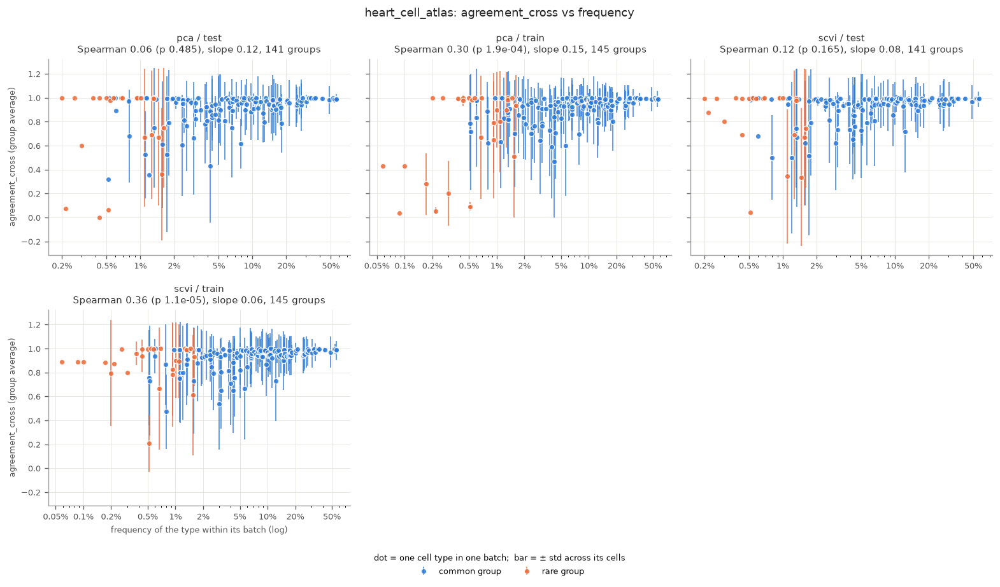
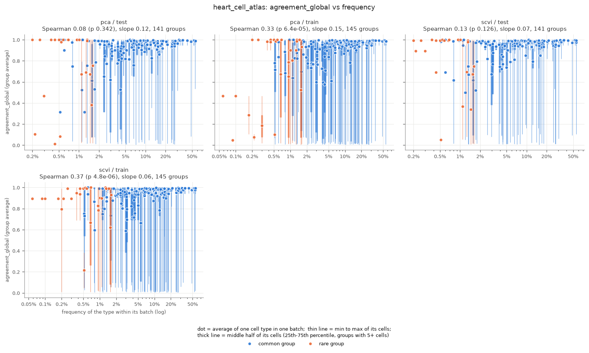
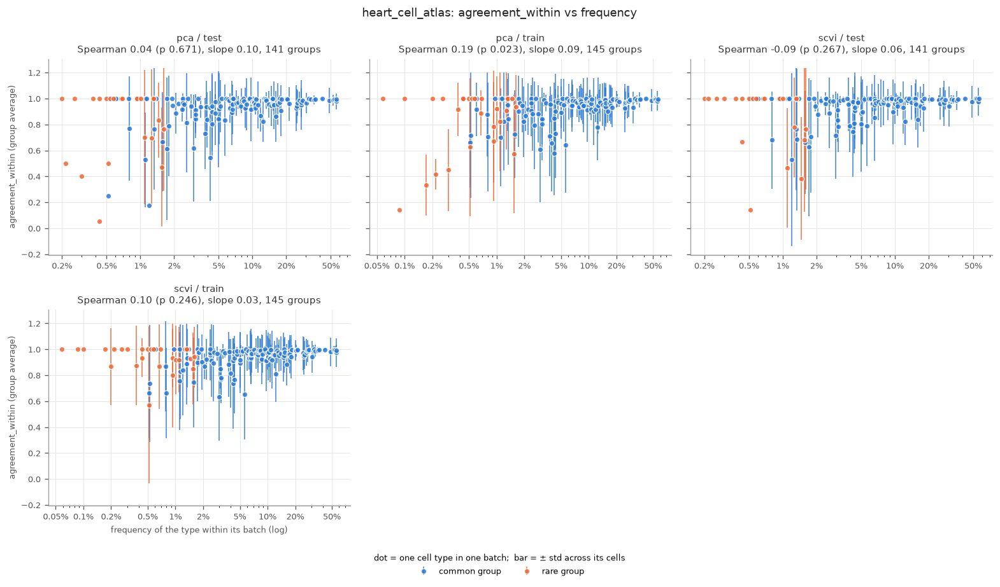
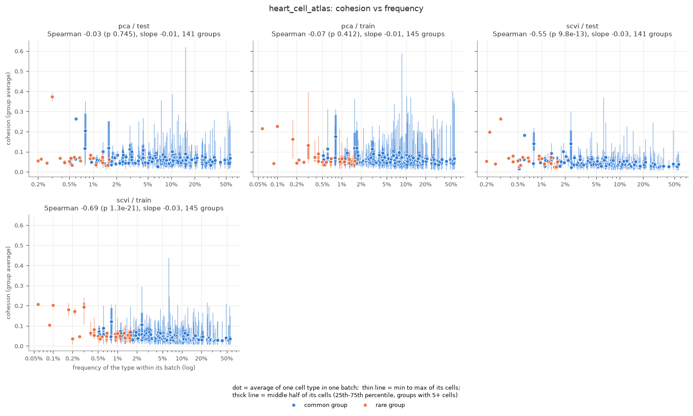
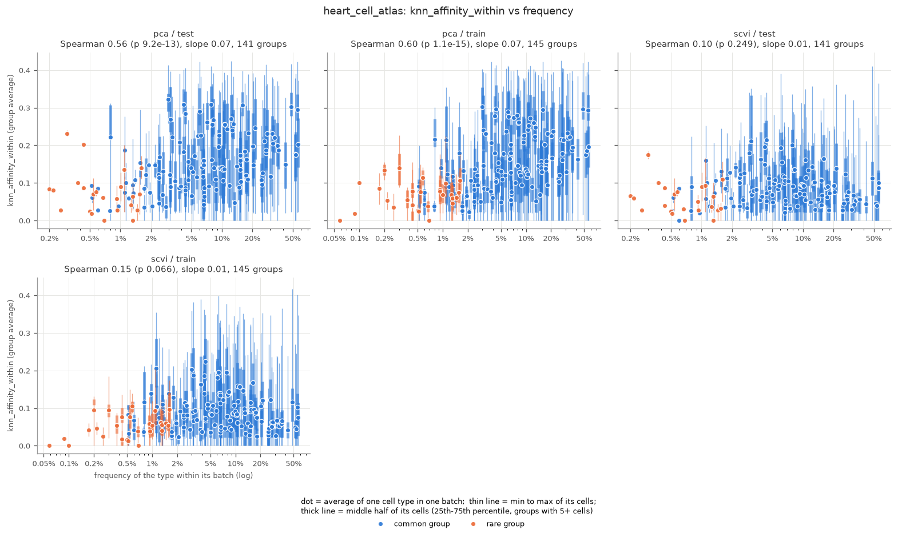
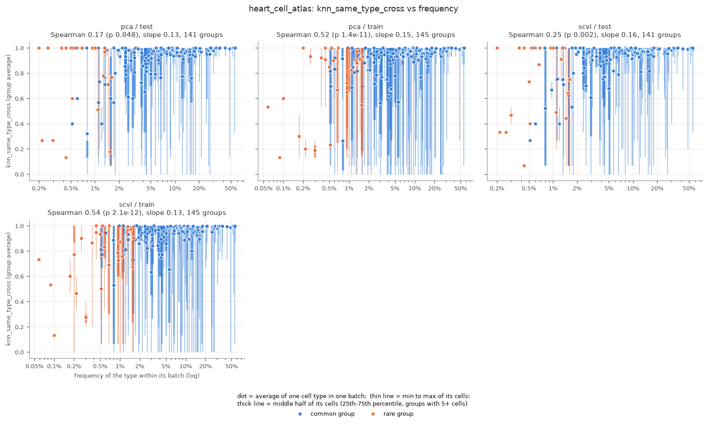
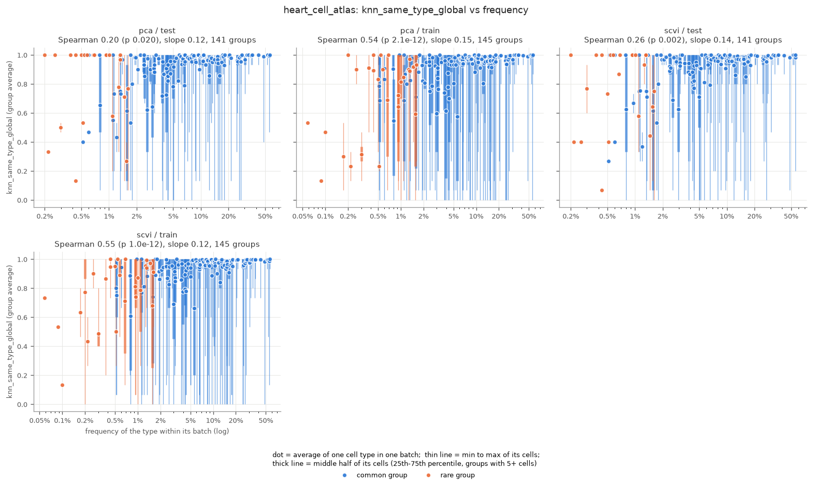
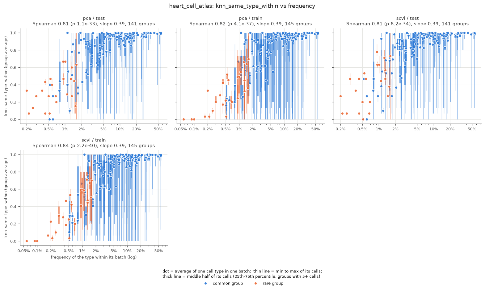

# rare_cell_preservation — generated tables

> **GENERATED FILE — do not edit.** Made by `evaluation/build_results.py` from
> `runs/rare_cell_preservation/*/*/metrics/`. Re-run that script to update. The written
> verdict lives in `results/rare_cell_preservation.md`.

Every value is mean ± std, higher = better. "Rare" = locally-rare (type, batch)
pairs, as defined in the task file. `cov` = share of cells where the metric is
defined (cross-batch agreement is undefined for a cell whose cluster has no
other-batch cells).

## Inputs

Environment (this script): python 3.13.11, pandas 3.0.5, numpy 2.4.6, scipy 1.18.0. Versions used to compute the metrics: each metrics folder's `metrics_config.json`.

| dataset | baseline | jobs | rare groups | rare rule | metrics folder |
|---|---|---|---|---|---|
| heart_cell_atlas | pca | test, train | 27 | log10(frequency) more than 1.0 std below its batch's mean log10 type-frequency (task file's rule) | `runs/rare_cell_preservation/heart_cell_atlas/pca/metrics` |
| heart_cell_atlas | scvi | test, train | 27 | log10(frequency) more than 1.0 std below its batch's mean log10 type-frequency (task file's rule) | `runs/rare_cell_preservation/heart_cell_atlas/scvi/metrics` |

**heart_cell_atlas: not scored yet:** bbknn, combat, harmony, seacells

## heart_cell_atlas

### Rare groups

**27 rare groups** (cell type in one batch) in **14 of 14 batches**, 216 cells in total. Rule: `log_std`.

**Which groups, and why** (rarest first):

| batch | cell type | cells (all) | cells (test) | cells (train) | frequency | cutoff in this batch | why rare |
|---|---|---|---|---|---|---|---|
| D2 | Mesothelial | 1 | 0 | 1 | 0.06% | 0.44% | 0.06% < 0.44% |
| D4 | Mesothelial | 1 | 0 | 1 | 0.09% | 0.58% | 0.09% < 0.58% |
| D3 | Mesothelial | 1 | 0 | 1 | 0.10% | 0.58% | 0.10% < 0.58% |
| D5 | Mesothelial | 2 | 0 | 2 | 0.17% | 0.45% | 0.17% < 0.45% |
| D6 | Adipocytes | 6 | 1 | 5 | 0.20% | 0.64% | 0.20% < 0.64% |
| D7 | Mesothelial | 3 | 1 | 2 | 0.22% | 0.82% | 0.22% < 0.82% |
| D5 | Adipocytes | 3 | 1 | 2 | 0.26% | 0.45% | 0.26% < 0.45% |
| D6 | Mesothelial | 9 | 2 | 7 | 0.30% | 0.64% | 0.30% < 0.64% |
| D11 | Neuronal | 7 | 1 | 6 | 0.38% | 0.72% | 0.38% < 0.72% |
| D11 | Adipocytes | 8 | 2 | 6 | 0.43% | 0.72% | 0.43% < 0.72% |
| D7 | Neuronal | 6 | 1 | 5 | 0.43% | 0.82% | 0.43% < 0.82% |
| D3 | Adipocytes | 5 | 1 | 4 | 0.50% | 0.58% | 0.50% < 0.58% |
| D1 | Smooth_muscle_cells | 3 | 1 | 2 | 0.52% | 0.79% | 0.52% < 0.79% |
| D11 | Atrial_Cardiomyocyte | 10 | 2 | 8 | 0.54% | 0.72% | 0.54% < 0.72% |
| D7 | Adipocytes | 8 | 2 | 6 | 0.58% | 0.82% | 0.58% < 0.82% |
| H4 | Adipocytes | 7 | 1 | 6 | 0.67% | 1.19% | 0.67% < 1.19% |
| D1 | Neuronal | 4 | 1 | 3 | 0.69% | 0.79% | 0.69% < 0.79% |
| H5 | Neuronal | 14 | 3 | 11 | 0.92% | 1.17% | 0.92% < 1.17% |
| H3 | Neuronal | 11 | 2 | 9 | 0.93% | 1.81% | 0.93% < 1.81% |
| H7 | Neuronal | 12 | 2 | 10 | 1.01% | 1.59% | 1.01% < 1.59% |
| H7 | Adipocytes | 13 | 3 | 10 | 1.09% | 1.59% | 1.09% < 1.59% |
| H6 | Neuronal | 13 | 3 | 10 | 1.27% | 1.55% | 1.27% < 1.55% |
| H2 | Adipocytes | 11 | 2 | 9 | 1.31% | 1.85% | 1.31% < 1.85% |
| H2 | Atrial_Cardiomyocyte | 11 | 2 | 9 | 1.31% | 1.85% | 1.31% < 1.85% |
| H6 | Adipocytes | 15 | 3 | 12 | 1.46% | 1.55% | 1.46% < 1.55% |
| H2 | Neuronal | 13 | 3 | 10 | 1.55% | 1.85% | 1.55% < 1.85% |
| H3 | Adipocytes | 19 | 4 | 15 | 1.61% | 1.81% | 1.61% < 1.81% |

**Closest to rare, but not rare** (5 lowest-frequency common groups):

| batch | cell type | cells (all) | frequency | cutoff in this batch |
|---|---|---|---|---|
| D5 | Lymphoid | 6 | 0.52% | 0.45% |
| D2 | Neuronal | 9 | 0.53% | 0.44% |
| D3 | Neuronal | 6 | 0.60% | 0.58% |
| D5 | Neuronal | 7 | 0.60% | 0.45% |
| D4 | Lymphoid | 9 | 0.79% | 0.58% |

**How each rare group did — pca / test** (mean ± std over its cells; std is empty for a 1-cell group):

| batch | cell type | cells | agreement global | agreement within | agreement cross | cohesion | neighbors same type | neighbor affinity | F1 (cells in a cluster labeled its type) |
|---|---|---|---|---|---|---|---|---|---|
| D2 | Mesothelial | 0 | — | — | — | — | — | — | — |
| D4 | Mesothelial | 0 | — | — | — | — | — | — | — |
| D3 | Mesothelial | 0 | — | — | — | — | — | — | — |
| D5 | Mesothelial | 0 | — | — | — | — | — | — | — |
| D6 | Adipocytes | 1 | 1.000 ± — | 1.000 ± — | 1.000 ± — | 0.055 ± — | 1.000 ± — | 0.083 ± — | 1.00 (found 1 of 1) |
| D7 | Mesothelial | 1 | 0.103 ± — | 0.500 ± — | 0.074 ± — | 0.065 ± — | 0.333 ± — | 0.080 ± — | 0.00 (found 0 of 1) |
| D5 | Adipocytes | 1 | 1.000 ± — | 1.000 ± — | 1.000 ± — | 0.043 ± — | 1.000 ± — | 0.027 ± — | 1.00 (found 1 of 1) |
| D6 | Mesothelial | 2 | 0.467 ± 0.000 | 0.400 ± 0.000 | 0.600 ± 0.000 | 0.372 ± 0.028 | 0.500 ± 0.047 | 0.232 ± 0.011 | 0.80 (found 2 of 2) |
| D11 | Neuronal | 1 | 1.000 ± — | 1.000 ± — | 1.000 ± — | 0.068 ± — | 1.000 ± — | 0.101 ± — | 1.00 (found 1 of 1) |
| D11 | Adipocytes | 2 | 1.000 ± 0.000 | 1.000 ± 0.000 | 1.000 ± 0.000 | 0.050 ± 0.006 | 1.000 ± 0.000 | 0.087 ± 0.007 | 1.00 (found 2 of 2) |
| D7 | Neuronal | 1 | 0.012 ± — | 0.053 ± — | 0.000 ± — | 0.047 ± — | 0.133 ± — | 0.203 ± — | 0.00 (found 0 of 1) |
| D3 | Adipocytes | 1 | 1.000 ± — | 1.000 ± — | 1.000 ± — | 0.054 ± — | 1.000 ± — | 0.025 ± — | 1.00 (found 1 of 1) |
| D1 | Smooth_muscle_cells | 1 | 0.082 ± — | 0.500 ± — | 0.064 ± — | 0.067 ± — | 0.533 ± — | 0.018 ± — | 0.00 (found 0 of 1) |
| D11 | Atrial_Cardiomyocyte | 2 | 0.977 ± 0.000 | 1.000 ± 0.000 | 0.976 ± 0.000 | 0.033 ± 0.008 | 1.000 ± 0.000 | 0.070 ± 0.061 | 1.00 (found 2 of 2) |
| D7 | Adipocytes | 2 | 1.000 ± 0.000 | 1.000 ± 0.000 | 1.000 ± 0.000 | 0.072 ± 0.013 | 1.000 ± 0.000 | 0.077 ± 0.015 | 1.00 (found 2 of 2) |
| H4 | Adipocytes | 1 | 1.000 ± — | 1.000 ± — | 1.000 ± — | 0.070 ± — | 1.000 ± — | 0.061 ± — | 1.00 (found 1 of 1) |
| D1 | Neuronal | 1 | 1.000 ± — | 1.000 ± — | 1.000 ± — | 0.056 ± — | 1.000 ± — | 0.000 ± — | 1.00 (found 1 of 1) |
| H5 | Neuronal | 3 | 1.000 ± 0.000 | 1.000 ± 0.000 | 1.000 ± 0.000 | 0.065 ± 0.011 | 1.000 ± 0.000 | 0.058 ± 0.035 | 1.00 (found 3 of 3) |
| H3 | Neuronal | 2 | 1.000 ± 0.000 | 1.000 ± 0.000 | 1.000 ± 0.000 | 0.083 ± 0.002 | 1.000 ± 0.000 | 0.028 ± 0.007 | 1.00 (found 2 of 2) |
| H7 | Neuronal | 2 | 1.000 ± 0.000 | 1.000 ± 0.000 | 1.000 ± 0.000 | 0.068 ± 0.004 | 1.000 ± 0.000 | 0.089 ± 0.053 | 1.00 (found 2 of 2) |
| H7 | Adipocytes | 3 | 0.675 ± 0.563 | 0.701 ± 0.518 | 0.667 ± 0.577 | 0.036 ± 0.017 | 0.578 ± 0.402 | 0.135 ± 0.097 | 0.80 (found 2 of 3) |
| H6 | Neuronal | 3 | 0.691 ± 0.535 | 0.694 ± 0.529 | 0.691 ± 0.535 | 0.054 ± 0.017 | 0.778 ± 0.385 | 0.042 ± 0.023 | 0.80 (found 2 of 3) |
| H2 | Adipocytes | 2 | 1.000 ± 0.000 | 1.000 ± 0.000 | 1.000 ± 0.000 | 0.073 ± 0.044 | 1.000 ± 0.000 | 0.064 ± 0.051 | 1.00 (found 2 of 2) |
| H2 | Atrial_Cardiomyocyte | 2 | 0.991 ± 0.000 | 1.000 ± 0.000 | 0.991 ± 0.000 | 0.046 ± 0.010 | 0.967 ± 0.047 | 0.000 ± 0.000 | 1.00 (found 2 of 2) |
| H6 | Adipocytes | 3 | 0.673 ± 0.566 | 0.833 ± 0.289 | 0.671 ± 0.570 | 0.032 ± 0.018 | 0.711 ± 0.500 | 0.028 ± 0.024 | 0.80 (found 2 of 3) |
| H2 | Neuronal | 3 | 0.383 ± 0.535 | 0.472 ± 0.457 | 0.361 ± 0.554 | 0.034 ± 0.013 | 0.267 ± 0.115 | 0.070 ± 0.049 | 0.50 (found 1 of 3) |
| H3 | Adipocytes | 4 | 0.755 ± 0.490 | 0.763 ± 0.474 | 0.750 ± 0.500 | 0.061 ± 0.013 | 0.767 ± 0.467 | 0.140 ± 0.029 | 0.86 (found 3 of 4) |

**How each rare group did — pca / train** (mean ± std over its cells; std is empty for a 1-cell group):

| batch | cell type | cells | agreement global | agreement within | agreement cross | cohesion | neighbors same type | neighbor affinity | F1 (cells in a cluster labeled its type) |
|---|---|---|---|---|---|---|---|---|---|
| D2 | Mesothelial | 1 | 0.467 ± — | 1.000 ± — | 0.429 ± — | 0.214 ± — | 0.533 ± — | 0.000 ± — | 0.00 (found 0 of 1) |
| D4 | Mesothelial | 1 | 0.049 ± — | 0.143 ± — | 0.037 ± — | 0.041 ± — | 0.133 ± — | 0.019 ± — | 0.00 (found 0 of 1) |
| D3 | Mesothelial | 1 | 0.467 ± — | 1.000 ± — | 0.429 ± — | 0.226 ± — | 0.467 ± — | 0.100 ± — | 0.00 (found 0 of 1) |
| D5 | Mesothelial | 2 | 0.285 ± 0.257 | 0.333 ± 0.236 | 0.279 ± 0.258 | 0.163 ± 0.136 | 0.300 ± 0.330 | 0.085 ± 0.058 | 0.00 (found 0 of 2) |
| D6 | Adipocytes | 5 | 1.000 ± 0.000 | 1.000 ± 0.000 | 1.000 ± 0.000 | 0.045 ± 0.002 | 1.000 ± 0.000 | 0.134 ± 0.020 | 1.00 (found 5 of 5) |
| D7 | Mesothelial | 2 | 0.076 ± 0.038 | 0.417 ± 0.118 | 0.054 ± 0.028 | 0.059 ± 0.003 | 0.233 ± 0.141 | 0.053 ± 0.033 | 0.00 (found 0 of 2) |
| D5 | Adipocytes | 2 | 1.000 ± 0.000 | 1.000 ± 0.000 | 1.000 ± 0.000 | 0.049 ± 0.005 | 0.900 ± 0.141 | 0.036 ± 0.050 | 1.00 (found 2 of 2) |
| D6 | Mesothelial | 7 | 0.187 ± 0.193 | 0.449 ± 0.316 | 0.201 ± 0.273 | 0.131 ± 0.129 | 0.314 ± 0.107 | 0.140 ± 0.057 | 0.00 (found 0 of 7) |
| D11 | Neuronal | 6 | 0.983 ± 0.041 | 0.917 ± 0.204 | 0.991 ± 0.023 | 0.072 ± 0.042 | 0.911 ± 0.218 | 0.054 ± 0.035 | 0.92 (found 6 of 6) |
| D11 | Adipocytes | 6 | 1.000 ± 0.000 | 1.000 ± 0.000 | 1.000 ± 0.000 | 0.054 ± 0.014 | 1.000 ± 0.000 | 0.077 ± 0.046 | 1.00 (found 6 of 6) |
| D7 | Neuronal | 5 | 0.980 ± 0.045 | 1.000 ± 0.000 | 0.979 ± 0.047 | 0.090 ± 0.050 | 0.893 ± 0.239 | 0.041 ± 0.065 | 1.00 (found 5 of 5) |
| D3 | Adipocytes | 4 | 1.000 ± 0.000 | 1.000 ± 0.000 | 1.000 ± 0.000 | 0.048 ± 0.014 | 0.833 ± 0.333 | 0.026 ± 0.011 | 1.00 (found 4 of 4) |
| D1 | Smooth_muscle_cells | 2 | 0.101 ± 0.032 | 0.625 ± 0.530 | 0.092 ± 0.036 | 0.035 ± 0.003 | 0.233 ± 0.047 | 0.024 ± 0.034 | 0.00 (found 0 of 2) |
| D11 | Atrial_Cardiomyocyte | 8 | 0.985 ± 0.009 | 1.000 ± 0.000 | 0.984 ± 0.010 | 0.036 ± 0.009 | 1.000 ± 0.000 | 0.077 ± 0.044 | 1.00 (found 8 of 8) |
| D7 | Adipocytes | 6 | 1.000 ± 0.000 | 1.000 ± 0.000 | 1.000 ± 0.000 | 0.048 ± 0.012 | 0.900 ± 0.245 | 0.114 ± 0.023 | 1.00 (found 6 of 6) |
| H4 | Adipocytes | 6 | 0.673 ± 0.507 | 0.889 ± 0.172 | 0.669 ± 0.513 | 0.052 ± 0.026 | 0.689 ± 0.482 | 0.038 ± 0.027 | 0.80 (found 4 of 6) |
| D1 | Neuronal | 3 | 1.000 ± 0.000 | 1.000 ± 0.000 | 1.000 ± 0.000 | 0.066 ± 0.008 | 1.000 ± 0.000 | 0.000 ± 0.000 | 1.00 (found 3 of 3) |
| H5 | Neuronal | 11 | 0.652 ± 0.483 | 0.669 ± 0.459 | 0.649 ± 0.488 | 0.064 ± 0.055 | 0.721 ± 0.396 | 0.082 ± 0.044 | 0.78 (found 7 of 11) |
| H3 | Neuronal | 9 | 0.788 ± 0.421 | 0.783 ± 0.430 | 0.790 ± 0.417 | 0.051 ± 0.022 | 0.644 ± 0.383 | 0.078 ± 0.055 | 0.88 (found 7 of 9) |
| H7 | Neuronal | 10 | 0.901 ± 0.313 | 0.920 ± 0.253 | 0.900 ± 0.316 | 0.065 ± 0.036 | 0.813 ± 0.338 | 0.068 ± 0.036 | 0.95 (found 9 of 10) |
| H7 | Adipocytes | 10 | 0.805 ± 0.411 | 0.821 ± 0.378 | 0.800 ± 0.422 | 0.050 ± 0.014 | 0.847 ± 0.327 | 0.098 ± 0.060 | 0.89 (found 8 of 10) |
| H6 | Neuronal | 10 | 0.901 ± 0.314 | 0.906 ± 0.296 | 0.900 ± 0.316 | 0.068 ± 0.019 | 0.900 ± 0.316 | 0.069 ± 0.041 | 0.95 (found 9 of 10) |
| H2 | Adipocytes | 9 | 1.000 ± 0.000 | 1.000 ± 0.000 | 1.000 ± 0.000 | 0.044 ± 0.012 | 0.889 ± 0.249 | 0.059 ± 0.037 | 1.00 (found 9 of 9) |
| H2 | Atrial_Cardiomyocyte | 9 | 0.985 ± 0.010 | 1.000 ± 0.000 | 0.985 ± 0.011 | 0.061 ± 0.025 | 0.970 ± 0.059 | 0.045 ± 0.021 | 1.00 (found 9 of 9) |
| H6 | Adipocytes | 12 | 1.000 ± 0.000 | 1.000 ± 0.000 | 1.000 ± 0.000 | 0.053 ± 0.018 | 0.917 ± 0.199 | 0.061 ± 0.026 | 1.00 (found 12 of 12) |
| H2 | Neuronal | 10 | 0.524 ± 0.503 | 0.573 ± 0.454 | 0.512 ± 0.514 | 0.050 ± 0.025 | 0.593 ± 0.430 | 0.074 ± 0.035 | 0.67 (found 5 of 10) |
| H3 | Adipocytes | 15 | 0.934 ± 0.255 | 0.936 ± 0.246 | 0.933 ± 0.258 | 0.055 ± 0.017 | 0.933 ± 0.189 | 0.106 ± 0.045 | 0.97 (found 14 of 15) |

**How each rare group did — scvi / test** (mean ± std over its cells; std is empty for a 1-cell group):

| batch | cell type | cells | agreement global | agreement within | agreement cross | cohesion | neighbors same type | neighbor affinity | F1 (cells in a cluster labeled its type) |
|---|---|---|---|---|---|---|---|---|---|
| D2 | Mesothelial | 0 | — | — | — | — | — | — | — |
| D4 | Mesothelial | 0 | — | — | — | — | — | — | — |
| D3 | Mesothelial | 0 | — | — | — | — | — | — | — |
| D5 | Mesothelial | 0 | — | — | — | — | — | — | — |
| D6 | Adipocytes | 1 | 0.992 ± — | 1.000 ± — | 0.992 ± — | 0.052 ± — | 1.000 ± — | 0.065 ± — | 1.00 (found 1 of 1) |
| D7 | Mesothelial | 1 | 0.895 ± — | 1.000 ± — | 0.875 ± — | 0.198 ± — | 0.400 ± — | 0.060 ± — | 1.00 (found 1 of 1) |
| D5 | Adipocytes | 1 | 0.992 ± — | 1.000 ± — | 0.992 ± — | 0.041 ± — | 0.400 ± — | 0.027 ± — | 1.00 (found 1 of 1) |
| D6 | Mesothelial | 2 | 0.895 ± 0.000 | 1.000 ± 0.000 | 0.800 ± 0.000 | 0.263 ± 0.004 | 0.767 ± 0.236 | 0.175 ± 0.014 | 1.00 (found 2 of 2) |
| D11 | Neuronal | 1 | 1.000 ± — | 1.000 ± — | 1.000 ± — | 0.067 ± — | 1.000 ± — | 0.101 ± — | 0.67 (found 1 of 1) |
| D11 | Adipocytes | 2 | 0.992 ± 0.000 | 1.000 ± 0.000 | 0.992 ± 0.000 | 0.050 ± 0.006 | 1.000 ± 0.000 | 0.087 ± 0.007 | 1.00 (found 2 of 2) |
| D7 | Neuronal | 1 | 0.690 ± — | 0.667 ± — | 0.692 ± — | 0.079 ± — | 0.067 ± — | 0.040 ± — | 1.00 (found 1 of 1) |
| D3 | Adipocytes | 1 | 0.992 ± — | 1.000 ± — | 0.992 ± — | 0.054 ± — | 0.733 ± — | 0.025 ± — | 1.00 (found 1 of 1) |
| D1 | Smooth_muscle_cells | 1 | 0.051 ± — | 0.143 ± — | 0.044 ± — | 0.026 ± — | 0.400 ± — | 0.018 ± — | 0.00 (found 0 of 1) |
| D11 | Atrial_Cardiomyocyte | 2 | 1.000 ± 0.000 | 1.000 ± 0.000 | 1.000 ± 0.000 | 0.033 ± 0.000 | 1.000 ± 0.000 | 0.070 ± 0.061 | 1.00 (found 2 of 2) |
| D7 | Adipocytes | 2 | 0.992 ± 0.000 | 1.000 ± 0.000 | 0.992 ± 0.000 | 0.073 ± 0.013 | 1.000 ± 0.000 | 0.077 ± 0.015 | 1.00 (found 2 of 2) |
| H4 | Adipocytes | 1 | 0.992 ± — | 1.000 ± — | 0.992 ± — | 0.071 ± — | 0.867 ± — | 0.031 ± — | 1.00 (found 1 of 1) |
| D1 | Neuronal | 1 | 1.000 ± — | 1.000 ± — | 1.000 ± — | 0.054 ± — | 1.000 ± — | 0.000 ± — | 1.00 (found 1 of 1) |
| H5 | Neuronal | 3 | 1.000 ± 0.000 | 1.000 ± 0.000 | 1.000 ± 0.000 | 0.065 ± 0.009 | 1.000 ± 0.000 | 0.050 ± 0.023 | 1.00 (found 3 of 3) |
| H3 | Neuronal | 2 | 1.000 ± 0.000 | 1.000 ± 0.000 | 1.000 ± 0.000 | 0.080 ± 0.002 | 1.000 ± 0.000 | 0.028 ± 0.007 | 1.00 (found 2 of 2) |
| H7 | Neuronal | 2 | 1.000 ± 0.000 | 1.000 ± 0.000 | 1.000 ± 0.000 | 0.066 ± 0.004 | 1.000 ± 0.000 | 0.089 ± 0.053 | 1.00 (found 2 of 2) |
| H7 | Adipocytes | 3 | 0.368 ± 0.540 | 0.467 ± 0.462 | 0.343 ± 0.562 | 0.040 ± 0.015 | 0.578 ± 0.367 | 0.092 ± 0.072 | 0.50 (found 1 of 3) |
| H6 | Neuronal | 3 | 0.694 ± 0.531 | 0.778 ± 0.385 | 0.689 ± 0.538 | 0.049 ± 0.020 | 0.933 ± 0.115 | 0.037 ± 0.027 | 0.80 (found 2 of 3) |
| H2 | Adipocytes | 2 | 0.992 ± 0.000 | 1.000 ± 0.000 | 0.992 ± 0.000 | 0.072 ± 0.043 | 1.000 ± 0.000 | 0.064 ± 0.051 | 1.00 (found 2 of 2) |
| H2 | Atrial_Cardiomyocyte | 2 | 0.980 ± 0.028 | 1.000 ± 0.000 | 0.980 ± 0.029 | 0.041 ± 0.012 | 1.000 ± 0.000 | 0.000 ± 0.000 | 1.00 (found 2 of 2) |
| H6 | Adipocytes | 3 | 0.341 ± 0.565 | 0.383 ± 0.474 | 0.337 ± 0.574 | 0.024 ± 0.022 | 0.444 ± 0.491 | 0.028 ± 0.024 | 0.50 (found 1 of 3) |
| H2 | Neuronal | 3 | 0.672 ± 0.568 | 0.681 ± 0.552 | 0.670 ± 0.571 | 0.024 ± 0.013 | 0.644 ± 0.444 | 0.032 ± 0.027 | 0.80 (found 2 of 3) |
| H3 | Adipocytes | 4 | 0.747 ± 0.490 | 0.767 ± 0.467 | 0.744 ± 0.496 | 0.050 ± 0.028 | 0.750 ± 0.500 | 0.109 ± 0.044 | 0.86 (found 3 of 4) |

**How each rare group did — scvi / train** (mean ± std over its cells; std is empty for a 1-cell group):

| batch | cell type | cells | agreement global | agreement within | agreement cross | cohesion | neighbors same type | neighbor affinity | F1 (cells in a cluster labeled its type) |
|---|---|---|---|---|---|---|---|---|---|
| D2 | Mesothelial | 1 | 0.895 ± — | 1.000 ± — | 0.889 ± — | 0.207 ± — | 0.733 ± — | 0.000 ± — | 1.00 (found 1 of 1) |
| D4 | Mesothelial | 1 | 0.895 ± — | 1.000 ± — | 0.889 ± — | 0.103 ± — | 0.533 ± — | 0.019 ± — | 1.00 (found 1 of 1) |
| D3 | Mesothelial | 1 | 0.895 ± — | 1.000 ± — | 0.889 ± — | 0.202 ± — | 0.133 ± — | 0.000 ± — | 1.00 (found 1 of 1) |
| D5 | Mesothelial | 2 | 0.895 ± 0.000 | 1.000 ± 0.000 | 0.882 ± 0.000 | 0.182 ± 0.047 | 0.633 ± 0.236 | 0.042 ± 0.025 | 1.00 (found 2 of 2) |
| D6 | Adipocytes | 5 | 0.796 ± 0.440 | 0.867 ± 0.298 | 0.794 ± 0.444 | 0.035 ± 0.015 | 0.773 ± 0.436 | 0.095 ± 0.054 | 0.89 (found 4 of 5) |
| D7 | Mesothelial | 2 | 0.895 ± 0.000 | 1.000 ± 0.000 | 0.875 ± 0.000 | 0.172 ± 0.024 | 0.433 ± 0.236 | 0.046 ± 0.023 | 1.00 (found 2 of 2) |
| D5 | Adipocytes | 2 | 0.992 ± 0.000 | 1.000 ± 0.000 | 0.992 ± 0.000 | 0.048 ± 0.004 | 0.900 ± 0.141 | 0.025 ± 0.035 | 1.00 (found 2 of 2) |
| D6 | Mesothelial | 7 | 0.895 ± 0.000 | 1.000 ± 0.000 | 0.800 ± 0.000 | 0.194 ± 0.044 | 0.486 ± 0.148 | 0.095 ± 0.051 | 1.00 (found 7 of 7) |
| D11 | Neuronal | 6 | 0.948 ± 0.127 | 0.875 ± 0.306 | 0.960 ± 0.098 | 0.065 ± 0.028 | 0.867 ± 0.327 | 0.053 ± 0.035 | 0.86 (found 6 of 6) |
| D11 | Adipocytes | 6 | 0.992 ± 0.000 | 1.000 ± 0.000 | 0.992 ± 0.000 | 0.054 ± 0.014 | 1.000 ± 0.000 | 0.077 ± 0.046 | 1.00 (found 6 of 6) |
| D7 | Neuronal | 5 | 0.938 ± 0.139 | 0.933 ± 0.149 | 0.938 ± 0.138 | 0.081 ± 0.036 | 0.947 ± 0.119 | 0.018 ± 0.017 | 0.91 (found 5 of 5) |
| D3 | Adipocytes | 4 | 0.992 ± 0.000 | 1.000 ± 0.000 | 0.992 ± 0.000 | 0.048 ± 0.013 | 0.950 ± 0.100 | 0.015 ± 0.011 | 1.00 (found 4 of 4) |
| D1 | Smooth_muscle_cells | 2 | 0.215 ± 0.238 | 0.571 ± 0.606 | 0.206 ± 0.238 | 0.035 ± 0.027 | 0.500 ± 0.330 | 0.012 ± 0.017 | 0.00 (found 0 of 2) |
| D11 | Atrial_Cardiomyocyte | 8 | 0.999 ± 0.002 | 1.000 ± 0.000 | 0.999 ± 0.003 | 0.037 ± 0.010 | 1.000 ± 0.000 | 0.077 ± 0.044 | 1.00 (found 8 of 8) |
| D7 | Adipocytes | 6 | 0.992 ± 0.000 | 1.000 ± 0.000 | 0.992 ± 0.000 | 0.047 ± 0.012 | 0.889 ± 0.214 | 0.106 ± 0.020 | 1.00 (found 6 of 6) |
| H4 | Adipocytes | 6 | 0.666 ± 0.505 | 0.867 ± 0.327 | 0.663 ± 0.510 | 0.050 ± 0.029 | 0.711 ± 0.448 | 0.038 ± 0.027 | 0.80 (found 4 of 6) |
| D1 | Neuronal | 3 | 1.000 ± 0.000 | 1.000 ± 0.000 | 1.000 ± 0.000 | 0.064 ± 0.008 | 1.000 ± 0.000 | 0.000 ± 0.000 | 1.00 (found 3 of 3) |
| H5 | Neuronal | 11 | 0.828 ± 0.384 | 0.932 ± 0.226 | 0.826 ± 0.388 | 0.061 ± 0.053 | 0.812 ± 0.314 | 0.058 ± 0.040 | 0.90 (found 9 of 11) |
| H3 | Neuronal | 9 | 0.783 ± 0.431 | 0.799 ± 0.400 | 0.781 ± 0.435 | 0.046 ± 0.023 | 0.741 ± 0.398 | 0.038 ± 0.025 | 0.88 (found 7 of 9) |
| H7 | Neuronal | 10 | 0.901 ± 0.312 | 0.917 ± 0.264 | 0.900 ± 0.316 | 0.063 ± 0.035 | 0.873 ± 0.318 | 0.054 ± 0.038 | 0.95 (found 9 of 10) |
| H7 | Adipocytes | 10 | 0.899 ± 0.296 | 0.920 ± 0.253 | 0.894 ± 0.308 | 0.050 ± 0.016 | 0.787 ± 0.306 | 0.093 ± 0.054 | 0.95 (found 9 of 10) |
| H6 | Neuronal | 10 | 1.000 ± 0.000 | 1.000 ± 0.000 | 1.000 ± 0.000 | 0.063 ± 0.024 | 0.953 ± 0.148 | 0.061 ± 0.041 | 1.00 (found 10 of 10) |
| H2 | Adipocytes | 9 | 0.992 ± 0.000 | 1.000 ± 0.000 | 0.992 ± 0.000 | 0.044 ± 0.012 | 0.941 ± 0.122 | 0.055 ± 0.038 | 1.00 (found 9 of 9) |
| H2 | Atrial_Cardiomyocyte | 9 | 0.990 ± 0.013 | 1.000 ± 0.000 | 0.990 ± 0.013 | 0.040 ± 0.026 | 0.993 ± 0.022 | 0.041 ± 0.026 | 1.00 (found 9 of 9) |
| H6 | Adipocytes | 12 | 0.992 ± 0.000 | 0.929 ± 0.000 | 1.000 ± 0.000 | 0.053 ± 0.018 | 0.972 ± 0.096 | 0.059 ± 0.027 | 0.96 (found 12 of 12) |
| H2 | Neuronal | 10 | 0.620 ± 0.492 | 0.850 ± 0.277 | 0.611 ± 0.502 | 0.041 ± 0.027 | 0.680 ± 0.458 | 0.054 ± 0.026 | 0.75 (found 6 of 10) |
| H3 | Adipocytes | 15 | 0.930 ± 0.242 | 0.940 ± 0.232 | 0.929 ± 0.243 | 0.054 ± 0.018 | 0.911 ± 0.161 | 0.096 ± 0.051 | 0.97 (found 14 of 15) |

### Agreement (all cells / rare cells)

| baseline | job | global — all | global — rare | within — all | within — rare | cross — all | cross — rare |
|---|---|---|---|---|---|---|---|
| pca | test | 0.954 ± 0.143 | 0.781 ± 0.385 | 0.959 ± 0.133 | 0.818 ± 0.327 | 0.948 ± 0.163 (cov 98%) | 0.783 ± 0.389 (cov 100%) |
| pca | train | 0.953 ± 0.150 | 0.822 ± 0.358 | 0.958 ± 0.141 | 0.864 ± 0.304 | 0.948 ± 0.166 (cov 99%) | 0.820 ± 0.364 (cov 100%) |
| scvi | test | 0.958 ± 0.142 | 0.807 ± 0.367 | 0.965 ± 0.131 | 0.836 ± 0.329 | 0.954 ± 0.153 (cov 100%) | 0.800 ± 0.372 (cov 100%) |
| scvi | train | 0.958 ± 0.141 | 0.897 ± 0.273 | 0.964 ± 0.130 | 0.937 ± 0.204 | 0.954 ± 0.151 (cov 100%) | 0.892 ± 0.278 (cov 100%) |

### Neighbor metrics (embedding only, no clusters; all cells / rare cells)

Each cell's 15 nearest neighbors in the embedding. `same type` = share of them
with the cell's own type (among all cells / own batch / other batches).
`affinity` = mean ground-truth affinity to the 15 nearest own-batch neighbors.

| baseline | job | same type global — all | same type global — rare | same type within — all | same type within — rare | same type cross — all | same type cross — rare | affinity — all | affinity — rare |
|---|---|---|---|---|---|---|---|---|---|
| pca | test | 0.965 ± 0.132 | 0.795 ± 0.325 | 0.947 ± 0.163 | 0.397 ± 0.253 | 0.959 ± 0.148 | 0.774 ± 0.355 | 0.196 ± 0.103 | 0.078 ± 0.063 |
| pca | train | 0.963 ± 0.137 | 0.805 ± 0.324 | 0.946 ± 0.165 | 0.416 ± 0.269 | 0.959 ± 0.148 | 0.797 ± 0.337 | 0.197 ± 0.103 | 0.074 ± 0.048 |
| scvi | test | 0.965 ± 0.134 | 0.800 ± 0.319 | 0.949 ± 0.160 | 0.464 ± 0.280 | 0.962 ± 0.141 | 0.776 ± 0.341 | 0.083 ± 0.070 | 0.061 ± 0.048 |
| scvi | train | 0.968 ± 0.125 | 0.844 ± 0.281 | 0.951 ± 0.153 | 0.464 ± 0.270 | 0.965 ± 0.131 | 0.829 ± 0.300 | 0.085 ± 0.071 | 0.061 ± 0.044 |

### Purity, rare coverage, rare F1, cohesion

| baseline | job | purity | rare coverage | rare F1 | cohesion — all | cohesion — rare |
|---|---|---|---|---|---|---|
| pca | test | 0.973 ± 0.075 | 0.903 ± 0.220 | 0.807 ± 0.342 | 0.062 ± 0.040 | 0.069 ± 0.069 |
| pca | train | 0.969 ± 0.064 | 0.690 ± 0.356 | 0.696 ± 0.427 | 0.061 ± 0.037 | 0.062 ± 0.045 |
| scvi | test | 0.970 ± 0.080 | 0.958 ± 0.138 | 0.875 ± 0.248 | 0.038 ± 0.026 | 0.064 ± 0.053 |
| scvi | train | 0.975 ± 0.065 | 0.964 ± 0.129 | 0.919 ± 0.196 | 0.038 ± 0.026 | 0.063 ± 0.045 |

### Does each metric fall as frequency falls?

Asked across **groups** (one cell type in one batch), not cells: each group's
average counts once, whatever its size, so big common groups can't outvote
small rare ones. `spearman` > 0 = lower-frequency groups have lower averages
(order only; p-value based on the number of groups). `slope` = how big the
drop is: change in the group average per 10x change in frequency.

| baseline | job | metric | groups | spearman | p | slope |
|---|---|---|---|---|---|---|
| pca | test | agreement_cross | 141 | 0.059 | 0.485 | 0.116 |
| pca | test | agreement_global | 141 | 0.081 | 0.342 | 0.122 |
| pca | test | agreement_within | 141 | 0.036 | 0.671 | 0.101 |
| pca | test | cohesion | 141 | -0.028 | 0.745 | -0.013 |
| pca | test | knn_affinity_within | 141 | 0.555 | 9.2e-13 | 0.066 |
| pca | test | knn_same_type_cross | 141 | 0.167 | 0.048 | 0.131 |
| pca | test | knn_same_type_global | 141 | 0.196 | 0.020 | 0.123 |
| pca | test | knn_same_type_within | 141 | 0.808 | 1.1e-33 | 0.391 |
| pca | train | agreement_cross | 145 | 0.305 | 1.9e-04 | 0.148 |
| pca | train | agreement_global | 145 | 0.326 | 6.4e-05 | 0.148 |
| pca | train | agreement_within | 145 | 0.189 | 0.023 | 0.091 |
| pca | train | cohesion | 145 | -0.069 | 0.412 | -0.015 |
| pca | train | knn_affinity_within | 145 | 0.603 | 1.1e-15 | 0.067 |
| pca | train | knn_same_type_cross | 145 | 0.524 | 1.4e-11 | 0.154 |
| pca | train | knn_same_type_global | 145 | 0.541 | 2.1e-12 | 0.154 |
| pca | train | knn_same_type_within | 145 | 0.824 | 4.1e-37 | 0.394 |
| scvi | test | agreement_cross | 141 | 0.118 | 0.165 | 0.077 |
| scvi | test | agreement_global | 141 | 0.130 | 0.126 | 0.072 |
| scvi | test | agreement_within | 141 | -0.094 | 0.267 | 0.056 |
| scvi | test | cohesion | 141 | -0.554 | 9.8e-13 | -0.025 |
| scvi | test | knn_affinity_within | 141 | 0.098 | 0.249 | 0.007 |
| scvi | test | knn_same_type_cross | 141 | 0.253 | 0.002 | 0.156 |
| scvi | test | knn_same_type_global | 141 | 0.260 | 0.002 | 0.143 |
| scvi | test | knn_same_type_within | 141 | 0.809 | 8.2e-34 | 0.388 |
| scvi | train | agreement_cross | 145 | 0.357 | 1.1e-05 | 0.060 |
| scvi | train | agreement_global | 145 | 0.369 | 4.8e-06 | 0.056 |
| scvi | train | agreement_within | 145 | 0.097 | 0.246 | 0.030 |
| scvi | train | cohesion | 145 | -0.687 | 1.3e-21 | -0.030 |
| scvi | train | knn_affinity_within | 145 | 0.153 | 0.066 | 0.013 |
| scvi | train | knn_same_type_cross | 145 | 0.541 | 2.1e-12 | 0.127 |
| scvi | train | knn_same_type_global | 145 | 0.547 | 1.0e-12 | 0.121 |
| scvi | train | knn_same_type_within | 145 | 0.843 | 2.2e-40 | 0.385 |

## Appendix — every group

One row per group (cell type in one batch), rarest first. `cells` = cells with a
defined value. `std` = spread of the metric across that group's cells: high std
with a middling mean means the group split (some cells kept together, some
scattered); low std means all cells did about equally well or badly.

heart_cell_atlas / pca / test / agreement_cross — 141 groups

| batch | cell type | frequency | cells | mean | std | rare |
|---|---|---|---|---|---|---|
| D6 | Adipocytes | 0.0020 | 1 | 1.000 | — | rare |
| D7 | Mesothelial | 0.0022 | 1 | 0.074 | — | rare |
| D5 | Adipocytes | 0.0026 | 1 | 1.000 | — | rare |
| D6 | Mesothelial | 0.0030 | 2 | 0.600 | 0.000 | rare |
| D11 | Neuronal | 0.0038 | 1 | 1.000 | — | rare |
| D11 | Adipocytes | 0.0043 | 2 | 1.000 | 0.000 | rare |
| D7 | Neuronal | 0.0043 | 1 | 0.000 | — | rare |
| D3 | Adipocytes | 0.0050 | 1 | 1.000 | — | rare |
| D1 | Smooth_muscle_cells | 0.0052 | 1 | 0.064 | — | rare |
| D5 | Lymphoid | 0.0052 | 1 | 0.319 | — |  |
| D2 | Neuronal | 0.0053 | 2 | 1.000 | 0.000 |  |
| D11 | Atrial_Cardiomyocyte | 0.0054 | 2 | 0.976 | 0.000 | rare |
| D7 | Adipocytes | 0.0058 | 2 | 1.000 | 0.000 | rare |
| D3 | Neuronal | 0.0060 | 1 | 1.000 | — |  |
| D5 | Neuronal | 0.0060 | 1 | 0.895 | — |  |
| H4 | Adipocytes | 0.0067 | 1 | 1.000 | — | rare |
| D1 | Neuronal | 0.0069 | 1 | 1.000 | — | rare |
| D4 | Lymphoid | 0.0079 | 2 | 0.972 | 0.022 |  |
| D6 | Neuronal | 0.0080 | 5 | 0.680 | 0.390 |  |
| H5 | Neuronal | 0.0092 | 3 | 1.000 | 0.000 | rare |
| H3 | Neuronal | 0.0093 | 2 | 1.000 | 0.000 | rare |
| D4 | Adipocytes | 0.0096 | 2 | 1.000 | 0.000 |  |
| H7 | Neuronal | 0.0101 | 2 | 1.000 | 0.000 | rare |
| H7 | Adipocytes | 0.0109 | 3 | 0.667 | 0.577 | rare |
| D2 | Adipocytes | 0.0111 | 4 | 1.000 | 0.000 |  |
| D2 | Smooth_muscle_cells | 0.0111 | 4 | 0.524 | 0.363 |  |
| D4 | Neuronal | 0.0114 | 3 | 1.000 | 0.000 |  |
| D3 | Lymphoid | 0.0120 | 2 | 0.356 | 0.000 |  |
| H6 | Neuronal | 0.0127 | 3 | 0.691 | 0.535 | rare |
| H2 | Adipocytes | 0.0131 | 2 | 1.000 | 0.000 | rare |
| H2 | Atrial_Cardiomyocyte | 0.0131 | 2 | 0.991 | 0.000 | rare |
| H5 | Adipocytes | 0.0132 | 4 | 0.750 | 0.500 |  |
| H4 | Neuronal | 0.0134 | 3 | 1.000 | 0.000 |  |
| H5 | Lymphoid | 0.0139 | 4 | 0.987 | 0.000 |  |
| H6 | Adipocytes | 0.0146 | 3 | 0.671 | 0.570 | rare |
| H2 | Neuronal | 0.0155 | 3 | 0.361 | 0.554 | rare |
| D2 | Lymphoid | 0.0158 | 5 | 0.608 | 0.531 |  |
| H3 | Adipocytes | 0.0161 | 4 | 0.750 | 0.500 | rare |
| D1 | Atrial_Cardiomyocyte | 0.0172 | 2 | 0.992 | 0.001 |  |
| D1 | Lymphoid | 0.0172 | 2 | 0.528 | 0.651 |  |
| H5 | Atrial_Cardiomyocyte | 0.0178 | 5 | 0.791 | 0.442 |  |
| H4 | Lymphoid | 0.0191 | 4 | 0.987 | 0.000 |  |
| H6 | Lymphoid | 0.0195 | 4 | 0.994 | 0.000 |  |
| D1 | Myeloid | 0.0207 | 2 | 0.963 | 0.053 |  |
| H7 | Lymphoid | 0.0218 | 5 | 0.993 | 0.000 |  |
| H3 | Lymphoid | 0.0237 | 6 | 0.603 | 0.421 |  |
| H4 | Atrial_Cardiomyocyte | 0.0239 | 5 | 0.982 | 0.014 |  |
| H4 | Myeloid | 0.0239 | 5 | 0.951 | 0.037 |  |
| D4 | Smooth_muscle_cells | 0.0245 | 6 | 0.810 | 0.103 |  |
| D5 | Smooth_muscle_cells | 0.0258 | 6 | 0.765 | 0.375 |  |
| H5 | Myeloid | 0.0264 | 8 | 0.984 | 0.025 |  |
| H6 | Myeloid | 0.0282 | 6 | 0.960 | 0.033 |  |
| D11 | Smooth_muscle_cells | 0.0297 | 11 | 0.661 | 0.471 |  |
| D2 | Myeloid | 0.0309 | 11 | 0.958 | 0.034 |  |
| D7 | Smooth_muscle_cells | 0.0310 | 9 | 0.822 | 0.070 |  |
| H6 | Smooth_muscle_cells | 0.0312 | 6 | 0.890 | 0.091 |  |
| D6 | Atrial_Cardiomyocyte | 0.0326 | 20 | 0.996 | 0.005 |  |
| D5 | Myeloid | 0.0345 | 8 | 0.900 | 0.101 |  |
| H7 | Smooth_muscle_cells | 0.0378 | 9 | 0.783 | 0.331 |  |
| D6 | Fibroblast | 0.0386 | 23 | 0.926 | 0.208 |  |
| H2 | Smooth_muscle_cells | 0.0394 | 7 | 0.807 | 0.161 |  |
| D3 | Smooth_muscle_cells | 0.0420 | 8 | 0.887 | 0.076 |  |
| D6 | Smooth_muscle_cells | 0.0422 | 25 | 0.429 | 0.474 |  |
| H5 | Smooth_muscle_cells | 0.0436 | 13 | 0.832 | 0.191 |  |
| H7 | Myeloid | 0.0436 | 10 | 0.856 | 0.301 |  |
| D11 | Lymphoid | 0.0438 | 16 | 0.936 | 0.250 |  |
| D4 | Myeloid | 0.0463 | 11 | 0.860 | 0.111 |  |
| H3 | Myeloid | 0.0466 | 11 | 0.944 | 0.069 |  |
| H3 | Smooth_muscle_cells | 0.0500 | 12 | 0.811 | 0.368 |  |
| H7 | Endothelial | 0.0503 | 12 | 0.908 | 0.286 |  |
| H6 | Atrial_Cardiomyocyte | 0.0516 | 11 | 0.897 | 0.298 |  |
| H3 | Atrial_Cardiomyocyte | 0.0534 | 13 | 0.987 | 0.015 |  |
| H4 | Smooth_muscle_cells | 0.0564 | 12 | 0.808 | 0.324 |  |
| D2 | Atrial_Cardiomyocyte | 0.0583 | 20 | 0.999 | 0.003 |  |
| D6 | Lymphoid | 0.0605 | 36 | 0.982 | 0.039 |  |
| D6 | Myeloid | 0.0621 | 37 | 0.918 | 0.131 |  |
| H2 | Myeloid | 0.0633 | 11 | 0.963 | 0.038 |  |
| D1 | Endothelial | 0.0654 | 8 | 0.999 | 0.002 |  |
| H2 | Lymphoid | 0.0657 | 11 | 0.747 | 0.411 |  |
| H4 | Fibroblast | 0.0660 | 14 | 0.969 | 0.055 |  |
| D3 | Myeloid | 0.0661 | 13 | 0.892 | 0.126 |  |
| H4 | Endothelial | 0.0669 | 14 | 0.995 | 0.008 |  |
| H6 | Endothelial | 0.0672 | 14 | 0.994 | 0.009 |  |
| D6 | Ventricular_Cardiomyocyte | 0.0715 | 43 | 0.977 | 0.152 |  |
| H5 | Fibroblast | 0.0746 | 23 | 0.947 | 0.068 |  |
| D11 | Myeloid | 0.0783 | 29 | 0.615 | 0.208 |  |
| D2 | Endothelial | 0.0793 | 27 | 0.954 | 0.191 |  |
| D4 | Atrial_Cardiomyocyte | 0.0804 | 18 | 0.999 | 0.002 |  |
| D11 | Fibroblast | 0.0827 | 31 | 0.983 | 0.024 |  |
| H5 | Endothelial | 0.0839 | 25 | 0.999 | 0.005 |  |
| H7 | Fibroblast | 0.0864 | 21 | 0.900 | 0.210 |  |
| H3 | Endothelial | 0.0881 | 21 | 0.943 | 0.212 |  |
| D7 | Atrial_Cardiomyocyte | 0.0931 | 26 | 1.000 | 0.000 |  |
| D5 | Atrial_Cardiomyocyte | 0.0939 | 22 | 0.989 | 0.001 |  |
| D7 | Pericytes | 0.0967 | 27 | 0.884 | 0.236 |  |
| D4 | Endothelial | 0.0997 | 23 | 0.994 | 0.007 |  |
| H6 | Fibroblast | 0.1022 | 21 | 0.906 | 0.129 |  |
| D7 | Fibroblast | 0.1032 | 29 | 0.984 | 0.015 |  |
| H3 | Fibroblast | 0.1059 | 25 | 0.959 | 0.062 |  |
| D7 | Myeloid | 0.1061 | 29 | 0.968 | 0.012 |  |
| D11 | Ventricular_Cardiomyocyte | 0.1075 | 26 | 0.999 | 0.006 |  |
| D7 | Lymphoid | 0.1126 | 31 | 0.914 | 0.264 |  |
| H2 | Fibroblast | 0.1183 | 20 | 0.969 | 0.044 |  |
| D6 | Pericytes | 0.1236 | 75 | 0.870 | 0.241 |  |
| D3 | Atrial_Cardiomyocyte | 0.1271 | 25 | 0.796 | 0.162 |  |
| H7 | Atrial_Cardiomyocyte | 0.1300 | 31 | 1.000 | 0.001 |  |
| D1 | Pericytes | 0.1325 | 15 | 0.972 | 0.021 |  |
| D2 | Pericytes | 0.1406 | 48 | 0.945 | 0.156 |  |
| H6 | Pericytes | 0.1480 | 30 | 0.902 | 0.202 |  |
| D3 | Endothelial | 0.1512 | 30 | 0.985 | 0.029 |  |
| H2 | Endothelial | 0.1517 | 25 | 0.916 | 0.276 |  |
| D5 | Pericytes | 0.1525 | 35 | 0.935 | 0.078 |  |
| D5 | Endothelial | 0.1542 | 36 | 0.933 | 0.227 |  |
| D11 | Pericytes | 0.1605 | 59 | 0.905 | 0.218 |  |
| D4 | Pericytes | 0.1678 | 38 | 0.953 | 0.163 |  |
| D1 | Fibroblast | 0.1738 | 20 | 0.989 | 0.012 |  |
| D3 | Pericytes | 0.1752 | 35 | 0.933 | 0.076 |  |
| H5 | Pericytes | 0.1797 | 54 | 0.920 | 0.187 |  |
| D7 | Ventricular_Cardiomyocyte | 0.1818 | 50 | 0.786 | 0.246 |  |
| D3 | Fibroblast | 0.2022 | 40 | 0.964 | 0.031 |  |
| D5 | Fibroblast | 0.2041 | 47 | 0.975 | 0.026 |  |
| D3 | Ventricular_Cardiomyocyte | 0.2122 | 27 | 0.955 | 0.192 |  |
| H7 | Pericytes | 0.2458 | 59 | 0.933 | 0.177 |  |
| H2 | Pericytes | 0.2473 | 41 | 0.941 | 0.148 |  |
| H3 | Pericytes | 0.2525 | 60 | 0.957 | 0.068 |  |
| D7 | Endothelial | 0.2633 | 73 | 0.976 | 0.118 |  |
| D4 | Fibroblast | 0.2710 | 62 | 0.937 | 0.214 |  |
| H2 | Ventricular_Cardiomyocyte | 0.2724 | 46 | 0.974 | 0.147 |  |
| D4 | Ventricular_Cardiomyocyte | 0.2806 | 64 | 0.999 | 0.008 |  |
| H4 | Pericytes | 0.3031 | 63 | 0.968 | 0.056 |  |
| D2 | Ventricular_Cardiomyocyte | 0.3145 | 108 | 0.998 | 0.008 |  |
| D5 | Ventricular_Cardiomyocyte | 0.3196 | 74 | 0.999 | 0.004 |  |
| D2 | Fibroblast | 0.3326 | 114 | 0.996 | 0.012 |  |
| H3 | Ventricular_Cardiomyocyte | 0.3542 | 84 | 0.991 | 0.012 |  |
| H7 | Ventricular_Cardiomyocyte | 0.3633 | 87 | 0.997 | 0.011 |  |
| H4 | Ventricular_Cardiomyocyte | 0.4207 | 88 | 0.992 | 0.013 |  |
| D11 | Endothelial | 0.4841 | 148 | 0.983 | 0.117 |  |
| H6 | Ventricular_Cardiomyocyte | 0.5248 | 108 | 0.997 | 0.011 |  |
| H5 | Ventricular_Cardiomyocyte | 0.5376 | 163 | 0.987 | 0.030 |  |
| D6 | Endothelial | 0.5560 | 335 | 0.995 | 0.034 |  |
| D1 | Ventricular_Cardiomyocyte | 0.5611 | 65 | 0.988 | 0.019 |  |

heart_cell_atlas / pca / test / agreement_global — 141 groups

| batch | cell type | frequency | cells | mean | std | rare |
|---|---|---|---|---|---|---|
| D6 | Adipocytes | 0.0020 | 1 | 1.000 | — | rare |
| D7 | Mesothelial | 0.0022 | 1 | 0.103 | — | rare |
| D5 | Adipocytes | 0.0026 | 1 | 1.000 | — | rare |
| D6 | Mesothelial | 0.0030 | 2 | 0.467 | 0.000 | rare |
| D11 | Neuronal | 0.0038 | 1 | 1.000 | — | rare |
| D11 | Adipocytes | 0.0043 | 2 | 1.000 | 0.000 | rare |
| D7 | Neuronal | 0.0043 | 1 | 0.012 | — | rare |
| D3 | Adipocytes | 0.0050 | 1 | 1.000 | — | rare |
| D1 | Smooth_muscle_cells | 0.0052 | 1 | 0.082 | — | rare |
| D5 | Lymphoid | 0.0052 | 1 | 0.316 | — |  |
| D2 | Neuronal | 0.0053 | 2 | 1.000 | 0.000 |  |
| D11 | Atrial_Cardiomyocyte | 0.0054 | 2 | 0.977 | 0.000 | rare |
| D7 | Adipocytes | 0.0058 | 2 | 1.000 | 0.000 | rare |
| D3 | Neuronal | 0.0060 | 1 | 1.000 | — |  |
| D5 | Neuronal | 0.0060 | 1 | 0.900 | — |  |
| H4 | Adipocytes | 0.0067 | 1 | 1.000 | — | rare |
| D1 | Neuronal | 0.0069 | 1 | 1.000 | — | rare |
| D4 | Lymphoid | 0.0079 | 2 | 0.974 | 0.020 |  |
| D6 | Neuronal | 0.0080 | 5 | 0.747 | 0.399 |  |
| H5 | Neuronal | 0.0092 | 3 | 1.000 | 0.000 | rare |
| H3 | Neuronal | 0.0093 | 2 | 1.000 | 0.000 | rare |
| D4 | Adipocytes | 0.0096 | 2 | 1.000 | 0.000 |  |
| H7 | Neuronal | 0.0101 | 2 | 1.000 | 0.000 | rare |
| H7 | Adipocytes | 0.0109 | 3 | 0.675 | 0.563 | rare |
| D2 | Adipocytes | 0.0111 | 4 | 1.000 | 0.000 |  |
| D2 | Smooth_muscle_cells | 0.0111 | 4 | 0.526 | 0.359 |  |
| D4 | Neuronal | 0.0114 | 3 | 1.000 | 0.000 |  |
| D3 | Lymphoid | 0.0120 | 2 | 0.316 | 0.000 |  |
| H6 | Neuronal | 0.0127 | 3 | 0.691 | 0.535 | rare |
| H2 | Adipocytes | 0.0131 | 2 | 1.000 | 0.000 | rare |
| H2 | Atrial_Cardiomyocyte | 0.0131 | 2 | 0.991 | 0.000 | rare |
| H5 | Adipocytes | 0.0132 | 4 | 0.754 | 0.493 |  |
| H4 | Neuronal | 0.0134 | 3 | 1.000 | 0.000 |  |
| H5 | Lymphoid | 0.0139 | 4 | 0.988 | 0.000 |  |
| H6 | Adipocytes | 0.0146 | 3 | 0.673 | 0.566 | rare |
| H2 | Neuronal | 0.0155 | 3 | 0.383 | 0.535 | rare |
| D2 | Lymphoid | 0.0158 | 5 | 0.612 | 0.489 |  |
| H3 | Adipocytes | 0.0161 | 4 | 0.755 | 0.490 | rare |
| D1 | Atrial_Cardiomyocyte | 0.0172 | 2 | 0.992 | 0.002 |  |
| D1 | Lymphoid | 0.0172 | 2 | 0.533 | 0.644 |  |
| H5 | Atrial_Cardiomyocyte | 0.0178 | 5 | 0.789 | 0.434 |  |
| H4 | Lymphoid | 0.0191 | 4 | 0.988 | 0.000 |  |
| H6 | Lymphoid | 0.0195 | 4 | 0.988 | 0.000 |  |
| D1 | Myeloid | 0.0207 | 2 | 0.958 | 0.059 |  |
| H7 | Lymphoid | 0.0218 | 5 | 0.988 | 0.000 |  |
| H3 | Lymphoid | 0.0237 | 6 | 0.652 | 0.368 |  |
| H4 | Atrial_Cardiomyocyte | 0.0239 | 5 | 0.985 | 0.011 |  |
| H4 | Myeloid | 0.0239 | 5 | 0.952 | 0.037 |  |
| D4 | Smooth_muscle_cells | 0.0245 | 6 | 0.844 | 0.079 |  |
| D5 | Smooth_muscle_cells | 0.0258 | 6 | 0.772 | 0.373 |  |
| H5 | Myeloid | 0.0264 | 8 | 0.985 | 0.024 |  |
| H6 | Myeloid | 0.0282 | 6 | 0.957 | 0.036 |  |
| D11 | Smooth_muscle_cells | 0.0297 | 11 | 0.620 | 0.415 |  |
| D2 | Myeloid | 0.0309 | 11 | 0.944 | 0.036 |  |
| D7 | Smooth_muscle_cells | 0.0310 | 9 | 0.847 | 0.057 |  |
| H6 | Smooth_muscle_cells | 0.0312 | 6 | 0.890 | 0.095 |  |
| D6 | Atrial_Cardiomyocyte | 0.0326 | 20 | 0.997 | 0.003 |  |
| D5 | Myeloid | 0.0345 | 8 | 0.902 | 0.100 |  |
| H7 | Smooth_muscle_cells | 0.0378 | 9 | 0.775 | 0.325 |  |
| D6 | Fibroblast | 0.0386 | 23 | 0.936 | 0.203 |  |
| H2 | Smooth_muscle_cells | 0.0394 | 7 | 0.808 | 0.165 |  |
| D3 | Smooth_muscle_cells | 0.0420 | 8 | 0.893 | 0.075 |  |
| D6 | Smooth_muscle_cells | 0.0422 | 25 | 0.529 | 0.366 |  |
| H5 | Smooth_muscle_cells | 0.0436 | 13 | 0.822 | 0.207 |  |
| H7 | Myeloid | 0.0436 | 10 | 0.859 | 0.300 |  |
| D11 | Lymphoid | 0.0438 | 16 | 0.938 | 0.240 |  |
| D4 | Myeloid | 0.0463 | 11 | 0.875 | 0.108 |  |
| H3 | Myeloid | 0.0466 | 11 | 0.936 | 0.097 |  |
| H3 | Smooth_muscle_cells | 0.0500 | 12 | 0.819 | 0.367 |  |
| H7 | Endothelial | 0.0503 | 12 | 0.909 | 0.284 |  |
| H6 | Atrial_Cardiomyocyte | 0.0516 | 11 | 0.899 | 0.295 |  |
| H3 | Atrial_Cardiomyocyte | 0.0534 | 13 | 0.990 | 0.011 |  |
| H4 | Smooth_muscle_cells | 0.0564 | 12 | 0.814 | 0.313 |  |
| D2 | Atrial_Cardiomyocyte | 0.0583 | 20 | 0.999 | 0.003 |  |
| D6 | Lymphoid | 0.0605 | 36 | 0.990 | 0.022 |  |
| D6 | Myeloid | 0.0621 | 37 | 0.930 | 0.099 |  |
| H2 | Myeloid | 0.0633 | 11 | 0.959 | 0.036 |  |
| D1 | Endothelial | 0.0654 | 8 | 0.999 | 0.002 |  |
| H2 | Lymphoid | 0.0657 | 11 | 0.760 | 0.397 |  |
| H4 | Fibroblast | 0.0660 | 14 | 0.968 | 0.050 |  |
| D3 | Myeloid | 0.0661 | 13 | 0.903 | 0.110 |  |
| H4 | Endothelial | 0.0669 | 14 | 0.996 | 0.006 |  |
| H6 | Endothelial | 0.0672 | 14 | 0.995 | 0.009 |  |
| D6 | Ventricular_Cardiomyocyte | 0.0715 | 43 | 0.959 | 0.149 |  |
| H5 | Fibroblast | 0.0746 | 23 | 0.950 | 0.065 |  |
| D11 | Myeloid | 0.0783 | 29 | 0.927 | 0.022 |  |
| D2 | Endothelial | 0.0793 | 27 | 0.956 | 0.186 |  |
| D4 | Atrial_Cardiomyocyte | 0.0804 | 18 | 0.990 | 0.001 |  |
| D11 | Fibroblast | 0.0827 | 31 | 0.987 | 0.017 |  |
| H5 | Endothelial | 0.0839 | 25 | 0.995 | 0.006 |  |
| H7 | Fibroblast | 0.0864 | 21 | 0.903 | 0.204 |  |
| H3 | Endothelial | 0.0881 | 21 | 0.946 | 0.210 |  |
| D7 | Atrial_Cardiomyocyte | 0.0931 | 26 | 0.998 | 0.003 |  |
| D5 | Atrial_Cardiomyocyte | 0.0939 | 22 | 0.993 | 0.000 |  |
| D7 | Pericytes | 0.0967 | 27 | 0.887 | 0.238 |  |
| D4 | Endothelial | 0.0997 | 23 | 0.991 | 0.011 |  |
| H6 | Fibroblast | 0.1022 | 21 | 0.948 | 0.061 |  |
| D7 | Fibroblast | 0.1032 | 29 | 0.975 | 0.014 |  |
| H3 | Fibroblast | 0.1059 | 25 | 0.957 | 0.060 |  |
| D7 | Myeloid | 0.1061 | 29 | 0.954 | 0.012 |  |
| D11 | Ventricular_Cardiomyocyte | 0.1075 | 40 | 0.995 | 0.005 |  |
| D7 | Lymphoid | 0.1126 | 31 | 0.916 | 0.258 |  |
| H2 | Fibroblast | 0.1183 | 20 | 0.953 | 0.052 |  |
| D6 | Pericytes | 0.1236 | 75 | 0.827 | 0.146 |  |
| D3 | Atrial_Cardiomyocyte | 0.1271 | 25 | 0.989 | 0.004 |  |
| H7 | Atrial_Cardiomyocyte | 0.1300 | 31 | 0.996 | 0.004 |  |
| D1 | Pericytes | 0.1325 | 15 | 0.972 | 0.023 |  |
| D2 | Pericytes | 0.1406 | 48 | 0.946 | 0.149 |  |
| H6 | Pericytes | 0.1480 | 30 | 0.908 | 0.199 |  |
| D3 | Endothelial | 0.1512 | 30 | 0.985 | 0.027 |  |
| H2 | Endothelial | 0.1517 | 25 | 0.970 | 0.091 |  |
| D5 | Pericytes | 0.1525 | 35 | 0.939 | 0.063 |  |
| D5 | Endothelial | 0.1542 | 36 | 0.935 | 0.224 |  |
| D11 | Pericytes | 0.1605 | 59 | 0.862 | 0.196 |  |
| D4 | Pericytes | 0.1678 | 38 | 0.948 | 0.159 |  |
| D1 | Fibroblast | 0.1738 | 20 | 0.991 | 0.010 |  |
| D3 | Pericytes | 0.1752 | 35 | 0.961 | 0.031 |  |
| H5 | Pericytes | 0.1797 | 54 | 0.918 | 0.188 |  |
| D7 | Ventricular_Cardiomyocyte | 0.1818 | 50 | 0.989 | 0.008 |  |
| D3 | Fibroblast | 0.2022 | 40 | 0.987 | 0.013 |  |
| D5 | Fibroblast | 0.2041 | 47 | 0.983 | 0.016 |  |
| D3 | Ventricular_Cardiomyocyte | 0.2122 | 42 | 0.954 | 0.150 |  |
| H7 | Pericytes | 0.2458 | 59 | 0.932 | 0.174 |  |
| H2 | Pericytes | 0.2473 | 41 | 0.941 | 0.144 |  |
| H3 | Pericytes | 0.2525 | 60 | 0.960 | 0.063 |  |
| D7 | Endothelial | 0.2633 | 73 | 0.975 | 0.116 |  |
| D4 | Fibroblast | 0.2710 | 62 | 0.938 | 0.209 |  |
| H2 | Ventricular_Cardiomyocyte | 0.2724 | 46 | 0.964 | 0.139 |  |
| D4 | Ventricular_Cardiomyocyte | 0.2806 | 64 | 0.988 | 0.014 |  |
| H4 | Pericytes | 0.3031 | 63 | 0.965 | 0.060 |  |
| D2 | Ventricular_Cardiomyocyte | 0.3145 | 108 | 0.995 | 0.009 |  |
| D5 | Ventricular_Cardiomyocyte | 0.3196 | 74 | 0.999 | 0.004 |  |
| D2 | Fibroblast | 0.3326 | 114 | 0.993 | 0.011 |  |
| H3 | Ventricular_Cardiomyocyte | 0.3542 | 84 | 0.992 | 0.011 |  |
| H7 | Ventricular_Cardiomyocyte | 0.3633 | 87 | 0.996 | 0.011 |  |
| H4 | Ventricular_Cardiomyocyte | 0.4207 | 88 | 0.993 | 0.011 |  |
| D11 | Endothelial | 0.4841 | 179 | 0.983 | 0.098 |  |
| H6 | Ventricular_Cardiomyocyte | 0.5248 | 108 | 0.995 | 0.013 |  |
| H5 | Ventricular_Cardiomyocyte | 0.5376 | 163 | 0.992 | 0.015 |  |
| D6 | Endothelial | 0.5560 | 335 | 0.981 | 0.057 |  |
| D1 | Ventricular_Cardiomyocyte | 0.5611 | 65 | 0.989 | 0.013 |  |

heart_cell_atlas / pca / test / agreement_within — 141 groups

| batch | cell type | frequency | cells | mean | std | rare |
|---|---|---|---|---|---|---|
| D6 | Adipocytes | 0.0020 | 1 | 1.000 | — | rare |
| D7 | Mesothelial | 0.0022 | 1 | 0.500 | — | rare |
| D5 | Adipocytes | 0.0026 | 1 | 1.000 | — | rare |
| D6 | Mesothelial | 0.0030 | 2 | 0.400 | 0.000 | rare |
| D11 | Neuronal | 0.0038 | 1 | 1.000 | — | rare |
| D11 | Adipocytes | 0.0043 | 2 | 1.000 | 0.000 | rare |
| D7 | Neuronal | 0.0043 | 1 | 0.053 | — | rare |
| D3 | Adipocytes | 0.0050 | 1 | 1.000 | — | rare |
| D1 | Smooth_muscle_cells | 0.0052 | 1 | 0.500 | — | rare |
| D5 | Lymphoid | 0.0052 | 1 | 0.250 | — |  |
| D2 | Neuronal | 0.0053 | 2 | 1.000 | 0.000 |  |
| D11 | Atrial_Cardiomyocyte | 0.0054 | 2 | 1.000 | 0.000 | rare |
| D7 | Adipocytes | 0.0058 | 2 | 1.000 | 0.000 | rare |
| D3 | Neuronal | 0.0060 | 1 | 1.000 | — |  |
| D5 | Neuronal | 0.0060 | 1 | 1.000 | — |  |
| H4 | Adipocytes | 0.0067 | 1 | 1.000 | — | rare |
| D1 | Neuronal | 0.0069 | 1 | 1.000 | — | rare |
| D4 | Lymphoid | 0.0079 | 2 | 1.000 | 0.000 |  |
| D6 | Neuronal | 0.0080 | 5 | 0.770 | 0.404 |  |
| H5 | Neuronal | 0.0092 | 3 | 1.000 | 0.000 | rare |
| H3 | Neuronal | 0.0093 | 2 | 1.000 | 0.000 | rare |
| D4 | Adipocytes | 0.0096 | 2 | 1.000 | 0.000 |  |
| H7 | Neuronal | 0.0101 | 2 | 1.000 | 0.000 | rare |
| H7 | Adipocytes | 0.0109 | 3 | 0.701 | 0.518 | rare |
| D2 | Adipocytes | 0.0111 | 4 | 1.000 | 0.000 |  |
| D2 | Smooth_muscle_cells | 0.0111 | 4 | 0.528 | 0.364 |  |
| D4 | Neuronal | 0.0114 | 3 | 1.000 | 0.000 |  |
| D3 | Lymphoid | 0.0120 | 2 | 0.176 | 0.000 |  |
| H6 | Neuronal | 0.0127 | 3 | 0.694 | 0.529 | rare |
| H2 | Adipocytes | 0.0131 | 2 | 1.000 | 0.000 | rare |
| H2 | Atrial_Cardiomyocyte | 0.0131 | 2 | 1.000 | 0.000 | rare |
| H5 | Adipocytes | 0.0132 | 4 | 0.767 | 0.467 |  |
| H4 | Neuronal | 0.0134 | 3 | 1.000 | 0.000 |  |
| H5 | Lymphoid | 0.0139 | 4 | 1.000 | 0.000 |  |
| H6 | Adipocytes | 0.0146 | 3 | 0.833 | 0.289 | rare |
| H2 | Neuronal | 0.0155 | 3 | 0.472 | 0.457 | rare |
| D2 | Lymphoid | 0.0158 | 5 | 0.667 | 0.382 |  |
| H3 | Adipocytes | 0.0161 | 4 | 0.763 | 0.474 | rare |
| D1 | Atrial_Cardiomyocyte | 0.0172 | 2 | 1.000 | 0.000 |  |
| D1 | Lymphoid | 0.0172 | 2 | 0.611 | 0.550 |  |
| H5 | Atrial_Cardiomyocyte | 0.0178 | 5 | 0.788 | 0.386 |  |
| H4 | Lymphoid | 0.0191 | 4 | 1.000 | 0.000 |  |
| H6 | Lymphoid | 0.0195 | 4 | 0.944 | 0.000 |  |
| D1 | Myeloid | 0.0207 | 2 | 0.889 | 0.157 |  |
| H7 | Lymphoid | 0.0218 | 5 | 0.960 | 0.000 |  |
| H3 | Lymphoid | 0.0237 | 6 | 0.917 | 0.091 |  |
| H4 | Atrial_Cardiomyocyte | 0.0239 | 5 | 1.000 | 0.000 |  |
| H4 | Myeloid | 0.0239 | 5 | 0.967 | 0.075 |  |
| D4 | Smooth_muscle_cells | 0.0245 | 6 | 0.956 | 0.034 |  |
| D5 | Smooth_muscle_cells | 0.0258 | 6 | 0.814 | 0.381 |  |
| H5 | Myeloid | 0.0264 | 8 | 1.000 | 0.000 |  |
| H6 | Myeloid | 0.0282 | 6 | 0.939 | 0.094 |  |
| D11 | Smooth_muscle_cells | 0.0297 | 11 | 0.618 | 0.412 |  |
| D2 | Myeloid | 0.0309 | 11 | 0.909 | 0.126 |  |
| D7 | Smooth_muscle_cells | 0.0310 | 9 | 0.842 | 0.144 |  |
| H6 | Smooth_muscle_cells | 0.0312 | 6 | 0.878 | 0.142 |  |
| D6 | Atrial_Cardiomyocyte | 0.0326 | 20 | 1.000 | 0.000 |  |
| D5 | Myeloid | 0.0345 | 8 | 0.935 | 0.082 |  |
| H7 | Smooth_muscle_cells | 0.0378 | 9 | 0.729 | 0.276 |  |
| D6 | Fibroblast | 0.0386 | 23 | 0.935 | 0.200 |  |
| H2 | Smooth_muscle_cells | 0.0394 | 7 | 0.836 | 0.213 |  |
| D3 | Smooth_muscle_cells | 0.0420 | 8 | 0.932 | 0.125 |  |
| D6 | Smooth_muscle_cells | 0.0422 | 25 | 0.544 | 0.333 |  |
| H5 | Smooth_muscle_cells | 0.0436 | 13 | 0.805 | 0.264 |  |
| H7 | Myeloid | 0.0436 | 10 | 0.895 | 0.301 |  |
| D11 | Lymphoid | 0.0438 | 16 | 0.940 | 0.240 |  |
| D4 | Myeloid | 0.0463 | 11 | 0.974 | 0.058 |  |
| H3 | Myeloid | 0.0466 | 11 | 0.888 | 0.244 |  |
| H3 | Smooth_muscle_cells | 0.0500 | 12 | 0.841 | 0.371 |  |
| H7 | Endothelial | 0.0503 | 12 | 0.921 | 0.275 |  |
| H6 | Atrial_Cardiomyocyte | 0.0516 | 11 | 0.939 | 0.201 |  |
| H3 | Atrial_Cardiomyocyte | 0.0534 | 13 | 1.000 | 0.000 |  |
| H4 | Smooth_muscle_cells | 0.0564 | 12 | 0.833 | 0.275 |  |
| D2 | Atrial_Cardiomyocyte | 0.0583 | 20 | 1.000 | 0.000 |  |
| D6 | Lymphoid | 0.0605 | 36 | 0.997 | 0.008 |  |
| D6 | Myeloid | 0.0621 | 37 | 0.987 | 0.014 |  |
| H2 | Myeloid | 0.0633 | 11 | 0.926 | 0.115 |  |
| D1 | Endothelial | 0.0654 | 8 | 1.000 | 0.000 |  |
| H2 | Lymphoid | 0.0657 | 11 | 0.891 | 0.247 |  |
| H4 | Fibroblast | 0.0660 | 14 | 0.917 | 0.191 |  |
| D3 | Myeloid | 0.0661 | 13 | 0.954 | 0.061 |  |
| H4 | Endothelial | 0.0669 | 14 | 1.000 | 0.000 |  |
| H6 | Endothelial | 0.0672 | 14 | 1.000 | 0.000 |  |
| D6 | Ventricular_Cardiomyocyte | 0.0715 | 43 | 0.966 | 0.100 |  |
| H5 | Fibroblast | 0.0746 | 23 | 0.971 | 0.050 |  |
| D11 | Myeloid | 0.0783 | 29 | 0.939 | 0.027 |  |
| D2 | Endothelial | 0.0793 | 27 | 0.981 | 0.096 |  |
| D4 | Atrial_Cardiomyocyte | 0.0804 | 18 | 0.988 | 0.004 |  |
| D11 | Fibroblast | 0.0827 | 31 | 1.000 | 0.000 |  |
| H5 | Endothelial | 0.0839 | 25 | 0.981 | 0.024 |  |
| H7 | Fibroblast | 0.0864 | 21 | 0.927 | 0.155 |  |
| H3 | Endothelial | 0.0881 | 21 | 0.956 | 0.200 |  |
| D7 | Atrial_Cardiomyocyte | 0.0931 | 26 | 0.993 | 0.010 |  |
| D5 | Atrial_Cardiomyocyte | 0.0939 | 22 | 1.000 | 0.000 |  |
| D7 | Pericytes | 0.0967 | 27 | 0.917 | 0.245 |  |
| D4 | Endothelial | 0.0997 | 23 | 0.977 | 0.032 |  |
| H6 | Fibroblast | 0.1022 | 21 | 0.973 | 0.039 |  |
| D7 | Fibroblast | 0.1032 | 29 | 0.972 | 0.029 |  |
| H3 | Fibroblast | 0.1059 | 25 | 0.955 | 0.059 |  |
| D7 | Myeloid | 0.1061 | 29 | 0.927 | 0.052 |  |
| D11 | Ventricular_Cardiomyocyte | 0.1075 | 40 | 0.995 | 0.004 |  |
| D7 | Lymphoid | 0.1126 | 31 | 0.952 | 0.181 |  |
| H2 | Fibroblast | 0.1183 | 20 | 0.868 | 0.124 |  |
| D6 | Pericytes | 0.1236 | 75 | 0.822 | 0.158 |  |
| D3 | Atrial_Cardiomyocyte | 0.1271 | 25 | 1.000 | 0.000 |  |
| H7 | Atrial_Cardiomyocyte | 0.1300 | 31 | 0.995 | 0.006 |  |
| D1 | Pericytes | 0.1325 | 15 | 0.983 | 0.065 |  |
| D2 | Pericytes | 0.1406 | 48 | 0.954 | 0.103 |  |
| H6 | Pericytes | 0.1480 | 30 | 0.944 | 0.155 |  |
| D3 | Endothelial | 0.1512 | 30 | 0.996 | 0.014 |  |
| H2 | Endothelial | 0.1517 | 25 | 1.000 | 0.000 |  |
| D5 | Pericytes | 0.1525 | 35 | 0.953 | 0.047 |  |
| D5 | Endothelial | 0.1542 | 36 | 0.949 | 0.184 |  |
| D11 | Pericytes | 0.1605 | 59 | 0.861 | 0.196 |  |
| D4 | Pericytes | 0.1678 | 38 | 0.957 | 0.159 |  |
| D1 | Fibroblast | 0.1738 | 20 | 1.000 | 0.000 |  |
| D3 | Pericytes | 0.1752 | 35 | 0.972 | 0.050 |  |
| H5 | Pericytes | 0.1797 | 54 | 0.908 | 0.195 |  |
| D7 | Ventricular_Cardiomyocyte | 0.1818 | 50 | 0.997 | 0.005 |  |
| D3 | Fibroblast | 0.2022 | 40 | 1.000 | 0.000 |  |
| D5 | Fibroblast | 0.2041 | 47 | 0.995 | 0.023 |  |
| D3 | Ventricular_Cardiomyocyte | 0.2122 | 42 | 0.959 | 0.129 |  |
| H7 | Pericytes | 0.2458 | 59 | 0.928 | 0.177 |  |
| H2 | Pericytes | 0.2473 | 41 | 0.941 | 0.134 |  |
| H3 | Pericytes | 0.2525 | 60 | 0.965 | 0.099 |  |
| D7 | Endothelial | 0.2633 | 73 | 0.983 | 0.069 |  |
| D4 | Fibroblast | 0.2710 | 62 | 0.951 | 0.192 |  |
| H2 | Ventricular_Cardiomyocyte | 0.2724 | 46 | 0.969 | 0.110 |  |
| D4 | Ventricular_Cardiomyocyte | 0.2806 | 64 | 0.983 | 0.022 |  |
| H4 | Pericytes | 0.3031 | 63 | 0.965 | 0.081 |  |
| D2 | Ventricular_Cardiomyocyte | 0.3145 | 108 | 0.995 | 0.017 |  |
| D5 | Ventricular_Cardiomyocyte | 0.3196 | 74 | 0.998 | 0.017 |  |
| D2 | Fibroblast | 0.3326 | 114 | 0.994 | 0.019 |  |
| H3 | Ventricular_Cardiomyocyte | 0.3542 | 84 | 0.990 | 0.035 |  |
| H7 | Ventricular_Cardiomyocyte | 0.3633 | 87 | 0.996 | 0.011 |  |
| H4 | Ventricular_Cardiomyocyte | 0.4207 | 88 | 0.997 | 0.008 |  |
| D11 | Endothelial | 0.4841 | 179 | 0.984 | 0.097 |  |
| H6 | Ventricular_Cardiomyocyte | 0.5248 | 108 | 0.989 | 0.041 |  |
| H5 | Ventricular_Cardiomyocyte | 0.5376 | 163 | 0.995 | 0.014 |  |
| D6 | Endothelial | 0.5560 | 335 | 0.980 | 0.061 |  |
| D1 | Ventricular_Cardiomyocyte | 0.5611 | 65 | 0.997 | 0.009 |  |

heart_cell_atlas / pca / test / cohesion — 141 groups

| batch | cell type | frequency | cells | mean | std | rare |
|---|---|---|---|---|---|---|
| D6 | Adipocytes | 0.0020 | 1 | 0.055 | — | rare |
| D7 | Mesothelial | 0.0022 | 1 | 0.065 | — | rare |
| D5 | Adipocytes | 0.0026 | 1 | 0.043 | — | rare |
| D6 | Mesothelial | 0.0030 | 2 | 0.372 | 0.028 | rare |
| D11 | Neuronal | 0.0038 | 1 | 0.068 | — | rare |
| D11 | Adipocytes | 0.0043 | 2 | 0.050 | 0.006 | rare |
| D7 | Neuronal | 0.0043 | 1 | 0.047 | — | rare |
| D3 | Adipocytes | 0.0050 | 1 | 0.054 | — | rare |
| D1 | Smooth_muscle_cells | 0.0052 | 1 | 0.067 | — | rare |
| D5 | Lymphoid | 0.0052 | 1 | 0.043 | — |  |
| D2 | Neuronal | 0.0053 | 2 | 0.063 | 0.013 |  |
| D11 | Atrial_Cardiomyocyte | 0.0054 | 2 | 0.033 | 0.008 | rare |
| D7 | Adipocytes | 0.0058 | 2 | 0.072 | 0.013 | rare |
| D3 | Neuronal | 0.0060 | 1 | 0.065 | — |  |
| D5 | Neuronal | 0.0060 | 1 | 0.264 | — |  |
| H4 | Adipocytes | 0.0067 | 1 | 0.070 | — | rare |
| D1 | Neuronal | 0.0069 | 1 | 0.056 | — | rare |
| D4 | Lymphoid | 0.0079 | 2 | 0.115 | 0.119 |  |
| D6 | Neuronal | 0.0080 | 5 | 0.203 | 0.127 |  |
| H5 | Neuronal | 0.0092 | 3 | 0.065 | 0.011 | rare |
| H3 | Neuronal | 0.0093 | 2 | 0.083 | 0.002 | rare |
| D4 | Adipocytes | 0.0096 | 2 | 0.048 | 0.011 |  |
| H7 | Neuronal | 0.0101 | 2 | 0.068 | 0.004 | rare |
| H7 | Adipocytes | 0.0109 | 3 | 0.036 | 0.017 | rare |
| D2 | Adipocytes | 0.0111 | 4 | 0.066 | 0.015 |  |
| D2 | Smooth_muscle_cells | 0.0111 | 4 | 0.047 | 0.022 |  |
| D4 | Neuronal | 0.0114 | 3 | 0.059 | 0.034 |  |
| D3 | Lymphoid | 0.0120 | 2 | 0.056 | 0.021 |  |
| H6 | Neuronal | 0.0127 | 3 | 0.054 | 0.017 | rare |
| H2 | Adipocytes | 0.0131 | 2 | 0.073 | 0.044 | rare |
| H2 | Atrial_Cardiomyocyte | 0.0131 | 2 | 0.046 | 0.010 | rare |
| H5 | Adipocytes | 0.0132 | 4 | 0.058 | 0.019 |  |
| H4 | Neuronal | 0.0134 | 3 | 0.101 | 0.070 |  |
| H5 | Lymphoid | 0.0139 | 4 | 0.042 | 0.004 |  |
| H6 | Adipocytes | 0.0146 | 3 | 0.032 | 0.018 | rare |
| H2 | Neuronal | 0.0155 | 3 | 0.034 | 0.013 | rare |
| D2 | Lymphoid | 0.0158 | 5 | 0.118 | 0.123 |  |
| H3 | Adipocytes | 0.0161 | 4 | 0.061 | 0.013 | rare |
| D1 | Atrial_Cardiomyocyte | 0.0172 | 2 | 0.036 | 0.008 |  |
| D1 | Lymphoid | 0.0172 | 2 | 0.052 | 0.013 |  |
| H5 | Atrial_Cardiomyocyte | 0.0178 | 5 | 0.073 | 0.041 |  |
| H4 | Lymphoid | 0.0191 | 4 | 0.070 | 0.027 |  |
| H6 | Lymphoid | 0.0195 | 4 | 0.039 | 0.007 |  |
| D1 | Myeloid | 0.0207 | 2 | 0.085 | 0.029 |  |
| H7 | Lymphoid | 0.0218 | 5 | 0.044 | 0.015 |  |
| H3 | Lymphoid | 0.0237 | 6 | 0.061 | 0.040 |  |
| H4 | Atrial_Cardiomyocyte | 0.0239 | 5 | 0.073 | 0.037 |  |
| H4 | Myeloid | 0.0239 | 5 | 0.050 | 0.035 |  |
| D4 | Smooth_muscle_cells | 0.0245 | 6 | 0.084 | 0.031 |  |
| D5 | Smooth_muscle_cells | 0.0258 | 6 | 0.045 | 0.019 |  |
| H5 | Myeloid | 0.0264 | 8 | 0.074 | 0.017 |  |
| H6 | Myeloid | 0.0282 | 6 | 0.044 | 0.015 |  |
| D11 | Smooth_muscle_cells | 0.0297 | 11 | 0.112 | 0.066 |  |
| D2 | Myeloid | 0.0309 | 11 | 0.062 | 0.024 |  |
| D7 | Smooth_muscle_cells | 0.0310 | 9 | 0.101 | 0.040 |  |
| H6 | Smooth_muscle_cells | 0.0312 | 6 | 0.075 | 0.042 |  |
| D6 | Atrial_Cardiomyocyte | 0.0326 | 20 | 0.044 | 0.018 |  |
| D5 | Myeloid | 0.0345 | 8 | 0.045 | 0.015 |  |
| H7 | Smooth_muscle_cells | 0.0378 | 9 | 0.056 | 0.038 |  |
| D6 | Fibroblast | 0.0386 | 23 | 0.079 | 0.049 |  |
| H2 | Smooth_muscle_cells | 0.0394 | 7 | 0.072 | 0.027 |  |
| D3 | Smooth_muscle_cells | 0.0420 | 8 | 0.072 | 0.029 |  |
| D6 | Smooth_muscle_cells | 0.0422 | 25 | 0.066 | 0.017 |  |
| H5 | Smooth_muscle_cells | 0.0436 | 13 | 0.044 | 0.020 |  |
| H7 | Myeloid | 0.0436 | 10 | 0.070 | 0.063 |  |
| D11 | Lymphoid | 0.0438 | 16 | 0.108 | 0.056 |  |
| D4 | Myeloid | 0.0463 | 11 | 0.048 | 0.027 |  |
| H3 | Myeloid | 0.0466 | 11 | 0.047 | 0.014 |  |
| H3 | Smooth_muscle_cells | 0.0500 | 12 | 0.040 | 0.019 |  |
| H7 | Endothelial | 0.0503 | 12 | 0.045 | 0.018 |  |
| H6 | Atrial_Cardiomyocyte | 0.0516 | 11 | 0.074 | 0.039 |  |
| H3 | Atrial_Cardiomyocyte | 0.0534 | 13 | 0.072 | 0.026 |  |
| H4 | Smooth_muscle_cells | 0.0564 | 12 | 0.051 | 0.013 |  |
| D2 | Atrial_Cardiomyocyte | 0.0583 | 20 | 0.068 | 0.029 |  |
| D6 | Lymphoid | 0.0605 | 36 | 0.082 | 0.044 |  |
| D6 | Myeloid | 0.0621 | 37 | 0.079 | 0.039 |  |
| H2 | Myeloid | 0.0633 | 11 | 0.069 | 0.028 |  |
| D1 | Endothelial | 0.0654 | 8 | 0.055 | 0.026 |  |
| H2 | Lymphoid | 0.0657 | 11 | 0.056 | 0.021 |  |
| H4 | Fibroblast | 0.0660 | 14 | 0.046 | 0.026 |  |
| D3 | Myeloid | 0.0661 | 13 | 0.053 | 0.021 |  |
| H4 | Endothelial | 0.0669 | 14 | 0.058 | 0.048 |  |
| H6 | Endothelial | 0.0672 | 14 | 0.027 | 0.011 |  |
| D6 | Ventricular_Cardiomyocyte | 0.0715 | 43 | 0.063 | 0.028 |  |
| H5 | Fibroblast | 0.0746 | 23 | 0.058 | 0.067 |  |
| D11 | Myeloid | 0.0783 | 29 | 0.086 | 0.037 |  |
| D2 | Endothelial | 0.0793 | 27 | 0.052 | 0.027 |  |
| D4 | Atrial_Cardiomyocyte | 0.0804 | 18 | 0.064 | 0.020 |  |
| D11 | Fibroblast | 0.0827 | 31 | 0.075 | 0.024 |  |
| H5 | Endothelial | 0.0839 | 25 | 0.045 | 0.029 |  |
| H7 | Fibroblast | 0.0864 | 21 | 0.057 | 0.036 |  |
| H3 | Endothelial | 0.0881 | 21 | 0.042 | 0.036 |  |
| D7 | Atrial_Cardiomyocyte | 0.0931 | 26 | 0.045 | 0.017 |  |
| D5 | Atrial_Cardiomyocyte | 0.0939 | 22 | 0.041 | 0.010 |  |
| D7 | Pericytes | 0.0967 | 27 | 0.061 | 0.039 |  |
| D4 | Endothelial | 0.0997 | 23 | 0.048 | 0.030 |  |
| H6 | Fibroblast | 0.1022 | 21 | 0.102 | 0.105 |  |
| D7 | Fibroblast | 0.1032 | 29 | 0.060 | 0.043 |  |
| H3 | Fibroblast | 0.1059 | 25 | 0.051 | 0.017 |  |
| D7 | Myeloid | 0.1061 | 29 | 0.056 | 0.019 |  |
| D11 | Ventricular_Cardiomyocyte | 0.1075 | 40 | 0.072 | 0.046 |  |
| D7 | Lymphoid | 0.1126 | 31 | 0.072 | 0.023 |  |
| H2 | Fibroblast | 0.1183 | 20 | 0.072 | 0.052 |  |
| D6 | Pericytes | 0.1236 | 75 | 0.072 | 0.051 |  |
| D3 | Atrial_Cardiomyocyte | 0.1271 | 25 | 0.067 | 0.033 |  |
| H7 | Atrial_Cardiomyocyte | 0.1300 | 31 | 0.073 | 0.033 |  |
| D1 | Pericytes | 0.1325 | 15 | 0.046 | 0.028 |  |
| D2 | Pericytes | 0.1406 | 48 | 0.056 | 0.029 |  |
| H6 | Pericytes | 0.1480 | 30 | 0.069 | 0.046 |  |
| D3 | Endothelial | 0.1512 | 30 | 0.066 | 0.042 |  |
| H2 | Endothelial | 0.1517 | 25 | 0.091 | 0.159 |  |
| D5 | Pericytes | 0.1525 | 35 | 0.055 | 0.021 |  |
| D5 | Endothelial | 0.1542 | 36 | 0.059 | 0.037 |  |
| D11 | Pericytes | 0.1605 | 59 | 0.072 | 0.034 |  |
| D4 | Pericytes | 0.1678 | 38 | 0.046 | 0.022 |  |
| D1 | Fibroblast | 0.1738 | 20 | 0.044 | 0.022 |  |
| D3 | Pericytes | 0.1752 | 35 | 0.052 | 0.024 |  |
| H5 | Pericytes | 0.1797 | 54 | 0.058 | 0.030 |  |
| D7 | Ventricular_Cardiomyocyte | 0.1818 | 50 | 0.061 | 0.027 |  |
| D3 | Fibroblast | 0.2022 | 40 | 0.068 | 0.025 |  |
| D5 | Fibroblast | 0.2041 | 47 | 0.046 | 0.022 |  |
| D3 | Ventricular_Cardiomyocyte | 0.2122 | 42 | 0.071 | 0.032 |  |
| H7 | Pericytes | 0.2458 | 59 | 0.061 | 0.032 |  |
| H2 | Pericytes | 0.2473 | 41 | 0.051 | 0.028 |  |
| H3 | Pericytes | 0.2525 | 60 | 0.060 | 0.031 |  |
| D7 | Endothelial | 0.2633 | 73 | 0.060 | 0.028 |  |
| D4 | Fibroblast | 0.2710 | 62 | 0.049 | 0.026 |  |
| H2 | Ventricular_Cardiomyocyte | 0.2724 | 46 | 0.073 | 0.043 |  |
| D4 | Ventricular_Cardiomyocyte | 0.2806 | 64 | 0.045 | 0.022 |  |
| H4 | Pericytes | 0.3031 | 63 | 0.053 | 0.025 |  |
| D2 | Ventricular_Cardiomyocyte | 0.3145 | 108 | 0.059 | 0.028 |  |
| D5 | Ventricular_Cardiomyocyte | 0.3196 | 74 | 0.034 | 0.013 |  |
| D2 | Fibroblast | 0.3326 | 114 | 0.052 | 0.031 |  |
| H3 | Ventricular_Cardiomyocyte | 0.3542 | 84 | 0.072 | 0.044 |  |
| H7 | Ventricular_Cardiomyocyte | 0.3633 | 87 | 0.058 | 0.027 |  |
| H4 | Ventricular_Cardiomyocyte | 0.4207 | 88 | 0.049 | 0.022 |  |
| D11 | Endothelial | 0.4841 | 179 | 0.060 | 0.029 |  |
| H6 | Ventricular_Cardiomyocyte | 0.5248 | 108 | 0.063 | 0.048 |  |
| H5 | Ventricular_Cardiomyocyte | 0.5376 | 163 | 0.062 | 0.034 |  |
| D6 | Endothelial | 0.5560 | 335 | 0.072 | 0.038 |  |
| D1 | Ventricular_Cardiomyocyte | 0.5611 | 65 | 0.068 | 0.043 |  |

heart_cell_atlas / pca / test / knn_affinity_within — 141 groups

| batch | cell type | frequency | cells | mean | std | rare |
|---|---|---|---|---|---|---|
| D6 | Adipocytes | 0.0020 | 1 | 0.083 | — | rare |
| D7 | Mesothelial | 0.0022 | 1 | 0.080 | — | rare |
| D5 | Adipocytes | 0.0026 | 1 | 0.027 | — | rare |
| D6 | Mesothelial | 0.0030 | 2 | 0.232 | 0.011 | rare |
| D11 | Neuronal | 0.0038 | 1 | 0.101 | — | rare |
| D11 | Adipocytes | 0.0043 | 2 | 0.087 | 0.007 | rare |
| D7 | Neuronal | 0.0043 | 1 | 0.203 | — | rare |
| D3 | Adipocytes | 0.0050 | 1 | 0.025 | — | rare |
| D1 | Smooth_muscle_cells | 0.0052 | 1 | 0.018 | — | rare |
| D5 | Lymphoid | 0.0052 | 1 | 0.093 | — |  |
| D2 | Neuronal | 0.0053 | 2 | 0.061 | 0.018 |  |
| D11 | Atrial_Cardiomyocyte | 0.0054 | 2 | 0.070 | 0.061 | rare |
| D7 | Adipocytes | 0.0058 | 2 | 0.077 | 0.015 | rare |
| D3 | Neuronal | 0.0060 | 1 | 0.085 | — |  |
| D5 | Neuronal | 0.0060 | 1 | 0.027 | — |  |
| H4 | Adipocytes | 0.0067 | 1 | 0.061 | — | rare |
| D1 | Neuronal | 0.0069 | 1 | 0.000 | — | rare |
| D4 | Lymphoid | 0.0079 | 2 | 0.026 | 0.002 |  |
| D6 | Neuronal | 0.0080 | 5 | 0.222 | 0.130 |  |
| H5 | Neuronal | 0.0092 | 3 | 0.058 | 0.035 | rare |
| H3 | Neuronal | 0.0093 | 2 | 0.028 | 0.007 | rare |
| D4 | Adipocytes | 0.0096 | 2 | 0.039 | 0.001 |  |
| H7 | Neuronal | 0.0101 | 2 | 0.089 | 0.053 | rare |
| H7 | Adipocytes | 0.0109 | 3 | 0.135 | 0.097 | rare |
| D2 | Adipocytes | 0.0111 | 4 | 0.187 | 0.087 |  |
| D2 | Smooth_muscle_cells | 0.0111 | 4 | 0.074 | 0.048 |  |
| D4 | Neuronal | 0.0114 | 3 | 0.100 | 0.087 |  |
| D3 | Lymphoid | 0.0120 | 2 | 0.059 | 0.005 |  |
| H6 | Neuronal | 0.0127 | 3 | 0.042 | 0.023 | rare |
| H2 | Adipocytes | 0.0131 | 2 | 0.064 | 0.051 | rare |
| H2 | Atrial_Cardiomyocyte | 0.0131 | 2 | 0.000 | 0.000 | rare |
| H5 | Adipocytes | 0.0132 | 4 | 0.094 | 0.084 |  |
| H4 | Neuronal | 0.0134 | 3 | 0.073 | 0.035 |  |
| H5 | Lymphoid | 0.0139 | 4 | 0.109 | 0.019 |  |
| H6 | Adipocytes | 0.0146 | 3 | 0.028 | 0.024 | rare |
| H2 | Neuronal | 0.0155 | 3 | 0.070 | 0.049 | rare |
| D2 | Lymphoid | 0.0158 | 5 | 0.154 | 0.080 |  |
| H3 | Adipocytes | 0.0161 | 4 | 0.140 | 0.029 | rare |
| D1 | Atrial_Cardiomyocyte | 0.0172 | 2 | 0.034 | 0.049 |  |
| D1 | Lymphoid | 0.0172 | 2 | 0.085 | 0.015 |  |
| H5 | Atrial_Cardiomyocyte | 0.0178 | 5 | 0.122 | 0.080 |  |
| H4 | Lymphoid | 0.0191 | 4 | 0.148 | 0.091 |  |
| H6 | Lymphoid | 0.0195 | 4 | 0.075 | 0.036 |  |
| D1 | Myeloid | 0.0207 | 2 | 0.038 | 0.054 |  |
| H7 | Lymphoid | 0.0218 | 5 | 0.148 | 0.037 |  |
| H3 | Lymphoid | 0.0237 | 6 | 0.122 | 0.083 |  |
| H4 | Atrial_Cardiomyocyte | 0.0239 | 5 | 0.114 | 0.087 |  |
| H4 | Myeloid | 0.0239 | 5 | 0.046 | 0.016 |  |
| D4 | Smooth_muscle_cells | 0.0245 | 6 | 0.169 | 0.090 |  |
| D5 | Smooth_muscle_cells | 0.0258 | 6 | 0.068 | 0.039 |  |
| H5 | Myeloid | 0.0264 | 8 | 0.131 | 0.072 |  |
| H6 | Myeloid | 0.0282 | 6 | 0.037 | 0.042 |  |
| D11 | Smooth_muscle_cells | 0.0297 | 11 | 0.322 | 0.048 |  |
| D2 | Myeloid | 0.0309 | 11 | 0.122 | 0.120 |  |
| D7 | Smooth_muscle_cells | 0.0310 | 9 | 0.269 | 0.145 |  |
| H6 | Smooth_muscle_cells | 0.0312 | 6 | 0.089 | 0.054 |  |
| D6 | Atrial_Cardiomyocyte | 0.0326 | 20 | 0.221 | 0.065 |  |
| D5 | Myeloid | 0.0345 | 8 | 0.105 | 0.098 |  |
| H7 | Smooth_muscle_cells | 0.0378 | 9 | 0.087 | 0.054 |  |
| D6 | Fibroblast | 0.0386 | 23 | 0.209 | 0.090 |  |
| H2 | Smooth_muscle_cells | 0.0394 | 7 | 0.092 | 0.044 |  |
| D3 | Smooth_muscle_cells | 0.0420 | 8 | 0.182 | 0.087 |  |
| D6 | Smooth_muscle_cells | 0.0422 | 25 | 0.308 | 0.057 |  |
| H5 | Smooth_muscle_cells | 0.0436 | 13 | 0.086 | 0.034 |  |
| H7 | Myeloid | 0.0436 | 10 | 0.081 | 0.061 |  |
| D11 | Lymphoid | 0.0438 | 16 | 0.284 | 0.106 |  |
| D4 | Myeloid | 0.0463 | 11 | 0.157 | 0.066 |  |
| H3 | Myeloid | 0.0466 | 11 | 0.108 | 0.046 |  |
| H3 | Smooth_muscle_cells | 0.0500 | 12 | 0.141 | 0.040 |  |
| H7 | Endothelial | 0.0503 | 12 | 0.065 | 0.043 |  |
| H6 | Atrial_Cardiomyocyte | 0.0516 | 11 | 0.129 | 0.105 |  |
| H3 | Atrial_Cardiomyocyte | 0.0534 | 13 | 0.172 | 0.068 |  |
| H4 | Smooth_muscle_cells | 0.0564 | 12 | 0.115 | 0.049 |  |
| D2 | Atrial_Cardiomyocyte | 0.0583 | 20 | 0.224 | 0.102 |  |
| D6 | Lymphoid | 0.0605 | 36 | 0.290 | 0.088 |  |
| D6 | Myeloid | 0.0621 | 37 | 0.227 | 0.102 |  |
| H2 | Myeloid | 0.0633 | 11 | 0.141 | 0.087 |  |
| D1 | Endothelial | 0.0654 | 8 | 0.117 | 0.109 |  |
| H2 | Lymphoid | 0.0657 | 11 | 0.159 | 0.090 |  |
| H4 | Fibroblast | 0.0660 | 14 | 0.043 | 0.045 |  |
| D3 | Myeloid | 0.0661 | 13 | 0.148 | 0.084 |  |
| H4 | Endothelial | 0.0669 | 14 | 0.086 | 0.054 |  |
| H6 | Endothelial | 0.0672 | 14 | 0.063 | 0.052 |  |
| D6 | Ventricular_Cardiomyocyte | 0.0715 | 43 | 0.261 | 0.073 |  |
| H5 | Fibroblast | 0.0746 | 23 | 0.091 | 0.053 |  |
| D11 | Myeloid | 0.0783 | 29 | 0.309 | 0.071 |  |
| D2 | Endothelial | 0.0793 | 27 | 0.162 | 0.096 |  |
| D4 | Atrial_Cardiomyocyte | 0.0804 | 18 | 0.255 | 0.053 |  |
| D11 | Fibroblast | 0.0827 | 31 | 0.267 | 0.095 |  |
| H5 | Endothelial | 0.0839 | 25 | 0.141 | 0.071 |  |
| H7 | Fibroblast | 0.0864 | 21 | 0.109 | 0.077 |  |
| H3 | Endothelial | 0.0881 | 21 | 0.082 | 0.065 |  |
| D7 | Atrial_Cardiomyocyte | 0.0931 | 26 | 0.195 | 0.070 |  |
| D5 | Atrial_Cardiomyocyte | 0.0939 | 22 | 0.226 | 0.072 |  |
| D7 | Pericytes | 0.0967 | 27 | 0.140 | 0.097 |  |
| D4 | Endothelial | 0.0997 | 23 | 0.142 | 0.096 |  |
| H6 | Fibroblast | 0.1022 | 21 | 0.136 | 0.089 |  |
| D7 | Fibroblast | 0.1032 | 29 | 0.107 | 0.079 |  |
| H3 | Fibroblast | 0.1059 | 25 | 0.136 | 0.063 |  |
| D7 | Myeloid | 0.1061 | 29 | 0.255 | 0.094 |  |
| D11 | Ventricular_Cardiomyocyte | 0.1075 | 40 | 0.255 | 0.078 |  |
| D7 | Lymphoid | 0.1126 | 31 | 0.243 | 0.092 |  |
| H2 | Fibroblast | 0.1183 | 20 | 0.093 | 0.063 |  |
| D6 | Pericytes | 0.1236 | 75 | 0.270 | 0.096 |  |
| D3 | Atrial_Cardiomyocyte | 0.1271 | 25 | 0.240 | 0.072 |  |
| H7 | Atrial_Cardiomyocyte | 0.1300 | 31 | 0.256 | 0.072 |  |
| D1 | Pericytes | 0.1325 | 15 | 0.048 | 0.049 |  |
| D2 | Pericytes | 0.1406 | 48 | 0.145 | 0.071 |  |
| H6 | Pericytes | 0.1480 | 30 | 0.088 | 0.051 |  |
| D3 | Endothelial | 0.1512 | 30 | 0.173 | 0.083 |  |
| H2 | Endothelial | 0.1517 | 25 | 0.136 | 0.061 |  |
| D5 | Pericytes | 0.1525 | 35 | 0.159 | 0.088 |  |
| D5 | Endothelial | 0.1542 | 36 | 0.103 | 0.057 |  |
| D11 | Pericytes | 0.1605 | 59 | 0.307 | 0.050 |  |
| D4 | Pericytes | 0.1678 | 38 | 0.184 | 0.088 |  |
| D1 | Fibroblast | 0.1738 | 20 | 0.121 | 0.079 |  |
| D3 | Pericytes | 0.1752 | 35 | 0.162 | 0.083 |  |
| H5 | Pericytes | 0.1797 | 54 | 0.110 | 0.069 |  |
| D7 | Ventricular_Cardiomyocyte | 0.1818 | 50 | 0.232 | 0.090 |  |
| D3 | Fibroblast | 0.2022 | 40 | 0.197 | 0.109 |  |
| D5 | Fibroblast | 0.2041 | 47 | 0.148 | 0.071 |  |
| D3 | Ventricular_Cardiomyocyte | 0.2122 | 42 | 0.246 | 0.100 |  |
| H7 | Pericytes | 0.2458 | 59 | 0.108 | 0.060 |  |
| H2 | Pericytes | 0.2473 | 41 | 0.095 | 0.056 |  |
| H3 | Pericytes | 0.2525 | 60 | 0.126 | 0.071 |  |
| D7 | Endothelial | 0.2633 | 73 | 0.211 | 0.100 |  |
| D4 | Fibroblast | 0.2710 | 62 | 0.179 | 0.067 |  |
| H2 | Ventricular_Cardiomyocyte | 0.2724 | 46 | 0.186 | 0.091 |  |
| D4 | Ventricular_Cardiomyocyte | 0.2806 | 64 | 0.231 | 0.084 |  |
| H4 | Pericytes | 0.3031 | 63 | 0.118 | 0.061 |  |
| D2 | Ventricular_Cardiomyocyte | 0.3145 | 108 | 0.231 | 0.073 |  |
| D5 | Ventricular_Cardiomyocyte | 0.3196 | 74 | 0.205 | 0.079 |  |
| D2 | Fibroblast | 0.3326 | 114 | 0.220 | 0.062 |  |
| H3 | Ventricular_Cardiomyocyte | 0.3542 | 84 | 0.199 | 0.082 |  |
| H7 | Ventricular_Cardiomyocyte | 0.3633 | 87 | 0.187 | 0.069 |  |
| H4 | Ventricular_Cardiomyocyte | 0.4207 | 88 | 0.148 | 0.079 |  |
| D11 | Endothelial | 0.4841 | 179 | 0.303 | 0.058 |  |
| H6 | Ventricular_Cardiomyocyte | 0.5248 | 108 | 0.176 | 0.092 |  |
| H5 | Ventricular_Cardiomyocyte | 0.5376 | 163 | 0.176 | 0.085 |  |
| D6 | Endothelial | 0.5560 | 335 | 0.295 | 0.058 |  |
| D1 | Ventricular_Cardiomyocyte | 0.5611 | 65 | 0.202 | 0.082 |  |

heart_cell_atlas / pca / test / knn_same_type_cross — 141 groups

| batch | cell type | frequency | cells | mean | std | rare |
|---|---|---|---|---|---|---|
| D6 | Adipocytes | 0.0020 | 1 | 1.000 | — | rare |
| D7 | Mesothelial | 0.0022 | 1 | 0.267 | — | rare |
| D5 | Adipocytes | 0.0026 | 1 | 1.000 | — | rare |
| D6 | Mesothelial | 0.0030 | 2 | 0.267 | 0.000 | rare |
| D11 | Neuronal | 0.0038 | 1 | 1.000 | — | rare |
| D11 | Adipocytes | 0.0043 | 2 | 1.000 | 0.000 | rare |
| D7 | Neuronal | 0.0043 | 1 | 0.133 | — | rare |
| D3 | Adipocytes | 0.0050 | 1 | 1.000 | — | rare |
| D1 | Smooth_muscle_cells | 0.0052 | 1 | 0.600 | — | rare |
| D5 | Lymphoid | 0.0052 | 1 | 0.400 | — |  |
| D2 | Neuronal | 0.0053 | 2 | 1.000 | 0.000 |  |
| D11 | Atrial_Cardiomyocyte | 0.0054 | 2 | 1.000 | 0.000 | rare |
| D7 | Adipocytes | 0.0058 | 2 | 1.000 | 0.000 | rare |
| D3 | Neuronal | 0.0060 | 1 | 1.000 | — |  |
| D5 | Neuronal | 0.0060 | 1 | 0.600 | — |  |
| H4 | Adipocytes | 0.0067 | 1 | 1.000 | — | rare |
| D1 | Neuronal | 0.0069 | 1 | 1.000 | — | rare |
| D4 | Lymphoid | 0.0079 | 2 | 1.000 | 0.000 |  |
| D6 | Neuronal | 0.0080 | 5 | 0.320 | 0.393 |  |
| H5 | Neuronal | 0.0092 | 3 | 1.000 | 0.000 | rare |
| H3 | Neuronal | 0.0093 | 2 | 1.000 | 0.000 | rare |
| D4 | Adipocytes | 0.0096 | 2 | 1.000 | 0.000 |  |
| H7 | Neuronal | 0.0101 | 2 | 1.000 | 0.000 | rare |
| H7 | Adipocytes | 0.0109 | 3 | 0.511 | 0.444 | rare |
| D2 | Adipocytes | 0.0111 | 4 | 1.000 | 0.000 |  |
| D2 | Smooth_muscle_cells | 0.0111 | 4 | 0.567 | 0.503 |  |
| D4 | Neuronal | 0.0114 | 3 | 0.733 | 0.462 |  |
| D3 | Lymphoid | 0.0120 | 2 | 0.400 | 0.189 |  |
| H6 | Neuronal | 0.0127 | 3 | 0.778 | 0.385 | rare |
| H2 | Adipocytes | 0.0131 | 2 | 1.000 | 0.000 | rare |
| H2 | Atrial_Cardiomyocyte | 0.0131 | 2 | 0.967 | 0.047 | rare |
| H5 | Adipocytes | 0.0132 | 4 | 0.767 | 0.467 |  |
| H4 | Neuronal | 0.0134 | 3 | 0.711 | 0.500 |  |
| H5 | Lymphoid | 0.0139 | 4 | 0.983 | 0.033 |  |
| H6 | Adipocytes | 0.0146 | 3 | 0.711 | 0.500 | rare |
| H2 | Neuronal | 0.0155 | 3 | 0.178 | 0.139 | rare |
| D2 | Lymphoid | 0.0158 | 5 | 0.600 | 0.488 |  |
| H3 | Adipocytes | 0.0161 | 4 | 0.767 | 0.467 | rare |
| D1 | Atrial_Cardiomyocyte | 0.0172 | 2 | 1.000 | 0.000 |  |
| D1 | Lymphoid | 0.0172 | 2 | 0.567 | 0.613 |  |
| H5 | Atrial_Cardiomyocyte | 0.0178 | 5 | 0.800 | 0.447 |  |
| H4 | Lymphoid | 0.0191 | 4 | 0.983 | 0.033 |  |
| H6 | Lymphoid | 0.0195 | 4 | 0.983 | 0.033 |  |
| D1 | Myeloid | 0.0207 | 2 | 0.933 | 0.094 |  |
| H7 | Lymphoid | 0.0218 | 5 | 1.000 | 0.000 |  |
| H3 | Lymphoid | 0.0237 | 6 | 0.856 | 0.176 |  |
| H4 | Atrial_Cardiomyocyte | 0.0239 | 5 | 1.000 | 0.000 |  |
| H4 | Myeloid | 0.0239 | 5 | 0.933 | 0.067 |  |
| D4 | Smooth_muscle_cells | 0.0245 | 6 | 0.789 | 0.240 |  |
| D5 | Smooth_muscle_cells | 0.0258 | 6 | 0.611 | 0.378 |  |
| H5 | Myeloid | 0.0264 | 8 | 0.983 | 0.047 |  |
| H6 | Myeloid | 0.0282 | 6 | 0.900 | 0.092 |  |
| D11 | Smooth_muscle_cells | 0.0297 | 11 | 0.600 | 0.313 |  |
| D2 | Myeloid | 0.0309 | 11 | 0.964 | 0.046 |  |
| D7 | Smooth_muscle_cells | 0.0310 | 9 | 0.807 | 0.212 |  |
| H6 | Smooth_muscle_cells | 0.0312 | 6 | 0.922 | 0.129 |  |
| D6 | Atrial_Cardiomyocyte | 0.0326 | 20 | 1.000 | 0.000 |  |
| D5 | Myeloid | 0.0345 | 8 | 0.992 | 0.024 |  |
| H7 | Smooth_muscle_cells | 0.0378 | 9 | 0.726 | 0.293 |  |
| D6 | Fibroblast | 0.0386 | 23 | 0.959 | 0.195 |  |
| H2 | Smooth_muscle_cells | 0.0394 | 7 | 0.857 | 0.235 |  |
| D3 | Smooth_muscle_cells | 0.0420 | 8 | 0.900 | 0.118 |  |
| D6 | Smooth_muscle_cells | 0.0422 | 25 | 0.653 | 0.350 |  |
| H5 | Smooth_muscle_cells | 0.0436 | 13 | 0.815 | 0.275 |  |
| H7 | Myeloid | 0.0436 | 10 | 0.847 | 0.306 |  |
| D11 | Lymphoid | 0.0438 | 16 | 0.921 | 0.251 |  |
| D4 | Myeloid | 0.0463 | 11 | 0.939 | 0.055 |  |
| H3 | Myeloid | 0.0466 | 11 | 0.903 | 0.113 |  |
| H3 | Smooth_muscle_cells | 0.0500 | 12 | 0.794 | 0.285 |  |
| H7 | Endothelial | 0.0503 | 12 | 0.917 | 0.289 |  |
| H6 | Atrial_Cardiomyocyte | 0.0516 | 11 | 0.958 | 0.141 |  |
| H3 | Atrial_Cardiomyocyte | 0.0534 | 13 | 0.974 | 0.075 |  |
| H4 | Smooth_muscle_cells | 0.0564 | 12 | 0.794 | 0.309 |  |
| D2 | Atrial_Cardiomyocyte | 0.0583 | 20 | 1.000 | 0.000 |  |
| D6 | Lymphoid | 0.0605 | 36 | 0.974 | 0.062 |  |
| D6 | Myeloid | 0.0621 | 37 | 0.905 | 0.151 |  |
| H2 | Myeloid | 0.0633 | 11 | 0.976 | 0.054 |  |
| D1 | Endothelial | 0.0654 | 8 | 1.000 | 0.000 |  |
| H2 | Lymphoid | 0.0657 | 11 | 0.764 | 0.395 |  |
| H4 | Fibroblast | 0.0660 | 14 | 0.990 | 0.024 |  |
| D3 | Myeloid | 0.0661 | 13 | 0.959 | 0.092 |  |
| H4 | Endothelial | 0.0669 | 14 | 0.948 | 0.196 |  |
| H6 | Endothelial | 0.0672 | 14 | 1.000 | 0.000 |  |
| D6 | Ventricular_Cardiomyocyte | 0.0715 | 43 | 0.984 | 0.102 |  |
| H5 | Fibroblast | 0.0746 | 23 | 0.965 | 0.139 |  |
| D11 | Myeloid | 0.0783 | 29 | 0.972 | 0.038 |  |
| D2 | Endothelial | 0.0793 | 27 | 0.953 | 0.192 |  |
| D4 | Atrial_Cardiomyocyte | 0.0804 | 18 | 0.996 | 0.016 |  |
| D11 | Fibroblast | 0.0827 | 31 | 0.991 | 0.023 |  |
| H5 | Endothelial | 0.0839 | 25 | 1.000 | 0.000 |  |
| H7 | Fibroblast | 0.0864 | 21 | 0.962 | 0.175 |  |
| H3 | Endothelial | 0.0881 | 21 | 0.946 | 0.189 |  |
| D7 | Atrial_Cardiomyocyte | 0.0931 | 26 | 1.000 | 0.000 |  |
| D5 | Atrial_Cardiomyocyte | 0.0939 | 22 | 0.985 | 0.041 |  |
| D7 | Pericytes | 0.0967 | 27 | 0.936 | 0.150 |  |
| D4 | Endothelial | 0.0997 | 23 | 0.994 | 0.028 |  |
| H6 | Fibroblast | 0.1022 | 21 | 0.984 | 0.029 |  |
| D7 | Fibroblast | 0.1032 | 29 | 0.995 | 0.017 |  |
| H3 | Fibroblast | 0.1059 | 25 | 0.995 | 0.018 |  |
| D7 | Myeloid | 0.1061 | 29 | 0.963 | 0.058 |  |
| D11 | Ventricular_Cardiomyocyte | 0.1075 | 40 | 1.000 | 0.000 |  |
| D7 | Lymphoid | 0.1126 | 31 | 0.935 | 0.197 |  |
| H2 | Fibroblast | 0.1183 | 20 | 0.967 | 0.134 |  |
| D6 | Pericytes | 0.1236 | 75 | 0.775 | 0.296 |  |
| D3 | Atrial_Cardiomyocyte | 0.1271 | 25 | 0.909 | 0.163 |  |
| H7 | Atrial_Cardiomyocyte | 0.1300 | 31 | 0.957 | 0.108 |  |
| D1 | Pericytes | 0.1325 | 15 | 0.960 | 0.097 |  |
| D2 | Pericytes | 0.1406 | 48 | 0.975 | 0.145 |  |
| H6 | Pericytes | 0.1480 | 30 | 0.944 | 0.086 |  |
| D3 | Endothelial | 0.1512 | 30 | 0.976 | 0.071 |  |
| H2 | Endothelial | 0.1517 | 25 | 0.987 | 0.054 |  |
| D5 | Pericytes | 0.1525 | 35 | 0.968 | 0.061 |  |
| D5 | Endothelial | 0.1542 | 36 | 0.946 | 0.217 |  |
| D11 | Pericytes | 0.1605 | 59 | 0.762 | 0.299 |  |
| D4 | Pericytes | 0.1678 | 38 | 0.942 | 0.167 |  |
| D1 | Fibroblast | 0.1738 | 20 | 1.000 | 0.000 |  |
| D3 | Pericytes | 0.1752 | 35 | 0.975 | 0.046 |  |
| H5 | Pericytes | 0.1797 | 54 | 0.931 | 0.204 |  |
| D7 | Ventricular_Cardiomyocyte | 0.1818 | 50 | 1.000 | 0.000 |  |
| D3 | Fibroblast | 0.2022 | 40 | 0.977 | 0.061 |  |
| D5 | Fibroblast | 0.2041 | 47 | 0.997 | 0.014 |  |
| D3 | Ventricular_Cardiomyocyte | 0.2122 | 42 | 0.970 | 0.146 |  |
| H7 | Pericytes | 0.2458 | 59 | 0.958 | 0.105 |  |
| H2 | Pericytes | 0.2473 | 41 | 0.966 | 0.075 |  |
| H3 | Pericytes | 0.2525 | 60 | 0.949 | 0.082 |  |
| D7 | Endothelial | 0.2633 | 73 | 0.981 | 0.111 |  |
| D4 | Fibroblast | 0.2710 | 62 | 0.951 | 0.203 |  |
| H2 | Ventricular_Cardiomyocyte | 0.2724 | 46 | 0.999 | 0.010 |  |
| D4 | Ventricular_Cardiomyocyte | 0.2806 | 64 | 0.999 | 0.008 |  |
| H4 | Pericytes | 0.3031 | 63 | 0.978 | 0.043 |  |
| D2 | Ventricular_Cardiomyocyte | 0.3145 | 108 | 0.999 | 0.009 |  |
| D5 | Ventricular_Cardiomyocyte | 0.3196 | 74 | 0.998 | 0.011 |  |
| D2 | Fibroblast | 0.3326 | 114 | 0.999 | 0.006 |  |
| H3 | Ventricular_Cardiomyocyte | 0.3542 | 84 | 0.997 | 0.014 |  |
| H7 | Ventricular_Cardiomyocyte | 0.3633 | 87 | 1.000 | 0.000 |  |
| H4 | Ventricular_Cardiomyocyte | 0.4207 | 88 | 0.999 | 0.007 |  |
| D11 | Endothelial | 0.4841 | 179 | 0.992 | 0.066 |  |
| H6 | Ventricular_Cardiomyocyte | 0.5248 | 108 | 0.998 | 0.011 |  |
| H5 | Ventricular_Cardiomyocyte | 0.5376 | 163 | 1.000 | 0.000 |  |
| D6 | Endothelial | 0.5560 | 335 | 0.996 | 0.041 |  |
| D1 | Ventricular_Cardiomyocyte | 0.5611 | 65 | 1.000 | 0.000 |  |

heart_cell_atlas / pca / test / knn_same_type_global — 141 groups

| batch | cell type | frequency | cells | mean | std | rare |
|---|---|---|---|---|---|---|
| D6 | Adipocytes | 0.0020 | 1 | 1.000 | — | rare |
| D7 | Mesothelial | 0.0022 | 1 | 0.333 | — | rare |
| D5 | Adipocytes | 0.0026 | 1 | 1.000 | — | rare |
| D6 | Mesothelial | 0.0030 | 2 | 0.500 | 0.047 | rare |
| D11 | Neuronal | 0.0038 | 1 | 1.000 | — | rare |
| D11 | Adipocytes | 0.0043 | 2 | 1.000 | 0.000 | rare |
| D7 | Neuronal | 0.0043 | 1 | 0.133 | — | rare |
| D3 | Adipocytes | 0.0050 | 1 | 1.000 | — | rare |
| D1 | Smooth_muscle_cells | 0.0052 | 1 | 0.533 | — | rare |
| D5 | Lymphoid | 0.0052 | 1 | 0.400 | — |  |
| D2 | Neuronal | 0.0053 | 2 | 1.000 | 0.000 |  |
| D11 | Atrial_Cardiomyocyte | 0.0054 | 2 | 1.000 | 0.000 | rare |
| D7 | Adipocytes | 0.0058 | 2 | 1.000 | 0.000 | rare |
| D3 | Neuronal | 0.0060 | 1 | 1.000 | — |  |
| D5 | Neuronal | 0.0060 | 1 | 0.467 | — |  |
| H4 | Adipocytes | 0.0067 | 1 | 1.000 | — | rare |
| D1 | Neuronal | 0.0069 | 1 | 1.000 | — | rare |
| D4 | Lymphoid | 0.0079 | 2 | 1.000 | 0.000 |  |
| D6 | Neuronal | 0.0080 | 5 | 0.653 | 0.396 |  |
| H5 | Neuronal | 0.0092 | 3 | 1.000 | 0.000 | rare |
| H3 | Neuronal | 0.0093 | 2 | 1.000 | 0.000 | rare |
| D4 | Adipocytes | 0.0096 | 2 | 1.000 | 0.000 |  |
| H7 | Neuronal | 0.0101 | 2 | 1.000 | 0.000 | rare |
| H7 | Adipocytes | 0.0109 | 3 | 0.578 | 0.402 | rare |
| D2 | Adipocytes | 0.0111 | 4 | 1.000 | 0.000 |  |
| D2 | Smooth_muscle_cells | 0.0111 | 4 | 0.550 | 0.485 |  |
| D4 | Neuronal | 0.0114 | 3 | 0.733 | 0.462 |  |
| D3 | Lymphoid | 0.0120 | 2 | 0.433 | 0.141 |  |
| H6 | Neuronal | 0.0127 | 3 | 0.778 | 0.385 | rare |
| H2 | Adipocytes | 0.0131 | 2 | 1.000 | 0.000 | rare |
| H2 | Atrial_Cardiomyocyte | 0.0131 | 2 | 0.967 | 0.047 | rare |
| H5 | Adipocytes | 0.0132 | 4 | 0.750 | 0.500 |  |
| H4 | Neuronal | 0.0134 | 3 | 0.733 | 0.462 |  |
| H5 | Lymphoid | 0.0139 | 4 | 0.967 | 0.067 |  |
| H6 | Adipocytes | 0.0146 | 3 | 0.711 | 0.500 | rare |
| H2 | Neuronal | 0.0155 | 3 | 0.267 | 0.115 | rare |
| D2 | Lymphoid | 0.0158 | 5 | 0.613 | 0.470 |  |
| H3 | Adipocytes | 0.0161 | 4 | 0.767 | 0.467 | rare |
| D1 | Atrial_Cardiomyocyte | 0.0172 | 2 | 1.000 | 0.000 |  |
| D1 | Lymphoid | 0.0172 | 2 | 0.533 | 0.660 |  |
| H5 | Atrial_Cardiomyocyte | 0.0178 | 5 | 0.800 | 0.447 |  |
| H4 | Lymphoid | 0.0191 | 4 | 0.983 | 0.033 |  |
| H6 | Lymphoid | 0.0195 | 4 | 0.983 | 0.033 |  |
| D1 | Myeloid | 0.0207 | 2 | 0.900 | 0.141 |  |
| H7 | Lymphoid | 0.0218 | 5 | 1.000 | 0.000 |  |
| H3 | Lymphoid | 0.0237 | 6 | 0.933 | 0.060 |  |
| H4 | Atrial_Cardiomyocyte | 0.0239 | 5 | 1.000 | 0.000 |  |
| H4 | Myeloid | 0.0239 | 5 | 0.933 | 0.067 |  |
| D4 | Smooth_muscle_cells | 0.0245 | 6 | 0.856 | 0.166 |  |
| D5 | Smooth_muscle_cells | 0.0258 | 6 | 0.622 | 0.388 |  |
| H5 | Myeloid | 0.0264 | 8 | 0.975 | 0.050 |  |
| H6 | Myeloid | 0.0282 | 6 | 0.900 | 0.092 |  |
| D11 | Smooth_muscle_cells | 0.0297 | 11 | 0.642 | 0.304 |  |
| D2 | Myeloid | 0.0309 | 11 | 0.909 | 0.075 |  |
| D7 | Smooth_muscle_cells | 0.0310 | 9 | 0.881 | 0.144 |  |
| H6 | Smooth_muscle_cells | 0.0312 | 6 | 0.933 | 0.133 |  |
| D6 | Atrial_Cardiomyocyte | 0.0326 | 20 | 1.000 | 0.000 |  |
| D5 | Myeloid | 0.0345 | 8 | 0.975 | 0.035 |  |
| H7 | Smooth_muscle_cells | 0.0378 | 9 | 0.719 | 0.307 |  |
| D6 | Fibroblast | 0.0386 | 23 | 0.954 | 0.208 |  |
| H2 | Smooth_muscle_cells | 0.0394 | 7 | 0.867 | 0.211 |  |
| D3 | Smooth_muscle_cells | 0.0420 | 8 | 0.908 | 0.133 |  |
| D6 | Smooth_muscle_cells | 0.0422 | 25 | 0.725 | 0.292 |  |
| H5 | Smooth_muscle_cells | 0.0436 | 13 | 0.821 | 0.292 |  |
| H7 | Myeloid | 0.0436 | 10 | 0.853 | 0.308 |  |
| D11 | Lymphoid | 0.0438 | 16 | 0.933 | 0.249 |  |
| D4 | Myeloid | 0.0463 | 11 | 0.958 | 0.062 |  |
| H3 | Myeloid | 0.0466 | 11 | 0.873 | 0.218 |  |
| H3 | Smooth_muscle_cells | 0.0500 | 12 | 0.783 | 0.324 |  |
| H7 | Endothelial | 0.0503 | 12 | 0.917 | 0.289 |  |
| H6 | Atrial_Cardiomyocyte | 0.0516 | 11 | 0.958 | 0.141 |  |
| H3 | Atrial_Cardiomyocyte | 0.0534 | 13 | 0.979 | 0.057 |  |
| H4 | Smooth_muscle_cells | 0.0564 | 12 | 0.822 | 0.283 |  |
| D2 | Atrial_Cardiomyocyte | 0.0583 | 20 | 1.000 | 0.000 |  |
| D6 | Lymphoid | 0.0605 | 36 | 0.991 | 0.040 |  |
| D6 | Myeloid | 0.0621 | 37 | 0.937 | 0.125 |  |
| H2 | Myeloid | 0.0633 | 11 | 0.976 | 0.045 |  |
| D1 | Endothelial | 0.0654 | 8 | 1.000 | 0.000 |  |
| H2 | Lymphoid | 0.0657 | 11 | 0.788 | 0.386 |  |
| H4 | Fibroblast | 0.0660 | 14 | 0.995 | 0.018 |  |
| D3 | Myeloid | 0.0661 | 13 | 0.938 | 0.088 |  |
| H4 | Endothelial | 0.0669 | 14 | 0.952 | 0.178 |  |
| H6 | Endothelial | 0.0672 | 14 | 1.000 | 0.000 |  |
| D6 | Ventricular_Cardiomyocyte | 0.0715 | 43 | 0.983 | 0.112 |  |
| H5 | Fibroblast | 0.0746 | 23 | 0.974 | 0.111 |  |
| D11 | Myeloid | 0.0783 | 29 | 0.984 | 0.029 |  |
| D2 | Endothelial | 0.0793 | 27 | 0.956 | 0.192 |  |
| D4 | Atrial_Cardiomyocyte | 0.0804 | 18 | 1.000 | 0.000 |  |
| D11 | Fibroblast | 0.0827 | 31 | 0.989 | 0.049 |  |
| H5 | Endothelial | 0.0839 | 25 | 0.997 | 0.013 |  |
| H7 | Fibroblast | 0.0864 | 21 | 0.962 | 0.175 |  |
| H3 | Endothelial | 0.0881 | 21 | 0.949 | 0.188 |  |
| D7 | Atrial_Cardiomyocyte | 0.0931 | 26 | 1.000 | 0.000 |  |
| D5 | Atrial_Cardiomyocyte | 0.0939 | 22 | 1.000 | 0.000 |  |
| D7 | Pericytes | 0.0967 | 27 | 0.901 | 0.229 |  |
| D4 | Endothelial | 0.0997 | 23 | 0.986 | 0.028 |  |
| H6 | Fibroblast | 0.1022 | 21 | 0.990 | 0.024 |  |
| D7 | Fibroblast | 0.1032 | 29 | 0.993 | 0.027 |  |
| H3 | Fibroblast | 0.1059 | 25 | 0.997 | 0.013 |  |
| D7 | Myeloid | 0.1061 | 29 | 0.956 | 0.070 |  |
| D11 | Ventricular_Cardiomyocyte | 0.1075 | 40 | 1.000 | 0.000 |  |
| D7 | Lymphoid | 0.1126 | 31 | 0.931 | 0.201 |  |
| H2 | Fibroblast | 0.1183 | 20 | 0.963 | 0.134 |  |
| D6 | Pericytes | 0.1236 | 75 | 0.857 | 0.175 |  |
| D3 | Atrial_Cardiomyocyte | 0.1271 | 25 | 0.963 | 0.098 |  |
| H7 | Atrial_Cardiomyocyte | 0.1300 | 31 | 0.978 | 0.087 |  |
| D1 | Pericytes | 0.1325 | 15 | 0.951 | 0.117 |  |
| D2 | Pericytes | 0.1406 | 48 | 0.967 | 0.146 |  |
| H6 | Pericytes | 0.1480 | 30 | 0.947 | 0.083 |  |
| D3 | Endothelial | 0.1512 | 30 | 0.980 | 0.058 |  |
| H2 | Endothelial | 0.1517 | 25 | 0.989 | 0.042 |  |
| D5 | Pericytes | 0.1525 | 35 | 0.968 | 0.065 |  |
| D5 | Endothelial | 0.1542 | 36 | 0.944 | 0.217 |  |
| D11 | Pericytes | 0.1605 | 59 | 0.859 | 0.209 |  |
| D4 | Pericytes | 0.1678 | 38 | 0.951 | 0.166 |  |
| D1 | Fibroblast | 0.1738 | 20 | 1.000 | 0.000 |  |
| D3 | Pericytes | 0.1752 | 35 | 0.989 | 0.034 |  |
| H5 | Pericytes | 0.1797 | 54 | 0.928 | 0.208 |  |
| D7 | Ventricular_Cardiomyocyte | 0.1818 | 50 | 1.000 | 0.000 |  |
| D3 | Fibroblast | 0.2022 | 40 | 0.993 | 0.042 |  |
| D5 | Fibroblast | 0.2041 | 47 | 0.999 | 0.010 |  |
| D3 | Ventricular_Cardiomyocyte | 0.2122 | 42 | 0.978 | 0.134 |  |
| H7 | Pericytes | 0.2458 | 59 | 0.963 | 0.105 |  |
| H2 | Pericytes | 0.2473 | 41 | 0.963 | 0.075 |  |
| H3 | Pericytes | 0.2525 | 60 | 0.954 | 0.069 |  |
| D7 | Endothelial | 0.2633 | 73 | 0.984 | 0.117 |  |
| D4 | Fibroblast | 0.2710 | 62 | 0.954 | 0.193 |  |
| H2 | Ventricular_Cardiomyocyte | 0.2724 | 46 | 0.993 | 0.032 |  |
| D4 | Ventricular_Cardiomyocyte | 0.2806 | 64 | 1.000 | 0.000 |  |
| H4 | Pericytes | 0.3031 | 63 | 0.968 | 0.057 |  |
| D2 | Ventricular_Cardiomyocyte | 0.3145 | 108 | 1.000 | 0.000 |  |
| D5 | Ventricular_Cardiomyocyte | 0.3196 | 74 | 1.000 | 0.000 |  |
| D2 | Fibroblast | 0.3326 | 114 | 0.999 | 0.012 |  |
| H3 | Ventricular_Cardiomyocyte | 0.3542 | 84 | 0.998 | 0.012 |  |
| H7 | Ventricular_Cardiomyocyte | 0.3633 | 87 | 0.999 | 0.007 |  |
| H4 | Ventricular_Cardiomyocyte | 0.4207 | 88 | 0.999 | 0.007 |  |
| D11 | Endothelial | 0.4841 | 179 | 0.990 | 0.066 |  |
| H6 | Ventricular_Cardiomyocyte | 0.5248 | 108 | 0.999 | 0.009 |  |
| H5 | Ventricular_Cardiomyocyte | 0.5376 | 163 | 1.000 | 0.000 |  |
| D6 | Endothelial | 0.5560 | 335 | 0.992 | 0.043 |  |
| D1 | Ventricular_Cardiomyocyte | 0.5611 | 65 | 1.000 | 0.000 |  |

heart_cell_atlas / pca / test / knn_same_type_within — 141 groups

| batch | cell type | frequency | cells | mean | std | rare |
|---|---|---|---|---|---|---|
| D6 | Adipocytes | 0.0020 | 1 | 0.333 | — | rare |
| D7 | Mesothelial | 0.0022 | 1 | 0.067 | — | rare |
| D5 | Adipocytes | 0.0026 | 1 | 0.133 | — | rare |
| D6 | Mesothelial | 0.0030 | 2 | 0.267 | 0.000 | rare |
| D11 | Neuronal | 0.0038 | 1 | 0.333 | — | rare |
| D11 | Adipocytes | 0.0043 | 2 | 0.433 | 0.047 | rare |
| D7 | Neuronal | 0.0043 | 1 | 0.067 | — | rare |
| D3 | Adipocytes | 0.0050 | 1 | 0.267 | — | rare |
| D1 | Smooth_muscle_cells | 0.0052 | 1 | 0.067 | — | rare |
| D5 | Lymphoid | 0.0052 | 1 | 0.000 | — |  |
| D2 | Neuronal | 0.0053 | 2 | 0.400 | 0.000 |  |
| D11 | Atrial_Cardiomyocyte | 0.0054 | 2 | 0.467 | 0.000 | rare |
| D7 | Adipocytes | 0.0058 | 2 | 0.400 | 0.094 | rare |
| D3 | Neuronal | 0.0060 | 1 | 0.267 | — |  |
| D5 | Neuronal | 0.0060 | 1 | 0.000 | — |  |
| H4 | Adipocytes | 0.0067 | 1 | 0.267 | — | rare |
| D1 | Neuronal | 0.0069 | 1 | 0.200 | — | rare |
| D4 | Lymphoid | 0.0079 | 2 | 0.333 | 0.000 |  |
| D6 | Neuronal | 0.0080 | 5 | 0.440 | 0.355 |  |
| H5 | Neuronal | 0.0092 | 3 | 0.667 | 0.133 | rare |
| H3 | Neuronal | 0.0093 | 2 | 0.467 | 0.094 | rare |
| D4 | Adipocytes | 0.0096 | 2 | 0.667 | 0.000 |  |
| H7 | Neuronal | 0.0101 | 2 | 0.667 | 0.000 | rare |
| H7 | Adipocytes | 0.0109 | 3 | 0.289 | 0.102 | rare |
| D2 | Adipocytes | 0.0111 | 4 | 1.000 | 0.000 |  |
| D2 | Smooth_muscle_cells | 0.0111 | 4 | 0.400 | 0.283 |  |
| D4 | Neuronal | 0.0114 | 3 | 0.556 | 0.367 |  |
| D3 | Lymphoid | 0.0120 | 2 | 0.100 | 0.047 |  |
| H6 | Neuronal | 0.0127 | 3 | 0.467 | 0.406 | rare |
| H2 | Adipocytes | 0.0131 | 2 | 0.600 | 0.094 | rare |
| H2 | Atrial_Cardiomyocyte | 0.0131 | 2 | 0.267 | 0.189 | rare |
| H5 | Adipocytes | 0.0132 | 4 | 0.783 | 0.433 |  |
| H4 | Neuronal | 0.0134 | 3 | 0.511 | 0.385 |  |
| H5 | Lymphoid | 0.0139 | 4 | 0.867 | 0.122 |  |
| H6 | Adipocytes | 0.0146 | 3 | 0.444 | 0.367 | rare |
| H2 | Neuronal | 0.0155 | 3 | 0.156 | 0.077 | rare |
| D2 | Lymphoid | 0.0158 | 5 | 0.640 | 0.404 |  |
| H3 | Adipocytes | 0.0161 | 4 | 0.633 | 0.457 | rare |
| D1 | Atrial_Cardiomyocyte | 0.0172 | 2 | 0.367 | 0.141 |  |
| D1 | Lymphoid | 0.0172 | 2 | 0.300 | 0.141 |  |
| H5 | Atrial_Cardiomyocyte | 0.0178 | 5 | 0.773 | 0.436 |  |
| H4 | Lymphoid | 0.0191 | 4 | 1.000 | 0.000 |  |
| H6 | Lymphoid | 0.0195 | 4 | 0.917 | 0.064 |  |
| D1 | Myeloid | 0.0207 | 2 | 0.433 | 0.330 |  |
| H7 | Lymphoid | 0.0218 | 5 | 0.933 | 0.047 |  |
| H3 | Lymphoid | 0.0237 | 6 | 0.900 | 0.117 |  |
| H4 | Atrial_Cardiomyocyte | 0.0239 | 5 | 0.880 | 0.268 |  |
| H4 | Myeloid | 0.0239 | 5 | 0.867 | 0.189 |  |
| D4 | Smooth_muscle_cells | 0.0245 | 6 | 0.544 | 0.181 |  |
| D5 | Smooth_muscle_cells | 0.0258 | 6 | 0.522 | 0.433 |  |
| H5 | Myeloid | 0.0264 | 8 | 0.900 | 0.113 |  |
| H6 | Myeloid | 0.0282 | 6 | 0.844 | 0.124 |  |
| D11 | Smooth_muscle_cells | 0.0297 | 11 | 0.636 | 0.302 |  |
| D2 | Myeloid | 0.0309 | 11 | 0.739 | 0.218 |  |
| D7 | Smooth_muscle_cells | 0.0310 | 9 | 0.711 | 0.379 |  |
| H6 | Smooth_muscle_cells | 0.0312 | 6 | 0.733 | 0.193 |  |
| D6 | Atrial_Cardiomyocyte | 0.0326 | 20 | 0.997 | 0.015 |  |
| D5 | Myeloid | 0.0345 | 8 | 0.850 | 0.154 |  |
| H7 | Smooth_muscle_cells | 0.0378 | 9 | 0.652 | 0.300 |  |
| D6 | Fibroblast | 0.0386 | 23 | 0.948 | 0.211 |  |
| H2 | Smooth_muscle_cells | 0.0394 | 7 | 0.629 | 0.263 |  |
| D3 | Smooth_muscle_cells | 0.0420 | 8 | 0.742 | 0.361 |  |
| D6 | Smooth_muscle_cells | 0.0422 | 25 | 0.699 | 0.295 |  |
| H5 | Smooth_muscle_cells | 0.0436 | 13 | 0.738 | 0.270 |  |
| H7 | Myeloid | 0.0436 | 10 | 0.800 | 0.331 |  |
| D11 | Lymphoid | 0.0438 | 16 | 0.854 | 0.321 |  |
| D4 | Myeloid | 0.0463 | 11 | 1.000 | 0.000 |  |
| H3 | Myeloid | 0.0466 | 11 | 0.842 | 0.264 |  |
| H3 | Smooth_muscle_cells | 0.0500 | 12 | 0.756 | 0.328 |  |
| H7 | Endothelial | 0.0503 | 12 | 0.878 | 0.307 |  |
| H6 | Atrial_Cardiomyocyte | 0.0516 | 11 | 0.927 | 0.159 |  |
| H3 | Atrial_Cardiomyocyte | 0.0534 | 13 | 0.954 | 0.148 |  |
| H4 | Smooth_muscle_cells | 0.0564 | 12 | 0.783 | 0.309 |  |
| D2 | Atrial_Cardiomyocyte | 0.0583 | 20 | 1.000 | 0.000 |  |
| D6 | Lymphoid | 0.0605 | 36 | 0.991 | 0.040 |  |
| D6 | Myeloid | 0.0621 | 37 | 0.951 | 0.135 |  |
| H2 | Myeloid | 0.0633 | 11 | 0.927 | 0.087 |  |
| D1 | Endothelial | 0.0654 | 8 | 0.950 | 0.117 |  |
| H2 | Lymphoid | 0.0657 | 11 | 0.800 | 0.359 |  |
| H4 | Fibroblast | 0.0660 | 14 | 0.957 | 0.085 |  |
| D3 | Myeloid | 0.0661 | 13 | 0.969 | 0.035 |  |
| H4 | Endothelial | 0.0669 | 14 | 0.933 | 0.249 |  |
| H6 | Endothelial | 0.0672 | 14 | 0.990 | 0.024 |  |
| D6 | Ventricular_Cardiomyocyte | 0.0715 | 43 | 0.980 | 0.132 |  |
| H5 | Fibroblast | 0.0746 | 23 | 0.959 | 0.110 |  |
| D11 | Myeloid | 0.0783 | 29 | 0.984 | 0.029 |  |
| D2 | Endothelial | 0.0793 | 27 | 0.963 | 0.192 |  |
| D4 | Atrial_Cardiomyocyte | 0.0804 | 18 | 1.000 | 0.000 |  |
| D11 | Fibroblast | 0.0827 | 31 | 0.987 | 0.072 |  |
| H5 | Endothelial | 0.0839 | 25 | 0.997 | 0.013 |  |
| H7 | Fibroblast | 0.0864 | 21 | 0.921 | 0.217 |  |
| H3 | Endothelial | 0.0881 | 21 | 0.952 | 0.190 |  |
| D7 | Atrial_Cardiomyocyte | 0.0931 | 26 | 1.000 | 0.000 |  |
| D5 | Atrial_Cardiomyocyte | 0.0939 | 22 | 0.997 | 0.014 |  |
| D7 | Pericytes | 0.0967 | 27 | 0.867 | 0.238 |  |
| D4 | Endothelial | 0.0997 | 23 | 0.965 | 0.063 |  |
| H6 | Fibroblast | 0.1022 | 21 | 0.984 | 0.059 |  |
| D7 | Fibroblast | 0.1032 | 29 | 0.991 | 0.039 |  |
| H3 | Fibroblast | 0.1059 | 25 | 0.957 | 0.086 |  |
| D7 | Myeloid | 0.1061 | 29 | 0.933 | 0.099 |  |
| D11 | Ventricular_Cardiomyocyte | 0.1075 | 40 | 1.000 | 0.000 |  |
| D7 | Lymphoid | 0.1126 | 31 | 0.912 | 0.225 |  |
| H2 | Fibroblast | 0.1183 | 20 | 0.860 | 0.214 |  |
| D6 | Pericytes | 0.1236 | 75 | 0.848 | 0.176 |  |
| D3 | Atrial_Cardiomyocyte | 0.1271 | 25 | 0.965 | 0.093 |  |
| H7 | Atrial_Cardiomyocyte | 0.1300 | 31 | 0.968 | 0.106 |  |
| D1 | Pericytes | 0.1325 | 15 | 0.933 | 0.118 |  |
| D2 | Pericytes | 0.1406 | 48 | 0.954 | 0.146 |  |
| H6 | Pericytes | 0.1480 | 30 | 0.896 | 0.198 |  |
| D3 | Endothelial | 0.1512 | 30 | 0.976 | 0.057 |  |
| H2 | Endothelial | 0.1517 | 25 | 0.992 | 0.029 |  |
| D5 | Pericytes | 0.1525 | 35 | 0.931 | 0.099 |  |
| D5 | Endothelial | 0.1542 | 36 | 0.939 | 0.195 |  |
| D11 | Pericytes | 0.1605 | 59 | 0.855 | 0.208 |  |
| D4 | Pericytes | 0.1678 | 38 | 0.939 | 0.188 |  |
| D1 | Fibroblast | 0.1738 | 20 | 1.000 | 0.000 |  |
| D3 | Pericytes | 0.1752 | 35 | 0.985 | 0.028 |  |
| H5 | Pericytes | 0.1797 | 54 | 0.911 | 0.209 |  |
| D7 | Ventricular_Cardiomyocyte | 0.1818 | 50 | 1.000 | 0.000 |  |
| D3 | Fibroblast | 0.2022 | 40 | 0.970 | 0.131 |  |
| D5 | Fibroblast | 0.2041 | 47 | 0.997 | 0.014 |  |
| D3 | Ventricular_Cardiomyocyte | 0.2122 | 42 | 0.975 | 0.127 |  |
| H7 | Pericytes | 0.2458 | 59 | 0.954 | 0.143 |  |
| H2 | Pericytes | 0.2473 | 41 | 0.951 | 0.092 |  |
| H3 | Pericytes | 0.2525 | 60 | 0.960 | 0.086 |  |
| D7 | Endothelial | 0.2633 | 73 | 0.984 | 0.117 |  |
| D4 | Fibroblast | 0.2710 | 62 | 0.956 | 0.193 |  |
| H2 | Ventricular_Cardiomyocyte | 0.2724 | 46 | 0.993 | 0.032 |  |
| D4 | Ventricular_Cardiomyocyte | 0.2806 | 64 | 1.000 | 0.000 |  |
| H4 | Pericytes | 0.3031 | 63 | 0.949 | 0.077 |  |
| D2 | Ventricular_Cardiomyocyte | 0.3145 | 108 | 1.000 | 0.000 |  |
| D5 | Ventricular_Cardiomyocyte | 0.3196 | 74 | 1.000 | 0.000 |  |
| D2 | Fibroblast | 0.3326 | 114 | 0.998 | 0.019 |  |
| H3 | Ventricular_Cardiomyocyte | 0.3542 | 84 | 0.995 | 0.023 |  |
| H7 | Ventricular_Cardiomyocyte | 0.3633 | 87 | 0.998 | 0.010 |  |
| H4 | Ventricular_Cardiomyocyte | 0.4207 | 88 | 1.000 | 0.000 |  |
| D11 | Endothelial | 0.4841 | 179 | 0.990 | 0.066 |  |
| H6 | Ventricular_Cardiomyocyte | 0.5248 | 108 | 0.997 | 0.017 |  |
| H5 | Ventricular_Cardiomyocyte | 0.5376 | 163 | 1.000 | 0.005 |  |
| D6 | Endothelial | 0.5560 | 335 | 0.990 | 0.047 |  |
| D1 | Ventricular_Cardiomyocyte | 0.5611 | 65 | 1.000 | 0.000 |  |

heart_cell_atlas / pca / train / agreement_cross — 145 groups

| batch | cell type | frequency | cells | mean | std | rare |
|---|---|---|---|---|---|---|
| D2 | Mesothelial | 0.0006 | 1 | 0.429 | — | rare |
| D4 | Mesothelial | 0.0009 | 1 | 0.037 | — | rare |
| D3 | Mesothelial | 0.0010 | 1 | 0.429 | — | rare |
| D5 | Mesothelial | 0.0017 | 2 | 0.279 | 0.258 | rare |
| D6 | Adipocytes | 0.0020 | 5 | 1.000 | 0.000 | rare |
| D7 | Mesothelial | 0.0022 | 2 | 0.054 | 0.028 | rare |
| D5 | Adipocytes | 0.0026 | 2 | 1.000 | 0.000 | rare |
| D6 | Mesothelial | 0.0030 | 7 | 0.201 | 0.273 | rare |
| D11 | Neuronal | 0.0038 | 6 | 0.991 | 0.023 | rare |
| D11 | Adipocytes | 0.0043 | 6 | 1.000 | 0.000 | rare |
| D7 | Neuronal | 0.0043 | 5 | 0.979 | 0.047 | rare |
| D3 | Adipocytes | 0.0050 | 4 | 1.000 | 0.000 | rare |
| D1 | Smooth_muscle_cells | 0.0052 | 2 | 0.092 | 0.036 | rare |
| D5 | Lymphoid | 0.0052 | 5 | 0.786 | 0.401 |  |
| D2 | Neuronal | 0.0053 | 7 | 0.714 | 0.488 |  |
| D11 | Atrial_Cardiomyocyte | 0.0054 | 8 | 0.984 | 0.010 | rare |
| D7 | Adipocytes | 0.0058 | 6 | 1.000 | 0.000 | rare |
| D3 | Neuronal | 0.0060 | 5 | 0.979 | 0.047 |  |
| D5 | Neuronal | 0.0060 | 6 | 0.833 | 0.408 |  |
| H4 | Adipocytes | 0.0067 | 6 | 0.669 | 0.513 | rare |
| D1 | Neuronal | 0.0069 | 3 | 1.000 | 0.000 | rare |
| D4 | Lymphoid | 0.0079 | 7 | 0.887 | 0.245 |  |
| D6 | Neuronal | 0.0080 | 19 | 0.621 | 0.388 |  |
| H5 | Neuronal | 0.0092 | 11 | 0.649 | 0.488 | rare |
| H3 | Neuronal | 0.0093 | 9 | 0.790 | 0.417 | rare |
| D4 | Adipocytes | 0.0096 | 9 | 1.000 | 0.000 |  |
| H7 | Neuronal | 0.0101 | 10 | 0.900 | 0.316 | rare |
| H7 | Adipocytes | 0.0109 | 10 | 0.800 | 0.422 | rare |
| D2 | Adipocytes | 0.0111 | 15 | 1.000 | 0.000 |  |
| D2 | Smooth_muscle_cells | 0.0111 | 15 | 0.634 | 0.391 |  |
| D4 | Neuronal | 0.0114 | 10 | 1.000 | 0.000 |  |
| D3 | Lymphoid | 0.0120 | 10 | 0.828 | 0.342 |  |
| H6 | Neuronal | 0.0127 | 10 | 0.900 | 0.316 | rare |
| H2 | Adipocytes | 0.0131 | 9 | 1.000 | 0.000 | rare |
| H2 | Atrial_Cardiomyocyte | 0.0131 | 9 | 0.985 | 0.011 | rare |
| H5 | Adipocytes | 0.0132 | 16 | 0.875 | 0.342 |  |
| H4 | Neuronal | 0.0134 | 11 | 0.819 | 0.402 |  |
| H5 | Lymphoid | 0.0139 | 17 | 0.906 | 0.229 |  |
| H6 | Adipocytes | 0.0146 | 12 | 1.000 | 0.000 | rare |
| H2 | Neuronal | 0.0155 | 10 | 0.512 | 0.514 | rare |
| D2 | Lymphoid | 0.0158 | 22 | 0.701 | 0.445 |  |
| H3 | Adipocytes | 0.0161 | 15 | 0.933 | 0.258 | rare |
| D1 | Atrial_Cardiomyocyte | 0.0172 | 8 | 0.994 | 0.004 |  |
| D1 | Lymphoid | 0.0172 | 8 | 0.855 | 0.319 |  |
| H5 | Atrial_Cardiomyocyte | 0.0178 | 22 | 0.990 | 0.007 |  |
| H4 | Lymphoid | 0.0191 | 16 | 0.930 | 0.228 |  |
| H6 | Lymphoid | 0.0195 | 16 | 0.834 | 0.346 |  |
| D1 | Myeloid | 0.0207 | 10 | 0.778 | 0.297 |  |
| H7 | Lymphoid | 0.0218 | 21 | 0.945 | 0.214 |  |
| H3 | Lymphoid | 0.0237 | 22 | 0.701 | 0.389 |  |
| H4 | Atrial_Cardiomyocyte | 0.0239 | 20 | 0.981 | 0.013 |  |
| H4 | Myeloid | 0.0239 | 20 | 0.961 | 0.032 |  |
| D4 | Smooth_muscle_cells | 0.0245 | 22 | 0.749 | 0.259 |  |
| D5 | Smooth_muscle_cells | 0.0258 | 24 | 0.766 | 0.311 |  |
| H5 | Myeloid | 0.0264 | 32 | 0.978 | 0.024 |  |
| H6 | Myeloid | 0.0282 | 23 | 0.916 | 0.210 |  |
| D11 | Smooth_muscle_cells | 0.0297 | 44 | 0.640 | 0.442 |  |
| D2 | Myeloid | 0.0309 | 42 | 0.906 | 0.163 |  |
| D7 | Smooth_muscle_cells | 0.0310 | 34 | 0.786 | 0.142 |  |
| H6 | Smooth_muscle_cells | 0.0312 | 26 | 0.766 | 0.310 |  |
| D6 | Atrial_Cardiomyocyte | 0.0326 | 78 | 0.995 | 0.005 |  |
| D5 | Myeloid | 0.0345 | 32 | 0.909 | 0.069 |  |
| H7 | Smooth_muscle_cells | 0.0378 | 36 | 0.725 | 0.383 |  |
| D6 | Fibroblast | 0.0386 | 93 | 0.936 | 0.136 |  |
| H2 | Smooth_muscle_cells | 0.0394 | 26 | 0.589 | 0.430 |  |
| D3 | Smooth_muscle_cells | 0.0420 | 34 | 0.838 | 0.247 |  |
| D6 | Smooth_muscle_cells | 0.0422 | 102 | 0.469 | 0.471 |  |
| H5 | Smooth_muscle_cells | 0.0436 | 53 | 0.706 | 0.385 |  |
| H7 | Myeloid | 0.0436 | 42 | 0.966 | 0.038 |  |
| D11 | Lymphoid | 0.0438 | 65 | 0.945 | 0.156 |  |
| D4 | Myeloid | 0.0463 | 42 | 0.880 | 0.081 |  |
| H3 | Myeloid | 0.0466 | 44 | 0.967 | 0.044 |  |
| H3 | Smooth_muscle_cells | 0.0500 | 47 | 0.826 | 0.245 |  |
| H7 | Endothelial | 0.0503 | 48 | 0.933 | 0.235 |  |
| H6 | Atrial_Cardiomyocyte | 0.0516 | 42 | 0.994 | 0.009 |  |
| H3 | Atrial_Cardiomyocyte | 0.0534 | 50 | 0.928 | 0.233 |  |
| H4 | Smooth_muscle_cells | 0.0564 | 47 | 0.598 | 0.415 |  |
| D2 | Atrial_Cardiomyocyte | 0.0583 | 80 | 0.998 | 0.005 |  |
| D6 | Lymphoid | 0.0605 | 146 | 0.952 | 0.143 |  |
| D6 | Myeloid | 0.0621 | 150 | 0.930 | 0.116 |  |
| H2 | Myeloid | 0.0633 | 42 | 0.978 | 0.032 |  |
| D1 | Endothelial | 0.0654 | 30 | 0.967 | 0.179 |  |
| H2 | Lymphoid | 0.0657 | 44 | 0.904 | 0.259 |  |
| H4 | Fibroblast | 0.0660 | 55 | 0.923 | 0.189 |  |
| D3 | Myeloid | 0.0661 | 53 | 0.862 | 0.139 |  |
| H4 | Endothelial | 0.0669 | 56 | 0.993 | 0.007 |  |
| H6 | Endothelial | 0.0672 | 55 | 0.976 | 0.134 |  |
| D6 | Ventricular_Cardiomyocyte | 0.0715 | 172 | 0.999 | 0.005 |  |
| H5 | Fibroblast | 0.0746 | 90 | 0.958 | 0.113 |  |
| D11 | Myeloid | 0.0783 | 116 | 0.698 | 0.255 |  |
| D2 | Endothelial | 0.0793 | 109 | 0.973 | 0.133 |  |
| D4 | Atrial_Cardiomyocyte | 0.0804 | 74 | 0.998 | 0.004 |  |
| D11 | Fibroblast | 0.0827 | 122 | 0.965 | 0.152 |  |
| H5 | Endothelial | 0.0839 | 102 | 0.980 | 0.138 |  |
| H7 | Fibroblast | 0.0864 | 82 | 0.912 | 0.185 |  |
| H3 | Endothelial | 0.0881 | 83 | 0.931 | 0.232 |  |
| D7 | Atrial_Cardiomyocyte | 0.0931 | 103 | 1.000 | 0.002 |  |
| D5 | Atrial_Cardiomyocyte | 0.0939 | 87 | 0.990 | 0.002 |  |
| D7 | Pericytes | 0.0967 | 107 | 0.864 | 0.241 |  |
| D4 | Endothelial | 0.0997 | 91 | 0.982 | 0.058 |  |
| H6 | Fibroblast | 0.1022 | 84 | 0.927 | 0.143 |  |
| D7 | Fibroblast | 0.1032 | 114 | 0.975 | 0.095 |  |
| H3 | Fibroblast | 0.1059 | 100 | 0.961 | 0.056 |  |
| D7 | Myeloid | 0.1061 | 118 | 0.963 | 0.050 |  |
| D11 | Ventricular_Cardiomyocyte | 0.1075 | 127 | 1.000 | 0.000 |  |
| D7 | Lymphoid | 0.1126 | 125 | 0.896 | 0.284 |  |
| H2 | Fibroblast | 0.1183 | 79 | 0.965 | 0.049 |  |
| D6 | Pericytes | 0.1236 | 297 | 0.817 | 0.320 |  |
| D3 | Atrial_Cardiomyocyte | 0.1271 | 98 | 0.793 | 0.195 |  |
| H7 | Atrial_Cardiomyocyte | 0.1300 | 124 | 0.992 | 0.086 |  |
| D1 | Pericytes | 0.1325 | 62 | 0.954 | 0.126 |  |
| D2 | Pericytes | 0.1406 | 193 | 0.936 | 0.178 |  |
| H6 | Pericytes | 0.1480 | 122 | 0.913 | 0.194 |  |
| D3 | Endothelial | 0.1512 | 121 | 0.974 | 0.123 |  |
| H2 | Endothelial | 0.1517 | 102 | 0.985 | 0.094 |  |
| D5 | Pericytes | 0.1525 | 142 | 0.922 | 0.163 |  |
| D5 | Endothelial | 0.1542 | 143 | 0.942 | 0.184 |  |
| D11 | Pericytes | 0.1605 | 238 | 0.929 | 0.122 |  |
| D4 | Pericytes | 0.1678 | 154 | 0.956 | 0.142 |  |
| D1 | Fibroblast | 0.1738 | 81 | 0.976 | 0.111 |  |
| D3 | Pericytes | 0.1752 | 140 | 0.897 | 0.173 |  |
| H5 | Pericytes | 0.1797 | 218 | 0.936 | 0.154 |  |
| D7 | Ventricular_Cardiomyocyte | 0.1818 | 202 | 0.802 | 0.243 |  |
| D3 | Fibroblast | 0.2022 | 162 | 0.960 | 0.083 |  |
| D5 | Fibroblast | 0.2041 | 190 | 0.974 | 0.075 |  |
| D3 | Ventricular_Cardiomyocyte | 0.2122 | 108 | 0.992 | 0.016 |  |
| H7 | Pericytes | 0.2458 | 234 | 0.954 | 0.113 |  |
| H2 | Pericytes | 0.2473 | 166 | 0.919 | 0.185 |  |
| H3 | Pericytes | 0.2525 | 238 | 0.936 | 0.119 |  |
| D7 | Endothelial | 0.2633 | 292 | 0.971 | 0.132 |  |
| D4 | Fibroblast | 0.2710 | 248 | 0.967 | 0.139 |  |
| H2 | Ventricular_Cardiomyocyte | 0.2724 | 182 | 0.991 | 0.073 |  |
| D4 | Ventricular_Cardiomyocyte | 0.2806 | 257 | 0.997 | 0.009 |  |
| H4 | Pericytes | 0.3031 | 254 | 0.955 | 0.117 |  |
| D2 | Ventricular_Cardiomyocyte | 0.3145 | 431 | 0.999 | 0.006 |  |
| D5 | Ventricular_Cardiomyocyte | 0.3196 | 297 | 0.998 | 0.009 |  |
| D2 | Fibroblast | 0.3326 | 456 | 0.996 | 0.013 |  |
| H3 | Ventricular_Cardiomyocyte | 0.3542 | 334 | 0.988 | 0.054 |  |
| H7 | Ventricular_Cardiomyocyte | 0.3633 | 346 | 0.996 | 0.014 |  |
| H4 | Ventricular_Cardiomyocyte | 0.4207 | 352 | 0.993 | 0.011 |  |
| D11 | Endothelial | 0.4841 | 613 | 0.986 | 0.101 |  |
| H6 | Ventricular_Cardiomyocyte | 0.5248 | 431 | 0.997 | 0.010 |  |
| H5 | Ventricular_Cardiomyocyte | 0.5376 | 651 | 0.988 | 0.028 |  |
| D6 | Endothelial | 0.5560 | 1338 | 0.992 | 0.065 |  |
| D1 | Ventricular_Cardiomyocyte | 0.5611 | 261 | 0.990 | 0.018 |  |

heart_cell_atlas / pca / train / agreement_global — 145 groups

| batch | cell type | frequency | cells | mean | std | rare |
|---|---|---|---|---|---|---|
| D2 | Mesothelial | 0.0006 | 1 | 0.467 | — | rare |
| D4 | Mesothelial | 0.0009 | 1 | 0.049 | — | rare |
| D3 | Mesothelial | 0.0010 | 1 | 0.467 | — | rare |
| D5 | Mesothelial | 0.0017 | 2 | 0.285 | 0.257 | rare |
| D6 | Adipocytes | 0.0020 | 5 | 1.000 | 0.000 | rare |
| D7 | Mesothelial | 0.0022 | 2 | 0.076 | 0.038 | rare |
| D5 | Adipocytes | 0.0026 | 2 | 1.000 | 0.000 | rare |
| D6 | Mesothelial | 0.0030 | 7 | 0.187 | 0.193 | rare |
| D11 | Neuronal | 0.0038 | 6 | 0.983 | 0.041 | rare |
| D11 | Adipocytes | 0.0043 | 6 | 1.000 | 0.000 | rare |
| D7 | Neuronal | 0.0043 | 5 | 0.980 | 0.045 | rare |
| D3 | Adipocytes | 0.0050 | 4 | 1.000 | 0.000 | rare |
| D1 | Smooth_muscle_cells | 0.0052 | 2 | 0.101 | 0.032 | rare |
| D5 | Lymphoid | 0.0052 | 5 | 0.779 | 0.397 |  |
| D2 | Neuronal | 0.0053 | 7 | 0.717 | 0.483 |  |
| D11 | Atrial_Cardiomyocyte | 0.0054 | 8 | 0.985 | 0.009 | rare |
| D7 | Adipocytes | 0.0058 | 6 | 1.000 | 0.000 | rare |
| D3 | Neuronal | 0.0060 | 5 | 0.980 | 0.045 |  |
| D5 | Neuronal | 0.0060 | 6 | 0.836 | 0.401 |  |
| H4 | Adipocytes | 0.0067 | 6 | 0.673 | 0.507 | rare |
| D1 | Neuronal | 0.0069 | 3 | 1.000 | 0.000 | rare |
| D4 | Lymphoid | 0.0079 | 7 | 0.885 | 0.252 |  |
| D6 | Neuronal | 0.0080 | 19 | 0.683 | 0.411 |  |
| H5 | Neuronal | 0.0092 | 11 | 0.652 | 0.483 | rare |
| H3 | Neuronal | 0.0093 | 9 | 0.788 | 0.421 | rare |
| D4 | Adipocytes | 0.0096 | 9 | 1.000 | 0.000 |  |
| H7 | Neuronal | 0.0101 | 10 | 0.901 | 0.313 | rare |
| H7 | Adipocytes | 0.0109 | 10 | 0.805 | 0.411 | rare |
| D2 | Adipocytes | 0.0111 | 15 | 1.000 | 0.000 |  |
| D2 | Smooth_muscle_cells | 0.0111 | 15 | 0.639 | 0.386 |  |
| D4 | Neuronal | 0.0114 | 10 | 1.000 | 0.000 |  |
| D3 | Lymphoid | 0.0120 | 10 | 0.824 | 0.348 |  |
| H6 | Neuronal | 0.0127 | 10 | 0.901 | 0.314 | rare |
| H2 | Adipocytes | 0.0131 | 9 | 1.000 | 0.000 | rare |
| H2 | Atrial_Cardiomyocyte | 0.0131 | 9 | 0.985 | 0.010 | rare |
| H5 | Adipocytes | 0.0132 | 16 | 0.876 | 0.338 |  |
| H4 | Neuronal | 0.0134 | 11 | 0.821 | 0.398 |  |
| H5 | Lymphoid | 0.0139 | 17 | 0.909 | 0.223 |  |
| H6 | Adipocytes | 0.0146 | 12 | 1.000 | 0.000 | rare |
| H2 | Neuronal | 0.0155 | 10 | 0.524 | 0.503 | rare |
| D2 | Lymphoid | 0.0158 | 22 | 0.698 | 0.413 |  |
| H3 | Adipocytes | 0.0161 | 15 | 0.934 | 0.255 | rare |
| D1 | Atrial_Cardiomyocyte | 0.0172 | 8 | 0.994 | 0.004 |  |
| D1 | Lymphoid | 0.0172 | 8 | 0.860 | 0.317 |  |
| H5 | Atrial_Cardiomyocyte | 0.0178 | 22 | 0.984 | 0.010 |  |
| H4 | Lymphoid | 0.0191 | 16 | 0.931 | 0.228 |  |
| H6 | Lymphoid | 0.0195 | 16 | 0.832 | 0.341 |  |
| D1 | Myeloid | 0.0207 | 10 | 0.775 | 0.291 |  |
| H7 | Lymphoid | 0.0218 | 21 | 0.941 | 0.212 |  |
| H3 | Lymphoid | 0.0237 | 22 | 0.733 | 0.350 |  |
| H4 | Atrial_Cardiomyocyte | 0.0239 | 20 | 0.984 | 0.010 |  |
| H4 | Myeloid | 0.0239 | 20 | 0.961 | 0.033 |  |
| D4 | Smooth_muscle_cells | 0.0245 | 22 | 0.775 | 0.256 |  |
| D5 | Smooth_muscle_cells | 0.0258 | 24 | 0.771 | 0.314 |  |
| H5 | Myeloid | 0.0264 | 32 | 0.980 | 0.023 |  |
| H6 | Myeloid | 0.0282 | 23 | 0.914 | 0.210 |  |
| D11 | Smooth_muscle_cells | 0.0297 | 44 | 0.598 | 0.398 |  |
| D2 | Myeloid | 0.0309 | 42 | 0.887 | 0.153 |  |
| D7 | Smooth_muscle_cells | 0.0310 | 34 | 0.818 | 0.142 |  |
| H6 | Smooth_muscle_cells | 0.0312 | 26 | 0.766 | 0.308 |  |
| D6 | Atrial_Cardiomyocyte | 0.0326 | 78 | 0.996 | 0.003 |  |
| D5 | Myeloid | 0.0345 | 32 | 0.913 | 0.068 |  |
| H7 | Smooth_muscle_cells | 0.0378 | 36 | 0.725 | 0.369 |  |
| D6 | Fibroblast | 0.0386 | 93 | 0.953 | 0.136 |  |
| H2 | Smooth_muscle_cells | 0.0394 | 26 | 0.595 | 0.425 |  |
| D3 | Smooth_muscle_cells | 0.0420 | 34 | 0.839 | 0.256 |  |
| D6 | Smooth_muscle_cells | 0.0422 | 102 | 0.576 | 0.349 |  |
| H5 | Smooth_muscle_cells | 0.0436 | 53 | 0.707 | 0.380 |  |
| H7 | Myeloid | 0.0436 | 42 | 0.965 | 0.033 |  |
| D11 | Lymphoid | 0.0438 | 65 | 0.901 | 0.286 |  |
| D4 | Myeloid | 0.0463 | 42 | 0.897 | 0.079 |  |
| H3 | Myeloid | 0.0466 | 44 | 0.967 | 0.056 |  |
| H3 | Smooth_muscle_cells | 0.0500 | 47 | 0.837 | 0.238 |  |
| H7 | Endothelial | 0.0503 | 48 | 0.935 | 0.233 |  |
| H6 | Atrial_Cardiomyocyte | 0.0516 | 42 | 0.995 | 0.008 |  |
| H3 | Atrial_Cardiomyocyte | 0.0534 | 50 | 0.932 | 0.230 |  |
| H4 | Smooth_muscle_cells | 0.0564 | 47 | 0.610 | 0.402 |  |
| D2 | Atrial_Cardiomyocyte | 0.0583 | 80 | 0.998 | 0.005 |  |
| D6 | Lymphoid | 0.0605 | 146 | 0.966 | 0.137 |  |
| D6 | Myeloid | 0.0621 | 150 | 0.940 | 0.086 |  |
| H2 | Myeloid | 0.0633 | 42 | 0.974 | 0.032 |  |
| D1 | Endothelial | 0.0654 | 30 | 0.967 | 0.175 |  |
| H2 | Lymphoid | 0.0657 | 44 | 0.909 | 0.256 |  |
| H4 | Fibroblast | 0.0660 | 55 | 0.927 | 0.185 |  |
| D3 | Myeloid | 0.0661 | 53 | 0.876 | 0.120 |  |
| H4 | Endothelial | 0.0669 | 56 | 0.994 | 0.006 |  |
| H6 | Endothelial | 0.0672 | 55 | 0.977 | 0.126 |  |
| D6 | Ventricular_Cardiomyocyte | 0.0715 | 172 | 0.982 | 0.014 |  |
| H5 | Fibroblast | 0.0746 | 90 | 0.960 | 0.111 |  |
| D11 | Myeloid | 0.0783 | 116 | 0.921 | 0.121 |  |
| D2 | Endothelial | 0.0793 | 109 | 0.975 | 0.132 |  |
| D4 | Atrial_Cardiomyocyte | 0.0804 | 74 | 0.990 | 0.002 |  |
| D11 | Fibroblast | 0.0827 | 122 | 0.968 | 0.149 |  |
| H5 | Endothelial | 0.0839 | 102 | 0.975 | 0.135 |  |
| H7 | Fibroblast | 0.0864 | 82 | 0.918 | 0.166 |  |
| H3 | Endothelial | 0.0881 | 83 | 0.935 | 0.228 |  |
| D7 | Atrial_Cardiomyocyte | 0.0931 | 103 | 0.997 | 0.004 |  |
| D5 | Atrial_Cardiomyocyte | 0.0939 | 87 | 0.993 | 0.002 |  |
| D7 | Pericytes | 0.0967 | 107 | 0.870 | 0.243 |  |
| D4 | Endothelial | 0.0997 | 91 | 0.981 | 0.055 |  |
| H6 | Fibroblast | 0.1022 | 84 | 0.950 | 0.116 |  |
| D7 | Fibroblast | 0.1032 | 114 | 0.969 | 0.093 |  |
| H3 | Fibroblast | 0.1059 | 100 | 0.960 | 0.056 |  |
| D7 | Myeloid | 0.1061 | 118 | 0.945 | 0.048 |  |
| D11 | Ventricular_Cardiomyocyte | 0.1075 | 159 | 0.995 | 0.004 |  |
| D7 | Lymphoid | 0.1126 | 125 | 0.896 | 0.278 |  |
| H2 | Fibroblast | 0.1183 | 79 | 0.956 | 0.057 |  |
| D6 | Pericytes | 0.1236 | 297 | 0.783 | 0.253 |  |
| D3 | Atrial_Cardiomyocyte | 0.1271 | 102 | 0.933 | 0.223 |  |
| H7 | Atrial_Cardiomyocyte | 0.1300 | 124 | 0.986 | 0.086 |  |
| D1 | Pericytes | 0.1325 | 62 | 0.955 | 0.125 |  |
| D2 | Pericytes | 0.1406 | 193 | 0.938 | 0.174 |  |
| H6 | Pericytes | 0.1480 | 122 | 0.917 | 0.190 |  |
| D3 | Endothelial | 0.1512 | 121 | 0.973 | 0.120 |  |
| H2 | Endothelial | 0.1517 | 102 | 0.986 | 0.094 |  |
| D5 | Pericytes | 0.1525 | 142 | 0.924 | 0.158 |  |
| D5 | Endothelial | 0.1542 | 143 | 0.946 | 0.180 |  |
| D11 | Pericytes | 0.1605 | 238 | 0.900 | 0.103 |  |
| D4 | Pericytes | 0.1678 | 154 | 0.953 | 0.137 |  |
| D1 | Fibroblast | 0.1738 | 81 | 0.978 | 0.110 |  |
| D3 | Pericytes | 0.1752 | 140 | 0.929 | 0.160 |  |
| H5 | Pericytes | 0.1797 | 218 | 0.936 | 0.151 |  |
| D7 | Ventricular_Cardiomyocyte | 0.1818 | 202 | 0.991 | 0.007 |  |
| D3 | Fibroblast | 0.2022 | 162 | 0.985 | 0.077 |  |
| D5 | Fibroblast | 0.2041 | 190 | 0.977 | 0.072 |  |
| D3 | Ventricular_Cardiomyocyte | 0.2122 | 170 | 0.977 | 0.024 |  |
| H7 | Pericytes | 0.2458 | 234 | 0.954 | 0.111 |  |
| H2 | Pericytes | 0.2473 | 166 | 0.921 | 0.180 |  |
| H3 | Pericytes | 0.2525 | 238 | 0.949 | 0.107 |  |
| D7 | Endothelial | 0.2633 | 292 | 0.969 | 0.130 |  |
| D4 | Fibroblast | 0.2710 | 248 | 0.967 | 0.136 |  |
| H2 | Ventricular_Cardiomyocyte | 0.2724 | 182 | 0.978 | 0.072 |  |
| D4 | Ventricular_Cardiomyocyte | 0.2806 | 257 | 0.991 | 0.013 |  |
| H4 | Pericytes | 0.3031 | 254 | 0.946 | 0.117 |  |
| D2 | Ventricular_Cardiomyocyte | 0.3145 | 431 | 0.995 | 0.008 |  |
| D5 | Ventricular_Cardiomyocyte | 0.3196 | 297 | 0.998 | 0.009 |  |
| D2 | Fibroblast | 0.3326 | 456 | 0.992 | 0.013 |  |
| H3 | Ventricular_Cardiomyocyte | 0.3542 | 334 | 0.990 | 0.053 |  |
| H7 | Ventricular_Cardiomyocyte | 0.3633 | 346 | 0.994 | 0.013 |  |
| H4 | Ventricular_Cardiomyocyte | 0.4207 | 352 | 0.995 | 0.009 |  |
| D11 | Endothelial | 0.4841 | 717 | 0.986 | 0.085 |  |
| H6 | Ventricular_Cardiomyocyte | 0.5248 | 431 | 0.996 | 0.011 |  |
| H5 | Ventricular_Cardiomyocyte | 0.5376 | 651 | 0.992 | 0.014 |  |
| D6 | Endothelial | 0.5560 | 1338 | 0.981 | 0.074 |  |
| D1 | Ventricular_Cardiomyocyte | 0.5611 | 261 | 0.988 | 0.014 |  |

heart_cell_atlas / pca / train / agreement_within — 145 groups

| batch | cell type | frequency | cells | mean | std | rare |
|---|---|---|---|---|---|---|
| D2 | Mesothelial | 0.0006 | 1 | 1.000 | — | rare |
| D4 | Mesothelial | 0.0009 | 1 | 0.143 | — | rare |
| D3 | Mesothelial | 0.0010 | 1 | 1.000 | — | rare |
| D5 | Mesothelial | 0.0017 | 2 | 0.333 | 0.236 | rare |
| D6 | Adipocytes | 0.0020 | 5 | 1.000 | 0.000 | rare |
| D7 | Mesothelial | 0.0022 | 2 | 0.417 | 0.118 | rare |
| D5 | Adipocytes | 0.0026 | 2 | 1.000 | 0.000 | rare |
| D6 | Mesothelial | 0.0030 | 7 | 0.449 | 0.316 | rare |
| D11 | Neuronal | 0.0038 | 6 | 0.917 | 0.204 | rare |
| D11 | Adipocytes | 0.0043 | 6 | 1.000 | 0.000 | rare |
| D7 | Neuronal | 0.0043 | 5 | 1.000 | 0.000 | rare |
| D3 | Adipocytes | 0.0050 | 4 | 1.000 | 0.000 | rare |
| D1 | Smooth_muscle_cells | 0.0052 | 2 | 0.625 | 0.530 | rare |
| D5 | Lymphoid | 0.0052 | 5 | 0.663 | 0.351 |  |
| D2 | Neuronal | 0.0053 | 7 | 0.717 | 0.483 |  |
| D11 | Atrial_Cardiomyocyte | 0.0054 | 8 | 1.000 | 0.000 | rare |
| D7 | Adipocytes | 0.0058 | 6 | 1.000 | 0.000 | rare |
| D3 | Neuronal | 0.0060 | 5 | 1.000 | 0.000 |  |
| D5 | Neuronal | 0.0060 | 6 | 0.917 | 0.204 |  |
| H4 | Adipocytes | 0.0067 | 6 | 0.889 | 0.172 | rare |
| D1 | Neuronal | 0.0069 | 3 | 1.000 | 0.000 | rare |
| D4 | Lymphoid | 0.0079 | 7 | 0.878 | 0.324 |  |
| D6 | Neuronal | 0.0080 | 19 | 0.704 | 0.420 |  |
| H5 | Neuronal | 0.0092 | 11 | 0.669 | 0.459 | rare |
| H3 | Neuronal | 0.0093 | 9 | 0.783 | 0.430 | rare |
| D4 | Adipocytes | 0.0096 | 9 | 1.000 | 0.000 |  |
| H7 | Neuronal | 0.0101 | 10 | 0.920 | 0.253 | rare |
| H7 | Adipocytes | 0.0109 | 10 | 0.821 | 0.378 | rare |
| D2 | Adipocytes | 0.0111 | 15 | 1.000 | 0.000 |  |
| D2 | Smooth_muscle_cells | 0.0111 | 15 | 0.700 | 0.378 |  |
| D4 | Neuronal | 0.0114 | 10 | 1.000 | 0.000 |  |
| D3 | Lymphoid | 0.0120 | 10 | 0.822 | 0.377 |  |
| H6 | Neuronal | 0.0127 | 10 | 0.906 | 0.296 | rare |
| H2 | Adipocytes | 0.0131 | 9 | 1.000 | 0.000 | rare |
| H2 | Atrial_Cardiomyocyte | 0.0131 | 9 | 1.000 | 0.000 | rare |
| H5 | Adipocytes | 0.0132 | 16 | 0.950 | 0.200 |  |
| H4 | Neuronal | 0.0134 | 11 | 0.843 | 0.352 |  |
| H5 | Lymphoid | 0.0139 | 17 | 1.000 | 0.000 |  |
| H6 | Adipocytes | 0.0146 | 12 | 1.000 | 0.000 | rare |
| H2 | Neuronal | 0.0155 | 10 | 0.573 | 0.454 | rare |
| D2 | Lymphoid | 0.0158 | 22 | 0.725 | 0.339 |  |
| H3 | Adipocytes | 0.0161 | 15 | 0.936 | 0.246 | rare |
| D1 | Atrial_Cardiomyocyte | 0.0172 | 8 | 1.000 | 0.000 |  |
| D1 | Lymphoid | 0.0172 | 8 | 0.903 | 0.275 |  |
| H5 | Atrial_Cardiomyocyte | 0.0178 | 22 | 0.964 | 0.025 |  |
| H4 | Lymphoid | 0.0191 | 16 | 0.948 | 0.208 |  |
| H6 | Lymphoid | 0.0195 | 16 | 0.821 | 0.273 |  |
| D1 | Myeloid | 0.0207 | 10 | 0.867 | 0.115 |  |
| H7 | Lymphoid | 0.0218 | 21 | 0.918 | 0.200 |  |
| H3 | Lymphoid | 0.0237 | 22 | 0.906 | 0.196 |  |
| H4 | Atrial_Cardiomyocyte | 0.0239 | 20 | 1.000 | 0.000 |  |
| H4 | Myeloid | 0.0239 | 20 | 0.967 | 0.068 |  |
| D4 | Smooth_muscle_cells | 0.0245 | 22 | 0.880 | 0.281 |  |
| D5 | Smooth_muscle_cells | 0.0258 | 24 | 0.793 | 0.337 |  |
| H5 | Myeloid | 0.0264 | 32 | 1.000 | 0.000 |  |
| H6 | Myeloid | 0.0282 | 23 | 0.882 | 0.219 |  |
| D11 | Smooth_muscle_cells | 0.0297 | 44 | 0.605 | 0.403 |  |
| D2 | Myeloid | 0.0309 | 42 | 0.831 | 0.182 |  |
| D7 | Smooth_muscle_cells | 0.0310 | 34 | 0.841 | 0.134 |  |
| H6 | Smooth_muscle_cells | 0.0312 | 26 | 0.804 | 0.279 |  |
| D6 | Atrial_Cardiomyocyte | 0.0326 | 78 | 0.991 | 0.053 |  |
| D5 | Myeloid | 0.0345 | 32 | 0.964 | 0.064 |  |
| H7 | Smooth_muscle_cells | 0.0378 | 36 | 0.711 | 0.309 |  |
| D6 | Fibroblast | 0.0386 | 93 | 0.954 | 0.138 |  |
| H2 | Smooth_muscle_cells | 0.0394 | 26 | 0.657 | 0.374 |  |
| D3 | Smooth_muscle_cells | 0.0420 | 34 | 0.849 | 0.273 |  |
| D6 | Smooth_muscle_cells | 0.0422 | 102 | 0.579 | 0.326 |  |
| H5 | Smooth_muscle_cells | 0.0436 | 53 | 0.731 | 0.344 |  |
| H7 | Myeloid | 0.0436 | 42 | 0.979 | 0.023 |  |
| D11 | Lymphoid | 0.0438 | 65 | 0.900 | 0.289 |  |
| D4 | Myeloid | 0.0463 | 42 | 0.986 | 0.042 |  |
| H3 | Myeloid | 0.0466 | 44 | 0.970 | 0.128 |  |
| H3 | Smooth_muscle_cells | 0.0500 | 47 | 0.893 | 0.202 |  |
| H7 | Endothelial | 0.0503 | 48 | 0.961 | 0.188 |  |
| H6 | Atrial_Cardiomyocyte | 0.0516 | 42 | 1.000 | 0.000 |  |
| H3 | Atrial_Cardiomyocyte | 0.0534 | 50 | 0.950 | 0.203 |  |
| H4 | Smooth_muscle_cells | 0.0564 | 47 | 0.644 | 0.369 |  |
| D2 | Atrial_Cardiomyocyte | 0.0583 | 80 | 1.000 | 0.000 |  |
| D6 | Lymphoid | 0.0605 | 146 | 0.974 | 0.138 |  |
| D6 | Myeloid | 0.0621 | 150 | 0.984 | 0.014 |  |
| H2 | Myeloid | 0.0633 | 42 | 0.947 | 0.095 |  |
| D1 | Endothelial | 0.0654 | 30 | 0.983 | 0.091 |  |
| H2 | Lymphoid | 0.0657 | 44 | 0.947 | 0.202 |  |
| H4 | Fibroblast | 0.0660 | 55 | 0.955 | 0.175 |  |
| D3 | Myeloid | 0.0661 | 53 | 0.946 | 0.069 |  |
| H4 | Endothelial | 0.0669 | 56 | 1.000 | 0.000 |  |
| H6 | Endothelial | 0.0672 | 55 | 0.983 | 0.124 |  |
| D6 | Ventricular_Cardiomyocyte | 0.0715 | 172 | 0.982 | 0.015 |  |
| H5 | Fibroblast | 0.0746 | 90 | 0.968 | 0.111 |  |
| D11 | Myeloid | 0.0783 | 116 | 0.935 | 0.117 |  |
| D2 | Endothelial | 0.0793 | 109 | 0.985 | 0.113 |  |
| D4 | Atrial_Cardiomyocyte | 0.0804 | 74 | 0.990 | 0.006 |  |
| D11 | Fibroblast | 0.0827 | 122 | 0.980 | 0.134 |  |
| H5 | Endothelial | 0.0839 | 102 | 0.959 | 0.124 |  |
| H7 | Fibroblast | 0.0864 | 82 | 0.941 | 0.138 |  |
| H3 | Endothelial | 0.0881 | 83 | 0.948 | 0.208 |  |
| D7 | Atrial_Cardiomyocyte | 0.0931 | 103 | 0.987 | 0.049 |  |
| D5 | Atrial_Cardiomyocyte | 0.0939 | 87 | 1.000 | 0.000 |  |
| D7 | Pericytes | 0.0967 | 107 | 0.913 | 0.248 |  |
| D4 | Endothelial | 0.0997 | 91 | 0.976 | 0.042 |  |
| H6 | Fibroblast | 0.1022 | 84 | 0.971 | 0.094 |  |
| D7 | Fibroblast | 0.1032 | 114 | 0.974 | 0.094 |  |
| H3 | Fibroblast | 0.1059 | 100 | 0.960 | 0.066 |  |
| D7 | Myeloid | 0.1061 | 118 | 0.915 | 0.084 |  |
| D11 | Ventricular_Cardiomyocyte | 0.1075 | 159 | 0.995 | 0.004 |  |
| D7 | Lymphoid | 0.1126 | 125 | 0.899 | 0.258 |  |
| H2 | Fibroblast | 0.1183 | 79 | 0.916 | 0.098 |  |
| D6 | Pericytes | 0.1236 | 297 | 0.779 | 0.254 |  |
| D3 | Atrial_Cardiomyocyte | 0.1271 | 102 | 0.946 | 0.218 |  |
| H7 | Atrial_Cardiomyocyte | 0.1300 | 124 | 0.979 | 0.091 |  |
| D1 | Pericytes | 0.1325 | 62 | 0.968 | 0.145 |  |
| D2 | Pericytes | 0.1406 | 193 | 0.952 | 0.165 |  |
| H6 | Pericytes | 0.1480 | 122 | 0.938 | 0.183 |  |
| D3 | Endothelial | 0.1512 | 121 | 0.993 | 0.018 |  |
| H2 | Endothelial | 0.1517 | 102 | 0.991 | 0.095 |  |
| D5 | Pericytes | 0.1525 | 142 | 0.934 | 0.151 |  |
| D5 | Endothelial | 0.1542 | 143 | 0.964 | 0.156 |  |
| D11 | Pericytes | 0.1605 | 238 | 0.904 | 0.091 |  |
| D4 | Pericytes | 0.1678 | 154 | 0.967 | 0.138 |  |
| D1 | Fibroblast | 0.1738 | 81 | 0.982 | 0.122 |  |
| D3 | Pericytes | 0.1752 | 140 | 0.948 | 0.146 |  |
| H5 | Pericytes | 0.1797 | 218 | 0.932 | 0.152 |  |
| D7 | Ventricular_Cardiomyocyte | 0.1818 | 202 | 0.996 | 0.005 |  |
| D3 | Fibroblast | 0.2022 | 162 | 0.995 | 0.065 |  |
| D5 | Fibroblast | 0.2041 | 190 | 0.985 | 0.051 |  |
| D3 | Ventricular_Cardiomyocyte | 0.2122 | 170 | 0.973 | 0.038 |  |
| H7 | Pericytes | 0.2458 | 234 | 0.959 | 0.120 |  |
| H2 | Pericytes | 0.2473 | 166 | 0.926 | 0.185 |  |
| H3 | Pericytes | 0.2525 | 238 | 0.971 | 0.082 |  |
| D7 | Endothelial | 0.2633 | 292 | 0.973 | 0.127 |  |
| D4 | Fibroblast | 0.2710 | 248 | 0.978 | 0.120 |  |
| H2 | Ventricular_Cardiomyocyte | 0.2724 | 182 | 0.978 | 0.064 |  |
| D4 | Ventricular_Cardiomyocyte | 0.2806 | 257 | 0.989 | 0.019 |  |
| H4 | Pericytes | 0.3031 | 254 | 0.931 | 0.125 |  |
| D2 | Ventricular_Cardiomyocyte | 0.3145 | 431 | 0.994 | 0.028 |  |
| D5 | Ventricular_Cardiomyocyte | 0.3196 | 297 | 0.998 | 0.018 |  |
| D2 | Fibroblast | 0.3326 | 456 | 0.990 | 0.034 |  |
| H3 | Ventricular_Cardiomyocyte | 0.3542 | 334 | 0.989 | 0.059 |  |
| H7 | Ventricular_Cardiomyocyte | 0.3633 | 346 | 0.996 | 0.012 |  |
| H4 | Ventricular_Cardiomyocyte | 0.4207 | 352 | 0.998 | 0.007 |  |
| D11 | Endothelial | 0.4841 | 717 | 0.986 | 0.086 |  |
| H6 | Ventricular_Cardiomyocyte | 0.5248 | 431 | 0.993 | 0.028 |  |
| H5 | Ventricular_Cardiomyocyte | 0.5376 | 651 | 0.995 | 0.013 |  |
| D6 | Endothelial | 0.5560 | 1338 | 0.981 | 0.076 |  |
| D1 | Ventricular_Cardiomyocyte | 0.5611 | 261 | 0.993 | 0.012 |  |

heart_cell_atlas / pca / train / cohesion — 145 groups

| batch | cell type | frequency | cells | mean | std | rare |
|---|---|---|---|---|---|---|
| D2 | Mesothelial | 0.0006 | 1 | 0.214 | — | rare |
| D4 | Mesothelial | 0.0009 | 1 | 0.041 | — | rare |
| D3 | Mesothelial | 0.0010 | 1 | 0.226 | — | rare |
| D5 | Mesothelial | 0.0017 | 2 | 0.163 | 0.136 | rare |
| D6 | Adipocytes | 0.0020 | 5 | 0.045 | 0.002 | rare |
| D7 | Mesothelial | 0.0022 | 2 | 0.059 | 0.003 | rare |
| D5 | Adipocytes | 0.0026 | 2 | 0.049 | 0.005 | rare |
| D6 | Mesothelial | 0.0030 | 7 | 0.131 | 0.129 | rare |
| D11 | Neuronal | 0.0038 | 6 | 0.072 | 0.042 | rare |
| D11 | Adipocytes | 0.0043 | 6 | 0.054 | 0.014 | rare |
| D7 | Neuronal | 0.0043 | 5 | 0.090 | 0.050 | rare |
| D3 | Adipocytes | 0.0050 | 4 | 0.048 | 0.014 | rare |
| D1 | Smooth_muscle_cells | 0.0052 | 2 | 0.035 | 0.003 | rare |
| D5 | Lymphoid | 0.0052 | 5 | 0.082 | 0.019 |  |
| D2 | Neuronal | 0.0053 | 7 | 0.061 | 0.027 |  |
| D11 | Atrial_Cardiomyocyte | 0.0054 | 8 | 0.036 | 0.009 | rare |
| D7 | Adipocytes | 0.0058 | 6 | 0.048 | 0.012 | rare |
| D3 | Neuronal | 0.0060 | 5 | 0.115 | 0.112 |  |
| D5 | Neuronal | 0.0060 | 6 | 0.071 | 0.013 |  |
| H4 | Adipocytes | 0.0067 | 6 | 0.052 | 0.026 | rare |
| D1 | Neuronal | 0.0069 | 3 | 0.066 | 0.008 | rare |
| D4 | Lymphoid | 0.0079 | 7 | 0.069 | 0.074 |  |
| D6 | Neuronal | 0.0080 | 19 | 0.175 | 0.113 |  |
| H5 | Neuronal | 0.0092 | 11 | 0.064 | 0.055 | rare |
| H3 | Neuronal | 0.0093 | 9 | 0.051 | 0.022 | rare |
| D4 | Adipocytes | 0.0096 | 9 | 0.051 | 0.007 |  |
| H7 | Neuronal | 0.0101 | 10 | 0.065 | 0.036 | rare |
| H7 | Adipocytes | 0.0109 | 10 | 0.050 | 0.014 | rare |
| D2 | Adipocytes | 0.0111 | 15 | 0.072 | 0.021 |  |
| D2 | Smooth_muscle_cells | 0.0111 | 15 | 0.051 | 0.023 |  |
| D4 | Neuronal | 0.0114 | 10 | 0.067 | 0.032 |  |
| D3 | Lymphoid | 0.0120 | 10 | 0.095 | 0.047 |  |
| H6 | Neuronal | 0.0127 | 10 | 0.068 | 0.019 | rare |
| H2 | Adipocytes | 0.0131 | 9 | 0.044 | 0.012 | rare |
| H2 | Atrial_Cardiomyocyte | 0.0131 | 9 | 0.061 | 0.025 | rare |
| H5 | Adipocytes | 0.0132 | 16 | 0.051 | 0.014 |  |
| H4 | Neuronal | 0.0134 | 11 | 0.066 | 0.023 |  |
| H5 | Lymphoid | 0.0139 | 17 | 0.040 | 0.012 |  |
| H6 | Adipocytes | 0.0146 | 12 | 0.053 | 0.018 | rare |
| H2 | Neuronal | 0.0155 | 10 | 0.050 | 0.025 | rare |
| D2 | Lymphoid | 0.0158 | 22 | 0.119 | 0.100 |  |
| H3 | Adipocytes | 0.0161 | 15 | 0.055 | 0.017 | rare |
| D1 | Atrial_Cardiomyocyte | 0.0172 | 8 | 0.044 | 0.012 |  |
| D1 | Lymphoid | 0.0172 | 8 | 0.119 | 0.096 |  |
| H5 | Atrial_Cardiomyocyte | 0.0178 | 22 | 0.081 | 0.038 |  |
| H4 | Lymphoid | 0.0191 | 16 | 0.043 | 0.013 |  |
| H6 | Lymphoid | 0.0195 | 16 | 0.049 | 0.016 |  |
| D1 | Myeloid | 0.0207 | 10 | 0.048 | 0.026 |  |
| H7 | Lymphoid | 0.0218 | 21 | 0.055 | 0.042 |  |
| H3 | Lymphoid | 0.0237 | 22 | 0.052 | 0.017 |  |
| H4 | Atrial_Cardiomyocyte | 0.0239 | 20 | 0.054 | 0.017 |  |
| H4 | Myeloid | 0.0239 | 20 | 0.063 | 0.027 |  |
| D4 | Smooth_muscle_cells | 0.0245 | 22 | 0.066 | 0.024 |  |
| D5 | Smooth_muscle_cells | 0.0258 | 24 | 0.070 | 0.026 |  |
| H5 | Myeloid | 0.0264 | 32 | 0.065 | 0.028 |  |
| H6 | Myeloid | 0.0282 | 23 | 0.070 | 0.039 |  |
| D11 | Smooth_muscle_cells | 0.0297 | 44 | 0.114 | 0.059 |  |
| D2 | Myeloid | 0.0309 | 42 | 0.052 | 0.026 |  |
| D7 | Smooth_muscle_cells | 0.0310 | 34 | 0.091 | 0.030 |  |
| H6 | Smooth_muscle_cells | 0.0312 | 26 | 0.061 | 0.047 |  |
| D6 | Atrial_Cardiomyocyte | 0.0326 | 78 | 0.053 | 0.024 |  |
| D5 | Myeloid | 0.0345 | 32 | 0.047 | 0.015 |  |
| H7 | Smooth_muscle_cells | 0.0378 | 36 | 0.056 | 0.032 |  |
| D6 | Fibroblast | 0.0386 | 93 | 0.083 | 0.046 |  |
| H2 | Smooth_muscle_cells | 0.0394 | 26 | 0.049 | 0.025 |  |
| D3 | Smooth_muscle_cells | 0.0420 | 34 | 0.070 | 0.021 |  |
| D6 | Smooth_muscle_cells | 0.0422 | 102 | 0.059 | 0.021 |  |
| H5 | Smooth_muscle_cells | 0.0436 | 53 | 0.050 | 0.029 |  |
| H7 | Myeloid | 0.0436 | 42 | 0.058 | 0.024 |  |
| D11 | Lymphoid | 0.0438 | 65 | 0.094 | 0.035 |  |
| D4 | Myeloid | 0.0463 | 42 | 0.047 | 0.022 |  |
| H3 | Myeloid | 0.0466 | 44 | 0.072 | 0.040 |  |
| H3 | Smooth_muscle_cells | 0.0500 | 47 | 0.053 | 0.027 |  |
| H7 | Endothelial | 0.0503 | 48 | 0.045 | 0.028 |  |
| H6 | Atrial_Cardiomyocyte | 0.0516 | 42 | 0.068 | 0.029 |  |
| H3 | Atrial_Cardiomyocyte | 0.0534 | 50 | 0.067 | 0.035 |  |
| H4 | Smooth_muscle_cells | 0.0564 | 47 | 0.049 | 0.022 |  |
| D2 | Atrial_Cardiomyocyte | 0.0583 | 80 | 0.064 | 0.029 |  |
| D6 | Lymphoid | 0.0605 | 146 | 0.076 | 0.029 |  |
| D6 | Myeloid | 0.0621 | 150 | 0.086 | 0.037 |  |
| H2 | Myeloid | 0.0633 | 42 | 0.081 | 0.048 |  |
| D1 | Endothelial | 0.0654 | 30 | 0.054 | 0.017 |  |
| H2 | Lymphoid | 0.0657 | 44 | 0.051 | 0.016 |  |
| H4 | Fibroblast | 0.0660 | 55 | 0.060 | 0.056 |  |
| D3 | Myeloid | 0.0661 | 53 | 0.057 | 0.020 |  |
| H4 | Endothelial | 0.0669 | 56 | 0.045 | 0.029 |  |
| H6 | Endothelial | 0.0672 | 55 | 0.044 | 0.036 |  |
| D6 | Ventricular_Cardiomyocyte | 0.0715 | 172 | 0.071 | 0.038 |  |
| H5 | Fibroblast | 0.0746 | 90 | 0.051 | 0.036 |  |
| D11 | Myeloid | 0.0783 | 116 | 0.097 | 0.069 |  |
| D2 | Endothelial | 0.0793 | 109 | 0.051 | 0.025 |  |
| D4 | Atrial_Cardiomyocyte | 0.0804 | 74 | 0.068 | 0.031 |  |
| D11 | Fibroblast | 0.0827 | 122 | 0.069 | 0.027 |  |
| H5 | Endothelial | 0.0839 | 102 | 0.039 | 0.023 |  |
| H7 | Fibroblast | 0.0864 | 82 | 0.072 | 0.076 |  |
| H3 | Endothelial | 0.0881 | 83 | 0.043 | 0.032 |  |
| D7 | Atrial_Cardiomyocyte | 0.0931 | 103 | 0.051 | 0.022 |  |
| D5 | Atrial_Cardiomyocyte | 0.0939 | 87 | 0.047 | 0.018 |  |
| D7 | Pericytes | 0.0967 | 107 | 0.057 | 0.030 |  |
| D4 | Endothelial | 0.0997 | 91 | 0.057 | 0.033 |  |
| H6 | Fibroblast | 0.1022 | 84 | 0.083 | 0.085 |  |
| D7 | Fibroblast | 0.1032 | 114 | 0.068 | 0.046 |  |
| H3 | Fibroblast | 0.1059 | 100 | 0.054 | 0.035 |  |
| D7 | Myeloid | 0.1061 | 118 | 0.054 | 0.018 |  |
| D11 | Ventricular_Cardiomyocyte | 0.1075 | 159 | 0.068 | 0.043 |  |
| D7 | Lymphoid | 0.1126 | 125 | 0.077 | 0.030 |  |
| H2 | Fibroblast | 0.1183 | 79 | 0.062 | 0.055 |  |
| D6 | Pericytes | 0.1236 | 297 | 0.077 | 0.053 |  |
| D3 | Atrial_Cardiomyocyte | 0.1271 | 102 | 0.062 | 0.032 |  |
| H7 | Atrial_Cardiomyocyte | 0.1300 | 124 | 0.070 | 0.033 |  |
| D1 | Pericytes | 0.1325 | 62 | 0.048 | 0.030 |  |
| D2 | Pericytes | 0.1406 | 193 | 0.054 | 0.025 |  |
| H6 | Pericytes | 0.1480 | 122 | 0.049 | 0.031 |  |
| D3 | Endothelial | 0.1512 | 121 | 0.067 | 0.032 |  |
| H2 | Endothelial | 0.1517 | 102 | 0.047 | 0.029 |  |
| D5 | Pericytes | 0.1525 | 142 | 0.056 | 0.022 |  |
| D5 | Endothelial | 0.1542 | 143 | 0.067 | 0.037 |  |
| D11 | Pericytes | 0.1605 | 238 | 0.080 | 0.037 |  |
| D4 | Pericytes | 0.1678 | 154 | 0.048 | 0.023 |  |
| D1 | Fibroblast | 0.1738 | 81 | 0.053 | 0.029 |  |
| D3 | Pericytes | 0.1752 | 140 | 0.060 | 0.032 |  |
| H5 | Pericytes | 0.1797 | 218 | 0.057 | 0.032 |  |
| D7 | Ventricular_Cardiomyocyte | 0.1818 | 202 | 0.053 | 0.022 |  |
| D3 | Fibroblast | 0.2022 | 162 | 0.068 | 0.029 |  |
| D5 | Fibroblast | 0.2041 | 190 | 0.054 | 0.027 |  |
| D3 | Ventricular_Cardiomyocyte | 0.2122 | 170 | 0.066 | 0.027 |  |
| H7 | Pericytes | 0.2458 | 234 | 0.062 | 0.034 |  |
| H2 | Pericytes | 0.2473 | 166 | 0.059 | 0.030 |  |
| H3 | Pericytes | 0.2525 | 238 | 0.062 | 0.036 |  |
| D7 | Endothelial | 0.2633 | 292 | 0.070 | 0.038 |  |
| D4 | Fibroblast | 0.2710 | 248 | 0.048 | 0.028 |  |
| H2 | Ventricular_Cardiomyocyte | 0.2724 | 182 | 0.061 | 0.032 |  |
| D4 | Ventricular_Cardiomyocyte | 0.2806 | 257 | 0.040 | 0.019 |  |
| H4 | Pericytes | 0.3031 | 254 | 0.058 | 0.035 |  |
| D2 | Ventricular_Cardiomyocyte | 0.3145 | 431 | 0.055 | 0.026 |  |
| D5 | Ventricular_Cardiomyocyte | 0.3196 | 297 | 0.036 | 0.017 |  |
| D2 | Fibroblast | 0.3326 | 456 | 0.051 | 0.026 |  |
| H3 | Ventricular_Cardiomyocyte | 0.3542 | 334 | 0.061 | 0.034 |  |
| H7 | Ventricular_Cardiomyocyte | 0.3633 | 346 | 0.062 | 0.034 |  |
| H4 | Ventricular_Cardiomyocyte | 0.4207 | 352 | 0.053 | 0.033 |  |
| D11 | Endothelial | 0.4841 | 717 | 0.061 | 0.032 |  |
| H6 | Ventricular_Cardiomyocyte | 0.5248 | 431 | 0.055 | 0.037 |  |
| H5 | Ventricular_Cardiomyocyte | 0.5376 | 651 | 0.062 | 0.040 |  |
| D6 | Endothelial | 0.5560 | 1338 | 0.069 | 0.039 |  |
| D1 | Ventricular_Cardiomyocyte | 0.5611 | 261 | 0.066 | 0.047 |  |

heart_cell_atlas / pca / train / knn_affinity_within — 145 groups

| batch | cell type | frequency | cells | mean | std | rare |
|---|---|---|---|---|---|---|
| D2 | Mesothelial | 0.0006 | 1 | 0.000 | — | rare |
| D4 | Mesothelial | 0.0009 | 1 | 0.019 | — | rare |
| D3 | Mesothelial | 0.0010 | 1 | 0.100 | — | rare |
| D5 | Mesothelial | 0.0017 | 2 | 0.085 | 0.058 | rare |
| D6 | Adipocytes | 0.0020 | 5 | 0.134 | 0.020 | rare |
| D7 | Mesothelial | 0.0022 | 2 | 0.053 | 0.033 | rare |
| D5 | Adipocytes | 0.0026 | 2 | 0.036 | 0.050 | rare |
| D6 | Mesothelial | 0.0030 | 7 | 0.140 | 0.057 | rare |
| D11 | Neuronal | 0.0038 | 6 | 0.054 | 0.035 | rare |
| D11 | Adipocytes | 0.0043 | 6 | 0.077 | 0.046 | rare |
| D7 | Neuronal | 0.0043 | 5 | 0.041 | 0.065 | rare |
| D3 | Adipocytes | 0.0050 | 4 | 0.026 | 0.011 | rare |
| D1 | Smooth_muscle_cells | 0.0052 | 2 | 0.024 | 0.034 | rare |
| D5 | Lymphoid | 0.0052 | 5 | 0.091 | 0.053 |  |
| D2 | Neuronal | 0.0053 | 7 | 0.078 | 0.068 |  |
| D11 | Atrial_Cardiomyocyte | 0.0054 | 8 | 0.077 | 0.044 | rare |
| D7 | Adipocytes | 0.0058 | 6 | 0.114 | 0.023 | rare |
| D3 | Neuronal | 0.0060 | 5 | 0.042 | 0.033 |  |
| D5 | Neuronal | 0.0060 | 6 | 0.074 | 0.025 |  |
| H4 | Adipocytes | 0.0067 | 6 | 0.038 | 0.027 | rare |
| D1 | Neuronal | 0.0069 | 3 | 0.000 | 0.000 | rare |
| D4 | Lymphoid | 0.0079 | 7 | 0.037 | 0.013 |  |
| D6 | Neuronal | 0.0080 | 19 | 0.216 | 0.081 |  |
| H5 | Neuronal | 0.0092 | 11 | 0.082 | 0.044 | rare |
| H3 | Neuronal | 0.0093 | 9 | 0.078 | 0.055 | rare |
| D4 | Adipocytes | 0.0096 | 9 | 0.139 | 0.048 |  |
| H7 | Neuronal | 0.0101 | 10 | 0.068 | 0.036 | rare |
| H7 | Adipocytes | 0.0109 | 10 | 0.098 | 0.060 | rare |
| D2 | Adipocytes | 0.0111 | 15 | 0.215 | 0.098 |  |
| D2 | Smooth_muscle_cells | 0.0111 | 15 | 0.090 | 0.057 |  |
| D4 | Neuronal | 0.0114 | 10 | 0.124 | 0.050 |  |
| D3 | Lymphoid | 0.0120 | 10 | 0.090 | 0.097 |  |
| H6 | Neuronal | 0.0127 | 10 | 0.069 | 0.041 | rare |
| H2 | Adipocytes | 0.0131 | 9 | 0.059 | 0.037 | rare |
| H2 | Atrial_Cardiomyocyte | 0.0131 | 9 | 0.045 | 0.021 | rare |
| H5 | Adipocytes | 0.0132 | 16 | 0.117 | 0.073 |  |
| H4 | Neuronal | 0.0134 | 11 | 0.095 | 0.051 |  |
| H5 | Lymphoid | 0.0139 | 17 | 0.060 | 0.032 |  |
| H6 | Adipocytes | 0.0146 | 12 | 0.061 | 0.026 | rare |
| H2 | Neuronal | 0.0155 | 10 | 0.074 | 0.035 | rare |
| D2 | Lymphoid | 0.0158 | 22 | 0.179 | 0.080 |  |
| H3 | Adipocytes | 0.0161 | 15 | 0.106 | 0.045 | rare |
| D1 | Atrial_Cardiomyocyte | 0.0172 | 8 | 0.026 | 0.022 |  |
| D1 | Lymphoid | 0.0172 | 8 | 0.038 | 0.025 |  |
| H5 | Atrial_Cardiomyocyte | 0.0178 | 22 | 0.133 | 0.050 |  |
| H4 | Lymphoid | 0.0191 | 16 | 0.063 | 0.040 |  |
| H6 | Lymphoid | 0.0195 | 16 | 0.065 | 0.046 |  |
| D1 | Myeloid | 0.0207 | 10 | 0.023 | 0.019 |  |
| H7 | Lymphoid | 0.0218 | 21 | 0.106 | 0.049 |  |
| H3 | Lymphoid | 0.0237 | 22 | 0.093 | 0.077 |  |
| H4 | Atrial_Cardiomyocyte | 0.0239 | 20 | 0.083 | 0.056 |  |
| H4 | Myeloid | 0.0239 | 20 | 0.050 | 0.024 |  |
| D4 | Smooth_muscle_cells | 0.0245 | 22 | 0.137 | 0.068 |  |
| D5 | Smooth_muscle_cells | 0.0258 | 24 | 0.120 | 0.055 |  |
| H5 | Myeloid | 0.0264 | 32 | 0.094 | 0.076 |  |
| H6 | Myeloid | 0.0282 | 23 | 0.051 | 0.033 |  |
| D11 | Smooth_muscle_cells | 0.0297 | 44 | 0.302 | 0.070 |  |
| D2 | Myeloid | 0.0309 | 42 | 0.146 | 0.062 |  |
| D7 | Smooth_muscle_cells | 0.0310 | 34 | 0.240 | 0.111 |  |
| H6 | Smooth_muscle_cells | 0.0312 | 26 | 0.085 | 0.051 |  |
| D6 | Atrial_Cardiomyocyte | 0.0326 | 78 | 0.231 | 0.081 |  |
| D5 | Myeloid | 0.0345 | 32 | 0.083 | 0.051 |  |
| H7 | Smooth_muscle_cells | 0.0378 | 36 | 0.078 | 0.040 |  |
| D6 | Fibroblast | 0.0386 | 93 | 0.207 | 0.105 |  |
| H2 | Smooth_muscle_cells | 0.0394 | 26 | 0.061 | 0.036 |  |
| D3 | Smooth_muscle_cells | 0.0420 | 34 | 0.179 | 0.073 |  |
| D6 | Smooth_muscle_cells | 0.0422 | 102 | 0.277 | 0.080 |  |
| H5 | Smooth_muscle_cells | 0.0436 | 53 | 0.108 | 0.052 |  |
| H7 | Myeloid | 0.0436 | 42 | 0.103 | 0.058 |  |
| D11 | Lymphoid | 0.0438 | 65 | 0.296 | 0.085 |  |
| D4 | Myeloid | 0.0463 | 42 | 0.154 | 0.089 |  |
| H3 | Myeloid | 0.0466 | 44 | 0.134 | 0.075 |  |
| H3 | Smooth_muscle_cells | 0.0500 | 47 | 0.131 | 0.060 |  |
| H7 | Endothelial | 0.0503 | 48 | 0.049 | 0.033 |  |
| H6 | Atrial_Cardiomyocyte | 0.0516 | 42 | 0.109 | 0.072 |  |
| H3 | Atrial_Cardiomyocyte | 0.0534 | 50 | 0.178 | 0.085 |  |
| H4 | Smooth_muscle_cells | 0.0564 | 47 | 0.120 | 0.054 |  |
| D2 | Atrial_Cardiomyocyte | 0.0583 | 80 | 0.237 | 0.095 |  |
| D6 | Lymphoid | 0.0605 | 146 | 0.289 | 0.083 |  |
| D6 | Myeloid | 0.0621 | 150 | 0.277 | 0.089 |  |
| H2 | Myeloid | 0.0633 | 42 | 0.164 | 0.068 |  |
| D1 | Endothelial | 0.0654 | 30 | 0.128 | 0.084 |  |
| H2 | Lymphoid | 0.0657 | 44 | 0.203 | 0.080 |  |
| H4 | Fibroblast | 0.0660 | 55 | 0.055 | 0.038 |  |
| D3 | Myeloid | 0.0661 | 53 | 0.180 | 0.100 |  |
| H4 | Endothelial | 0.0669 | 56 | 0.068 | 0.046 |  |
| H6 | Endothelial | 0.0672 | 55 | 0.076 | 0.056 |  |
| D6 | Ventricular_Cardiomyocyte | 0.0715 | 172 | 0.274 | 0.077 |  |
| H5 | Fibroblast | 0.0746 | 90 | 0.100 | 0.059 |  |
| D11 | Myeloid | 0.0783 | 116 | 0.280 | 0.082 |  |
| D2 | Endothelial | 0.0793 | 109 | 0.146 | 0.086 |  |
| D4 | Atrial_Cardiomyocyte | 0.0804 | 74 | 0.260 | 0.085 |  |
| D11 | Fibroblast | 0.0827 | 122 | 0.262 | 0.082 |  |
| H5 | Endothelial | 0.0839 | 102 | 0.128 | 0.060 |  |
| H7 | Fibroblast | 0.0864 | 82 | 0.120 | 0.087 |  |
| H3 | Endothelial | 0.0881 | 83 | 0.095 | 0.059 |  |
| D7 | Atrial_Cardiomyocyte | 0.0931 | 103 | 0.209 | 0.090 |  |
| D5 | Atrial_Cardiomyocyte | 0.0939 | 87 | 0.227 | 0.064 |  |
| D7 | Pericytes | 0.0967 | 107 | 0.136 | 0.089 |  |
| D4 | Endothelial | 0.0997 | 91 | 0.137 | 0.084 |  |
| H6 | Fibroblast | 0.1022 | 84 | 0.116 | 0.078 |  |
| D7 | Fibroblast | 0.1032 | 114 | 0.129 | 0.087 |  |
| H3 | Fibroblast | 0.1059 | 100 | 0.123 | 0.068 |  |
| D7 | Myeloid | 0.1061 | 118 | 0.241 | 0.097 |  |
| D11 | Ventricular_Cardiomyocyte | 0.1075 | 159 | 0.252 | 0.086 |  |
| D7 | Lymphoid | 0.1126 | 125 | 0.272 | 0.092 |  |
| H2 | Fibroblast | 0.1183 | 79 | 0.090 | 0.053 |  |
| D6 | Pericytes | 0.1236 | 297 | 0.260 | 0.096 |  |
| D3 | Atrial_Cardiomyocyte | 0.1271 | 102 | 0.223 | 0.081 |  |
| H7 | Atrial_Cardiomyocyte | 0.1300 | 124 | 0.248 | 0.072 |  |
| D1 | Pericytes | 0.1325 | 62 | 0.051 | 0.039 |  |
| D2 | Pericytes | 0.1406 | 193 | 0.146 | 0.086 |  |
| H6 | Pericytes | 0.1480 | 122 | 0.068 | 0.048 |  |
| D3 | Endothelial | 0.1512 | 121 | 0.157 | 0.078 |  |
| H2 | Endothelial | 0.1517 | 102 | 0.148 | 0.088 |  |
| D5 | Pericytes | 0.1525 | 142 | 0.140 | 0.087 |  |
| D5 | Endothelial | 0.1542 | 143 | 0.130 | 0.073 |  |
| D11 | Pericytes | 0.1605 | 238 | 0.295 | 0.077 |  |
| D4 | Pericytes | 0.1678 | 154 | 0.201 | 0.078 |  |
| D1 | Fibroblast | 0.1738 | 81 | 0.139 | 0.082 |  |
| D3 | Pericytes | 0.1752 | 140 | 0.158 | 0.077 |  |
| H5 | Pericytes | 0.1797 | 218 | 0.094 | 0.053 |  |
| D7 | Ventricular_Cardiomyocyte | 0.1818 | 202 | 0.231 | 0.083 |  |
| D3 | Fibroblast | 0.2022 | 162 | 0.225 | 0.100 |  |
| D5 | Fibroblast | 0.2041 | 190 | 0.165 | 0.071 |  |
| D3 | Ventricular_Cardiomyocyte | 0.2122 | 170 | 0.237 | 0.097 |  |
| H7 | Pericytes | 0.2458 | 234 | 0.111 | 0.062 |  |
| H2 | Pericytes | 0.2473 | 166 | 0.104 | 0.061 |  |
| H3 | Pericytes | 0.2525 | 238 | 0.120 | 0.070 |  |
| D7 | Endothelial | 0.2633 | 292 | 0.215 | 0.108 |  |
| D4 | Fibroblast | 0.2710 | 248 | 0.177 | 0.081 |  |
| H2 | Ventricular_Cardiomyocyte | 0.2724 | 182 | 0.161 | 0.087 |  |
| D4 | Ventricular_Cardiomyocyte | 0.2806 | 257 | 0.215 | 0.085 |  |
| H4 | Pericytes | 0.3031 | 254 | 0.129 | 0.075 |  |
| D2 | Ventricular_Cardiomyocyte | 0.3145 | 431 | 0.233 | 0.077 |  |
| D5 | Ventricular_Cardiomyocyte | 0.3196 | 297 | 0.219 | 0.078 |  |
| D2 | Fibroblast | 0.3326 | 456 | 0.221 | 0.070 |  |
| H3 | Ventricular_Cardiomyocyte | 0.3542 | 334 | 0.187 | 0.082 |  |
| H7 | Ventricular_Cardiomyocyte | 0.3633 | 346 | 0.194 | 0.080 |  |
| H4 | Ventricular_Cardiomyocyte | 0.4207 | 352 | 0.162 | 0.074 |  |
| D11 | Endothelial | 0.4841 | 717 | 0.297 | 0.068 |  |
| H6 | Ventricular_Cardiomyocyte | 0.5248 | 431 | 0.175 | 0.081 |  |
| H5 | Ventricular_Cardiomyocyte | 0.5376 | 651 | 0.186 | 0.081 |  |
| D6 | Endothelial | 0.5560 | 1338 | 0.293 | 0.063 |  |
| D1 | Ventricular_Cardiomyocyte | 0.5611 | 261 | 0.195 | 0.083 |  |

heart_cell_atlas / pca / train / knn_same_type_cross — 145 groups

| batch | cell type | frequency | cells | mean | std | rare |
|---|---|---|---|---|---|---|
| D2 | Mesothelial | 0.0006 | 1 | 0.533 | — | rare |
| D4 | Mesothelial | 0.0009 | 1 | 0.133 | — | rare |
| D3 | Mesothelial | 0.0010 | 1 | 0.600 | — | rare |
| D5 | Mesothelial | 0.0017 | 2 | 0.300 | 0.236 | rare |
| D6 | Adipocytes | 0.0020 | 5 | 1.000 | 0.000 | rare |
| D7 | Mesothelial | 0.0022 | 2 | 0.200 | 0.094 | rare |
| D5 | Adipocytes | 0.0026 | 2 | 0.933 | 0.094 | rare |
| D6 | Mesothelial | 0.0030 | 7 | 0.190 | 0.060 | rare |
| D11 | Neuronal | 0.0038 | 6 | 0.922 | 0.191 | rare |
| D11 | Adipocytes | 0.0043 | 6 | 1.000 | 0.000 | rare |
| D7 | Neuronal | 0.0043 | 5 | 0.907 | 0.209 | rare |
| D3 | Adipocytes | 0.0050 | 4 | 0.850 | 0.300 | rare |
| D1 | Smooth_muscle_cells | 0.0052 | 2 | 0.233 | 0.047 | rare |
| D5 | Lymphoid | 0.0052 | 5 | 0.813 | 0.417 |  |
| D2 | Neuronal | 0.0053 | 7 | 0.695 | 0.440 |  |
| D11 | Atrial_Cardiomyocyte | 0.0054 | 8 | 1.000 | 0.000 | rare |
| D7 | Adipocytes | 0.0058 | 6 | 0.900 | 0.245 | rare |
| D3 | Neuronal | 0.0060 | 5 | 0.920 | 0.179 |  |
| D5 | Neuronal | 0.0060 | 6 | 0.833 | 0.408 |  |
| H4 | Adipocytes | 0.0067 | 6 | 0.667 | 0.516 | rare |
| D1 | Neuronal | 0.0069 | 3 | 1.000 | 0.000 | rare |
| D4 | Lymphoid | 0.0079 | 7 | 0.914 | 0.148 |  |
| D6 | Neuronal | 0.0080 | 19 | 0.263 | 0.342 |  |
| H5 | Neuronal | 0.0092 | 11 | 0.721 | 0.395 | rare |
| H3 | Neuronal | 0.0093 | 9 | 0.652 | 0.383 | rare |
| D4 | Adipocytes | 0.0096 | 9 | 1.000 | 0.000 |  |
| H7 | Neuronal | 0.0101 | 10 | 0.813 | 0.326 | rare |
| H7 | Adipocytes | 0.0109 | 10 | 0.827 | 0.371 | rare |
| D2 | Adipocytes | 0.0111 | 15 | 1.000 | 0.000 |  |
| D2 | Smooth_muscle_cells | 0.0111 | 15 | 0.684 | 0.391 |  |
| D4 | Neuronal | 0.0114 | 10 | 0.847 | 0.313 |  |
| D3 | Lymphoid | 0.0120 | 10 | 0.807 | 0.375 |  |
| H6 | Neuronal | 0.0127 | 10 | 0.900 | 0.316 | rare |
| H2 | Adipocytes | 0.0131 | 9 | 0.881 | 0.247 | rare |
| H2 | Atrial_Cardiomyocyte | 0.0131 | 9 | 0.970 | 0.068 | rare |
| H5 | Adipocytes | 0.0132 | 16 | 0.887 | 0.310 |  |
| H4 | Neuronal | 0.0134 | 11 | 0.818 | 0.348 |  |
| H5 | Lymphoid | 0.0139 | 17 | 0.976 | 0.040 |  |
| H6 | Adipocytes | 0.0146 | 12 | 0.911 | 0.215 | rare |
| H2 | Neuronal | 0.0155 | 10 | 0.547 | 0.450 | rare |
| D2 | Lymphoid | 0.0158 | 22 | 0.697 | 0.440 |  |
| H3 | Adipocytes | 0.0161 | 15 | 0.933 | 0.189 | rare |
| D1 | Atrial_Cardiomyocyte | 0.0172 | 8 | 0.992 | 0.024 |  |
| D1 | Lymphoid | 0.0172 | 8 | 0.883 | 0.330 |  |
| H5 | Atrial_Cardiomyocyte | 0.0178 | 22 | 1.000 | 0.000 |  |
| H4 | Lymphoid | 0.0191 | 16 | 0.929 | 0.249 |  |
| H6 | Lymphoid | 0.0195 | 16 | 0.825 | 0.345 |  |
| D1 | Myeloid | 0.0207 | 10 | 0.827 | 0.288 |  |
| H7 | Lymphoid | 0.0218 | 21 | 0.952 | 0.218 |  |
| H3 | Lymphoid | 0.0237 | 22 | 0.885 | 0.234 |  |
| H4 | Atrial_Cardiomyocyte | 0.0239 | 20 | 1.000 | 0.000 |  |
| H4 | Myeloid | 0.0239 | 20 | 0.943 | 0.092 |  |
| D4 | Smooth_muscle_cells | 0.0245 | 22 | 0.715 | 0.332 |  |
| D5 | Smooth_muscle_cells | 0.0258 | 24 | 0.786 | 0.279 |  |
| H5 | Myeloid | 0.0264 | 32 | 0.973 | 0.053 |  |
| H6 | Myeloid | 0.0282 | 23 | 0.925 | 0.187 |  |
| D11 | Smooth_muscle_cells | 0.0297 | 44 | 0.564 | 0.319 |  |
| D2 | Myeloid | 0.0309 | 42 | 0.965 | 0.045 |  |
| D7 | Smooth_muscle_cells | 0.0310 | 34 | 0.784 | 0.246 |  |
| H6 | Smooth_muscle_cells | 0.0312 | 26 | 0.769 | 0.263 |  |
| D6 | Atrial_Cardiomyocyte | 0.0326 | 78 | 1.000 | 0.000 |  |
| D5 | Myeloid | 0.0345 | 32 | 0.946 | 0.069 |  |
| H7 | Smooth_muscle_cells | 0.0378 | 36 | 0.752 | 0.323 |  |
| D6 | Fibroblast | 0.0386 | 93 | 0.964 | 0.164 |  |
| H2 | Smooth_muscle_cells | 0.0394 | 26 | 0.618 | 0.425 |  |
| D3 | Smooth_muscle_cells | 0.0420 | 34 | 0.871 | 0.254 |  |
| D6 | Smooth_muscle_cells | 0.0422 | 102 | 0.669 | 0.345 |  |
| H5 | Smooth_muscle_cells | 0.0436 | 53 | 0.677 | 0.374 |  |
| H7 | Myeloid | 0.0436 | 42 | 0.962 | 0.055 |  |
| D11 | Lymphoid | 0.0438 | 65 | 0.933 | 0.195 |  |
| D4 | Myeloid | 0.0463 | 42 | 0.908 | 0.108 |  |
| H3 | Myeloid | 0.0466 | 44 | 0.958 | 0.089 |  |
| H3 | Smooth_muscle_cells | 0.0500 | 47 | 0.780 | 0.302 |  |
| H7 | Endothelial | 0.0503 | 48 | 0.929 | 0.210 |  |
| H6 | Atrial_Cardiomyocyte | 0.0516 | 42 | 0.983 | 0.078 |  |
| H3 | Atrial_Cardiomyocyte | 0.0534 | 50 | 0.932 | 0.185 |  |
| H4 | Smooth_muscle_cells | 0.0564 | 47 | 0.570 | 0.409 |  |
| D2 | Atrial_Cardiomyocyte | 0.0583 | 80 | 0.996 | 0.027 |  |
| D6 | Lymphoid | 0.0605 | 146 | 0.949 | 0.142 |  |
| D6 | Myeloid | 0.0621 | 150 | 0.952 | 0.071 |  |
| H2 | Myeloid | 0.0633 | 42 | 0.971 | 0.045 |  |
| D1 | Endothelial | 0.0654 | 30 | 0.962 | 0.171 |  |
| H2 | Lymphoid | 0.0657 | 44 | 0.920 | 0.247 |  |
| H4 | Fibroblast | 0.0660 | 55 | 0.965 | 0.121 |  |
| D3 | Myeloid | 0.0661 | 53 | 0.930 | 0.087 |  |
| H4 | Endothelial | 0.0669 | 56 | 0.986 | 0.090 |  |
| H6 | Endothelial | 0.0672 | 55 | 0.932 | 0.209 |  |
| D6 | Ventricular_Cardiomyocyte | 0.0715 | 172 | 1.000 | 0.005 |  |
| H5 | Fibroblast | 0.0746 | 90 | 0.981 | 0.105 |  |
| D11 | Myeloid | 0.0783 | 116 | 0.952 | 0.102 |  |
| D2 | Endothelial | 0.0793 | 109 | 0.979 | 0.090 |  |
| D4 | Atrial_Cardiomyocyte | 0.0804 | 74 | 0.990 | 0.063 |  |
| D11 | Fibroblast | 0.0827 | 122 | 0.978 | 0.138 |  |
| H5 | Endothelial | 0.0839 | 102 | 0.969 | 0.141 |  |
| H7 | Fibroblast | 0.0864 | 82 | 0.976 | 0.084 |  |
| H3 | Endothelial | 0.0881 | 83 | 0.933 | 0.228 |  |
| D7 | Atrial_Cardiomyocyte | 0.0931 | 103 | 1.000 | 0.000 |  |
| D5 | Atrial_Cardiomyocyte | 0.0939 | 87 | 0.999 | 0.007 |  |
| D7 | Pericytes | 0.0967 | 107 | 0.888 | 0.210 |  |
| D4 | Endothelial | 0.0997 | 91 | 0.991 | 0.040 |  |
| H6 | Fibroblast | 0.1022 | 84 | 0.969 | 0.098 |  |
| D7 | Fibroblast | 0.1032 | 114 | 0.979 | 0.121 |  |
| H3 | Fibroblast | 0.1059 | 100 | 0.983 | 0.077 |  |
| D7 | Myeloid | 0.1061 | 118 | 0.954 | 0.074 |  |
| D11 | Ventricular_Cardiomyocyte | 0.1075 | 159 | 1.000 | 0.005 |  |
| D7 | Lymphoid | 0.1126 | 125 | 0.903 | 0.267 |  |
| H2 | Fibroblast | 0.1183 | 79 | 0.981 | 0.057 |  |
| D6 | Pericytes | 0.1236 | 297 | 0.767 | 0.297 |  |
| D3 | Atrial_Cardiomyocyte | 0.1271 | 102 | 0.933 | 0.171 |  |
| H7 | Atrial_Cardiomyocyte | 0.1300 | 124 | 0.961 | 0.110 |  |
| D1 | Pericytes | 0.1325 | 62 | 0.958 | 0.167 |  |
| D2 | Pericytes | 0.1406 | 193 | 0.958 | 0.152 |  |
| H6 | Pericytes | 0.1480 | 122 | 0.914 | 0.171 |  |
| D3 | Endothelial | 0.1512 | 121 | 0.976 | 0.126 |  |
| H2 | Endothelial | 0.1517 | 102 | 0.993 | 0.060 |  |
| D5 | Pericytes | 0.1525 | 142 | 0.962 | 0.130 |  |
| D5 | Endothelial | 0.1542 | 143 | 0.959 | 0.145 |  |
| D11 | Pericytes | 0.1605 | 238 | 0.858 | 0.220 |  |
| D4 | Pericytes | 0.1678 | 154 | 0.951 | 0.142 |  |
| D1 | Fibroblast | 0.1738 | 81 | 0.990 | 0.089 |  |
| D3 | Pericytes | 0.1752 | 140 | 0.935 | 0.154 |  |
| H5 | Pericytes | 0.1797 | 218 | 0.955 | 0.122 |  |
| D7 | Ventricular_Cardiomyocyte | 0.1818 | 202 | 1.000 | 0.005 |  |
| D3 | Fibroblast | 0.2022 | 162 | 0.969 | 0.101 |  |
| D5 | Fibroblast | 0.2041 | 190 | 0.993 | 0.064 |  |
| D3 | Ventricular_Cardiomyocyte | 0.2122 | 170 | 0.998 | 0.014 |  |
| H7 | Pericytes | 0.2458 | 234 | 0.956 | 0.111 |  |
| H2 | Pericytes | 0.2473 | 166 | 0.943 | 0.154 |  |
| H3 | Pericytes | 0.2525 | 238 | 0.933 | 0.153 |  |
| D7 | Endothelial | 0.2633 | 292 | 0.969 | 0.133 |  |
| D4 | Fibroblast | 0.2710 | 248 | 0.981 | 0.104 |  |
| H2 | Ventricular_Cardiomyocyte | 0.2724 | 182 | 0.999 | 0.012 |  |
| D4 | Ventricular_Cardiomyocyte | 0.2806 | 257 | 0.998 | 0.015 |  |
| H4 | Pericytes | 0.3031 | 254 | 0.977 | 0.074 |  |
| D2 | Ventricular_Cardiomyocyte | 0.3145 | 431 | 0.998 | 0.011 |  |
| D5 | Ventricular_Cardiomyocyte | 0.3196 | 297 | 0.999 | 0.013 |  |
| D2 | Fibroblast | 0.3326 | 456 | 0.999 | 0.008 |  |
| H3 | Ventricular_Cardiomyocyte | 0.3542 | 334 | 0.997 | 0.014 |  |
| H7 | Ventricular_Cardiomyocyte | 0.3633 | 346 | 0.999 | 0.007 |  |
| H4 | Ventricular_Cardiomyocyte | 0.4207 | 352 | 0.997 | 0.014 |  |
| D11 | Endothelial | 0.4841 | 717 | 0.991 | 0.049 |  |
| H6 | Ventricular_Cardiomyocyte | 0.5248 | 431 | 1.000 | 0.006 |  |
| H5 | Ventricular_Cardiomyocyte | 0.5376 | 651 | 0.999 | 0.009 |  |
| D6 | Endothelial | 0.5560 | 1338 | 0.996 | 0.037 |  |
| D1 | Ventricular_Cardiomyocyte | 0.5611 | 261 | 0.999 | 0.009 |  |

heart_cell_atlas / pca / train / knn_same_type_global — 145 groups

| batch | cell type | frequency | cells | mean | std | rare |
|---|---|---|---|---|---|---|
| D2 | Mesothelial | 0.0006 | 1 | 0.533 | — | rare |
| D4 | Mesothelial | 0.0009 | 1 | 0.133 | — | rare |
| D3 | Mesothelial | 0.0010 | 1 | 0.467 | — | rare |
| D5 | Mesothelial | 0.0017 | 2 | 0.300 | 0.330 | rare |
| D6 | Adipocytes | 0.0020 | 5 | 1.000 | 0.000 | rare |
| D7 | Mesothelial | 0.0022 | 2 | 0.233 | 0.141 | rare |
| D5 | Adipocytes | 0.0026 | 2 | 0.900 | 0.141 | rare |
| D6 | Mesothelial | 0.0030 | 7 | 0.314 | 0.107 | rare |
| D11 | Neuronal | 0.0038 | 6 | 0.911 | 0.218 | rare |
| D11 | Adipocytes | 0.0043 | 6 | 1.000 | 0.000 | rare |
| D7 | Neuronal | 0.0043 | 5 | 0.893 | 0.239 | rare |
| D3 | Adipocytes | 0.0050 | 4 | 0.833 | 0.333 | rare |
| D1 | Smooth_muscle_cells | 0.0052 | 2 | 0.233 | 0.047 | rare |
| D5 | Lymphoid | 0.0052 | 5 | 0.787 | 0.404 |  |
| D2 | Neuronal | 0.0053 | 7 | 0.686 | 0.457 |  |
| D11 | Atrial_Cardiomyocyte | 0.0054 | 8 | 1.000 | 0.000 | rare |
| D7 | Adipocytes | 0.0058 | 6 | 0.900 | 0.245 | rare |
| D3 | Neuronal | 0.0060 | 5 | 0.907 | 0.209 |  |
| D5 | Neuronal | 0.0060 | 6 | 0.833 | 0.408 |  |
| H4 | Adipocytes | 0.0067 | 6 | 0.689 | 0.482 | rare |
| D1 | Neuronal | 0.0069 | 3 | 1.000 | 0.000 | rare |
| D4 | Lymphoid | 0.0079 | 7 | 0.905 | 0.172 |  |
| D6 | Neuronal | 0.0080 | 19 | 0.547 | 0.362 |  |
| H5 | Neuronal | 0.0092 | 11 | 0.721 | 0.396 | rare |
| H3 | Neuronal | 0.0093 | 9 | 0.644 | 0.383 | rare |
| D4 | Adipocytes | 0.0096 | 9 | 1.000 | 0.000 |  |
| H7 | Neuronal | 0.0101 | 10 | 0.813 | 0.338 | rare |
| H7 | Adipocytes | 0.0109 | 10 | 0.847 | 0.327 | rare |
| D2 | Adipocytes | 0.0111 | 15 | 1.000 | 0.000 |  |
| D2 | Smooth_muscle_cells | 0.0111 | 15 | 0.684 | 0.390 |  |
| D4 | Neuronal | 0.0114 | 10 | 0.867 | 0.288 |  |
| D3 | Lymphoid | 0.0120 | 10 | 0.800 | 0.390 |  |
| H6 | Neuronal | 0.0127 | 10 | 0.900 | 0.316 | rare |
| H2 | Adipocytes | 0.0131 | 9 | 0.889 | 0.249 | rare |
| H2 | Atrial_Cardiomyocyte | 0.0131 | 9 | 0.970 | 0.059 | rare |
| H5 | Adipocytes | 0.0132 | 16 | 0.883 | 0.320 |  |
| H4 | Neuronal | 0.0134 | 11 | 0.824 | 0.347 |  |
| H5 | Lymphoid | 0.0139 | 17 | 0.980 | 0.031 |  |
| H6 | Adipocytes | 0.0146 | 12 | 0.917 | 0.199 | rare |
| H2 | Neuronal | 0.0155 | 10 | 0.593 | 0.430 | rare |
| D2 | Lymphoid | 0.0158 | 22 | 0.712 | 0.402 |  |
| H3 | Adipocytes | 0.0161 | 15 | 0.933 | 0.189 | rare |
| D1 | Atrial_Cardiomyocyte | 0.0172 | 8 | 0.992 | 0.024 |  |
| D1 | Lymphoid | 0.0172 | 8 | 0.883 | 0.330 |  |
| H5 | Atrial_Cardiomyocyte | 0.0178 | 22 | 1.000 | 0.000 |  |
| H4 | Lymphoid | 0.0191 | 16 | 0.929 | 0.249 |  |
| H6 | Lymphoid | 0.0195 | 16 | 0.821 | 0.354 |  |
| D1 | Myeloid | 0.0207 | 10 | 0.807 | 0.284 |  |
| H7 | Lymphoid | 0.0218 | 21 | 0.949 | 0.218 |  |
| H3 | Lymphoid | 0.0237 | 22 | 0.927 | 0.170 |  |
| H4 | Atrial_Cardiomyocyte | 0.0239 | 20 | 1.000 | 0.000 |  |
| H4 | Myeloid | 0.0239 | 20 | 0.953 | 0.084 |  |
| D4 | Smooth_muscle_cells | 0.0245 | 22 | 0.752 | 0.326 |  |
| D5 | Smooth_muscle_cells | 0.0258 | 24 | 0.786 | 0.270 |  |
| H5 | Myeloid | 0.0264 | 32 | 0.981 | 0.051 |  |
| H6 | Myeloid | 0.0282 | 23 | 0.925 | 0.200 |  |
| D11 | Smooth_muscle_cells | 0.0297 | 44 | 0.595 | 0.309 |  |
| D2 | Myeloid | 0.0309 | 42 | 0.913 | 0.088 |  |
| D7 | Smooth_muscle_cells | 0.0310 | 34 | 0.841 | 0.186 |  |
| H6 | Smooth_muscle_cells | 0.0312 | 26 | 0.764 | 0.269 |  |
| D6 | Atrial_Cardiomyocyte | 0.0326 | 78 | 1.000 | 0.000 |  |
| D5 | Myeloid | 0.0345 | 32 | 0.950 | 0.063 |  |
| H7 | Smooth_muscle_cells | 0.0378 | 36 | 0.741 | 0.320 |  |
| D6 | Fibroblast | 0.0386 | 93 | 0.963 | 0.171 |  |
| H2 | Smooth_muscle_cells | 0.0394 | 26 | 0.613 | 0.426 |  |
| D3 | Smooth_muscle_cells | 0.0420 | 34 | 0.876 | 0.253 |  |
| D6 | Smooth_muscle_cells | 0.0422 | 102 | 0.778 | 0.275 |  |
| H5 | Smooth_muscle_cells | 0.0436 | 53 | 0.701 | 0.363 |  |
| H7 | Myeloid | 0.0436 | 42 | 0.973 | 0.051 |  |
| D11 | Lymphoid | 0.0438 | 65 | 0.935 | 0.200 |  |
| D4 | Myeloid | 0.0463 | 42 | 0.932 | 0.097 |  |
| H3 | Myeloid | 0.0466 | 44 | 0.956 | 0.124 |  |
| H3 | Smooth_muscle_cells | 0.0500 | 47 | 0.804 | 0.298 |  |
| H7 | Endothelial | 0.0503 | 48 | 0.932 | 0.207 |  |
| H6 | Atrial_Cardiomyocyte | 0.0516 | 42 | 0.984 | 0.069 |  |
| H3 | Atrial_Cardiomyocyte | 0.0534 | 50 | 0.933 | 0.190 |  |
| H4 | Smooth_muscle_cells | 0.0564 | 47 | 0.576 | 0.389 |  |
| D2 | Atrial_Cardiomyocyte | 0.0583 | 80 | 0.997 | 0.021 |  |
| D6 | Lymphoid | 0.0605 | 146 | 0.976 | 0.132 |  |
| D6 | Myeloid | 0.0621 | 150 | 0.973 | 0.060 |  |
| H2 | Myeloid | 0.0633 | 42 | 0.968 | 0.052 |  |
| D1 | Endothelial | 0.0654 | 30 | 0.962 | 0.171 |  |
| H2 | Lymphoid | 0.0657 | 44 | 0.930 | 0.244 |  |
| H4 | Fibroblast | 0.0660 | 55 | 0.965 | 0.120 |  |
| D3 | Myeloid | 0.0661 | 53 | 0.943 | 0.058 |  |
| H4 | Endothelial | 0.0669 | 56 | 0.987 | 0.081 |  |
| H6 | Endothelial | 0.0672 | 55 | 0.939 | 0.190 |  |
| D6 | Ventricular_Cardiomyocyte | 0.0715 | 172 | 1.000 | 0.005 |  |
| H5 | Fibroblast | 0.0746 | 90 | 0.980 | 0.107 |  |
| D11 | Myeloid | 0.0783 | 116 | 0.968 | 0.094 |  |
| D2 | Endothelial | 0.0793 | 109 | 0.981 | 0.088 |  |
| D4 | Atrial_Cardiomyocyte | 0.0804 | 74 | 0.991 | 0.063 |  |
| D11 | Fibroblast | 0.0827 | 122 | 0.978 | 0.143 |  |
| H5 | Endothelial | 0.0839 | 102 | 0.969 | 0.141 |  |
| H7 | Fibroblast | 0.0864 | 82 | 0.973 | 0.084 |  |
| H3 | Endothelial | 0.0881 | 83 | 0.939 | 0.208 |  |
| D7 | Atrial_Cardiomyocyte | 0.0931 | 103 | 1.000 | 0.000 |  |
| D5 | Atrial_Cardiomyocyte | 0.0939 | 87 | 0.999 | 0.007 |  |
| D7 | Pericytes | 0.0967 | 107 | 0.883 | 0.231 |  |
| D4 | Endothelial | 0.0997 | 91 | 0.985 | 0.044 |  |
| H6 | Fibroblast | 0.1022 | 84 | 0.969 | 0.106 |  |
| D7 | Fibroblast | 0.1032 | 114 | 0.980 | 0.120 |  |
| H3 | Fibroblast | 0.1059 | 100 | 0.979 | 0.085 |  |
| D7 | Myeloid | 0.1061 | 118 | 0.952 | 0.085 |  |
| D11 | Ventricular_Cardiomyocyte | 0.1075 | 159 | 1.000 | 0.005 |  |
| D7 | Lymphoid | 0.1126 | 125 | 0.911 | 0.251 |  |
| H2 | Fibroblast | 0.1183 | 79 | 0.972 | 0.066 |  |
| D6 | Pericytes | 0.1236 | 297 | 0.804 | 0.249 |  |
| D3 | Atrial_Cardiomyocyte | 0.1271 | 102 | 0.942 | 0.177 |  |
| H7 | Atrial_Cardiomyocyte | 0.1300 | 124 | 0.989 | 0.061 |  |
| D1 | Pericytes | 0.1325 | 62 | 0.955 | 0.173 |  |
| D2 | Pericytes | 0.1406 | 193 | 0.959 | 0.147 |  |
| H6 | Pericytes | 0.1480 | 122 | 0.917 | 0.163 |  |
| D3 | Endothelial | 0.1512 | 121 | 0.979 | 0.119 |  |
| H2 | Endothelial | 0.1517 | 102 | 0.993 | 0.060 |  |
| D5 | Pericytes | 0.1525 | 142 | 0.957 | 0.136 |  |
| D5 | Endothelial | 0.1542 | 143 | 0.959 | 0.152 |  |
| D11 | Pericytes | 0.1605 | 238 | 0.914 | 0.123 |  |
| D4 | Pericytes | 0.1678 | 154 | 0.960 | 0.139 |  |
| D1 | Fibroblast | 0.1738 | 81 | 0.989 | 0.096 |  |
| D3 | Pericytes | 0.1752 | 140 | 0.947 | 0.154 |  |
| H5 | Pericytes | 0.1797 | 218 | 0.954 | 0.123 |  |
| D7 | Ventricular_Cardiomyocyte | 0.1818 | 202 | 0.999 | 0.008 |  |
| D3 | Fibroblast | 0.2022 | 162 | 0.986 | 0.074 |  |
| D5 | Fibroblast | 0.2041 | 190 | 0.993 | 0.064 |  |
| D3 | Ventricular_Cardiomyocyte | 0.2122 | 170 | 0.996 | 0.023 |  |
| H7 | Pericytes | 0.2458 | 234 | 0.963 | 0.110 |  |
| H2 | Pericytes | 0.2473 | 166 | 0.939 | 0.163 |  |
| H3 | Pericytes | 0.2525 | 238 | 0.936 | 0.141 |  |
| D7 | Endothelial | 0.2633 | 292 | 0.970 | 0.133 |  |
| D4 | Fibroblast | 0.2710 | 248 | 0.983 | 0.098 |  |
| H2 | Ventricular_Cardiomyocyte | 0.2724 | 182 | 0.998 | 0.013 |  |
| D4 | Ventricular_Cardiomyocyte | 0.2806 | 257 | 0.998 | 0.014 |  |
| H4 | Pericytes | 0.3031 | 254 | 0.967 | 0.074 |  |
| D2 | Ventricular_Cardiomyocyte | 0.3145 | 431 | 0.999 | 0.008 |  |
| D5 | Ventricular_Cardiomyocyte | 0.3196 | 297 | 0.999 | 0.013 |  |
| D2 | Fibroblast | 0.3326 | 456 | 0.999 | 0.010 |  |
| H3 | Ventricular_Cardiomyocyte | 0.3542 | 334 | 0.998 | 0.011 |  |
| H7 | Ventricular_Cardiomyocyte | 0.3633 | 346 | 0.999 | 0.008 |  |
| H4 | Ventricular_Cardiomyocyte | 0.4207 | 352 | 0.998 | 0.011 |  |
| D11 | Endothelial | 0.4841 | 717 | 0.989 | 0.062 |  |
| H6 | Ventricular_Cardiomyocyte | 0.5248 | 431 | 1.000 | 0.005 |  |
| H5 | Ventricular_Cardiomyocyte | 0.5376 | 651 | 0.999 | 0.010 |  |
| D6 | Endothelial | 0.5560 | 1338 | 0.992 | 0.047 |  |
| D1 | Ventricular_Cardiomyocyte | 0.5611 | 261 | 0.999 | 0.011 |  |

heart_cell_atlas / pca / train / knn_same_type_within — 145 groups

| batch | cell type | frequency | cells | mean | std | rare |
|---|---|---|---|---|---|---|
| D2 | Mesothelial | 0.0006 | 1 | 0.000 | — | rare |
| D4 | Mesothelial | 0.0009 | 1 | 0.000 | — | rare |
| D3 | Mesothelial | 0.0010 | 1 | 0.000 | — | rare |
| D5 | Mesothelial | 0.0017 | 2 | 0.033 | 0.047 | rare |
| D6 | Adipocytes | 0.0020 | 5 | 0.333 | 0.000 | rare |
| D7 | Mesothelial | 0.0022 | 2 | 0.033 | 0.047 | rare |
| D5 | Adipocytes | 0.0026 | 2 | 0.100 | 0.047 | rare |
| D6 | Mesothelial | 0.0030 | 7 | 0.200 | 0.094 | rare |
| D11 | Neuronal | 0.0038 | 6 | 0.278 | 0.136 | rare |
| D11 | Adipocytes | 0.0043 | 6 | 0.422 | 0.081 | rare |
| D7 | Neuronal | 0.0043 | 5 | 0.173 | 0.060 | rare |
| D3 | Adipocytes | 0.0050 | 4 | 0.217 | 0.100 | rare |
| D1 | Smooth_muscle_cells | 0.0052 | 2 | 0.033 | 0.047 | rare |
| D5 | Lymphoid | 0.0052 | 5 | 0.160 | 0.089 |  |
| D2 | Neuronal | 0.0053 | 7 | 0.238 | 0.180 |  |
| D11 | Atrial_Cardiomyocyte | 0.0054 | 8 | 0.517 | 0.047 | rare |
| D7 | Adipocytes | 0.0058 | 6 | 0.456 | 0.027 | rare |
| D3 | Neuronal | 0.0060 | 5 | 0.213 | 0.119 |  |
| D5 | Neuronal | 0.0060 | 6 | 0.222 | 0.109 |  |
| H4 | Adipocytes | 0.0067 | 6 | 0.211 | 0.115 | rare |
| D1 | Neuronal | 0.0069 | 3 | 0.200 | 0.000 | rare |
| D4 | Lymphoid | 0.0079 | 7 | 0.200 | 0.133 |  |
| D6 | Neuronal | 0.0080 | 19 | 0.389 | 0.277 |  |
| H5 | Neuronal | 0.0092 | 11 | 0.491 | 0.303 | rare |
| H3 | Neuronal | 0.0093 | 9 | 0.244 | 0.183 | rare |
| D4 | Adipocytes | 0.0096 | 9 | 0.667 | 0.000 |  |
| H7 | Neuronal | 0.0101 | 10 | 0.493 | 0.271 | rare |
| H7 | Adipocytes | 0.0109 | 10 | 0.547 | 0.233 | rare |
| D2 | Adipocytes | 0.0111 | 15 | 1.000 | 0.000 |  |
| D2 | Smooth_muscle_cells | 0.0111 | 15 | 0.511 | 0.307 |  |
| D4 | Neuronal | 0.0114 | 10 | 0.600 | 0.239 |  |
| D3 | Lymphoid | 0.0120 | 10 | 0.260 | 0.176 |  |
| H6 | Neuronal | 0.0127 | 10 | 0.660 | 0.236 | rare |
| H2 | Adipocytes | 0.0131 | 9 | 0.452 | 0.278 | rare |
| H2 | Atrial_Cardiomyocyte | 0.0131 | 9 | 0.326 | 0.131 | rare |
| H5 | Adipocytes | 0.0132 | 16 | 0.871 | 0.329 |  |
| H4 | Neuronal | 0.0134 | 11 | 0.564 | 0.290 |  |
| H5 | Lymphoid | 0.0139 | 17 | 0.918 | 0.109 |  |
| H6 | Adipocytes | 0.0146 | 12 | 0.639 | 0.286 | rare |
| H2 | Neuronal | 0.0155 | 10 | 0.360 | 0.229 | rare |
| D2 | Lymphoid | 0.0158 | 22 | 0.694 | 0.340 |  |
| H3 | Adipocytes | 0.0161 | 15 | 0.698 | 0.280 | rare |
| D1 | Atrial_Cardiomyocyte | 0.0172 | 8 | 0.508 | 0.087 |  |
| D1 | Lymphoid | 0.0172 | 8 | 0.417 | 0.069 |  |
| H5 | Atrial_Cardiomyocyte | 0.0178 | 22 | 1.000 | 0.000 |  |
| H4 | Lymphoid | 0.0191 | 16 | 0.925 | 0.249 |  |
| H6 | Lymphoid | 0.0195 | 16 | 0.787 | 0.318 |  |
| D1 | Myeloid | 0.0207 | 10 | 0.613 | 0.193 |  |
| H7 | Lymphoid | 0.0218 | 21 | 0.908 | 0.210 |  |
| H3 | Lymphoid | 0.0237 | 22 | 0.900 | 0.156 |  |
| H4 | Atrial_Cardiomyocyte | 0.0239 | 20 | 0.903 | 0.113 |  |
| H4 | Myeloid | 0.0239 | 20 | 0.890 | 0.185 |  |
| D4 | Smooth_muscle_cells | 0.0245 | 22 | 0.558 | 0.271 |  |
| D5 | Smooth_muscle_cells | 0.0258 | 24 | 0.611 | 0.355 |  |
| H5 | Myeloid | 0.0264 | 32 | 0.917 | 0.104 |  |
| H6 | Myeloid | 0.0282 | 23 | 0.762 | 0.176 |  |
| D11 | Smooth_muscle_cells | 0.0297 | 44 | 0.562 | 0.314 |  |
| D2 | Myeloid | 0.0309 | 42 | 0.805 | 0.157 |  |
| D7 | Smooth_muscle_cells | 0.0310 | 34 | 0.802 | 0.216 |  |
| H6 | Smooth_muscle_cells | 0.0312 | 26 | 0.618 | 0.281 |  |
| D6 | Atrial_Cardiomyocyte | 0.0326 | 78 | 1.000 | 0.000 |  |
| D5 | Myeloid | 0.0345 | 32 | 0.856 | 0.152 |  |
| H7 | Smooth_muscle_cells | 0.0378 | 36 | 0.617 | 0.312 |  |
| D6 | Fibroblast | 0.0386 | 93 | 0.955 | 0.181 |  |
| H2 | Smooth_muscle_cells | 0.0394 | 26 | 0.451 | 0.328 |  |
| D3 | Smooth_muscle_cells | 0.0420 | 34 | 0.800 | 0.304 |  |
| D6 | Smooth_muscle_cells | 0.0422 | 102 | 0.759 | 0.287 |  |
| H5 | Smooth_muscle_cells | 0.0436 | 53 | 0.704 | 0.297 |  |
| H7 | Myeloid | 0.0436 | 42 | 0.908 | 0.152 |  |
| D11 | Lymphoid | 0.0438 | 65 | 0.895 | 0.245 |  |
| D4 | Myeloid | 0.0463 | 42 | 0.949 | 0.201 |  |
| H3 | Myeloid | 0.0466 | 44 | 0.894 | 0.168 |  |
| H3 | Smooth_muscle_cells | 0.0500 | 47 | 0.774 | 0.297 |  |
| H7 | Endothelial | 0.0503 | 48 | 0.890 | 0.278 |  |
| H6 | Atrial_Cardiomyocyte | 0.0516 | 42 | 0.935 | 0.188 |  |
| H3 | Atrial_Cardiomyocyte | 0.0534 | 50 | 0.905 | 0.205 |  |
| H4 | Smooth_muscle_cells | 0.0564 | 47 | 0.550 | 0.354 |  |
| D2 | Atrial_Cardiomyocyte | 0.0583 | 80 | 0.996 | 0.025 |  |
| D6 | Lymphoid | 0.0605 | 146 | 0.974 | 0.135 |  |
| D6 | Myeloid | 0.0621 | 150 | 0.983 | 0.060 |  |
| H2 | Myeloid | 0.0633 | 42 | 0.949 | 0.078 |  |
| D1 | Endothelial | 0.0654 | 30 | 0.951 | 0.188 |  |
| H2 | Lymphoid | 0.0657 | 44 | 0.930 | 0.231 |  |
| H4 | Fibroblast | 0.0660 | 55 | 0.939 | 0.179 |  |
| D3 | Myeloid | 0.0661 | 53 | 0.966 | 0.041 |  |
| H4 | Endothelial | 0.0669 | 56 | 0.982 | 0.125 |  |
| H6 | Endothelial | 0.0672 | 55 | 0.922 | 0.225 |  |
| D6 | Ventricular_Cardiomyocyte | 0.0715 | 172 | 0.999 | 0.015 |  |
| H5 | Fibroblast | 0.0746 | 90 | 0.970 | 0.122 |  |
| D11 | Myeloid | 0.0783 | 116 | 0.968 | 0.101 |  |
| D2 | Endothelial | 0.0793 | 109 | 0.978 | 0.112 |  |
| D4 | Atrial_Cardiomyocyte | 0.0804 | 74 | 0.992 | 0.070 |  |
| D11 | Fibroblast | 0.0827 | 122 | 0.977 | 0.138 |  |
| H5 | Endothelial | 0.0839 | 102 | 0.960 | 0.185 |  |
| H7 | Fibroblast | 0.0864 | 82 | 0.929 | 0.130 |  |
| H3 | Endothelial | 0.0881 | 83 | 0.930 | 0.228 |  |
| D7 | Atrial_Cardiomyocyte | 0.0931 | 103 | 0.995 | 0.031 |  |
| D5 | Atrial_Cardiomyocyte | 0.0939 | 87 | 0.999 | 0.007 |  |
| D7 | Pericytes | 0.0967 | 107 | 0.847 | 0.250 |  |
| D4 | Endothelial | 0.0997 | 91 | 0.958 | 0.104 |  |
| H6 | Fibroblast | 0.1022 | 84 | 0.953 | 0.137 |  |
| D7 | Fibroblast | 0.1032 | 114 | 0.975 | 0.134 |  |
| H3 | Fibroblast | 0.1059 | 100 | 0.957 | 0.137 |  |
| D7 | Myeloid | 0.1061 | 118 | 0.935 | 0.095 |  |
| D11 | Ventricular_Cardiomyocyte | 0.1075 | 159 | 1.000 | 0.005 |  |
| D7 | Lymphoid | 0.1126 | 125 | 0.870 | 0.268 |  |
| H2 | Fibroblast | 0.1183 | 79 | 0.922 | 0.136 |  |
| D6 | Pericytes | 0.1236 | 297 | 0.797 | 0.242 |  |
| D3 | Atrial_Cardiomyocyte | 0.1271 | 102 | 0.943 | 0.169 |  |
| H7 | Atrial_Cardiomyocyte | 0.1300 | 124 | 0.993 | 0.044 |  |
| D1 | Pericytes | 0.1325 | 62 | 0.929 | 0.196 |  |
| D2 | Pericytes | 0.1406 | 193 | 0.942 | 0.169 |  |
| H6 | Pericytes | 0.1480 | 122 | 0.925 | 0.165 |  |
| D3 | Endothelial | 0.1512 | 121 | 0.973 | 0.107 |  |
| H2 | Endothelial | 0.1517 | 102 | 0.991 | 0.092 |  |
| D5 | Pericytes | 0.1525 | 142 | 0.909 | 0.175 |  |
| D5 | Endothelial | 0.1542 | 143 | 0.941 | 0.172 |  |
| D11 | Pericytes | 0.1605 | 238 | 0.909 | 0.125 |  |
| D4 | Pericytes | 0.1678 | 154 | 0.945 | 0.166 |  |
| D1 | Fibroblast | 0.1738 | 81 | 0.987 | 0.111 |  |
| D3 | Pericytes | 0.1752 | 140 | 0.927 | 0.179 |  |
| H5 | Pericytes | 0.1797 | 218 | 0.926 | 0.156 |  |
| D7 | Ventricular_Cardiomyocyte | 0.1818 | 202 | 0.998 | 0.012 |  |
| D3 | Fibroblast | 0.2022 | 162 | 0.966 | 0.132 |  |
| D5 | Fibroblast | 0.2041 | 190 | 0.989 | 0.076 |  |
| D3 | Ventricular_Cardiomyocyte | 0.2122 | 170 | 0.989 | 0.040 |  |
| H7 | Pericytes | 0.2458 | 234 | 0.964 | 0.136 |  |
| H2 | Pericytes | 0.2473 | 166 | 0.929 | 0.169 |  |
| H3 | Pericytes | 0.2525 | 238 | 0.929 | 0.156 |  |
| D7 | Endothelial | 0.2633 | 292 | 0.966 | 0.148 |  |
| D4 | Fibroblast | 0.2710 | 248 | 0.983 | 0.101 |  |
| H2 | Ventricular_Cardiomyocyte | 0.2724 | 182 | 0.999 | 0.009 |  |
| D4 | Ventricular_Cardiomyocyte | 0.2806 | 257 | 1.000 | 0.000 |  |
| H4 | Pericytes | 0.3031 | 254 | 0.943 | 0.075 |  |
| D2 | Ventricular_Cardiomyocyte | 0.3145 | 431 | 1.000 | 0.003 |  |
| D5 | Ventricular_Cardiomyocyte | 0.3196 | 297 | 0.998 | 0.031 |  |
| D2 | Fibroblast | 0.3326 | 456 | 0.998 | 0.014 |  |
| H3 | Ventricular_Cardiomyocyte | 0.3542 | 334 | 0.997 | 0.017 |  |
| H7 | Ventricular_Cardiomyocyte | 0.3633 | 346 | 0.997 | 0.018 |  |
| H4 | Ventricular_Cardiomyocyte | 0.4207 | 352 | 1.000 | 0.000 |  |
| D11 | Endothelial | 0.4841 | 717 | 0.988 | 0.067 |  |
| H6 | Ventricular_Cardiomyocyte | 0.5248 | 431 | 1.000 | 0.006 |  |
| H5 | Ventricular_Cardiomyocyte | 0.5376 | 651 | 0.999 | 0.007 |  |
| D6 | Endothelial | 0.5560 | 1338 | 0.990 | 0.052 |  |
| D1 | Ventricular_Cardiomyocyte | 0.5611 | 261 | 0.999 | 0.009 |  |

heart_cell_atlas / scvi / test / agreement_cross — 141 groups

| batch | cell type | frequency | cells | mean | std | rare |
|---|---|---|---|---|---|---|
| D6 | Adipocytes | 0.0020 | 1 | 0.992 | — | rare |
| D7 | Mesothelial | 0.0022 | 1 | 0.875 | — | rare |
| D5 | Adipocytes | 0.0026 | 1 | 0.992 | — | rare |
| D6 | Mesothelial | 0.0030 | 2 | 0.800 | 0.000 | rare |
| D11 | Neuronal | 0.0038 | 1 | 1.000 | — | rare |
| D11 | Adipocytes | 0.0043 | 2 | 0.992 | 0.000 | rare |
| D7 | Neuronal | 0.0043 | 1 | 0.692 | — | rare |
| D3 | Adipocytes | 0.0050 | 1 | 0.992 | — | rare |
| D1 | Smooth_muscle_cells | 0.0052 | 1 | 0.044 | — | rare |
| D5 | Lymphoid | 0.0052 | 1 | 0.981 | — |  |
| D2 | Neuronal | 0.0053 | 2 | 1.000 | 0.000 |  |
| D11 | Atrial_Cardiomyocyte | 0.0054 | 2 | 1.000 | 0.000 | rare |
| D7 | Adipocytes | 0.0058 | 2 | 0.992 | 0.000 | rare |
| D3 | Neuronal | 0.0060 | 1 | 1.000 | — |  |
| D5 | Neuronal | 0.0060 | 1 | 0.679 | — |  |
| H4 | Adipocytes | 0.0067 | 1 | 0.992 | — | rare |
| D1 | Neuronal | 0.0069 | 1 | 1.000 | — | rare |
| D4 | Lymphoid | 0.0079 | 2 | 0.985 | 0.006 |  |
| D6 | Neuronal | 0.0080 | 5 | 0.500 | 0.354 |  |
| H5 | Neuronal | 0.0092 | 3 | 1.000 | 0.000 | rare |
| H3 | Neuronal | 0.0093 | 2 | 1.000 | 0.000 | rare |
| D4 | Adipocytes | 0.0096 | 2 | 0.992 | 0.000 |  |
| H7 | Neuronal | 0.0101 | 2 | 1.000 | 0.000 | rare |
| H7 | Adipocytes | 0.0109 | 3 | 0.343 | 0.562 | rare |
| D2 | Adipocytes | 0.0111 | 4 | 0.991 | 0.000 |  |
| D2 | Smooth_muscle_cells | 0.0111 | 4 | 0.945 | 0.019 |  |
| D4 | Neuronal | 0.0114 | 3 | 1.000 | 0.000 |  |
| D3 | Lymphoid | 0.0120 | 2 | 0.498 | 0.632 |  |
| H6 | Neuronal | 0.0127 | 3 | 0.689 | 0.538 | rare |
| H2 | Adipocytes | 0.0131 | 2 | 0.992 | 0.000 | rare |
| H2 | Atrial_Cardiomyocyte | 0.0131 | 2 | 0.980 | 0.029 | rare |
| H5 | Adipocytes | 0.0132 | 4 | 0.744 | 0.496 |  |
| H4 | Neuronal | 0.0134 | 3 | 0.667 | 0.577 |  |
| H5 | Lymphoid | 0.0139 | 4 | 0.986 | 0.004 |  |
| H6 | Adipocytes | 0.0146 | 3 | 0.337 | 0.574 | rare |
| H2 | Neuronal | 0.0155 | 3 | 0.670 | 0.571 | rare |
| D2 | Lymphoid | 0.0158 | 5 | 0.620 | 0.521 |  |
| H3 | Adipocytes | 0.0161 | 4 | 0.744 | 0.496 | rare |
| D1 | Atrial_Cardiomyocyte | 0.0172 | 2 | 0.971 | 0.016 |  |
| D1 | Lymphoid | 0.0172 | 2 | 0.517 | 0.667 |  |
| H5 | Atrial_Cardiomyocyte | 0.0178 | 5 | 0.792 | 0.443 |  |
| H4 | Lymphoid | 0.0191 | 4 | 0.981 | 0.005 |  |
| H6 | Lymphoid | 0.0195 | 4 | 0.989 | 0.000 |  |
| D1 | Myeloid | 0.0207 | 2 | 0.973 | 0.038 |  |
| H7 | Lymphoid | 0.0218 | 5 | 0.989 | 0.000 |  |
| H3 | Lymphoid | 0.0237 | 6 | 0.936 | 0.051 |  |
| H4 | Atrial_Cardiomyocyte | 0.0239 | 5 | 0.977 | 0.012 |  |
| H4 | Myeloid | 0.0239 | 5 | 0.927 | 0.045 |  |
| D4 | Smooth_muscle_cells | 0.0245 | 6 | 0.964 | 0.013 |  |
| D5 | Smooth_muscle_cells | 0.0258 | 6 | 0.813 | 0.357 |  |
| H5 | Myeloid | 0.0264 | 8 | 0.985 | 0.020 |  |
| H6 | Myeloid | 0.0282 | 6 | 0.950 | 0.032 |  |
| D11 | Smooth_muscle_cells | 0.0297 | 11 | 0.622 | 0.394 |  |
| D2 | Myeloid | 0.0309 | 11 | 0.970 | 0.031 |  |
| D7 | Smooth_muscle_cells | 0.0310 | 9 | 0.731 | 0.313 |  |
| H6 | Smooth_muscle_cells | 0.0312 | 6 | 0.890 | 0.127 |  |
| D6 | Atrial_Cardiomyocyte | 0.0326 | 20 | 0.992 | 0.010 |  |
| D5 | Myeloid | 0.0345 | 8 | 0.935 | 0.033 |  |
| H7 | Smooth_muscle_cells | 0.0378 | 9 | 0.952 | 0.024 |  |
| D6 | Fibroblast | 0.0386 | 23 | 0.953 | 0.208 |  |
| H2 | Smooth_muscle_cells | 0.0394 | 7 | 0.734 | 0.287 |  |
| D3 | Smooth_muscle_cells | 0.0420 | 8 | 0.852 | 0.321 |  |
| D6 | Smooth_muscle_cells | 0.0422 | 25 | 0.651 | 0.334 |  |
| H5 | Smooth_muscle_cells | 0.0436 | 13 | 0.849 | 0.261 |  |
| H7 | Myeloid | 0.0436 | 10 | 0.761 | 0.402 |  |
| D11 | Lymphoid | 0.0438 | 16 | 0.931 | 0.242 |  |
| D4 | Myeloid | 0.0463 | 11 | 0.929 | 0.009 |  |
| H3 | Myeloid | 0.0466 | 11 | 0.941 | 0.034 |  |
| H3 | Smooth_muscle_cells | 0.0500 | 12 | 0.729 | 0.402 |  |
| H7 | Endothelial | 0.0503 | 12 | 0.911 | 0.287 |  |
| H6 | Atrial_Cardiomyocyte | 0.0516 | 11 | 0.899 | 0.299 |  |
| H3 | Atrial_Cardiomyocyte | 0.0534 | 13 | 0.988 | 0.013 |  |
| H4 | Smooth_muscle_cells | 0.0564 | 12 | 0.793 | 0.359 |  |
| D2 | Atrial_Cardiomyocyte | 0.0583 | 20 | 0.986 | 0.014 |  |
| D6 | Lymphoid | 0.0605 | 36 | 0.869 | 0.142 |  |
| D6 | Myeloid | 0.0621 | 35 | 0.931 | 0.147 |  |
| H2 | Myeloid | 0.0633 | 11 | 0.961 | 0.030 |  |
| D1 | Endothelial | 0.0654 | 8 | 0.996 | 0.005 |  |
| H2 | Lymphoid | 0.0657 | 11 | 0.805 | 0.377 |  |
| H4 | Fibroblast | 0.0660 | 14 | 0.963 | 0.050 |  |
| D3 | Myeloid | 0.0661 | 13 | 0.939 | 0.038 |  |
| H4 | Endothelial | 0.0669 | 14 | 0.995 | 0.009 |  |
| H6 | Endothelial | 0.0672 | 14 | 0.995 | 0.009 |  |
| D6 | Ventricular_Cardiomyocyte | 0.0715 | 43 | 0.945 | 0.149 |  |
| H5 | Fibroblast | 0.0746 | 23 | 0.939 | 0.189 |  |
| D11 | Myeloid | 0.0783 | 29 | 0.970 | 0.015 |  |
| D2 | Endothelial | 0.0793 | 27 | 0.953 | 0.191 |  |
| D4 | Atrial_Cardiomyocyte | 0.0804 | 18 | 0.996 | 0.008 |  |
| D11 | Fibroblast | 0.0827 | 31 | 0.994 | 0.010 |  |
| H5 | Endothelial | 0.0839 | 25 | 0.994 | 0.007 |  |
| H7 | Fibroblast | 0.0864 | 21 | 0.937 | 0.216 |  |
| H3 | Endothelial | 0.0881 | 21 | 0.989 | 0.012 |  |
| D7 | Atrial_Cardiomyocyte | 0.0931 | 26 | 0.977 | 0.018 |  |
| D5 | Atrial_Cardiomyocyte | 0.0939 | 22 | 0.988 | 0.010 |  |
| D7 | Pericytes | 0.0967 | 27 | 0.854 | 0.261 |  |
| D4 | Endothelial | 0.0997 | 23 | 0.955 | 0.177 |  |
| H6 | Fibroblast | 0.1022 | 21 | 0.988 | 0.017 |  |
| D7 | Fibroblast | 0.1032 | 29 | 0.953 | 0.069 |  |
| H3 | Fibroblast | 0.1059 | 25 | 0.980 | 0.041 |  |
| D7 | Myeloid | 0.1061 | 29 | 0.973 | 0.020 |  |
| D11 | Ventricular_Cardiomyocyte | 0.1075 | 40 | 0.999 | 0.004 |  |
| D7 | Lymphoid | 0.1126 | 31 | 0.992 | 0.026 |  |
| H2 | Fibroblast | 0.1183 | 20 | 0.931 | 0.220 |  |
| D6 | Pericytes | 0.1236 | 75 | 0.719 | 0.341 |  |
| D3 | Atrial_Cardiomyocyte | 0.1271 | 25 | 0.983 | 0.018 |  |
| H7 | Atrial_Cardiomyocyte | 0.1300 | 31 | 0.986 | 0.013 |  |
| D1 | Pericytes | 0.1325 | 15 | 0.981 | 0.035 |  |
| D2 | Pericytes | 0.1406 | 48 | 0.948 | 0.143 |  |
| H6 | Pericytes | 0.1480 | 30 | 0.969 | 0.029 |  |
| D3 | Endothelial | 0.1512 | 30 | 0.958 | 0.160 |  |
| H2 | Endothelial | 0.1517 | 25 | 0.992 | 0.007 |  |
| D5 | Pericytes | 0.1525 | 35 | 0.963 | 0.064 |  |
| D5 | Endothelial | 0.1542 | 36 | 0.941 | 0.232 |  |
| D11 | Pericytes | 0.1605 | 59 | 0.894 | 0.231 |  |
| D4 | Pericytes | 0.1678 | 38 | 0.929 | 0.169 |  |
| D1 | Fibroblast | 0.1738 | 20 | 0.994 | 0.009 |  |
| D3 | Pericytes | 0.1752 | 35 | 0.976 | 0.035 |  |
| H5 | Pericytes | 0.1797 | 54 | 0.934 | 0.187 |  |
| D7 | Ventricular_Cardiomyocyte | 0.1818 | 50 | 0.979 | 0.048 |  |
| D3 | Fibroblast | 0.2022 | 40 | 0.971 | 0.033 |  |
| D5 | Fibroblast | 0.2041 | 47 | 0.980 | 0.028 |  |
| D3 | Ventricular_Cardiomyocyte | 0.2122 | 42 | 0.998 | 0.009 |  |
| H7 | Pericytes | 0.2458 | 59 | 0.959 | 0.048 |  |
| H2 | Pericytes | 0.2473 | 41 | 0.982 | 0.022 |  |
| H3 | Pericytes | 0.2525 | 60 | 0.942 | 0.164 |  |
| D7 | Endothelial | 0.2633 | 73 | 0.987 | 0.055 |  |
| D4 | Fibroblast | 0.2710 | 62 | 0.933 | 0.209 |  |
| H2 | Ventricular_Cardiomyocyte | 0.2724 | 46 | 0.952 | 0.205 |  |
| D4 | Ventricular_Cardiomyocyte | 0.2806 | 64 | 0.986 | 0.023 |  |
| H4 | Pericytes | 0.3031 | 63 | 0.945 | 0.185 |  |
| D2 | Ventricular_Cardiomyocyte | 0.3145 | 108 | 0.998 | 0.008 |  |
| D5 | Ventricular_Cardiomyocyte | 0.3196 | 74 | 0.996 | 0.013 |  |
| D2 | Fibroblast | 0.3326 | 114 | 0.971 | 0.045 |  |
| H3 | Ventricular_Cardiomyocyte | 0.3542 | 84 | 0.993 | 0.013 |  |
| H7 | Ventricular_Cardiomyocyte | 0.3633 | 87 | 0.996 | 0.009 |  |
| H4 | Ventricular_Cardiomyocyte | 0.4207 | 88 | 0.992 | 0.018 |  |
| D11 | Endothelial | 0.4841 | 179 | 0.965 | 0.142 |  |
| H6 | Ventricular_Cardiomyocyte | 0.5248 | 108 | 0.995 | 0.010 |  |
| H5 | Ventricular_Cardiomyocyte | 0.5376 | 163 | 0.995 | 0.011 |  |
| D6 | Endothelial | 0.5560 | 335 | 0.988 | 0.065 |  |
| D1 | Ventricular_Cardiomyocyte | 0.5611 | 65 | 0.992 | 0.020 |  |

heart_cell_atlas / scvi / test / agreement_global — 141 groups

| batch | cell type | frequency | cells | mean | std | rare |
|---|---|---|---|---|---|---|
| D6 | Adipocytes | 0.0020 | 1 | 0.992 | — | rare |
| D7 | Mesothelial | 0.0022 | 1 | 0.895 | — | rare |
| D5 | Adipocytes | 0.0026 | 1 | 0.992 | — | rare |
| D6 | Mesothelial | 0.0030 | 2 | 0.895 | 0.000 | rare |
| D11 | Neuronal | 0.0038 | 1 | 1.000 | — | rare |
| D11 | Adipocytes | 0.0043 | 2 | 0.992 | 0.000 | rare |
| D7 | Neuronal | 0.0043 | 1 | 0.690 | — | rare |
| D3 | Adipocytes | 0.0050 | 1 | 0.992 | — | rare |
| D1 | Smooth_muscle_cells | 0.0052 | 1 | 0.051 | — | rare |
| D5 | Lymphoid | 0.0052 | 1 | 0.981 | — |  |
| D2 | Neuronal | 0.0053 | 2 | 1.000 | 0.000 |  |
| D11 | Atrial_Cardiomyocyte | 0.0054 | 2 | 1.000 | 0.000 | rare |
| D7 | Adipocytes | 0.0058 | 2 | 0.992 | 0.000 | rare |
| D3 | Neuronal | 0.0060 | 1 | 1.000 | — |  |
| D5 | Neuronal | 0.0060 | 1 | 0.690 | — |  |
| H4 | Adipocytes | 0.0067 | 1 | 0.992 | — | rare |
| D1 | Neuronal | 0.0069 | 1 | 1.000 | — | rare |
| D4 | Lymphoid | 0.0079 | 2 | 0.986 | 0.006 |  |
| D6 | Neuronal | 0.0080 | 5 | 0.617 | 0.361 |  |
| H5 | Neuronal | 0.0092 | 3 | 1.000 | 0.000 | rare |
| H3 | Neuronal | 0.0093 | 2 | 1.000 | 0.000 | rare |
| D4 | Adipocytes | 0.0096 | 2 | 0.992 | 0.000 |  |
| H7 | Neuronal | 0.0101 | 2 | 1.000 | 0.000 | rare |
| H7 | Adipocytes | 0.0109 | 3 | 0.368 | 0.540 | rare |
| D2 | Adipocytes | 0.0111 | 4 | 0.992 | 0.000 |  |
| D2 | Smooth_muscle_cells | 0.0111 | 4 | 0.948 | 0.018 |  |
| D4 | Neuronal | 0.0114 | 3 | 1.000 | 0.000 |  |
| D3 | Lymphoid | 0.0120 | 2 | 0.500 | 0.633 |  |
| H6 | Neuronal | 0.0127 | 3 | 0.694 | 0.531 | rare |
| H2 | Adipocytes | 0.0131 | 2 | 0.992 | 0.000 | rare |
| H2 | Atrial_Cardiomyocyte | 0.0131 | 2 | 0.980 | 0.028 | rare |
| H5 | Adipocytes | 0.0132 | 4 | 0.747 | 0.490 |  |
| H4 | Neuronal | 0.0134 | 3 | 0.669 | 0.573 |  |
| H5 | Lymphoid | 0.0139 | 4 | 0.988 | 0.004 |  |
| H6 | Adipocytes | 0.0146 | 3 | 0.341 | 0.565 | rare |
| H2 | Neuronal | 0.0155 | 3 | 0.672 | 0.568 | rare |
| D2 | Lymphoid | 0.0158 | 5 | 0.617 | 0.512 |  |
| H3 | Adipocytes | 0.0161 | 4 | 0.747 | 0.490 | rare |
| D1 | Atrial_Cardiomyocyte | 0.0172 | 2 | 0.971 | 0.016 |  |
| D1 | Lymphoid | 0.0172 | 2 | 0.521 | 0.663 |  |
| H5 | Atrial_Cardiomyocyte | 0.0178 | 5 | 0.794 | 0.435 |  |
| H4 | Lymphoid | 0.0191 | 4 | 0.983 | 0.004 |  |
| H6 | Lymphoid | 0.0195 | 4 | 0.983 | 0.004 |  |
| D1 | Myeloid | 0.0207 | 2 | 0.970 | 0.043 |  |
| H7 | Lymphoid | 0.0218 | 5 | 0.988 | 0.004 |  |
| H3 | Lymphoid | 0.0237 | 6 | 0.966 | 0.020 |  |
| H4 | Atrial_Cardiomyocyte | 0.0239 | 5 | 0.976 | 0.011 |  |
| H4 | Myeloid | 0.0239 | 5 | 0.931 | 0.042 |  |
| D4 | Smooth_muscle_cells | 0.0245 | 6 | 0.966 | 0.014 |  |
| D5 | Smooth_muscle_cells | 0.0258 | 6 | 0.818 | 0.353 |  |
| H5 | Myeloid | 0.0264 | 8 | 0.983 | 0.021 |  |
| H6 | Myeloid | 0.0282 | 6 | 0.952 | 0.032 |  |
| D11 | Smooth_muscle_cells | 0.0297 | 11 | 0.673 | 0.346 |  |
| D2 | Myeloid | 0.0309 | 11 | 0.960 | 0.027 |  |
| D7 | Smooth_muscle_cells | 0.0310 | 9 | 0.770 | 0.225 |  |
| H6 | Smooth_muscle_cells | 0.0312 | 6 | 0.875 | 0.143 |  |
| D6 | Atrial_Cardiomyocyte | 0.0326 | 20 | 0.991 | 0.012 |  |
| D5 | Myeloid | 0.0345 | 8 | 0.937 | 0.032 |  |
| H7 | Smooth_muscle_cells | 0.0378 | 9 | 0.959 | 0.019 |  |
| D6 | Fibroblast | 0.0386 | 23 | 0.953 | 0.206 |  |
| H2 | Smooth_muscle_cells | 0.0394 | 7 | 0.743 | 0.277 |  |
| D3 | Smooth_muscle_cells | 0.0420 | 8 | 0.856 | 0.311 |  |
| D6 | Smooth_muscle_cells | 0.0422 | 25 | 0.724 | 0.307 |  |
| H5 | Smooth_muscle_cells | 0.0436 | 13 | 0.841 | 0.255 |  |
| H7 | Myeloid | 0.0436 | 10 | 0.770 | 0.391 |  |
| D11 | Lymphoid | 0.0438 | 16 | 0.931 | 0.242 |  |
| D4 | Myeloid | 0.0463 | 11 | 0.937 | 0.011 |  |
| H3 | Myeloid | 0.0466 | 11 | 0.945 | 0.036 |  |
| H3 | Smooth_muscle_cells | 0.0500 | 12 | 0.737 | 0.402 |  |
| H7 | Endothelial | 0.0503 | 12 | 0.909 | 0.283 |  |
| H6 | Atrial_Cardiomyocyte | 0.0516 | 11 | 0.899 | 0.295 |  |
| H3 | Atrial_Cardiomyocyte | 0.0534 | 13 | 0.988 | 0.013 |  |
| H4 | Smooth_muscle_cells | 0.0564 | 12 | 0.790 | 0.352 |  |
| D2 | Atrial_Cardiomyocyte | 0.0583 | 20 | 0.989 | 0.012 |  |
| D6 | Lymphoid | 0.0605 | 36 | 0.986 | 0.019 |  |
| D6 | Myeloid | 0.0621 | 37 | 0.943 | 0.146 |  |
| H2 | Myeloid | 0.0633 | 11 | 0.959 | 0.029 |  |
| D1 | Endothelial | 0.0654 | 8 | 0.996 | 0.005 |  |
| H2 | Lymphoid | 0.0657 | 11 | 0.812 | 0.375 |  |
| H4 | Fibroblast | 0.0660 | 14 | 0.964 | 0.047 |  |
| D3 | Myeloid | 0.0661 | 13 | 0.943 | 0.034 |  |
| H4 | Endothelial | 0.0669 | 14 | 0.993 | 0.008 |  |
| H6 | Endothelial | 0.0672 | 14 | 0.992 | 0.008 |  |
| D6 | Ventricular_Cardiomyocyte | 0.0715 | 43 | 0.967 | 0.149 |  |
| H5 | Fibroblast | 0.0746 | 23 | 0.941 | 0.188 |  |
| D11 | Myeloid | 0.0783 | 29 | 0.972 | 0.014 |  |
| D2 | Endothelial | 0.0793 | 27 | 0.955 | 0.188 |  |
| D4 | Atrial_Cardiomyocyte | 0.0804 | 18 | 0.991 | 0.004 |  |
| D11 | Fibroblast | 0.0827 | 31 | 0.996 | 0.007 |  |
| H5 | Endothelial | 0.0839 | 25 | 0.995 | 0.006 |  |
| H7 | Fibroblast | 0.0864 | 21 | 0.939 | 0.193 |  |
| H3 | Endothelial | 0.0881 | 21 | 0.990 | 0.010 |  |
| D7 | Atrial_Cardiomyocyte | 0.0931 | 26 | 0.984 | 0.011 |  |
| D5 | Atrial_Cardiomyocyte | 0.0939 | 22 | 0.990 | 0.009 |  |
| D7 | Pericytes | 0.0967 | 27 | 0.851 | 0.257 |  |
| D4 | Endothelial | 0.0997 | 23 | 0.955 | 0.174 |  |
| H6 | Fibroblast | 0.1022 | 21 | 0.986 | 0.014 |  |
| D7 | Fibroblast | 0.1032 | 29 | 0.962 | 0.056 |  |
| H3 | Fibroblast | 0.1059 | 25 | 0.978 | 0.040 |  |
| D7 | Myeloid | 0.1061 | 29 | 0.968 | 0.025 |  |
| D11 | Ventricular_Cardiomyocyte | 0.1075 | 40 | 0.999 | 0.003 |  |
| D7 | Lymphoid | 0.1126 | 31 | 0.991 | 0.026 |  |
| H2 | Fibroblast | 0.1183 | 20 | 0.931 | 0.214 |  |
| D6 | Pericytes | 0.1236 | 75 | 0.793 | 0.199 |  |
| D3 | Atrial_Cardiomyocyte | 0.1271 | 25 | 0.986 | 0.014 |  |
| H7 | Atrial_Cardiomyocyte | 0.1300 | 31 | 0.986 | 0.014 |  |
| D1 | Pericytes | 0.1325 | 15 | 0.982 | 0.033 |  |
| D2 | Pericytes | 0.1406 | 48 | 0.951 | 0.141 |  |
| H6 | Pericytes | 0.1480 | 30 | 0.973 | 0.027 |  |
| D3 | Endothelial | 0.1512 | 30 | 0.959 | 0.159 |  |
| H2 | Endothelial | 0.1517 | 25 | 0.994 | 0.006 |  |
| D5 | Pericytes | 0.1525 | 35 | 0.963 | 0.064 |  |
| D5 | Endothelial | 0.1542 | 36 | 0.942 | 0.229 |  |
| D11 | Pericytes | 0.1605 | 59 | 0.852 | 0.227 |  |
| D4 | Pericytes | 0.1678 | 38 | 0.931 | 0.164 |  |
| D1 | Fibroblast | 0.1738 | 20 | 0.991 | 0.011 |  |
| D3 | Pericytes | 0.1752 | 35 | 0.976 | 0.032 |  |
| H5 | Pericytes | 0.1797 | 54 | 0.933 | 0.185 |  |
| D7 | Ventricular_Cardiomyocyte | 0.1818 | 50 | 0.990 | 0.020 |  |
| D3 | Fibroblast | 0.2022 | 40 | 0.981 | 0.029 |  |
| D5 | Fibroblast | 0.2041 | 47 | 0.983 | 0.022 |  |
| D3 | Ventricular_Cardiomyocyte | 0.2122 | 42 | 0.993 | 0.010 |  |
| H7 | Pericytes | 0.2458 | 59 | 0.963 | 0.044 |  |
| H2 | Pericytes | 0.2473 | 41 | 0.982 | 0.023 |  |
| H3 | Pericytes | 0.2525 | 60 | 0.944 | 0.161 |  |
| D7 | Endothelial | 0.2633 | 73 | 0.988 | 0.054 |  |
| D4 | Fibroblast | 0.2710 | 62 | 0.938 | 0.204 |  |
| H2 | Ventricular_Cardiomyocyte | 0.2724 | 46 | 0.953 | 0.202 |  |
| D4 | Ventricular_Cardiomyocyte | 0.2806 | 64 | 0.994 | 0.012 |  |
| H4 | Pericytes | 0.3031 | 63 | 0.942 | 0.180 |  |
| D2 | Ventricular_Cardiomyocyte | 0.3145 | 108 | 0.998 | 0.010 |  |
| D5 | Ventricular_Cardiomyocyte | 0.3196 | 74 | 0.995 | 0.013 |  |
| D2 | Fibroblast | 0.3326 | 114 | 0.980 | 0.038 |  |
| H3 | Ventricular_Cardiomyocyte | 0.3542 | 84 | 0.993 | 0.013 |  |
| H7 | Ventricular_Cardiomyocyte | 0.3633 | 87 | 0.996 | 0.008 |  |
| H4 | Ventricular_Cardiomyocyte | 0.4207 | 88 | 0.993 | 0.014 |  |
| D11 | Endothelial | 0.4841 | 179 | 0.972 | 0.126 |  |
| H6 | Ventricular_Cardiomyocyte | 0.5248 | 108 | 0.996 | 0.008 |  |
| H5 | Ventricular_Cardiomyocyte | 0.5376 | 163 | 0.996 | 0.009 |  |
| D6 | Endothelial | 0.5560 | 335 | 0.976 | 0.103 |  |
| D1 | Ventricular_Cardiomyocyte | 0.5611 | 65 | 0.994 | 0.014 |  |

heart_cell_atlas / scvi / test / agreement_within — 141 groups

| batch | cell type | frequency | cells | mean | std | rare |
|---|---|---|---|---|---|---|
| D6 | Adipocytes | 0.0020 | 1 | 1.000 | — | rare |
| D7 | Mesothelial | 0.0022 | 1 | 1.000 | — | rare |
| D5 | Adipocytes | 0.0026 | 1 | 1.000 | — | rare |
| D6 | Mesothelial | 0.0030 | 2 | 1.000 | 0.000 | rare |
| D11 | Neuronal | 0.0038 | 1 | 1.000 | — | rare |
| D11 | Adipocytes | 0.0043 | 2 | 1.000 | 0.000 | rare |
| D7 | Neuronal | 0.0043 | 1 | 0.667 | — | rare |
| D3 | Adipocytes | 0.0050 | 1 | 1.000 | — | rare |
| D1 | Smooth_muscle_cells | 0.0052 | 1 | 0.143 | — | rare |
| D5 | Lymphoid | 0.0052 | 1 | 1.000 | — |  |
| D2 | Neuronal | 0.0053 | 2 | 1.000 | 0.000 |  |
| D11 | Atrial_Cardiomyocyte | 0.0054 | 2 | 1.000 | 0.000 | rare |
| D7 | Adipocytes | 0.0058 | 2 | 1.000 | 0.000 | rare |
| D3 | Neuronal | 0.0060 | 1 | 1.000 | — |  |
| D5 | Neuronal | 0.0060 | 1 | 1.000 | — |  |
| H4 | Adipocytes | 0.0067 | 1 | 1.000 | — | rare |
| D1 | Neuronal | 0.0069 | 1 | 1.000 | — | rare |
| D4 | Lymphoid | 0.0079 | 2 | 1.000 | 0.000 |  |
| D6 | Neuronal | 0.0080 | 5 | 0.679 | 0.377 |  |
| H5 | Neuronal | 0.0092 | 3 | 1.000 | 0.000 | rare |
| H3 | Neuronal | 0.0093 | 2 | 1.000 | 0.000 | rare |
| D4 | Adipocytes | 0.0096 | 2 | 1.000 | 0.000 |  |
| H7 | Neuronal | 0.0101 | 2 | 1.000 | 0.000 | rare |
| H7 | Adipocytes | 0.0109 | 3 | 0.467 | 0.462 | rare |
| D2 | Adipocytes | 0.0111 | 4 | 1.000 | 0.000 |  |
| D2 | Smooth_muscle_cells | 0.0111 | 4 | 1.000 | 0.000 |  |
| D4 | Neuronal | 0.0114 | 3 | 1.000 | 0.000 |  |
| D3 | Lymphoid | 0.0120 | 2 | 0.529 | 0.666 |  |
| H6 | Neuronal | 0.0127 | 3 | 0.778 | 0.385 | rare |
| H2 | Adipocytes | 0.0131 | 2 | 1.000 | 0.000 | rare |
| H2 | Atrial_Cardiomyocyte | 0.0131 | 2 | 1.000 | 0.000 | rare |
| H5 | Adipocytes | 0.0132 | 4 | 0.765 | 0.471 |  |
| H4 | Neuronal | 0.0134 | 3 | 0.684 | 0.547 |  |
| H5 | Lymphoid | 0.0139 | 4 | 1.000 | 0.000 |  |
| H6 | Adipocytes | 0.0146 | 3 | 0.383 | 0.474 | rare |
| H2 | Neuronal | 0.0155 | 3 | 0.681 | 0.552 | rare |
| D2 | Lymphoid | 0.0158 | 5 | 0.662 | 0.397 |  |
| H3 | Adipocytes | 0.0161 | 4 | 0.767 | 0.467 | rare |
| D1 | Atrial_Cardiomyocyte | 0.0172 | 2 | 1.000 | 0.000 |  |
| D1 | Lymphoid | 0.0172 | 2 | 0.625 | 0.530 |  |
| H5 | Atrial_Cardiomyocyte | 0.0178 | 5 | 0.707 | 0.434 |  |
| H4 | Lymphoid | 0.0191 | 4 | 1.000 | 0.000 |  |
| H6 | Lymphoid | 0.0195 | 4 | 0.942 | 0.038 |  |
| D1 | Myeloid | 0.0207 | 2 | 0.875 | 0.177 |  |
| H7 | Lymphoid | 0.0218 | 5 | 0.987 | 0.030 |  |
| H3 | Lymphoid | 0.0237 | 6 | 1.000 | 0.000 |  |
| H4 | Atrial_Cardiomyocyte | 0.0239 | 5 | 0.960 | 0.089 |  |
| H4 | Myeloid | 0.0239 | 5 | 1.000 | 0.000 |  |
| D4 | Smooth_muscle_cells | 0.0245 | 6 | 1.000 | 0.000 |  |
| D5 | Smooth_muscle_cells | 0.0258 | 6 | 0.889 | 0.272 |  |
| H5 | Myeloid | 0.0264 | 8 | 0.978 | 0.030 |  |
| H6 | Myeloid | 0.0282 | 6 | 0.981 | 0.045 |  |
| D11 | Smooth_muscle_cells | 0.0297 | 11 | 0.716 | 0.335 |  |
| D2 | Myeloid | 0.0309 | 11 | 0.913 | 0.126 |  |
| D7 | Smooth_muscle_cells | 0.0310 | 9 | 0.835 | 0.170 |  |
| H6 | Smooth_muscle_cells | 0.0312 | 6 | 0.785 | 0.195 |  |
| D6 | Atrial_Cardiomyocyte | 0.0326 | 20 | 0.983 | 0.034 |  |
| D5 | Myeloid | 0.0345 | 8 | 0.992 | 0.024 |  |
| H7 | Smooth_muscle_cells | 0.0378 | 9 | 1.000 | 0.000 |  |
| D6 | Fibroblast | 0.0386 | 23 | 0.953 | 0.206 |  |
| H2 | Smooth_muscle_cells | 0.0394 | 7 | 0.790 | 0.204 |  |
| D3 | Smooth_muscle_cells | 0.0420 | 8 | 0.976 | 0.015 |  |
| D6 | Smooth_muscle_cells | 0.0422 | 25 | 0.742 | 0.344 |  |
| H5 | Smooth_muscle_cells | 0.0436 | 13 | 0.810 | 0.230 |  |
| H7 | Myeloid | 0.0436 | 10 | 0.907 | 0.295 |  |
| D11 | Lymphoid | 0.0438 | 16 | 0.933 | 0.241 |  |
| D4 | Myeloid | 0.0463 | 11 | 0.971 | 0.024 |  |
| H3 | Myeloid | 0.0466 | 11 | 0.970 | 0.042 |  |
| H3 | Smooth_muscle_cells | 0.0500 | 12 | 0.804 | 0.369 |  |
| H7 | Endothelial | 0.0503 | 12 | 0.888 | 0.239 |  |
| H6 | Atrial_Cardiomyocyte | 0.0516 | 11 | 0.898 | 0.249 |  |
| H3 | Atrial_Cardiomyocyte | 0.0534 | 13 | 0.992 | 0.028 |  |
| H4 | Smooth_muscle_cells | 0.0564 | 12 | 0.788 | 0.309 |  |
| D2 | Atrial_Cardiomyocyte | 0.0583 | 20 | 1.000 | 0.000 |  |
| D6 | Lymphoid | 0.0605 | 36 | 0.999 | 0.008 |  |
| D6 | Myeloid | 0.0621 | 37 | 0.959 | 0.154 |  |
| H2 | Myeloid | 0.0633 | 11 | 0.960 | 0.061 |  |
| D1 | Endothelial | 0.0654 | 8 | 1.000 | 0.000 |  |
| H2 | Lymphoid | 0.0657 | 11 | 0.852 | 0.330 |  |
| H4 | Fibroblast | 0.0660 | 14 | 0.982 | 0.067 |  |
| D3 | Myeloid | 0.0661 | 13 | 0.951 | 0.089 |  |
| H4 | Endothelial | 0.0669 | 14 | 0.985 | 0.025 |  |
| H6 | Endothelial | 0.0672 | 14 | 0.964 | 0.059 |  |
| D6 | Ventricular_Cardiomyocyte | 0.0715 | 43 | 0.973 | 0.139 |  |
| H5 | Fibroblast | 0.0746 | 23 | 0.962 | 0.184 |  |
| D11 | Myeloid | 0.0783 | 29 | 0.976 | 0.014 |  |
| D2 | Endothelial | 0.0793 | 27 | 0.967 | 0.171 |  |
| D4 | Atrial_Cardiomyocyte | 0.0804 | 18 | 0.990 | 0.007 |  |
| D11 | Fibroblast | 0.0827 | 31 | 1.000 | 0.000 |  |
| H5 | Endothelial | 0.0839 | 25 | 1.000 | 0.000 |  |
| H7 | Fibroblast | 0.0864 | 21 | 0.953 | 0.119 |  |
| H3 | Endothelial | 0.0881 | 21 | 1.000 | 0.000 |  |
| D7 | Atrial_Cardiomyocyte | 0.0931 | 26 | 0.995 | 0.028 |  |
| D5 | Atrial_Cardiomyocyte | 0.0939 | 22 | 1.000 | 0.000 |  |
| D7 | Pericytes | 0.0967 | 27 | 0.898 | 0.251 |  |
| D4 | Endothelial | 0.0997 | 23 | 0.959 | 0.157 |  |
| H6 | Fibroblast | 0.1022 | 21 | 0.990 | 0.019 |  |
| D7 | Fibroblast | 0.1032 | 29 | 0.991 | 0.046 |  |
| H3 | Fibroblast | 0.1059 | 25 | 0.963 | 0.061 |  |
| D7 | Myeloid | 0.1061 | 29 | 0.940 | 0.072 |  |
| D11 | Ventricular_Cardiomyocyte | 0.1075 | 40 | 1.000 | 0.000 |  |
| D7 | Lymphoid | 0.1126 | 31 | 0.983 | 0.064 |  |
| H2 | Fibroblast | 0.1183 | 20 | 0.930 | 0.199 |  |
| D6 | Pericytes | 0.1236 | 75 | 0.823 | 0.180 |  |
| D3 | Atrial_Cardiomyocyte | 0.1271 | 25 | 1.000 | 0.000 |  |
| H7 | Atrial_Cardiomyocyte | 0.1300 | 31 | 0.986 | 0.035 |  |
| D1 | Pericytes | 0.1325 | 15 | 1.000 | 0.000 |  |
| D2 | Pericytes | 0.1406 | 48 | 0.970 | 0.131 |  |
| H6 | Pericytes | 0.1480 | 30 | 1.000 | 0.000 |  |
| D3 | Endothelial | 0.1512 | 30 | 0.973 | 0.146 |  |
| H2 | Endothelial | 0.1517 | 25 | 1.000 | 0.000 |  |
| D5 | Pericytes | 0.1525 | 35 | 0.965 | 0.078 |  |
| D5 | Endothelial | 0.1542 | 36 | 0.954 | 0.195 |  |
| D11 | Pericytes | 0.1605 | 59 | 0.837 | 0.214 |  |
| D4 | Pericytes | 0.1678 | 38 | 0.942 | 0.152 |  |
| D1 | Fibroblast | 0.1738 | 20 | 0.986 | 0.021 |  |
| D3 | Pericytes | 0.1752 | 35 | 0.983 | 0.059 |  |
| H5 | Pericytes | 0.1797 | 54 | 0.927 | 0.184 |  |
| D7 | Ventricular_Cardiomyocyte | 0.1818 | 50 | 1.000 | 0.000 |  |
| D3 | Fibroblast | 0.2022 | 40 | 0.995 | 0.032 |  |
| D5 | Fibroblast | 0.2041 | 47 | 0.994 | 0.015 |  |
| D3 | Ventricular_Cardiomyocyte | 0.2122 | 42 | 0.995 | 0.007 |  |
| H7 | Pericytes | 0.2458 | 59 | 0.983 | 0.041 |  |
| H2 | Pericytes | 0.2473 | 41 | 0.991 | 0.033 |  |
| H3 | Pericytes | 0.2525 | 60 | 0.961 | 0.122 |  |
| D7 | Endothelial | 0.2633 | 73 | 0.993 | 0.025 |  |
| D4 | Fibroblast | 0.2710 | 62 | 0.973 | 0.115 |  |
| H2 | Ventricular_Cardiomyocyte | 0.2724 | 46 | 0.963 | 0.174 |  |
| D4 | Ventricular_Cardiomyocyte | 0.2806 | 64 | 0.991 | 0.075 |  |
| H4 | Pericytes | 0.3031 | 63 | 0.938 | 0.153 |  |
| D2 | Ventricular_Cardiomyocyte | 0.3145 | 108 | 0.994 | 0.033 |  |
| D5 | Ventricular_Cardiomyocyte | 0.3196 | 74 | 0.993 | 0.033 |  |
| D2 | Fibroblast | 0.3326 | 114 | 0.992 | 0.031 |  |
| H3 | Ventricular_Cardiomyocyte | 0.3542 | 84 | 0.986 | 0.075 |  |
| H7 | Ventricular_Cardiomyocyte | 0.3633 | 87 | 0.997 | 0.017 |  |
| H4 | Ventricular_Cardiomyocyte | 0.4207 | 88 | 0.998 | 0.008 |  |
| D11 | Endothelial | 0.4841 | 179 | 0.975 | 0.121 |  |
| H6 | Ventricular_Cardiomyocyte | 0.5248 | 108 | 0.998 | 0.016 |  |
| H5 | Ventricular_Cardiomyocyte | 0.5376 | 163 | 0.997 | 0.017 |  |
| D6 | Endothelial | 0.5560 | 335 | 0.975 | 0.108 |  |
| D1 | Ventricular_Cardiomyocyte | 0.5611 | 65 | 0.998 | 0.016 |  |

heart_cell_atlas / scvi / test / cohesion — 141 groups

| batch | cell type | frequency | cells | mean | std | rare |
|---|---|---|---|---|---|---|
| D6 | Adipocytes | 0.0020 | 1 | 0.052 | — | rare |
| D7 | Mesothelial | 0.0022 | 1 | 0.198 | — | rare |
| D5 | Adipocytes | 0.0026 | 1 | 0.041 | — | rare |
| D6 | Mesothelial | 0.0030 | 2 | 0.263 | 0.004 | rare |
| D11 | Neuronal | 0.0038 | 1 | 0.067 | — | rare |
| D11 | Adipocytes | 0.0043 | 2 | 0.050 | 0.006 | rare |
| D7 | Neuronal | 0.0043 | 1 | 0.079 | — | rare |
| D3 | Adipocytes | 0.0050 | 1 | 0.054 | — | rare |
| D1 | Smooth_muscle_cells | 0.0052 | 1 | 0.026 | — | rare |
| D5 | Lymphoid | 0.0052 | 1 | 0.016 | — |  |
| D2 | Neuronal | 0.0053 | 2 | 0.061 | 0.013 |  |
| D11 | Atrial_Cardiomyocyte | 0.0054 | 2 | 0.033 | 0.000 | rare |
| D7 | Adipocytes | 0.0058 | 2 | 0.073 | 0.013 | rare |
| D3 | Neuronal | 0.0060 | 1 | 0.062 | — |  |
| D5 | Neuronal | 0.0060 | 1 | 0.182 | — |  |
| H4 | Adipocytes | 0.0067 | 1 | 0.071 | — | rare |
| D1 | Neuronal | 0.0069 | 1 | 0.054 | — | rare |
| D4 | Lymphoid | 0.0079 | 2 | 0.041 | 0.023 |  |
| D6 | Neuronal | 0.0080 | 5 | 0.141 | 0.080 |  |
| H5 | Neuronal | 0.0092 | 3 | 0.065 | 0.009 | rare |
| H3 | Neuronal | 0.0093 | 2 | 0.080 | 0.002 | rare |
| D4 | Adipocytes | 0.0096 | 2 | 0.045 | 0.012 |  |
| H7 | Neuronal | 0.0101 | 2 | 0.066 | 0.004 | rare |
| H7 | Adipocytes | 0.0109 | 3 | 0.040 | 0.015 | rare |
| D2 | Adipocytes | 0.0111 | 4 | 0.067 | 0.015 |  |
| D2 | Smooth_muscle_cells | 0.0111 | 4 | 0.030 | 0.023 |  |
| D4 | Neuronal | 0.0114 | 3 | 0.057 | 0.033 |  |
| D3 | Lymphoid | 0.0120 | 2 | 0.054 | 0.056 |  |
| H6 | Neuronal | 0.0127 | 3 | 0.049 | 0.020 | rare |
| H2 | Adipocytes | 0.0131 | 2 | 0.072 | 0.043 | rare |
| H2 | Atrial_Cardiomyocyte | 0.0131 | 2 | 0.041 | 0.012 | rare |
| H5 | Adipocytes | 0.0132 | 4 | 0.056 | 0.019 |  |
| H4 | Neuronal | 0.0134 | 3 | 0.093 | 0.075 |  |
| H5 | Lymphoid | 0.0139 | 4 | 0.071 | 0.013 |  |
| H6 | Adipocytes | 0.0146 | 3 | 0.024 | 0.022 | rare |
| H2 | Neuronal | 0.0155 | 3 | 0.024 | 0.013 | rare |
| D2 | Lymphoid | 0.0158 | 5 | 0.047 | 0.029 |  |
| H3 | Adipocytes | 0.0161 | 4 | 0.050 | 0.028 | rare |
| D1 | Atrial_Cardiomyocyte | 0.0172 | 2 | 0.029 | 0.006 |  |
| D1 | Lymphoid | 0.0172 | 2 | 0.054 | 0.016 |  |
| H5 | Atrial_Cardiomyocyte | 0.0178 | 5 | 0.050 | 0.045 |  |
| H4 | Lymphoid | 0.0191 | 4 | 0.102 | 0.041 |  |
| H6 | Lymphoid | 0.0195 | 4 | 0.047 | 0.015 |  |
| D1 | Myeloid | 0.0207 | 2 | 0.077 | 0.037 |  |
| H7 | Lymphoid | 0.0218 | 5 | 0.057 | 0.020 |  |
| H3 | Lymphoid | 0.0237 | 6 | 0.141 | 0.112 |  |
| H4 | Atrial_Cardiomyocyte | 0.0239 | 5 | 0.022 | 0.008 |  |
| H4 | Myeloid | 0.0239 | 5 | 0.046 | 0.037 |  |
| D4 | Smooth_muscle_cells | 0.0245 | 6 | 0.041 | 0.012 |  |
| D5 | Smooth_muscle_cells | 0.0258 | 6 | 0.036 | 0.016 |  |
| H5 | Myeloid | 0.0264 | 8 | 0.071 | 0.018 |  |
| H6 | Myeloid | 0.0282 | 6 | 0.037 | 0.020 |  |
| D11 | Smooth_muscle_cells | 0.0297 | 11 | 0.048 | 0.032 |  |
| D2 | Myeloid | 0.0309 | 11 | 0.055 | 0.030 |  |
| D7 | Smooth_muscle_cells | 0.0310 | 9 | 0.059 | 0.036 |  |
| H6 | Smooth_muscle_cells | 0.0312 | 6 | 0.062 | 0.038 |  |
| D6 | Atrial_Cardiomyocyte | 0.0326 | 20 | 0.042 | 0.024 |  |
| D5 | Myeloid | 0.0345 | 8 | 0.036 | 0.022 |  |
| H7 | Smooth_muscle_cells | 0.0378 | 9 | 0.042 | 0.032 |  |
| D6 | Fibroblast | 0.0386 | 23 | 0.048 | 0.021 |  |
| H2 | Smooth_muscle_cells | 0.0394 | 7 | 0.056 | 0.020 |  |
| D3 | Smooth_muscle_cells | 0.0420 | 8 | 0.047 | 0.016 |  |
| D6 | Smooth_muscle_cells | 0.0422 | 25 | 0.066 | 0.032 |  |
| H5 | Smooth_muscle_cells | 0.0436 | 13 | 0.035 | 0.018 |  |
| H7 | Myeloid | 0.0436 | 10 | 0.072 | 0.058 |  |
| D11 | Lymphoid | 0.0438 | 16 | 0.064 | 0.023 |  |
| D4 | Myeloid | 0.0463 | 11 | 0.047 | 0.015 |  |
| H3 | Myeloid | 0.0466 | 11 | 0.038 | 0.019 |  |
| H3 | Smooth_muscle_cells | 0.0500 | 12 | 0.034 | 0.017 |  |
| H7 | Endothelial | 0.0503 | 12 | 0.037 | 0.011 |  |
| H6 | Atrial_Cardiomyocyte | 0.0516 | 11 | 0.054 | 0.042 |  |
| H3 | Atrial_Cardiomyocyte | 0.0534 | 13 | 0.037 | 0.023 |  |
| H4 | Smooth_muscle_cells | 0.0564 | 12 | 0.039 | 0.014 |  |
| D2 | Atrial_Cardiomyocyte | 0.0583 | 20 | 0.030 | 0.013 |  |
| D6 | Lymphoid | 0.0605 | 36 | 0.064 | 0.023 |  |
| D6 | Myeloid | 0.0621 | 37 | 0.056 | 0.076 |  |
| H2 | Myeloid | 0.0633 | 11 | 0.059 | 0.028 |  |
| D1 | Endothelial | 0.0654 | 8 | 0.038 | 0.007 |  |
| H2 | Lymphoid | 0.0657 | 11 | 0.074 | 0.062 |  |
| H4 | Fibroblast | 0.0660 | 14 | 0.030 | 0.018 |  |
| D3 | Myeloid | 0.0661 | 13 | 0.041 | 0.015 |  |
| H4 | Endothelial | 0.0669 | 14 | 0.040 | 0.020 |  |
| H6 | Endothelial | 0.0672 | 14 | 0.032 | 0.012 |  |
| D6 | Ventricular_Cardiomyocyte | 0.0715 | 43 | 0.040 | 0.015 |  |
| H5 | Fibroblast | 0.0746 | 23 | 0.037 | 0.018 |  |
| D11 | Myeloid | 0.0783 | 29 | 0.058 | 0.031 |  |
| D2 | Endothelial | 0.0793 | 27 | 0.045 | 0.023 |  |
| D4 | Atrial_Cardiomyocyte | 0.0804 | 18 | 0.034 | 0.009 |  |
| D11 | Fibroblast | 0.0827 | 31 | 0.056 | 0.022 |  |
| H5 | Endothelial | 0.0839 | 25 | 0.037 | 0.022 |  |
| H7 | Fibroblast | 0.0864 | 21 | 0.036 | 0.026 |  |
| H3 | Endothelial | 0.0881 | 21 | 0.030 | 0.017 |  |
| D7 | Atrial_Cardiomyocyte | 0.0931 | 26 | 0.031 | 0.014 |  |
| D5 | Atrial_Cardiomyocyte | 0.0939 | 22 | 0.030 | 0.019 |  |
| D7 | Pericytes | 0.0967 | 27 | 0.038 | 0.022 |  |
| D4 | Endothelial | 0.0997 | 23 | 0.049 | 0.028 |  |
| H6 | Fibroblast | 0.1022 | 21 | 0.030 | 0.019 |  |
| D7 | Fibroblast | 0.1032 | 29 | 0.030 | 0.012 |  |
| H3 | Fibroblast | 0.1059 | 25 | 0.028 | 0.011 |  |
| D7 | Myeloid | 0.1061 | 29 | 0.043 | 0.017 |  |
| D11 | Ventricular_Cardiomyocyte | 0.1075 | 40 | 0.037 | 0.023 |  |
| D7 | Lymphoid | 0.1126 | 31 | 0.054 | 0.032 |  |
| H2 | Fibroblast | 0.1183 | 20 | 0.036 | 0.018 |  |
| D6 | Pericytes | 0.1236 | 75 | 0.056 | 0.037 |  |
| D3 | Atrial_Cardiomyocyte | 0.1271 | 25 | 0.032 | 0.018 |  |
| H7 | Atrial_Cardiomyocyte | 0.1300 | 31 | 0.035 | 0.018 |  |
| D1 | Pericytes | 0.1325 | 15 | 0.038 | 0.022 |  |
| D2 | Pericytes | 0.1406 | 48 | 0.028 | 0.016 |  |
| H6 | Pericytes | 0.1480 | 30 | 0.045 | 0.048 |  |
| D3 | Endothelial | 0.1512 | 30 | 0.039 | 0.019 |  |
| H2 | Endothelial | 0.1517 | 25 | 0.033 | 0.014 |  |
| D5 | Pericytes | 0.1525 | 35 | 0.039 | 0.014 |  |
| D5 | Endothelial | 0.1542 | 36 | 0.034 | 0.015 |  |
| D11 | Pericytes | 0.1605 | 59 | 0.050 | 0.017 |  |
| D4 | Pericytes | 0.1678 | 38 | 0.031 | 0.015 |  |
| D1 | Fibroblast | 0.1738 | 20 | 0.032 | 0.010 |  |
| D3 | Pericytes | 0.1752 | 35 | 0.030 | 0.015 |  |
| H5 | Pericytes | 0.1797 | 54 | 0.031 | 0.024 |  |
| D7 | Ventricular_Cardiomyocyte | 0.1818 | 50 | 0.029 | 0.015 |  |
| D3 | Fibroblast | 0.2022 | 40 | 0.042 | 0.022 |  |
| D5 | Fibroblast | 0.2041 | 47 | 0.035 | 0.017 |  |
| D3 | Ventricular_Cardiomyocyte | 0.2122 | 42 | 0.049 | 0.042 |  |
| H7 | Pericytes | 0.2458 | 59 | 0.033 | 0.024 |  |
| H2 | Pericytes | 0.2473 | 41 | 0.033 | 0.020 |  |
| H3 | Pericytes | 0.2525 | 60 | 0.028 | 0.018 |  |
| D7 | Endothelial | 0.2633 | 73 | 0.042 | 0.032 |  |
| D4 | Fibroblast | 0.2710 | 62 | 0.031 | 0.016 |  |
| H2 | Ventricular_Cardiomyocyte | 0.2724 | 46 | 0.028 | 0.012 |  |
| D4 | Ventricular_Cardiomyocyte | 0.2806 | 64 | 0.037 | 0.022 |  |
| H4 | Pericytes | 0.3031 | 63 | 0.024 | 0.013 |  |
| D2 | Ventricular_Cardiomyocyte | 0.3145 | 108 | 0.028 | 0.013 |  |
| D5 | Ventricular_Cardiomyocyte | 0.3196 | 74 | 0.024 | 0.009 |  |
| D2 | Fibroblast | 0.3326 | 114 | 0.029 | 0.012 |  |
| H3 | Ventricular_Cardiomyocyte | 0.3542 | 84 | 0.028 | 0.014 |  |
| H7 | Ventricular_Cardiomyocyte | 0.3633 | 87 | 0.028 | 0.015 |  |
| H4 | Ventricular_Cardiomyocyte | 0.4207 | 88 | 0.026 | 0.011 |  |
| D11 | Endothelial | 0.4841 | 179 | 0.040 | 0.028 |  |
| H6 | Ventricular_Cardiomyocyte | 0.5248 | 108 | 0.029 | 0.013 |  |
| H5 | Ventricular_Cardiomyocyte | 0.5376 | 163 | 0.028 | 0.015 |  |
| D6 | Endothelial | 0.5560 | 335 | 0.040 | 0.017 |  |
| D1 | Ventricular_Cardiomyocyte | 0.5611 | 65 | 0.038 | 0.019 |  |

heart_cell_atlas / scvi / test / knn_affinity_within — 141 groups

| batch | cell type | frequency | cells | mean | std | rare |
|---|---|---|---|---|---|---|
| D6 | Adipocytes | 0.0020 | 1 | 0.065 | — | rare |
| D7 | Mesothelial | 0.0022 | 1 | 0.060 | — | rare |
| D5 | Adipocytes | 0.0026 | 1 | 0.027 | — | rare |
| D6 | Mesothelial | 0.0030 | 2 | 0.175 | 0.014 | rare |
| D11 | Neuronal | 0.0038 | 1 | 0.101 | — | rare |
| D11 | Adipocytes | 0.0043 | 2 | 0.087 | 0.007 | rare |
| D7 | Neuronal | 0.0043 | 1 | 0.040 | — | rare |
| D3 | Adipocytes | 0.0050 | 1 | 0.025 | — | rare |
| D1 | Smooth_muscle_cells | 0.0052 | 1 | 0.018 | — | rare |
| D5 | Lymphoid | 0.0052 | 1 | 0.027 | — |  |
| D2 | Neuronal | 0.0053 | 2 | 0.061 | 0.018 |  |
| D11 | Atrial_Cardiomyocyte | 0.0054 | 2 | 0.070 | 0.061 | rare |
| D7 | Adipocytes | 0.0058 | 2 | 0.077 | 0.015 | rare |
| D3 | Neuronal | 0.0060 | 1 | 0.085 | — |  |
| D5 | Neuronal | 0.0060 | 1 | 0.000 | — |  |
| H4 | Adipocytes | 0.0067 | 1 | 0.031 | — | rare |
| D1 | Neuronal | 0.0069 | 1 | 0.000 | — | rare |
| D4 | Lymphoid | 0.0079 | 2 | 0.026 | 0.002 |  |
| D6 | Neuronal | 0.0080 | 5 | 0.090 | 0.094 |  |
| H5 | Neuronal | 0.0092 | 3 | 0.050 | 0.023 | rare |
| H3 | Neuronal | 0.0093 | 2 | 0.028 | 0.007 | rare |
| D4 | Adipocytes | 0.0096 | 2 | 0.020 | 0.002 |  |
| H7 | Neuronal | 0.0101 | 2 | 0.089 | 0.053 | rare |
| H7 | Adipocytes | 0.0109 | 3 | 0.092 | 0.072 | rare |
| D2 | Adipocytes | 0.0111 | 4 | 0.159 | 0.104 |  |
| D2 | Smooth_muscle_cells | 0.0111 | 4 | 0.057 | 0.049 |  |
| D4 | Neuronal | 0.0114 | 3 | 0.100 | 0.087 |  |
| D3 | Lymphoid | 0.0120 | 2 | 0.038 | 0.024 |  |
| H6 | Neuronal | 0.0127 | 3 | 0.037 | 0.027 | rare |
| H2 | Adipocytes | 0.0131 | 2 | 0.064 | 0.051 | rare |
| H2 | Atrial_Cardiomyocyte | 0.0131 | 2 | 0.000 | 0.000 | rare |
| H5 | Adipocytes | 0.0132 | 4 | 0.069 | 0.093 |  |
| H4 | Neuronal | 0.0134 | 3 | 0.073 | 0.035 |  |
| H5 | Lymphoid | 0.0139 | 4 | 0.106 | 0.015 |  |
| H6 | Adipocytes | 0.0146 | 3 | 0.028 | 0.024 | rare |
| H2 | Neuronal | 0.0155 | 3 | 0.032 | 0.027 | rare |
| D2 | Lymphoid | 0.0158 | 5 | 0.131 | 0.068 |  |
| H3 | Adipocytes | 0.0161 | 4 | 0.109 | 0.044 | rare |
| D1 | Atrial_Cardiomyocyte | 0.0172 | 2 | 0.034 | 0.049 |  |
| D1 | Lymphoid | 0.0172 | 2 | 0.085 | 0.015 |  |
| H5 | Atrial_Cardiomyocyte | 0.0178 | 5 | 0.112 | 0.089 |  |
| H4 | Lymphoid | 0.0191 | 4 | 0.128 | 0.070 |  |
| H6 | Lymphoid | 0.0195 | 4 | 0.060 | 0.040 |  |
| D1 | Myeloid | 0.0207 | 2 | 0.038 | 0.054 |  |
| H7 | Lymphoid | 0.0218 | 5 | 0.142 | 0.029 |  |
| H3 | Lymphoid | 0.0237 | 6 | 0.100 | 0.073 |  |
| H4 | Atrial_Cardiomyocyte | 0.0239 | 5 | 0.114 | 0.087 |  |
| H4 | Myeloid | 0.0239 | 5 | 0.038 | 0.027 |  |
| D4 | Smooth_muscle_cells | 0.0245 | 6 | 0.123 | 0.088 |  |
| D5 | Smooth_muscle_cells | 0.0258 | 6 | 0.054 | 0.028 |  |
| H5 | Myeloid | 0.0264 | 8 | 0.126 | 0.070 |  |
| H6 | Myeloid | 0.0282 | 6 | 0.033 | 0.038 |  |
| D11 | Smooth_muscle_cells | 0.0297 | 11 | 0.179 | 0.080 |  |
| D2 | Myeloid | 0.0309 | 11 | 0.076 | 0.089 |  |
| D7 | Smooth_muscle_cells | 0.0310 | 9 | 0.211 | 0.130 |  |
| H6 | Smooth_muscle_cells | 0.0312 | 6 | 0.069 | 0.057 |  |
| D6 | Atrial_Cardiomyocyte | 0.0326 | 20 | 0.079 | 0.047 |  |
| D5 | Myeloid | 0.0345 | 8 | 0.081 | 0.079 |  |
| H7 | Smooth_muscle_cells | 0.0378 | 9 | 0.055 | 0.042 |  |
| D6 | Fibroblast | 0.0386 | 23 | 0.163 | 0.084 |  |
| H2 | Smooth_muscle_cells | 0.0394 | 7 | 0.063 | 0.052 |  |
| D3 | Smooth_muscle_cells | 0.0420 | 8 | 0.149 | 0.066 |  |
| D6 | Smooth_muscle_cells | 0.0422 | 25 | 0.196 | 0.085 |  |
| H5 | Smooth_muscle_cells | 0.0436 | 13 | 0.052 | 0.033 |  |
| H7 | Myeloid | 0.0436 | 10 | 0.072 | 0.051 |  |
| D11 | Lymphoid | 0.0438 | 16 | 0.214 | 0.092 |  |
| D4 | Myeloid | 0.0463 | 11 | 0.112 | 0.047 |  |
| H3 | Myeloid | 0.0466 | 11 | 0.087 | 0.044 |  |
| H3 | Smooth_muscle_cells | 0.0500 | 12 | 0.068 | 0.041 |  |
| H7 | Endothelial | 0.0503 | 12 | 0.049 | 0.035 |  |
| H6 | Atrial_Cardiomyocyte | 0.0516 | 11 | 0.098 | 0.087 |  |
| H3 | Atrial_Cardiomyocyte | 0.0534 | 13 | 0.108 | 0.053 |  |
| H4 | Smooth_muscle_cells | 0.0564 | 12 | 0.084 | 0.055 |  |
| D2 | Atrial_Cardiomyocyte | 0.0583 | 20 | 0.093 | 0.062 |  |
| D6 | Lymphoid | 0.0605 | 36 | 0.193 | 0.077 |  |
| D6 | Myeloid | 0.0621 | 37 | 0.156 | 0.081 |  |
| H2 | Myeloid | 0.0633 | 11 | 0.119 | 0.066 |  |
| D1 | Endothelial | 0.0654 | 8 | 0.101 | 0.100 |  |
| H2 | Lymphoid | 0.0657 | 11 | 0.116 | 0.083 |  |
| H4 | Fibroblast | 0.0660 | 14 | 0.022 | 0.026 |  |
| D3 | Myeloid | 0.0661 | 13 | 0.107 | 0.063 |  |
| H4 | Endothelial | 0.0669 | 14 | 0.045 | 0.035 |  |
| H6 | Endothelial | 0.0672 | 14 | 0.053 | 0.052 |  |
| D6 | Ventricular_Cardiomyocyte | 0.0715 | 43 | 0.104 | 0.070 |  |
| H5 | Fibroblast | 0.0746 | 23 | 0.032 | 0.027 |  |
| D11 | Myeloid | 0.0783 | 29 | 0.200 | 0.073 |  |
| D2 | Endothelial | 0.0793 | 27 | 0.091 | 0.061 |  |
| D4 | Atrial_Cardiomyocyte | 0.0804 | 18 | 0.133 | 0.070 |  |
| D11 | Fibroblast | 0.0827 | 31 | 0.135 | 0.074 |  |
| H5 | Endothelial | 0.0839 | 25 | 0.067 | 0.060 |  |
| H7 | Fibroblast | 0.0864 | 21 | 0.065 | 0.063 |  |
| H3 | Endothelial | 0.0881 | 21 | 0.038 | 0.033 |  |
| D7 | Atrial_Cardiomyocyte | 0.0931 | 26 | 0.072 | 0.056 |  |
| D5 | Atrial_Cardiomyocyte | 0.0939 | 22 | 0.090 | 0.054 |  |
| D7 | Pericytes | 0.0967 | 27 | 0.097 | 0.083 |  |
| D4 | Endothelial | 0.0997 | 23 | 0.094 | 0.068 |  |
| H6 | Fibroblast | 0.1022 | 21 | 0.093 | 0.067 |  |
| D7 | Fibroblast | 0.1032 | 29 | 0.069 | 0.062 |  |
| H3 | Fibroblast | 0.1059 | 25 | 0.055 | 0.051 |  |
| D7 | Myeloid | 0.1061 | 29 | 0.162 | 0.081 |  |
| D11 | Ventricular_Cardiomyocyte | 0.1075 | 40 | 0.114 | 0.065 |  |
| D7 | Lymphoid | 0.1126 | 31 | 0.134 | 0.055 |  |
| H2 | Fibroblast | 0.1183 | 20 | 0.048 | 0.043 |  |
| D6 | Pericytes | 0.1236 | 75 | 0.142 | 0.076 |  |
| D3 | Atrial_Cardiomyocyte | 0.1271 | 25 | 0.100 | 0.044 |  |
| H7 | Atrial_Cardiomyocyte | 0.1300 | 31 | 0.103 | 0.051 |  |
| D1 | Pericytes | 0.1325 | 15 | 0.030 | 0.028 |  |
| D2 | Pericytes | 0.1406 | 48 | 0.056 | 0.046 |  |
| H6 | Pericytes | 0.1480 | 30 | 0.040 | 0.040 |  |
| D3 | Endothelial | 0.1512 | 30 | 0.108 | 0.068 |  |
| H2 | Endothelial | 0.1517 | 25 | 0.040 | 0.029 |  |
| D5 | Pericytes | 0.1525 | 35 | 0.106 | 0.073 |  |
| D5 | Endothelial | 0.1542 | 36 | 0.067 | 0.043 |  |
| D11 | Pericytes | 0.1605 | 59 | 0.164 | 0.069 |  |
| D4 | Pericytes | 0.1678 | 38 | 0.087 | 0.059 |  |
| D1 | Fibroblast | 0.1738 | 20 | 0.062 | 0.038 |  |
| D3 | Pericytes | 0.1752 | 35 | 0.090 | 0.067 |  |
| H5 | Pericytes | 0.1797 | 54 | 0.027 | 0.030 |  |
| D7 | Ventricular_Cardiomyocyte | 0.1818 | 50 | 0.073 | 0.058 |  |
| D3 | Fibroblast | 0.2022 | 40 | 0.093 | 0.063 |  |
| D5 | Fibroblast | 0.2041 | 47 | 0.075 | 0.064 |  |
| D3 | Ventricular_Cardiomyocyte | 0.2122 | 42 | 0.139 | 0.088 |  |
| H7 | Pericytes | 0.2458 | 59 | 0.026 | 0.027 |  |
| H2 | Pericytes | 0.2473 | 41 | 0.028 | 0.036 |  |
| H3 | Pericytes | 0.2525 | 60 | 0.046 | 0.049 |  |
| D7 | Endothelial | 0.2633 | 73 | 0.123 | 0.067 |  |
| D4 | Fibroblast | 0.2710 | 62 | 0.065 | 0.047 |  |
| H2 | Ventricular_Cardiomyocyte | 0.2724 | 46 | 0.057 | 0.045 |  |
| D4 | Ventricular_Cardiomyocyte | 0.2806 | 64 | 0.076 | 0.049 |  |
| H4 | Pericytes | 0.3031 | 63 | 0.029 | 0.034 |  |
| D2 | Ventricular_Cardiomyocyte | 0.3145 | 108 | 0.067 | 0.052 |  |
| D5 | Ventricular_Cardiomyocyte | 0.3196 | 74 | 0.043 | 0.036 |  |
| D2 | Fibroblast | 0.3326 | 114 | 0.053 | 0.036 |  |
| H3 | Ventricular_Cardiomyocyte | 0.3542 | 84 | 0.058 | 0.051 |  |
| H7 | Ventricular_Cardiomyocyte | 0.3633 | 87 | 0.056 | 0.051 |  |
| H4 | Ventricular_Cardiomyocyte | 0.4207 | 88 | 0.044 | 0.043 |  |
| D11 | Endothelial | 0.4841 | 179 | 0.113 | 0.070 |  |
| H6 | Ventricular_Cardiomyocyte | 0.5248 | 108 | 0.045 | 0.050 |  |
| H5 | Ventricular_Cardiomyocyte | 0.5376 | 163 | 0.039 | 0.048 |  |
| D6 | Endothelial | 0.5560 | 335 | 0.100 | 0.062 |  |
| D1 | Ventricular_Cardiomyocyte | 0.5611 | 65 | 0.087 | 0.058 |  |

heart_cell_atlas / scvi / test / knn_same_type_cross — 141 groups

| batch | cell type | frequency | cells | mean | std | rare |
|---|---|---|---|---|---|---|
| D6 | Adipocytes | 0.0020 | 1 | 1.000 | — | rare |
| D7 | Mesothelial | 0.0022 | 1 | 0.333 | — | rare |
| D5 | Adipocytes | 0.0026 | 1 | 0.333 | — | rare |
| D6 | Mesothelial | 0.0030 | 2 | 0.467 | 0.094 | rare |
| D11 | Neuronal | 0.0038 | 1 | 1.000 | — | rare |
| D11 | Adipocytes | 0.0043 | 2 | 1.000 | 0.000 | rare |
| D7 | Neuronal | 0.0043 | 1 | 0.067 | — | rare |
| D3 | Adipocytes | 0.0050 | 1 | 0.733 | — | rare |
| D1 | Smooth_muscle_cells | 0.0052 | 1 | 0.400 | — | rare |
| D5 | Lymphoid | 0.0052 | 1 | 0.267 | — |  |
| D2 | Neuronal | 0.0053 | 2 | 1.000 | 0.000 |  |
| D11 | Atrial_Cardiomyocyte | 0.0054 | 2 | 1.000 | 0.000 | rare |
| D7 | Adipocytes | 0.0058 | 2 | 1.000 | 0.000 | rare |
| D3 | Neuronal | 0.0060 | 1 | 1.000 | — |  |
| D5 | Neuronal | 0.0060 | 1 | 0.400 | — |  |
| H4 | Adipocytes | 0.0067 | 1 | 0.867 | — | rare |
| D1 | Neuronal | 0.0069 | 1 | 1.000 | — | rare |
| D4 | Lymphoid | 0.0079 | 2 | 1.000 | 0.000 |  |
| D6 | Neuronal | 0.0080 | 5 | 0.520 | 0.468 |  |
| H5 | Neuronal | 0.0092 | 3 | 1.000 | 0.000 | rare |
| H3 | Neuronal | 0.0093 | 2 | 1.000 | 0.000 | rare |
| D4 | Adipocytes | 0.0096 | 2 | 0.667 | 0.094 |  |
| H7 | Neuronal | 0.0101 | 2 | 1.000 | 0.000 | rare |
| H7 | Adipocytes | 0.0109 | 3 | 0.489 | 0.444 | rare |
| D2 | Adipocytes | 0.0111 | 4 | 1.000 | 0.000 |  |
| D2 | Smooth_muscle_cells | 0.0111 | 4 | 0.750 | 0.328 |  |
| D4 | Neuronal | 0.0114 | 3 | 0.756 | 0.423 |  |
| D3 | Lymphoid | 0.0120 | 2 | 0.400 | 0.189 |  |
| H6 | Neuronal | 0.0127 | 3 | 0.911 | 0.154 | rare |
| H2 | Adipocytes | 0.0131 | 2 | 1.000 | 0.000 | rare |
| H2 | Atrial_Cardiomyocyte | 0.0131 | 2 | 1.000 | 0.000 | rare |
| H5 | Adipocytes | 0.0132 | 4 | 0.750 | 0.500 |  |
| H4 | Neuronal | 0.0134 | 3 | 0.711 | 0.500 |  |
| H5 | Lymphoid | 0.0139 | 4 | 1.000 | 0.000 |  |
| H6 | Adipocytes | 0.0146 | 3 | 0.444 | 0.491 | rare |
| H2 | Neuronal | 0.0155 | 3 | 0.644 | 0.505 | rare |
| D2 | Lymphoid | 0.0158 | 5 | 0.627 | 0.511 |  |
| H3 | Adipocytes | 0.0161 | 4 | 0.750 | 0.500 | rare |
| D1 | Atrial_Cardiomyocyte | 0.0172 | 2 | 1.000 | 0.000 |  |
| D1 | Lymphoid | 0.0172 | 2 | 0.533 | 0.660 |  |
| H5 | Atrial_Cardiomyocyte | 0.0178 | 5 | 0.800 | 0.447 |  |
| H4 | Lymphoid | 0.0191 | 4 | 1.000 | 0.000 |  |
| H6 | Lymphoid | 0.0195 | 4 | 0.950 | 0.033 |  |
| D1 | Myeloid | 0.0207 | 2 | 0.967 | 0.047 |  |
| H7 | Lymphoid | 0.0218 | 5 | 1.000 | 0.000 |  |
| H3 | Lymphoid | 0.0237 | 6 | 0.800 | 0.276 |  |
| H4 | Atrial_Cardiomyocyte | 0.0239 | 5 | 1.000 | 0.000 |  |
| H4 | Myeloid | 0.0239 | 5 | 0.920 | 0.056 |  |
| D4 | Smooth_muscle_cells | 0.0245 | 6 | 0.844 | 0.172 |  |
| D5 | Smooth_muscle_cells | 0.0258 | 6 | 0.700 | 0.334 |  |
| H5 | Myeloid | 0.0264 | 8 | 0.958 | 0.050 |  |
| H6 | Myeloid | 0.0282 | 6 | 0.967 | 0.056 |  |
| D11 | Smooth_muscle_cells | 0.0297 | 11 | 0.606 | 0.364 |  |
| D2 | Myeloid | 0.0309 | 11 | 0.976 | 0.045 |  |
| D7 | Smooth_muscle_cells | 0.0310 | 9 | 0.904 | 0.153 |  |
| H6 | Smooth_muscle_cells | 0.0312 | 6 | 0.989 | 0.027 |  |
| D6 | Atrial_Cardiomyocyte | 0.0326 | 20 | 1.000 | 0.000 |  |
| D5 | Myeloid | 0.0345 | 8 | 0.933 | 0.094 |  |
| H7 | Smooth_muscle_cells | 0.0378 | 9 | 0.867 | 0.236 |  |
| D6 | Fibroblast | 0.0386 | 23 | 0.959 | 0.195 |  |
| H2 | Smooth_muscle_cells | 0.0394 | 7 | 0.857 | 0.271 |  |
| D3 | Smooth_muscle_cells | 0.0420 | 8 | 0.892 | 0.205 |  |
| D6 | Smooth_muscle_cells | 0.0422 | 25 | 0.757 | 0.256 |  |
| H5 | Smooth_muscle_cells | 0.0436 | 13 | 0.774 | 0.300 |  |
| H7 | Myeloid | 0.0436 | 10 | 0.773 | 0.347 |  |
| D11 | Lymphoid | 0.0438 | 16 | 0.929 | 0.233 |  |
| D4 | Myeloid | 0.0463 | 11 | 0.933 | 0.067 |  |
| H3 | Myeloid | 0.0466 | 11 | 0.903 | 0.113 |  |
| H3 | Smooth_muscle_cells | 0.0500 | 12 | 0.678 | 0.353 |  |
| H7 | Endothelial | 0.0503 | 12 | 0.917 | 0.289 |  |
| H6 | Atrial_Cardiomyocyte | 0.0516 | 11 | 0.909 | 0.302 |  |
| H3 | Atrial_Cardiomyocyte | 0.0534 | 13 | 1.000 | 0.000 |  |
| H4 | Smooth_muscle_cells | 0.0564 | 12 | 0.817 | 0.364 |  |
| D2 | Atrial_Cardiomyocyte | 0.0583 | 20 | 1.000 | 0.000 |  |
| D6 | Lymphoid | 0.0605 | 36 | 0.976 | 0.093 |  |
| D6 | Myeloid | 0.0621 | 37 | 0.924 | 0.111 |  |
| H2 | Myeloid | 0.0633 | 11 | 0.988 | 0.040 |  |
| D1 | Endothelial | 0.0654 | 8 | 1.000 | 0.000 |  |
| H2 | Lymphoid | 0.0657 | 11 | 0.788 | 0.392 |  |
| H4 | Fibroblast | 0.0660 | 14 | 0.981 | 0.041 |  |
| D3 | Myeloid | 0.0661 | 13 | 0.954 | 0.057 |  |
| H4 | Endothelial | 0.0669 | 14 | 0.967 | 0.125 |  |
| H6 | Endothelial | 0.0672 | 14 | 1.000 | 0.000 |  |
| D6 | Ventricular_Cardiomyocyte | 0.0715 | 43 | 0.978 | 0.122 |  |
| H5 | Fibroblast | 0.0746 | 23 | 0.957 | 0.168 |  |
| D11 | Myeloid | 0.0783 | 29 | 0.975 | 0.045 |  |
| D2 | Endothelial | 0.0793 | 27 | 0.958 | 0.192 |  |
| D4 | Atrial_Cardiomyocyte | 0.0804 | 18 | 1.000 | 0.000 |  |
| D11 | Fibroblast | 0.0827 | 31 | 0.991 | 0.037 |  |
| H5 | Endothelial | 0.0839 | 25 | 0.989 | 0.032 |  |
| H7 | Fibroblast | 0.0864 | 21 | 0.940 | 0.209 |  |
| H3 | Endothelial | 0.0881 | 21 | 0.981 | 0.052 |  |
| D7 | Atrial_Cardiomyocyte | 0.0931 | 26 | 1.000 | 0.000 |  |
| D5 | Atrial_Cardiomyocyte | 0.0939 | 22 | 1.000 | 0.000 |  |
| D7 | Pericytes | 0.0967 | 27 | 0.916 | 0.212 |  |
| D4 | Endothelial | 0.0997 | 23 | 0.951 | 0.194 |  |
| H6 | Fibroblast | 0.1022 | 21 | 0.994 | 0.020 |  |
| D7 | Fibroblast | 0.1032 | 29 | 0.966 | 0.140 |  |
| H3 | Fibroblast | 0.1059 | 25 | 0.989 | 0.025 |  |
| D7 | Myeloid | 0.1061 | 29 | 0.963 | 0.052 |  |
| D11 | Ventricular_Cardiomyocyte | 0.1075 | 40 | 1.000 | 0.000 |  |
| D7 | Lymphoid | 0.1126 | 31 | 0.957 | 0.149 |  |
| H2 | Fibroblast | 0.1183 | 20 | 0.930 | 0.224 |  |
| D6 | Pericytes | 0.1236 | 75 | 0.812 | 0.225 |  |
| D3 | Atrial_Cardiomyocyte | 0.1271 | 25 | 0.976 | 0.107 |  |
| H7 | Atrial_Cardiomyocyte | 0.1300 | 31 | 0.981 | 0.079 |  |
| D1 | Pericytes | 0.1325 | 15 | 0.973 | 0.049 |  |
| D2 | Pericytes | 0.1406 | 48 | 0.968 | 0.128 |  |
| H6 | Pericytes | 0.1480 | 30 | 0.962 | 0.067 |  |
| D3 | Endothelial | 0.1512 | 30 | 0.973 | 0.101 |  |
| H2 | Endothelial | 0.1517 | 25 | 0.979 | 0.050 |  |
| D5 | Pericytes | 0.1525 | 35 | 0.973 | 0.071 |  |
| D5 | Endothelial | 0.1542 | 36 | 0.944 | 0.217 |  |
| D11 | Pericytes | 0.1605 | 59 | 0.817 | 0.253 |  |
| D4 | Pericytes | 0.1678 | 38 | 0.942 | 0.180 |  |
| D1 | Fibroblast | 0.1738 | 20 | 0.997 | 0.015 |  |
| D3 | Pericytes | 0.1752 | 35 | 0.985 | 0.049 |  |
| H5 | Pericytes | 0.1797 | 54 | 0.931 | 0.193 |  |
| D7 | Ventricular_Cardiomyocyte | 0.1818 | 50 | 0.999 | 0.009 |  |
| D3 | Fibroblast | 0.2022 | 40 | 0.997 | 0.015 |  |
| D5 | Fibroblast | 0.2041 | 47 | 0.990 | 0.052 |  |
| D3 | Ventricular_Cardiomyocyte | 0.2122 | 42 | 0.992 | 0.034 |  |
| H7 | Pericytes | 0.2458 | 59 | 0.956 | 0.089 |  |
| H2 | Pericytes | 0.2473 | 41 | 0.976 | 0.065 |  |
| H3 | Pericytes | 0.2525 | 60 | 0.971 | 0.119 |  |
| D7 | Endothelial | 0.2633 | 73 | 0.984 | 0.095 |  |
| D4 | Fibroblast | 0.2710 | 62 | 0.953 | 0.212 |  |
| H2 | Ventricular_Cardiomyocyte | 0.2724 | 46 | 0.991 | 0.041 |  |
| D4 | Ventricular_Cardiomyocyte | 0.2806 | 64 | 0.996 | 0.033 |  |
| H4 | Pericytes | 0.3031 | 63 | 0.982 | 0.080 |  |
| D2 | Ventricular_Cardiomyocyte | 0.3145 | 108 | 0.999 | 0.009 |  |
| D5 | Ventricular_Cardiomyocyte | 0.3196 | 74 | 0.999 | 0.008 |  |
| D2 | Fibroblast | 0.3326 | 114 | 0.996 | 0.017 |  |
| H3 | Ventricular_Cardiomyocyte | 0.3542 | 84 | 0.995 | 0.025 |  |
| H7 | Ventricular_Cardiomyocyte | 0.3633 | 87 | 0.999 | 0.007 |  |
| H4 | Ventricular_Cardiomyocyte | 0.4207 | 88 | 0.995 | 0.037 |  |
| D11 | Endothelial | 0.4841 | 179 | 0.988 | 0.071 |  |
| H6 | Ventricular_Cardiomyocyte | 0.5248 | 108 | 0.999 | 0.013 |  |
| H5 | Ventricular_Cardiomyocyte | 0.5376 | 163 | 1.000 | 0.005 |  |
| D6 | Endothelial | 0.5560 | 335 | 0.991 | 0.056 |  |
| D1 | Ventricular_Cardiomyocyte | 0.5611 | 65 | 1.000 | 0.000 |  |

heart_cell_atlas / scvi / test / knn_same_type_global — 141 groups

| batch | cell type | frequency | cells | mean | std | rare |
|---|---|---|---|---|---|---|
| D6 | Adipocytes | 0.0020 | 1 | 1.000 | — | rare |
| D7 | Mesothelial | 0.0022 | 1 | 0.400 | — | rare |
| D5 | Adipocytes | 0.0026 | 1 | 0.400 | — | rare |
| D6 | Mesothelial | 0.0030 | 2 | 0.767 | 0.236 | rare |
| D11 | Neuronal | 0.0038 | 1 | 1.000 | — | rare |
| D11 | Adipocytes | 0.0043 | 2 | 1.000 | 0.000 | rare |
| D7 | Neuronal | 0.0043 | 1 | 0.067 | — | rare |
| D3 | Adipocytes | 0.0050 | 1 | 0.733 | — | rare |
| D1 | Smooth_muscle_cells | 0.0052 | 1 | 0.400 | — | rare |
| D5 | Lymphoid | 0.0052 | 1 | 0.267 | — |  |
| D2 | Neuronal | 0.0053 | 2 | 1.000 | 0.000 |  |
| D11 | Atrial_Cardiomyocyte | 0.0054 | 2 | 1.000 | 0.000 | rare |
| D7 | Adipocytes | 0.0058 | 2 | 1.000 | 0.000 | rare |
| D3 | Neuronal | 0.0060 | 1 | 1.000 | — |  |
| D5 | Neuronal | 0.0060 | 1 | 0.400 | — |  |
| H4 | Adipocytes | 0.0067 | 1 | 0.867 | — | rare |
| D1 | Neuronal | 0.0069 | 1 | 1.000 | — | rare |
| D4 | Lymphoid | 0.0079 | 2 | 1.000 | 0.000 |  |
| D6 | Neuronal | 0.0080 | 5 | 0.627 | 0.444 |  |
| H5 | Neuronal | 0.0092 | 3 | 1.000 | 0.000 | rare |
| H3 | Neuronal | 0.0093 | 2 | 1.000 | 0.000 | rare |
| D4 | Adipocytes | 0.0096 | 2 | 0.667 | 0.094 |  |
| H7 | Neuronal | 0.0101 | 2 | 1.000 | 0.000 | rare |
| H7 | Adipocytes | 0.0109 | 3 | 0.578 | 0.367 | rare |
| D2 | Adipocytes | 0.0111 | 4 | 1.000 | 0.000 |  |
| D2 | Smooth_muscle_cells | 0.0111 | 4 | 0.750 | 0.290 |  |
| D4 | Neuronal | 0.0114 | 3 | 0.756 | 0.423 |  |
| D3 | Lymphoid | 0.0120 | 2 | 0.367 | 0.141 |  |
| H6 | Neuronal | 0.0127 | 3 | 0.933 | 0.115 | rare |
| H2 | Adipocytes | 0.0131 | 2 | 1.000 | 0.000 | rare |
| H2 | Atrial_Cardiomyocyte | 0.0131 | 2 | 1.000 | 0.000 | rare |
| H5 | Adipocytes | 0.0132 | 4 | 0.750 | 0.500 |  |
| H4 | Neuronal | 0.0134 | 3 | 0.711 | 0.500 |  |
| H5 | Lymphoid | 0.0139 | 4 | 1.000 | 0.000 |  |
| H6 | Adipocytes | 0.0146 | 3 | 0.444 | 0.491 | rare |
| H2 | Neuronal | 0.0155 | 3 | 0.644 | 0.444 | rare |
| D2 | Lymphoid | 0.0158 | 5 | 0.613 | 0.530 |  |
| H3 | Adipocytes | 0.0161 | 4 | 0.750 | 0.500 | rare |
| D1 | Atrial_Cardiomyocyte | 0.0172 | 2 | 1.000 | 0.000 |  |
| D1 | Lymphoid | 0.0172 | 2 | 0.533 | 0.660 |  |
| H5 | Atrial_Cardiomyocyte | 0.0178 | 5 | 0.800 | 0.447 |  |
| H4 | Lymphoid | 0.0191 | 4 | 1.000 | 0.000 |  |
| H6 | Lymphoid | 0.0195 | 4 | 0.967 | 0.038 |  |
| D1 | Myeloid | 0.0207 | 2 | 0.967 | 0.047 |  |
| H7 | Lymphoid | 0.0218 | 5 | 0.987 | 0.030 |  |
| H3 | Lymphoid | 0.0237 | 6 | 0.889 | 0.209 |  |
| H4 | Atrial_Cardiomyocyte | 0.0239 | 5 | 1.000 | 0.000 |  |
| H4 | Myeloid | 0.0239 | 5 | 0.920 | 0.056 |  |
| D4 | Smooth_muscle_cells | 0.0245 | 6 | 0.911 | 0.109 |  |
| D5 | Smooth_muscle_cells | 0.0258 | 6 | 0.689 | 0.352 |  |
| H5 | Myeloid | 0.0264 | 8 | 0.983 | 0.031 |  |
| H6 | Myeloid | 0.0282 | 6 | 0.956 | 0.054 |  |
| D11 | Smooth_muscle_cells | 0.0297 | 11 | 0.624 | 0.339 |  |
| D2 | Myeloid | 0.0309 | 11 | 0.945 | 0.072 |  |
| D7 | Smooth_muscle_cells | 0.0310 | 9 | 0.926 | 0.085 |  |
| H6 | Smooth_muscle_cells | 0.0312 | 6 | 1.000 | 0.000 |  |
| D6 | Atrial_Cardiomyocyte | 0.0326 | 20 | 1.000 | 0.000 |  |
| D5 | Myeloid | 0.0345 | 8 | 0.942 | 0.083 |  |
| H7 | Smooth_muscle_cells | 0.0378 | 9 | 0.881 | 0.238 |  |
| D6 | Fibroblast | 0.0386 | 23 | 0.945 | 0.210 |  |
| H2 | Smooth_muscle_cells | 0.0394 | 7 | 0.867 | 0.269 |  |
| D3 | Smooth_muscle_cells | 0.0420 | 8 | 0.883 | 0.201 |  |
| D6 | Smooth_muscle_cells | 0.0422 | 25 | 0.813 | 0.242 |  |
| H5 | Smooth_muscle_cells | 0.0436 | 13 | 0.821 | 0.263 |  |
| H7 | Myeloid | 0.0436 | 10 | 0.773 | 0.346 |  |
| D11 | Lymphoid | 0.0438 | 16 | 0.925 | 0.238 |  |
| D4 | Myeloid | 0.0463 | 11 | 0.952 | 0.052 |  |
| H3 | Myeloid | 0.0466 | 11 | 0.927 | 0.101 |  |
| H3 | Smooth_muscle_cells | 0.0500 | 12 | 0.711 | 0.337 |  |
| H7 | Endothelial | 0.0503 | 12 | 0.911 | 0.288 |  |
| H6 | Atrial_Cardiomyocyte | 0.0516 | 11 | 0.909 | 0.302 |  |
| H3 | Atrial_Cardiomyocyte | 0.0534 | 13 | 1.000 | 0.000 |  |
| H4 | Smooth_muscle_cells | 0.0564 | 12 | 0.811 | 0.367 |  |
| D2 | Atrial_Cardiomyocyte | 0.0583 | 20 | 1.000 | 0.000 |  |
| D6 | Lymphoid | 0.0605 | 36 | 0.983 | 0.089 |  |
| D6 | Myeloid | 0.0621 | 37 | 0.932 | 0.108 |  |
| H2 | Myeloid | 0.0633 | 11 | 0.976 | 0.045 |  |
| D1 | Endothelial | 0.0654 | 8 | 1.000 | 0.000 |  |
| H2 | Lymphoid | 0.0657 | 11 | 0.794 | 0.395 |  |
| H4 | Fibroblast | 0.0660 | 14 | 0.981 | 0.041 |  |
| D3 | Myeloid | 0.0661 | 13 | 0.969 | 0.044 |  |
| H4 | Endothelial | 0.0669 | 14 | 0.967 | 0.125 |  |
| H6 | Endothelial | 0.0672 | 14 | 1.000 | 0.000 |  |
| D6 | Ventricular_Cardiomyocyte | 0.0715 | 43 | 0.980 | 0.122 |  |
| H5 | Fibroblast | 0.0746 | 23 | 0.959 | 0.168 |  |
| D11 | Myeloid | 0.0783 | 29 | 0.979 | 0.051 |  |
| D2 | Endothelial | 0.0793 | 27 | 0.958 | 0.192 |  |
| D4 | Atrial_Cardiomyocyte | 0.0804 | 18 | 1.000 | 0.000 |  |
| D11 | Fibroblast | 0.0827 | 31 | 0.985 | 0.084 |  |
| H5 | Endothelial | 0.0839 | 25 | 0.992 | 0.029 |  |
| H7 | Fibroblast | 0.0864 | 21 | 0.937 | 0.209 |  |
| H3 | Endothelial | 0.0881 | 21 | 0.981 | 0.052 |  |
| D7 | Atrial_Cardiomyocyte | 0.0931 | 26 | 1.000 | 0.000 |  |
| D5 | Atrial_Cardiomyocyte | 0.0939 | 22 | 1.000 | 0.000 |  |
| D7 | Pericytes | 0.0967 | 27 | 0.906 | 0.219 |  |
| D4 | Endothelial | 0.0997 | 23 | 0.959 | 0.181 |  |
| H6 | Fibroblast | 0.1022 | 21 | 0.994 | 0.020 |  |
| D7 | Fibroblast | 0.1032 | 29 | 0.968 | 0.128 |  |
| H3 | Fibroblast | 0.1059 | 25 | 0.989 | 0.032 |  |
| D7 | Myeloid | 0.1061 | 29 | 0.956 | 0.065 |  |
| D11 | Ventricular_Cardiomyocyte | 0.1075 | 40 | 1.000 | 0.000 |  |
| D7 | Lymphoid | 0.1126 | 31 | 0.959 | 0.116 |  |
| H2 | Fibroblast | 0.1183 | 20 | 0.930 | 0.224 |  |
| D6 | Pericytes | 0.1236 | 75 | 0.860 | 0.195 |  |
| D3 | Atrial_Cardiomyocyte | 0.1271 | 25 | 0.973 | 0.120 |  |
| H7 | Atrial_Cardiomyocyte | 0.1300 | 31 | 0.991 | 0.037 |  |
| D1 | Pericytes | 0.1325 | 15 | 0.973 | 0.049 |  |
| D2 | Pericytes | 0.1406 | 48 | 0.968 | 0.127 |  |
| H6 | Pericytes | 0.1480 | 30 | 0.969 | 0.057 |  |
| D3 | Endothelial | 0.1512 | 30 | 0.971 | 0.105 |  |
| H2 | Endothelial | 0.1517 | 25 | 0.984 | 0.040 |  |
| D5 | Pericytes | 0.1525 | 35 | 0.971 | 0.063 |  |
| D5 | Endothelial | 0.1542 | 36 | 0.941 | 0.224 |  |
| D11 | Pericytes | 0.1605 | 59 | 0.850 | 0.214 |  |
| D4 | Pericytes | 0.1678 | 38 | 0.954 | 0.175 |  |
| D1 | Fibroblast | 0.1738 | 20 | 0.997 | 0.015 |  |
| D3 | Pericytes | 0.1752 | 35 | 0.989 | 0.034 |  |
| H5 | Pericytes | 0.1797 | 54 | 0.928 | 0.197 |  |
| D7 | Ventricular_Cardiomyocyte | 0.1818 | 50 | 1.000 | 0.000 |  |
| D3 | Fibroblast | 0.2022 | 40 | 0.998 | 0.011 |  |
| D5 | Fibroblast | 0.2041 | 47 | 0.996 | 0.016 |  |
| D3 | Ventricular_Cardiomyocyte | 0.2122 | 42 | 0.994 | 0.032 |  |
| H7 | Pericytes | 0.2458 | 59 | 0.965 | 0.069 |  |
| H2 | Pericytes | 0.2473 | 41 | 0.980 | 0.054 |  |
| H3 | Pericytes | 0.2525 | 60 | 0.973 | 0.103 |  |
| D7 | Endothelial | 0.2633 | 73 | 0.988 | 0.071 |  |
| D4 | Fibroblast | 0.2710 | 62 | 0.954 | 0.207 |  |
| H2 | Ventricular_Cardiomyocyte | 0.2724 | 46 | 0.988 | 0.057 |  |
| D4 | Ventricular_Cardiomyocyte | 0.2806 | 64 | 0.996 | 0.033 |  |
| H4 | Pericytes | 0.3031 | 63 | 0.981 | 0.072 |  |
| D2 | Ventricular_Cardiomyocyte | 0.3145 | 108 | 0.999 | 0.006 |  |
| D5 | Ventricular_Cardiomyocyte | 0.3196 | 74 | 1.000 | 0.000 |  |
| D2 | Fibroblast | 0.3326 | 114 | 0.996 | 0.018 |  |
| H3 | Ventricular_Cardiomyocyte | 0.3542 | 84 | 0.998 | 0.012 |  |
| H7 | Ventricular_Cardiomyocyte | 0.3633 | 87 | 0.999 | 0.007 |  |
| H4 | Ventricular_Cardiomyocyte | 0.4207 | 88 | 0.997 | 0.017 |  |
| D11 | Endothelial | 0.4841 | 179 | 0.982 | 0.092 |  |
| H6 | Ventricular_Cardiomyocyte | 0.5248 | 108 | 0.999 | 0.006 |  |
| H5 | Ventricular_Cardiomyocyte | 0.5376 | 163 | 1.000 | 0.005 |  |
| D6 | Endothelial | 0.5560 | 335 | 0.984 | 0.080 |  |
| D1 | Ventricular_Cardiomyocyte | 0.5611 | 65 | 1.000 | 0.000 |  |

heart_cell_atlas / scvi / test / knn_same_type_within — 141 groups

| batch | cell type | frequency | cells | mean | std | rare |
|---|---|---|---|---|---|---|
| D6 | Adipocytes | 0.0020 | 1 | 0.267 | — | rare |
| D7 | Mesothelial | 0.0022 | 1 | 0.067 | — | rare |
| D5 | Adipocytes | 0.0026 | 1 | 0.067 | — | rare |
| D6 | Mesothelial | 0.0030 | 2 | 0.467 | 0.094 | rare |
| D11 | Neuronal | 0.0038 | 1 | 0.333 | — | rare |
| D11 | Adipocytes | 0.0043 | 2 | 0.467 | 0.000 | rare |
| D7 | Neuronal | 0.0043 | 1 | 0.067 | — | rare |
| D3 | Adipocytes | 0.0050 | 1 | 0.200 | — | rare |
| D1 | Smooth_muscle_cells | 0.0052 | 1 | 0.000 | — | rare |
| D5 | Lymphoid | 0.0052 | 1 | 0.000 | — |  |
| D2 | Neuronal | 0.0053 | 2 | 0.467 | 0.000 |  |
| D11 | Atrial_Cardiomyocyte | 0.0054 | 2 | 0.533 | 0.000 | rare |
| D7 | Adipocytes | 0.0058 | 2 | 0.467 | 0.000 | rare |
| D3 | Neuronal | 0.0060 | 1 | 0.267 | — |  |
| D5 | Neuronal | 0.0060 | 1 | 0.000 | — |  |
| H4 | Adipocytes | 0.0067 | 1 | 0.067 | — | rare |
| D1 | Neuronal | 0.0069 | 1 | 0.200 | — | rare |
| D4 | Lymphoid | 0.0079 | 2 | 0.333 | 0.000 |  |
| D6 | Neuronal | 0.0080 | 5 | 0.467 | 0.353 |  |
| H5 | Neuronal | 0.0092 | 3 | 0.778 | 0.077 | rare |
| H3 | Neuronal | 0.0093 | 2 | 0.633 | 0.047 | rare |
| D4 | Adipocytes | 0.0096 | 2 | 0.267 | 0.094 |  |
| H7 | Neuronal | 0.0101 | 2 | 0.633 | 0.141 | rare |
| H7 | Adipocytes | 0.0109 | 3 | 0.444 | 0.308 | rare |
| D2 | Adipocytes | 0.0111 | 4 | 0.933 | 0.133 |  |
| D2 | Smooth_muscle_cells | 0.0111 | 4 | 0.383 | 0.324 |  |
| D4 | Neuronal | 0.0114 | 3 | 0.556 | 0.367 |  |
| D3 | Lymphoid | 0.0120 | 2 | 0.100 | 0.047 |  |
| H6 | Neuronal | 0.0127 | 3 | 0.711 | 0.154 | rare |
| H2 | Adipocytes | 0.0131 | 2 | 0.567 | 0.141 | rare |
| H2 | Atrial_Cardiomyocyte | 0.0131 | 2 | 0.467 | 0.094 | rare |
| H5 | Adipocytes | 0.0132 | 4 | 0.683 | 0.473 |  |
| H4 | Neuronal | 0.0134 | 3 | 0.533 | 0.346 |  |
| H5 | Lymphoid | 0.0139 | 4 | 1.000 | 0.000 |  |
| H6 | Adipocytes | 0.0146 | 3 | 0.267 | 0.353 | rare |
| H2 | Neuronal | 0.0155 | 3 | 0.378 | 0.192 | rare |
| D2 | Lymphoid | 0.0158 | 5 | 0.680 | 0.415 |  |
| H3 | Adipocytes | 0.0161 | 4 | 0.733 | 0.490 | rare |
| D1 | Atrial_Cardiomyocyte | 0.0172 | 2 | 0.533 | 0.000 |  |
| D1 | Lymphoid | 0.0172 | 2 | 0.267 | 0.283 |  |
| H5 | Atrial_Cardiomyocyte | 0.0178 | 5 | 0.693 | 0.399 |  |
| H4 | Lymphoid | 0.0191 | 4 | 0.983 | 0.033 |  |
| H6 | Lymphoid | 0.0195 | 4 | 0.833 | 0.246 |  |
| D1 | Myeloid | 0.0207 | 2 | 0.367 | 0.330 |  |
| H7 | Lymphoid | 0.0218 | 5 | 0.880 | 0.073 |  |
| H3 | Lymphoid | 0.0237 | 6 | 0.811 | 0.181 |  |
| H4 | Atrial_Cardiomyocyte | 0.0239 | 5 | 0.920 | 0.110 |  |
| H4 | Myeloid | 0.0239 | 5 | 0.840 | 0.130 |  |
| D4 | Smooth_muscle_cells | 0.0245 | 6 | 0.500 | 0.249 |  |
| D5 | Smooth_muscle_cells | 0.0258 | 6 | 0.478 | 0.366 |  |
| H5 | Myeloid | 0.0264 | 8 | 0.908 | 0.100 |  |
| H6 | Myeloid | 0.0282 | 6 | 0.844 | 0.100 |  |
| D11 | Smooth_muscle_cells | 0.0297 | 11 | 0.606 | 0.305 |  |
| D2 | Myeloid | 0.0309 | 11 | 0.685 | 0.229 |  |
| D7 | Smooth_muscle_cells | 0.0310 | 9 | 0.770 | 0.289 |  |
| H6 | Smooth_muscle_cells | 0.0312 | 6 | 0.822 | 0.138 |  |
| D6 | Atrial_Cardiomyocyte | 0.0326 | 20 | 1.000 | 0.000 |  |
| D5 | Myeloid | 0.0345 | 8 | 0.967 | 0.036 |  |
| H7 | Smooth_muscle_cells | 0.0378 | 9 | 0.830 | 0.200 |  |
| D6 | Fibroblast | 0.0386 | 23 | 0.925 | 0.218 |  |
| H2 | Smooth_muscle_cells | 0.0394 | 7 | 0.724 | 0.330 |  |
| D3 | Smooth_muscle_cells | 0.0420 | 8 | 0.767 | 0.344 |  |
| D6 | Smooth_muscle_cells | 0.0422 | 25 | 0.811 | 0.257 |  |
| H5 | Smooth_muscle_cells | 0.0436 | 13 | 0.836 | 0.196 |  |
| H7 | Myeloid | 0.0436 | 10 | 0.747 | 0.347 |  |
| D11 | Lymphoid | 0.0438 | 16 | 0.921 | 0.251 |  |
| D4 | Myeloid | 0.0463 | 11 | 1.000 | 0.000 |  |
| H3 | Myeloid | 0.0466 | 11 | 0.873 | 0.194 |  |
| H3 | Smooth_muscle_cells | 0.0500 | 12 | 0.700 | 0.358 |  |
| H7 | Endothelial | 0.0503 | 12 | 0.872 | 0.269 |  |
| H6 | Atrial_Cardiomyocyte | 0.0516 | 11 | 0.945 | 0.181 |  |
| H3 | Atrial_Cardiomyocyte | 0.0534 | 13 | 0.995 | 0.018 |  |
| H4 | Smooth_muscle_cells | 0.0564 | 12 | 0.833 | 0.311 |  |
| D2 | Atrial_Cardiomyocyte | 0.0583 | 20 | 1.000 | 0.000 |  |
| D6 | Lymphoid | 0.0605 | 36 | 0.987 | 0.067 |  |
| D6 | Myeloid | 0.0621 | 37 | 0.942 | 0.125 |  |
| H2 | Myeloid | 0.0633 | 11 | 0.927 | 0.070 |  |
| D1 | Endothelial | 0.0654 | 8 | 0.967 | 0.036 |  |
| H2 | Lymphoid | 0.0657 | 11 | 0.824 | 0.352 |  |
| H4 | Fibroblast | 0.0660 | 14 | 0.976 | 0.042 |  |
| D3 | Myeloid | 0.0661 | 13 | 0.974 | 0.051 |  |
| H4 | Endothelial | 0.0669 | 14 | 0.938 | 0.232 |  |
| H6 | Endothelial | 0.0672 | 14 | 0.971 | 0.043 |  |
| D6 | Ventricular_Cardiomyocyte | 0.0715 | 43 | 0.981 | 0.122 |  |
| H5 | Fibroblast | 0.0746 | 23 | 0.951 | 0.153 |  |
| D11 | Myeloid | 0.0783 | 29 | 0.986 | 0.033 |  |
| D2 | Endothelial | 0.0793 | 27 | 0.963 | 0.192 |  |
| D4 | Atrial_Cardiomyocyte | 0.0804 | 18 | 1.000 | 0.000 |  |
| D11 | Fibroblast | 0.0827 | 31 | 0.974 | 0.144 |  |
| H5 | Endothelial | 0.0839 | 25 | 1.000 | 0.000 |  |
| H7 | Fibroblast | 0.0864 | 21 | 0.873 | 0.257 |  |
| H3 | Endothelial | 0.0881 | 21 | 0.962 | 0.111 |  |
| D7 | Atrial_Cardiomyocyte | 0.0931 | 26 | 1.000 | 0.000 |  |
| D5 | Atrial_Cardiomyocyte | 0.0939 | 22 | 1.000 | 0.000 |  |
| D7 | Pericytes | 0.0967 | 27 | 0.864 | 0.267 |  |
| D4 | Endothelial | 0.0997 | 23 | 0.925 | 0.191 |  |
| H6 | Fibroblast | 0.1022 | 21 | 0.987 | 0.027 |  |
| D7 | Fibroblast | 0.1032 | 29 | 0.975 | 0.082 |  |
| H3 | Fibroblast | 0.1059 | 25 | 0.971 | 0.077 |  |
| D7 | Myeloid | 0.1061 | 29 | 0.933 | 0.084 |  |
| D11 | Ventricular_Cardiomyocyte | 0.1075 | 40 | 1.000 | 0.000 |  |
| D7 | Lymphoid | 0.1126 | 31 | 0.912 | 0.231 |  |
| H2 | Fibroblast | 0.1183 | 20 | 0.883 | 0.245 |  |
| D6 | Pericytes | 0.1236 | 75 | 0.844 | 0.191 |  |
| D3 | Atrial_Cardiomyocyte | 0.1271 | 25 | 0.979 | 0.107 |  |
| H7 | Atrial_Cardiomyocyte | 0.1300 | 31 | 0.987 | 0.050 |  |
| D1 | Pericytes | 0.1325 | 15 | 0.987 | 0.037 |  |
| D2 | Pericytes | 0.1406 | 48 | 0.972 | 0.145 |  |
| H6 | Pericytes | 0.1480 | 30 | 0.933 | 0.151 |  |
| D3 | Endothelial | 0.1512 | 30 | 0.938 | 0.181 |  |
| H2 | Endothelial | 0.1517 | 25 | 0.995 | 0.018 |  |
| D5 | Pericytes | 0.1525 | 35 | 0.922 | 0.115 |  |
| D5 | Endothelial | 0.1542 | 36 | 0.937 | 0.196 |  |
| D11 | Pericytes | 0.1605 | 59 | 0.828 | 0.224 |  |
| D4 | Pericytes | 0.1678 | 38 | 0.960 | 0.170 |  |
| D1 | Fibroblast | 0.1738 | 20 | 0.997 | 0.015 |  |
| D3 | Pericytes | 0.1752 | 35 | 0.979 | 0.045 |  |
| H5 | Pericytes | 0.1797 | 54 | 0.912 | 0.217 |  |
| D7 | Ventricular_Cardiomyocyte | 0.1818 | 50 | 1.000 | 0.000 |  |
| D3 | Fibroblast | 0.2022 | 40 | 0.978 | 0.127 |  |
| D5 | Fibroblast | 0.2041 | 47 | 0.991 | 0.030 |  |
| D3 | Ventricular_Cardiomyocyte | 0.2122 | 42 | 0.992 | 0.051 |  |
| H7 | Pericytes | 0.2458 | 59 | 0.958 | 0.123 |  |
| H2 | Pericytes | 0.2473 | 41 | 0.976 | 0.073 |  |
| H3 | Pericytes | 0.2525 | 60 | 0.969 | 0.081 |  |
| D7 | Endothelial | 0.2633 | 73 | 0.985 | 0.043 |  |
| D4 | Fibroblast | 0.2710 | 62 | 0.955 | 0.198 |  |
| H2 | Ventricular_Cardiomyocyte | 0.2724 | 46 | 0.990 | 0.042 |  |
| D4 | Ventricular_Cardiomyocyte | 0.2806 | 64 | 1.000 | 0.000 |  |
| H4 | Pericytes | 0.3031 | 63 | 0.964 | 0.080 |  |
| D2 | Ventricular_Cardiomyocyte | 0.3145 | 108 | 1.000 | 0.000 |  |
| D5 | Ventricular_Cardiomyocyte | 0.3196 | 74 | 1.000 | 0.000 |  |
| D2 | Fibroblast | 0.3326 | 114 | 0.996 | 0.022 |  |
| H3 | Ventricular_Cardiomyocyte | 0.3542 | 84 | 0.995 | 0.027 |  |
| H7 | Ventricular_Cardiomyocyte | 0.3633 | 87 | 0.999 | 0.007 |  |
| H4 | Ventricular_Cardiomyocyte | 0.4207 | 88 | 1.000 | 0.000 |  |
| D11 | Endothelial | 0.4841 | 179 | 0.982 | 0.089 |  |
| H6 | Ventricular_Cardiomyocyte | 0.5248 | 108 | 0.998 | 0.013 |  |
| H5 | Ventricular_Cardiomyocyte | 0.5376 | 163 | 0.999 | 0.009 |  |
| D6 | Endothelial | 0.5560 | 335 | 0.983 | 0.085 |  |
| D1 | Ventricular_Cardiomyocyte | 0.5611 | 65 | 0.998 | 0.012 |  |

heart_cell_atlas / scvi / train / agreement_cross — 145 groups

| batch | cell type | frequency | cells | mean | std | rare |
|---|---|---|---|---|---|---|
| D2 | Mesothelial | 0.0006 | 1 | 0.889 | — | rare |
| D4 | Mesothelial | 0.0009 | 1 | 0.889 | — | rare |
| D3 | Mesothelial | 0.0010 | 1 | 0.889 | — | rare |
| D5 | Mesothelial | 0.0017 | 2 | 0.882 | 0.000 | rare |
| D6 | Adipocytes | 0.0020 | 5 | 0.794 | 0.444 | rare |
| D7 | Mesothelial | 0.0022 | 2 | 0.875 | 0.000 | rare |
| D5 | Adipocytes | 0.0026 | 2 | 0.992 | 0.000 | rare |
| D6 | Mesothelial | 0.0030 | 7 | 0.800 | 0.000 | rare |
| D11 | Neuronal | 0.0038 | 6 | 0.960 | 0.098 | rare |
| D11 | Adipocytes | 0.0043 | 6 | 0.992 | 0.000 | rare |
| D7 | Neuronal | 0.0043 | 5 | 0.938 | 0.138 | rare |
| D3 | Adipocytes | 0.0050 | 4 | 0.992 | 0.000 | rare |
| D1 | Smooth_muscle_cells | 0.0052 | 2 | 0.206 | 0.238 | rare |
| D5 | Lymphoid | 0.0052 | 5 | 0.756 | 0.397 |  |
| D2 | Neuronal | 0.0053 | 7 | 0.731 | 0.460 |  |
| D11 | Atrial_Cardiomyocyte | 0.0054 | 8 | 0.999 | 0.003 | rare |
| D7 | Adipocytes | 0.0058 | 6 | 0.992 | 0.000 | rare |
| D3 | Neuronal | 0.0060 | 5 | 0.936 | 0.144 |  |
| D5 | Neuronal | 0.0060 | 6 | 1.000 | 0.000 |  |
| H4 | Adipocytes | 0.0067 | 6 | 0.663 | 0.510 | rare |
| D1 | Neuronal | 0.0069 | 3 | 1.000 | 0.000 | rare |
| D4 | Lymphoid | 0.0079 | 7 | 0.865 | 0.339 |  |
| D6 | Neuronal | 0.0080 | 19 | 0.474 | 0.311 |  |
| H5 | Neuronal | 0.0092 | 11 | 0.826 | 0.388 | rare |
| H3 | Neuronal | 0.0093 | 9 | 0.781 | 0.435 | rare |
| D4 | Adipocytes | 0.0096 | 9 | 0.992 | 0.000 |  |
| H7 | Neuronal | 0.0101 | 10 | 0.900 | 0.316 | rare |
| H7 | Adipocytes | 0.0109 | 10 | 0.894 | 0.308 | rare |
| D2 | Adipocytes | 0.0111 | 15 | 0.991 | 0.000 |  |
| D2 | Smooth_muscle_cells | 0.0111 | 15 | 0.749 | 0.364 |  |
| D4 | Neuronal | 0.0114 | 10 | 0.800 | 0.422 |  |
| D3 | Lymphoid | 0.0120 | 10 | 0.799 | 0.392 |  |
| H6 | Neuronal | 0.0127 | 10 | 1.000 | 0.000 | rare |
| H2 | Adipocytes | 0.0131 | 9 | 0.992 | 0.000 | rare |
| H2 | Atrial_Cardiomyocyte | 0.0131 | 9 | 0.990 | 0.013 | rare |
| H5 | Adipocytes | 0.0132 | 16 | 0.867 | 0.339 |  |
| H4 | Neuronal | 0.0134 | 11 | 0.909 | 0.302 |  |
| H5 | Lymphoid | 0.0139 | 17 | 0.982 | 0.011 |  |
| H6 | Adipocytes | 0.0146 | 12 | 1.000 | 0.000 | rare |
| H2 | Neuronal | 0.0155 | 10 | 0.611 | 0.502 | rare |
| D2 | Lymphoid | 0.0158 | 22 | 0.732 | 0.443 |  |
| H3 | Adipocytes | 0.0161 | 15 | 0.929 | 0.243 | rare |
| D1 | Atrial_Cardiomyocyte | 0.0172 | 8 | 0.991 | 0.008 |  |
| D1 | Lymphoid | 0.0172 | 8 | 0.875 | 0.316 |  |
| H5 | Atrial_Cardiomyocyte | 0.0178 | 22 | 0.991 | 0.011 |  |
| H4 | Lymphoid | 0.0191 | 16 | 0.924 | 0.235 |  |
| H6 | Lymphoid | 0.0195 | 16 | 0.927 | 0.223 |  |
| D1 | Myeloid | 0.0207 | 10 | 0.932 | 0.030 |  |
| H7 | Lymphoid | 0.0218 | 21 | 0.944 | 0.206 |  |
| H3 | Lymphoid | 0.0237 | 22 | 0.912 | 0.187 |  |
| H4 | Atrial_Cardiomyocyte | 0.0239 | 20 | 0.980 | 0.017 |  |
| H4 | Myeloid | 0.0239 | 20 | 0.946 | 0.036 |  |
| D4 | Smooth_muscle_cells | 0.0245 | 22 | 0.846 | 0.277 |  |
| D5 | Smooth_muscle_cells | 0.0258 | 24 | 0.795 | 0.309 |  |
| H5 | Myeloid | 0.0264 | 32 | 0.966 | 0.035 |  |
| H6 | Myeloid | 0.0282 | 23 | 0.959 | 0.041 |  |
| D11 | Smooth_muscle_cells | 0.0297 | 44 | 0.536 | 0.379 |  |
| D2 | Myeloid | 0.0309 | 42 | 0.928 | 0.151 |  |
| D7 | Smooth_muscle_cells | 0.0310 | 34 | 0.648 | 0.317 |  |
| H6 | Smooth_muscle_cells | 0.0312 | 26 | 0.804 | 0.285 |  |
| D6 | Atrial_Cardiomyocyte | 0.0326 | 78 | 0.993 | 0.009 |  |
| D5 | Myeloid | 0.0345 | 32 | 0.947 | 0.021 |  |
| H7 | Smooth_muscle_cells | 0.0378 | 36 | 0.813 | 0.238 |  |
| D6 | Fibroblast | 0.0386 | 93 | 0.983 | 0.085 |  |
| H2 | Smooth_muscle_cells | 0.0394 | 26 | 0.707 | 0.342 |  |
| D3 | Smooth_muscle_cells | 0.0420 | 34 | 0.881 | 0.223 |  |
| D6 | Smooth_muscle_cells | 0.0422 | 102 | 0.651 | 0.356 |  |
| H5 | Smooth_muscle_cells | 0.0436 | 53 | 0.758 | 0.325 |  |
| H7 | Myeloid | 0.0436 | 42 | 0.957 | 0.030 |  |
| D11 | Lymphoid | 0.0438 | 65 | 0.939 | 0.169 |  |
| D4 | Myeloid | 0.0463 | 42 | 0.926 | 0.015 |  |
| H3 | Myeloid | 0.0466 | 44 | 0.960 | 0.032 |  |
| H3 | Smooth_muscle_cells | 0.0500 | 47 | 0.817 | 0.233 |  |
| H7 | Endothelial | 0.0503 | 48 | 0.935 | 0.240 |  |
| H6 | Atrial_Cardiomyocyte | 0.0516 | 42 | 0.989 | 0.014 |  |
| H3 | Atrial_Cardiomyocyte | 0.0534 | 50 | 0.986 | 0.013 |  |
| H4 | Smooth_muscle_cells | 0.0564 | 47 | 0.665 | 0.426 |  |
| D2 | Atrial_Cardiomyocyte | 0.0583 | 80 | 0.983 | 0.013 |  |
| D6 | Lymphoid | 0.0605 | 146 | 0.846 | 0.178 |  |
| D6 | Myeloid | 0.0621 | 136 | 0.956 | 0.023 |  |
| H2 | Myeloid | 0.0633 | 42 | 0.971 | 0.033 |  |
| D1 | Endothelial | 0.0654 | 30 | 0.936 | 0.233 |  |
| H2 | Lymphoid | 0.0657 | 44 | 0.913 | 0.237 |  |
| H4 | Fibroblast | 0.0660 | 55 | 0.923 | 0.215 |  |
| D3 | Myeloid | 0.0661 | 53 | 0.942 | 0.032 |  |
| H4 | Endothelial | 0.0669 | 56 | 0.995 | 0.007 |  |
| H6 | Endothelial | 0.0672 | 55 | 0.957 | 0.174 |  |
| D6 | Ventricular_Cardiomyocyte | 0.0715 | 172 | 0.973 | 0.023 |  |
| H5 | Fibroblast | 0.0746 | 90 | 0.954 | 0.145 |  |
| D11 | Myeloid | 0.0783 | 116 | 0.944 | 0.144 |  |
| D2 | Endothelial | 0.0793 | 109 | 0.974 | 0.105 |  |
| D4 | Atrial_Cardiomyocyte | 0.0804 | 74 | 0.996 | 0.009 |  |
| D11 | Fibroblast | 0.0827 | 122 | 0.975 | 0.127 |  |
| H5 | Endothelial | 0.0839 | 102 | 0.983 | 0.097 |  |
| H7 | Fibroblast | 0.0864 | 82 | 0.936 | 0.209 |  |
| H3 | Endothelial | 0.0881 | 83 | 0.930 | 0.234 |  |
| D7 | Atrial_Cardiomyocyte | 0.0931 | 103 | 0.977 | 0.015 |  |
| D5 | Atrial_Cardiomyocyte | 0.0939 | 87 | 0.986 | 0.010 |  |
| D7 | Pericytes | 0.0967 | 107 | 0.868 | 0.264 |  |
| D4 | Endothelial | 0.0997 | 91 | 0.965 | 0.147 |  |
| H6 | Fibroblast | 0.1022 | 84 | 0.943 | 0.180 |  |
| D7 | Fibroblast | 0.1032 | 114 | 0.947 | 0.137 |  |
| H3 | Fibroblast | 0.1059 | 100 | 0.955 | 0.172 |  |
| D7 | Myeloid | 0.1061 | 118 | 0.949 | 0.147 |  |
| D11 | Ventricular_Cardiomyocyte | 0.1075 | 159 | 0.999 | 0.004 |  |
| D7 | Lymphoid | 0.1126 | 125 | 0.918 | 0.246 |  |
| H2 | Fibroblast | 0.1183 | 79 | 0.981 | 0.029 |  |
| D6 | Pericytes | 0.1236 | 297 | 0.731 | 0.335 |  |
| D3 | Atrial_Cardiomyocyte | 0.1271 | 102 | 0.975 | 0.099 |  |
| H7 | Atrial_Cardiomyocyte | 0.1300 | 124 | 0.986 | 0.013 |  |
| D1 | Pericytes | 0.1325 | 62 | 0.938 | 0.178 |  |
| D2 | Pericytes | 0.1406 | 193 | 0.945 | 0.154 |  |
| H6 | Pericytes | 0.1480 | 122 | 0.899 | 0.244 |  |
| D3 | Endothelial | 0.1512 | 121 | 0.986 | 0.061 |  |
| H2 | Endothelial | 0.1517 | 102 | 0.990 | 0.009 |  |
| D5 | Pericytes | 0.1525 | 142 | 0.934 | 0.160 |  |
| D5 | Endothelial | 0.1542 | 143 | 0.959 | 0.159 |  |
| D11 | Pericytes | 0.1605 | 238 | 0.937 | 0.150 |  |
| D4 | Pericytes | 0.1678 | 154 | 0.942 | 0.128 |  |
| D1 | Fibroblast | 0.1738 | 81 | 0.982 | 0.111 |  |
| D3 | Pericytes | 0.1752 | 140 | 0.942 | 0.163 |  |
| H5 | Pericytes | 0.1797 | 218 | 0.943 | 0.164 |  |
| D7 | Ventricular_Cardiomyocyte | 0.1818 | 202 | 0.967 | 0.062 |  |
| D3 | Fibroblast | 0.2022 | 162 | 0.964 | 0.083 |  |
| D5 | Fibroblast | 0.2041 | 190 | 0.982 | 0.031 |  |
| D3 | Ventricular_Cardiomyocyte | 0.2122 | 170 | 0.997 | 0.009 |  |
| H7 | Pericytes | 0.2458 | 234 | 0.942 | 0.151 |  |
| H2 | Pericytes | 0.2473 | 166 | 0.955 | 0.139 |  |
| H3 | Pericytes | 0.2525 | 238 | 0.953 | 0.126 |  |
| D7 | Endothelial | 0.2633 | 292 | 0.972 | 0.131 |  |
| D4 | Fibroblast | 0.2710 | 248 | 0.970 | 0.111 |  |
| H2 | Ventricular_Cardiomyocyte | 0.2724 | 182 | 0.997 | 0.009 |  |
| D4 | Ventricular_Cardiomyocyte | 0.2806 | 257 | 0.985 | 0.024 |  |
| H4 | Pericytes | 0.3031 | 254 | 0.961 | 0.121 |  |
| D2 | Ventricular_Cardiomyocyte | 0.3145 | 431 | 0.997 | 0.009 |  |
| D5 | Ventricular_Cardiomyocyte | 0.3196 | 297 | 0.996 | 0.013 |  |
| D2 | Fibroblast | 0.3326 | 456 | 0.966 | 0.075 |  |
| H3 | Ventricular_Cardiomyocyte | 0.3542 | 334 | 0.993 | 0.013 |  |
| H7 | Ventricular_Cardiomyocyte | 0.3633 | 346 | 0.996 | 0.010 |  |
| H4 | Ventricular_Cardiomyocyte | 0.4207 | 352 | 0.992 | 0.016 |  |
| D11 | Endothelial | 0.4841 | 717 | 0.969 | 0.130 |  |
| H6 | Ventricular_Cardiomyocyte | 0.5248 | 431 | 0.995 | 0.011 |  |
| H5 | Ventricular_Cardiomyocyte | 0.5376 | 651 | 0.994 | 0.040 |  |
| D6 | Endothelial | 0.5560 | 1338 | 0.986 | 0.079 |  |
| D1 | Ventricular_Cardiomyocyte | 0.5611 | 261 | 0.991 | 0.019 |  |

heart_cell_atlas / scvi / train / agreement_global — 145 groups

| batch | cell type | frequency | cells | mean | std | rare |
|---|---|---|---|---|---|---|
| D2 | Mesothelial | 0.0006 | 1 | 0.895 | — | rare |
| D4 | Mesothelial | 0.0009 | 1 | 0.895 | — | rare |
| D3 | Mesothelial | 0.0010 | 1 | 0.895 | — | rare |
| D5 | Mesothelial | 0.0017 | 2 | 0.895 | 0.000 | rare |
| D6 | Adipocytes | 0.0020 | 5 | 0.796 | 0.440 | rare |
| D7 | Mesothelial | 0.0022 | 2 | 0.895 | 0.000 | rare |
| D5 | Adipocytes | 0.0026 | 2 | 0.992 | 0.000 | rare |
| D6 | Mesothelial | 0.0030 | 7 | 0.895 | 0.000 | rare |
| D11 | Neuronal | 0.0038 | 6 | 0.948 | 0.127 | rare |
| D11 | Adipocytes | 0.0043 | 6 | 0.992 | 0.000 | rare |
| D7 | Neuronal | 0.0043 | 5 | 0.938 | 0.139 | rare |
| D3 | Adipocytes | 0.0050 | 4 | 0.992 | 0.000 | rare |
| D1 | Smooth_muscle_cells | 0.0052 | 2 | 0.215 | 0.238 | rare |
| D5 | Lymphoid | 0.0052 | 5 | 0.751 | 0.393 |  |
| D2 | Neuronal | 0.0053 | 7 | 0.730 | 0.461 |  |
| D11 | Atrial_Cardiomyocyte | 0.0054 | 8 | 0.999 | 0.002 | rare |
| D7 | Adipocytes | 0.0058 | 6 | 0.992 | 0.000 | rare |
| D3 | Neuronal | 0.0060 | 5 | 0.938 | 0.139 |  |
| D5 | Neuronal | 0.0060 | 6 | 1.000 | 0.000 |  |
| H4 | Adipocytes | 0.0067 | 6 | 0.666 | 0.505 | rare |
| D1 | Neuronal | 0.0069 | 3 | 1.000 | 0.000 | rare |
| D4 | Lymphoid | 0.0079 | 7 | 0.865 | 0.339 |  |
| D6 | Neuronal | 0.0080 | 19 | 0.597 | 0.328 |  |
| H5 | Neuronal | 0.0092 | 11 | 0.828 | 0.384 | rare |
| H3 | Neuronal | 0.0093 | 9 | 0.783 | 0.431 | rare |
| D4 | Adipocytes | 0.0096 | 9 | 0.992 | 0.000 |  |
| H7 | Neuronal | 0.0101 | 10 | 0.901 | 0.312 | rare |
| H7 | Adipocytes | 0.0109 | 10 | 0.899 | 0.296 | rare |
| D2 | Adipocytes | 0.0111 | 15 | 0.992 | 0.000 |  |
| D2 | Smooth_muscle_cells | 0.0111 | 15 | 0.750 | 0.363 |  |
| D4 | Neuronal | 0.0114 | 10 | 0.802 | 0.417 |  |
| D3 | Lymphoid | 0.0120 | 10 | 0.799 | 0.391 |  |
| H6 | Neuronal | 0.0127 | 10 | 1.000 | 0.000 | rare |
| H2 | Adipocytes | 0.0131 | 9 | 0.992 | 0.000 | rare |
| H2 | Atrial_Cardiomyocyte | 0.0131 | 9 | 0.990 | 0.013 | rare |
| H5 | Adipocytes | 0.0132 | 16 | 0.870 | 0.336 |  |
| H4 | Neuronal | 0.0134 | 11 | 0.910 | 0.297 |  |
| H5 | Lymphoid | 0.0139 | 17 | 0.983 | 0.010 |  |
| H6 | Adipocytes | 0.0146 | 12 | 0.992 | 0.000 | rare |
| H2 | Neuronal | 0.0155 | 10 | 0.620 | 0.492 | rare |
| D2 | Lymphoid | 0.0158 | 22 | 0.735 | 0.422 |  |
| H3 | Adipocytes | 0.0161 | 15 | 0.930 | 0.242 | rare |
| D1 | Atrial_Cardiomyocyte | 0.0172 | 8 | 0.991 | 0.007 |  |
| D1 | Lymphoid | 0.0172 | 8 | 0.876 | 0.315 |  |
| H5 | Atrial_Cardiomyocyte | 0.0178 | 22 | 0.991 | 0.010 |  |
| H4 | Lymphoid | 0.0191 | 16 | 0.926 | 0.233 |  |
| H6 | Lymphoid | 0.0195 | 16 | 0.924 | 0.221 |  |
| D1 | Myeloid | 0.0207 | 10 | 0.929 | 0.031 |  |
| H7 | Lymphoid | 0.0218 | 21 | 0.940 | 0.203 |  |
| H3 | Lymphoid | 0.0237 | 22 | 0.932 | 0.188 |  |
| H4 | Atrial_Cardiomyocyte | 0.0239 | 20 | 0.980 | 0.016 |  |
| H4 | Myeloid | 0.0239 | 20 | 0.949 | 0.034 |  |
| D4 | Smooth_muscle_cells | 0.0245 | 22 | 0.850 | 0.276 |  |
| D5 | Smooth_muscle_cells | 0.0258 | 24 | 0.802 | 0.306 |  |
| H5 | Myeloid | 0.0264 | 32 | 0.965 | 0.033 |  |
| H6 | Myeloid | 0.0282 | 23 | 0.959 | 0.041 |  |
| D11 | Smooth_muscle_cells | 0.0297 | 44 | 0.588 | 0.345 |  |
| D2 | Myeloid | 0.0309 | 42 | 0.912 | 0.145 |  |
| D7 | Smooth_muscle_cells | 0.0310 | 34 | 0.695 | 0.232 |  |
| H6 | Smooth_muscle_cells | 0.0312 | 26 | 0.794 | 0.283 |  |
| D6 | Atrial_Cardiomyocyte | 0.0326 | 78 | 0.993 | 0.010 |  |
| D5 | Myeloid | 0.0345 | 32 | 0.948 | 0.020 |  |
| H7 | Smooth_muscle_cells | 0.0378 | 36 | 0.823 | 0.240 |  |
| D6 | Fibroblast | 0.0386 | 93 | 0.981 | 0.094 |  |
| H2 | Smooth_muscle_cells | 0.0394 | 26 | 0.717 | 0.334 |  |
| D3 | Smooth_muscle_cells | 0.0420 | 34 | 0.882 | 0.221 |  |
| D6 | Smooth_muscle_cells | 0.0422 | 102 | 0.718 | 0.329 |  |
| H5 | Smooth_muscle_cells | 0.0436 | 53 | 0.755 | 0.316 |  |
| H7 | Myeloid | 0.0436 | 42 | 0.961 | 0.029 |  |
| D11 | Lymphoid | 0.0438 | 65 | 0.936 | 0.170 |  |
| D4 | Myeloid | 0.0463 | 42 | 0.933 | 0.017 |  |
| H3 | Myeloid | 0.0466 | 44 | 0.964 | 0.032 |  |
| H3 | Smooth_muscle_cells | 0.0500 | 47 | 0.829 | 0.233 |  |
| H7 | Endothelial | 0.0503 | 48 | 0.933 | 0.237 |  |
| H6 | Atrial_Cardiomyocyte | 0.0516 | 42 | 0.989 | 0.014 |  |
| H3 | Atrial_Cardiomyocyte | 0.0534 | 50 | 0.986 | 0.014 |  |
| H4 | Smooth_muscle_cells | 0.0564 | 47 | 0.663 | 0.410 |  |
| D2 | Atrial_Cardiomyocyte | 0.0583 | 80 | 0.986 | 0.012 |  |
| D6 | Lymphoid | 0.0605 | 146 | 0.957 | 0.139 |  |
| D6 | Myeloid | 0.0621 | 150 | 0.969 | 0.019 |  |
| H2 | Myeloid | 0.0633 | 42 | 0.968 | 0.035 |  |
| D1 | Endothelial | 0.0654 | 30 | 0.937 | 0.231 |  |
| H2 | Lymphoid | 0.0657 | 44 | 0.920 | 0.236 |  |
| H4 | Fibroblast | 0.0660 | 55 | 0.924 | 0.212 |  |
| D3 | Myeloid | 0.0661 | 53 | 0.945 | 0.030 |  |
| H4 | Endothelial | 0.0669 | 56 | 0.994 | 0.006 |  |
| H6 | Endothelial | 0.0672 | 55 | 0.958 | 0.172 |  |
| D6 | Ventricular_Cardiomyocyte | 0.0715 | 172 | 0.989 | 0.013 |  |
| H5 | Fibroblast | 0.0746 | 90 | 0.955 | 0.143 |  |
| D11 | Myeloid | 0.0783 | 116 | 0.947 | 0.142 |  |
| D2 | Endothelial | 0.0793 | 109 | 0.976 | 0.112 |  |
| D4 | Atrial_Cardiomyocyte | 0.0804 | 74 | 0.991 | 0.007 |  |
| D11 | Fibroblast | 0.0827 | 122 | 0.977 | 0.125 |  |
| H5 | Endothelial | 0.0839 | 102 | 0.985 | 0.096 |  |
| H7 | Fibroblast | 0.0864 | 82 | 0.932 | 0.202 |  |
| H3 | Endothelial | 0.0881 | 83 | 0.933 | 0.230 |  |
| D7 | Atrial_Cardiomyocyte | 0.0931 | 103 | 0.984 | 0.010 |  |
| D5 | Atrial_Cardiomyocyte | 0.0939 | 87 | 0.989 | 0.009 |  |
| D7 | Pericytes | 0.0967 | 107 | 0.873 | 0.256 |  |
| D4 | Endothelial | 0.0997 | 91 | 0.965 | 0.145 |  |
| H6 | Fibroblast | 0.1022 | 84 | 0.943 | 0.179 |  |
| D7 | Fibroblast | 0.1032 | 114 | 0.954 | 0.130 |  |
| H3 | Fibroblast | 0.1059 | 100 | 0.954 | 0.169 |  |
| D7 | Myeloid | 0.1061 | 118 | 0.946 | 0.145 |  |
| D11 | Ventricular_Cardiomyocyte | 0.1075 | 159 | 0.999 | 0.004 |  |
| D7 | Lymphoid | 0.1126 | 125 | 0.918 | 0.243 |  |
| H2 | Fibroblast | 0.1183 | 79 | 0.979 | 0.031 |  |
| D6 | Pericytes | 0.1236 | 297 | 0.784 | 0.236 |  |
| D3 | Atrial_Cardiomyocyte | 0.1271 | 102 | 0.978 | 0.097 |  |
| H7 | Atrial_Cardiomyocyte | 0.1300 | 124 | 0.985 | 0.016 |  |
| D1 | Pericytes | 0.1325 | 62 | 0.938 | 0.175 |  |
| D2 | Pericytes | 0.1406 | 193 | 0.949 | 0.152 |  |
| H6 | Pericytes | 0.1480 | 122 | 0.904 | 0.236 |  |
| D3 | Endothelial | 0.1512 | 121 | 0.986 | 0.059 |  |
| H2 | Endothelial | 0.1517 | 102 | 0.992 | 0.008 |  |
| D5 | Pericytes | 0.1525 | 142 | 0.934 | 0.157 |  |
| D5 | Endothelial | 0.1542 | 143 | 0.960 | 0.156 |  |
| D11 | Pericytes | 0.1605 | 238 | 0.899 | 0.161 |  |
| D4 | Pericytes | 0.1678 | 154 | 0.943 | 0.125 |  |
| D1 | Fibroblast | 0.1738 | 81 | 0.981 | 0.110 |  |
| D3 | Pericytes | 0.1752 | 140 | 0.943 | 0.161 |  |
| H5 | Pericytes | 0.1797 | 218 | 0.942 | 0.163 |  |
| D7 | Ventricular_Cardiomyocyte | 0.1818 | 202 | 0.986 | 0.024 |  |
| D3 | Fibroblast | 0.2022 | 162 | 0.974 | 0.082 |  |
| D5 | Fibroblast | 0.2041 | 190 | 0.984 | 0.028 |  |
| D3 | Ventricular_Cardiomyocyte | 0.2122 | 170 | 0.993 | 0.010 |  |
| H7 | Pericytes | 0.2458 | 234 | 0.947 | 0.149 |  |
| H2 | Pericytes | 0.2473 | 166 | 0.952 | 0.139 |  |
| H3 | Pericytes | 0.2525 | 238 | 0.953 | 0.125 |  |
| D7 | Endothelial | 0.2633 | 292 | 0.974 | 0.129 |  |
| D4 | Fibroblast | 0.2710 | 248 | 0.975 | 0.108 |  |
| H2 | Ventricular_Cardiomyocyte | 0.2724 | 182 | 0.996 | 0.009 |  |
| D4 | Ventricular_Cardiomyocyte | 0.2806 | 257 | 0.992 | 0.015 |  |
| H4 | Pericytes | 0.3031 | 254 | 0.956 | 0.118 |  |
| D2 | Ventricular_Cardiomyocyte | 0.3145 | 431 | 0.996 | 0.011 |  |
| D5 | Ventricular_Cardiomyocyte | 0.3196 | 297 | 0.996 | 0.012 |  |
| D2 | Fibroblast | 0.3326 | 456 | 0.976 | 0.070 |  |
| H3 | Ventricular_Cardiomyocyte | 0.3542 | 334 | 0.993 | 0.014 |  |
| H7 | Ventricular_Cardiomyocyte | 0.3633 | 346 | 0.996 | 0.010 |  |
| H4 | Ventricular_Cardiomyocyte | 0.4207 | 352 | 0.993 | 0.013 |  |
| D11 | Endothelial | 0.4841 | 717 | 0.976 | 0.115 |  |
| H6 | Ventricular_Cardiomyocyte | 0.5248 | 431 | 0.996 | 0.009 |  |
| H5 | Ventricular_Cardiomyocyte | 0.5376 | 651 | 0.994 | 0.040 |  |
| D6 | Endothelial | 0.5560 | 1338 | 0.977 | 0.106 |  |
| D1 | Ventricular_Cardiomyocyte | 0.5611 | 261 | 0.993 | 0.014 |  |

heart_cell_atlas / scvi / train / agreement_within — 145 groups

| batch | cell type | frequency | cells | mean | std | rare |
|---|---|---|---|---|---|---|
| D2 | Mesothelial | 0.0006 | 1 | 1.000 | — | rare |
| D4 | Mesothelial | 0.0009 | 1 | 1.000 | — | rare |
| D3 | Mesothelial | 0.0010 | 1 | 1.000 | — | rare |
| D5 | Mesothelial | 0.0017 | 2 | 1.000 | 0.000 | rare |
| D6 | Adipocytes | 0.0020 | 5 | 0.867 | 0.298 | rare |
| D7 | Mesothelial | 0.0022 | 2 | 1.000 | 0.000 | rare |
| D5 | Adipocytes | 0.0026 | 2 | 1.000 | 0.000 | rare |
| D6 | Mesothelial | 0.0030 | 7 | 1.000 | 0.000 | rare |
| D11 | Neuronal | 0.0038 | 6 | 0.875 | 0.306 | rare |
| D11 | Adipocytes | 0.0043 | 6 | 1.000 | 0.000 | rare |
| D7 | Neuronal | 0.0043 | 5 | 0.933 | 0.149 | rare |
| D3 | Adipocytes | 0.0050 | 4 | 1.000 | 0.000 | rare |
| D1 | Smooth_muscle_cells | 0.0052 | 2 | 0.571 | 0.606 | rare |
| D5 | Lymphoid | 0.0052 | 5 | 0.663 | 0.351 |  |
| D2 | Neuronal | 0.0053 | 7 | 0.737 | 0.450 |  |
| D11 | Atrial_Cardiomyocyte | 0.0054 | 8 | 1.000 | 0.000 | rare |
| D7 | Adipocytes | 0.0058 | 6 | 1.000 | 0.000 | rare |
| D3 | Neuronal | 0.0060 | 5 | 1.000 | 0.000 |  |
| D5 | Neuronal | 0.0060 | 6 | 1.000 | 0.000 |  |
| H4 | Adipocytes | 0.0067 | 6 | 0.867 | 0.327 | rare |
| D1 | Neuronal | 0.0069 | 3 | 1.000 | 0.000 | rare |
| D4 | Lymphoid | 0.0079 | 7 | 0.869 | 0.346 |  |
| D6 | Neuronal | 0.0080 | 19 | 0.661 | 0.348 |  |
| H5 | Neuronal | 0.0092 | 11 | 0.932 | 0.226 | rare |
| H3 | Neuronal | 0.0093 | 9 | 0.799 | 0.400 | rare |
| D4 | Adipocytes | 0.0096 | 9 | 1.000 | 0.000 |  |
| H7 | Neuronal | 0.0101 | 10 | 0.917 | 0.264 | rare |
| H7 | Adipocytes | 0.0109 | 10 | 0.920 | 0.253 | rare |
| D2 | Adipocytes | 0.0111 | 15 | 1.000 | 0.000 |  |
| D2 | Smooth_muscle_cells | 0.0111 | 15 | 0.756 | 0.375 |  |
| D4 | Neuronal | 0.0114 | 10 | 0.828 | 0.367 |  |
| D3 | Lymphoid | 0.0120 | 10 | 0.838 | 0.347 |  |
| H6 | Neuronal | 0.0127 | 10 | 1.000 | 0.000 | rare |
| H2 | Adipocytes | 0.0131 | 9 | 1.000 | 0.000 | rare |
| H2 | Atrial_Cardiomyocyte | 0.0131 | 9 | 1.000 | 0.000 | rare |
| H5 | Adipocytes | 0.0132 | 16 | 0.886 | 0.310 |  |
| H4 | Neuronal | 0.0134 | 11 | 0.932 | 0.226 |  |
| H5 | Lymphoid | 0.0139 | 17 | 1.000 | 0.000 |  |
| H6 | Adipocytes | 0.0146 | 12 | 0.929 | 0.000 | rare |
| H2 | Neuronal | 0.0155 | 10 | 0.850 | 0.277 | rare |
| D2 | Lymphoid | 0.0158 | 22 | 0.745 | 0.345 |  |
| H3 | Adipocytes | 0.0161 | 15 | 0.940 | 0.232 | rare |
| D1 | Atrial_Cardiomyocyte | 0.0172 | 8 | 1.000 | 0.000 |  |
| D1 | Lymphoid | 0.0172 | 8 | 0.896 | 0.295 |  |
| H5 | Atrial_Cardiomyocyte | 0.0178 | 22 | 0.977 | 0.107 |  |
| H4 | Lymphoid | 0.0191 | 16 | 1.000 | 0.000 |  |
| H6 | Lymphoid | 0.0195 | 16 | 0.901 | 0.214 |  |
| D1 | Myeloid | 0.0207 | 10 | 0.867 | 0.098 |  |
| H7 | Lymphoid | 0.0218 | 21 | 0.923 | 0.157 |  |
| H3 | Lymphoid | 0.0237 | 22 | 0.958 | 0.195 |  |
| H4 | Atrial_Cardiomyocyte | 0.0239 | 20 | 0.970 | 0.073 |  |
| H4 | Myeloid | 0.0239 | 20 | 1.000 | 0.000 |  |
| D4 | Smooth_muscle_cells | 0.0245 | 22 | 0.914 | 0.279 |  |
| D5 | Smooth_muscle_cells | 0.0258 | 24 | 0.893 | 0.294 |  |
| H5 | Myeloid | 0.0264 | 32 | 0.976 | 0.029 |  |
| H6 | Myeloid | 0.0282 | 23 | 0.966 | 0.052 |  |
| D11 | Smooth_muscle_cells | 0.0297 | 44 | 0.635 | 0.340 |  |
| D2 | Myeloid | 0.0309 | 42 | 0.849 | 0.154 |  |
| D7 | Smooth_muscle_cells | 0.0310 | 34 | 0.769 | 0.170 |  |
| H6 | Smooth_muscle_cells | 0.0312 | 26 | 0.781 | 0.197 |  |
| D6 | Atrial_Cardiomyocyte | 0.0326 | 78 | 0.984 | 0.057 |  |
| D5 | Myeloid | 0.0345 | 32 | 0.973 | 0.033 |  |
| H7 | Smooth_muscle_cells | 0.0378 | 36 | 0.881 | 0.250 |  |
| D6 | Fibroblast | 0.0386 | 93 | 0.981 | 0.101 |  |
| H2 | Smooth_muscle_cells | 0.0394 | 26 | 0.814 | 0.264 |  |
| D3 | Smooth_muscle_cells | 0.0420 | 34 | 0.914 | 0.171 |  |
| D6 | Smooth_muscle_cells | 0.0422 | 102 | 0.736 | 0.347 |  |
| H5 | Smooth_muscle_cells | 0.0436 | 53 | 0.766 | 0.260 |  |
| H7 | Myeloid | 0.0436 | 42 | 0.982 | 0.065 |  |
| D11 | Lymphoid | 0.0438 | 65 | 0.931 | 0.171 |  |
| D4 | Myeloid | 0.0463 | 42 | 0.963 | 0.029 |  |
| H3 | Myeloid | 0.0466 | 44 | 0.987 | 0.031 |  |
| H3 | Smooth_muscle_cells | 0.0500 | 47 | 0.894 | 0.234 |  |
| H7 | Endothelial | 0.0503 | 48 | 0.917 | 0.214 |  |
| H6 | Atrial_Cardiomyocyte | 0.0516 | 42 | 0.986 | 0.042 |  |
| H3 | Atrial_Cardiomyocyte | 0.0534 | 50 | 0.984 | 0.037 |  |
| H4 | Smooth_muscle_cells | 0.0564 | 47 | 0.654 | 0.348 |  |
| D2 | Atrial_Cardiomyocyte | 0.0583 | 80 | 1.000 | 0.000 |  |
| D6 | Lymphoid | 0.0605 | 146 | 0.974 | 0.139 |  |
| D6 | Myeloid | 0.0621 | 150 | 0.984 | 0.012 |  |
| H2 | Myeloid | 0.0633 | 42 | 0.932 | 0.088 |  |
| D1 | Endothelial | 0.0654 | 30 | 0.968 | 0.174 |  |
| H2 | Lymphoid | 0.0657 | 44 | 0.943 | 0.213 |  |
| H4 | Fibroblast | 0.0660 | 55 | 0.932 | 0.198 |  |
| D3 | Myeloid | 0.0661 | 53 | 0.964 | 0.050 |  |
| H4 | Endothelial | 0.0669 | 56 | 0.987 | 0.023 |  |
| H6 | Endothelial | 0.0672 | 55 | 0.967 | 0.146 |  |
| D6 | Ventricular_Cardiomyocyte | 0.0715 | 172 | 0.996 | 0.004 |  |
| H5 | Fibroblast | 0.0746 | 90 | 0.967 | 0.117 |  |
| D11 | Myeloid | 0.0783 | 116 | 0.958 | 0.139 |  |
| D2 | Endothelial | 0.0793 | 109 | 0.983 | 0.123 |  |
| D4 | Atrial_Cardiomyocyte | 0.0804 | 74 | 0.989 | 0.006 |  |
| D11 | Fibroblast | 0.0827 | 122 | 0.988 | 0.094 |  |
| H5 | Endothelial | 0.0839 | 102 | 0.991 | 0.087 |  |
| H7 | Fibroblast | 0.0864 | 82 | 0.921 | 0.191 |  |
| H3 | Endothelial | 0.0881 | 83 | 0.964 | 0.146 |  |
| D7 | Atrial_Cardiomyocyte | 0.0931 | 103 | 0.993 | 0.031 |  |
| D5 | Atrial_Cardiomyocyte | 0.0939 | 87 | 1.000 | 0.000 |  |
| D7 | Pericytes | 0.0967 | 107 | 0.914 | 0.235 |  |
| D4 | Endothelial | 0.0997 | 91 | 0.973 | 0.129 |  |
| H6 | Fibroblast | 0.1022 | 84 | 0.945 | 0.182 |  |
| D7 | Fibroblast | 0.1032 | 114 | 0.975 | 0.110 |  |
| H3 | Fibroblast | 0.1059 | 100 | 0.933 | 0.185 |  |
| D7 | Myeloid | 0.1061 | 118 | 0.928 | 0.145 |  |
| D11 | Ventricular_Cardiomyocyte | 0.1075 | 159 | 0.997 | 0.040 |  |
| D7 | Lymphoid | 0.1126 | 125 | 0.918 | 0.223 |  |
| H2 | Fibroblast | 0.1183 | 79 | 0.958 | 0.106 |  |
| D6 | Pericytes | 0.1236 | 297 | 0.812 | 0.218 |  |
| D3 | Atrial_Cardiomyocyte | 0.1271 | 102 | 0.990 | 0.097 |  |
| H7 | Atrial_Cardiomyocyte | 0.1300 | 124 | 0.978 | 0.056 |  |
| D1 | Pericytes | 0.1325 | 62 | 0.952 | 0.123 |  |
| D2 | Pericytes | 0.1406 | 193 | 0.968 | 0.133 |  |
| H6 | Pericytes | 0.1480 | 122 | 0.940 | 0.188 |  |
| D3 | Endothelial | 0.1512 | 121 | 0.986 | 0.048 |  |
| H2 | Endothelial | 0.1517 | 102 | 1.000 | 0.000 |  |
| D5 | Pericytes | 0.1525 | 142 | 0.953 | 0.133 |  |
| D5 | Endothelial | 0.1542 | 143 | 0.977 | 0.118 |  |
| D11 | Pericytes | 0.1605 | 238 | 0.882 | 0.158 |  |
| D4 | Pericytes | 0.1678 | 154 | 0.963 | 0.106 |  |
| D1 | Fibroblast | 0.1738 | 81 | 0.981 | 0.098 |  |
| D3 | Pericytes | 0.1752 | 140 | 0.963 | 0.147 |  |
| H5 | Pericytes | 0.1797 | 218 | 0.942 | 0.165 |  |
| D7 | Ventricular_Cardiomyocyte | 0.1818 | 202 | 0.997 | 0.033 |  |
| D3 | Fibroblast | 0.2022 | 162 | 0.991 | 0.078 |  |
| D5 | Fibroblast | 0.2041 | 190 | 0.990 | 0.047 |  |
| D3 | Ventricular_Cardiomyocyte | 0.2122 | 170 | 0.995 | 0.007 |  |
| H7 | Pericytes | 0.2458 | 234 | 0.969 | 0.128 |  |
| H2 | Pericytes | 0.2473 | 166 | 0.949 | 0.145 |  |
| H3 | Pericytes | 0.2525 | 238 | 0.958 | 0.109 |  |
| D7 | Endothelial | 0.2633 | 292 | 0.979 | 0.103 |  |
| D4 | Fibroblast | 0.2710 | 248 | 0.986 | 0.082 |  |
| H2 | Ventricular_Cardiomyocyte | 0.2724 | 182 | 0.996 | 0.029 |  |
| D4 | Ventricular_Cardiomyocyte | 0.2806 | 257 | 0.998 | 0.037 |  |
| H4 | Pericytes | 0.3031 | 254 | 0.944 | 0.123 |  |
| D2 | Ventricular_Cardiomyocyte | 0.3145 | 431 | 0.993 | 0.040 |  |
| D5 | Ventricular_Cardiomyocyte | 0.3196 | 297 | 0.999 | 0.014 |  |
| D2 | Fibroblast | 0.3326 | 456 | 0.988 | 0.046 |  |
| H3 | Ventricular_Cardiomyocyte | 0.3542 | 334 | 0.993 | 0.024 |  |
| H7 | Ventricular_Cardiomyocyte | 0.3633 | 346 | 0.998 | 0.013 |  |
| H4 | Ventricular_Cardiomyocyte | 0.4207 | 352 | 0.998 | 0.008 |  |
| D11 | Endothelial | 0.4841 | 717 | 0.979 | 0.109 |  |
| H6 | Ventricular_Cardiomyocyte | 0.5248 | 431 | 0.997 | 0.029 |  |
| H5 | Ventricular_Cardiomyocyte | 0.5376 | 651 | 0.995 | 0.030 |  |
| D6 | Endothelial | 0.5560 | 1338 | 0.976 | 0.110 |  |
| D1 | Ventricular_Cardiomyocyte | 0.5611 | 261 | 0.992 | 0.045 |  |

heart_cell_atlas / scvi / train / cohesion — 145 groups

| batch | cell type | frequency | cells | mean | std | rare |
|---|---|---|---|---|---|---|
| D2 | Mesothelial | 0.0006 | 1 | 0.207 | — | rare |
| D4 | Mesothelial | 0.0009 | 1 | 0.103 | — | rare |
| D3 | Mesothelial | 0.0010 | 1 | 0.202 | — | rare |
| D5 | Mesothelial | 0.0017 | 2 | 0.182 | 0.047 | rare |
| D6 | Adipocytes | 0.0020 | 5 | 0.035 | 0.015 | rare |
| D7 | Mesothelial | 0.0022 | 2 | 0.172 | 0.024 | rare |
| D5 | Adipocytes | 0.0026 | 2 | 0.048 | 0.004 | rare |
| D6 | Mesothelial | 0.0030 | 7 | 0.194 | 0.044 | rare |
| D11 | Neuronal | 0.0038 | 6 | 0.065 | 0.028 | rare |
| D11 | Adipocytes | 0.0043 | 6 | 0.054 | 0.014 | rare |
| D7 | Neuronal | 0.0043 | 5 | 0.081 | 0.036 | rare |
| D3 | Adipocytes | 0.0050 | 4 | 0.048 | 0.013 | rare |
| D1 | Smooth_muscle_cells | 0.0052 | 2 | 0.035 | 0.027 | rare |
| D5 | Lymphoid | 0.0052 | 5 | 0.072 | 0.028 |  |
| D2 | Neuronal | 0.0053 | 7 | 0.058 | 0.028 |  |
| D11 | Atrial_Cardiomyocyte | 0.0054 | 8 | 0.037 | 0.010 | rare |
| D7 | Adipocytes | 0.0058 | 6 | 0.047 | 0.012 | rare |
| D3 | Neuronal | 0.0060 | 5 | 0.090 | 0.065 |  |
| D5 | Neuronal | 0.0060 | 6 | 0.059 | 0.027 |  |
| H4 | Adipocytes | 0.0067 | 6 | 0.050 | 0.029 | rare |
| D1 | Neuronal | 0.0069 | 3 | 0.064 | 0.008 | rare |
| D4 | Lymphoid | 0.0079 | 7 | 0.046 | 0.027 |  |
| D6 | Neuronal | 0.0080 | 19 | 0.120 | 0.074 |  |
| H5 | Neuronal | 0.0092 | 11 | 0.061 | 0.053 | rare |
| H3 | Neuronal | 0.0093 | 9 | 0.046 | 0.023 | rare |
| D4 | Adipocytes | 0.0096 | 9 | 0.052 | 0.007 |  |
| H7 | Neuronal | 0.0101 | 10 | 0.063 | 0.035 | rare |
| H7 | Adipocytes | 0.0109 | 10 | 0.050 | 0.016 | rare |
| D2 | Adipocytes | 0.0111 | 15 | 0.072 | 0.021 |  |
| D2 | Smooth_muscle_cells | 0.0111 | 15 | 0.040 | 0.020 |  |
| D4 | Neuronal | 0.0114 | 10 | 0.061 | 0.034 |  |
| D3 | Lymphoid | 0.0120 | 10 | 0.049 | 0.018 |  |
| H6 | Neuronal | 0.0127 | 10 | 0.063 | 0.024 | rare |
| H2 | Adipocytes | 0.0131 | 9 | 0.044 | 0.012 | rare |
| H2 | Atrial_Cardiomyocyte | 0.0131 | 9 | 0.040 | 0.026 | rare |
| H5 | Adipocytes | 0.0132 | 16 | 0.048 | 0.014 |  |
| H4 | Neuronal | 0.0134 | 11 | 0.059 | 0.028 |  |
| H5 | Lymphoid | 0.0139 | 17 | 0.053 | 0.031 |  |
| H6 | Adipocytes | 0.0146 | 12 | 0.053 | 0.018 | rare |
| H2 | Neuronal | 0.0155 | 10 | 0.041 | 0.027 | rare |
| D2 | Lymphoid | 0.0158 | 22 | 0.069 | 0.035 |  |
| H3 | Adipocytes | 0.0161 | 15 | 0.054 | 0.018 | rare |
| D1 | Atrial_Cardiomyocyte | 0.0172 | 8 | 0.032 | 0.014 |  |
| D1 | Lymphoid | 0.0172 | 8 | 0.052 | 0.023 |  |
| H5 | Atrial_Cardiomyocyte | 0.0178 | 22 | 0.054 | 0.043 |  |
| H4 | Lymphoid | 0.0191 | 16 | 0.054 | 0.024 |  |
| H6 | Lymphoid | 0.0195 | 16 | 0.069 | 0.027 |  |
| D1 | Myeloid | 0.0207 | 10 | 0.038 | 0.024 |  |
| H7 | Lymphoid | 0.0218 | 21 | 0.058 | 0.027 |  |
| H3 | Lymphoid | 0.0237 | 22 | 0.106 | 0.085 |  |
| H4 | Atrial_Cardiomyocyte | 0.0239 | 20 | 0.031 | 0.015 |  |
| H4 | Myeloid | 0.0239 | 20 | 0.057 | 0.031 |  |
| D4 | Smooth_muscle_cells | 0.0245 | 22 | 0.043 | 0.014 |  |
| D5 | Smooth_muscle_cells | 0.0258 | 24 | 0.049 | 0.015 |  |
| H5 | Myeloid | 0.0264 | 32 | 0.056 | 0.034 |  |
| H6 | Myeloid | 0.0282 | 23 | 0.062 | 0.041 |  |
| D11 | Smooth_muscle_cells | 0.0297 | 44 | 0.051 | 0.023 |  |
| D2 | Myeloid | 0.0309 | 42 | 0.042 | 0.022 |  |
| D7 | Smooth_muscle_cells | 0.0310 | 34 | 0.070 | 0.031 |  |
| H6 | Smooth_muscle_cells | 0.0312 | 26 | 0.050 | 0.039 |  |
| D6 | Atrial_Cardiomyocyte | 0.0326 | 78 | 0.058 | 0.035 |  |
| D5 | Myeloid | 0.0345 | 32 | 0.039 | 0.015 |  |
| H7 | Smooth_muscle_cells | 0.0378 | 36 | 0.041 | 0.024 |  |
| D6 | Fibroblast | 0.0386 | 93 | 0.043 | 0.026 |  |
| H2 | Smooth_muscle_cells | 0.0394 | 26 | 0.038 | 0.021 |  |
| D3 | Smooth_muscle_cells | 0.0420 | 34 | 0.048 | 0.020 |  |
| D6 | Smooth_muscle_cells | 0.0422 | 102 | 0.056 | 0.024 |  |
| H5 | Smooth_muscle_cells | 0.0436 | 53 | 0.041 | 0.023 |  |
| H7 | Myeloid | 0.0436 | 42 | 0.047 | 0.026 |  |
| D11 | Lymphoid | 0.0438 | 65 | 0.068 | 0.021 |  |
| D4 | Myeloid | 0.0463 | 42 | 0.040 | 0.021 |  |
| H3 | Myeloid | 0.0466 | 44 | 0.065 | 0.042 |  |
| H3 | Smooth_muscle_cells | 0.0500 | 47 | 0.049 | 0.024 |  |
| H7 | Endothelial | 0.0503 | 48 | 0.036 | 0.016 |  |
| H6 | Atrial_Cardiomyocyte | 0.0516 | 42 | 0.047 | 0.035 |  |
| H3 | Atrial_Cardiomyocyte | 0.0534 | 50 | 0.039 | 0.030 |  |
| H4 | Smooth_muscle_cells | 0.0564 | 47 | 0.034 | 0.019 |  |
| D2 | Atrial_Cardiomyocyte | 0.0583 | 80 | 0.029 | 0.011 |  |
| D6 | Lymphoid | 0.0605 | 146 | 0.062 | 0.022 |  |
| D6 | Myeloid | 0.0621 | 150 | 0.066 | 0.083 |  |
| H2 | Myeloid | 0.0633 | 42 | 0.072 | 0.051 |  |
| D1 | Endothelial | 0.0654 | 30 | 0.041 | 0.017 |  |
| H2 | Lymphoid | 0.0657 | 44 | 0.068 | 0.029 |  |
| H4 | Fibroblast | 0.0660 | 55 | 0.029 | 0.011 |  |
| D3 | Myeloid | 0.0661 | 53 | 0.041 | 0.016 |  |
| H4 | Endothelial | 0.0669 | 56 | 0.039 | 0.018 |  |
| H6 | Endothelial | 0.0672 | 55 | 0.032 | 0.012 |  |
| D6 | Ventricular_Cardiomyocyte | 0.0715 | 172 | 0.042 | 0.021 |  |
| H5 | Fibroblast | 0.0746 | 90 | 0.029 | 0.015 |  |
| D11 | Myeloid | 0.0783 | 116 | 0.054 | 0.026 |  |
| D2 | Endothelial | 0.0793 | 109 | 0.039 | 0.019 |  |
| D4 | Atrial_Cardiomyocyte | 0.0804 | 74 | 0.041 | 0.018 |  |
| D11 | Fibroblast | 0.0827 | 122 | 0.050 | 0.023 |  |
| H5 | Endothelial | 0.0839 | 102 | 0.036 | 0.015 |  |
| H7 | Fibroblast | 0.0864 | 82 | 0.039 | 0.029 |  |
| H3 | Endothelial | 0.0881 | 83 | 0.034 | 0.018 |  |
| D7 | Atrial_Cardiomyocyte | 0.0931 | 103 | 0.033 | 0.014 |  |
| D5 | Atrial_Cardiomyocyte | 0.0939 | 87 | 0.032 | 0.017 |  |
| D7 | Pericytes | 0.0967 | 107 | 0.037 | 0.021 |  |
| D4 | Endothelial | 0.0997 | 91 | 0.038 | 0.021 |  |
| H6 | Fibroblast | 0.1022 | 84 | 0.039 | 0.019 |  |
| D7 | Fibroblast | 0.1032 | 114 | 0.034 | 0.019 |  |
| H3 | Fibroblast | 0.1059 | 100 | 0.032 | 0.015 |  |
| D7 | Myeloid | 0.1061 | 118 | 0.046 | 0.019 |  |
| D11 | Ventricular_Cardiomyocyte | 0.1075 | 159 | 0.036 | 0.025 |  |
| D7 | Lymphoid | 0.1126 | 125 | 0.065 | 0.029 |  |
| H2 | Fibroblast | 0.1183 | 79 | 0.035 | 0.018 |  |
| D6 | Pericytes | 0.1236 | 297 | 0.057 | 0.035 |  |
| D3 | Atrial_Cardiomyocyte | 0.1271 | 102 | 0.035 | 0.020 |  |
| H7 | Atrial_Cardiomyocyte | 0.1300 | 124 | 0.036 | 0.018 |  |
| D1 | Pericytes | 0.1325 | 62 | 0.029 | 0.015 |  |
| D2 | Pericytes | 0.1406 | 193 | 0.030 | 0.017 |  |
| H6 | Pericytes | 0.1480 | 122 | 0.030 | 0.024 |  |
| D3 | Endothelial | 0.1512 | 121 | 0.040 | 0.021 |  |
| H2 | Endothelial | 0.1517 | 102 | 0.034 | 0.015 |  |
| D5 | Pericytes | 0.1525 | 142 | 0.034 | 0.017 |  |
| D5 | Endothelial | 0.1542 | 143 | 0.040 | 0.027 |  |
| D11 | Pericytes | 0.1605 | 238 | 0.051 | 0.023 |  |
| D4 | Pericytes | 0.1678 | 154 | 0.033 | 0.016 |  |
| D1 | Fibroblast | 0.1738 | 81 | 0.038 | 0.019 |  |
| D3 | Pericytes | 0.1752 | 140 | 0.033 | 0.016 |  |
| H5 | Pericytes | 0.1797 | 218 | 0.028 | 0.022 |  |
| D7 | Ventricular_Cardiomyocyte | 0.1818 | 202 | 0.031 | 0.020 |  |
| D3 | Fibroblast | 0.2022 | 162 | 0.044 | 0.023 |  |
| D5 | Fibroblast | 0.2041 | 190 | 0.032 | 0.018 |  |
| D3 | Ventricular_Cardiomyocyte | 0.2122 | 170 | 0.048 | 0.038 |  |
| H7 | Pericytes | 0.2458 | 234 | 0.030 | 0.021 |  |
| H2 | Pericytes | 0.2473 | 166 | 0.035 | 0.027 |  |
| H3 | Pericytes | 0.2525 | 238 | 0.034 | 0.025 |  |
| D7 | Endothelial | 0.2633 | 292 | 0.041 | 0.026 |  |
| D4 | Fibroblast | 0.2710 | 248 | 0.030 | 0.015 |  |
| H2 | Ventricular_Cardiomyocyte | 0.2724 | 182 | 0.028 | 0.015 |  |
| D4 | Ventricular_Cardiomyocyte | 0.2806 | 257 | 0.032 | 0.019 |  |
| H4 | Pericytes | 0.3031 | 254 | 0.028 | 0.018 |  |
| D2 | Ventricular_Cardiomyocyte | 0.3145 | 431 | 0.028 | 0.013 |  |
| D5 | Ventricular_Cardiomyocyte | 0.3196 | 297 | 0.026 | 0.010 |  |
| D2 | Fibroblast | 0.3326 | 456 | 0.030 | 0.014 |  |
| H3 | Ventricular_Cardiomyocyte | 0.3542 | 334 | 0.027 | 0.015 |  |
| H7 | Ventricular_Cardiomyocyte | 0.3633 | 346 | 0.029 | 0.016 |  |
| H4 | Ventricular_Cardiomyocyte | 0.4207 | 352 | 0.027 | 0.014 |  |
| D11 | Endothelial | 0.4841 | 717 | 0.040 | 0.024 |  |
| H6 | Ventricular_Cardiomyocyte | 0.5248 | 431 | 0.029 | 0.013 |  |
| H5 | Ventricular_Cardiomyocyte | 0.5376 | 651 | 0.029 | 0.014 |  |
| D6 | Endothelial | 0.5560 | 1338 | 0.042 | 0.022 |  |
| D1 | Ventricular_Cardiomyocyte | 0.5611 | 261 | 0.035 | 0.019 |  |

heart_cell_atlas / scvi / train / knn_affinity_within — 145 groups

| batch | cell type | frequency | cells | mean | std | rare |
|---|---|---|---|---|---|---|
| D2 | Mesothelial | 0.0006 | 1 | 0.000 | — | rare |
| D4 | Mesothelial | 0.0009 | 1 | 0.019 | — | rare |
| D3 | Mesothelial | 0.0010 | 1 | 0.000 | — | rare |
| D5 | Mesothelial | 0.0017 | 2 | 0.042 | 0.025 | rare |
| D6 | Adipocytes | 0.0020 | 5 | 0.095 | 0.054 | rare |
| D7 | Mesothelial | 0.0022 | 2 | 0.046 | 0.023 | rare |
| D5 | Adipocytes | 0.0026 | 2 | 0.025 | 0.035 | rare |
| D6 | Mesothelial | 0.0030 | 7 | 0.095 | 0.051 | rare |
| D11 | Neuronal | 0.0038 | 6 | 0.053 | 0.035 | rare |
| D11 | Adipocytes | 0.0043 | 6 | 0.077 | 0.046 | rare |
| D7 | Neuronal | 0.0043 | 5 | 0.018 | 0.017 | rare |
| D3 | Adipocytes | 0.0050 | 4 | 0.015 | 0.011 | rare |
| D1 | Smooth_muscle_cells | 0.0052 | 2 | 0.012 | 0.017 | rare |
| D5 | Lymphoid | 0.0052 | 5 | 0.083 | 0.047 |  |
| D2 | Neuronal | 0.0053 | 7 | 0.032 | 0.031 |  |
| D11 | Atrial_Cardiomyocyte | 0.0054 | 8 | 0.077 | 0.044 | rare |
| D7 | Adipocytes | 0.0058 | 6 | 0.106 | 0.020 | rare |
| D3 | Neuronal | 0.0060 | 5 | 0.042 | 0.033 |  |
| D5 | Neuronal | 0.0060 | 6 | 0.067 | 0.034 |  |
| H4 | Adipocytes | 0.0067 | 6 | 0.038 | 0.027 | rare |
| D1 | Neuronal | 0.0069 | 3 | 0.000 | 0.000 | rare |
| D4 | Lymphoid | 0.0079 | 7 | 0.037 | 0.013 |  |
| D6 | Neuronal | 0.0080 | 19 | 0.117 | 0.077 |  |
| H5 | Neuronal | 0.0092 | 11 | 0.058 | 0.040 | rare |
| H3 | Neuronal | 0.0093 | 9 | 0.038 | 0.025 | rare |
| D4 | Adipocytes | 0.0096 | 9 | 0.139 | 0.048 |  |
| H7 | Neuronal | 0.0101 | 10 | 0.054 | 0.038 | rare |
| H7 | Adipocytes | 0.0109 | 10 | 0.093 | 0.054 | rare |
| D2 | Adipocytes | 0.0111 | 15 | 0.206 | 0.096 |  |
| D2 | Smooth_muscle_cells | 0.0111 | 15 | 0.062 | 0.042 |  |
| D4 | Neuronal | 0.0114 | 10 | 0.104 | 0.063 |  |
| D3 | Lymphoid | 0.0120 | 10 | 0.074 | 0.085 |  |
| H6 | Neuronal | 0.0127 | 10 | 0.061 | 0.041 | rare |
| H2 | Adipocytes | 0.0131 | 9 | 0.055 | 0.038 | rare |
| H2 | Atrial_Cardiomyocyte | 0.0131 | 9 | 0.041 | 0.026 | rare |
| H5 | Adipocytes | 0.0132 | 16 | 0.110 | 0.079 |  |
| H4 | Neuronal | 0.0134 | 11 | 0.090 | 0.058 |  |
| H5 | Lymphoid | 0.0139 | 17 | 0.059 | 0.030 |  |
| H6 | Adipocytes | 0.0146 | 12 | 0.059 | 0.027 | rare |
| H2 | Neuronal | 0.0155 | 10 | 0.054 | 0.026 | rare |
| D2 | Lymphoid | 0.0158 | 22 | 0.139 | 0.066 |  |
| H3 | Adipocytes | 0.0161 | 15 | 0.096 | 0.051 | rare |
| D1 | Atrial_Cardiomyocyte | 0.0172 | 8 | 0.026 | 0.022 |  |
| D1 | Lymphoid | 0.0172 | 8 | 0.038 | 0.025 |  |
| H5 | Atrial_Cardiomyocyte | 0.0178 | 22 | 0.128 | 0.049 |  |
| H4 | Lymphoid | 0.0191 | 16 | 0.063 | 0.040 |  |
| H6 | Lymphoid | 0.0195 | 16 | 0.059 | 0.043 |  |
| D1 | Myeloid | 0.0207 | 10 | 0.023 | 0.019 |  |
| H7 | Lymphoid | 0.0218 | 21 | 0.092 | 0.047 |  |
| H3 | Lymphoid | 0.0237 | 22 | 0.075 | 0.066 |  |
| H4 | Atrial_Cardiomyocyte | 0.0239 | 20 | 0.081 | 0.055 |  |
| H4 | Myeloid | 0.0239 | 20 | 0.050 | 0.024 |  |
| D4 | Smooth_muscle_cells | 0.0245 | 22 | 0.115 | 0.057 |  |
| D5 | Smooth_muscle_cells | 0.0258 | 24 | 0.107 | 0.054 |  |
| H5 | Myeloid | 0.0264 | 32 | 0.080 | 0.066 |  |
| H6 | Myeloid | 0.0282 | 23 | 0.044 | 0.032 |  |
| D11 | Smooth_muscle_cells | 0.0297 | 44 | 0.202 | 0.080 |  |
| D2 | Myeloid | 0.0309 | 42 | 0.090 | 0.041 |  |
| D7 | Smooth_muscle_cells | 0.0310 | 34 | 0.187 | 0.095 |  |
| H6 | Smooth_muscle_cells | 0.0312 | 26 | 0.066 | 0.054 |  |
| D6 | Atrial_Cardiomyocyte | 0.0326 | 78 | 0.094 | 0.046 |  |
| D5 | Myeloid | 0.0345 | 32 | 0.069 | 0.043 |  |
| H7 | Smooth_muscle_cells | 0.0378 | 36 | 0.042 | 0.035 |  |
| D6 | Fibroblast | 0.0386 | 93 | 0.163 | 0.094 |  |
| H2 | Smooth_muscle_cells | 0.0394 | 26 | 0.037 | 0.038 |  |
| D3 | Smooth_muscle_cells | 0.0420 | 34 | 0.138 | 0.064 |  |
| D6 | Smooth_muscle_cells | 0.0422 | 102 | 0.186 | 0.082 |  |
| H5 | Smooth_muscle_cells | 0.0436 | 53 | 0.067 | 0.051 |  |
| H7 | Myeloid | 0.0436 | 42 | 0.071 | 0.042 |  |
| D11 | Lymphoid | 0.0438 | 65 | 0.224 | 0.080 |  |
| D4 | Myeloid | 0.0463 | 42 | 0.099 | 0.065 |  |
| H3 | Myeloid | 0.0466 | 44 | 0.110 | 0.067 |  |
| H3 | Smooth_muscle_cells | 0.0500 | 47 | 0.084 | 0.049 |  |
| H7 | Endothelial | 0.0503 | 48 | 0.035 | 0.025 |  |
| H6 | Atrial_Cardiomyocyte | 0.0516 | 42 | 0.082 | 0.061 |  |
| H3 | Atrial_Cardiomyocyte | 0.0534 | 50 | 0.106 | 0.058 |  |
| H4 | Smooth_muscle_cells | 0.0564 | 47 | 0.056 | 0.055 |  |
| D2 | Atrial_Cardiomyocyte | 0.0583 | 80 | 0.093 | 0.049 |  |
| D6 | Lymphoid | 0.0605 | 146 | 0.181 | 0.076 |  |
| D6 | Myeloid | 0.0621 | 150 | 0.194 | 0.084 |  |
| H2 | Myeloid | 0.0633 | 42 | 0.139 | 0.071 |  |
| D1 | Endothelial | 0.0654 | 30 | 0.113 | 0.083 |  |
| H2 | Lymphoid | 0.0657 | 44 | 0.139 | 0.069 |  |
| H4 | Fibroblast | 0.0660 | 55 | 0.035 | 0.026 |  |
| D3 | Myeloid | 0.0661 | 53 | 0.135 | 0.090 |  |
| H4 | Endothelial | 0.0669 | 56 | 0.043 | 0.034 |  |
| H6 | Endothelial | 0.0672 | 55 | 0.051 | 0.047 |  |
| D6 | Ventricular_Cardiomyocyte | 0.0715 | 172 | 0.122 | 0.064 |  |
| H5 | Fibroblast | 0.0746 | 90 | 0.046 | 0.041 |  |
| D11 | Myeloid | 0.0783 | 116 | 0.196 | 0.080 |  |
| D2 | Endothelial | 0.0793 | 109 | 0.078 | 0.055 |  |
| D4 | Atrial_Cardiomyocyte | 0.0804 | 74 | 0.135 | 0.077 |  |
| D11 | Fibroblast | 0.0827 | 122 | 0.143 | 0.070 |  |
| H5 | Endothelial | 0.0839 | 102 | 0.047 | 0.035 |  |
| H7 | Fibroblast | 0.0864 | 82 | 0.067 | 0.061 |  |
| H3 | Endothelial | 0.0881 | 83 | 0.044 | 0.035 |  |
| D7 | Atrial_Cardiomyocyte | 0.0931 | 103 | 0.086 | 0.059 |  |
| D5 | Atrial_Cardiomyocyte | 0.0939 | 87 | 0.086 | 0.048 |  |
| D7 | Pericytes | 0.0967 | 107 | 0.106 | 0.083 |  |
| D4 | Endothelial | 0.0997 | 91 | 0.092 | 0.059 |  |
| H6 | Fibroblast | 0.1022 | 84 | 0.081 | 0.062 |  |
| D7 | Fibroblast | 0.1032 | 114 | 0.084 | 0.074 |  |
| H3 | Fibroblast | 0.1059 | 100 | 0.061 | 0.045 |  |
| D7 | Myeloid | 0.1061 | 118 | 0.159 | 0.076 |  |
| D11 | Ventricular_Cardiomyocyte | 0.1075 | 159 | 0.118 | 0.069 |  |
| D7 | Lymphoid | 0.1126 | 125 | 0.157 | 0.071 |  |
| H2 | Fibroblast | 0.1183 | 79 | 0.052 | 0.040 |  |
| D6 | Pericytes | 0.1236 | 297 | 0.146 | 0.080 |  |
| D3 | Atrial_Cardiomyocyte | 0.1271 | 102 | 0.098 | 0.059 |  |
| H7 | Atrial_Cardiomyocyte | 0.1300 | 124 | 0.087 | 0.056 |  |
| D1 | Pericytes | 0.1325 | 62 | 0.032 | 0.029 |  |
| D2 | Pericytes | 0.1406 | 193 | 0.059 | 0.057 |  |
| H6 | Pericytes | 0.1480 | 122 | 0.028 | 0.030 |  |
| D3 | Endothelial | 0.1512 | 121 | 0.114 | 0.062 |  |
| H2 | Endothelial | 0.1517 | 102 | 0.052 | 0.042 |  |
| D5 | Pericytes | 0.1525 | 142 | 0.092 | 0.077 |  |
| D5 | Endothelial | 0.1542 | 143 | 0.096 | 0.057 |  |
| D11 | Pericytes | 0.1605 | 238 | 0.167 | 0.070 |  |
| D4 | Pericytes | 0.1678 | 154 | 0.097 | 0.059 |  |
| D1 | Fibroblast | 0.1738 | 81 | 0.082 | 0.059 |  |
| D3 | Pericytes | 0.1752 | 140 | 0.089 | 0.059 |  |
| H5 | Pericytes | 0.1797 | 218 | 0.025 | 0.028 |  |
| D7 | Ventricular_Cardiomyocyte | 0.1818 | 202 | 0.074 | 0.053 |  |
| D3 | Fibroblast | 0.2022 | 162 | 0.106 | 0.062 |  |
| D5 | Fibroblast | 0.2041 | 190 | 0.065 | 0.055 |  |
| D3 | Ventricular_Cardiomyocyte | 0.2122 | 170 | 0.120 | 0.080 |  |
| H7 | Pericytes | 0.2458 | 234 | 0.028 | 0.027 |  |
| H2 | Pericytes | 0.2473 | 166 | 0.037 | 0.036 |  |
| H3 | Pericytes | 0.2525 | 238 | 0.046 | 0.043 |  |
| D7 | Endothelial | 0.2633 | 292 | 0.122 | 0.078 |  |
| D4 | Fibroblast | 0.2710 | 248 | 0.063 | 0.049 |  |
| H2 | Ventricular_Cardiomyocyte | 0.2724 | 182 | 0.050 | 0.041 |  |
| D4 | Ventricular_Cardiomyocyte | 0.2806 | 257 | 0.064 | 0.051 |  |
| H4 | Pericytes | 0.3031 | 254 | 0.026 | 0.029 |  |
| D2 | Ventricular_Cardiomyocyte | 0.3145 | 431 | 0.067 | 0.051 |  |
| D5 | Ventricular_Cardiomyocyte | 0.3196 | 297 | 0.054 | 0.043 |  |
| D2 | Fibroblast | 0.3326 | 456 | 0.052 | 0.041 |  |
| H3 | Ventricular_Cardiomyocyte | 0.3542 | 334 | 0.059 | 0.049 |  |
| H7 | Ventricular_Cardiomyocyte | 0.3633 | 346 | 0.066 | 0.057 |  |
| H4 | Ventricular_Cardiomyocyte | 0.4207 | 352 | 0.042 | 0.038 |  |
| D11 | Endothelial | 0.4841 | 717 | 0.115 | 0.072 |  |
| H6 | Ventricular_Cardiomyocyte | 0.5248 | 431 | 0.048 | 0.045 |  |
| H5 | Ventricular_Cardiomyocyte | 0.5376 | 651 | 0.045 | 0.042 |  |
| D6 | Endothelial | 0.5560 | 1338 | 0.103 | 0.061 |  |
| D1 | Ventricular_Cardiomyocyte | 0.5611 | 261 | 0.075 | 0.057 |  |

heart_cell_atlas / scvi / train / knn_same_type_cross — 145 groups

| batch | cell type | frequency | cells | mean | std | rare |
|---|---|---|---|---|---|---|
| D2 | Mesothelial | 0.0006 | 1 | 0.733 | — | rare |
| D4 | Mesothelial | 0.0009 | 1 | 0.533 | — | rare |
| D3 | Mesothelial | 0.0010 | 1 | 0.133 | — | rare |
| D5 | Mesothelial | 0.0017 | 2 | 0.600 | 0.189 | rare |
| D6 | Adipocytes | 0.0020 | 5 | 0.773 | 0.436 | rare |
| D7 | Mesothelial | 0.0022 | 2 | 0.467 | 0.189 | rare |
| D5 | Adipocytes | 0.0026 | 2 | 0.900 | 0.141 | rare |
| D6 | Mesothelial | 0.0030 | 7 | 0.276 | 0.071 | rare |
| D11 | Neuronal | 0.0038 | 6 | 0.867 | 0.327 | rare |
| D11 | Adipocytes | 0.0043 | 6 | 1.000 | 0.000 | rare |
| D7 | Neuronal | 0.0043 | 5 | 0.947 | 0.119 | rare |
| D3 | Adipocytes | 0.0050 | 4 | 0.933 | 0.133 | rare |
| D1 | Smooth_muscle_cells | 0.0052 | 2 | 0.500 | 0.330 | rare |
| D5 | Lymphoid | 0.0052 | 5 | 0.813 | 0.417 |  |
| D2 | Neuronal | 0.0053 | 7 | 0.771 | 0.398 |  |
| D11 | Atrial_Cardiomyocyte | 0.0054 | 8 | 1.000 | 0.000 | rare |
| D7 | Adipocytes | 0.0058 | 6 | 0.833 | 0.279 | rare |
| D3 | Neuronal | 0.0060 | 5 | 0.947 | 0.119 |  |
| D5 | Neuronal | 0.0060 | 6 | 0.944 | 0.136 |  |
| H4 | Adipocytes | 0.0067 | 6 | 0.689 | 0.482 | rare |
| D1 | Neuronal | 0.0069 | 3 | 1.000 | 0.000 | rare |
| D4 | Lymphoid | 0.0079 | 7 | 0.886 | 0.302 |  |
| D6 | Neuronal | 0.0080 | 19 | 0.530 | 0.458 |  |
| H5 | Neuronal | 0.0092 | 11 | 0.788 | 0.325 | rare |
| H3 | Neuronal | 0.0093 | 9 | 0.726 | 0.398 | rare |
| D4 | Adipocytes | 0.0096 | 9 | 1.000 | 0.000 |  |
| H7 | Neuronal | 0.0101 | 10 | 0.873 | 0.318 | rare |
| H7 | Adipocytes | 0.0109 | 10 | 0.760 | 0.353 | rare |
| D2 | Adipocytes | 0.0111 | 15 | 1.000 | 0.000 |  |
| D2 | Smooth_muscle_cells | 0.0111 | 15 | 0.769 | 0.376 |  |
| D4 | Neuronal | 0.0114 | 10 | 0.807 | 0.374 |  |
| D3 | Lymphoid | 0.0120 | 10 | 0.813 | 0.394 |  |
| H6 | Neuronal | 0.0127 | 10 | 0.953 | 0.148 | rare |
| H2 | Adipocytes | 0.0131 | 9 | 0.970 | 0.068 | rare |
| H2 | Atrial_Cardiomyocyte | 0.0131 | 9 | 0.993 | 0.022 | rare |
| H5 | Adipocytes | 0.0132 | 16 | 0.892 | 0.284 |  |
| H4 | Neuronal | 0.0134 | 11 | 0.933 | 0.221 |  |
| H5 | Lymphoid | 0.0139 | 17 | 0.988 | 0.026 |  |
| H6 | Adipocytes | 0.0146 | 12 | 0.972 | 0.096 | rare |
| H2 | Neuronal | 0.0155 | 10 | 0.673 | 0.457 | rare |
| D2 | Lymphoid | 0.0158 | 22 | 0.730 | 0.433 |  |
| H3 | Adipocytes | 0.0161 | 15 | 0.907 | 0.163 | rare |
| D1 | Atrial_Cardiomyocyte | 0.0172 | 8 | 1.000 | 0.000 |  |
| D1 | Lymphoid | 0.0172 | 8 | 0.892 | 0.306 |  |
| H5 | Atrial_Cardiomyocyte | 0.0178 | 22 | 1.000 | 0.000 |  |
| H4 | Lymphoid | 0.0191 | 16 | 0.908 | 0.244 |  |
| H6 | Lymphoid | 0.0195 | 16 | 0.858 | 0.271 |  |
| D1 | Myeloid | 0.0207 | 10 | 0.927 | 0.097 |  |
| H7 | Lymphoid | 0.0218 | 21 | 0.946 | 0.219 |  |
| H3 | Lymphoid | 0.0237 | 22 | 0.885 | 0.228 |  |
| H4 | Atrial_Cardiomyocyte | 0.0239 | 20 | 0.997 | 0.015 |  |
| H4 | Myeloid | 0.0239 | 20 | 0.950 | 0.064 |  |
| D4 | Smooth_muscle_cells | 0.0245 | 22 | 0.870 | 0.200 |  |
| D5 | Smooth_muscle_cells | 0.0258 | 24 | 0.822 | 0.261 |  |
| H5 | Myeloid | 0.0264 | 32 | 0.940 | 0.071 |  |
| H6 | Myeloid | 0.0282 | 23 | 0.954 | 0.065 |  |
| D11 | Smooth_muscle_cells | 0.0297 | 44 | 0.633 | 0.304 |  |
| D2 | Myeloid | 0.0309 | 42 | 0.929 | 0.145 |  |
| D7 | Smooth_muscle_cells | 0.0310 | 34 | 0.855 | 0.221 |  |
| H6 | Smooth_muscle_cells | 0.0312 | 26 | 0.841 | 0.203 |  |
| D6 | Atrial_Cardiomyocyte | 0.0326 | 78 | 1.000 | 0.000 |  |
| D5 | Myeloid | 0.0345 | 32 | 0.967 | 0.038 |  |
| H7 | Smooth_muscle_cells | 0.0378 | 36 | 0.844 | 0.268 |  |
| D6 | Fibroblast | 0.0386 | 93 | 0.968 | 0.130 |  |
| H2 | Smooth_muscle_cells | 0.0394 | 26 | 0.772 | 0.348 |  |
| D3 | Smooth_muscle_cells | 0.0420 | 34 | 0.894 | 0.211 |  |
| D6 | Smooth_muscle_cells | 0.0422 | 102 | 0.752 | 0.288 |  |
| H5 | Smooth_muscle_cells | 0.0436 | 53 | 0.771 | 0.316 |  |
| H7 | Myeloid | 0.0436 | 42 | 0.949 | 0.059 |  |
| D11 | Lymphoid | 0.0438 | 65 | 0.931 | 0.201 |  |
| D4 | Myeloid | 0.0463 | 42 | 0.913 | 0.073 |  |
| H3 | Myeloid | 0.0466 | 44 | 0.955 | 0.067 |  |
| H3 | Smooth_muscle_cells | 0.0500 | 47 | 0.860 | 0.251 |  |
| H7 | Endothelial | 0.0503 | 48 | 0.942 | 0.189 |  |
| H6 | Atrial_Cardiomyocyte | 0.0516 | 42 | 0.989 | 0.055 |  |
| H3 | Atrial_Cardiomyocyte | 0.0534 | 50 | 0.996 | 0.021 |  |
| H4 | Smooth_muscle_cells | 0.0564 | 47 | 0.655 | 0.387 |  |
| D2 | Atrial_Cardiomyocyte | 0.0583 | 80 | 0.999 | 0.007 |  |
| D6 | Lymphoid | 0.0605 | 146 | 0.960 | 0.133 |  |
| D6 | Myeloid | 0.0621 | 150 | 0.950 | 0.084 |  |
| H2 | Myeloid | 0.0633 | 42 | 0.967 | 0.052 |  |
| D1 | Endothelial | 0.0654 | 30 | 0.964 | 0.161 |  |
| H2 | Lymphoid | 0.0657 | 44 | 0.929 | 0.243 |  |
| H4 | Fibroblast | 0.0660 | 55 | 0.942 | 0.186 |  |
| D3 | Myeloid | 0.0661 | 53 | 0.969 | 0.058 |  |
| H4 | Endothelial | 0.0669 | 56 | 0.992 | 0.038 |  |
| H6 | Endothelial | 0.0672 | 55 | 0.964 | 0.154 |  |
| D6 | Ventricular_Cardiomyocyte | 0.0715 | 172 | 0.998 | 0.012 |  |
| H5 | Fibroblast | 0.0746 | 90 | 0.984 | 0.109 |  |
| D11 | Myeloid | 0.0783 | 116 | 0.942 | 0.092 |  |
| D2 | Endothelial | 0.0793 | 109 | 0.987 | 0.068 |  |
| D4 | Atrial_Cardiomyocyte | 0.0804 | 74 | 0.996 | 0.024 |  |
| D11 | Fibroblast | 0.0827 | 122 | 0.982 | 0.124 |  |
| H5 | Endothelial | 0.0839 | 102 | 0.985 | 0.103 |  |
| H7 | Fibroblast | 0.0864 | 82 | 0.963 | 0.132 |  |
| H3 | Endothelial | 0.0881 | 83 | 0.954 | 0.169 |  |
| D7 | Atrial_Cardiomyocyte | 0.0931 | 103 | 0.997 | 0.033 |  |
| D5 | Atrial_Cardiomyocyte | 0.0939 | 87 | 0.999 | 0.007 |  |
| D7 | Pericytes | 0.0967 | 107 | 0.887 | 0.237 |  |
| D4 | Endothelial | 0.0997 | 91 | 0.985 | 0.055 |  |
| H6 | Fibroblast | 0.1022 | 84 | 0.979 | 0.077 |  |
| D7 | Fibroblast | 0.1032 | 114 | 0.982 | 0.095 |  |
| H3 | Fibroblast | 0.1059 | 100 | 0.971 | 0.137 |  |
| D7 | Myeloid | 0.1061 | 118 | 0.956 | 0.079 |  |
| D11 | Ventricular_Cardiomyocyte | 0.1075 | 159 | 0.998 | 0.021 |  |
| D7 | Lymphoid | 0.1126 | 125 | 0.894 | 0.281 |  |
| H2 | Fibroblast | 0.1183 | 79 | 0.976 | 0.076 |  |
| D6 | Pericytes | 0.1236 | 297 | 0.801 | 0.249 |  |
| D3 | Atrial_Cardiomyocyte | 0.1271 | 102 | 0.985 | 0.085 |  |
| H7 | Atrial_Cardiomyocyte | 0.1300 | 124 | 0.999 | 0.006 |  |
| D1 | Pericytes | 0.1325 | 62 | 0.945 | 0.181 |  |
| D2 | Pericytes | 0.1406 | 193 | 0.955 | 0.148 |  |
| H6 | Pericytes | 0.1480 | 122 | 0.926 | 0.180 |  |
| D3 | Endothelial | 0.1512 | 121 | 0.988 | 0.069 |  |
| H2 | Endothelial | 0.1517 | 102 | 0.988 | 0.068 |  |
| D5 | Pericytes | 0.1525 | 142 | 0.950 | 0.125 |  |
| D5 | Endothelial | 0.1542 | 143 | 0.966 | 0.139 |  |
| D11 | Pericytes | 0.1605 | 238 | 0.894 | 0.164 |  |
| D4 | Pericytes | 0.1678 | 154 | 0.951 | 0.128 |  |
| D1 | Fibroblast | 0.1738 | 81 | 0.988 | 0.104 |  |
| D3 | Pericytes | 0.1752 | 140 | 0.960 | 0.154 |  |
| H5 | Pericytes | 0.1797 | 218 | 0.953 | 0.146 |  |
| D7 | Ventricular_Cardiomyocyte | 0.1818 | 202 | 0.997 | 0.014 |  |
| D3 | Fibroblast | 0.2022 | 162 | 0.995 | 0.029 |  |
| D5 | Fibroblast | 0.2041 | 190 | 0.993 | 0.033 |  |
| D3 | Ventricular_Cardiomyocyte | 0.2122 | 170 | 0.997 | 0.015 |  |
| H7 | Pericytes | 0.2458 | 234 | 0.954 | 0.136 |  |
| H2 | Pericytes | 0.2473 | 166 | 0.954 | 0.133 |  |
| H3 | Pericytes | 0.2525 | 238 | 0.950 | 0.124 |  |
| D7 | Endothelial | 0.2633 | 292 | 0.972 | 0.131 |  |
| D4 | Fibroblast | 0.2710 | 248 | 0.983 | 0.115 |  |
| H2 | Ventricular_Cardiomyocyte | 0.2724 | 182 | 0.999 | 0.012 |  |
| D4 | Ventricular_Cardiomyocyte | 0.2806 | 257 | 0.998 | 0.012 |  |
| H4 | Pericytes | 0.3031 | 254 | 0.980 | 0.058 |  |
| D2 | Ventricular_Cardiomyocyte | 0.3145 | 431 | 0.999 | 0.014 |  |
| D5 | Ventricular_Cardiomyocyte | 0.3196 | 297 | 0.999 | 0.007 |  |
| D2 | Fibroblast | 0.3326 | 456 | 0.997 | 0.018 |  |
| H3 | Ventricular_Cardiomyocyte | 0.3542 | 334 | 0.995 | 0.024 |  |
| H7 | Ventricular_Cardiomyocyte | 0.3633 | 346 | 0.999 | 0.010 |  |
| H4 | Ventricular_Cardiomyocyte | 0.4207 | 352 | 0.996 | 0.025 |  |
| D11 | Endothelial | 0.4841 | 717 | 0.989 | 0.063 |  |
| H6 | Ventricular_Cardiomyocyte | 0.5248 | 431 | 0.999 | 0.008 |  |
| H5 | Ventricular_Cardiomyocyte | 0.5376 | 651 | 0.998 | 0.022 |  |
| D6 | Endothelial | 0.5560 | 1338 | 0.988 | 0.063 |  |
| D1 | Ventricular_Cardiomyocyte | 0.5611 | 261 | 0.999 | 0.009 |  |

heart_cell_atlas / scvi / train / knn_same_type_global — 145 groups

| batch | cell type | frequency | cells | mean | std | rare |
|---|---|---|---|---|---|---|
| D2 | Mesothelial | 0.0006 | 1 | 0.733 | — | rare |
| D4 | Mesothelial | 0.0009 | 1 | 0.533 | — | rare |
| D3 | Mesothelial | 0.0010 | 1 | 0.133 | — | rare |
| D5 | Mesothelial | 0.0017 | 2 | 0.633 | 0.236 | rare |
| D6 | Adipocytes | 0.0020 | 5 | 0.773 | 0.436 | rare |
| D7 | Mesothelial | 0.0022 | 2 | 0.433 | 0.236 | rare |
| D5 | Adipocytes | 0.0026 | 2 | 0.900 | 0.141 | rare |
| D6 | Mesothelial | 0.0030 | 7 | 0.486 | 0.148 | rare |
| D11 | Neuronal | 0.0038 | 6 | 0.867 | 0.327 | rare |
| D11 | Adipocytes | 0.0043 | 6 | 1.000 | 0.000 | rare |
| D7 | Neuronal | 0.0043 | 5 | 0.947 | 0.119 | rare |
| D3 | Adipocytes | 0.0050 | 4 | 0.950 | 0.100 | rare |
| D1 | Smooth_muscle_cells | 0.0052 | 2 | 0.500 | 0.330 | rare |
| D5 | Lymphoid | 0.0052 | 5 | 0.800 | 0.411 |  |
| D2 | Neuronal | 0.0053 | 7 | 0.752 | 0.425 |  |
| D11 | Atrial_Cardiomyocyte | 0.0054 | 8 | 1.000 | 0.000 | rare |
| D7 | Adipocytes | 0.0058 | 6 | 0.889 | 0.214 | rare |
| D3 | Neuronal | 0.0060 | 5 | 0.947 | 0.119 |  |
| D5 | Neuronal | 0.0060 | 6 | 0.944 | 0.136 |  |
| H4 | Adipocytes | 0.0067 | 6 | 0.711 | 0.448 | rare |
| D1 | Neuronal | 0.0069 | 3 | 1.000 | 0.000 | rare |
| D4 | Lymphoid | 0.0079 | 7 | 0.886 | 0.302 |  |
| D6 | Neuronal | 0.0080 | 19 | 0.607 | 0.410 |  |
| H5 | Neuronal | 0.0092 | 11 | 0.812 | 0.314 | rare |
| H3 | Neuronal | 0.0093 | 9 | 0.741 | 0.398 | rare |
| D4 | Adipocytes | 0.0096 | 9 | 1.000 | 0.000 |  |
| H7 | Neuronal | 0.0101 | 10 | 0.873 | 0.318 | rare |
| H7 | Adipocytes | 0.0109 | 10 | 0.787 | 0.306 | rare |
| D2 | Adipocytes | 0.0111 | 15 | 1.000 | 0.000 |  |
| D2 | Smooth_muscle_cells | 0.0111 | 15 | 0.769 | 0.376 |  |
| D4 | Neuronal | 0.0114 | 10 | 0.807 | 0.374 |  |
| D3 | Lymphoid | 0.0120 | 10 | 0.813 | 0.394 |  |
| H6 | Neuronal | 0.0127 | 10 | 0.953 | 0.148 | rare |
| H2 | Adipocytes | 0.0131 | 9 | 0.941 | 0.122 | rare |
| H2 | Atrial_Cardiomyocyte | 0.0131 | 9 | 0.993 | 0.022 | rare |
| H5 | Adipocytes | 0.0132 | 16 | 0.883 | 0.306 |  |
| H4 | Neuronal | 0.0134 | 11 | 0.933 | 0.221 |  |
| H5 | Lymphoid | 0.0139 | 17 | 0.988 | 0.026 |  |
| H6 | Adipocytes | 0.0146 | 12 | 0.972 | 0.096 | rare |
| H2 | Neuronal | 0.0155 | 10 | 0.680 | 0.458 | rare |
| D2 | Lymphoid | 0.0158 | 22 | 0.739 | 0.412 |  |
| H3 | Adipocytes | 0.0161 | 15 | 0.911 | 0.161 | rare |
| D1 | Atrial_Cardiomyocyte | 0.0172 | 8 | 1.000 | 0.000 |  |
| D1 | Lymphoid | 0.0172 | 8 | 0.892 | 0.306 |  |
| H5 | Atrial_Cardiomyocyte | 0.0178 | 22 | 1.000 | 0.000 |  |
| H4 | Lymphoid | 0.0191 | 16 | 0.917 | 0.246 |  |
| H6 | Lymphoid | 0.0195 | 16 | 0.863 | 0.272 |  |
| D1 | Myeloid | 0.0207 | 10 | 0.927 | 0.097 |  |
| H7 | Lymphoid | 0.0218 | 21 | 0.943 | 0.217 |  |
| H3 | Lymphoid | 0.0237 | 22 | 0.945 | 0.185 |  |
| H4 | Atrial_Cardiomyocyte | 0.0239 | 20 | 0.997 | 0.015 |  |
| H4 | Myeloid | 0.0239 | 20 | 0.950 | 0.064 |  |
| D4 | Smooth_muscle_cells | 0.0245 | 22 | 0.870 | 0.219 |  |
| D5 | Smooth_muscle_cells | 0.0258 | 24 | 0.828 | 0.258 |  |
| H5 | Myeloid | 0.0264 | 32 | 0.948 | 0.071 |  |
| H6 | Myeloid | 0.0282 | 23 | 0.954 | 0.065 |  |
| D11 | Smooth_muscle_cells | 0.0297 | 44 | 0.691 | 0.299 |  |
| D2 | Myeloid | 0.0309 | 42 | 0.914 | 0.150 |  |
| D7 | Smooth_muscle_cells | 0.0310 | 34 | 0.873 | 0.167 |  |
| H6 | Smooth_muscle_cells | 0.0312 | 26 | 0.849 | 0.198 |  |
| D6 | Atrial_Cardiomyocyte | 0.0326 | 78 | 1.000 | 0.000 |  |
| D5 | Myeloid | 0.0345 | 32 | 0.960 | 0.044 |  |
| H7 | Smooth_muscle_cells | 0.0378 | 36 | 0.857 | 0.276 |  |
| D6 | Fibroblast | 0.0386 | 93 | 0.968 | 0.130 |  |
| H2 | Smooth_muscle_cells | 0.0394 | 26 | 0.777 | 0.340 |  |
| D3 | Smooth_muscle_cells | 0.0420 | 34 | 0.894 | 0.217 |  |
| D6 | Smooth_muscle_cells | 0.0422 | 102 | 0.795 | 0.291 |  |
| H5 | Smooth_muscle_cells | 0.0436 | 53 | 0.779 | 0.309 |  |
| H7 | Myeloid | 0.0436 | 42 | 0.960 | 0.057 |  |
| D11 | Lymphoid | 0.0438 | 65 | 0.923 | 0.217 |  |
| D4 | Myeloid | 0.0463 | 42 | 0.940 | 0.064 |  |
| H3 | Myeloid | 0.0466 | 44 | 0.968 | 0.051 |  |
| H3 | Smooth_muscle_cells | 0.0500 | 47 | 0.879 | 0.240 |  |
| H7 | Endothelial | 0.0503 | 48 | 0.940 | 0.190 |  |
| H6 | Atrial_Cardiomyocyte | 0.0516 | 42 | 0.990 | 0.052 |  |
| H3 | Atrial_Cardiomyocyte | 0.0534 | 50 | 0.996 | 0.021 |  |
| H4 | Smooth_muscle_cells | 0.0564 | 47 | 0.664 | 0.381 |  |
| D2 | Atrial_Cardiomyocyte | 0.0583 | 80 | 0.999 | 0.007 |  |
| D6 | Lymphoid | 0.0605 | 146 | 0.979 | 0.123 |  |
| D6 | Myeloid | 0.0621 | 150 | 0.965 | 0.057 |  |
| H2 | Myeloid | 0.0633 | 42 | 0.967 | 0.049 |  |
| D1 | Endothelial | 0.0654 | 30 | 0.962 | 0.173 |  |
| H2 | Lymphoid | 0.0657 | 44 | 0.930 | 0.244 |  |
| H4 | Fibroblast | 0.0660 | 55 | 0.943 | 0.184 |  |
| D3 | Myeloid | 0.0661 | 53 | 0.977 | 0.045 |  |
| H4 | Endothelial | 0.0669 | 56 | 0.993 | 0.030 |  |
| H6 | Endothelial | 0.0672 | 55 | 0.962 | 0.161 |  |
| D6 | Ventricular_Cardiomyocyte | 0.0715 | 172 | 0.999 | 0.009 |  |
| H5 | Fibroblast | 0.0746 | 90 | 0.982 | 0.109 |  |
| D11 | Myeloid | 0.0783 | 116 | 0.958 | 0.093 |  |
| D2 | Endothelial | 0.0793 | 109 | 0.991 | 0.048 |  |
| D4 | Atrial_Cardiomyocyte | 0.0804 | 74 | 0.997 | 0.023 |  |
| D11 | Fibroblast | 0.0827 | 122 | 0.983 | 0.124 |  |
| H5 | Endothelial | 0.0839 | 102 | 0.986 | 0.102 |  |
| H7 | Fibroblast | 0.0864 | 82 | 0.963 | 0.128 |  |
| H3 | Endothelial | 0.0881 | 83 | 0.956 | 0.168 |  |
| D7 | Atrial_Cardiomyocyte | 0.0931 | 103 | 0.996 | 0.039 |  |
| D5 | Atrial_Cardiomyocyte | 0.0939 | 87 | 0.999 | 0.007 |  |
| D7 | Pericytes | 0.0967 | 107 | 0.886 | 0.244 |  |
| D4 | Endothelial | 0.0997 | 91 | 0.984 | 0.062 |  |
| H6 | Fibroblast | 0.1022 | 84 | 0.981 | 0.078 |  |
| D7 | Fibroblast | 0.1032 | 114 | 0.984 | 0.090 |  |
| H3 | Fibroblast | 0.1059 | 100 | 0.969 | 0.144 |  |
| D7 | Myeloid | 0.1061 | 118 | 0.954 | 0.084 |  |
| D11 | Ventricular_Cardiomyocyte | 0.1075 | 159 | 1.000 | 0.000 |  |
| D7 | Lymphoid | 0.1126 | 125 | 0.903 | 0.261 |  |
| H2 | Fibroblast | 0.1183 | 79 | 0.975 | 0.069 |  |
| D6 | Pericytes | 0.1236 | 297 | 0.840 | 0.208 |  |
| D3 | Atrial_Cardiomyocyte | 0.1271 | 102 | 0.986 | 0.092 |  |
| H7 | Atrial_Cardiomyocyte | 0.1300 | 124 | 0.999 | 0.006 |  |
| D1 | Pericytes | 0.1325 | 62 | 0.946 | 0.181 |  |
| D2 | Pericytes | 0.1406 | 193 | 0.958 | 0.148 |  |
| H6 | Pericytes | 0.1480 | 122 | 0.932 | 0.176 |  |
| D3 | Endothelial | 0.1512 | 121 | 0.987 | 0.070 |  |
| H2 | Endothelial | 0.1517 | 102 | 0.988 | 0.074 |  |
| D5 | Pericytes | 0.1525 | 142 | 0.949 | 0.130 |  |
| D5 | Endothelial | 0.1542 | 143 | 0.966 | 0.138 |  |
| D11 | Pericytes | 0.1605 | 238 | 0.910 | 0.132 |  |
| D4 | Pericytes | 0.1678 | 154 | 0.959 | 0.125 |  |
| D1 | Fibroblast | 0.1738 | 81 | 0.988 | 0.104 |  |
| D3 | Pericytes | 0.1752 | 140 | 0.961 | 0.153 |  |
| H5 | Pericytes | 0.1797 | 218 | 0.951 | 0.149 |  |
| D7 | Ventricular_Cardiomyocyte | 0.1818 | 202 | 0.999 | 0.007 |  |
| D3 | Fibroblast | 0.2022 | 162 | 0.994 | 0.043 |  |
| D5 | Fibroblast | 0.2041 | 190 | 0.995 | 0.028 |  |
| D3 | Ventricular_Cardiomyocyte | 0.2122 | 170 | 0.998 | 0.011 |  |
| H7 | Pericytes | 0.2458 | 234 | 0.957 | 0.133 |  |
| H2 | Pericytes | 0.2473 | 166 | 0.951 | 0.135 |  |
| H3 | Pericytes | 0.2525 | 238 | 0.959 | 0.114 |  |
| D7 | Endothelial | 0.2633 | 292 | 0.973 | 0.130 |  |
| D4 | Fibroblast | 0.2710 | 248 | 0.986 | 0.098 |  |
| H2 | Ventricular_Cardiomyocyte | 0.2724 | 182 | 0.999 | 0.009 |  |
| D4 | Ventricular_Cardiomyocyte | 0.2806 | 257 | 0.999 | 0.011 |  |
| H4 | Pericytes | 0.3031 | 254 | 0.977 | 0.063 |  |
| D2 | Ventricular_Cardiomyocyte | 0.3145 | 431 | 0.999 | 0.013 |  |
| D5 | Ventricular_Cardiomyocyte | 0.3196 | 297 | 0.999 | 0.007 |  |
| D2 | Fibroblast | 0.3326 | 456 | 0.997 | 0.016 |  |
| H3 | Ventricular_Cardiomyocyte | 0.3542 | 334 | 0.995 | 0.025 |  |
| H7 | Ventricular_Cardiomyocyte | 0.3633 | 346 | 0.999 | 0.009 |  |
| H4 | Ventricular_Cardiomyocyte | 0.4207 | 352 | 0.996 | 0.022 |  |
| D11 | Endothelial | 0.4841 | 717 | 0.983 | 0.083 |  |
| H6 | Ventricular_Cardiomyocyte | 0.5248 | 431 | 0.999 | 0.006 |  |
| H5 | Ventricular_Cardiomyocyte | 0.5376 | 651 | 0.998 | 0.022 |  |
| D6 | Endothelial | 0.5560 | 1338 | 0.987 | 0.067 |  |
| D1 | Ventricular_Cardiomyocyte | 0.5611 | 261 | 1.000 | 0.004 |  |

heart_cell_atlas / scvi / train / knn_same_type_within — 145 groups

| batch | cell type | frequency | cells | mean | std | rare |
|---|---|---|---|---|---|---|
| D2 | Mesothelial | 0.0006 | 1 | 0.000 | — | rare |
| D4 | Mesothelial | 0.0009 | 1 | 0.000 | — | rare |
| D3 | Mesothelial | 0.0010 | 1 | 0.000 | — | rare |
| D5 | Mesothelial | 0.0017 | 2 | 0.067 | 0.000 | rare |
| D6 | Adipocytes | 0.0020 | 5 | 0.227 | 0.130 | rare |
| D7 | Mesothelial | 0.0022 | 2 | 0.033 | 0.047 | rare |
| D5 | Adipocytes | 0.0026 | 2 | 0.100 | 0.047 | rare |
| D6 | Mesothelial | 0.0030 | 7 | 0.295 | 0.121 | rare |
| D11 | Neuronal | 0.0038 | 6 | 0.278 | 0.136 | rare |
| D11 | Adipocytes | 0.0043 | 6 | 0.467 | 0.000 | rare |
| D7 | Neuronal | 0.0043 | 5 | 0.187 | 0.073 | rare |
| D3 | Adipocytes | 0.0050 | 4 | 0.250 | 0.033 | rare |
| D1 | Smooth_muscle_cells | 0.0052 | 2 | 0.033 | 0.047 | rare |
| D5 | Lymphoid | 0.0052 | 5 | 0.107 | 0.101 |  |
| D2 | Neuronal | 0.0053 | 7 | 0.295 | 0.227 |  |
| D11 | Atrial_Cardiomyocyte | 0.0054 | 8 | 0.533 | 0.036 | rare |
| D7 | Adipocytes | 0.0058 | 6 | 0.422 | 0.069 | rare |
| D3 | Neuronal | 0.0060 | 5 | 0.213 | 0.119 |  |
| D5 | Neuronal | 0.0060 | 6 | 0.289 | 0.109 |  |
| H4 | Adipocytes | 0.0067 | 6 | 0.200 | 0.103 | rare |
| D1 | Neuronal | 0.0069 | 3 | 0.200 | 0.000 | rare |
| D4 | Lymphoid | 0.0079 | 7 | 0.238 | 0.133 |  |
| D6 | Neuronal | 0.0080 | 19 | 0.537 | 0.375 |  |
| H5 | Neuronal | 0.0092 | 11 | 0.594 | 0.266 | rare |
| H3 | Neuronal | 0.0093 | 9 | 0.407 | 0.261 | rare |
| D4 | Adipocytes | 0.0096 | 9 | 0.667 | 0.000 |  |
| H7 | Neuronal | 0.0101 | 10 | 0.593 | 0.221 | rare |
| H7 | Adipocytes | 0.0109 | 10 | 0.587 | 0.249 | rare |
| D2 | Adipocytes | 0.0111 | 15 | 1.000 | 0.000 |  |
| D2 | Smooth_muscle_cells | 0.0111 | 15 | 0.511 | 0.338 |  |
| D4 | Neuronal | 0.0114 | 10 | 0.567 | 0.285 |  |
| D3 | Lymphoid | 0.0120 | 10 | 0.307 | 0.192 |  |
| H6 | Neuronal | 0.0127 | 10 | 0.713 | 0.229 | rare |
| H2 | Adipocytes | 0.0131 | 9 | 0.474 | 0.201 | rare |
| H2 | Atrial_Cardiomyocyte | 0.0131 | 9 | 0.444 | 0.058 | rare |
| H5 | Adipocytes | 0.0132 | 16 | 0.787 | 0.301 |  |
| H4 | Neuronal | 0.0134 | 11 | 0.727 | 0.234 |  |
| H5 | Lymphoid | 0.0139 | 17 | 0.925 | 0.115 |  |
| H6 | Adipocytes | 0.0146 | 12 | 0.672 | 0.245 | rare |
| H2 | Neuronal | 0.0155 | 10 | 0.507 | 0.302 | rare |
| D2 | Lymphoid | 0.0158 | 22 | 0.703 | 0.396 |  |
| H3 | Adipocytes | 0.0161 | 15 | 0.702 | 0.287 | rare |
| D1 | Atrial_Cardiomyocyte | 0.0172 | 8 | 0.483 | 0.141 |  |
| D1 | Lymphoid | 0.0172 | 8 | 0.408 | 0.115 |  |
| H5 | Atrial_Cardiomyocyte | 0.0178 | 22 | 0.885 | 0.119 |  |
| H4 | Lymphoid | 0.0191 | 16 | 0.929 | 0.216 |  |
| H6 | Lymphoid | 0.0195 | 16 | 0.771 | 0.326 |  |
| D1 | Myeloid | 0.0207 | 10 | 0.553 | 0.172 |  |
| H7 | Lymphoid | 0.0218 | 21 | 0.902 | 0.214 |  |
| H3 | Lymphoid | 0.0237 | 22 | 0.897 | 0.219 |  |
| H4 | Atrial_Cardiomyocyte | 0.0239 | 20 | 0.880 | 0.098 |  |
| H4 | Myeloid | 0.0239 | 20 | 0.847 | 0.242 |  |
| D4 | Smooth_muscle_cells | 0.0245 | 22 | 0.609 | 0.249 |  |
| D5 | Smooth_muscle_cells | 0.0258 | 24 | 0.633 | 0.348 |  |
| H5 | Myeloid | 0.0264 | 32 | 0.898 | 0.117 |  |
| H6 | Myeloid | 0.0282 | 23 | 0.759 | 0.125 |  |
| D11 | Smooth_muscle_cells | 0.0297 | 44 | 0.638 | 0.318 |  |
| D2 | Myeloid | 0.0309 | 42 | 0.822 | 0.164 |  |
| D7 | Smooth_muscle_cells | 0.0310 | 34 | 0.800 | 0.192 |  |
| H6 | Smooth_muscle_cells | 0.0312 | 26 | 0.636 | 0.235 |  |
| D6 | Atrial_Cardiomyocyte | 0.0326 | 78 | 1.000 | 0.000 |  |
| D5 | Myeloid | 0.0345 | 32 | 0.910 | 0.081 |  |
| H7 | Smooth_muscle_cells | 0.0378 | 36 | 0.756 | 0.280 |  |
| D6 | Fibroblast | 0.0386 | 93 | 0.953 | 0.151 |  |
| H2 | Smooth_muscle_cells | 0.0394 | 26 | 0.603 | 0.333 |  |
| D3 | Smooth_muscle_cells | 0.0420 | 34 | 0.800 | 0.319 |  |
| D6 | Smooth_muscle_cells | 0.0422 | 102 | 0.778 | 0.294 |  |
| H5 | Smooth_muscle_cells | 0.0436 | 53 | 0.732 | 0.272 |  |
| H7 | Myeloid | 0.0436 | 42 | 0.919 | 0.136 |  |
| D11 | Lymphoid | 0.0438 | 65 | 0.912 | 0.242 |  |
| D4 | Myeloid | 0.0463 | 42 | 0.973 | 0.108 |  |
| H3 | Myeloid | 0.0466 | 44 | 0.895 | 0.131 |  |
| H3 | Smooth_muscle_cells | 0.0500 | 47 | 0.855 | 0.240 |  |
| H7 | Endothelial | 0.0503 | 48 | 0.888 | 0.249 |  |
| H6 | Atrial_Cardiomyocyte | 0.0516 | 42 | 0.952 | 0.159 |  |
| H3 | Atrial_Cardiomyocyte | 0.0534 | 50 | 0.985 | 0.069 |  |
| H4 | Smooth_muscle_cells | 0.0564 | 47 | 0.634 | 0.338 |  |
| D2 | Atrial_Cardiomyocyte | 0.0583 | 80 | 0.998 | 0.010 |  |
| D6 | Lymphoid | 0.0605 | 146 | 0.976 | 0.124 |  |
| D6 | Myeloid | 0.0621 | 150 | 0.975 | 0.042 |  |
| H2 | Myeloid | 0.0633 | 42 | 0.946 | 0.078 |  |
| D1 | Endothelial | 0.0654 | 30 | 0.958 | 0.183 |  |
| H2 | Lymphoid | 0.0657 | 44 | 0.941 | 0.216 |  |
| H4 | Fibroblast | 0.0660 | 55 | 0.888 | 0.232 |  |
| D3 | Myeloid | 0.0661 | 53 | 0.985 | 0.028 |  |
| H4 | Endothelial | 0.0669 | 56 | 0.982 | 0.081 |  |
| H6 | Endothelial | 0.0672 | 55 | 0.910 | 0.221 |  |
| D6 | Ventricular_Cardiomyocyte | 0.0715 | 172 | 1.000 | 0.000 |  |
| H5 | Fibroblast | 0.0746 | 90 | 0.964 | 0.136 |  |
| D11 | Myeloid | 0.0783 | 116 | 0.968 | 0.071 |  |
| D2 | Endothelial | 0.0793 | 109 | 0.974 | 0.111 |  |
| D4 | Atrial_Cardiomyocyte | 0.0804 | 74 | 0.998 | 0.011 |  |
| D11 | Fibroblast | 0.0827 | 122 | 0.979 | 0.130 |  |
| H5 | Endothelial | 0.0839 | 102 | 0.980 | 0.116 |  |
| H7 | Fibroblast | 0.0864 | 82 | 0.929 | 0.158 |  |
| H3 | Endothelial | 0.0881 | 83 | 0.953 | 0.151 |  |
| D7 | Atrial_Cardiomyocyte | 0.0931 | 103 | 0.997 | 0.033 |  |
| D5 | Atrial_Cardiomyocyte | 0.0939 | 87 | 1.000 | 0.000 |  |
| D7 | Pericytes | 0.0967 | 107 | 0.857 | 0.262 |  |
| D4 | Endothelial | 0.0997 | 91 | 0.968 | 0.090 |  |
| H6 | Fibroblast | 0.1022 | 84 | 0.935 | 0.142 |  |
| D7 | Fibroblast | 0.1032 | 114 | 0.980 | 0.090 |  |
| H3 | Fibroblast | 0.1059 | 100 | 0.950 | 0.171 |  |
| D7 | Myeloid | 0.1061 | 118 | 0.934 | 0.092 |  |
| D11 | Ventricular_Cardiomyocyte | 0.1075 | 159 | 1.000 | 0.005 |  |
| D7 | Lymphoid | 0.1126 | 125 | 0.866 | 0.286 |  |
| H2 | Fibroblast | 0.1183 | 79 | 0.932 | 0.113 |  |
| D6 | Pericytes | 0.1236 | 297 | 0.819 | 0.212 |  |
| D3 | Atrial_Cardiomyocyte | 0.1271 | 102 | 0.974 | 0.101 |  |
| H7 | Atrial_Cardiomyocyte | 0.1300 | 124 | 0.997 | 0.016 |  |
| D1 | Pericytes | 0.1325 | 62 | 0.941 | 0.208 |  |
| D2 | Pericytes | 0.1406 | 193 | 0.954 | 0.165 |  |
| H6 | Pericytes | 0.1480 | 122 | 0.940 | 0.164 |  |
| D3 | Endothelial | 0.1512 | 121 | 0.969 | 0.111 |  |
| H2 | Endothelial | 0.1517 | 102 | 0.991 | 0.052 |  |
| D5 | Pericytes | 0.1525 | 142 | 0.922 | 0.170 |  |
| D5 | Endothelial | 0.1542 | 143 | 0.944 | 0.160 |  |
| D11 | Pericytes | 0.1605 | 238 | 0.903 | 0.133 |  |
| D4 | Pericytes | 0.1678 | 154 | 0.970 | 0.130 |  |
| D1 | Fibroblast | 0.1738 | 81 | 0.985 | 0.112 |  |
| D3 | Pericytes | 0.1752 | 140 | 0.933 | 0.174 |  |
| H5 | Pericytes | 0.1797 | 218 | 0.939 | 0.156 |  |
| D7 | Ventricular_Cardiomyocyte | 0.1818 | 202 | 0.999 | 0.008 |  |
| D3 | Fibroblast | 0.2022 | 162 | 0.979 | 0.086 |  |
| D5 | Fibroblast | 0.2041 | 190 | 0.992 | 0.046 |  |
| D3 | Ventricular_Cardiomyocyte | 0.2122 | 170 | 0.997 | 0.036 |  |
| H7 | Pericytes | 0.2458 | 234 | 0.968 | 0.126 |  |
| H2 | Pericytes | 0.2473 | 166 | 0.939 | 0.157 |  |
| H3 | Pericytes | 0.2525 | 238 | 0.961 | 0.091 |  |
| D7 | Endothelial | 0.2633 | 292 | 0.968 | 0.138 |  |
| D4 | Fibroblast | 0.2710 | 248 | 0.990 | 0.079 |  |
| H2 | Ventricular_Cardiomyocyte | 0.2724 | 182 | 0.995 | 0.023 |  |
| D4 | Ventricular_Cardiomyocyte | 0.2806 | 257 | 1.000 | 0.004 |  |
| H4 | Pericytes | 0.3031 | 254 | 0.957 | 0.089 |  |
| D2 | Ventricular_Cardiomyocyte | 0.3145 | 431 | 0.999 | 0.006 |  |
| D5 | Ventricular_Cardiomyocyte | 0.3196 | 297 | 1.000 | 0.000 |  |
| D2 | Fibroblast | 0.3326 | 456 | 0.998 | 0.013 |  |
| H3 | Ventricular_Cardiomyocyte | 0.3542 | 334 | 0.993 | 0.040 |  |
| H7 | Ventricular_Cardiomyocyte | 0.3633 | 346 | 0.998 | 0.023 |  |
| H4 | Ventricular_Cardiomyocyte | 0.4207 | 352 | 0.999 | 0.009 |  |
| D11 | Endothelial | 0.4841 | 717 | 0.982 | 0.080 |  |
| H6 | Ventricular_Cardiomyocyte | 0.5248 | 431 | 1.000 | 0.006 |  |
| H5 | Ventricular_Cardiomyocyte | 0.5376 | 651 | 0.998 | 0.011 |  |
| D6 | Endothelial | 0.5560 | 1338 | 0.987 | 0.066 |  |
| D1 | Ventricular_Cardiomyocyte | 0.5611 | 261 | 0.999 | 0.007 |  |

