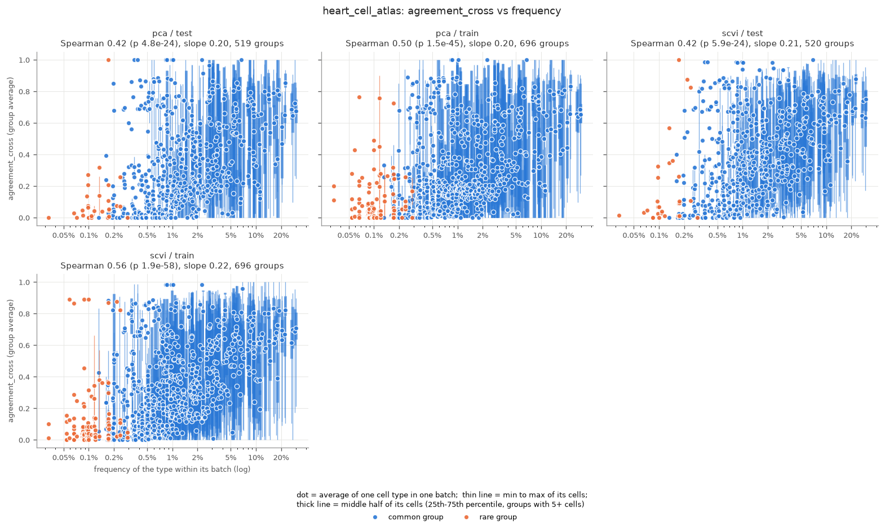
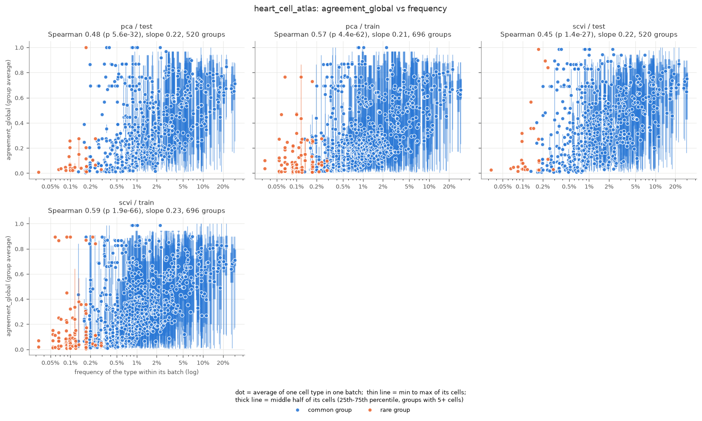
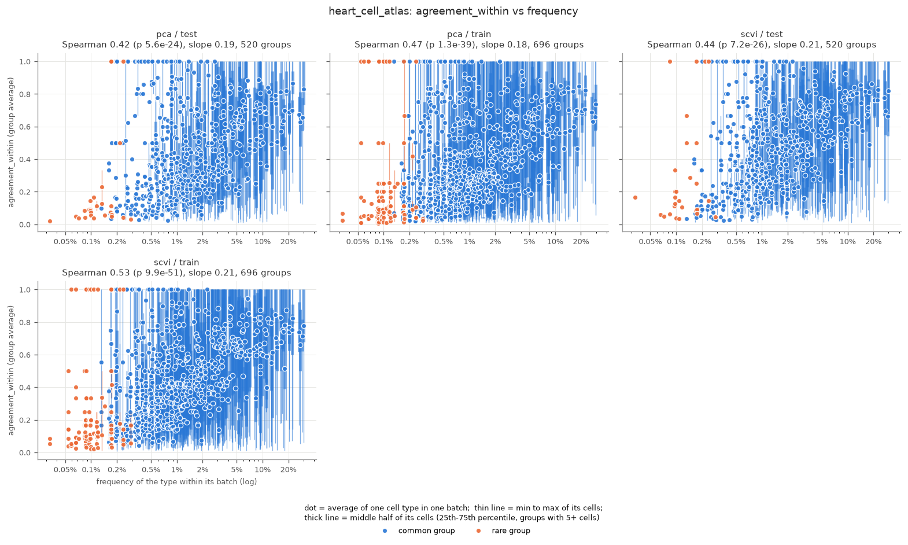
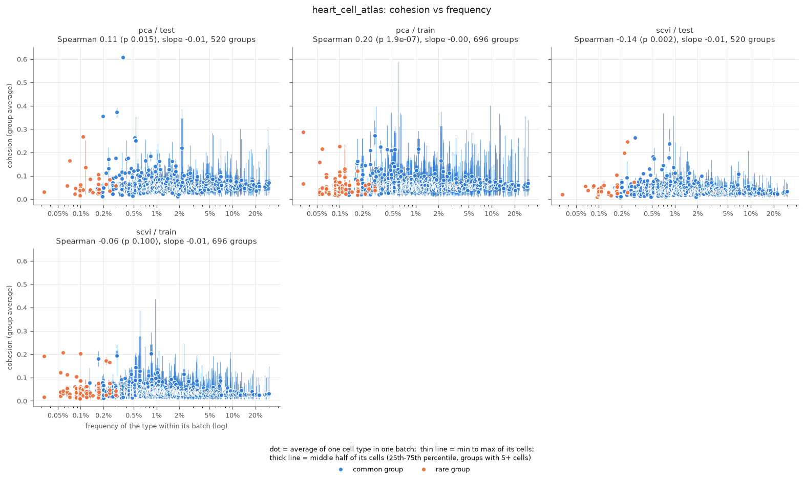
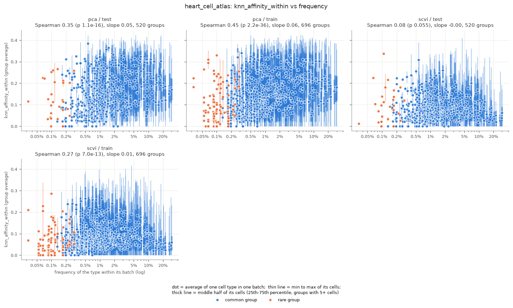
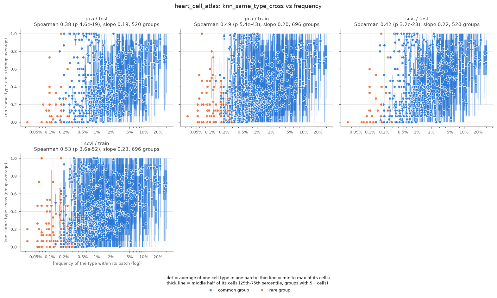
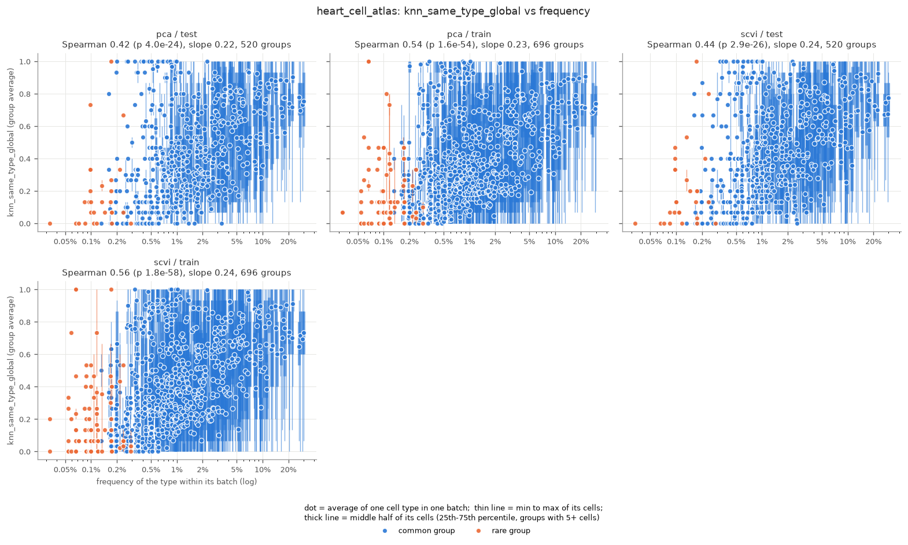
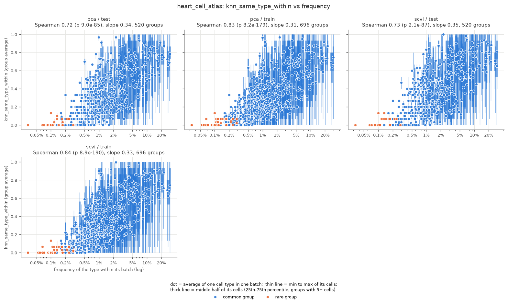

# rare_cell_preservation — generated tables — WHAT-IF: `metrics__label-cell_states`

> **GENERATED FILE — do not edit.** Made by `evaluation/build_results.py` from
> `runs/rare_cell_preservation/*/*/metrics__label-cell_states/`. Re-run that script to update. The written
> verdict lives in `results/rare_cell_preservation.md`.

Every value is mean ± std, higher = better. "Rare" = locally-rare (type, batch)
pairs, as defined in the task file. `cov` = share of cells where the metric is
defined (cross-batch agreement is undefined for a cell whose cluster has no
other-batch cells).

## Inputs

Environment (this script): python 3.13.11, pandas 3.0.5, numpy 2.4.6, scipy 1.18.0. Versions used to compute the metrics: each metrics folder's `metrics_config.json`.

| dataset | baseline | jobs | rare groups | rare rule | metrics folder |
|---|---|---|---|---|---|
| heart_cell_atlas | pca | test, train | 126 | log10(frequency) more than 1.0 std below its batch's mean log10 type-frequency (task file's rule) | `runs/rare_cell_preservation/heart_cell_atlas/pca/metrics__label-cell_states` |
| heart_cell_atlas | scvi | test, train | 126 | log10(frequency) more than 1.0 std below its batch's mean log10 type-frequency (task file's rule) | `runs/rare_cell_preservation/heart_cell_atlas/scvi/metrics__label-cell_states` |

**heart_cell_atlas: not scored yet:** bbknn, combat, harmony, seacells

## heart_cell_atlas

### Rare groups

**126 rare groups** (cell type in one batch) in **14 of 14 batches**, 168 cells in total. Rule: `log_std`.

**Which groups, and why** (rarest first):

| batch | cell type | cells (all) | cells (test) | cells (train) | frequency | cutoff in this batch | why rare |
|---|---|---|---|---|---|---|---|
| D6 | EC9_FB-like | 1 | 0 | 1 | 0.03% | 0.16% | 0.03% < 0.16% |
| D6 | NC2 | 1 | 0 | 1 | 0.03% | 0.16% | 0.03% < 0.16% |
| D6 | aCM5 | 1 | 1 | 0 | 0.03% | 0.16% | 0.03% < 0.16% |
| D11 | FB6 | 1 | 0 | 1 | 0.05% | 0.14% | 0.05% < 0.14% |
| D11 | FB7 | 1 | 0 | 1 | 0.05% | 0.14% | 0.05% < 0.14% |
| D11 | Mast | 1 | 0 | 1 | 0.05% | 0.14% | 0.05% < 0.14% |
| D11 | NC2 | 1 | 0 | 1 | 0.05% | 0.14% | 0.05% < 0.14% |
| D11 | aCM2 | 1 | 0 | 1 | 0.05% | 0.14% | 0.05% < 0.14% |
| D11 | aCM3 | 1 | 0 | 1 | 0.05% | 0.14% | 0.05% < 0.14% |
| D2 | Meso | 1 | 0 | 1 | 0.06% | 0.15% | 0.06% < 0.15% |
| D2 | MØ_AgP | 1 | 0 | 1 | 0.06% | 0.15% | 0.06% < 0.15% |
| D2 | NKT | 1 | 0 | 1 | 0.06% | 0.15% | 0.06% < 0.15% |
| H5 | CD8+T_cytox | 1 | 0 | 1 | 0.07% | 0.11% | 0.07% < 0.11% |
| H5 | DOCK4+MØ2 | 1 | 0 | 1 | 0.07% | 0.11% | 0.07% < 0.11% |
| H5 | EC7_atria | 1 | 0 | 1 | 0.07% | 0.11% | 0.07% < 0.11% |
| H5 | LYVE1+MØ2 | 1 | 0 | 1 | 0.07% | 0.11% | 0.07% < 0.11% |
| H5 | Mo_pi | 1 | 1 | 0 | 0.07% | 0.11% | 0.07% < 0.11% |
| H5 | MØ_mod | 1 | 0 | 1 | 0.07% | 0.11% | 0.07% < 0.11% |
| H5 | NK | 1 | 0 | 1 | 0.07% | 0.11% | 0.07% < 0.11% |
| H5 | aCM4 | 1 | 0 | 1 | 0.07% | 0.11% | 0.07% < 0.11% |
| D6 | DC | 2 | 0 | 2 | 0.07% | 0.16% | 0.07% < 0.16% |
| D6 | NØ | 2 | 0 | 2 | 0.07% | 0.16% | 0.07% < 0.16% |
| D7 | Adip2 | 1 | 0 | 1 | 0.07% | 0.32% | 0.07% < 0.32% |
| D7 | EC8_ln | 1 | 0 | 1 | 0.07% | 0.32% | 0.07% < 0.32% |
| D7 | FB6 | 1 | 1 | 0 | 0.07% | 0.32% | 0.07% < 0.32% |
| H7 | Adip3 | 1 | 0 | 1 | 0.08% | 0.16% | 0.08% < 0.16% |
| H7 | DC | 1 | 0 | 1 | 0.08% | 0.16% | 0.08% < 0.16% |
| H7 | Mo_pi | 1 | 1 | 0 | 0.08% | 0.16% | 0.08% < 0.16% |
| H7 | NC2 | 1 | 0 | 1 | 0.08% | 0.16% | 0.08% < 0.16% |
| H7 | NC4 | 1 | 0 | 1 | 0.08% | 0.16% | 0.08% < 0.16% |
| H7 | vCM5 | 1 | 0 | 1 | 0.08% | 0.16% | 0.08% < 0.16% |
| H3 | DC | 1 | 0 | 1 | 0.08% | 0.20% | 0.08% < 0.20% |
| H3 | EC8_ln | 1 | 0 | 1 | 0.08% | 0.20% | 0.08% < 0.20% |
| H3 | NC4 | 1 | 0 | 1 | 0.08% | 0.20% | 0.08% < 0.20% |
| H3 | NK | 1 | 0 | 1 | 0.08% | 0.20% | 0.08% < 0.20% |
| H3 | aCM5 | 1 | 1 | 0 | 0.08% | 0.20% | 0.08% < 0.20% |
| D5 | CD4+T_cytox | 1 | 0 | 1 | 0.09% | 0.15% | 0.09% < 0.15% |
| D5 | CD8+T_tem | 1 | 0 | 1 | 0.09% | 0.15% | 0.09% < 0.15% |
| D5 | EC10_CMC-like | 1 | 0 | 1 | 0.09% | 0.15% | 0.09% < 0.15% |
| D5 | FB7 | 1 | 0 | 1 | 0.09% | 0.15% | 0.09% < 0.15% |
| D5 | Mo_pi | 1 | 0 | 1 | 0.09% | 0.15% | 0.09% < 0.15% |
| D5 | MØ_AgP | 1 | 0 | 1 | 0.09% | 0.15% | 0.09% < 0.15% |
| D5 | NC4 | 1 | 0 | 1 | 0.09% | 0.15% | 0.09% < 0.15% |
| D5 | PC4_CMC-like | 1 | 0 | 1 | 0.09% | 0.15% | 0.09% < 0.15% |
| D5 | vCM5 | 1 | 0 | 1 | 0.09% | 0.15% | 0.09% < 0.15% |
| D4 | Adip3 | 1 | 0 | 1 | 0.09% | 0.18% | 0.09% < 0.18% |
| D4 | CD8+T_cytox | 1 | 0 | 1 | 0.09% | 0.18% | 0.09% < 0.18% |
| D4 | EC10_CMC-like | 1 | 0 | 1 | 0.09% | 0.18% | 0.09% < 0.18% |
| D4 | Meso | 1 | 0 | 1 | 0.09% | 0.18% | 0.09% < 0.18% |
| D4 | Mo_pi | 1 | 0 | 1 | 0.09% | 0.18% | 0.09% < 0.18% |
| D4 | NK | 1 | 0 | 1 | 0.09% | 0.18% | 0.09% < 0.18% |
| D4 | NKT | 1 | 0 | 1 | 0.09% | 0.18% | 0.09% < 0.18% |
| D4 | aCM5 | 1 | 0 | 1 | 0.09% | 0.18% | 0.09% < 0.18% |
| H4 | Adip3 | 1 | 0 | 1 | 0.10% | 0.15% | 0.10% < 0.15% |
| H4 | DC | 1 | 0 | 1 | 0.10% | 0.15% | 0.10% < 0.15% |
| H4 | EC4_immune | 1 | 0 | 1 | 0.10% | 0.15% | 0.10% < 0.15% |
| H4 | EC8_ln | 1 | 0 | 1 | 0.10% | 0.15% | 0.10% < 0.15% |
| H4 | LYVE1+MØ3 | 1 | 1 | 0 | 0.10% | 0.15% | 0.10% < 0.15% |
| H4 | NC2 | 1 | 0 | 1 | 0.10% | 0.15% | 0.10% < 0.15% |
| H4 | NC4 | 1 | 0 | 1 | 0.10% | 0.15% | 0.10% < 0.15% |
| H4 | NK | 1 | 0 | 1 | 0.10% | 0.15% | 0.10% < 0.15% |
| H6 | DC | 1 | 0 | 1 | 0.10% | 0.14% | 0.10% < 0.14% |
| H6 | DOCK4+MØ2 | 1 | 1 | 0 | 0.10% | 0.14% | 0.10% < 0.14% |
| H6 | EC8_ln | 1 | 1 | 0 | 0.10% | 0.14% | 0.10% < 0.14% |
| H6 | IL17RA+Mo | 1 | 0 | 1 | 0.10% | 0.14% | 0.10% < 0.14% |
| H6 | LYVE1+MØ2 | 1 | 1 | 0 | 0.10% | 0.14% | 0.10% < 0.14% |
| H6 | Mo_pi | 1 | 0 | 1 | 0.10% | 0.14% | 0.10% < 0.14% |
| H6 | MØ_mod | 1 | 0 | 1 | 0.10% | 0.14% | 0.10% < 0.14% |
| H6 | NC2 | 1 | 1 | 0 | 0.10% | 0.14% | 0.10% < 0.14% |
| H6 | NC4 | 1 | 0 | 1 | 0.10% | 0.14% | 0.10% < 0.14% |
| H6 | NKT | 1 | 0 | 1 | 0.10% | 0.14% | 0.10% < 0.14% |
| D6 | EC8_ln | 3 | 1 | 2 | 0.10% | 0.16% | 0.10% < 0.16% |
| D3 | Adip4 | 1 | 0 | 1 | 0.10% | 0.19% | 0.10% < 0.19% |
| D3 | CD4+T_tem | 1 | 0 | 1 | 0.10% | 0.19% | 0.10% < 0.19% |
| D3 | CD8+T_cytox | 1 | 0 | 1 | 0.10% | 0.19% | 0.10% < 0.19% |
| D3 | CD8+T_tem | 1 | 0 | 1 | 0.10% | 0.19% | 0.10% < 0.19% |
| D3 | DC | 1 | 0 | 1 | 0.10% | 0.19% | 0.10% < 0.19% |
| D3 | EC9_FB-like | 1 | 1 | 0 | 0.10% | 0.19% | 0.10% < 0.19% |
| D3 | FB6 | 1 | 0 | 1 | 0.10% | 0.19% | 0.10% < 0.19% |
| D3 | Meso | 1 | 0 | 1 | 0.10% | 0.19% | 0.10% < 0.19% |
| D11 | DC | 2 | 1 | 1 | 0.11% | 0.14% | 0.11% < 0.14% |
| D11 | DOCK4+MØ2 | 2 | 0 | 2 | 0.11% | 0.14% | 0.11% < 0.14% |
| D11 | aCM4 | 2 | 1 | 1 | 0.11% | 0.14% | 0.11% < 0.14% |
| D2 | Adip2 | 2 | 0 | 2 | 0.12% | 0.15% | 0.12% < 0.15% |
| D2 | CD4+T_tem | 2 | 2 | 0 | 0.12% | 0.15% | 0.12% < 0.15% |
| D2 | DC | 2 | 0 | 2 | 0.12% | 0.15% | 0.12% < 0.15% |
| D2 | FB7 | 2 | 0 | 2 | 0.12% | 0.15% | 0.12% < 0.15% |
| D2 | NC2 | 2 | 0 | 2 | 0.12% | 0.15% | 0.12% < 0.15% |
| D2 | NK | 2 | 0 | 2 | 0.12% | 0.15% | 0.12% < 0.15% |
| D2 | SMC2_art | 2 | 0 | 2 | 0.12% | 0.15% | 0.12% < 0.15% |
| H2 | CD16+Mo | 1 | 0 | 1 | 0.12% | 0.25% | 0.12% < 0.25% |
| H2 | CD4+T_tem | 1 | 0 | 1 | 0.12% | 0.25% | 0.12% < 0.25% |
| H2 | Mo_pi | 1 | 0 | 1 | 0.12% | 0.25% | 0.12% < 0.25% |
| H2 | NC3 | 1 | 0 | 1 | 0.12% | 0.25% | 0.12% < 0.25% |
| H2 | NC5 | 1 | 0 | 1 | 0.12% | 0.25% | 0.12% < 0.25% |
| H2 | aCM2 | 1 | 0 | 1 | 0.12% | 0.25% | 0.12% < 0.25% |
| D6 | DOCK4+MØ1 | 4 | 1 | 3 | 0.13% | 0.16% | 0.13% < 0.16% |
| D6 | DOCK4+MØ2 | 4 | 2 | 2 | 0.13% | 0.16% | 0.13% < 0.16% |
| D7 | DOCK4+MØ2 | 2 | 1 | 1 | 0.14% | 0.32% | 0.14% < 0.32% |
| H3 | IL17RA+Mo | 2 | 1 | 1 | 0.17% | 0.20% | 0.17% < 0.20% |
| H3 | LYVE1+MØ1 | 2 | 0 | 2 | 0.17% | 0.20% | 0.17% < 0.20% |
| H3 | LYVE1+MØ3 | 2 | 0 | 2 | 0.17% | 0.20% | 0.17% < 0.20% |
| D1 | CD16+Mo | 1 | 0 | 1 | 0.17% | 0.18% | 0.17% < 0.18% |
| D1 | CD4+T_cytox | 1 | 0 | 1 | 0.17% | 0.18% | 0.17% < 0.18% |
| D1 | CD4+T_tem | 1 | 0 | 1 | 0.17% | 0.18% | 0.17% < 0.18% |
| D1 | DOCK4+MØ2 | 1 | 0 | 1 | 0.17% | 0.18% | 0.17% < 0.18% |
| D1 | EC9_FB-like | 1 | 0 | 1 | 0.17% | 0.18% | 0.17% < 0.18% |
| D1 | FB7 | 1 | 0 | 1 | 0.17% | 0.18% | 0.17% < 0.18% |
| D1 | LYVE1+MØ1 | 1 | 1 | 0 | 0.17% | 0.18% | 0.17% < 0.18% |
| D1 | Mast | 1 | 1 | 0 | 0.17% | 0.18% | 0.17% < 0.18% |
| D1 | MØ_mod | 1 | 0 | 1 | 0.17% | 0.18% | 0.17% < 0.18% |
| D1 | NKT | 1 | 0 | 1 | 0.17% | 0.18% | 0.17% < 0.18% |
| D1 | aCM2 | 1 | 1 | 0 | 0.17% | 0.18% | 0.17% < 0.18% |
| D1 | aCM3 | 1 | 0 | 1 | 0.17% | 0.18% | 0.17% < 0.18% |
| D4 | CD4+T_cytox | 2 | 0 | 2 | 0.17% | 0.18% | 0.17% < 0.18% |
| D4 | EC4_immune | 2 | 1 | 1 | 0.17% | 0.18% | 0.17% < 0.18% |
| D4 | LYVE1+MØ3 | 2 | 1 | 1 | 0.17% | 0.18% | 0.17% < 0.18% |
| D4 | MØ_AgP | 2 | 2 | 0 | 0.17% | 0.18% | 0.17% < 0.18% |
| D7 | EC9_FB-like | 3 | 0 | 3 | 0.22% | 0.32% | 0.22% < 0.32% |
| D7 | Meso | 3 | 1 | 2 | 0.22% | 0.32% | 0.22% < 0.32% |
| H2 | B_cells | 2 | 1 | 1 | 0.24% | 0.25% | 0.24% < 0.25% |
| H2 | CD14+Mo | 2 | 0 | 2 | 0.24% | 0.25% | 0.24% < 0.25% |
| H2 | NK | 2 | 0 | 2 | 0.24% | 0.25% | 0.24% < 0.25% |
| H2 | NKT | 2 | 1 | 1 | 0.24% | 0.25% | 0.24% < 0.25% |
| D7 | aCM4 | 4 | 0 | 4 | 0.29% | 0.32% | 0.29% < 0.32% |
| D7 | vCM5 | 4 | 1 | 3 | 0.29% | 0.32% | 0.29% < 0.32% |

**Closest to rare, but not rare** (5 lowest-frequency common groups):

| batch | cell type | cells (all) | frequency | cutoff in this batch |
|---|---|---|---|---|
| H5 | B_cells | 2 | 0.13% | 0.11% |
| H5 | NC3 | 2 | 0.13% | 0.11% |
| H5 | aCM2 | 2 | 0.13% | 0.11% |
| D11 | Adip2 | 3 | 0.16% | 0.14% |
| D11 | CD8+T_tem | 3 | 0.16% | 0.14% |

**How each rare group did — pca / test** (mean ± std over its cells; std is empty for a 1-cell group):

| batch | cell type | cells | agreement global | agreement within | agreement cross | cohesion | neighbors same type | neighbor affinity | F1 (cells in a cluster labeled its type) |
|---|---|---|---|---|---|---|---|---|---|
| D6 | EC9_FB-like | 0 | — | — | — | — | — | — | — |
| D6 | NC2 | 0 | — | — | — | — | — | — | — |
| D6 | aCM5 | 1 | 0.009 ± — | 0.020 ± — | 0.000 ± — | 0.030 ± — | 0.000 ± — | 0.115 ± — | 0.00 (found 0 of 1) |
| D11 | FB6 | 0 | — | — | — | — | — | — | — |
| D11 | FB7 | 0 | — | — | — | — | — | — | — |
| D11 | Mast | 0 | — | — | — | — | — | — | — |
| D11 | NC2 | 0 | — | — | — | — | — | — | — |
| D11 | aCM2 | 0 | — | — | — | — | — | — | — |
| D11 | aCM3 | 0 | — | — | — | — | — | — | — |
| D2 | Meso | 0 | — | — | — | — | — | — | — |
| D2 | MØ_AgP | 0 | — | — | — | — | — | — | — |
| D2 | NKT | 0 | — | — | — | — | — | — | — |
| H5 | CD8+T_cytox | 0 | — | — | — | — | — | — | — |
| H5 | DOCK4+MØ2 | 0 | — | — | — | — | — | — | — |
| H5 | EC7_atria | 0 | — | — | — | — | — | — | — |
| H5 | LYVE1+MØ2 | 0 | — | — | — | — | — | — | — |
| H5 | Mo_pi | 1 | 0.031 ± — | 0.048 ± — | 0.028 ± — | 0.057 ± — | 0.000 ± — | 0.224 ± — | 0.00 (found 0 of 1) |
| H5 | MØ_mod | 0 | — | — | — | — | — | — | — |
| H5 | NK | 0 | — | — | — | — | — | — | — |
| H5 | aCM4 | 0 | — | — | — | — | — | — | — |
| D6 | DC | 0 | — | — | — | — | — | — | — |
| D6 | NØ | 0 | — | — | — | — | — | — | — |
| D7 | Adip2 | 0 | — | — | — | — | — | — | — |
| D7 | EC8_ln | 0 | — | — | — | — | — | — | — |
| D7 | FB6 | 1 | 0.036 ± — | 0.037 ± — | 0.000 ± — | 0.164 ± — | 0.000 ± — | 0.221 ± — | 0.00 (found 0 of 1) |
| H7 | Adip3 | 0 | — | — | — | — | — | — | — |
| H7 | DC | 0 | — | — | — | — | — | — | — |
| H7 | Mo_pi | 1 | 0.049 ± — | 0.083 ± — | 0.046 ± — | 0.023 ± — | 0.133 ± — | 0.034 ± — | 0.00 (found 0 of 1) |
| H7 | NC2 | 0 | — | — | — | — | — | — | — |
| H7 | NC4 | 0 | — | — | — | — | — | — | — |
| H7 | vCM5 | 0 | — | — | — | — | — | — | — |
| H3 | DC | 0 | — | — | — | — | — | — | — |
| H3 | EC8_ln | 0 | — | — | — | — | — | — | — |
| H3 | NC4 | 0 | — | — | — | — | — | — | — |
| H3 | NK | 0 | — | — | — | — | — | — | — |
| H3 | aCM5 | 1 | 0.023 ± — | 0.042 ± — | 0.016 ± — | 0.047 ± — | 0.000 ± — | 0.127 ± — | 0.00 (found 0 of 1) |
| D5 | CD4+T_cytox | 0 | — | — | — | — | — | — | — |
| D5 | CD8+T_tem | 0 | — | — | — | — | — | — | — |
| D5 | EC10_CMC-like | 0 | — | — | — | — | — | — | — |
| D5 | FB7 | 0 | — | — | — | — | — | — | — |
| D5 | Mo_pi | 0 | — | — | — | — | — | — | — |
| D5 | MØ_AgP | 0 | — | — | — | — | — | — | — |
| D5 | NC4 | 0 | — | — | — | — | — | — | — |
| D5 | PC4_CMC-like | 0 | — | — | — | — | — | — | — |
| D5 | vCM5 | 0 | — | — | — | — | — | — | — |
| D4 | Adip3 | 0 | — | — | — | — | — | — | — |
| D4 | CD8+T_cytox | 0 | — | — | — | — | — | — | — |
| D4 | EC10_CMC-like | 0 | — | — | — | — | — | — | — |
| D4 | Meso | 0 | — | — | — | — | — | — | — |
| D4 | Mo_pi | 0 | — | — | — | — | — | — | — |
| D4 | NK | 0 | — | — | — | — | — | — | — |
| D4 | NKT | 0 | — | — | — | — | — | — | — |
| D4 | aCM5 | 0 | — | — | — | — | — | — | — |
| H4 | Adip3 | 0 | — | — | — | — | — | — | — |
| H4 | DC | 0 | — | — | — | — | — | — | — |
| H4 | EC4_immune | 0 | — | — | — | — | — | — | — |
| H4 | EC8_ln | 0 | — | — | — | — | — | — | — |
| H4 | LYVE1+MØ3 | 1 | 0.133 ± — | 0.091 ± — | 0.137 ± — | 0.039 ± — | 0.133 ± — | 0.042 ± — | 0.00 (found 0 of 1) |
| H4 | NC2 | 0 | — | — | — | — | — | — | — |
| H4 | NC4 | 0 | — | — | — | — | — | — | — |
| H4 | NK | 0 | — | — | — | — | — | — | — |
| H6 | DC | 0 | — | — | — | — | — | — | — |
| H6 | DOCK4+MØ2 | 1 | 0.203 ± — | 0.143 ± — | 0.207 ± — | 0.032 ± — | 0.733 ± — | 0.000 ± — | 0.50 (found 1 of 1) |
| H6 | EC8_ln | 1 | 0.074 ± — | 0.077 ± — | 0.074 ± — | 0.016 ± — | 0.200 ± — | 0.062 ± — | 0.00 (found 0 of 1) |
| H6 | IL17RA+Mo | 0 | — | — | — | — | — | — | — |
| H6 | LYVE1+MØ2 | 1 | 0.259 ± — | 0.091 ± — | 0.273 ± — | 0.039 ± — | 0.333 ± — | 0.097 ± — | 0.00 (found 0 of 1) |
| H6 | Mo_pi | 0 | — | — | — | — | — | — | — |
| H6 | MØ_mod | 0 | — | — | — | — | — | — | — |
| H6 | NC2 | 1 | 0.066 ± — | 0.083 ± — | 0.064 ± — | 0.038 ± — | 0.333 ± — | 0.037 ± — | 0.00 (found 0 of 1) |
| H6 | NC4 | 0 | — | — | — | — | — | — | — |
| H6 | NKT | 0 | — | — | — | — | — | — | — |
| D6 | EC8_ln | 1 | 0.042 ± — | 0.075 ± — | 0.000 ± — | 0.055 ± — | 0.133 ± — | 0.253 ± — | 0.00 (found 0 of 1) |
| D3 | Adip4 | 0 | — | — | — | — | — | — | — |
| D3 | CD4+T_tem | 0 | — | — | — | — | — | — | — |
| D3 | CD8+T_cytox | 0 | — | — | — | — | — | — | — |
| D3 | CD8+T_tem | 0 | — | — | — | — | — | — | — |
| D3 | DC | 0 | — | — | — | — | — | — | — |
| D3 | EC9_FB-like | 1 | 0.022 ± — | 0.056 ± — | 0.000 ± — | 0.061 ± — | 0.067 ± — | 0.150 ± — | 0.00 (found 0 of 1) |
| D3 | FB6 | 0 | — | — | — | — | — | — | — |
| D3 | Meso | 0 | — | — | — | — | — | — | — |
| D11 | DC | 1 | 0.037 ± — | 0.038 ± — | 0.000 ± — | 0.268 ± — | 0.000 ± — | 0.260 ± — | 0.00 (found 0 of 1) |
| D11 | DOCK4+MØ2 | 0 | — | — | — | — | — | — | — |
| D11 | aCM4 | 1 | 0.023 ± — | 0.167 ± — | 0.012 ± — | 0.039 ± — | 0.067 ± — | 0.113 ± — | 0.00 (found 0 of 1) |
| D2 | Adip2 | 0 | — | — | — | — | — | — | — |
| D2 | CD4+T_tem | 2 | 0.049 ± 0.044 | 0.113 ± 0.042 | 0.045 ± 0.046 | 0.136 ± 0.166 | 0.000 ± 0.000 | 0.205 ± 0.126 | 0.00 (found 0 of 2) |
| D2 | DC | 0 | — | — | — | — | — | — | — |
| D2 | FB7 | 0 | — | — | — | — | — | — | — |
| D2 | NC2 | 0 | — | — | — | — | — | — | — |
| D2 | NK | 0 | — | — | — | — | — | — | — |
| D2 | SMC2_art | 0 | — | — | — | — | — | — | — |
| H2 | CD16+Mo | 0 | — | — | — | — | — | — | — |
| H2 | CD4+T_tem | 0 | — | — | — | — | — | — | — |
| H2 | Mo_pi | 0 | — | — | — | — | — | — | — |
| H2 | NC3 | 0 | — | — | — | — | — | — | — |
| H2 | NC5 | 0 | — | — | — | — | — | — | — |
| H2 | aCM2 | 0 | — | — | — | — | — | — | — |
| D6 | DOCK4+MØ1 | 1 | 0.276 ± — | 0.125 ± — | 0.317 ± — | 0.085 ± — | 0.133 ± — | 0.266 ± — | 0.00 (found 0 of 1) |
| D6 | DOCK4+MØ2 | 2 | 0.153 ± 0.160 | 0.229 ± 0.147 | 0.140 ± 0.174 | 0.041 ± 0.002 | 0.233 ± 0.047 | 0.034 ± 0.016 | 0.50 (found 1 of 2) |
| D7 | DOCK4+MØ2 | 1 | 0.042 ± — | 0.056 ± — | 0.040 ± — | 0.028 ± — | 0.067 ± — | 0.091 ± — | 0.00 (found 0 of 1) |
| H3 | IL17RA+Mo | 1 | 0.016 ± — | 0.074 ± — | 0.000 ± — | 0.025 ± — | 0.133 ± — | 0.122 ± — | 0.00 (found 0 of 1) |
| H3 | LYVE1+MØ1 | 0 | — | — | — | — | — | — | — |
| H3 | LYVE1+MØ3 | 0 | — | — | — | — | — | — | — |
| D1 | CD16+Mo | 0 | — | — | — | — | — | — | — |
| D1 | CD4+T_cytox | 0 | — | — | — | — | — | — | — |
| D1 | CD4+T_tem | 0 | — | — | — | — | — | — | — |
| D1 | DOCK4+MØ2 | 0 | — | — | — | — | — | — | — |
| D1 | EC9_FB-like | 0 | — | — | — | — | — | — | — |
| D1 | FB7 | 0 | — | — | — | — | — | — | — |
| D1 | LYVE1+MØ1 | 1 | 0.203 ± — | 0.111 ± — | 0.209 ± — | 0.064 ± — | 0.267 ± — | 0.077 ± — | 0.00 (found 0 of 1) |
| D1 | Mast | 1 | 1.000 ± — | 1.000 ± — | 1.000 ± — | 0.105 ± — | 1.000 ± — | 0.000 ± — | 1.00 (found 1 of 1) |
| D1 | MØ_mod | 0 | — | — | — | — | — | — | — |
| D1 | NKT | 0 | — | — | — | — | — | — | — |
| D1 | aCM2 | 1 | 0.117 ± — | 1.000 ± — | 0.109 ± — | 0.030 ± — | 0.200 ± — | 0.000 ± — | 0.00 (found 0 of 1) |
| D1 | aCM3 | 0 | — | — | — | — | — | — | — |
| D4 | CD4+T_cytox | 0 | — | — | — | — | — | — | — |
| D4 | EC4_immune | 1 | 0.050 ± — | 0.059 ± — | 0.045 ± — | 0.089 ± — | 0.067 ± — | 0.211 ± — | 0.00 (found 0 of 1) |
| D4 | LYVE1+MØ3 | 1 | 0.056 ± — | 0.059 ± — | 0.056 ± — | 0.029 ± — | 0.067 ± — | 0.115 ± — | 0.00 (found 0 of 1) |
| D4 | MØ_AgP | 2 | 0.014 ± 0.000 | 0.047 ± 0.016 | 0.008 ± 0.001 | 0.041 ± 0.013 | 0.000 ± 0.000 | 0.203 ± 0.027 | 0.00 (found 0 of 2) |
| D7 | EC9_FB-like | 0 | — | — | — | — | — | — | — |
| D7 | Meso | 1 | 0.103 ± — | 0.500 ± — | 0.074 ± — | 0.065 ± — | 0.333 ± — | 0.080 ± — | 0.00 (found 0 of 1) |
| H2 | B_cells | 1 | 0.276 ± — | 1.000 ± — | 0.257 ± — | 0.083 ± — | 0.667 ± — | 0.048 ± — | 1.00 (found 1 of 1) |
| H2 | CD14+Mo | 0 | — | — | — | — | — | — | — |
| H2 | NK | 0 | — | — | — | — | — | — | — |
| H2 | NKT | 1 | 0.064 ± — | 0.042 ± — | 0.073 ± — | 0.035 ± — | 0.067 ± — | 0.203 ± — | 0.00 (found 0 of 1) |
| D7 | aCM4 | 0 | — | — | — | — | — | — | — |
| D7 | vCM5 | 1 | 0.029 ± — | 0.030 ± — | 0.000 ± — | 0.058 ± — | 0.000 ± — | 0.258 ± — | 0.00 (found 0 of 1) |

**How each rare group did — pca / train** (mean ± std over its cells; std is empty for a 1-cell group):

| batch | cell type | cells | agreement global | agreement within | agreement cross | cohesion | neighbors same type | neighbor affinity | F1 (cells in a cluster labeled its type) |
|---|---|---|---|---|---|---|---|---|---|
| D6 | EC9_FB-like | 1 | 0.038 ± — | 0.023 ± — | 0.111 ± — | 0.067 ± — | 0.067 ± — | 0.183 ± — | 0.00 (found 0 of 1) |
| D6 | NC2 | 1 | 0.100 ± — | 0.067 ± — | 0.200 ± — | 0.288 ± — | 0.067 ± — | 0.223 ± — | 0.00 (found 0 of 1) |
| D6 | aCM5 | 0 | — | — | — | — | — | — | — |
| D11 | FB6 | 1 | 0.008 ± — | 0.008 ± — | 0.000 ± — | 0.020 ± — | 0.000 ± — | 0.265 ± — | 0.00 (found 0 of 1) |
| D11 | FB7 | 1 | 0.008 ± — | 0.008 ± — | 0.000 ± — | 0.022 ± — | 0.000 ± — | 0.071 ± — | 0.00 (found 0 of 1) |
| D11 | Mast | 1 | 0.016 ± — | 0.043 ± — | 0.000 ± — | 0.040 ± — | 0.000 ± — | 0.134 ± — | 0.00 (found 0 of 1) |
| D11 | NC2 | 1 | 0.100 ± — | 0.500 ± — | 0.056 ± — | 0.158 ± — | 0.067 ± — | 0.049 ± — | 0.00 (found 0 of 1) |
| D11 | aCM2 | 1 | 0.273 ± — | 0.167 ± — | 0.280 ± — | 0.034 ± — | 0.200 ± — | 0.111 ± — | 0.00 (found 0 of 1) |
| D11 | aCM3 | 1 | 0.123 ± — | 1.000 ± — | 0.117 ± — | 0.030 ± — | 0.133 ± — | 0.026 ± — | 0.00 (found 0 of 1) |
| D2 | Meso | 1 | 0.467 ± — | 1.000 ± — | 0.429 ± — | 0.214 ± — | 0.533 ± — | 0.000 ± — | 1.00 (found 1 of 1) |
| D2 | MØ_AgP | 1 | 0.014 ± — | 0.053 ± — | 0.008 ± — | 0.049 ± — | 0.000 ± — | 0.073 ± — | 0.00 (found 0 of 1) |
| D2 | NKT | 1 | 0.064 ± — | 0.143 ± — | 0.061 ± — | 0.022 ± — | 0.267 ± — | 0.064 ± — | 0.00 (found 0 of 1) |
| H5 | CD8+T_cytox | 1 | 0.186 ± — | 0.053 ± — | 0.203 ± — | 0.031 ± — | 0.333 ± — | 0.030 ± — | 0.00 (found 0 of 1) |
| H5 | DOCK4+MØ2 | 1 | 0.203 ± — | 0.048 ± — | 0.234 ± — | 0.035 ± — | 1.000 ± — | 0.000 ± — | 0.00 (found 0 of 1) |
| H5 | EC7_atria | 1 | 0.767 ± — | 1.000 ± — | 0.766 ± — | 0.053 ± — | 1.000 ± — | 0.000 ± — | 1.00 (found 1 of 1) |
| H5 | LYVE1+MØ2 | 1 | 0.016 ± — | 0.048 ± — | 0.009 ± — | 0.052 ± — | 0.000 ± — | 0.065 ± — | 0.00 (found 0 of 1) |
| H5 | Mo_pi | 0 | — | — | — | — | — | — | — |
| H5 | MØ_mod | 1 | 0.016 ± — | 0.048 ± — | 0.009 ± — | 0.107 ± — | 0.000 ± — | 0.294 ± — | 0.00 (found 0 of 1) |
| H5 | NK | 1 | 0.087 ± — | 0.053 ± — | 0.092 ± — | 0.030 ± — | 0.000 ± — | 0.022 ± — | 0.00 (found 0 of 1) |
| H5 | aCM4 | 1 | 0.126 ± — | 1.000 ± — | 0.117 ± — | 0.046 ± — | 0.467 ± — | 0.000 ± — | 0.00 (found 0 of 1) |
| D6 | DC | 2 | 0.032 ± 0.000 | 0.033 ± 0.000 | 0.000 ± 0.000 | 0.095 ± 0.009 | 0.000 ± 0.000 | 0.310 ± 0.061 | 0.00 (found 0 of 2) |
| D6 | NØ | 2 | 0.037 ± 0.000 | 0.036 ± 0.000 | 0.039 ± 0.000 | 0.045 ± 0.005 | 0.233 ± 0.047 | 0.098 ± 0.001 | 0.00 (found 0 of 2) |
| D7 | Adip2 | 1 | 0.246 ± — | 0.125 ± — | 0.254 ± — | 0.029 ± — | 0.000 ± — | 0.141 ± — | 0.00 (found 0 of 1) |
| D7 | EC8_ln | 1 | 0.074 ± — | 0.053 ± — | 0.076 ± — | 0.022 ± — | 0.133 ± — | 0.085 ± — | 0.00 (found 0 of 1) |
| D7 | FB6 | 0 | — | — | — | — | — | — | — |
| H7 | Adip3 | 1 | 0.045 ± — | 0.100 ± — | 0.040 ± — | 0.059 ± — | 0.133 ± — | 0.094 ± — | 0.00 (found 0 of 1) |
| H7 | DC | 1 | 0.016 ± — | 0.045 ± — | 0.009 ± — | 0.037 ± — | 0.000 ± — | 0.066 ± — | 0.00 (found 0 of 1) |
| H7 | Mo_pi | 0 | — | — | — | — | — | — | — |
| H7 | NC2 | 1 | 0.084 ± — | 0.091 ± — | 0.083 ± — | 0.031 ± — | 0.333 ± — | 0.113 ± — | 0.00 (found 0 of 1) |
| H7 | NC4 | 1 | 0.011 ± — | 0.200 ± — | 0.000 ± — | 0.018 ± — | 0.000 ± — | 0.047 ± — | 0.00 (found 0 of 1) |
| H7 | vCM5 | 1 | 0.011 ± — | 0.013 ± — | 0.000 ± — | 0.039 ± — | 0.000 ± — | 0.146 ± — | 0.00 (found 0 of 1) |
| H3 | DC | 1 | 0.049 ± — | 0.100 ± — | 0.045 ± — | 0.029 ± — | 0.067 ± — | 0.092 ± — | 0.00 (found 0 of 1) |
| H3 | EC8_ln | 1 | 0.012 ± — | 0.100 ± — | 0.000 ± — | 0.028 ± — | 0.000 ± — | 0.000 ± — | 0.00 (found 0 of 1) |
| H3 | NC4 | 1 | 0.017 ± — | 0.013 ± — | 0.024 ± — | 0.020 ± — | 0.067 ± — | 0.125 ± — | 0.00 (found 0 of 1) |
| H3 | NK | 1 | 0.087 ± — | 0.059 ± — | 0.090 ± — | 0.040 ± — | 0.067 ± — | 0.026 ± — | 0.00 (found 0 of 1) |
| H3 | aCM5 | 0 | — | — | — | — | — | — | — |
| D5 | CD4+T_cytox | 1 | 0.175 ± — | 1.000 ± — | 0.161 ± — | 0.088 ± — | 0.467 ± — | 0.000 ± — | 0.00 (found 0 of 1) |
| D5 | CD8+T_tem | 1 | 0.014 ± — | 0.067 ± — | 0.008 ± — | 0.060 ± — | 0.067 ± — | 0.140 ± — | 0.00 (found 0 of 1) |
| D5 | EC10_CMC-like | 1 | 0.016 ± — | 0.143 ± — | 0.000 ± — | 0.034 ± — | 0.000 ± — | 0.057 ± — | 0.00 (found 0 of 1) |
| D5 | FB7 | 1 | 0.010 ± — | 1.000 ± — | 0.000 ± — | 0.023 ± — | 0.133 ± — | 0.042 ± — | 0.00 (found 0 of 1) |
| D5 | Mo_pi | 1 | 0.066 ± — | 0.250 ± — | 0.056 ± — | 0.070 ± — | 0.000 ± — | 0.037 ± — | 0.00 (found 0 of 1) |
| D5 | MØ_AgP | 1 | 0.014 ± — | 0.077 ± — | 0.008 ± — | 0.060 ± — | 0.000 ± — | 0.049 ± — | 0.00 (found 0 of 1) |
| D5 | NC4 | 1 | 0.018 ± — | 0.500 ± — | 0.000 ± — | 0.066 ± — | 0.000 ± — | 0.060 ± — | 0.00 (found 0 of 1) |
| D5 | PC4_CMC-like | 1 | 0.029 ± — | 0.024 ± — | 0.031 ± — | 0.023 ± — | 0.000 ± — | 0.057 ± — | 0.00 (found 0 of 1) |
| D5 | vCM5 | 1 | 0.005 ± — | 0.006 ± — | 0.000 ± — | 0.019 ± — | 0.000 ± — | 0.258 ± — | 0.00 (found 0 of 1) |
| D4 | Adip3 | 1 | 0.045 ± — | 0.091 ± — | 0.041 ± — | 0.052 ± — | 0.000 ± — | 0.113 ± — | 0.00 (found 0 of 1) |
| D4 | CD8+T_cytox | 1 | 0.013 ± — | 0.143 ± — | 0.000 ± — | 0.048 ± — | 0.000 ± — | 0.025 ± — | 0.00 (found 0 of 1) |
| D4 | EC10_CMC-like | 1 | 0.027 ± — | 0.167 ± — | 0.000 ± — | 0.072 ± — | 0.000 ± — | 0.092 ± — | 0.00 (found 0 of 1) |
| D4 | Meso | 1 | 0.049 ± — | 0.143 ± — | 0.037 ± — | 0.041 ± — | 0.133 ± — | 0.019 ± — | 0.00 (found 0 of 1) |
| D4 | Mo_pi | 1 | 0.049 ± — | 0.036 ± — | 0.052 ± — | 0.033 ± — | 0.000 ± — | 0.211 ± — | 0.00 (found 0 of 1) |
| D4 | NK | 1 | 0.211 ± — | 1.000 ± — | 0.196 ± — | 0.074 ± — | 0.400 ± — | 0.023 ± — | 0.00 (found 0 of 1) |
| D4 | NKT | 1 | 0.220 ± — | 1.000 ± — | 0.213 ± — | 0.024 ± — | 0.133 ± — | 0.047 ± — | 0.00 (found 0 of 1) |
| D4 | aCM5 | 1 | 0.011 ± — | 0.013 ± — | 0.000 ± — | 0.058 ± — | 0.000 ± — | 0.243 ± — | 0.00 (found 0 of 1) |
| H4 | Adip3 | 1 | 0.045 ± — | 0.200 ± — | 0.039 ± — | 0.055 ± — | 0.200 ± — | 0.021 ± — | 0.00 (found 0 of 1) |
| H4 | DC | 1 | 0.035 ± — | 0.167 ± — | 0.029 ± — | 0.031 ± — | 0.000 ± — | 0.000 ± — | 0.00 (found 0 of 1) |
| H4 | EC4_immune | 1 | 0.067 ± — | 0.045 ± — | 0.071 ± — | 0.039 ± — | 0.067 ± — | 0.022 ± — | 0.00 (found 0 of 1) |
| H4 | EC8_ln | 1 | 0.037 ± — | 0.200 ± — | 0.000 ± — | 0.073 ± — | 0.133 ± — | 0.000 ± — | 0.00 (found 0 of 1) |
| H4 | LYVE1+MØ3 | 0 | — | — | — | — | — | — | — |
| H4 | NC2 | 1 | 0.016 ± — | 0.250 ± — | 0.000 ± — | 0.061 ± — | 0.067 ± — | 0.026 ± — | 0.00 (found 0 of 1) |
| H4 | NC4 | 1 | 0.017 ± — | 0.028 ± — | 0.012 ± — | 0.015 ± — | 0.067 ± — | 0.023 ± — | 0.00 (found 0 of 1) |
| H4 | NK | 1 | 0.087 ± — | 0.053 ± — | 0.092 ± — | 0.034 ± — | 0.000 ± — | 0.064 ± — | 0.00 (found 0 of 1) |
| H6 | DC | 1 | 0.049 ± — | 0.091 ± — | 0.045 ± — | 0.037 ± — | 0.000 ± — | 0.070 ± — | 0.00 (found 0 of 1) |
| H6 | DOCK4+MØ2 | 0 | — | — | — | — | — | — | — |
| H6 | EC8_ln | 0 | — | — | — | — | — | — | — |
| H6 | IL17RA+Mo | 1 | 0.007 ± — | 0.500 ± — | 0.000 ± — | 0.028 ± — | 0.067 ± — | 0.000 ± — | 0.00 (found 0 of 1) |
| H6 | LYVE1+MØ2 | 0 | — | — | — | — | — | — | — |
| H6 | Mo_pi | 1 | 0.014 ± — | 0.091 ± — | 0.008 ± — | 0.022 ± — | 0.067 ± — | 0.072 ± — | 0.00 (found 0 of 1) |
| H6 | MØ_mod | 1 | 0.016 ± — | 0.143 ± — | 0.008 ± — | 0.032 ± — | 0.000 ± — | 0.059 ± — | 0.00 (found 0 of 1) |
| H6 | NC2 | 0 | — | — | — | — | — | — | — |
| H6 | NC4 | 1 | 0.008 ± — | 0.062 ± — | 0.000 ± — | 0.034 ± — | 0.000 ± — | 0.106 ± — | 0.00 (found 0 of 1) |
| H6 | NKT | 1 | 0.064 ± — | 0.056 ± — | 0.065 ± — | 0.048 ± — | 0.200 ± — | 0.019 ± — | 0.00 (found 0 of 1) |
| D6 | EC8_ln | 2 | 0.042 ± 0.000 | 0.075 ± 0.000 | 0.000 ± 0.000 | 0.047 ± 0.006 | 0.133 ± 0.000 | 0.233 ± 0.016 | 0.00 (found 0 of 2) |
| D3 | Adip4 | 1 | 0.015 ± — | 0.200 ± — | 0.008 ± — | 0.044 ± — | 0.000 ± — | 0.019 ± — | 0.00 (found 0 of 1) |
| D3 | CD4+T_tem | 1 | 0.319 ± — | 1.000 ± — | 0.309 ± — | 0.070 ± — | 0.467 ± — | 0.000 ± — | 1.00 (found 1 of 1) |
| D3 | CD8+T_cytox | 1 | 0.474 ± — | 0.250 ± — | 0.491 ± — | 0.116 ± — | 0.467 ± — | 0.107 ± — | 0.40 (found 1 of 1) |
| D3 | CD8+T_tem | 1 | 0.070 ± — | 0.250 ± — | 0.057 ± — | 0.102 ± — | 0.067 ± — | 0.080 ± — | 0.00 (found 0 of 1) |
| D3 | DC | 1 | 0.016 ± — | 0.040 ± — | 0.010 ± — | 0.073 ± — | 0.000 ± — | 0.330 ± — | 0.00 (found 0 of 1) |
| D3 | EC9_FB-like | 0 | — | — | — | — | — | — | — |
| D3 | FB6 | 1 | 0.011 ± — | 0.013 ± — | 0.000 ± — | 0.049 ± — | 0.000 ± — | 0.174 ± — | 0.00 (found 0 of 1) |
| D3 | Meso | 1 | 0.467 ± — | 1.000 ± — | 0.429 ± — | 0.226 ± — | 0.467 ± — | 0.100 ± — | 1.00 (found 1 of 1) |
| D11 | DC | 1 | 0.011 ± — | 0.011 ± — | 0.000 ± — | 0.058 ± — | 0.067 ± — | 0.244 ± — | 0.00 (found 0 of 1) |
| D11 | DOCK4+MØ2 | 2 | 0.203 ± 0.000 | 0.100 ± 0.000 | 0.222 ± 0.000 | 0.046 ± 0.003 | 0.300 ± 0.236 | 0.195 ± 0.040 | 0.00 (found 0 of 2) |
| D11 | aCM4 | 1 | 0.126 ± — | 1.000 ± — | 0.117 ± — | 0.031 ± — | 0.800 ± — | 0.021 ± — | 0.00 (found 0 of 1) |
| D2 | Adip2 | 2 | 0.246 ± 0.000 | 0.105 ± 0.000 | 0.270 ± 0.000 | 0.055 ± 0.002 | 0.433 ± 0.519 | 0.075 ± 0.074 | 0.00 (found 0 of 2) |
| D2 | CD4+T_tem | 0 | — | — | — | — | — | — | — |
| D2 | DC | 2 | 0.035 ± 0.000 | 0.062 ± 0.000 | 0.027 ± 0.000 | 0.058 ± 0.017 | 0.033 ± 0.047 | 0.224 ± 0.127 | 0.00 (found 0 of 2) |
| D2 | FB7 | 2 | 0.436 ± 0.605 | 0.255 ± 0.347 | 0.450 ± 0.636 | 0.120 ± 0.131 | 0.367 ± 0.519 | 0.097 ± 0.138 | 0.67 (found 1 of 2) |
| D2 | NC2 | 2 | 0.046 ± 0.054 | 0.077 ± 0.094 | 0.040 ± 0.057 | 0.046 ± 0.016 | 0.067 ± 0.094 | 0.100 ± 0.141 | 0.00 (found 0 of 2) |
| D2 | NK | 2 | 0.144 ± 0.080 | 0.113 ± 0.042 | 0.196 ± 0.158 | 0.131 ± 0.146 | 0.133 ± 0.189 | 0.154 ± 0.047 | 0.00 (found 0 of 2) |
| D2 | SMC2_art | 2 | 0.765 ± 0.000 | 1.000 ± 0.000 | 0.758 ± 0.000 | 0.096 ± 0.029 | 0.733 ± 0.094 | 0.010 ± 0.015 | 1.00 (found 2 of 2) |
| H2 | CD16+Mo | 1 | 0.042 ± — | 0.111 ± — | 0.037 ± — | 0.034 ± — | 0.133 ± — | 0.228 ± — | 0.00 (found 0 of 1) |
| H2 | CD4+T_tem | 1 | 0.017 ± — | 0.021 ± — | 0.016 ± — | 0.043 ± — | 0.000 ± — | 0.197 ± — | 0.00 (found 0 of 1) |
| H2 | Mo_pi | 1 | 0.049 ± — | 0.111 ± — | 0.045 ± — | 0.035 ± — | 0.067 ± — | 0.177 ± — | 0.00 (found 0 of 1) |
| H2 | NC3 | 1 | 0.008 ± — | 0.042 ± — | 0.000 ± — | 0.022 ± — | 0.000 ± — | 0.092 ± — | 0.00 (found 0 of 1) |
| H2 | NC5 | 1 | 0.028 ± — | 0.167 ± — | 0.020 ± — | 0.066 ± — | 0.067 ± — | 0.065 ± — | 0.00 (found 0 of 1) |
| H2 | aCM2 | 1 | 0.273 ± — | 0.200 ± — | 0.277 ± — | 0.042 ± — | 0.333 ± — | 0.060 ± — | 0.00 (found 0 of 1) |
| D6 | DOCK4+MØ1 | 3 | 0.101 ± 0.152 | 0.053 ± 0.062 | 0.106 ± 0.183 | 0.063 ± 0.029 | 0.133 ± 0.231 | 0.206 ± 0.090 | 0.11 (found 1 of 3) |
| D6 | DOCK4+MØ2 | 2 | 0.153 ± 0.160 | 0.229 ± 0.147 | 0.140 ± 0.174 | 0.059 ± 0.032 | 0.100 ± 0.047 | 0.138 ± 0.128 | 0.33 (found 1 of 2) |
| D7 | DOCK4+MØ2 | 1 | 0.266 ± — | 0.250 ± — | 0.266 ± — | 0.031 ± — | 0.133 ± — | 0.064 ± — | 0.40 (found 1 of 1) |
| H3 | IL17RA+Mo | 1 | 0.016 ± — | 0.074 ± — | 0.000 ± — | 0.037 ± — | 0.067 ± — | 0.237 ± — | 0.00 (found 0 of 1) |
| H3 | LYVE1+MØ1 | 2 | 0.266 ± 0.000 | 0.074 ± 0.000 | 0.317 ± 0.000 | 0.068 ± 0.007 | 0.467 ± 0.094 | 0.091 ± 0.001 | 0.17 (found 2 of 2) |
| H3 | LYVE1+MØ3 | 2 | 0.133 ± 0.000 | 0.074 ± 0.000 | 0.149 ± 0.000 | 0.064 ± 0.011 | 0.233 ± 0.047 | 0.068 ± 0.001 | 0.00 (found 0 of 2) |
| D1 | CD16+Mo | 1 | 0.042 ± — | 0.111 ± — | 0.037 ± — | 0.045 ± — | 0.000 ± — | 0.022 ± — | 0.00 (found 0 of 1) |
| D1 | CD4+T_cytox | 1 | 0.244 ± — | 0.250 ± — | 0.244 ± — | 0.038 ± — | 0.400 ± — | 0.022 ± — | 0.00 (found 0 of 1) |
| D1 | CD4+T_tem | 1 | 0.080 ± — | 0.250 ± — | 0.048 ± — | 0.122 ± — | 0.067 ± — | 0.044 ± — | 0.00 (found 0 of 1) |
| D1 | DOCK4+MØ2 | 1 | 0.266 ± — | 0.111 ± — | 0.276 ± — | 0.023 ± — | 0.400 ± — | 0.000 ± — | 0.25 (found 1 of 1) |
| D1 | EC9_FB-like | 1 | 0.038 ± — | 0.500 ± — | 0.020 ± — | 0.080 ± — | 0.067 ± — | 0.012 ± — | 0.00 (found 0 of 1) |
| D1 | FB7 | 1 | 0.011 ± — | 0.014 ± — | 0.000 ± — | 0.017 ± — | 0.133 ± — | 0.035 ± — | 0.00 (found 0 of 1) |
| D1 | LYVE1+MØ1 | 0 | — | — | — | — | — | — | — |
| D1 | Mast | 0 | — | — | — | — | — | — | — |
| D1 | MØ_mod | 1 | 0.007 ± — | 0.111 ± — | 0.000 ± — | 0.045 ± — | 0.000 ± — | 0.045 ± — | 0.00 (found 0 of 1) |
| D1 | NKT | 1 | 0.064 ± — | 0.250 ± — | 0.060 ± — | 0.039 ± — | 0.133 ± — | 0.024 ± — | 0.00 (found 0 of 1) |
| D1 | aCM2 | 0 | — | — | — | — | — | — | — |
| D1 | aCM3 | 1 | 0.729 ± — | 1.000 ± — | 0.724 ± — | 0.063 ± — | 0.467 ± — | 0.000 ± — | 1.00 (found 1 of 1) |
| D4 | CD4+T_cytox | 2 | 0.253 ± 0.012 | 0.667 ± 0.471 | 0.246 ± 0.005 | 0.039 ± 0.005 | 0.267 ± 0.189 | 0.038 ± 0.021 | 0.00 (found 0 of 2) |
| D4 | EC4_immune | 1 | 0.050 ± — | 0.059 ± — | 0.045 ± — | 0.066 ± — | 0.000 ± — | 0.145 ± — | 0.00 (found 0 of 1) |
| D4 | LYVE1+MØ3 | 1 | 0.091 ± — | 0.036 ± — | 0.104 ± — | 0.034 ± — | 0.133 ± — | 0.190 ± — | 0.00 (found 0 of 1) |
| D4 | MØ_AgP | 0 | — | — | — | — | — | — | — |
| D7 | EC9_FB-like | 3 | 0.013 ± 0.001 | 0.091 ± 0.045 | 0.000 ± 0.000 | 0.022 ± 0.004 | 0.044 ± 0.038 | 0.077 ± 0.031 | 0.00 (found 0 of 3) |
| D7 | Meso | 2 | 0.076 ± 0.038 | 0.417 ± 0.118 | 0.054 ± 0.028 | 0.059 ± 0.003 | 0.233 ± 0.141 | 0.053 ± 0.033 | 0.00 (found 0 of 2) |
| H2 | B_cells | 1 | 0.276 ± — | 1.000 ± — | 0.257 ± — | 0.042 ± — | 0.333 ± — | 0.049 ± — | 0.00 (found 0 of 1) |
| H2 | CD14+Mo | 2 | 0.062 ± 0.000 | 0.105 ± 0.000 | 0.055 ± 0.000 | 0.041 ± 0.016 | 0.067 ± 0.000 | 0.101 ± 0.004 | 0.00 (found 0 of 2) |
| H2 | NK | 2 | 0.087 ± 0.000 | 0.042 ± 0.000 | 0.105 ± 0.000 | 0.044 ± 0.016 | 0.033 ± 0.047 | 0.218 ± 0.070 | 0.00 (found 0 of 2) |
| H2 | NKT | 1 | 0.064 ± — | 0.042 ± — | 0.073 ± — | 0.065 ± — | 0.067 ± — | 0.176 ± — | 0.00 (found 0 of 1) |
| D7 | aCM4 | 4 | 0.098 ± 0.035 | 0.035 ± 0.005 | 0.169 ± 0.100 | 0.048 ± 0.018 | 0.100 ± 0.038 | 0.256 ± 0.075 | 0.00 (found 0 of 4) |
| D7 | vCM5 | 3 | 0.022 ± 0.012 | 0.023 ± 0.012 | 0.000 ± 0.000 | 0.037 ± 0.015 | 0.000 ± 0.000 | 0.186 ± 0.043 | 0.00 (found 0 of 3) |

**How each rare group did — scvi / test** (mean ± std over its cells; std is empty for a 1-cell group):

| batch | cell type | cells | agreement global | agreement within | agreement cross | cohesion | neighbors same type | neighbor affinity | F1 (cells in a cluster labeled its type) |
|---|---|---|---|---|---|---|---|---|---|
| D6 | EC9_FB-like | 0 | — | — | — | — | — | — | — |
| D6 | NC2 | 0 | — | — | — | — | — | — | — |
| D6 | aCM5 | 1 | 0.026 ± — | 0.167 ± — | 0.014 ± — | 0.021 ± — | 0.000 ± — | 0.013 ± — | 0.00 (found 0 of 1) |
| D11 | FB6 | 0 | — | — | — | — | — | — | — |
| D11 | FB7 | 0 | — | — | — | — | — | — | — |
| D11 | Mast | 0 | — | — | — | — | — | — | — |
| D11 | NC2 | 0 | — | — | — | — | — | — | — |
| D11 | aCM2 | 0 | — | — | — | — | — | — | — |
| D11 | aCM3 | 0 | — | — | — | — | — | — | — |
| D2 | Meso | 0 | — | — | — | — | — | — | — |
| D2 | MØ_AgP | 0 | — | — | — | — | — | — | — |
| D2 | NKT | 0 | — | — | — | — | — | — | — |
| H5 | CD8+T_cytox | 0 | — | — | — | — | — | — | — |
| H5 | DOCK4+MØ2 | 0 | — | — | — | — | — | — | — |
| H5 | EC7_atria | 0 | — | — | — | — | — | — | — |
| H5 | LYVE1+MØ2 | 0 | — | — | — | — | — | — | — |
| H5 | Mo_pi | 1 | 0.036 ± — | 0.059 ± — | 0.032 ± — | 0.054 ± — | 0.000 ± — | 0.224 ± — | 0.00 (found 0 of 1) |
| H5 | MØ_mod | 0 | — | — | — | — | — | — | — |
| H5 | NK | 0 | — | — | — | — | — | — | — |
| H5 | aCM4 | 0 | — | — | — | — | — | — | — |
| D6 | DC | 0 | — | — | — | — | — | — | — |
| D6 | NØ | 0 | — | — | — | — | — | — | — |
| D7 | Adip2 | 0 | — | — | — | — | — | — | — |
| D7 | EC8_ln | 0 | — | — | — | — | — | — | — |
| D7 | FB6 | 1 | 0.048 ± — | 0.048 ± — | 0.048 ± — | 0.037 ± — | 0.000 ± — | 0.103 ± — | 0.00 (found 0 of 1) |
| H7 | Adip3 | 0 | — | — | — | — | — | — | — |
| H7 | DC | 0 | — | — | — | — | — | — | — |
| H7 | Mo_pi | 1 | 0.053 ± — | 1.000 ± — | 0.000 ± — | 0.053 ± — | 0.067 ± — | 0.018 ± — | 0.00 (found 0 of 1) |
| H7 | NC2 | 0 | — | — | — | — | — | — | — |
| H7 | NC4 | 0 | — | — | — | — | — | — | — |
| H7 | vCM5 | 0 | — | — | — | — | — | — | — |
| H3 | DC | 0 | — | — | — | — | — | — | — |
| H3 | EC8_ln | 0 | — | — | — | — | — | — | — |
| H3 | NC4 | 0 | — | — | — | — | — | — | — |
| H3 | NK | 0 | — | — | — | — | — | — | — |
| H3 | aCM5 | 1 | 0.016 ± — | 0.062 ± — | 0.000 ± — | 0.056 ± — | 0.000 ± — | 0.070 ± — | 0.00 (found 0 of 1) |
| D5 | CD4+T_cytox | 0 | — | — | — | — | — | — | — |
| D5 | CD8+T_tem | 0 | — | — | — | — | — | — | — |
| D5 | EC10_CMC-like | 0 | — | — | — | — | — | — | — |
| D5 | FB7 | 0 | — | — | — | — | — | — | — |
| D5 | Mo_pi | 0 | — | — | — | — | — | — | — |
| D5 | MØ_AgP | 0 | — | — | — | — | — | — | — |
| D5 | NC4 | 0 | — | — | — | — | — | — | — |
| D5 | PC4_CMC-like | 0 | — | — | — | — | — | — | — |
| D5 | vCM5 | 0 | — | — | — | — | — | — | — |
| D4 | Adip3 | 0 | — | — | — | — | — | — | — |
| D4 | CD8+T_cytox | 0 | — | — | — | — | — | — | — |
| D4 | EC10_CMC-like | 0 | — | — | — | — | — | — | — |
| D4 | Meso | 0 | — | — | — | — | — | — | — |
| D4 | Mo_pi | 0 | — | — | — | — | — | — | — |
| D4 | NK | 0 | — | — | — | — | — | — | — |
| D4 | NKT | 0 | — | — | — | — | — | — | — |
| D4 | aCM5 | 0 | — | — | — | — | — | — | — |
| H4 | Adip3 | 0 | — | — | — | — | — | — | — |
| H4 | DC | 0 | — | — | — | — | — | — | — |
| H4 | EC4_immune | 0 | — | — | — | — | — | — | — |
| H4 | EC8_ln | 0 | — | — | — | — | — | — | — |
| H4 | LYVE1+MØ3 | 1 | 0.103 ± — | 0.111 ± — | 0.102 ± — | 0.010 ± — | 0.067 ± — | 0.000 ± — | 0.00 (found 0 of 1) |
| H4 | NC2 | 0 | — | — | — | — | — | — | — |
| H4 | NC4 | 0 | — | — | — | — | — | — | — |
| H4 | NK | 0 | — | — | — | — | — | — | — |
| H6 | DC | 0 | — | — | — | — | — | — | — |
| H6 | DOCK4+MØ2 | 1 | 0.252 ± — | 0.200 ± — | 0.255 ± — | 0.037 ± — | 0.333 ± — | 0.000 ± — | 1.00 (found 1 of 1) |
| H6 | EC8_ln | 1 | 0.033 ± — | 0.125 ± — | 0.024 ± — | 0.018 ± — | 0.333 ± — | 0.022 ± — | 0.00 (found 0 of 1) |
| H6 | IL17RA+Mo | 0 | — | — | — | — | — | — | — |
| H6 | LYVE1+MØ2 | 1 | 0.318 ± — | 0.167 ± — | 0.327 ± — | 0.022 ± — | 0.467 ± — | 0.097 ± — | 0.50 (found 1 of 1) |
| H6 | Mo_pi | 0 | — | — | — | — | — | — | — |
| H6 | MØ_mod | 0 | — | — | — | — | — | — | — |
| H6 | NC2 | 1 | 0.081 ± — | 0.333 ± — | 0.068 ± — | 0.028 ± — | 0.400 ± — | 0.021 ± — | 0.00 (found 0 of 1) |
| H6 | NC4 | 0 | — | — | — | — | — | — | — |
| H6 | NKT | 0 | — | — | — | — | — | — | — |
| D6 | EC8_ln | 1 | 0.033 ± — | 0.036 ± — | 0.000 ± — | 0.044 ± — | 0.133 ± — | 0.138 ± — | 0.00 (found 0 of 1) |
| D3 | Adip4 | 0 | — | — | — | — | — | — | — |
| D3 | CD4+T_tem | 0 | — | — | — | — | — | — | — |
| D3 | CD8+T_cytox | 0 | — | — | — | — | — | — | — |
| D3 | CD8+T_tem | 0 | — | — | — | — | — | — | — |
| D3 | DC | 0 | — | — | — | — | — | — | — |
| D3 | EC9_FB-like | 1 | 0.080 ± — | 0.200 ± — | 0.067 ± — | 0.033 ± — | 0.133 ± — | 0.046 ± — | 0.00 (found 0 of 1) |
| D3 | FB6 | 0 | — | — | — | — | — | — | — |
| D3 | Meso | 0 | — | — | — | — | — | — | — |
| D11 | DC | 1 | 0.029 ± — | 0.036 ± — | 0.027 ± — | 0.050 ± — | 0.067 ± — | 0.337 ± — | 0.00 (found 0 of 1) |
| D11 | DOCK4+MØ2 | 0 | — | — | — | — | — | — | — |
| D11 | aCM4 | 1 | 0.051 ± — | 0.143 ± — | 0.038 ± — | 0.033 ± — | 0.067 ± — | 0.113 ± — | 0.00 (found 0 of 1) |
| D2 | Adip2 | 0 | — | — | — | — | — | — | — |
| D2 | CD4+T_tem | 2 | 0.031 ± 0.000 | 0.105 ± 0.000 | 0.013 ± 0.000 | 0.059 ± 0.026 | 0.000 ± 0.000 | 0.181 ± 0.091 | 0.00 (found 0 of 2) |
| D2 | DC | 0 | — | — | — | — | — | — | — |
| D2 | FB7 | 0 | — | — | — | — | — | — | — |
| D2 | NC2 | 0 | — | — | — | — | — | — | — |
| D2 | NK | 0 | — | — | — | — | — | — | — |
| D2 | SMC2_art | 0 | — | — | — | — | — | — | — |
| H2 | CD16+Mo | 0 | — | — | — | — | — | — | — |
| H2 | CD4+T_tem | 0 | — | — | — | — | — | — | — |
| H2 | Mo_pi | 0 | — | — | — | — | — | — | — |
| H2 | NC3 | 0 | — | — | — | — | — | — | — |
| H2 | NC5 | 0 | — | — | — | — | — | — | — |
| H2 | aCM2 | 0 | — | — | — | — | — | — | — |
| D6 | DOCK4+MØ1 | 1 | 0.566 ± — | 0.500 ± — | 0.569 ± — | 0.023 ± — | 0.533 ± — | 0.216 ± — | 1.00 (found 1 of 1) |
| D6 | DOCK4+MØ2 | 2 | 0.357 ± 0.000 | 0.667 ± 0.000 | 0.348 ± 0.000 | 0.029 ± 0.013 | 0.267 ± 0.094 | 0.034 ± 0.016 | 1.00 (found 2 of 2) |
| D7 | DOCK4+MØ2 | 1 | 0.357 ± — | 0.286 ± — | 0.361 ± — | 0.017 ± — | 0.200 ± — | 0.091 ± — | 0.67 (found 1 of 1) |
| H3 | IL17RA+Mo | 1 | 0.027 ± — | 0.083 ± — | 0.011 ± — | 0.035 ± — | 0.133 ± — | 0.123 ± — | 0.00 (found 0 of 1) |
| H3 | LYVE1+MØ1 | 0 | — | — | — | — | — | — | — |
| H3 | LYVE1+MØ3 | 0 | — | — | — | — | — | — | — |
| D1 | CD16+Mo | 0 | — | — | — | — | — | — | — |
| D1 | CD4+T_cytox | 0 | — | — | — | — | — | — | — |
| D1 | CD4+T_tem | 0 | — | — | — | — | — | — | — |
| D1 | DOCK4+MØ2 | 0 | — | — | — | — | — | — | — |
| D1 | EC9_FB-like | 0 | — | — | — | — | — | — | — |
| D1 | FB7 | 0 | — | — | — | — | — | — | — |
| D1 | LYVE1+MØ1 | 1 | 0.096 ± — | 0.250 ± — | 0.090 ± — | 0.050 ± — | 0.200 ± — | 0.077 ± — | 0.00 (found 0 of 1) |
| D1 | Mast | 1 | 0.986 ± — | 0.500 ± — | 1.000 ± — | 0.103 ± — | 1.000 ± — | 0.000 ± — | 1.00 (found 1 of 1) |
| D1 | MØ_mod | 0 | — | — | — | — | — | — | — |
| D1 | NKT | 0 | — | — | — | — | — | — | — |
| D1 | aCM2 | 1 | 0.270 ± — | 1.000 ± — | 0.263 ± — | 0.033 ± — | 0.200 ± — | 0.000 ± — | 0.00 (found 0 of 1) |
| D1 | aCM3 | 0 | — | — | — | — | — | — | — |
| D4 | CD4+T_cytox | 0 | — | — | — | — | — | — | — |
| D4 | EC4_immune | 1 | 0.092 ± — | 0.083 ± — | 0.094 ± — | 0.062 ± — | 0.200 ± — | 0.168 ± — | 0.00 (found 0 of 1) |
| D4 | LYVE1+MØ3 | 1 | 0.103 ± — | 0.091 ± — | 0.104 ± — | 0.025 ± — | 0.000 ± — | 0.096 ± — | 0.00 (found 0 of 1) |
| D4 | MØ_AgP | 2 | 0.026 ± 0.000 | 0.067 ± 0.000 | 0.012 ± 0.000 | 0.054 ± 0.008 | 0.033 ± 0.047 | 0.137 ± 0.008 | 0.00 (found 0 of 2) |
| D7 | EC9_FB-like | 0 | — | — | — | — | — | — | — |
| D7 | Meso | 1 | 0.895 ± — | 1.000 ± — | 0.875 ± — | 0.198 ± — | 0.400 ± — | 0.060 ± — | 1.00 (found 1 of 1) |
| H2 | B_cells | 1 | 0.842 ± — | 1.000 ± — | 0.824 ± — | 0.247 ± — | 0.800 ± — | 0.026 ± — | 1.00 (found 1 of 1) |
| H2 | CD14+Mo | 0 | — | — | — | — | — | — | — |
| H2 | NK | 0 | — | — | — | — | — | — | — |
| H2 | NKT | 1 | 0.112 ± — | 0.143 ± — | 0.107 ± — | 0.030 ± — | 0.133 ± — | 0.181 ± — | 0.00 (found 0 of 1) |
| D7 | aCM4 | 0 | — | — | — | — | — | — | — |
| D7 | vCM5 | 1 | 0.029 ± — | 0.047 ± — | 0.000 ± — | 0.072 ± — | 0.000 ± — | 0.120 ± — | 0.00 (found 0 of 1) |

**How each rare group did — scvi / train** (mean ± std over its cells; std is empty for a 1-cell group):

| batch | cell type | cells | agreement global | agreement within | agreement cross | cohesion | neighbors same type | neighbor affinity | F1 (cells in a cluster labeled its type) |
|---|---|---|---|---|---|---|---|---|---|
| D6 | EC9_FB-like | 1 | 0.020 ± — | 0.083 ± — | 0.011 ± — | 0.016 ± — | 0.200 ± — | 0.068 ± — | 0.00 (found 0 of 1) |
| D6 | NC2 | 1 | 0.069 ± — | 0.053 ± — | 0.100 ± — | 0.191 ± — | 0.000 ± — | 0.210 ± — | 0.00 (found 0 of 1) |
| D6 | aCM5 | 0 | — | — | — | — | — | — | — |
| D11 | FB6 | 1 | 0.022 ± — | 0.083 ± — | 0.000 ± — | 0.030 ± — | 0.000 ± — | 0.000 ± — | 0.00 (found 0 of 1) |
| D11 | FB7 | 1 | 0.020 ± — | 0.500 ± — | 0.000 ± — | 0.020 ± — | 0.067 ± — | 0.009 ± — | 0.00 (found 0 of 1) |
| D11 | Mast | 1 | 0.014 ± — | 0.038 ± — | 0.000 ± — | 0.041 ± — | 0.000 ± — | 0.054 ± — | 0.00 (found 0 of 1) |
| D11 | NC2 | 1 | 0.069 ± — | 0.250 ± — | 0.040 ± — | 0.121 ± — | 0.000 ± — | 0.041 ± — | 0.00 (found 0 of 1) |
| D11 | aCM2 | 1 | 0.153 ± — | 0.143 ± — | 0.154 ± — | 0.037 ± — | 0.333 ± — | 0.111 ± — | 0.00 (found 0 of 1) |
| D11 | aCM3 | 1 | 0.119 ± — | 0.143 ± — | 0.115 ± — | 0.038 ± — | 0.267 ± — | 0.026 ± — | 0.00 (found 0 of 1) |
| D2 | Meso | 1 | 0.895 ± — | 1.000 ± — | 0.889 ± — | 0.207 ± — | 0.733 ± — | 0.000 ± — | 1.00 (found 1 of 1) |
| D2 | MØ_AgP | 1 | 0.019 ± — | 0.042 ± — | 0.012 ± — | 0.031 ± — | 0.000 ± — | 0.073 ± — | 0.00 (found 0 of 1) |
| D2 | NKT | 1 | 0.112 ± — | 0.053 ± — | 0.127 ± — | 0.042 ± — | 0.200 ± — | 0.044 ± — | 0.00 (found 0 of 1) |
| H5 | CD8+T_cytox | 1 | 0.071 ± — | 0.091 ± — | 0.069 ± — | 0.028 ± — | 0.067 ± — | 0.030 ± — | 0.00 (found 0 of 1) |
| H5 | DOCK4+MØ2 | 1 | 0.252 ± — | 0.059 ± — | 0.287 ± — | 0.032 ± — | 1.000 ± — | 0.000 ± — | 0.00 (found 0 of 1) |
| H5 | EC7_atria | 1 | 0.867 ± — | 1.000 ± — | 0.866 ± — | 0.060 ± — | 1.000 ± — | 0.000 ± — | 1.00 (found 1 of 1) |
| H5 | LYVE1+MØ2 | 1 | 0.009 ± — | 0.059 ± — | 0.000 ± — | 0.053 ± — | 0.133 ± — | 0.045 ± — | 0.00 (found 0 of 1) |
| H5 | Mo_pi | 0 | — | — | — | — | — | — | — |
| H5 | MØ_mod | 1 | 0.009 ± — | 0.059 ± — | 0.000 ± — | 0.113 ± — | 0.000 ± — | 0.228 ± — | 0.00 (found 0 of 1) |
| H5 | NK | 1 | 0.133 ± — | 0.091 ± — | 0.138 ± — | 0.057 ± — | 0.133 ± — | 0.022 ± — | 0.00 (found 0 of 1) |
| H5 | aCM4 | 1 | 0.092 ± — | 0.333 ± — | 0.086 ± — | 0.032 ± — | 0.467 ± — | 0.000 ± — | 0.00 (found 0 of 1) |
| D6 | DC | 2 | 0.029 ± 0.000 | 0.024 ± 0.000 | 0.036 ± 0.000 | 0.037 ± 0.014 | 0.000 ± 0.000 | 0.206 ± 0.186 | 0.00 (found 0 of 2) |
| D6 | NØ | 2 | 0.065 ± 0.000 | 0.400 ± 0.000 | 0.042 ± 0.000 | 0.053 ± 0.008 | 0.233 ± 0.047 | 0.071 ± 0.000 | 0.00 (found 0 of 2) |
| D7 | Adip2 | 1 | 0.241 ± — | 0.125 ± — | 0.248 ± — | 0.029 ± — | 0.067 ± — | 0.091 ± — | 0.00 (found 0 of 1) |
| D7 | EC8_ln | 1 | 0.027 ± — | 0.083 ± — | 0.022 ± — | 0.016 ± — | 0.067 ± — | 0.022 ± — | 0.00 (found 0 of 1) |
| D7 | FB6 | 0 | — | — | — | — | — | — | — |
| H7 | Adip3 | 1 | 0.045 ± — | 0.100 ± — | 0.041 ± — | 0.059 ± — | 0.000 ± — | 0.094 ± — | 0.00 (found 0 of 1) |
| H7 | DC | 1 | 0.026 ± — | 0.250 ± — | 0.018 ± — | 0.012 ± — | 0.000 ± — | 0.044 ± — | 0.00 (found 0 of 1) |
| H7 | Mo_pi | 0 | — | — | — | — | — | — | — |
| H7 | NC2 | 1 | 0.081 ± — | 0.091 ± — | 0.080 ± — | 0.030 ± — | 0.267 ± — | 0.018 ± — | 0.00 (found 0 of 1) |
| H7 | NC4 | 1 | 0.013 ± — | 0.167 ± — | 0.000 ± — | 0.016 ± — | 0.000 ± — | 0.025 ± — | 0.00 (found 0 of 1) |
| H7 | vCM5 | 1 | 0.054 ± — | 0.500 ± — | 0.042 ± — | 0.018 ± — | 0.000 ± — | 0.023 ± — | 0.00 (found 0 of 1) |
| H3 | DC | 1 | 0.059 ± — | 0.083 ± — | 0.056 ± — | 0.029 ± — | 0.133 ± — | 0.069 ± — | 0.00 (found 0 of 1) |
| H3 | EC8_ln | 1 | 0.016 ± — | 0.200 ± — | 0.000 ± — | 0.025 ± — | 0.000 ± — | 0.000 ± — | 0.00 (found 0 of 1) |
| H3 | NC4 | 1 | 0.014 ± — | 0.125 ± — | 0.000 ± — | 0.023 ± — | 0.000 ± — | 0.011 ± — | 0.00 (found 0 of 1) |
| H3 | NK | 1 | 0.084 ± — | 0.083 ± — | 0.084 ± — | 0.045 ± — | 0.067 ± — | 0.026 ± — | 0.00 (found 0 of 1) |
| H3 | aCM5 | 0 | — | — | — | — | — | — | — |
| D5 | CD4+T_cytox | 1 | 0.147 ± — | 1.000 ± — | 0.139 ± — | 0.049 ± — | 0.067 ± — | 0.000 ± — | 0.00 (found 0 of 1) |
| D5 | CD8+T_tem | 1 | 0.017 ± — | 0.067 ± — | 0.010 ± — | 0.037 ± — | 0.067 ± — | 0.099 ± — | 0.00 (found 0 of 1) |
| D5 | EC10_CMC-like | 1 | 0.017 ± — | 0.167 ± — | 0.000 ± — | 0.024 ± — | 0.000 ± — | 0.020 ± — | 0.00 (found 0 of 1) |
| D5 | FB7 | 1 | 0.229 ± — | 0.200 ± — | 0.231 ± — | 0.017 ± — | 0.400 ± — | 0.013 ± — | 0.00 (found 0 of 1) |
| D5 | Mo_pi | 1 | 0.035 ± — | 0.067 ± — | 0.030 ± — | 0.017 ± — | 0.067 ± — | 0.037 ± — | 0.00 (found 0 of 1) |
| D5 | MØ_AgP | 1 | 0.026 ± — | 0.067 ± — | 0.020 ± — | 0.036 ± — | 0.000 ± — | 0.000 ± — | 0.00 (found 0 of 1) |
| D5 | NC4 | 1 | 0.027 ± — | 0.167 ± — | 0.019 ± — | 0.009 ± — | 0.000 ± — | 0.018 ± — | 0.00 (found 0 of 1) |
| D5 | PC4_CMC-like | 1 | 0.056 ± — | 0.200 ± — | 0.041 ± — | 0.042 ± — | 0.000 ± — | 0.038 ± — | 0.00 (found 0 of 1) |
| D5 | vCM5 | 1 | 0.011 ± — | 0.043 ± — | 0.000 ± — | 0.011 ± — | 0.000 ± — | 0.067 ± — | 0.00 (found 0 of 1) |
| D4 | Adip3 | 1 | 0.045 ± — | 0.091 ± — | 0.041 ± — | 0.053 ± — | 0.000 ± — | 0.113 ± — | 0.00 (found 0 of 1) |
| D4 | CD8+T_cytox | 1 | 0.007 ± — | 0.083 ± — | 0.000 ± — | 0.025 ± — | 0.000 ± — | 0.025 ± — | 0.00 (found 0 of 1) |
| D4 | EC10_CMC-like | 1 | 0.022 ± — | 0.500 ± — | 0.011 ± — | 0.013 ± — | 0.000 ± — | 0.073 ± — | 0.00 (found 0 of 1) |
| D4 | Meso | 1 | 0.895 ± — | 1.000 ± — | 0.889 ± — | 0.103 ± — | 0.533 ± — | 0.019 ± — | 1.00 (found 1 of 1) |
| D4 | Mo_pi | 1 | 0.035 ± — | 0.033 ± — | 0.035 ± — | 0.039 ± — | 0.000 ± — | 0.119 ± — | 0.00 (found 0 of 1) |
| D4 | NK | 1 | 0.451 ± — | 0.333 ± — | 0.455 ± — | 0.053 ± — | 0.467 ± — | 0.023 ± — | 0.50 (found 1 of 1) |
| D4 | NKT | 1 | 0.216 ± — | 0.333 ± — | 0.212 ± — | 0.035 ± — | 0.200 ± — | 0.047 ± — | 0.00 (found 0 of 1) |
| D4 | aCM5 | 1 | 0.009 ± — | 0.100 ± — | 0.000 ± — | 0.014 ± — | 0.000 ± — | 0.134 ± — | 0.00 (found 0 of 1) |
| H4 | Adip3 | 1 | 0.045 ± — | 0.200 ± — | 0.039 ± — | 0.055 ± — | 0.200 ± — | 0.021 ± — | 0.00 (found 0 of 1) |
| H4 | DC | 1 | 0.026 ± — | 1.000 ± — | 0.018 ± — | 0.025 ± — | 0.000 ± — | 0.000 ± — | 0.00 (found 0 of 1) |
| H4 | EC4_immune | 1 | 0.064 ± — | 0.053 ± — | 0.066 ± — | 0.044 ± — | 0.133 ± — | 0.022 ± — | 0.00 (found 0 of 1) |
| H4 | EC8_ln | 1 | 0.055 ± — | 0.200 ± — | 0.044 ± — | 0.045 ± — | 0.067 ± — | 0.000 ± — | 0.00 (found 0 of 1) |
| H4 | LYVE1+MØ3 | 0 | — | — | — | — | — | — | — |
| H4 | NC2 | 1 | 0.014 ± — | 0.250 ± — | 0.000 ± — | 0.014 ± — | 0.067 ± — | 0.000 ± — | 0.00 (found 0 of 1) |
| H4 | NC4 | 1 | 0.027 ± — | 0.083 ± — | 0.020 ± — | 0.009 ± — | 0.000 ± — | 0.000 ± — | 0.00 (found 0 of 1) |
| H4 | NK | 1 | 0.084 ± — | 0.077 ± — | 0.085 ± — | 0.055 ± — | 0.267 ± — | 0.064 ± — | 0.00 (found 0 of 1) |
| H6 | DC | 1 | 0.059 ± — | 0.111 ± — | 0.055 ± — | 0.030 ± — | 0.067 ± — | 0.070 ± — | 0.00 (found 0 of 1) |
| H6 | DOCK4+MØ2 | 0 | — | — | — | — | — | — | — |
| H6 | EC8_ln | 0 | — | — | — | — | — | — | — |
| H6 | IL17RA+Mo | 1 | 0.027 ± — | 0.200 ± — | 0.019 ± — | 0.024 ± — | 0.000 ± — | 0.000 ± — | 0.00 (found 0 of 1) |
| H6 | LYVE1+MØ2 | 0 | — | — | — | — | — | — | — |
| H6 | Mo_pi | 1 | 0.066 ± — | 0.111 ± — | 0.063 ± — | 0.028 ± — | 0.067 ± — | 0.072 ± — | 0.00 (found 0 of 1) |
| H6 | MØ_mod | 1 | 0.019 ± — | 0.167 ± — | 0.010 ± — | 0.038 ± — | 0.067 ± — | 0.059 ± — | 0.00 (found 0 of 1) |
| H6 | NC2 | 0 | — | — | — | — | — | — | — |
| H6 | NC4 | 1 | 0.027 ± — | 0.083 ± — | 0.020 ± — | 0.009 ± — | 0.067 ± — | 0.024 ± — | 0.00 (found 0 of 1) |
| H6 | NKT | 1 | 0.112 ± — | 0.200 ± — | 0.108 ± — | 0.086 ± — | 0.067 ± — | 0.019 ± — | 0.00 (found 0 of 1) |
| D6 | EC8_ln | 2 | 0.033 ± 0.000 | 0.036 ± 0.000 | 0.000 ± 0.000 | 0.047 ± 0.002 | 0.133 ± 0.000 | 0.178 ± 0.002 | 0.00 (found 0 of 2) |
| D3 | Adip4 | 1 | 0.015 ± — | 0.200 ± — | 0.008 ± — | 0.044 ± — | 0.000 ± — | 0.019 ± — | 0.00 (found 0 of 1) |
| D3 | CD4+T_tem | 1 | 0.324 ± — | 1.000 ± — | 0.314 ± — | 0.086 ± — | 0.533 ± — | 0.000 ± — | 0.00 (found 0 of 1) |
| D3 | CD8+T_cytox | 1 | 0.088 ± — | 0.200 ± — | 0.082 ± — | 0.042 ± — | 0.400 ± — | 0.107 ± — | 0.00 (found 0 of 1) |
| D3 | CD8+T_tem | 1 | 0.049 ± — | 0.200 ± — | 0.041 ± — | 0.060 ± — | 0.000 ± — | 0.080 ± — | 0.00 (found 0 of 1) |
| D3 | DC | 1 | 0.026 ± — | 0.333 ± — | 0.014 ± — | 0.053 ± — | 0.067 ± — | 0.286 ± — | 0.00 (found 0 of 1) |
| D3 | EC9_FB-like | 0 | — | — | — | — | — | — | — |
| D3 | FB6 | 1 | 0.008 ± — | 0.021 ± — | 0.000 ± — | 0.032 ± — | 0.000 ± — | 0.124 ± — | 0.00 (found 0 of 1) |
| D3 | Meso | 1 | 0.895 ± — | 1.000 ± — | 0.889 ± — | 0.202 ± — | 0.133 ± — | 0.000 ± — | 1.00 (found 1 of 1) |
| D11 | DC | 1 | 0.026 ± — | 0.021 ± — | 0.034 ± — | 0.052 ± — | 0.067 ± — | 0.163 ± — | 0.00 (found 0 of 1) |
| D11 | DOCK4+MØ2 | 2 | 0.252 ± 0.000 | 0.118 ± 0.000 | 0.277 ± 0.000 | 0.049 ± 0.002 | 0.333 ± 0.377 | 0.173 ± 0.019 | 0.00 (found 0 of 2) |
| D11 | aCM4 | 1 | 0.092 ± — | 1.000 ± — | 0.085 ± — | 0.023 ± — | 0.467 ± — | 0.021 ± — | 0.00 (found 0 of 1) |
| D2 | Adip2 | 2 | 0.241 ± 0.000 | 0.105 ± 0.000 | 0.263 ± 0.000 | 0.056 ± 0.002 | 0.367 ± 0.047 | 0.075 ± 0.074 | 0.00 (found 0 of 2) |
| D2 | CD4+T_tem | 0 | — | — | — | — | — | — | — |
| D2 | DC | 2 | 0.039 ± 0.028 | 0.054 ± 0.018 | 0.035 ± 0.032 | 0.057 ± 0.045 | 0.067 ± 0.094 | 0.096 ± 0.081 | 0.00 (found 0 of 2) |
| D2 | FB7 | 2 | 0.121 ± 0.153 | 0.158 ± 0.130 | 0.132 ± 0.187 | 0.035 ± 0.025 | 0.167 ± 0.236 | 0.000 ± 0.000 | 0.00 (found 0 of 2) |
| D2 | NC2 | 2 | 0.081 ± 0.000 | 0.094 ± 0.069 | 0.088 ± 0.016 | 0.037 ± 0.020 | 0.267 ± 0.094 | 0.000 ± 0.000 | 0.00 (found 0 of 2) |
| D2 | NK | 2 | 0.133 ± 0.000 | 0.105 ± 0.000 | 0.139 ± 0.000 | 0.061 ± 0.004 | 0.233 ± 0.236 | 0.154 ± 0.047 | 0.00 (found 0 of 2) |
| D2 | SMC2_art | 2 | 0.337 ± 0.431 | 0.188 ± 0.088 | 0.344 ± 0.450 | 0.059 ± 0.049 | 0.733 ± 0.377 | 0.010 ± 0.015 | 0.33 (found 1 of 2) |
| H2 | CD16+Mo | 1 | 0.037 ± — | 0.100 ± — | 0.032 ± — | 0.021 ± — | 0.067 ± — | 0.141 ± — | 0.00 (found 0 of 1) |
| H2 | CD4+T_tem | 1 | 0.009 ± — | 0.029 ± — | 0.000 ± — | 0.041 ± — | 0.000 ± — | 0.074 ± — | 0.00 (found 0 of 1) |
| H2 | Mo_pi | 1 | 0.066 ± — | 0.100 ± — | 0.063 ± — | 0.015 ± — | 0.133 ± — | 0.065 ± — | 0.00 (found 0 of 1) |
| H2 | NC3 | 1 | 0.027 ± — | 0.125 ± — | 0.019 ± — | 0.016 ± — | 0.000 ± — | 0.072 ± — | 0.00 (found 0 of 1) |
| H2 | NC5 | 1 | 0.027 ± — | 0.125 ± — | 0.019 ± — | 0.063 ± — | 0.067 ± — | 0.065 ± — | 0.00 (found 0 of 1) |
| H2 | aCM2 | 1 | 0.153 ± — | 1.000 ± — | 0.138 ± — | 0.031 ± — | 0.000 ± — | 0.060 ± — | 0.00 (found 0 of 1) |
| D6 | DOCK4+MØ1 | 3 | 0.380 ± 0.323 | 0.337 ± 0.282 | 0.379 ± 0.329 | 0.023 ± 0.016 | 0.356 ± 0.336 | 0.103 ± 0.029 | 0.50 (found 2 of 3) |
| D6 | DOCK4+MØ2 | 2 | 0.037 ± 0.000 | 0.105 ± 0.000 | 0.023 ± 0.000 | 0.033 ± 0.014 | 0.000 ± 0.000 | 0.099 ± 0.108 | 0.00 (found 0 of 2) |
| D7 | DOCK4+MØ2 | 1 | 0.357 ± — | 0.286 ± — | 0.361 ± — | 0.022 ± — | 0.133 ± — | 0.019 ± — | 0.33 (found 1 of 1) |
| H3 | IL17RA+Mo | 1 | 0.027 ± — | 0.083 ± — | 0.011 ± — | 0.041 ± — | 0.067 ± — | 0.204 ± — | 0.00 (found 0 of 1) |
| H3 | LYVE1+MØ1 | 2 | 0.306 ± 0.000 | 0.083 ± 0.000 | 0.368 ± 0.000 | 0.061 ± 0.024 | 0.467 ± 0.283 | 0.079 ± 0.018 | 0.17 (found 2 of 2) |
| H3 | LYVE1+MØ3 | 2 | 0.081 ± 0.000 | 0.083 ± 0.000 | 0.080 ± 0.000 | 0.057 ± 0.006 | 0.300 ± 0.047 | 0.068 ± 0.001 | 0.00 (found 0 of 2) |
| D1 | CD16+Mo | 1 | 0.037 ± — | 0.167 ± — | 0.031 ± — | 0.020 ± — | 0.067 ± — | 0.022 ± — | 0.00 (found 0 of 1) |
| D1 | CD4+T_cytox | 1 | 0.286 ± — | 0.143 ± — | 0.297 ± — | 0.064 ± — | 0.400 ± — | 0.022 ± — | 0.00 (found 0 of 1) |
| D1 | CD4+T_tem | 1 | 0.143 ± — | 1.000 ± — | 0.133 ± — | 0.018 ± — | 0.133 ± — | 0.044 ± — | 0.00 (found 0 of 1) |
| D1 | DOCK4+MØ2 | 1 | 0.357 ± — | 0.250 ± — | 0.360 ± — | 0.026 ± — | 0.067 ± — | 0.000 ± — | 0.67 (found 1 of 1) |
| D1 | EC9_FB-like | 1 | 0.020 ± — | 0.045 ± — | 0.013 ± — | 0.019 ± — | 0.067 ± — | 0.000 ± — | 0.00 (found 0 of 1) |
| D1 | FB7 | 1 | 0.007 ± — | 0.125 ± — | 0.000 ± — | 0.014 ± — | 0.067 ± — | 0.024 ± — | 0.00 (found 0 of 1) |
| D1 | LYVE1+MØ1 | 0 | — | — | — | — | — | — | — |
| D1 | Mast | 0 | — | — | — | — | — | — | — |
| D1 | MØ_mod | 1 | 0.019 ± — | 0.500 ± — | 0.010 ± — | 0.039 ± — | 0.000 ± — | 0.045 ± — | 0.00 (found 0 of 1) |
| D1 | NKT | 1 | 0.112 ± — | 0.143 ± — | 0.110 ± — | 0.074 ± — | 0.200 ± — | 0.024 ± — | 0.00 (found 0 of 1) |
| D1 | aCM2 | 0 | — | — | — | — | — | — | — |
| D1 | aCM3 | 1 | 0.871 ± — | 1.000 ± — | 0.869 ± — | 0.053 ± — | 1.000 ± — | 0.000 ± — | 1.00 (found 1 of 1) |
| D4 | CD4+T_cytox | 2 | 0.172 ± 0.035 | 0.417 ± 0.118 | 0.166 ± 0.035 | 0.029 ± 0.014 | 0.400 ± 0.094 | 0.038 ± 0.021 | 0.00 (found 0 of 2) |
| D4 | EC4_immune | 1 | 0.092 ± — | 0.083 ± — | 0.094 ± — | 0.048 ± — | 0.000 ± — | 0.073 ± — | 0.00 (found 0 of 1) |
| D4 | LYVE1+MØ3 | 1 | 0.061 ± — | 0.033 ± — | 0.071 ± — | 0.038 ± — | 0.000 ± — | 0.130 ± — | 0.00 (found 0 of 1) |
| D4 | MØ_AgP | 0 | — | — | — | — | — | — | — |
| D7 | EC9_FB-like | 3 | 0.045 ± 0.030 | 0.179 ± 0.062 | 0.022 ± 0.038 | 0.026 ± 0.002 | 0.022 ± 0.038 | 0.035 ± 0.030 | 0.00 (found 0 of 3) |
| D7 | Meso | 2 | 0.895 ± 0.000 | 1.000 ± 0.000 | 0.875 ± 0.000 | 0.172 ± 0.024 | 0.433 ± 0.236 | 0.046 ± 0.023 | 1.00 (found 2 of 2) |
| H2 | B_cells | 1 | 0.842 ± — | 1.000 ± — | 0.824 ± — | 0.166 ± — | 0.533 ± — | 0.049 ± — | 1.00 (found 1 of 1) |
| H2 | CD14+Mo | 2 | 0.034 ± 0.028 | 0.079 ± 0.029 | 0.031 ± 0.032 | 0.033 ± 0.022 | 0.033 ± 0.047 | 0.064 ± 0.019 | 0.00 (found 0 of 2) |
| H2 | NK | 2 | 0.108 ± 0.034 | 0.050 ± 0.030 | 0.126 ± 0.024 | 0.047 ± 0.008 | 0.067 ± 0.094 | 0.148 ± 0.099 | 0.00 (found 0 of 2) |
| H2 | NKT | 1 | 0.112 ± — | 0.143 ± — | 0.107 ± — | 0.076 ± — | 0.067 ± — | 0.168 ± — | 0.00 (found 0 of 1) |
| D7 | aCM4 | 4 | 0.050 ± 0.023 | 0.056 ± 0.008 | 0.048 ± 0.038 | 0.042 ± 0.007 | 0.033 ± 0.067 | 0.107 ± 0.035 | 0.00 (found 0 of 4) |
| D7 | vCM5 | 3 | 0.031 ± 0.022 | 0.166 ± 0.106 | 0.014 ± 0.025 | 0.026 ± 0.025 | 0.000 ± 0.000 | 0.053 ± 0.042 | 0.00 (found 0 of 3) |

### Agreement (all cells / rare cells)

| baseline | job | global — all | global — rare | within — all | within — rare | cross — all | cross — rare |
|---|---|---|---|---|---|---|---|
| pca | test | 0.490 ± 0.288 | 0.115 ± 0.180 | 0.534 ± 0.296 | 0.184 ± 0.278 | 0.462 ± 0.329 (cov 98%) | 0.107 ± 0.185 (cov 100%) |
| pca | train | 0.484 ± 0.292 | 0.115 ± 0.164 | 0.535 ± 0.303 | 0.219 ± 0.305 | 0.458 ± 0.330 (cov 99%) | 0.115 ± 0.171 (cov 100%) |
| scvi | test | 0.521 ± 0.295 | 0.199 ± 0.265 | 0.591 ± 0.302 | 0.292 ± 0.316 | 0.502 ± 0.305 (cov 100%) | 0.189 ± 0.268 (cov 100%) |
| scvi | train | 0.521 ± 0.295 | 0.141 ± 0.217 | 0.593 ± 0.303 | 0.235 ± 0.283 | 0.504 ± 0.304 (cov 100%) | 0.137 ± 0.220 (cov 100%) |

### Neighbor metrics (embedding only, no clusters; all cells / rare cells)

Each cell's 15 nearest neighbors in the embedding. `same type` = share of them
with the cell's own type (among all cells / own batch / other batches).
`affinity` = mean ground-truth affinity to the 15 nearest own-batch neighbors.

| baseline | job | same type global — all | same type global — rare | same type within — all | same type within — rare | same type cross — all | same type cross — rare | affinity — all | affinity — rare |
|---|---|---|---|---|---|---|---|---|---|
| pca | test | 0.572 ± 0.304 | 0.175 ± 0.231 | 0.539 ± 0.300 | 0.025 ± 0.040 | 0.526 ± 0.311 | 0.190 ± 0.230 | 0.196 ± 0.103 | 0.128 ± 0.088 |
| pca | train | 0.560 ± 0.303 | 0.155 ± 0.214 | 0.531 ± 0.302 | 0.018 ± 0.032 | 0.522 ± 0.307 | 0.171 ± 0.224 | 0.197 ± 0.103 | 0.105 ± 0.090 |
| scvi | test | 0.584 ± 0.312 | 0.202 ± 0.236 | 0.556 ± 0.309 | 0.033 ± 0.044 | 0.558 ± 0.314 | 0.200 ± 0.242 | 0.083 ± 0.070 | 0.096 ± 0.081 |
| scvi | train | 0.584 ± 0.308 | 0.166 ± 0.229 | 0.553 ± 0.305 | 0.014 ± 0.031 | 0.560 ± 0.309 | 0.174 ± 0.234 | 0.085 ± 0.071 | 0.064 ± 0.063 |

### Purity, rare coverage, rare F1, cohesion

| baseline | job | purity | rare coverage | rare F1 | cohesion — all | cohesion — rare |
|---|---|---|---|---|---|---|
| pca | test | 0.671 ± 0.212 | 0.103 ± 0.164 | 0.103 ± 0.280 | 0.062 ± 0.040 | 0.064 ± 0.059 |
| pca | train | 0.635 ± 0.193 | 0.121 ± 0.142 | 0.076 ± 0.241 | 0.061 ± 0.037 | 0.055 ± 0.043 |
| scvi | test | 0.671 ± 0.194 | 0.179 ± 0.231 | 0.247 ± 0.419 | 0.038 ± 0.026 | 0.052 ± 0.048 |
| scvi | train | 0.659 ± 0.184 | 0.113 ± 0.095 | 0.086 ± 0.260 | 0.038 ± 0.026 | 0.046 ± 0.037 |

### Does each metric fall as frequency falls?

Asked across **groups** (one cell type in one batch), not cells: each group's
average counts once, whatever its size, so big common groups can't outvote
small rare ones. `spearman` > 0 = lower-frequency groups have lower averages
(order only; p-value based on the number of groups). `slope` = how big the
drop is: change in the group average per 10x change in frequency.

| baseline | job | metric | groups | spearman | p | slope |
|---|---|---|---|---|---|---|
| pca | test | agreement_cross | 519 | 0.424 | 4.8e-24 | 0.203 |
| pca | test | agreement_global | 520 | 0.485 | 5.6e-32 | 0.220 |
| pca | test | agreement_within | 520 | 0.423 | 5.6e-24 | 0.194 |
| pca | test | cohesion | 520 | 0.107 | 0.015 | -0.006 |
| pca | test | knn_affinity_within | 520 | 0.353 | 1.1e-16 | 0.053 |
| pca | test | knn_same_type_cross | 520 | 0.378 | 4.6e-19 | 0.192 |
| pca | test | knn_same_type_global | 520 | 0.424 | 4.0e-24 | 0.224 |
| pca | test | knn_same_type_within | 520 | 0.722 | 9.0e-85 | 0.336 |
| pca | train | agreement_cross | 696 | 0.501 | 1.5e-45 | 0.196 |
| pca | train | agreement_global | 696 | 0.573 | 4.4e-62 | 0.215 |
| pca | train | agreement_within | 696 | 0.470 | 1.3e-39 | 0.175 |
| pca | train | cohesion | 696 | 0.196 | 1.9e-07 | -0.000 |
| pca | train | knn_affinity_within | 696 | 0.452 | 2.2e-36 | 0.058 |
| pca | train | knn_same_type_cross | 696 | 0.488 | 5.4e-43 | 0.200 |
| pca | train | knn_same_type_global | 696 | 0.543 | 1.6e-54 | 0.229 |
| pca | train | knn_same_type_within | 696 | 0.831 | 8.2e-179 | 0.314 |
| scvi | test | agreement_cross | 520 | 0.423 | 5.9e-24 | 0.209 |
| scvi | test | agreement_global | 520 | 0.452 | 1.4e-27 | 0.216 |
| scvi | test | agreement_within | 520 | 0.439 | 7.2e-26 | 0.210 |
| scvi | test | cohesion | 520 | -0.138 | 0.002 | -0.009 |
| scvi | test | knn_affinity_within | 520 | 0.084 | 0.055 | -0.000 |
| scvi | test | knn_same_type_cross | 520 | 0.416 | 3.2e-23 | 0.221 |
| scvi | test | knn_same_type_global | 520 | 0.442 | 2.9e-26 | 0.237 |
| scvi | test | knn_same_type_within | 520 | 0.729 | 2.1e-87 | 0.347 |
| scvi | train | agreement_cross | 696 | 0.559 | 1.9e-58 | 0.222 |
| scvi | train | agreement_global | 696 | 0.590 | 1.9e-66 | 0.230 |
| scvi | train | agreement_within | 696 | 0.526 | 9.9e-51 | 0.208 |
| scvi | train | cohesion | 696 | -0.062 | 0.100 | -0.005 |
| scvi | train | knn_affinity_within | 696 | 0.268 | 7.0e-13 | 0.015 |
| scvi | train | knn_same_type_cross | 696 | 0.532 | 3.6e-52 | 0.230 |
| scvi | train | knn_same_type_global | 696 | 0.559 | 1.8e-58 | 0.244 |
| scvi | train | knn_same_type_within | 696 | 0.844 | 8.9e-190 | 0.332 |

## Appendix — every group

One row per group (cell type in one batch), rarest first. `cells` = cells with a
defined value. `std` = spread of the metric across that group's cells: high std
with a middling mean means the group split (some cells kept together, some
scattered); low std means all cells did about equally well or badly.

heart_cell_atlas / pca / test / agreement_cross — 520 groups

| batch | cell type | frequency | cells | mean | std | rare |
|---|---|---|---|---|---|---|
| D6 | aCM5 | 0.0003 | 1 | 0.000 | — | rare |
| H5 | Mo_pi | 0.0007 | 1 | 0.028 | — | rare |
| D7 | FB6 | 0.0007 | 1 | 0.000 | — | rare |
| H7 | Mo_pi | 0.0008 | 1 | 0.046 | — | rare |
| H3 | aCM5 | 0.0008 | 1 | 0.016 | — | rare |
| H4 | LYVE1+MØ3 | 0.0010 | 1 | 0.137 | — | rare |
| H6 | DOCK4+MØ2 | 0.0010 | 1 | 0.207 | — | rare |
| H6 | EC8_ln | 0.0010 | 1 | 0.074 | — | rare |
| H6 | LYVE1+MØ2 | 0.0010 | 1 | 0.273 | — | rare |
| H6 | NC2 | 0.0010 | 1 | 0.064 | — | rare |
| D6 | EC8_ln | 0.0010 | 1 | 0.000 | — | rare |
| D3 | EC9_FB-like | 0.0010 | 1 | 0.000 | — | rare |
| D11 | DC | 0.0011 | 1 | 0.000 | — | rare |
| D11 | aCM4 | 0.0011 | 1 | 0.012 | — | rare |
| D2 | CD4+T_tem | 0.0012 | 2 | 0.045 | 0.046 | rare |
| H5 | aCM2 | 0.0013 | 1 | 0.000 | — |  |
| D6 | DOCK4+MØ1 | 0.0013 | 1 | 0.317 | — | rare |
| D6 | DOCK4+MØ2 | 0.0013 | 2 | 0.140 | 0.174 | rare |
| D7 | DOCK4+MØ2 | 0.0014 | 1 | 0.040 | — | rare |
| D11 | Adip2 | 0.0016 | 1 | 0.238 | — |  |
| D11 | CD8+T_tem | 0.0016 | 1 | 0.392 | — |  |
| D6 | FB6 | 0.0017 | 3 | 0.000 | 0.000 |  |
| H7 | LYVE1+MØ2 | 0.0017 | 1 | 0.000 | — |  |
| H3 | IL17RA+Mo | 0.0017 | 1 | 0.000 | — | rare |
| D1 | LYVE1+MØ1 | 0.0017 | 1 | 0.209 | — | rare |
| D1 | Mast | 0.0017 | 1 | 1.000 | — | rare |
| D1 | aCM2 | 0.0017 | 1 | 0.109 | — | rare |
| D5 | EC9_FB-like | 0.0017 | 1 | 0.027 | — |  |
| D4 | EC4_immune | 0.0017 | 1 | 0.045 | — | rare |
| D4 | LYVE1+MØ3 | 0.0017 | 1 | 0.056 | — | rare |
| D4 | MØ_AgP | 0.0017 | 2 | 0.008 | 0.001 | rare |
| D2 | EC10_CMC-like | 0.0018 | 1 | 0.000 | — |  |
| H4 | FB4 | 0.0019 | 1 | 0.040 | — |  |
| H4 | NC6 | 0.0019 | 1 | 0.000 | — |  |
| H6 | Adip4 | 0.0019 | 1 | 0.013 | — |  |
| H6 | LYVE1+MØ1 | 0.0019 | 1 | 0.199 | — |  |
| H6 | LYVE1+MØ3 | 0.0019 | 1 | 0.124 | — |  |
| H5 | FB7 | 0.0020 | 1 | 0.850 | — |  |
| H5 | NC2 | 0.0020 | 1 | 0.082 | — |  |
| H5 | NKT | 0.0020 | 1 | 0.052 | — |  |
| D6 | Adip1 | 0.0020 | 1 | 0.680 | — |  |
| D3 | MØ_AgP | 0.0020 | 1 | 0.144 | — |  |
| D3 | MØ_mod | 0.0020 | 1 | 0.038 | — |  |
| D11 | SMC2_art | 0.0022 | 1 | 0.000 | — |  |
| D7 | Meso | 0.0022 | 1 | 0.074 | — | rare |
| D6 | NC3 | 0.0023 | 2 | 0.000 | 0.000 |  |
| D2 | PC4_CMC-like | 0.0023 | 1 | 0.000 | — |  |
| H2 | B_cells | 0.0024 | 1 | 0.257 | — | rare |
| H2 | NKT | 0.0024 | 1 | 0.073 | — | rare |
| H7 | NKT | 0.0025 | 2 | 0.054 | 0.000 |  |
| H3 | EC10_CMC-like | 0.0025 | 2 | 0.010 | 0.013 |  |
| H3 | LYVE1+MØ2 | 0.0025 | 2 | 0.256 | 0.000 |  |
| D5 | Adip1 | 0.0026 | 1 | 0.687 | — |  |
| D5 | FB6 | 0.0026 | 1 | 0.030 | — |  |
| D4 | NC2 | 0.0026 | 1 | 0.064 | — |  |
| H5 | FB6 | 0.0026 | 2 | 0.231 | 0.000 |  |
| H5 | LYVE1+MØ1 | 0.0026 | 1 | 0.280 | — |  |
| D6 | aCM3 | 0.0027 | 3 | 0.059 | 0.000 |  |
| D11 | Adip1 | 0.0027 | 1 | 0.698 | — |  |
| D11 | EC7_atria | 0.0027 | 1 | 0.188 | — |  |
| D11 | LYVE1+MØ2 | 0.0027 | 1 | 0.210 | — |  |
| D7 | vCM5 | 0.0029 | 1 | 0.000 | — | rare |
| D2 | EC4_immune | 0.0029 | 1 | 0.026 | — |  |
| H6 | FB7 | 0.0029 | 1 | 0.000 | — |  |
| H6 | vCM5 | 0.0029 | 1 | 0.000 | — |  |
| D6 | Meso | 0.0030 | 2 | 0.600 | 0.000 |  |
| D3 | B_cells | 0.0030 | 2 | 0.322 | 0.000 |  |
| D11 | NC1 | 0.0032 | 1 | 0.861 | — |  |
| D11 | NKT | 0.0032 | 2 | 0.333 | 0.000 |  |
| D11 | aCM1 | 0.0032 | 1 | 0.561 | — |  |
| H5 | EC6_ven | 0.0033 | 1 | 0.086 | — |  |
| H5 | LYVE1+MØ3 | 0.0033 | 2 | 0.086 | 0.050 |  |
| H5 | vCM5 | 0.0033 | 1 | 0.000 | — |  |
| D6 | aCM2 | 0.0033 | 1 | 0.191 | — |  |
| H7 | EC6_ven | 0.0034 | 1 | 0.069 | — |  |
| H7 | NK | 0.0034 | 2 | 0.075 | 0.000 |  |
| H3 | EC7_atria | 0.0034 | 2 | 0.766 | 0.000 |  |
| D1 | DC | 0.0034 | 1 | 0.022 | — |  |
| D5 | B_cells | 0.0034 | 1 | 0.278 | — |  |
| D5 | CD16+Mo | 0.0034 | 1 | 0.000 | — |  |
| D4 | CD8+T_tem | 0.0035 | 2 | 0.323 | 0.088 |  |
| D4 | EC8_ln | 0.0035 | 1 | 0.055 | — |  |
| D2 | LYVE1+MØ2 | 0.0035 | 2 | 0.258 | 0.000 |  |
| D2 | Mast | 0.0035 | 3 | 1.000 | 0.000 |  |
| D2 | aCM4 | 0.0035 | 2 | 0.000 | 0.000 |  |
| H2 | EC10_CMC-like | 0.0036 | 1 | 0.032 | — |  |
| H2 | EC9_FB-like | 0.0036 | 2 | 0.000 | 0.000 |  |
| H2 | LYVE1+MØ3 | 0.0036 | 1 | 0.128 | — |  |
| H4 | Adip1 | 0.0038 | 1 | 0.690 | — |  |
| H4 | Mast | 0.0038 | 1 | 1.000 | — |  |
| H4 | PC4_CMC-like | 0.0038 | 1 | 0.000 | — |  |
| H5 | EC10_CMC-like | 0.0040 | 1 | 0.021 | — |  |
| H5 | EC4_immune | 0.0040 | 1 | 0.039 | — |  |
| D6 | B_cells | 0.0040 | 1 | 0.296 | — |  |
| D6 | FB5 | 0.0040 | 2 | 0.333 | 0.000 |  |
| D3 | Adip1 | 0.0040 | 1 | 0.690 | — |  |
| D3 | CD14+Mo | 0.0040 | 1 | 0.212 | — |  |
| D3 | Mo_pi | 0.0040 | 1 | 0.034 | — |  |
| D2 | NC1 | 0.0041 | 2 | 0.870 | 0.000 |  |
| H7 | Adip1 | 0.0042 | 1 | 0.710 | — |  |
| H7 | EC5_art | 0.0042 | 1 | 0.213 | — |  |
| H7 | FB7 | 0.0042 | 1 | 0.833 | — |  |
| H7 | aCM4 | 0.0042 | 1 | 0.000 | — |  |
| H3 | CD4+T_cytox | 0.0042 | 1 | 0.239 | — |  |
| H3 | CD8+T_cytox | 0.0042 | 1 | 0.174 | — |  |
| D5 | aCM4 | 0.0043 | 2 | 0.022 | 0.000 |  |
| D6 | FB3 | 0.0043 | 2 | 0.265 | 0.000 |  |
| D6 | FB4 | 0.0043 | 4 | 0.206 | 0.000 |  |
| D7 | NC1 | 0.0043 | 1 | 0.000 | — |  |
| D7 | PC4_CMC-like | 0.0043 | 1 | 0.000 | — |  |
| D4 | FB7 | 0.0044 | 2 | 0.000 | 0.000 |  |
| H5 | aCM3 | 0.0046 | 1 | 0.692 | — |  |
| D2 | DOCK4+MØ2 | 0.0047 | 2 | 0.160 | 0.169 |  |
| D2 | FB6 | 0.0047 | 3 | 0.010 | 0.016 |  |
| H2 | Adip1 | 0.0048 | 1 | 0.724 | — |  |
| H2 | Adip2 | 0.0048 | 1 | 0.236 | — |  |
| H2 | LYVE1+MØ1 | 0.0048 | 1 | 0.275 | — |  |
| H2 | vCM5 | 0.0048 | 2 | 0.017 | 0.024 |  |
| H4 | FB3 | 0.0048 | 2 | 0.864 | 0.000 |  |
| H4 | vCM5 | 0.0048 | 3 | 0.003 | 0.005 |  |
| D11 | LYVE1+MØ3 | 0.0049 | 2 | 0.000 | 0.000 |  |
| D11 | Mo_pi | 0.0049 | 3 | 0.097 | 0.167 |  |
| H6 | Adip2 | 0.0049 | 1 | 0.233 | — |  |
| H6 | EC6_ven | 0.0049 | 1 | 0.110 | — |  |
| H6 | NK | 0.0049 | 2 | 0.065 | 0.000 |  |
| D6 | FB7 | 0.0050 | 2 | 0.111 | 0.000 |  |
| H7 | EC2_cap | 0.0050 | 1 | 0.135 | — |  |
| H7 | LYVE1+MØ3 | 0.0050 | 2 | 0.103 | 0.027 |  |
| D7 | Adip1 | 0.0051 | 2 | 0.683 | 0.000 |  |
| D7 | SMC2_art | 0.0051 | 1 | 0.547 | — |  |
| H3 | CD8+T_tem | 0.0051 | 1 | 0.394 | — |  |
| H3 | DOCK4+MØ2 | 0.0051 | 1 | 0.198 | — |  |
| H3 | FB4 | 0.0051 | 1 | 0.040 | — |  |
| D1 | CD8+T_tem | 0.0052 | 1 | 0.387 | — |  |
| D1 | EC7_atria | 0.0052 | 1 | 0.763 | — |  |
| D1 | FB6 | 0.0052 | 1 | 0.039 | — |  |
| D1 | SMC1_basic | 0.0052 | 1 | 0.064 | — |  |
| D5 | NC1 | 0.0052 | 1 | 0.737 | — |  |
| D4 | EC7_atria | 0.0052 | 3 | 0.791 | 0.000 |  |
| D4 | aCM4 | 0.0052 | 1 | 0.300 | — |  |
| D2 | CD4+T_cytox | 0.0053 | 1 | 0.154 | — |  |
| D2 | aCM3 | 0.0053 | 4 | 0.083 | 0.000 |  |
| D6 | NC1 | 0.0053 | 3 | 0.688 | 0.152 |  |
| D6 | CD14+Mo | 0.0056 | 6 | 0.061 | 0.095 |  |
| D6 | CD16+Mo | 0.0056 | 3 | 0.755 | 0.424 |  |
| D6 | CD4+T_tem | 0.0056 | 2 | 0.259 | 0.000 |  |
| D7 | EC10_CMC-like | 0.0058 | 1 | 0.000 | — |  |
| D7 | FB5 | 0.0058 | 2 | 0.108 | 0.029 |  |
| D7 | LYVE1+MØ1 | 0.0058 | 5 | 0.353 | 0.000 |  |
| D7 | LYVE1+MØ3 | 0.0058 | 1 | 0.029 | — |  |
| H6 | CD8+T_cytox | 0.0058 | 2 | 0.169 | 0.000 |  |
| H6 | EC3_cap | 0.0058 | 1 | 0.144 | — |  |
| H6 | EC7_atria | 0.0058 | 3 | 0.791 | 0.000 |  |
| H7 | Adip2 | 0.0059 | 2 | 0.117 | 0.165 |  |
| H3 | Mo_pi | 0.0059 | 1 | 0.062 | — |  |
| H3 | NC1 | 0.0059 | 2 | 0.878 | 0.000 |  |
| H5 | Adip2 | 0.0059 | 2 | 0.115 | 0.163 |  |
| H5 | NC1 | 0.0059 | 2 | 0.866 | 0.000 |  |
| H2 | DC | 0.0060 | 2 | 0.015 | 0.021 |  |
| D6 | MØ_AgP | 0.0060 | 3 | 0.340 | 0.572 |  |
| D3 | EC4_immune | 0.0060 | 2 | 0.055 | 0.014 |  |
| D3 | NC1 | 0.0060 | 1 | 0.863 | — |  |
| D5 | LYVE1+MØ2 | 0.0060 | 2 | 0.242 | 0.000 |  |
| D4 | FB6 | 0.0061 | 2 | 0.023 | 0.033 |  |
| D4 | PC4_CMC-like | 0.0061 | 2 | 0.000 | 0.000 |  |
| D6 | EC7_atria | 0.0063 | 2 | 0.479 | 0.394 |  |
| D2 | CD8+T_tem | 0.0064 | 2 | 0.000 | 0.000 |  |
| D2 | DOCK4+MØ1 | 0.0064 | 1 | 0.476 | — |  |
| H5 | CD8+T_tem | 0.0066 | 3 | 0.373 | 0.000 |  |
| D6 | FB2 | 0.0066 | 3 | 0.711 | 0.039 |  |
| D6 | NKT | 0.0066 | 3 | 0.375 | 0.000 |  |
| H4 | CD4+T_cytox | 0.0067 | 1 | 0.229 | — |  |
| H4 | FB6 | 0.0067 | 1 | 0.042 | — |  |
| H4 | aCM2 | 0.0067 | 2 | 0.236 | 0.000 |  |
| H7 | DOCK4+MØ1 | 0.0067 | 3 | 0.360 | 0.120 |  |
| H7 | NC1 | 0.0067 | 2 | 0.885 | 0.000 |  |
| H3 | DOCK4+MØ1 | 0.0068 | 2 | 0.436 | 0.000 |  |
| H6 | FB6 | 0.0068 | 1 | 0.209 | — |  |
| H6 | PC3_str | 0.0068 | 2 | 0.453 | 0.561 |  |
| D1 | EC5_art | 0.0069 | 2 | 0.141 | 0.000 |  |
| D1 | FB5 | 0.0069 | 1 | 0.071 | — |  |
| D1 | NC1 | 0.0069 | 1 | 0.864 | — |  |
| D6 | LYVE1+MØ3 | 0.0070 | 3 | 0.024 | 0.042 |  |
| D6 | aCM4 | 0.0070 | 5 | 0.029 | 0.000 |  |
| D3 | LYVE1+MØ2 | 0.0070 | 2 | 0.254 | 0.000 |  |
| D11 | CD4+T_cytox | 0.0070 | 4 | 0.059 | 0.117 |  |
| D11 | vCM4 | 0.0070 | 1 | 0.000 | — |  |
| H2 | FB4 | 0.0072 | 2 | 0.565 | 0.313 |  |
| D7 | DOCK4+MØ1 | 0.0072 | 2 | 0.464 | 0.000 |  |
| D7 | FB4 | 0.0072 | 3 | 0.159 | 0.077 |  |
| H5 | Adip1 | 0.0073 | 2 | 0.701 | 0.000 |  |
| H7 | DOCK4+MØ2 | 0.0076 | 1 | 0.198 | — |  |
| H7 | EC7_atria | 0.0076 | 2 | 0.754 | 0.000 |  |
| H7 | SMC2_art | 0.0076 | 1 | 0.011 | — |  |
| H3 | Adip1 | 0.0076 | 2 | 0.718 | 0.000 |  |
| H3 | EC4_immune | 0.0076 | 3 | 0.050 | 0.018 |  |
| H3 | FB3 | 0.0076 | 1 | 0.021 | — |  |
| H3 | FB6 | 0.0076 | 1 | 0.245 | — |  |
| H4 | CD8+T_tem | 0.0076 | 3 | 0.386 | 0.000 |  |
| H4 | EC6_ven | 0.0076 | 2 | 0.328 | 0.372 |  |
| D5 | LYVE1+MØ1 | 0.0078 | 2 | 0.121 | 0.000 |  |
| D5 | aCM3 | 0.0078 | 2 | 0.146 | 0.000 |  |
| H6 | Adip1 | 0.0078 | 1 | 0.708 | — |  |
| H6 | DOCK4+MØ1 | 0.0078 | 1 | 0.432 | — |  |
| H6 | SMC2_art | 0.0078 | 2 | 0.759 | 0.000 |  |
| H6 | aCM2 | 0.0078 | 2 | 0.269 | 0.000 |  |
| H6 | vCM4 | 0.0078 | 1 | 0.000 | — |  |
| H5 | FB4 | 0.0079 | 1 | 0.050 | — |  |
| D6 | Mo_pi | 0.0080 | 4 | 0.294 | 0.000 |  |
| D3 | CD16+Mo | 0.0080 | 1 | 0.394 | — |  |
| D11 | MØ_AgP | 0.0081 | 5 | 0.000 | 0.000 |  |
| D6 | MØ_mod | 0.0083 | 4 | 0.000 | 0.000 |  |
| D6 | vCM4 | 0.0083 | 4 | 0.167 | 0.333 |  |
| H2 | NC2 | 0.0084 | 3 | 0.054 | 0.022 |  |
| H2 | aCM1 | 0.0084 | 2 | 0.654 | 0.000 |  |
| H7 | Mast | 0.0084 | 2 | 1.000 | 0.000 |  |
| H3 | Adip2 | 0.0085 | 2 | 0.107 | 0.151 |  |
| H3 | B_cells | 0.0085 | 3 | 0.172 | 0.000 |  |
| H3 | CD16+Mo | 0.0085 | 3 | 0.139 | 0.000 |  |
| H5 | Mast | 0.0086 | 4 | 1.000 | 0.000 |  |
| H5 | PC4_CMC-like | 0.0086 | 5 | 0.592 | 0.466 |  |
| H5 | SMC2_art | 0.0086 | 2 | 0.774 | 0.000 |  |
| D5 | DOCK4+MØ1 | 0.0086 | 3 | 0.369 | 0.146 |  |
| D5 | SMC2_art | 0.0086 | 2 | 0.557 | 0.000 |  |
| D6 | LYVE1+MØ2 | 0.0086 | 7 | 0.154 | 0.064 |  |
| D11 | FB4 | 0.0086 | 4 | 0.178 | 0.131 |  |
| D7 | CD8+T_tem | 0.0087 | 3 | 0.017 | 0.015 |  |
| D4 | Adip1 | 0.0087 | 2 | 0.675 | 0.000 |  |
| D4 | DOCK4+MØ2 | 0.0087 | 3 | 0.178 | 0.129 |  |
| D4 | LYVE1+MØ2 | 0.0087 | 1 | 0.009 | — |  |
| D4 | NC1 | 0.0087 | 2 | 0.883 | 0.000 |  |
| D4 | SMC2_art | 0.0087 | 2 | 0.543 | 0.000 |  |
| D4 | aCM2 | 0.0087 | 2 | 0.200 | 0.000 |  |
| D2 | LYVE1+MØ1 | 0.0088 | 3 | 0.171 | 0.000 |  |
| D6 | EC10_CMC-like | 0.0090 | 7 | 0.014 | 0.017 |  |
| H7 | CD8+T_tem | 0.0092 | 1 | 0.381 | — |  |
| H7 | PC3_str | 0.0092 | 3 | 0.336 | 0.547 |  |
| H3 | EC3_cap | 0.0093 | 1 | 0.229 | — |  |
| D7 | DC | 0.0094 | 1 | 0.000 | — |  |
| D7 | EC7_atria | 0.0094 | 5 | 0.671 | 0.253 |  |
| D7 | LYVE1+MØ2 | 0.0094 | 2 | 0.264 | 0.000 |  |
| D5 | EC2_cap | 0.0095 | 1 | 0.217 | — |  |
| H2 | DOCK4+MØ1 | 0.0096 | 2 | 0.436 | 0.000 |  |
| H2 | EC4_immune | 0.0096 | 1 | 0.042 | — |  |
| H2 | vCM4 | 0.0096 | 2 | 0.017 | 0.024 |  |
| H4 | NC1 | 0.0096 | 2 | 0.874 | 0.000 |  |
| D4 | EC6_ven | 0.0096 | 3 | 0.129 | 0.021 |  |
| D4 | LYVE1+MØ1 | 0.0096 | 1 | 0.071 | — |  |
| D6 | LYVE1+MØ1 | 0.0096 | 4 | 0.000 | 0.000 |  |
| H6 | EC2_cap | 0.0097 | 1 | 0.142 | — |  |
| H6 | Mast | 0.0097 | 1 | 1.000 | — |  |
| H5 | vCM4 | 0.0099 | 3 | 0.066 | 0.056 |  |
| D2 | Adip1 | 0.0099 | 4 | 0.661 | 0.000 |  |
| D2 | EC5_art | 0.0099 | 3 | 0.205 | 0.066 |  |
| D2 | SMC1_basic | 0.0099 | 4 | 0.505 | 0.344 |  |
| D6 | CD8+T_tem | 0.0100 | 9 | 0.091 | 0.085 |  |
| D6 | vCM3 | 0.0100 | 2 | 1.000 | 0.000 |  |
| H7 | EC3_cap | 0.0101 | 1 | 0.198 | — |  |
| D7 | EC4_immune | 0.0101 | 4 | 0.067 | 0.047 |  |
| H3 | EC6_ven | 0.0102 | 4 | 0.228 | 0.246 |  |
| H3 | Mast | 0.0102 | 1 | 1.000 | — |  |
| H3 | aCM2 | 0.0102 | 3 | 0.204 | 0.079 |  |
| D6 | NK | 0.0103 | 9 | 0.104 | 0.090 |  |
| D1 | EC1_cap | 0.0103 | 2 | 0.364 | 0.000 |  |
| D2 | EC6_ven | 0.0105 | 5 | 0.232 | 0.130 |  |
| H4 | DOCK4+MØ1 | 0.0105 | 3 | 0.345 | 0.135 |  |
| H6 | NC1 | 0.0107 | 2 | 0.854 | 0.000 |  |
| D11 | MØ_mod | 0.0108 | 3 | 0.000 | 0.000 |  |
| D7 | Mo_pi | 0.0108 | 3 | 0.286 | 0.000 |  |
| D7 | aCM3 | 0.0108 | 2 | 0.072 | 0.000 |  |
| H7 | PC4_CMC-like | 0.0109 | 4 | 0.700 | 0.460 |  |
| D3 | LYVE1+MØ1 | 0.0110 | 2 | 0.087 | 0.000 |  |
| H3 | EC2_cap | 0.0110 | 6 | 0.159 | 0.020 |  |
| D2 | EC3_cap | 0.0111 | 3 | 0.101 | 0.104 |  |
| D2 | EC7_atria | 0.0111 | 6 | 0.770 | 0.000 |  |
| H5 | EC2_cap | 0.0112 | 2 | 0.140 | 0.006 |  |
| H5 | aCM1 | 0.0112 | 3 | 0.478 | 0.000 |  |
| D6 | CD4+T_cytox | 0.0113 | 6 | 0.276 | 0.181 |  |
| H4 | EC5_art | 0.0115 | 2 | 0.220 | 0.000 |  |
| H4 | aCM1 | 0.0115 | 3 | 0.518 | 0.283 |  |
| D7 | B_cells | 0.0115 | 4 | 0.145 | 0.139 |  |
| D7 | MØ_AgP | 0.0115 | 2 | 0.059 | 0.000 |  |
| D2 | EC2_cap | 0.0117 | 2 | 0.132 | 0.085 |  |
| H6 | EC5_art | 0.0117 | 3 | 0.199 | 0.002 |  |
| H2 | SMC2_art | 0.0119 | 3 | 0.772 | 0.000 |  |
| D6 | CD8+T_cytox | 0.0120 | 6 | 0.117 | 0.159 |  |
| D6 | PC2_atria | 0.0120 | 8 | 0.136 | 0.077 |  |
| D6 | SMC2_art | 0.0120 | 6 | 0.492 | 0.241 |  |
| D1 | FB4 | 0.0120 | 1 | 0.204 | — |  |
| D1 | PC2_atria | 0.0120 | 2 | 0.166 | 0.072 |  |
| D5 | FB5 | 0.0121 | 2 | 0.063 | 0.046 |  |
| D4 | DOCK4+MØ1 | 0.0122 | 3 | 0.404 | 0.124 |  |
| H4 | EC3_cap | 0.0124 | 4 | 0.218 | 0.010 |  |
| H4 | PC3_str | 0.0124 | 4 | 0.436 | 0.475 |  |
| D6 | FB1 | 0.0126 | 7 | 0.324 | 0.093 |  |
| H6 | FB3 | 0.0127 | 3 | 0.321 | 0.447 |  |
| D11 | FB2 | 0.0130 | 6 | 0.167 | 0.093 |  |
| D11 | LYVE1+MØ1 | 0.0130 | 3 | 0.123 | 0.107 |  |
| D7 | CD4+T_cytox | 0.0130 | 4 | 0.135 | 0.000 |  |
| D7 | NKT | 0.0130 | 8 | 0.074 | 0.102 |  |
| D3 | EC6_ven | 0.0130 | 2 | 0.373 | 0.339 |  |
| D3 | SMC2_art | 0.0130 | 3 | 0.614 | 0.000 |  |
| D4 | EC2_cap | 0.0131 | 3 | 0.173 | 0.086 |  |
| H2 | FB6 | 0.0131 | 2 | 0.117 | 0.166 |  |
| H5 | PC3_str | 0.0132 | 3 | 0.744 | 0.180 |  |
| H4 | FB2 | 0.0134 | 3 | 0.619 | 0.117 |  |
| H7 | EC1_cap | 0.0134 | 6 | 0.264 | 0.138 |  |
| D11 | CD16+Mo | 0.0135 | 6 | 0.500 | 0.000 |  |
| D7 | PC2_atria | 0.0137 | 1 | 0.107 | — |  |
| D1 | aCM1 | 0.0138 | 1 | 0.743 | — |  |
| D6 | vCM2 | 0.0140 | 6 | 0.222 | 0.172 |  |
| H4 | EC2_cap | 0.0143 | 2 | 0.141 | 0.027 |  |
| D7 | FB3 | 0.0144 | 5 | 0.314 | 0.383 |  |
| H5 | FB2 | 0.0145 | 5 | 0.431 | 0.302 |  |
| H6 | PC4_CMC-like | 0.0146 | 7 | 0.534 | 0.496 |  |
| D5 | vCM4 | 0.0146 | 4 | 0.180 | 0.273 |  |
| D11 | CD14+Mo | 0.0151 | 6 | 0.000 | 0.000 |  |
| H2 | CD8+T_cytox | 0.0155 | 3 | 0.153 | 0.000 |  |
| H6 | aCM3 | 0.0156 | 3 | 0.513 | 0.378 |  |
| D11 | PC2_atria | 0.0157 | 8 | 0.167 | 0.309 |  |
| D4 | SMC1_basic | 0.0157 | 4 | 0.698 | 0.000 |  |
| H7 | FB2 | 0.0159 | 3 | 0.551 | 0.000 |  |
| D3 | EC3_cap | 0.0160 | 2 | 0.159 | 0.089 |  |
| D3 | aCM3 | 0.0160 | 1 | 0.118 | — |  |
| H4 | EC1_cap | 0.0163 | 4 | 0.194 | 0.129 |  |
| D4 | FB4 | 0.0166 | 5 | 0.150 | 0.115 |  |
| H2 | FB3 | 0.0167 | 4 | 0.589 | 0.319 |  |
| D2 | FB5 | 0.0169 | 5 | 0.015 | 0.034 |  |
| D2 | PC2_atria | 0.0169 | 5 | 0.119 | 0.075 |  |
| D2 | aCM2 | 0.0169 | 5 | 0.500 | 0.000 |  |
| H3 | PC4_CMC-like | 0.0169 | 3 | 0.646 | 0.559 |  |
| H3 | aCM3 | 0.0169 | 4 | 0.743 | 0.000 |  |
| D3 | EC2_cap | 0.0170 | 5 | 0.275 | 0.112 |  |
| D3 | PC2_atria | 0.0170 | 3 | 0.396 | 0.341 |  |
| D5 | EC6_ven | 0.0172 | 6 | 0.284 | 0.266 |  |
| D5 | SMC1_basic | 0.0172 | 4 | 0.528 | 0.422 |  |
| D7 | vCM3 | 0.0173 | 7 | 0.105 | 0.051 |  |
| D4 | FB5 | 0.0175 | 5 | 0.058 | 0.031 |  |
| H6 | FB2 | 0.0175 | 7 | 0.542 | 0.182 |  |
| H7 | FB3 | 0.0176 | 4 | 0.502 | 0.410 |  |
| H7 | aCM2 | 0.0176 | 4 | 0.248 | 0.127 |  |
| D11 | NK | 0.0178 | 8 | 0.000 | 0.000 |  |
| H2 | DOCK4+MØ2 | 0.0179 | 5 | 0.209 | 0.040 |  |
| H2 | EC6_ven | 0.0179 | 2 | 0.450 | 0.000 |  |
| D7 | CD14+Mo | 0.0180 | 2 | 0.235 | 0.000 |  |
| D2 | EC1_cap | 0.0181 | 6 | 0.372 | 0.060 |  |
| H4 | vCM4 | 0.0182 | 5 | 0.219 | 0.260 |  |
| H3 | vCM4 | 0.0186 | 4 | 0.027 | 0.021 |  |
| D7 | CD8+T_cytox | 0.0188 | 2 | 0.484 | 0.078 |  |
| D7 | vCM4 | 0.0188 | 3 | 0.225 | 0.221 |  |
| D3 | DOCK4+MØ1 | 0.0190 | 4 | 0.390 | 0.124 |  |
| H2 | FB2 | 0.0191 | 4 | 0.384 | 0.227 |  |
| H2 | PC3_str | 0.0191 | 1 | 0.008 | — |  |
| D4 | PC2_atria | 0.0192 | 4 | 0.325 | 0.069 |  |
| D2 | FB3 | 0.0193 | 7 | 0.040 | 0.060 |  |
| D6 | EC4_immune | 0.0193 | 10 | 0.006 | 0.020 |  |
| D6 | aCM1 | 0.0193 | 10 | 0.540 | 0.095 |  |
| H6 | EC1_cap | 0.0195 | 4 | 0.328 | 0.046 |  |
| H5 | EC3_cap | 0.0198 | 3 | 0.159 | 0.029 |  |
| H5 | EC5_art | 0.0198 | 8 | 0.196 | 0.026 |  |
| D4 | EC5_art | 0.0201 | 3 | 0.205 | 0.048 |  |
| D1 | EC6_ven | 0.0207 | 3 | 0.053 | 0.018 |  |
| D7 | PC3_str | 0.0209 | 7 | 0.511 | 0.383 |  |
| D4 | aCM3 | 0.0210 | 3 | 0.264 | 0.149 |  |
| D11 | vCM3 | 0.0211 | 9 | 0.600 | 0.000 |  |
| H5 | EC1_cap | 0.0211 | 9 | 0.341 | 0.041 |  |
| H6 | FB4 | 0.0214 | 5 | 0.598 | 0.293 |  |
| D7 | EC6_ven | 0.0216 | 5 | 0.399 | 0.261 |  |
| D7 | FB2 | 0.0216 | 6 | 0.463 | 0.310 |  |
| D7 | aCM2 | 0.0216 | 10 | 0.189 | 0.095 |  |
| H2 | EC2_cap | 0.0227 | 6 | 0.156 | 0.014 |  |
| H2 | Mast | 0.0227 | 2 | 1.000 | 0.000 |  |
| D3 | EC5_art | 0.0230 | 3 | 0.375 | 0.234 |  |
| D5 | EC3_cap | 0.0233 | 1 | 0.134 | — |  |
| D2 | FB4 | 0.0233 | 6 | 0.201 | 0.338 |  |
| H6 | SMC1_basic | 0.0234 | 4 | 0.916 | 0.102 |  |
| H2 | EC3_cap | 0.0239 | 5 | 0.186 | 0.039 |  |
| D5 | aCM2 | 0.0241 | 5 | 0.161 | 0.052 |  |
| D4 | vCM4 | 0.0245 | 6 | 0.042 | 0.061 |  |
| H2 | vCM3 | 0.0251 | 3 | 0.193 | 0.214 |  |
| H3 | FB2 | 0.0254 | 5 | 0.450 | 0.139 |  |
| H3 | aCM1 | 0.0254 | 5 | 0.466 | 0.251 |  |
| D1 | FB2 | 0.0258 | 2 | 0.099 | 0.140 |  |
| D5 | FB3 | 0.0258 | 7 | 0.172 | 0.053 |  |
| D7 | SMC1_basic | 0.0260 | 8 | 0.734 | 0.136 |  |
| H3 | EC1_cap | 0.0263 | 3 | 0.305 | 0.033 |  |
| H2 | CD8+T_tem | 0.0263 | 4 | 0.363 | 0.000 |  |
| H2 | EC5_art | 0.0263 | 5 | 0.203 | 0.004 |  |
| H7 | aCM3 | 0.0268 | 3 | 0.257 | 0.416 |  |
| H2 | SMC1_basic | 0.0275 | 4 | 0.795 | 0.226 |  |
| D1 | PC3_str | 0.0275 | 3 | 0.966 | 0.000 |  |
| D11 | FB3 | 0.0276 | 12 | 0.744 | 0.188 |  |
| D11 | SMC1_basic | 0.0276 | 10 | 0.627 | 0.482 |  |
| D5 | EC7_atria | 0.0276 | 4 | 0.762 | 0.000 |  |
| D4 | PC3_str | 0.0280 | 5 | 0.768 | 0.426 |  |
| D11 | FB1 | 0.0281 | 9 | 0.143 | 0.242 |  |
| H6 | aCM1 | 0.0282 | 6 | 0.458 | 0.280 |  |
| D3 | SMC1_basic | 0.0290 | 5 | 0.595 | 0.251 |  |
| D5 | PC2_atria | 0.0293 | 9 | 0.157 | 0.043 |  |
| H3 | PC3_str | 0.0297 | 9 | 0.815 | 0.286 |  |
| D4 | EC1_cap | 0.0297 | 9 | 0.358 | 0.077 |  |
| D2 | vCM4 | 0.0298 | 14 | 0.309 | 0.181 |  |
| D5 | PC3_str | 0.0301 | 6 | 0.793 | 0.230 |  |
| H7 | SMC1_basic | 0.0302 | 8 | 0.864 | 0.181 |  |
| D6 | SMC1_basic | 0.0302 | 19 | 0.177 | 0.270 |  |
| D4 | FB3 | 0.0306 | 8 | 0.203 | 0.074 |  |
| D11 | EC10_CMC-like | 0.0308 | 16 | 0.312 | 0.479 |  |
| H5 | PC2_atria | 0.0317 | 7 | 0.393 | 0.308 |  |
| D7 | CD16+Mo | 0.0317 | 11 | 0.235 | 0.000 |  |
| D11 | vCM2 | 0.0324 | 9 | 0.194 | 0.018 |  |
| D2 | aCM1 | 0.0327 | 9 | 0.490 | 0.110 |  |
| D5 | EC5_art | 0.0327 | 11 | 0.361 | 0.292 |  |
| H6 | PC2_atria | 0.0331 | 1 | 0.171 | — |  |
| D6 | EC6_ven | 0.0336 | 17 | 0.402 | 0.155 |  |
| D5 | EC1_cap | 0.0336 | 12 | 0.325 | 0.213 |  |
| D5 | vCM3 | 0.0336 | 8 | 0.215 | 0.243 |  |
| D7 | NK | 0.0339 | 9 | 0.397 | 0.207 |  |
| D7 | vCM2 | 0.0339 | 10 | 0.512 | 0.036 |  |
| D3 | EC1_cap | 0.0340 | 2 | 0.274 | 0.236 |  |
| D3 | FB3 | 0.0340 | 7 | 0.429 | 0.000 |  |
| H5 | SMC1_basic | 0.0350 | 11 | 0.834 | 0.210 |  |
| D3 | PC3_str | 0.0350 | 5 | 0.597 | 0.397 |  |
| H6 | FB1 | 0.0351 | 4 | 0.583 | 0.275 |  |
| H7 | FB1 | 0.0361 | 13 | 0.594 | 0.254 |  |
| H7 | PC2_atria | 0.0361 | 6 | 0.555 | 0.427 |  |
| D1 | FB3 | 0.0361 | 6 | 0.205 | 0.078 |  |
| H4 | FB1 | 0.0363 | 7 | 0.568 | 0.289 |  |
| H4 | vCM3 | 0.0373 | 9 | 0.167 | 0.093 |  |
| D4 | vCM3 | 0.0376 | 17 | 0.460 | 0.300 |  |
| D7 | EC2_cap | 0.0382 | 9 | 0.199 | 0.127 |  |
| D6 | vCM1 | 0.0392 | 31 | 0.028 | 0.056 |  |
| H2 | EC1_cap | 0.0394 | 3 | 0.292 | 0.013 |  |
| D3 | EC7_atria | 0.0410 | 13 | 0.580 | 0.252 |  |
| D3 | vCM2 | 0.0410 | 8 | 0.318 | 0.044 |  |
| D2 | PC3_str | 0.0414 | 12 | 0.755 | 0.213 |  |
| H3 | vCM3 | 0.0415 | 8 | 0.257 | 0.225 |  |
| H5 | FB1 | 0.0416 | 14 | 0.661 | 0.199 |  |
| H3 | SMC1_basic | 0.0424 | 12 | 0.804 | 0.365 |  |
| D3 | FB1 | 0.0440 | 10 | 0.432 | 0.233 |  |
| D4 | aCM1 | 0.0446 | 12 | 0.202 | 0.181 |  |
| D1 | vCM2 | 0.0448 | 11 | 0.257 | 0.065 |  |
| D11 | EC6_ven | 0.0448 | 9 | 0.574 | 0.343 |  |
| D3 | aCM2 | 0.0460 | 11 | 0.023 | 0.076 |  |
| D11 | vCM1 | 0.0470 | 7 | 0.287 | 0.217 |  |
| D5 | FB2 | 0.0474 | 15 | 0.478 | 0.160 |  |
| D4 | vCM2 | 0.0481 | 5 | 0.253 | 0.110 |  |
| D7 | FB1 | 0.0491 | 12 | 0.339 | 0.319 |  |
| D3 | FB2 | 0.0501 | 12 | 0.238 | 0.155 |  |
| D2 | vCM3 | 0.0513 | 17 | 0.353 | 0.229 |  |
| D11 | EC4_immune | 0.0524 | 8 | 0.033 | 0.062 |  |
| D4 | FB2 | 0.0524 | 14 | 0.539 | 0.231 |  |
| H3 | FB1 | 0.0534 | 17 | 0.647 | 0.197 |  |
| H4 | SMC1_basic | 0.0535 | 12 | 0.803 | 0.321 |  |
| H2 | FB1 | 0.0538 | 8 | 0.579 | 0.327 |  |
| H2 | vCM2 | 0.0538 | 9 | 0.153 | 0.228 |  |
| D7 | EC5_art | 0.0541 | 16 | 0.600 | 0.295 |  |
| D6 | PC3_str | 0.0545 | 36 | 0.530 | 0.367 |  |
| D6 | PC1_vent | 0.0552 | 31 | 0.611 | 0.197 |  |
| D3 | aCM1 | 0.0561 | 13 | 0.721 | 0.044 |  |
| H2 | PC2_atria | 0.0562 | 11 | 0.530 | 0.399 |  |
| D5 | aCM1 | 0.0577 | 13 | 0.674 | 0.088 |  |
| D7 | PC1_vent | 0.0577 | 18 | 0.688 | 0.220 |  |
| D7 | aCM1 | 0.0577 | 14 | 0.538 | 0.039 |  |
| D11 | PC3_str | 0.0589 | 27 | 0.853 | 0.353 |  |
| D7 | EC1_cap | 0.0592 | 18 | 0.231 | 0.178 |  |
| D7 | EC3_cap | 0.0620 | 15 | 0.822 | 0.314 |  |
| H4 | PC2_atria | 0.0631 | 18 | 0.616 | 0.362 |  |
| D11 | EC2_cap | 0.0643 | 34 | 0.093 | 0.149 |  |
| H3 | PC2_atria | 0.0653 | 10 | 0.513 | 0.345 |  |
| D2 | vCM2 | 0.0659 | 23 | 0.123 | 0.126 |  |
| D5 | vCM2 | 0.0663 | 19 | 0.461 | 0.096 |  |
| D3 | FB4 | 0.0671 | 11 | 1.000 | 0.000 |  |
| D3 | vCM3 | 0.0691 | 0 | — | — |  |
| H3 | vCM2 | 0.0695 | 17 | 0.219 | 0.120 |  |
| H7 | vCM2 | 0.0713 | 21 | 0.487 | 0.276 |  |
| H7 | aCM1 | 0.0797 | 23 | 0.712 | 0.089 |  |
| D2 | PC1_vent | 0.0799 | 30 | 0.747 | 0.187 |  |
| H7 | vCM3 | 0.0805 | 18 | 0.266 | 0.109 |  |
| D6 | EC2_cap | 0.0831 | 45 | 0.436 | 0.323 |  |
| D11 | EC3_cap | 0.0837 | 24 | 0.735 | 0.433 |  |
| D11 | PC1_vent | 0.0859 | 24 | 0.795 | 0.233 |  |
| D1 | FB1 | 0.0861 | 9 | 0.755 | 0.102 |  |
| D1 | PC1_vent | 0.0895 | 10 | 0.734 | 0.199 |  |
| D5 | PC1_vent | 0.0922 | 20 | 0.688 | 0.218 |  |
| D11 | EC5_art | 0.0924 | 35 | 0.414 | 0.210 |  |
| D2 | FB2 | 0.0933 | 29 | 0.548 | 0.300 |  |
| H6 | PC1_vent | 0.0935 | 20 | 0.719 | 0.174 |  |
| D6 | EC3_cap | 0.0937 | 61 | 0.340 | 0.413 |  |
| D3 | vCM1 | 0.0941 | 19 | 0.642 | 0.161 |  |
| H4 | vCM2 | 0.0946 | 23 | 0.369 | 0.154 |  |
| H6 | vCM2 | 0.0954 | 17 | 0.225 | 0.249 |  |
| H5 | vCM3 | 0.0997 | 32 | 0.330 | 0.252 |  |
| D1 | vCM3 | 0.1050 | 12 | 0.207 | 0.045 |  |
| D5 | FB1 | 0.1059 | 22 | 0.650 | 0.272 |  |
| D7 | vCM1 | 0.1089 | 29 | 0.463 | 0.318 |  |
| D11 | EC1_cap | 0.1108 | 21 | 0.122 | 0.172 |  |
| D1 | vCM4 | 0.1119 | 14 | 0.163 | 0.020 |  |
| D4 | PC1_vent | 0.1145 | 27 | 0.658 | 0.085 |  |
| D3 | PC1_vent | 0.1191 | 27 | 0.566 | 0.294 |  |
| H6 | vCM3 | 0.1256 | 24 | 0.425 | 0.253 |  |
| H5 | PC1_vent | 0.1262 | 39 | 0.799 | 0.141 |  |
| D6 | EC5_art | 0.1299 | 75 | 0.593 | 0.442 |  |
| H3 | PC1_vent | 0.1407 | 38 | 0.779 | 0.212 |  |
| D4 | FB1 | 0.1434 | 26 | 0.749 | 0.121 |  |
| H5 | vCM2 | 0.1486 | 51 | 0.539 | 0.215 |  |
| H2 | PC1_vent | 0.1613 | 29 | 0.788 | 0.172 |  |
| D2 | vCM1 | 0.1651 | 54 | 0.601 | 0.162 |  |
| D4 | vCM1 | 0.1705 | 36 | 0.340 | 0.189 |  |
| D2 | FB1 | 0.1739 | 64 | 0.636 | 0.269 |  |
| H2 | vCM1 | 0.1792 | 30 | 0.807 | 0.205 |  |
| D6 | EC1_cap | 0.1798 | 117 | 0.371 | 0.397 |  |
| H7 | PC1_vent | 0.1896 | 46 | 0.777 | 0.198 |  |
| D5 | vCM1 | 0.2041 | 43 | 0.467 | 0.183 |  |
| H7 | vCM1 | 0.2055 | 48 | 0.577 | 0.156 |  |
| H3 | vCM1 | 0.2220 | 55 | 0.651 | 0.078 |  |
| H4 | PC1_vent | 0.2237 | 40 | 0.852 | 0.094 |  |
| H4 | vCM1 | 0.2658 | 48 | 0.687 | 0.104 |  |
| H5 | vCM1 | 0.2761 | 76 | 0.648 | 0.226 |  |
| H6 | vCM1 | 0.2931 | 65 | 0.726 | 0.167 |  |
| D1 | vCM1 | 0.2995 | 28 | 0.675 | 0.111 |  |

heart_cell_atlas / pca / test / agreement_global — 520 groups

| batch | cell type | frequency | cells | mean | std | rare |
|---|---|---|---|---|---|---|
| D6 | aCM5 | 0.0003 | 1 | 0.009 | — | rare |
| H5 | Mo_pi | 0.0007 | 1 | 0.031 | — | rare |
| D7 | FB6 | 0.0007 | 1 | 0.036 | — | rare |
| H7 | Mo_pi | 0.0008 | 1 | 0.049 | — | rare |
| H3 | aCM5 | 0.0008 | 1 | 0.023 | — | rare |
| H4 | LYVE1+MØ3 | 0.0010 | 1 | 0.133 | — | rare |
| H6 | DOCK4+MØ2 | 0.0010 | 1 | 0.203 | — | rare |
| H6 | EC8_ln | 0.0010 | 1 | 0.074 | — | rare |
| H6 | LYVE1+MØ2 | 0.0010 | 1 | 0.259 | — | rare |
| H6 | NC2 | 0.0010 | 1 | 0.066 | — | rare |
| D6 | EC8_ln | 0.0010 | 1 | 0.042 | — | rare |
| D3 | EC9_FB-like | 0.0010 | 1 | 0.022 | — | rare |
| D11 | DC | 0.0011 | 1 | 0.037 | — | rare |
| D11 | aCM4 | 0.0011 | 1 | 0.023 | — | rare |
| D2 | CD4+T_tem | 0.0012 | 2 | 0.049 | 0.044 | rare |
| H5 | aCM2 | 0.0013 | 1 | 0.012 | — |  |
| D6 | DOCK4+MØ1 | 0.0013 | 1 | 0.276 | — | rare |
| D6 | DOCK4+MØ2 | 0.0013 | 2 | 0.153 | 0.160 | rare |
| D7 | DOCK4+MØ2 | 0.0014 | 1 | 0.042 | — | rare |
| D11 | Adip2 | 0.0016 | 1 | 0.246 | — |  |
| D11 | CD8+T_tem | 0.0016 | 1 | 0.390 | — |  |
| D6 | FB6 | 0.0017 | 3 | 0.028 | 0.013 |  |
| H7 | LYVE1+MØ2 | 0.0017 | 1 | 0.006 | — |  |
| H3 | IL17RA+Mo | 0.0017 | 1 | 0.016 | — | rare |
| D1 | LYVE1+MØ1 | 0.0017 | 1 | 0.203 | — | rare |
| D1 | Mast | 0.0017 | 1 | 1.000 | — | rare |
| D1 | aCM2 | 0.0017 | 1 | 0.117 | — | rare |
| D5 | EC9_FB-like | 0.0017 | 1 | 0.028 | — |  |
| D4 | EC4_immune | 0.0017 | 1 | 0.050 | — | rare |
| D4 | LYVE1+MØ3 | 0.0017 | 1 | 0.056 | — | rare |
| D4 | MØ_AgP | 0.0017 | 2 | 0.014 | 0.000 | rare |
| D2 | EC10_CMC-like | 0.0018 | 1 | 0.025 | — |  |
| H4 | FB4 | 0.0019 | 1 | 0.049 | — |  |
| H4 | NC6 | 0.0019 | 1 | 0.019 | — |  |
| H6 | Adip4 | 0.0019 | 1 | 0.019 | — |  |
| H6 | LYVE1+MØ1 | 0.0019 | 1 | 0.203 | — |  |
| H6 | LYVE1+MØ3 | 0.0019 | 1 | 0.133 | — |  |
| H5 | FB7 | 0.0020 | 1 | 0.864 | — |  |
| H5 | NC2 | 0.0020 | 1 | 0.084 | — |  |
| H5 | NKT | 0.0020 | 1 | 0.064 | — |  |
| D6 | Adip1 | 0.0020 | 1 | 0.694 | — |  |
| D3 | MØ_AgP | 0.0020 | 1 | 0.132 | — |  |
| D3 | MØ_mod | 0.0020 | 1 | 0.047 | — |  |
| D11 | SMC2_art | 0.0022 | 1 | 0.108 | — |  |
| D7 | Meso | 0.0022 | 1 | 0.103 | — | rare |
| D6 | NC3 | 0.0023 | 2 | 0.044 | 0.009 |  |
| D2 | PC4_CMC-like | 0.0023 | 1 | 0.045 | — |  |
| H2 | B_cells | 0.0024 | 1 | 0.276 | — | rare |
| H2 | NKT | 0.0024 | 1 | 0.064 | — | rare |
| H7 | NKT | 0.0025 | 2 | 0.064 | 0.000 |  |
| H3 | EC10_CMC-like | 0.0025 | 2 | 0.013 | 0.011 |  |
| H3 | LYVE1+MØ2 | 0.0025 | 2 | 0.259 | 0.000 |  |
| D5 | Adip1 | 0.0026 | 1 | 0.694 | — |  |
| D5 | FB6 | 0.0026 | 1 | 0.064 | — |  |
| D4 | NC2 | 0.0026 | 1 | 0.084 | — |  |
| H5 | FB6 | 0.0026 | 2 | 0.230 | 0.000 |  |
| H5 | LYVE1+MØ1 | 0.0026 | 1 | 0.266 | — |  |
| D6 | aCM3 | 0.0027 | 3 | 0.077 | 0.000 |  |
| D11 | Adip1 | 0.0027 | 1 | 0.694 | — |  |
| D11 | EC7_atria | 0.0027 | 1 | 0.211 | — |  |
| D11 | LYVE1+MØ2 | 0.0027 | 1 | 0.206 | — |  |
| D7 | vCM5 | 0.0029 | 1 | 0.029 | — | rare |
| D2 | EC4_immune | 0.0029 | 1 | 0.058 | — |  |
| H6 | FB7 | 0.0029 | 1 | 0.062 | — |  |
| H6 | vCM5 | 0.0029 | 1 | 0.018 | — |  |
| D6 | Meso | 0.0030 | 2 | 0.467 | 0.000 |  |
| D3 | B_cells | 0.0030 | 2 | 0.276 | 0.000 |  |
| D11 | NC1 | 0.0032 | 1 | 0.869 | — |  |
| D11 | NKT | 0.0032 | 2 | 0.103 | 0.000 |  |
| D11 | aCM1 | 0.0032 | 1 | 0.568 | — |  |
| H5 | EC6_ven | 0.0033 | 1 | 0.078 | — |  |
| H5 | LYVE1+MØ3 | 0.0033 | 2 | 0.094 | 0.054 |  |
| H5 | vCM5 | 0.0033 | 1 | 0.015 | — |  |
| D6 | aCM2 | 0.0033 | 1 | 0.162 | — |  |
| H7 | EC6_ven | 0.0034 | 1 | 0.078 | — |  |
| H7 | NK | 0.0034 | 2 | 0.087 | 0.000 |  |
| H3 | EC7_atria | 0.0034 | 2 | 0.767 | 0.000 |  |
| D1 | DC | 0.0034 | 1 | 0.035 | — |  |
| D5 | B_cells | 0.0034 | 1 | 0.276 | — |  |
| D5 | CD16+Mo | 0.0034 | 1 | 0.013 | — |  |
| D4 | CD8+T_tem | 0.0035 | 2 | 0.355 | 0.049 |  |
| D4 | EC8_ln | 0.0035 | 1 | 0.074 | — |  |
| D2 | LYVE1+MØ2 | 0.0035 | 2 | 0.259 | 0.000 |  |
| D2 | Mast | 0.0035 | 3 | 1.000 | 0.000 |  |
| D2 | aCM4 | 0.0035 | 2 | 0.065 | 0.000 |  |
| H2 | EC10_CMC-like | 0.0036 | 1 | 0.030 | — |  |
| H2 | EC9_FB-like | 0.0036 | 2 | 0.667 | 0.000 |  |
| H2 | LYVE1+MØ3 | 0.0036 | 1 | 0.133 | — |  |
| H4 | Adip1 | 0.0038 | 1 | 0.694 | — |  |
| H4 | Mast | 0.0038 | 1 | 1.000 | — |  |
| H4 | PC4_CMC-like | 0.0038 | 1 | 0.012 | — |  |
| H5 | EC10_CMC-like | 0.0040 | 1 | 0.030 | — |  |
| H5 | EC4_immune | 0.0040 | 1 | 0.044 | — |  |
| D6 | B_cells | 0.0040 | 1 | 0.261 | — |  |
| D6 | FB5 | 0.0040 | 2 | 0.154 | 0.000 |  |
| D3 | Adip1 | 0.0040 | 1 | 0.694 | — |  |
| D3 | CD14+Mo | 0.0040 | 1 | 0.202 | — |  |
| D3 | Mo_pi | 0.0040 | 1 | 0.066 | — |  |
| D2 | NC1 | 0.0041 | 2 | 0.869 | 0.000 |  |
| H7 | Adip1 | 0.0042 | 1 | 0.694 | — |  |
| H7 | EC5_art | 0.0042 | 1 | 0.201 | — |  |
| H7 | FB7 | 0.0042 | 1 | 0.864 | — |  |
| H7 | aCM4 | 0.0042 | 1 | 0.027 | — |  |
| H3 | CD4+T_cytox | 0.0042 | 1 | 0.244 | — |  |
| H3 | CD8+T_cytox | 0.0042 | 1 | 0.186 | — |  |
| D5 | aCM4 | 0.0043 | 2 | 0.048 | 0.000 |  |
| D6 | FB3 | 0.0043 | 2 | 0.228 | 0.000 |  |
| D6 | FB4 | 0.0043 | 4 | 0.219 | 0.000 |  |
| D7 | NC1 | 0.0043 | 1 | 0.012 | — |  |
| D7 | PC4_CMC-like | 0.0043 | 1 | 0.015 | — |  |
| D4 | FB7 | 0.0044 | 2 | 0.027 | 0.000 |  |
| H5 | aCM3 | 0.0046 | 1 | 0.729 | — |  |
| D2 | DOCK4+MØ2 | 0.0047 | 2 | 0.154 | 0.158 |  |
| D2 | FB6 | 0.0047 | 3 | 0.023 | 0.012 |  |
| H2 | Adip1 | 0.0048 | 1 | 0.694 | — |  |
| H2 | Adip2 | 0.0048 | 1 | 0.246 | — |  |
| H2 | LYVE1+MØ1 | 0.0048 | 1 | 0.266 | — |  |
| H2 | vCM5 | 0.0048 | 2 | 0.044 | 0.003 |  |
| H4 | FB3 | 0.0048 | 2 | 0.857 | 0.000 |  |
| H4 | vCM5 | 0.0048 | 3 | 0.012 | 0.004 |  |
| D11 | LYVE1+MØ3 | 0.0049 | 2 | 0.084 | 0.000 |  |
| D11 | Mo_pi | 0.0049 | 3 | 0.142 | 0.136 |  |
| H6 | Adip2 | 0.0049 | 1 | 0.246 | — |  |
| H6 | EC6_ven | 0.0049 | 1 | 0.114 | — |  |
| H6 | NK | 0.0049 | 2 | 0.087 | 0.000 |  |
| D6 | FB7 | 0.0050 | 2 | 0.308 | 0.000 |  |
| H7 | EC2_cap | 0.0050 | 1 | 0.147 | — |  |
| H7 | LYVE1+MØ3 | 0.0050 | 2 | 0.112 | 0.030 |  |
| D7 | Adip1 | 0.0051 | 2 | 0.694 | 0.000 |  |
| D7 | SMC2_art | 0.0051 | 1 | 0.566 | — |  |
| H3 | CD8+T_tem | 0.0051 | 1 | 0.390 | — |  |
| H3 | DOCK4+MØ2 | 0.0051 | 1 | 0.203 | — |  |
| H3 | FB4 | 0.0051 | 1 | 0.044 | — |  |
| D1 | CD8+T_tem | 0.0052 | 1 | 0.390 | — |  |
| D1 | EC7_atria | 0.0052 | 1 | 0.767 | — |  |
| D1 | FB6 | 0.0052 | 1 | 0.043 | — |  |
| D1 | SMC1_basic | 0.0052 | 1 | 0.082 | — |  |
| D5 | NC1 | 0.0052 | 1 | 0.750 | — |  |
| D4 | EC7_atria | 0.0052 | 3 | 0.767 | 0.000 |  |
| D4 | aCM4 | 0.0052 | 1 | 0.126 | — |  |
| D2 | CD4+T_cytox | 0.0053 | 1 | 0.280 | — |  |
| D2 | aCM3 | 0.0053 | 4 | 0.109 | 0.000 |  |
| D6 | NC1 | 0.0053 | 3 | 0.790 | 0.069 |  |
| D6 | CD14+Mo | 0.0056 | 6 | 0.246 | 0.034 |  |
| D6 | CD16+Mo | 0.0056 | 3 | 0.319 | 0.039 |  |
| D6 | CD4+T_tem | 0.0056 | 2 | 0.319 | 0.000 |  |
| D7 | EC10_CMC-like | 0.0058 | 1 | 0.014 | — |  |
| D7 | FB5 | 0.0058 | 2 | 0.119 | 0.030 |  |
| D7 | LYVE1+MØ1 | 0.0058 | 5 | 0.140 | 0.000 |  |
| D7 | LYVE1+MØ3 | 0.0058 | 1 | 0.039 | — |  |
| H6 | CD8+T_cytox | 0.0058 | 2 | 0.186 | 0.000 |  |
| H6 | EC3_cap | 0.0058 | 1 | 0.142 | — |  |
| H6 | EC7_atria | 0.0058 | 3 | 0.767 | 0.000 |  |
| H7 | Adip2 | 0.0059 | 2 | 0.135 | 0.157 |  |
| H3 | Mo_pi | 0.0059 | 1 | 0.066 | — |  |
| H3 | NC1 | 0.0059 | 2 | 0.869 | 0.000 |  |
| H5 | Adip2 | 0.0059 | 2 | 0.130 | 0.164 |  |
| H5 | NC1 | 0.0059 | 2 | 0.869 | 0.000 |  |
| H2 | DC | 0.0060 | 2 | 0.056 | 0.010 |  |
| D6 | MØ_AgP | 0.0060 | 3 | 0.092 | 0.061 |  |
| D3 | EC4_immune | 0.0060 | 2 | 0.065 | 0.010 |  |
| D3 | NC1 | 0.0060 | 1 | 0.869 | — |  |
| D5 | LYVE1+MØ2 | 0.0060 | 2 | 0.259 | 0.000 |  |
| D4 | FB6 | 0.0061 | 2 | 0.026 | 0.024 |  |
| D4 | PC4_CMC-like | 0.0061 | 2 | 0.015 | 0.003 |  |
| D6 | EC7_atria | 0.0063 | 2 | 0.550 | 0.307 |  |
| D2 | CD8+T_tem | 0.0064 | 2 | 0.042 | 0.000 |  |
| D2 | DOCK4+MØ1 | 0.0064 | 1 | 0.448 | — |  |
| H5 | CD8+T_tem | 0.0066 | 3 | 0.390 | 0.000 |  |
| D6 | FB2 | 0.0066 | 3 | 0.716 | 0.034 |  |
| D6 | NKT | 0.0066 | 3 | 0.220 | 0.000 |  |
| H4 | CD4+T_cytox | 0.0067 | 1 | 0.244 | — |  |
| H4 | FB6 | 0.0067 | 1 | 0.044 | — |  |
| H4 | aCM2 | 0.0067 | 2 | 0.273 | 0.000 |  |
| H7 | DOCK4+MØ1 | 0.0067 | 3 | 0.368 | 0.137 |  |
| H7 | NC1 | 0.0067 | 2 | 0.869 | 0.000 |  |
| H3 | DOCK4+MØ1 | 0.0068 | 2 | 0.448 | 0.000 |  |
| H6 | FB6 | 0.0068 | 1 | 0.230 | — |  |
| H6 | PC3_str | 0.0068 | 2 | 0.456 | 0.569 |  |
| D1 | EC5_art | 0.0069 | 2 | 0.159 | 0.000 |  |
| D1 | FB5 | 0.0069 | 1 | 0.087 | — |  |
| D1 | NC1 | 0.0069 | 1 | 0.869 | — |  |
| D6 | LYVE1+MØ3 | 0.0070 | 3 | 0.103 | 0.038 |  |
| D6 | aCM4 | 0.0070 | 5 | 0.128 | 0.000 |  |
| D3 | LYVE1+MØ2 | 0.0070 | 2 | 0.259 | 0.000 |  |
| D11 | CD4+T_cytox | 0.0070 | 4 | 0.149 | 0.063 |  |
| D11 | vCM4 | 0.0070 | 2 | 0.109 | 0.122 |  |
| H2 | FB4 | 0.0072 | 2 | 0.542 | 0.295 |  |
| D7 | DOCK4+MØ1 | 0.0072 | 2 | 0.448 | 0.000 |  |
| D7 | FB4 | 0.0072 | 3 | 0.162 | 0.069 |  |
| H5 | Adip1 | 0.0073 | 2 | 0.694 | 0.000 |  |
| H7 | DOCK4+MØ2 | 0.0076 | 1 | 0.203 | — |  |
| H7 | EC7_atria | 0.0076 | 2 | 0.767 | 0.000 |  |
| H7 | SMC2_art | 0.0076 | 1 | 0.020 | — |  |
| H3 | Adip1 | 0.0076 | 2 | 0.694 | 0.000 |  |
| H3 | EC4_immune | 0.0076 | 3 | 0.060 | 0.014 |  |
| H3 | FB3 | 0.0076 | 1 | 0.041 | — |  |
| H3 | FB6 | 0.0076 | 1 | 0.230 | — |  |
| H4 | CD8+T_tem | 0.0076 | 3 | 0.390 | 0.000 |  |
| H4 | EC6_ven | 0.0076 | 2 | 0.317 | 0.337 |  |
| D5 | LYVE1+MØ1 | 0.0078 | 2 | 0.140 | 0.000 |  |
| D5 | aCM3 | 0.0078 | 2 | 0.123 | 0.000 |  |
| H6 | Adip1 | 0.0078 | 1 | 0.694 | — |  |
| H6 | DOCK4+MØ1 | 0.0078 | 1 | 0.448 | — |  |
| H6 | SMC2_art | 0.0078 | 2 | 0.765 | 0.000 |  |
| H6 | aCM2 | 0.0078 | 2 | 0.273 | 0.000 |  |
| H6 | vCM4 | 0.0078 | 1 | 0.022 | — |  |
| H5 | FB4 | 0.0079 | 1 | 0.061 | — |  |
| D6 | Mo_pi | 0.0080 | 4 | 0.299 | 0.000 |  |
| D3 | CD16+Mo | 0.0080 | 1 | 0.372 | — |  |
| D11 | MØ_AgP | 0.0081 | 5 | 0.137 | 0.000 |  |
| D6 | MØ_mod | 0.0083 | 4 | 0.323 | 0.000 |  |
| D6 | vCM4 | 0.0083 | 4 | 0.148 | 0.026 |  |
| H2 | NC2 | 0.0084 | 3 | 0.072 | 0.011 |  |
| H2 | aCM1 | 0.0084 | 2 | 0.667 | 0.000 |  |
| H7 | Mast | 0.0084 | 2 | 1.000 | 0.000 |  |
| H3 | Adip2 | 0.0085 | 2 | 0.133 | 0.160 |  |
| H3 | B_cells | 0.0085 | 3 | 0.276 | 0.000 |  |
| H3 | CD16+Mo | 0.0085 | 3 | 0.180 | 0.000 |  |
| H5 | Mast | 0.0086 | 4 | 1.000 | 0.000 |  |
| H5 | PC4_CMC-like | 0.0086 | 5 | 0.590 | 0.480 |  |
| H5 | SMC2_art | 0.0086 | 2 | 0.765 | 0.000 |  |
| D5 | DOCK4+MØ1 | 0.0086 | 3 | 0.368 | 0.137 |  |
| D5 | SMC2_art | 0.0086 | 2 | 0.566 | 0.000 |  |
| D6 | LYVE1+MØ2 | 0.0086 | 7 | 0.203 | 0.029 |  |
| D11 | FB4 | 0.0086 | 4 | 0.208 | 0.113 |  |
| D7 | CD8+T_tem | 0.0087 | 3 | 0.073 | 0.004 |  |
| D4 | Adip1 | 0.0087 | 2 | 0.694 | 0.000 |  |
| D4 | DOCK4+MØ2 | 0.0087 | 3 | 0.190 | 0.131 |  |
| D4 | LYVE1+MØ2 | 0.0087 | 1 | 0.021 | — |  |
| D4 | NC1 | 0.0087 | 2 | 0.869 | 0.000 |  |
| D4 | SMC2_art | 0.0087 | 2 | 0.566 | 0.000 |  |
| D4 | aCM2 | 0.0087 | 2 | 0.137 | 0.000 |  |
| D2 | LYVE1+MØ1 | 0.0088 | 3 | 0.203 | 0.000 |  |
| D6 | EC10_CMC-like | 0.0090 | 7 | 0.053 | 0.023 |  |
| H7 | CD8+T_tem | 0.0092 | 1 | 0.390 | — |  |
| H7 | PC3_str | 0.0092 | 3 | 0.345 | 0.540 |  |
| H3 | EC3_cap | 0.0093 | 1 | 0.210 | — |  |
| D7 | DC | 0.0094 | 1 | 0.067 | — |  |
| D7 | EC7_atria | 0.0094 | 5 | 0.656 | 0.249 |  |
| D7 | LYVE1+MØ2 | 0.0094 | 2 | 0.259 | 0.000 |  |
| D5 | EC2_cap | 0.0095 | 1 | 0.162 | — |  |
| H2 | DOCK4+MØ1 | 0.0096 | 2 | 0.448 | 0.000 |  |
| H2 | EC4_immune | 0.0096 | 1 | 0.067 | — |  |
| H2 | vCM4 | 0.0096 | 2 | 0.048 | 0.002 |  |
| H4 | NC1 | 0.0096 | 2 | 0.869 | 0.000 |  |
| D4 | EC6_ven | 0.0096 | 3 | 0.123 | 0.008 |  |
| D4 | LYVE1+MØ1 | 0.0096 | 1 | 0.091 | — |  |
| D6 | LYVE1+MØ1 | 0.0096 | 4 | 0.290 | 0.000 |  |
| H6 | EC2_cap | 0.0097 | 1 | 0.157 | — |  |
| H6 | Mast | 0.0097 | 1 | 1.000 | — |  |
| H5 | vCM4 | 0.0099 | 3 | 0.073 | 0.056 |  |
| D2 | Adip1 | 0.0099 | 4 | 0.694 | 0.000 |  |
| D2 | EC5_art | 0.0099 | 3 | 0.209 | 0.060 |  |
| D2 | SMC1_basic | 0.0099 | 4 | 0.508 | 0.342 |  |
| D6 | CD8+T_tem | 0.0100 | 9 | 0.280 | 0.015 |  |
| D6 | vCM3 | 0.0100 | 2 | 0.161 | 0.000 |  |
| H7 | EC3_cap | 0.0101 | 1 | 0.210 | — |  |
| D7 | EC4_immune | 0.0101 | 4 | 0.057 | 0.029 |  |
| H3 | EC6_ven | 0.0102 | 4 | 0.252 | 0.265 |  |
| H3 | Mast | 0.0102 | 1 | 1.000 | — |  |
| H3 | aCM2 | 0.0102 | 3 | 0.221 | 0.090 |  |
| D6 | NK | 0.0103 | 9 | 0.210 | 0.004 |  |
| D1 | EC1_cap | 0.0103 | 2 | 0.330 | 0.000 |  |
| D2 | EC6_ven | 0.0105 | 5 | 0.231 | 0.147 |  |
| H4 | DOCK4+MØ1 | 0.0105 | 3 | 0.368 | 0.137 |  |
| H6 | NC1 | 0.0107 | 2 | 0.869 | 0.000 |  |
| D11 | MØ_mod | 0.0108 | 3 | 0.667 | 0.000 |  |
| D7 | Mo_pi | 0.0108 | 3 | 0.299 | 0.000 |  |
| D7 | aCM3 | 0.0108 | 2 | 0.115 | 0.000 |  |
| H7 | PC4_CMC-like | 0.0109 | 4 | 0.711 | 0.460 |  |
| D3 | LYVE1+MØ1 | 0.0110 | 2 | 0.140 | 0.000 |  |
| H3 | EC2_cap | 0.0110 | 6 | 0.163 | 0.013 |  |
| D2 | EC3_cap | 0.0111 | 3 | 0.140 | 0.080 |  |
| D2 | EC7_atria | 0.0111 | 6 | 0.767 | 0.000 |  |
| H5 | EC2_cap | 0.0112 | 2 | 0.154 | 0.003 |  |
| H5 | aCM1 | 0.0112 | 3 | 0.568 | 0.000 |  |
| D6 | CD4+T_cytox | 0.0113 | 6 | 0.189 | 0.035 |  |
| H4 | EC5_art | 0.0115 | 2 | 0.210 | 0.000 |  |
| H4 | aCM1 | 0.0115 | 3 | 0.514 | 0.271 |  |
| D7 | B_cells | 0.0115 | 4 | 0.159 | 0.127 |  |
| D7 | MØ_AgP | 0.0115 | 2 | 0.132 | 0.000 |  |
| D2 | EC2_cap | 0.0117 | 2 | 0.145 | 0.106 |  |
| H6 | EC5_art | 0.0117 | 3 | 0.204 | 0.005 |  |
| H2 | SMC2_art | 0.0119 | 3 | 0.765 | 0.000 |  |
| D6 | CD8+T_cytox | 0.0120 | 6 | 0.207 | 0.207 |  |
| D6 | PC2_atria | 0.0120 | 8 | 0.126 | 0.056 |  |
| D6 | SMC2_art | 0.0120 | 6 | 0.480 | 0.211 |  |
| D1 | FB4 | 0.0120 | 1 | 0.183 | — |  |
| D1 | PC2_atria | 0.0120 | 2 | 0.177 | 0.059 |  |
| D5 | FB5 | 0.0121 | 2 | 0.071 | 0.041 |  |
| D4 | DOCK4+MØ1 | 0.0122 | 3 | 0.390 | 0.099 |  |
| H4 | EC3_cap | 0.0124 | 4 | 0.226 | 0.011 |  |
| H4 | PC3_str | 0.0124 | 4 | 0.449 | 0.474 |  |
| D6 | FB1 | 0.0126 | 7 | 0.352 | 0.076 |  |
| H6 | FB3 | 0.0127 | 3 | 0.331 | 0.456 |  |
| D11 | FB2 | 0.0130 | 6 | 0.147 | 0.062 |  |
| D11 | LYVE1+MØ1 | 0.0130 | 3 | 0.184 | 0.141 |  |
| D7 | CD4+T_cytox | 0.0130 | 4 | 0.174 | 0.000 |  |
| D7 | NKT | 0.0130 | 8 | 0.131 | 0.076 |  |
| D3 | EC6_ven | 0.0130 | 2 | 0.353 | 0.318 |  |
| D3 | SMC2_art | 0.0130 | 3 | 0.566 | 0.000 |  |
| D4 | EC2_cap | 0.0131 | 3 | 0.164 | 0.082 |  |
| H2 | FB6 | 0.0131 | 2 | 0.127 | 0.145 |  |
| H5 | PC3_str | 0.0132 | 3 | 0.754 | 0.181 |  |
| H4 | FB2 | 0.0134 | 3 | 0.626 | 0.113 |  |
| H7 | EC1_cap | 0.0134 | 6 | 0.267 | 0.137 |  |
| D11 | CD16+Mo | 0.0135 | 6 | 0.274 | 0.000 |  |
| D7 | PC2_atria | 0.0137 | 1 | 0.109 | — |  |
| D1 | aCM1 | 0.0138 | 1 | 0.753 | — |  |
| D6 | vCM2 | 0.0140 | 6 | 0.413 | 0.270 |  |
| H4 | EC2_cap | 0.0143 | 2 | 0.152 | 0.007 |  |
| D7 | FB3 | 0.0144 | 5 | 0.152 | 0.045 |  |
| H5 | FB2 | 0.0145 | 5 | 0.425 | 0.292 |  |
| H6 | PC4_CMC-like | 0.0146 | 7 | 0.559 | 0.478 |  |
| D5 | vCM4 | 0.0146 | 4 | 0.168 | 0.256 |  |
| D11 | CD14+Mo | 0.0151 | 6 | 0.295 | 0.000 |  |
| H2 | CD8+T_cytox | 0.0155 | 3 | 0.186 | 0.000 |  |
| H6 | aCM3 | 0.0156 | 3 | 0.516 | 0.368 |  |
| D11 | PC2_atria | 0.0157 | 8 | 0.168 | 0.091 |  |
| D4 | SMC1_basic | 0.0157 | 4 | 0.759 | 0.000 |  |
| H7 | FB2 | 0.0159 | 3 | 0.561 | 0.000 |  |
| D3 | EC3_cap | 0.0160 | 2 | 0.197 | 0.074 |  |
| D3 | aCM3 | 0.0160 | 1 | 0.123 | — |  |
| H4 | EC1_cap | 0.0163 | 4 | 0.211 | 0.116 |  |
| D4 | FB4 | 0.0166 | 5 | 0.162 | 0.117 |  |
| H2 | FB3 | 0.0167 | 4 | 0.604 | 0.292 |  |
| D2 | FB5 | 0.0169 | 5 | 0.112 | 0.061 |  |
| D2 | PC2_atria | 0.0169 | 5 | 0.138 | 0.069 |  |
| D2 | aCM2 | 0.0169 | 5 | 0.348 | 0.000 |  |
| H3 | PC4_CMC-like | 0.0169 | 3 | 0.646 | 0.511 |  |
| H3 | aCM3 | 0.0169 | 4 | 0.729 | 0.000 |  |
| D3 | EC2_cap | 0.0170 | 5 | 0.304 | 0.095 |  |
| D3 | PC2_atria | 0.0170 | 3 | 0.229 | 0.099 |  |
| D5 | EC6_ven | 0.0172 | 6 | 0.271 | 0.237 |  |
| D5 | SMC1_basic | 0.0172 | 4 | 0.533 | 0.419 |  |
| D7 | vCM3 | 0.0173 | 7 | 0.120 | 0.041 |  |
| D4 | FB5 | 0.0175 | 5 | 0.077 | 0.029 |  |
| H6 | FB2 | 0.0175 | 7 | 0.521 | 0.172 |  |
| H7 | FB3 | 0.0176 | 4 | 0.525 | 0.405 |  |
| H7 | aCM2 | 0.0176 | 4 | 0.144 | 0.031 |  |
| D11 | NK | 0.0178 | 8 | 0.485 | 0.000 |  |
| H2 | DOCK4+MØ2 | 0.0179 | 5 | 0.241 | 0.034 |  |
| H2 | EC6_ven | 0.0179 | 2 | 0.556 | 0.000 |  |
| D7 | CD14+Mo | 0.0180 | 2 | 0.202 | 0.000 |  |
| D2 | EC1_cap | 0.0181 | 6 | 0.363 | 0.050 |  |
| H4 | vCM4 | 0.0182 | 5 | 0.232 | 0.266 |  |
| H3 | vCM4 | 0.0186 | 4 | 0.036 | 0.021 |  |
| D7 | CD8+T_cytox | 0.0188 | 2 | 0.365 | 0.154 |  |
| D7 | vCM4 | 0.0188 | 3 | 0.232 | 0.228 |  |
| D3 | DOCK4+MØ1 | 0.0190 | 4 | 0.405 | 0.086 |  |
| H2 | FB2 | 0.0191 | 4 | 0.396 | 0.191 |  |
| H2 | PC3_str | 0.0191 | 1 | 0.016 | — |  |
| D4 | PC2_atria | 0.0192 | 4 | 0.156 | 0.042 |  |
| D2 | FB3 | 0.0193 | 7 | 0.082 | 0.064 |  |
| D6 | EC4_immune | 0.0193 | 10 | 0.059 | 0.022 |  |
| D6 | aCM1 | 0.0193 | 10 | 0.568 | 0.029 |  |
| H6 | EC1_cap | 0.0195 | 4 | 0.336 | 0.045 |  |
| H5 | EC3_cap | 0.0198 | 3 | 0.202 | 0.051 |  |
| H5 | EC5_art | 0.0198 | 8 | 0.203 | 0.004 |  |
| D4 | EC5_art | 0.0201 | 3 | 0.216 | 0.049 |  |
| D1 | EC6_ven | 0.0207 | 3 | 0.080 | 0.009 |  |
| D7 | PC3_str | 0.0209 | 7 | 0.515 | 0.377 |  |
| D4 | aCM3 | 0.0210 | 3 | 0.217 | 0.081 |  |
| D11 | vCM3 | 0.0211 | 11 | 0.222 | 0.045 |  |
| H5 | EC1_cap | 0.0211 | 9 | 0.321 | 0.039 |  |
| H6 | FB4 | 0.0214 | 5 | 0.652 | 0.308 |  |
| D7 | EC6_ven | 0.0216 | 5 | 0.396 | 0.245 |  |
| D7 | FB2 | 0.0216 | 6 | 0.444 | 0.294 |  |
| D7 | aCM2 | 0.0216 | 10 | 0.218 | 0.078 |  |
| H2 | EC2_cap | 0.0227 | 6 | 0.164 | 0.008 |  |
| H2 | Mast | 0.0227 | 2 | 1.000 | 0.000 |  |
| D3 | EC5_art | 0.0230 | 3 | 0.388 | 0.249 |  |
| D5 | EC3_cap | 0.0233 | 1 | 0.145 | — |  |
| D2 | FB4 | 0.0233 | 6 | 0.294 | 0.304 |  |
| H6 | SMC1_basic | 0.0234 | 4 | 0.917 | 0.106 |  |
| H2 | EC3_cap | 0.0239 | 5 | 0.187 | 0.042 |  |
| D5 | aCM2 | 0.0241 | 5 | 0.219 | 0.084 |  |
| D4 | vCM4 | 0.0245 | 6 | 0.108 | 0.030 |  |
| H2 | vCM3 | 0.0251 | 3 | 0.211 | 0.190 |  |
| H3 | FB2 | 0.0254 | 5 | 0.490 | 0.159 |  |
| H3 | aCM1 | 0.0254 | 5 | 0.466 | 0.237 |  |
| D1 | FB2 | 0.0258 | 2 | 0.133 | 0.102 |  |
| D5 | FB3 | 0.0258 | 7 | 0.188 | 0.045 |  |
| D7 | SMC1_basic | 0.0260 | 8 | 0.759 | 0.155 |  |
| H3 | EC1_cap | 0.0263 | 3 | 0.313 | 0.034 |  |
| H2 | CD8+T_tem | 0.0263 | 4 | 0.390 | 0.000 |  |
| H2 | EC5_art | 0.0263 | 5 | 0.203 | 0.004 |  |
| H7 | aCM3 | 0.0268 | 3 | 0.342 | 0.336 |  |
| H2 | SMC1_basic | 0.0275 | 4 | 0.795 | 0.231 |  |
| D1 | PC3_str | 0.0275 | 3 | 0.968 | 0.000 |  |
| D11 | FB3 | 0.0276 | 12 | 0.615 | 0.257 |  |
| D11 | SMC1_basic | 0.0276 | 10 | 0.526 | 0.369 |  |
| D5 | EC7_atria | 0.0276 | 4 | 0.767 | 0.000 |  |
| D4 | PC3_str | 0.0280 | 5 | 0.777 | 0.428 |  |
| D11 | FB1 | 0.0281 | 9 | 0.382 | 0.115 |  |
| H6 | aCM1 | 0.0282 | 6 | 0.466 | 0.283 |  |
| D3 | SMC1_basic | 0.0290 | 5 | 0.620 | 0.220 |  |
| D5 | PC2_atria | 0.0293 | 9 | 0.188 | 0.051 |  |
| H3 | PC3_str | 0.0297 | 9 | 0.781 | 0.275 |  |
| D4 | EC1_cap | 0.0297 | 9 | 0.373 | 0.062 |  |
| D2 | vCM4 | 0.0298 | 14 | 0.194 | 0.164 |  |
| D5 | PC3_str | 0.0301 | 6 | 0.803 | 0.202 |  |
| H7 | SMC1_basic | 0.0302 | 8 | 0.856 | 0.179 |  |
| D6 | SMC1_basic | 0.0302 | 19 | 0.308 | 0.215 |  |
| D4 | FB3 | 0.0306 | 8 | 0.222 | 0.080 |  |
| D11 | EC10_CMC-like | 0.0308 | 19 | 0.133 | 0.050 |  |
| H5 | PC2_atria | 0.0317 | 7 | 0.388 | 0.309 |  |
| D7 | CD16+Mo | 0.0317 | 11 | 0.372 | 0.000 |  |
| D11 | vCM2 | 0.0324 | 9 | 0.408 | 0.095 |  |
| D2 | aCM1 | 0.0327 | 9 | 0.536 | 0.088 |  |
| D5 | EC5_art | 0.0327 | 11 | 0.370 | 0.290 |  |
| H6 | PC2_atria | 0.0331 | 1 | 0.161 | — |  |
| D6 | EC6_ven | 0.0336 | 17 | 0.462 | 0.237 |  |
| D5 | EC1_cap | 0.0336 | 12 | 0.331 | 0.206 |  |
| D5 | vCM3 | 0.0336 | 8 | 0.184 | 0.248 |  |
| D7 | NK | 0.0339 | 9 | 0.371 | 0.153 |  |
| D7 | vCM2 | 0.0339 | 10 | 0.439 | 0.056 |  |
| D3 | EC1_cap | 0.0340 | 2 | 0.341 | 0.113 |  |
| D3 | FB3 | 0.0340 | 7 | 0.376 | 0.000 |  |
| H5 | SMC1_basic | 0.0350 | 11 | 0.818 | 0.224 |  |
| D3 | PC3_str | 0.0350 | 5 | 0.616 | 0.380 |  |
| H6 | FB1 | 0.0351 | 4 | 0.594 | 0.288 |  |
| H7 | FB1 | 0.0361 | 13 | 0.596 | 0.250 |  |
| H7 | PC2_atria | 0.0361 | 6 | 0.576 | 0.383 |  |
| D1 | FB3 | 0.0361 | 6 | 0.213 | 0.080 |  |
| H4 | FB1 | 0.0363 | 7 | 0.572 | 0.290 |  |
| H4 | vCM3 | 0.0373 | 9 | 0.200 | 0.096 |  |
| D4 | vCM3 | 0.0376 | 17 | 0.277 | 0.152 |  |
| D7 | EC2_cap | 0.0382 | 9 | 0.286 | 0.198 |  |
| D6 | vCM1 | 0.0392 | 31 | 0.457 | 0.153 |  |
| H2 | EC1_cap | 0.0394 | 3 | 0.277 | 0.014 |  |
| D3 | EC7_atria | 0.0410 | 13 | 0.629 | 0.264 |  |
| D3 | vCM2 | 0.0410 | 8 | 0.329 | 0.046 |  |
| D2 | PC3_str | 0.0414 | 12 | 0.774 | 0.205 |  |
| H3 | vCM3 | 0.0415 | 8 | 0.260 | 0.222 |  |
| H5 | FB1 | 0.0416 | 14 | 0.671 | 0.204 |  |
| H3 | SMC1_basic | 0.0424 | 12 | 0.814 | 0.365 |  |
| D3 | FB1 | 0.0440 | 10 | 0.446 | 0.231 |  |
| D4 | aCM1 | 0.0446 | 12 | 0.478 | 0.087 |  |
| D1 | vCM2 | 0.0448 | 11 | 0.241 | 0.067 |  |
| D11 | EC6_ven | 0.0448 | 11 | 0.539 | 0.394 |  |
| D3 | aCM2 | 0.0460 | 11 | 0.528 | 0.090 |  |
| D11 | vCM1 | 0.0470 | 18 | 0.550 | 0.200 |  |
| D5 | FB2 | 0.0474 | 15 | 0.526 | 0.174 |  |
| D4 | vCM2 | 0.0481 | 5 | 0.196 | 0.010 |  |
| D7 | FB1 | 0.0491 | 12 | 0.594 | 0.228 |  |
| D3 | FB2 | 0.0501 | 12 | 0.321 | 0.175 |  |
| D2 | vCM3 | 0.0513 | 17 | 0.425 | 0.165 |  |
| D11 | EC4_immune | 0.0524 | 18 | 0.185 | 0.093 |  |
| D4 | FB2 | 0.0524 | 14 | 0.556 | 0.224 |  |
| H3 | FB1 | 0.0534 | 17 | 0.647 | 0.197 |  |
| H4 | SMC1_basic | 0.0535 | 12 | 0.810 | 0.311 |  |
| H2 | FB1 | 0.0538 | 8 | 0.563 | 0.307 |  |
| H2 | vCM2 | 0.0538 | 9 | 0.239 | 0.180 |  |
| D7 | EC5_art | 0.0541 | 16 | 0.619 | 0.285 |  |
| D6 | PC3_str | 0.0545 | 36 | 0.648 | 0.319 |  |
| D6 | PC1_vent | 0.0552 | 31 | 0.555 | 0.190 |  |
| D3 | aCM1 | 0.0561 | 13 | 0.603 | 0.199 |  |
| H2 | PC2_atria | 0.0562 | 11 | 0.536 | 0.378 |  |
| D5 | aCM1 | 0.0577 | 13 | 0.661 | 0.103 |  |
| D7 | PC1_vent | 0.0577 | 18 | 0.694 | 0.217 |  |
| D7 | aCM1 | 0.0577 | 14 | 0.599 | 0.035 |  |
| D11 | PC3_str | 0.0589 | 27 | 0.766 | 0.296 |  |
| D7 | EC1_cap | 0.0592 | 18 | 0.299 | 0.148 |  |
| D7 | EC3_cap | 0.0620 | 15 | 0.731 | 0.325 |  |
| H4 | PC2_atria | 0.0631 | 18 | 0.639 | 0.369 |  |
| D11 | EC2_cap | 0.0643 | 36 | 0.266 | 0.095 |  |
| H3 | PC2_atria | 0.0653 | 10 | 0.618 | 0.325 |  |
| D2 | vCM2 | 0.0659 | 23 | 0.349 | 0.143 |  |
| D5 | vCM2 | 0.0663 | 19 | 0.274 | 0.045 |  |
| D3 | FB4 | 0.0671 | 11 | 0.897 | 0.000 |  |
| D3 | vCM3 | 0.0691 | 12 | 0.790 | 0.000 |  |
| H3 | vCM2 | 0.0695 | 17 | 0.373 | 0.208 |  |
| H7 | vCM2 | 0.0713 | 21 | 0.473 | 0.284 |  |
| H7 | aCM1 | 0.0797 | 23 | 0.673 | 0.018 |  |
| D2 | PC1_vent | 0.0799 | 30 | 0.731 | 0.190 |  |
| H7 | vCM3 | 0.0805 | 18 | 0.390 | 0.256 |  |
| D6 | EC2_cap | 0.0831 | 45 | 0.249 | 0.131 |  |
| D11 | EC3_cap | 0.0837 | 31 | 0.525 | 0.340 |  |
| D11 | PC1_vent | 0.0859 | 24 | 0.745 | 0.166 |  |
| D1 | FB1 | 0.0861 | 9 | 0.752 | 0.100 |  |
| D1 | PC1_vent | 0.0895 | 10 | 0.740 | 0.186 |  |
| D5 | PC1_vent | 0.0922 | 20 | 0.697 | 0.175 |  |
| D11 | EC5_art | 0.0924 | 36 | 0.680 | 0.358 |  |
| D2 | FB2 | 0.0933 | 29 | 0.540 | 0.243 |  |
| H6 | PC1_vent | 0.0935 | 20 | 0.729 | 0.161 |  |
| D6 | EC3_cap | 0.0937 | 61 | 0.457 | 0.312 |  |
| D3 | vCM1 | 0.0941 | 22 | 0.543 | 0.227 |  |
| H4 | vCM2 | 0.0946 | 23 | 0.377 | 0.150 |  |
| H6 | vCM2 | 0.0954 | 17 | 0.266 | 0.248 |  |
| H5 | vCM3 | 0.0997 | 32 | 0.404 | 0.289 |  |
| D1 | vCM3 | 0.1050 | 12 | 0.392 | 0.073 |  |
| D5 | FB1 | 0.1059 | 22 | 0.648 | 0.268 |  |
| D7 | vCM1 | 0.1089 | 29 | 0.644 | 0.193 |  |
| D11 | EC1_cap | 0.1108 | 27 | 0.347 | 0.098 |  |
| D1 | vCM4 | 0.1119 | 14 | 0.447 | 0.152 |  |
| D4 | PC1_vent | 0.1145 | 27 | 0.789 | 0.073 |  |
| D3 | PC1_vent | 0.1191 | 27 | 0.700 | 0.117 |  |
| H6 | vCM3 | 0.1256 | 24 | 0.488 | 0.273 |  |
| H5 | PC1_vent | 0.1262 | 39 | 0.798 | 0.130 |  |
| D6 | EC5_art | 0.1299 | 75 | 0.604 | 0.364 |  |
| H3 | PC1_vent | 0.1407 | 38 | 0.782 | 0.201 |  |
| D4 | FB1 | 0.1434 | 26 | 0.733 | 0.117 |  |
| H5 | vCM2 | 0.1486 | 51 | 0.510 | 0.193 |  |
| H2 | PC1_vent | 0.1613 | 29 | 0.791 | 0.171 |  |
| D2 | vCM1 | 0.1651 | 54 | 0.585 | 0.135 |  |
| D4 | vCM1 | 0.1705 | 36 | 0.567 | 0.198 |  |
| D2 | FB1 | 0.1739 | 64 | 0.645 | 0.220 |  |
| H2 | vCM1 | 0.1792 | 30 | 0.685 | 0.122 |  |
| D6 | EC1_cap | 0.1798 | 117 | 0.446 | 0.136 |  |
| H7 | PC1_vent | 0.1896 | 46 | 0.772 | 0.184 |  |
| D5 | vCM1 | 0.2041 | 43 | 0.642 | 0.112 |  |
| H7 | vCM1 | 0.2055 | 48 | 0.619 | 0.186 |  |
| H3 | vCM1 | 0.2220 | 55 | 0.673 | 0.111 |  |
| H4 | PC1_vent | 0.2237 | 40 | 0.849 | 0.096 |  |
| H4 | vCM1 | 0.2658 | 48 | 0.672 | 0.087 |  |
| H5 | vCM1 | 0.2761 | 76 | 0.647 | 0.211 |  |
| H6 | vCM1 | 0.2931 | 65 | 0.652 | 0.162 |  |
| D1 | vCM1 | 0.2995 | 28 | 0.711 | 0.110 |  |

heart_cell_atlas / pca / test / agreement_within — 520 groups

| batch | cell type | frequency | cells | mean | std | rare |
|---|---|---|---|---|---|---|
| D6 | aCM5 | 0.0003 | 1 | 0.020 | — | rare |
| H5 | Mo_pi | 0.0007 | 1 | 0.048 | — | rare |
| D7 | FB6 | 0.0007 | 1 | 0.037 | — | rare |
| H7 | Mo_pi | 0.0008 | 1 | 0.083 | — | rare |
| H3 | aCM5 | 0.0008 | 1 | 0.042 | — | rare |
| H4 | LYVE1+MØ3 | 0.0010 | 1 | 0.091 | — | rare |
| H6 | DOCK4+MØ2 | 0.0010 | 1 | 0.143 | — | rare |
| H6 | EC8_ln | 0.0010 | 1 | 0.077 | — | rare |
| H6 | LYVE1+MØ2 | 0.0010 | 1 | 0.091 | — | rare |
| H6 | NC2 | 0.0010 | 1 | 0.083 | — | rare |
| D6 | EC8_ln | 0.0010 | 1 | 0.075 | — | rare |
| D3 | EC9_FB-like | 0.0010 | 1 | 0.056 | — | rare |
| D11 | DC | 0.0011 | 1 | 0.038 | — | rare |
| D11 | aCM4 | 0.0011 | 1 | 0.167 | — | rare |
| D2 | CD4+T_tem | 0.0012 | 2 | 0.113 | 0.042 | rare |
| H5 | aCM2 | 0.0013 | 1 | 0.100 | — |  |
| D6 | DOCK4+MØ1 | 0.0013 | 1 | 0.125 | — | rare |
| D6 | DOCK4+MØ2 | 0.0013 | 2 | 0.229 | 0.147 | rare |
| D7 | DOCK4+MØ2 | 0.0014 | 1 | 0.056 | — | rare |
| D11 | Adip2 | 0.0016 | 1 | 0.375 | — |  |
| D11 | CD8+T_tem | 0.0016 | 1 | 0.333 | — |  |
| D6 | FB6 | 0.0017 | 3 | 0.065 | 0.038 |  |
| H7 | LYVE1+MØ2 | 0.0017 | 1 | 0.040 | — |  |
| H3 | IL17RA+Mo | 0.0017 | 1 | 0.074 | — | rare |
| D1 | LYVE1+MØ1 | 0.0017 | 1 | 0.111 | — | rare |
| D1 | Mast | 0.0017 | 1 | 1.000 | — | rare |
| D1 | aCM2 | 0.0017 | 1 | 1.000 | — | rare |
| D5 | EC9_FB-like | 0.0017 | 1 | 0.034 | — |  |
| D4 | EC4_immune | 0.0017 | 1 | 0.059 | — | rare |
| D4 | LYVE1+MØ3 | 0.0017 | 1 | 0.059 | — | rare |
| D4 | MØ_AgP | 0.0017 | 2 | 0.047 | 0.016 | rare |
| D2 | EC10_CMC-like | 0.0018 | 1 | 0.500 | — |  |
| H4 | FB4 | 0.0019 | 1 | 1.000 | — |  |
| H4 | NC6 | 0.0019 | 1 | 0.167 | — |  |
| H6 | Adip4 | 0.0019 | 1 | 0.500 | — |  |
| H6 | LYVE1+MØ1 | 0.0019 | 1 | 0.500 | — |  |
| H6 | LYVE1+MØ3 | 0.0019 | 1 | 0.286 | — |  |
| H5 | FB7 | 0.0020 | 1 | 1.000 | — |  |
| H5 | NC2 | 0.0020 | 1 | 0.100 | — |  |
| H5 | NKT | 0.0020 | 1 | 0.158 | — |  |
| D6 | Adip1 | 0.0020 | 1 | 1.000 | — |  |
| D3 | MØ_AgP | 0.0020 | 1 | 0.080 | — |  |
| D3 | MØ_mod | 0.0020 | 1 | 0.080 | — |  |
| D11 | SMC2_art | 0.0022 | 1 | 0.114 | — |  |
| D7 | Meso | 0.0022 | 1 | 0.500 | — | rare |
| D6 | NC3 | 0.0023 | 2 | 0.058 | 0.012 |  |
| D2 | PC4_CMC-like | 0.0023 | 1 | 0.500 | — |  |
| H2 | B_cells | 0.0024 | 1 | 1.000 | — | rare |
| H2 | NKT | 0.0024 | 1 | 0.042 | — | rare |
| H7 | NKT | 0.0025 | 2 | 0.120 | 0.000 |  |
| H3 | EC10_CMC-like | 0.0025 | 2 | 0.513 | 0.688 |  |
| H3 | LYVE1+MØ2 | 0.0025 | 2 | 0.300 | 0.000 |  |
| D5 | Adip1 | 0.0026 | 1 | 1.000 | — |  |
| D5 | FB6 | 0.0026 | 1 | 0.143 | — |  |
| D4 | NC2 | 0.0026 | 1 | 0.231 | — |  |
| H5 | FB6 | 0.0026 | 2 | 0.222 | 0.000 |  |
| H5 | LYVE1+MØ1 | 0.0026 | 1 | 0.190 | — |  |
| D6 | aCM3 | 0.0027 | 3 | 0.102 | 0.000 |  |
| D11 | Adip1 | 0.0027 | 1 | 0.625 | — |  |
| D11 | EC7_atria | 0.0027 | 1 | 1.000 | — |  |
| D11 | LYVE1+MØ2 | 0.0027 | 1 | 0.143 | — |  |
| D7 | vCM5 | 0.0029 | 1 | 0.030 | — | rare |
| D2 | EC4_immune | 0.0029 | 1 | 0.100 | — |  |
| H6 | FB7 | 0.0029 | 1 | 0.077 | — |  |
| H6 | vCM5 | 0.0029 | 1 | 0.062 | — |  |
| D6 | Meso | 0.0030 | 2 | 0.400 | 0.000 |  |
| D3 | B_cells | 0.0030 | 2 | 0.118 | 0.000 |  |
| D11 | NC1 | 0.0032 | 1 | 1.000 | — |  |
| D11 | NKT | 0.0032 | 2 | 0.092 | 0.000 |  |
| D11 | aCM1 | 0.0032 | 1 | 0.667 | — |  |
| H5 | EC6_ven | 0.0033 | 1 | 0.058 | — |  |
| H5 | LYVE1+MØ3 | 0.0033 | 2 | 0.179 | 0.017 |  |
| H5 | vCM5 | 0.0033 | 1 | 0.167 | — |  |
| D6 | aCM2 | 0.0033 | 1 | 0.122 | — |  |
| H7 | EC6_ven | 0.0034 | 1 | 0.188 | — |  |
| H7 | NK | 0.0034 | 2 | 0.160 | 0.000 |  |
| H3 | EC7_atria | 0.0034 | 2 | 0.800 | 0.000 |  |
| D1 | DC | 0.0034 | 1 | 0.222 | — |  |
| D5 | B_cells | 0.0034 | 1 | 0.250 | — |  |
| D5 | CD16+Mo | 0.0034 | 1 | 0.250 | — |  |
| D4 | CD8+T_tem | 0.0035 | 2 | 0.833 | 0.236 |  |
| D4 | EC8_ln | 0.0035 | 1 | 0.308 | — |  |
| D2 | LYVE1+MØ2 | 0.0035 | 2 | 0.263 | 0.000 |  |
| D2 | Mast | 0.0035 | 3 | 1.000 | 0.000 |  |
| D2 | aCM4 | 0.0035 | 2 | 0.075 | 0.000 |  |
| H2 | EC10_CMC-like | 0.0036 | 1 | 0.026 | — |  |
| H2 | EC9_FB-like | 0.0036 | 2 | 1.000 | 0.000 |  |
| H2 | LYVE1+MØ3 | 0.0036 | 1 | 0.158 | — |  |
| H4 | Adip1 | 0.0038 | 1 | 0.800 | — |  |
| H4 | Mast | 0.0038 | 1 | 1.000 | — |  |
| H4 | PC4_CMC-like | 0.0038 | 1 | 0.059 | — |  |
| H5 | EC10_CMC-like | 0.0040 | 1 | 0.054 | — |  |
| H5 | EC4_immune | 0.0040 | 1 | 0.058 | — |  |
| D6 | B_cells | 0.0040 | 1 | 0.238 | — |  |
| D6 | FB5 | 0.0040 | 2 | 0.116 | 0.000 |  |
| D3 | Adip1 | 0.0040 | 1 | 0.800 | — |  |
| D3 | CD14+Mo | 0.0040 | 1 | 0.160 | — |  |
| D3 | Mo_pi | 0.0040 | 1 | 0.176 | — |  |
| D2 | NC1 | 0.0041 | 2 | 0.857 | 0.000 |  |
| H7 | Adip1 | 0.0042 | 1 | 0.500 | — |  |
| H7 | EC5_art | 0.0042 | 1 | 0.062 | — |  |
| H7 | FB7 | 0.0042 | 1 | 1.000 | — |  |
| H7 | aCM4 | 0.0042 | 1 | 0.037 | — |  |
| H3 | CD4+T_cytox | 0.0042 | 1 | 0.294 | — |  |
| H3 | CD8+T_cytox | 0.0042 | 1 | 0.294 | — |  |
| D5 | aCM4 | 0.0043 | 2 | 0.088 | 0.000 |  |
| D6 | FB3 | 0.0043 | 2 | 0.174 | 0.000 |  |
| D6 | FB4 | 0.0043 | 4 | 0.239 | 0.000 |  |
| D7 | NC1 | 0.0043 | 1 | 0.053 | — |  |
| D7 | PC4_CMC-like | 0.0043 | 1 | 0.250 | — |  |
| D4 | FB7 | 0.0044 | 2 | 0.044 | 0.000 |  |
| H5 | aCM3 | 0.0046 | 1 | 1.000 | — |  |
| D2 | DOCK4+MØ2 | 0.0047 | 2 | 0.136 | 0.117 |  |
| D2 | FB6 | 0.0047 | 3 | 0.180 | 0.277 |  |
| H2 | Adip1 | 0.0048 | 1 | 0.364 | — |  |
| H2 | Adip2 | 0.0048 | 1 | 0.364 | — |  |
| H2 | LYVE1+MØ1 | 0.0048 | 1 | 0.211 | — |  |
| H2 | vCM5 | 0.0048 | 2 | 0.151 | 0.140 |  |
| H4 | FB3 | 0.0048 | 2 | 0.750 | 0.000 |  |
| H4 | vCM5 | 0.0048 | 3 | 0.072 | 0.049 |  |
| D11 | LYVE1+MØ3 | 0.0049 | 2 | 0.086 | 0.000 |  |
| D11 | Mo_pi | 0.0049 | 3 | 0.186 | 0.210 |  |
| H6 | Adip2 | 0.0049 | 1 | 0.357 | — |  |
| H6 | EC6_ven | 0.0049 | 1 | 0.154 | — |  |
| H6 | NK | 0.0049 | 2 | 0.278 | 0.000 |  |
| D6 | FB7 | 0.0050 | 2 | 0.349 | 0.000 |  |
| H7 | EC2_cap | 0.0050 | 1 | 0.235 | — |  |
| H7 | LYVE1+MØ3 | 0.0050 | 2 | 0.174 | 0.011 |  |
| D7 | Adip1 | 0.0051 | 2 | 0.875 | 0.000 |  |
| D7 | SMC2_art | 0.0051 | 1 | 0.857 | — |  |
| H3 | CD8+T_tem | 0.0051 | 1 | 0.353 | — |  |
| H3 | DOCK4+MØ2 | 0.0051 | 1 | 0.222 | — |  |
| H3 | FB4 | 0.0051 | 1 | 0.059 | — |  |
| D1 | CD8+T_tem | 0.0052 | 1 | 0.500 | — |  |
| D1 | EC7_atria | 0.0052 | 1 | 1.000 | — |  |
| D1 | FB6 | 0.0052 | 1 | 0.059 | — |  |
| D1 | SMC1_basic | 0.0052 | 1 | 0.500 | — |  |
| D5 | NC1 | 0.0052 | 1 | 1.000 | — |  |
| D4 | EC7_atria | 0.0052 | 3 | 0.462 | 0.000 |  |
| D4 | aCM4 | 0.0052 | 1 | 0.080 | — |  |
| D2 | CD4+T_cytox | 0.0053 | 1 | 0.417 | — |  |
| D2 | aCM3 | 0.0053 | 4 | 0.113 | 0.000 |  |
| D6 | NC1 | 0.0053 | 3 | 0.867 | 0.115 |  |
| D6 | CD14+Mo | 0.0056 | 6 | 0.433 | 0.245 |  |
| D6 | CD16+Mo | 0.0056 | 3 | 0.550 | 0.390 |  |
| D6 | CD4+T_tem | 0.0056 | 2 | 0.357 | 0.000 |  |
| D7 | EC10_CMC-like | 0.0058 | 1 | 0.500 | — |  |
| D7 | FB5 | 0.0058 | 2 | 0.345 | 0.219 |  |
| D7 | LYVE1+MØ1 | 0.0058 | 5 | 0.063 | 0.000 |  |
| D7 | LYVE1+MØ3 | 0.0058 | 1 | 0.042 | — |  |
| H6 | CD8+T_cytox | 0.0058 | 2 | 0.333 | 0.000 |  |
| H6 | EC3_cap | 0.0058 | 1 | 0.125 | — |  |
| H6 | EC7_atria | 0.0058 | 3 | 0.462 | 0.000 |  |
| H7 | Adip2 | 0.0059 | 2 | 0.252 | 0.210 |  |
| H3 | Mo_pi | 0.0059 | 1 | 0.083 | — |  |
| H3 | NC1 | 0.0059 | 2 | 0.778 | 0.000 |  |
| H5 | Adip2 | 0.0059 | 2 | 0.210 | 0.202 |  |
| H5 | NC1 | 0.0059 | 2 | 0.900 | 0.000 |  |
| H2 | DC | 0.0060 | 2 | 0.400 | 0.141 |  |
| D6 | MØ_AgP | 0.0060 | 3 | 0.102 | 0.049 |  |
| D3 | EC4_immune | 0.0060 | 2 | 0.321 | 0.253 |  |
| D3 | NC1 | 0.0060 | 1 | 1.000 | — |  |
| D5 | LYVE1+MØ2 | 0.0060 | 2 | 0.400 | 0.000 |  |
| D4 | FB6 | 0.0061 | 2 | 0.146 | 0.147 |  |
| D4 | PC4_CMC-like | 0.0061 | 2 | 0.122 | 0.111 |  |
| D6 | EC7_atria | 0.0063 | 2 | 0.655 | 0.360 |  |
| D2 | CD8+T_tem | 0.0064 | 2 | 0.188 | 0.000 |  |
| D2 | DOCK4+MØ1 | 0.0064 | 1 | 0.263 | — |  |
| H5 | CD8+T_tem | 0.0066 | 3 | 0.526 | 0.000 |  |
| D6 | FB2 | 0.0066 | 3 | 0.735 | 0.013 |  |
| D6 | NKT | 0.0066 | 3 | 0.194 | 0.000 |  |
| H4 | CD4+T_cytox | 0.0067 | 1 | 0.368 | — |  |
| H4 | FB6 | 0.0067 | 1 | 0.059 | — |  |
| H4 | aCM2 | 0.0067 | 2 | 0.438 | 0.000 |  |
| H7 | DOCK4+MØ1 | 0.0067 | 3 | 0.528 | 0.385 |  |
| H7 | NC1 | 0.0067 | 2 | 0.727 | 0.000 |  |
| H3 | DOCK4+MØ1 | 0.0068 | 2 | 0.600 | 0.000 |  |
| H6 | FB6 | 0.0068 | 1 | 0.417 | — |  |
| H6 | PC3_str | 0.0068 | 2 | 0.520 | 0.679 |  |
| D1 | EC5_art | 0.0069 | 2 | 0.400 | 0.000 |  |
| D1 | FB5 | 0.0069 | 1 | 0.250 | — |  |
| D1 | NC1 | 0.0069 | 1 | 1.000 | — |  |
| D6 | LYVE1+MØ3 | 0.0070 | 3 | 0.241 | 0.227 |  |
| D6 | aCM4 | 0.0070 | 5 | 0.265 | 0.000 |  |
| D3 | LYVE1+MØ2 | 0.0070 | 2 | 0.294 | 0.000 |  |
| D11 | CD4+T_cytox | 0.0070 | 4 | 0.217 | 0.188 |  |
| D11 | vCM4 | 0.0070 | 2 | 0.110 | 0.122 |  |
| H2 | FB4 | 0.0072 | 2 | 0.393 | 0.152 |  |
| D7 | DOCK4+MØ1 | 0.0072 | 2 | 0.333 | 0.000 |  |
| D7 | FB4 | 0.0072 | 3 | 0.278 | 0.194 |  |
| H5 | Adip1 | 0.0073 | 2 | 0.647 | 0.000 |  |
| H7 | DOCK4+MØ2 | 0.0076 | 1 | 0.227 | — |  |
| H7 | EC7_atria | 0.0076 | 2 | 1.000 | 0.000 |  |
| H7 | SMC2_art | 0.0076 | 1 | 0.125 | — |  |
| H3 | Adip1 | 0.0076 | 2 | 0.529 | 0.000 |  |
| H3 | EC4_immune | 0.0076 | 3 | 0.107 | 0.007 |  |
| H3 | FB3 | 0.0076 | 1 | 0.107 | — |  |
| H3 | FB6 | 0.0076 | 1 | 0.179 | — |  |
| H4 | CD8+T_tem | 0.0076 | 3 | 0.421 | 0.000 |  |
| H4 | EC6_ven | 0.0076 | 2 | 0.305 | 0.134 |  |
| D5 | LYVE1+MØ1 | 0.0078 | 2 | 0.600 | 0.000 |  |
| D5 | aCM3 | 0.0078 | 2 | 0.088 | 0.000 |  |
| H6 | Adip1 | 0.0078 | 1 | 0.571 | — |  |
| H6 | DOCK4+MØ1 | 0.0078 | 1 | 0.636 | — |  |
| H6 | SMC2_art | 0.0078 | 2 | 0.800 | 0.000 |  |
| H6 | aCM2 | 0.0078 | 2 | 0.300 | 0.000 |  |
| H6 | vCM4 | 0.0078 | 1 | 0.024 | — |  |
| H5 | FB4 | 0.0079 | 1 | 0.091 | — |  |
| D6 | Mo_pi | 0.0080 | 4 | 0.304 | 0.000 |  |
| D3 | CD16+Mo | 0.0080 | 1 | 0.280 | — |  |
| D11 | MØ_AgP | 0.0081 | 5 | 0.140 | 0.000 |  |
| D6 | MØ_mod | 0.0083 | 4 | 0.328 | 0.000 |  |
| D6 | vCM4 | 0.0083 | 4 | 0.140 | 0.047 |  |
| H2 | NC2 | 0.0084 | 3 | 0.167 | 0.000 |  |
| H2 | aCM1 | 0.0084 | 2 | 1.000 | 0.000 |  |
| H7 | Mast | 0.0084 | 2 | 1.000 | 0.000 |  |
| H3 | Adip2 | 0.0085 | 2 | 0.262 | 0.296 |  |
| H3 | B_cells | 0.0085 | 3 | 0.833 | 0.000 |  |
| H3 | CD16+Mo | 0.0085 | 3 | 0.333 | 0.000 |  |
| H5 | Mast | 0.0086 | 4 | 1.000 | 0.000 |  |
| H5 | PC4_CMC-like | 0.0086 | 5 | 0.634 | 0.503 |  |
| H5 | SMC2_art | 0.0086 | 2 | 0.733 | 0.000 |  |
| D5 | DOCK4+MØ1 | 0.0086 | 3 | 0.369 | 0.053 |  |
| D5 | SMC2_art | 0.0086 | 2 | 0.625 | 0.000 |  |
| D6 | LYVE1+MØ2 | 0.0086 | 7 | 0.408 | 0.233 |  |
| D11 | FB4 | 0.0086 | 4 | 0.433 | 0.399 |  |
| D7 | CD8+T_tem | 0.0087 | 3 | 0.139 | 0.048 |  |
| D4 | Adip1 | 0.0087 | 2 | 0.909 | 0.000 |  |
| D4 | DOCK4+MØ2 | 0.0087 | 3 | 0.262 | 0.103 |  |
| D4 | LYVE1+MØ2 | 0.0087 | 1 | 0.071 | — |  |
| D4 | NC1 | 0.0087 | 2 | 0.769 | 0.000 |  |
| D4 | SMC2_art | 0.0087 | 2 | 0.875 | 0.000 |  |
| D4 | aCM2 | 0.0087 | 2 | 0.120 | 0.000 |  |
| D2 | LYVE1+MØ1 | 0.0088 | 3 | 0.312 | 0.000 |  |
| D6 | EC10_CMC-like | 0.0090 | 7 | 0.068 | 0.034 |  |
| H7 | CD8+T_tem | 0.0092 | 1 | 0.440 | — |  |
| H7 | PC3_str | 0.0092 | 3 | 0.403 | 0.518 |  |
| H3 | EC3_cap | 0.0093 | 1 | 0.158 | — |  |
| D7 | DC | 0.0094 | 1 | 0.072 | — |  |
| D7 | EC7_atria | 0.0094 | 5 | 0.534 | 0.219 |  |
| D7 | LYVE1+MØ2 | 0.0094 | 2 | 0.222 | 0.000 |  |
| D5 | EC2_cap | 0.0095 | 1 | 0.071 | — |  |
| H2 | DOCK4+MØ1 | 0.0096 | 2 | 0.600 | 0.000 |  |
| H2 | EC4_immune | 0.0096 | 1 | 0.128 | — |  |
| H2 | vCM4 | 0.0096 | 2 | 0.139 | 0.117 |  |
| H4 | NC1 | 0.0096 | 2 | 0.833 | 0.000 |  |
| D4 | EC6_ven | 0.0096 | 3 | 0.121 | 0.095 |  |
| D4 | LYVE1+MØ1 | 0.0096 | 1 | 0.235 | — |  |
| D6 | LYVE1+MØ1 | 0.0096 | 4 | 0.295 | 0.000 |  |
| H6 | EC2_cap | 0.0097 | 1 | 0.286 | — |  |
| H6 | Mast | 0.0097 | 1 | 1.000 | — |  |
| H5 | vCM4 | 0.0099 | 3 | 0.378 | 0.539 |  |
| D2 | Adip1 | 0.0099 | 4 | 0.895 | 0.000 |  |
| D2 | EC5_art | 0.0099 | 3 | 0.227 | 0.039 |  |
| D2 | SMC1_basic | 0.0099 | 4 | 0.528 | 0.364 |  |
| D6 | CD8+T_tem | 0.0100 | 9 | 0.314 | 0.007 |  |
| D6 | vCM3 | 0.0100 | 2 | 0.148 | 0.000 |  |
| H7 | EC3_cap | 0.0101 | 1 | 0.294 | — |  |
| D7 | EC4_immune | 0.0101 | 4 | 0.057 | 0.024 |  |
| H3 | EC6_ven | 0.0102 | 4 | 0.412 | 0.375 |  |
| H3 | Mast | 0.0102 | 1 | 1.000 | — |  |
| H3 | aCM2 | 0.0102 | 3 | 0.289 | 0.077 |  |
| D6 | NK | 0.0103 | 9 | 0.235 | 0.052 |  |
| D1 | EC1_cap | 0.0103 | 2 | 0.217 | 0.000 |  |
| D2 | EC6_ven | 0.0105 | 5 | 0.280 | 0.211 |  |
| H4 | DOCK4+MØ1 | 0.0105 | 3 | 0.889 | 0.192 |  |
| H6 | NC1 | 0.0107 | 2 | 1.000 | 0.000 |  |
| D11 | MØ_mod | 0.0108 | 3 | 0.692 | 0.000 |  |
| D7 | Mo_pi | 0.0108 | 3 | 0.324 | 0.000 |  |
| D7 | aCM3 | 0.0108 | 2 | 0.196 | 0.000 |  |
| H7 | PC4_CMC-like | 0.0109 | 4 | 0.781 | 0.438 |  |
| D3 | LYVE1+MØ1 | 0.0110 | 2 | 0.360 | 0.000 |  |
| H3 | EC2_cap | 0.0110 | 6 | 0.176 | 0.007 |  |
| D2 | EC3_cap | 0.0111 | 3 | 0.273 | 0.110 |  |
| D2 | EC7_atria | 0.0111 | 6 | 0.750 | 0.000 |  |
| H5 | EC2_cap | 0.0112 | 2 | 0.345 | 0.220 |  |
| H5 | aCM1 | 0.0112 | 3 | 0.895 | 0.000 |  |
| D6 | CD4+T_cytox | 0.0113 | 6 | 0.199 | 0.080 |  |
| H4 | EC5_art | 0.0115 | 2 | 0.150 | 0.000 |  |
| H4 | aCM1 | 0.0115 | 3 | 0.612 | 0.336 |  |
| D7 | B_cells | 0.0115 | 4 | 0.462 | 0.394 |  |
| D7 | MØ_AgP | 0.0115 | 2 | 0.158 | 0.000 |  |
| D2 | EC2_cap | 0.0117 | 2 | 0.190 | 0.181 |  |
| H6 | EC5_art | 0.0117 | 3 | 0.250 | 0.036 |  |
| H2 | SMC2_art | 0.0119 | 3 | 0.727 | 0.000 |  |
| D6 | CD8+T_cytox | 0.0120 | 6 | 0.353 | 0.292 |  |
| D6 | PC2_atria | 0.0120 | 8 | 0.148 | 0.061 |  |
| D6 | SMC2_art | 0.0120 | 6 | 0.463 | 0.184 |  |
| D1 | FB4 | 0.0120 | 1 | 0.152 | — |  |
| D1 | PC2_atria | 0.0120 | 2 | 0.307 | 0.080 |  |
| D5 | FB5 | 0.0121 | 2 | 0.088 | 0.024 |  |
| D4 | DOCK4+MØ1 | 0.0122 | 3 | 0.300 | 0.112 |  |
| H4 | EC3_cap | 0.0124 | 4 | 0.267 | 0.011 |  |
| H4 | PC3_str | 0.0124 | 4 | 0.542 | 0.529 |  |
| D6 | FB1 | 0.0126 | 7 | 0.414 | 0.173 |  |
| H6 | FB3 | 0.0127 | 3 | 0.511 | 0.483 |  |
| D11 | FB2 | 0.0130 | 6 | 0.221 | 0.186 |  |
| D11 | LYVE1+MØ1 | 0.0130 | 3 | 0.474 | 0.392 |  |
| D7 | CD4+T_cytox | 0.0130 | 4 | 0.462 | 0.000 |  |
| D7 | NKT | 0.0130 | 8 | 0.206 | 0.148 |  |
| D3 | EC6_ven | 0.0130 | 2 | 0.202 | 0.185 |  |
| D3 | SMC2_art | 0.0130 | 3 | 0.433 | 0.000 |  |
| D4 | EC2_cap | 0.0131 | 3 | 0.144 | 0.099 |  |
| H2 | FB6 | 0.0131 | 2 | 0.215 | 0.010 |  |
| H5 | PC3_str | 0.0132 | 3 | 0.949 | 0.044 |  |
| H4 | FB2 | 0.0134 | 3 | 0.778 | 0.192 |  |
| H7 | EC1_cap | 0.0134 | 6 | 0.371 | 0.324 |  |
| D11 | CD16+Mo | 0.0135 | 6 | 0.269 | 0.000 |  |
| D7 | PC2_atria | 0.0137 | 1 | 0.125 | — |  |
| D1 | aCM1 | 0.0138 | 1 | 1.000 | — |  |
| D6 | vCM2 | 0.0140 | 6 | 0.461 | 0.228 |  |
| H4 | EC2_cap | 0.0143 | 2 | 0.218 | 0.116 |  |
| D7 | FB3 | 0.0144 | 5 | 0.240 | 0.113 |  |
| H5 | FB2 | 0.0145 | 5 | 0.442 | 0.345 |  |
| H6 | PC4_CMC-like | 0.0146 | 7 | 0.702 | 0.390 |  |
| D5 | vCM4 | 0.0146 | 4 | 0.132 | 0.138 |  |
| D11 | CD14+Mo | 0.0151 | 6 | 0.301 | 0.000 |  |
| H2 | CD8+T_cytox | 0.0155 | 3 | 0.271 | 0.000 |  |
| H6 | aCM3 | 0.0156 | 3 | 0.548 | 0.302 |  |
| D11 | PC2_atria | 0.0157 | 8 | 0.158 | 0.074 |  |
| D4 | SMC1_basic | 0.0157 | 4 | 0.933 | 0.000 |  |
| H7 | FB2 | 0.0159 | 3 | 0.667 | 0.000 |  |
| D3 | EC3_cap | 0.0160 | 2 | 0.536 | 0.051 |  |
| D3 | aCM3 | 0.0160 | 1 | 0.139 | — |  |
| H4 | EC1_cap | 0.0163 | 4 | 0.289 | 0.059 |  |
| D4 | FB4 | 0.0166 | 5 | 0.376 | 0.255 |  |
| H2 | FB3 | 0.0167 | 4 | 0.709 | 0.126 |  |
| D2 | FB5 | 0.0169 | 5 | 0.189 | 0.111 |  |
| D2 | PC2_atria | 0.0169 | 5 | 0.250 | 0.158 |  |
| D2 | aCM2 | 0.0169 | 5 | 0.325 | 0.000 |  |
| H3 | PC4_CMC-like | 0.0169 | 3 | 0.663 | 0.401 |  |
| H3 | aCM3 | 0.0169 | 4 | 0.708 | 0.000 |  |
| D3 | EC2_cap | 0.0170 | 5 | 0.371 | 0.058 |  |
| D3 | PC2_atria | 0.0170 | 3 | 0.441 | 0.488 |  |
| D5 | EC6_ven | 0.0172 | 6 | 0.244 | 0.069 |  |
| D5 | SMC1_basic | 0.0172 | 4 | 0.564 | 0.434 |  |
| D7 | vCM3 | 0.0173 | 7 | 0.377 | 0.430 |  |
| D4 | FB5 | 0.0175 | 5 | 0.273 | 0.208 |  |
| H6 | FB2 | 0.0175 | 7 | 0.464 | 0.058 |  |
| H7 | FB3 | 0.0176 | 4 | 0.673 | 0.303 |  |
| H7 | aCM2 | 0.0176 | 4 | 0.119 | 0.011 |  |
| D11 | NK | 0.0178 | 8 | 0.508 | 0.000 |  |
| H2 | DOCK4+MØ2 | 0.0179 | 5 | 0.568 | 0.135 |  |
| H2 | EC6_ven | 0.0179 | 2 | 0.857 | 0.000 |  |
| D7 | CD14+Mo | 0.0180 | 2 | 0.189 | 0.000 |  |
| D2 | EC1_cap | 0.0181 | 6 | 0.434 | 0.170 |  |
| H4 | vCM4 | 0.0182 | 5 | 0.458 | 0.499 |  |
| H3 | vCM4 | 0.0186 | 4 | 0.082 | 0.046 |  |
| D7 | CD8+T_cytox | 0.0188 | 2 | 0.287 | 0.065 |  |
| D7 | vCM4 | 0.0188 | 3 | 0.393 | 0.528 |  |
| D3 | DOCK4+MØ1 | 0.0190 | 4 | 0.441 | 0.059 |  |
| H2 | FB2 | 0.0191 | 4 | 0.429 | 0.000 |  |
| H2 | PC3_str | 0.0191 | 1 | 1.000 | — |  |
| D4 | PC2_atria | 0.0192 | 4 | 0.104 | 0.042 |  |
| D2 | FB3 | 0.0193 | 7 | 0.240 | 0.280 |  |
| D6 | EC4_immune | 0.0193 | 10 | 0.060 | 0.022 |  |
| D6 | aCM1 | 0.0193 | 10 | 0.643 | 0.081 |  |
| H6 | EC1_cap | 0.0195 | 4 | 0.558 | 0.222 |  |
| H5 | EC3_cap | 0.0198 | 3 | 0.316 | 0.107 |  |
| H5 | EC5_art | 0.0198 | 8 | 0.238 | 0.091 |  |
| D4 | EC5_art | 0.0201 | 3 | 0.274 | 0.045 |  |
| D1 | EC6_ven | 0.0207 | 3 | 0.554 | 0.393 |  |
| D7 | PC3_str | 0.0209 | 7 | 0.551 | 0.320 |  |
| D4 | aCM3 | 0.0210 | 3 | 0.285 | 0.078 |  |
| D11 | vCM3 | 0.0211 | 11 | 0.211 | 0.040 |  |
| H5 | EC1_cap | 0.0211 | 9 | 0.262 | 0.033 |  |
| H6 | FB4 | 0.0214 | 5 | 0.689 | 0.324 |  |
| D7 | EC6_ven | 0.0216 | 5 | 0.377 | 0.203 |  |
| D7 | FB2 | 0.0216 | 6 | 0.383 | 0.184 |  |
| D7 | aCM2 | 0.0216 | 10 | 0.289 | 0.166 |  |
| H2 | EC2_cap | 0.0227 | 6 | 0.194 | 0.072 |  |
| H2 | Mast | 0.0227 | 2 | 1.000 | 0.000 |  |
| D3 | EC5_art | 0.0230 | 3 | 0.487 | 0.348 |  |
| D5 | EC3_cap | 0.0233 | 1 | 0.500 | — |  |
| D2 | FB4 | 0.0233 | 6 | 0.338 | 0.336 |  |
| H6 | SMC1_basic | 0.0234 | 4 | 0.917 | 0.167 |  |
| H2 | EC3_cap | 0.0239 | 5 | 0.215 | 0.098 |  |
| D5 | aCM2 | 0.0241 | 5 | 0.352 | 0.157 |  |
| D4 | vCM4 | 0.0245 | 6 | 0.164 | 0.060 |  |
| H2 | vCM3 | 0.0251 | 3 | 0.304 | 0.212 |  |
| H3 | FB2 | 0.0254 | 5 | 0.619 | 0.226 |  |
| H3 | aCM1 | 0.0254 | 5 | 0.500 | 0.306 |  |
| D1 | FB2 | 0.0258 | 2 | 0.576 | 0.600 |  |
| D5 | FB3 | 0.0258 | 7 | 0.276 | 0.154 |  |
| D7 | SMC1_basic | 0.0260 | 8 | 0.715 | 0.261 |  |
| H3 | EC1_cap | 0.0263 | 3 | 0.344 | 0.049 |  |
| H2 | CD8+T_tem | 0.0263 | 4 | 0.458 | 0.000 |  |
| H2 | EC5_art | 0.0263 | 5 | 0.207 | 0.034 |  |
| H7 | aCM3 | 0.0268 | 3 | 0.292 | 0.185 |  |
| H2 | SMC1_basic | 0.0275 | 4 | 0.850 | 0.300 |  |
| D1 | PC3_str | 0.0275 | 3 | 1.000 | 0.000 |  |
| D11 | FB3 | 0.0276 | 12 | 0.550 | 0.253 |  |
| D11 | SMC1_basic | 0.0276 | 10 | 0.520 | 0.362 |  |
| D5 | EC7_atria | 0.0276 | 4 | 0.793 | 0.000 |  |
| D4 | PC3_str | 0.0280 | 5 | 0.807 | 0.432 |  |
| D11 | FB1 | 0.0281 | 9 | 0.458 | 0.209 |  |
| H6 | aCM1 | 0.0282 | 6 | 0.613 | 0.300 |  |
| D3 | SMC1_basic | 0.0290 | 5 | 0.738 | 0.242 |  |
| D5 | PC2_atria | 0.0293 | 9 | 0.276 | 0.064 |  |
| H3 | PC3_str | 0.0297 | 9 | 0.735 | 0.265 |  |
| D4 | EC1_cap | 0.0297 | 9 | 0.388 | 0.039 |  |
| D2 | vCM4 | 0.0298 | 14 | 0.269 | 0.301 |  |
| D5 | PC3_str | 0.0301 | 6 | 0.903 | 0.078 |  |
| H7 | SMC1_basic | 0.0302 | 8 | 0.804 | 0.168 |  |
| D6 | SMC1_basic | 0.0302 | 19 | 0.334 | 0.226 |  |
| D4 | FB3 | 0.0306 | 8 | 0.305 | 0.223 |  |
| D11 | EC10_CMC-like | 0.0308 | 19 | 0.133 | 0.053 |  |
| H5 | PC2_atria | 0.0317 | 7 | 0.412 | 0.387 |  |
| D7 | CD16+Mo | 0.0317 | 11 | 0.421 | 0.000 |  |
| D11 | vCM2 | 0.0324 | 9 | 0.510 | 0.184 |  |
| D2 | aCM1 | 0.0327 | 9 | 0.658 | 0.256 |  |
| D5 | EC5_art | 0.0327 | 11 | 0.474 | 0.325 |  |
| H6 | PC2_atria | 0.0331 | 1 | 0.133 | — |  |
| D6 | EC6_ven | 0.0336 | 17 | 0.529 | 0.280 |  |
| D5 | EC1_cap | 0.0336 | 12 | 0.457 | 0.236 |  |
| D5 | vCM3 | 0.0336 | 8 | 0.314 | 0.423 |  |
| D7 | NK | 0.0339 | 9 | 0.398 | 0.114 |  |
| D7 | vCM2 | 0.0339 | 10 | 0.428 | 0.025 |  |
| D3 | EC1_cap | 0.0340 | 2 | 0.400 | 0.141 |  |
| D3 | FB3 | 0.0340 | 7 | 0.367 | 0.000 |  |
| H5 | SMC1_basic | 0.0350 | 11 | 0.758 | 0.270 |  |
| D3 | PC3_str | 0.0350 | 5 | 0.690 | 0.334 |  |
| H6 | FB1 | 0.0351 | 4 | 0.667 | 0.385 |  |
| H7 | FB1 | 0.0361 | 13 | 0.571 | 0.277 |  |
| H7 | PC2_atria | 0.0361 | 6 | 0.532 | 0.272 |  |
| D1 | FB3 | 0.0361 | 6 | 0.326 | 0.331 |  |
| H4 | FB1 | 0.0363 | 7 | 0.616 | 0.287 |  |
| H4 | vCM3 | 0.0373 | 9 | 0.358 | 0.176 |  |
| D4 | vCM3 | 0.0376 | 17 | 0.240 | 0.210 |  |
| D7 | EC2_cap | 0.0382 | 9 | 0.320 | 0.185 |  |
| D6 | vCM1 | 0.0392 | 31 | 0.573 | 0.104 |  |
| H2 | EC1_cap | 0.0394 | 3 | 0.224 | 0.012 |  |
| D3 | EC7_atria | 0.0410 | 13 | 0.855 | 0.224 |  |
| D3 | vCM2 | 0.0410 | 8 | 0.427 | 0.231 |  |
| D2 | PC3_str | 0.0414 | 12 | 0.810 | 0.196 |  |
| H3 | vCM3 | 0.0415 | 8 | 0.321 | 0.297 |  |
| H5 | FB1 | 0.0416 | 14 | 0.715 | 0.229 |  |
| H3 | SMC1_basic | 0.0424 | 12 | 0.841 | 0.371 |  |
| D3 | FB1 | 0.0440 | 10 | 0.628 | 0.320 |  |
| D4 | aCM1 | 0.0446 | 12 | 0.536 | 0.008 |  |
| D1 | vCM2 | 0.0448 | 11 | 0.273 | 0.251 |  |
| D11 | EC6_ven | 0.0448 | 11 | 0.556 | 0.387 |  |
| D3 | aCM2 | 0.0460 | 11 | 0.618 | 0.127 |  |
| D11 | vCM1 | 0.0470 | 18 | 0.598 | 0.215 |  |
| D5 | FB2 | 0.0474 | 15 | 0.664 | 0.210 |  |
| D4 | vCM2 | 0.0481 | 5 | 0.212 | 0.040 |  |
| D7 | FB1 | 0.0491 | 12 | 0.683 | 0.275 |  |
| D3 | FB2 | 0.0501 | 12 | 0.440 | 0.114 |  |
| D2 | vCM3 | 0.0513 | 17 | 0.497 | 0.234 |  |
| D11 | EC4_immune | 0.0524 | 18 | 0.186 | 0.093 |  |
| D4 | FB2 | 0.0524 | 14 | 0.628 | 0.243 |  |
| H3 | FB1 | 0.0534 | 17 | 0.641 | 0.196 |  |
| H4 | SMC1_basic | 0.0535 | 12 | 0.833 | 0.275 |  |
| H2 | FB1 | 0.0538 | 8 | 0.490 | 0.222 |  |
| H2 | vCM2 | 0.0538 | 9 | 0.229 | 0.105 |  |
| D7 | EC5_art | 0.0541 | 16 | 0.706 | 0.282 |  |
| D6 | PC3_str | 0.0545 | 36 | 0.662 | 0.323 |  |
| D6 | PC1_vent | 0.0552 | 31 | 0.588 | 0.236 |  |
| D3 | aCM1 | 0.0561 | 13 | 0.595 | 0.204 |  |
| H2 | PC2_atria | 0.0562 | 11 | 0.595 | 0.281 |  |
| D5 | aCM1 | 0.0577 | 13 | 0.632 | 0.138 |  |
| D7 | PC1_vent | 0.0577 | 18 | 0.699 | 0.248 |  |
| D7 | aCM1 | 0.0577 | 14 | 0.633 | 0.110 |  |
| D11 | PC3_str | 0.0589 | 27 | 0.757 | 0.289 |  |
| D7 | EC1_cap | 0.0592 | 18 | 0.424 | 0.214 |  |
| D7 | EC3_cap | 0.0620 | 15 | 0.722 | 0.311 |  |
| H4 | PC2_atria | 0.0631 | 18 | 0.704 | 0.389 |  |
| D11 | EC2_cap | 0.0643 | 36 | 0.274 | 0.091 |  |
| H3 | PC2_atria | 0.0653 | 10 | 0.820 | 0.324 |  |
| D2 | vCM2 | 0.0659 | 23 | 0.368 | 0.142 |  |
| D5 | vCM2 | 0.0663 | 19 | 0.278 | 0.069 |  |
| D3 | FB4 | 0.0671 | 11 | 0.882 | 0.000 |  |
| D3 | vCM3 | 0.0691 | 12 | 0.790 | 0.000 |  |
| H3 | vCM2 | 0.0695 | 17 | 0.465 | 0.295 |  |
| H7 | vCM2 | 0.0713 | 21 | 0.515 | 0.264 |  |
| H7 | aCM1 | 0.0797 | 23 | 0.646 | 0.046 |  |
| D2 | PC1_vent | 0.0799 | 30 | 0.698 | 0.217 |  |
| H7 | vCM3 | 0.0805 | 18 | 0.456 | 0.320 |  |
| D6 | EC2_cap | 0.0831 | 45 | 0.252 | 0.173 |  |
| D11 | EC3_cap | 0.0837 | 31 | 0.521 | 0.338 |  |
| D11 | PC1_vent | 0.0859 | 24 | 0.744 | 0.162 |  |
| D1 | FB1 | 0.0861 | 9 | 0.729 | 0.078 |  |
| D1 | PC1_vent | 0.0895 | 10 | 0.886 | 0.158 |  |
| D5 | PC1_vent | 0.0922 | 20 | 0.738 | 0.154 |  |
| D11 | EC5_art | 0.0924 | 36 | 0.692 | 0.355 |  |
| D2 | FB2 | 0.0933 | 29 | 0.539 | 0.254 |  |
| H6 | PC1_vent | 0.0935 | 20 | 0.805 | 0.170 |  |
| D6 | EC3_cap | 0.0937 | 61 | 0.488 | 0.316 |  |
| D3 | vCM1 | 0.0941 | 22 | 0.594 | 0.279 |  |
| H4 | vCM2 | 0.0946 | 23 | 0.375 | 0.203 |  |
| H6 | vCM2 | 0.0954 | 17 | 0.541 | 0.358 |  |
| H5 | vCM3 | 0.0997 | 32 | 0.500 | 0.293 |  |
| D1 | vCM3 | 0.1050 | 12 | 0.715 | 0.199 |  |
| D5 | FB1 | 0.1059 | 22 | 0.684 | 0.312 |  |
| D7 | vCM1 | 0.1089 | 29 | 0.686 | 0.225 |  |
| D11 | EC1_cap | 0.1108 | 27 | 0.357 | 0.095 |  |
| D1 | vCM4 | 0.1119 | 14 | 0.608 | 0.278 |  |
| D4 | PC1_vent | 0.1145 | 27 | 0.841 | 0.095 |  |
| D3 | PC1_vent | 0.1191 | 27 | 0.811 | 0.127 |  |
| H6 | vCM3 | 0.1256 | 24 | 0.493 | 0.288 |  |
| H5 | PC1_vent | 0.1262 | 39 | 0.770 | 0.167 |  |
| D6 | EC5_art | 0.1299 | 75 | 0.599 | 0.359 |  |
| H3 | PC1_vent | 0.1407 | 38 | 0.790 | 0.235 |  |
| D4 | FB1 | 0.1434 | 26 | 0.741 | 0.125 |  |
| H5 | vCM2 | 0.1486 | 51 | 0.507 | 0.193 |  |
| H2 | PC1_vent | 0.1613 | 29 | 0.814 | 0.200 |  |
| D2 | vCM1 | 0.1651 | 54 | 0.569 | 0.143 |  |
| D4 | vCM1 | 0.1705 | 36 | 0.622 | 0.211 |  |
| D2 | FB1 | 0.1739 | 64 | 0.634 | 0.230 |  |
| H2 | vCM1 | 0.1792 | 30 | 0.698 | 0.102 |  |
| D6 | EC1_cap | 0.1798 | 117 | 0.467 | 0.137 |  |
| H7 | PC1_vent | 0.1896 | 46 | 0.821 | 0.212 |  |
| D5 | vCM1 | 0.2041 | 43 | 0.687 | 0.150 |  |
| H7 | vCM1 | 0.2055 | 48 | 0.686 | 0.205 |  |
| H3 | vCM1 | 0.2220 | 55 | 0.698 | 0.166 |  |
| H4 | PC1_vent | 0.2237 | 40 | 0.866 | 0.130 |  |
| H4 | vCM1 | 0.2658 | 48 | 0.674 | 0.166 |  |
| H5 | vCM1 | 0.2761 | 76 | 0.626 | 0.220 |  |
| H6 | vCM1 | 0.2931 | 65 | 0.655 | 0.194 |  |
| D1 | vCM1 | 0.2995 | 28 | 0.829 | 0.144 |  |

heart_cell_atlas / pca / test / cohesion — 520 groups

| batch | cell type | frequency | cells | mean | std | rare |
|---|---|---|---|---|---|---|
| D6 | aCM5 | 0.0003 | 1 | 0.030 | — | rare |
| H5 | Mo_pi | 0.0007 | 1 | 0.057 | — | rare |
| D7 | FB6 | 0.0007 | 1 | 0.164 | — | rare |
| H7 | Mo_pi | 0.0008 | 1 | 0.023 | — | rare |
| H3 | aCM5 | 0.0008 | 1 | 0.047 | — | rare |
| H4 | LYVE1+MØ3 | 0.0010 | 1 | 0.039 | — | rare |
| H6 | DOCK4+MØ2 | 0.0010 | 1 | 0.032 | — | rare |
| H6 | EC8_ln | 0.0010 | 1 | 0.016 | — | rare |
| H6 | LYVE1+MØ2 | 0.0010 | 1 | 0.039 | — | rare |
| H6 | NC2 | 0.0010 | 1 | 0.038 | — | rare |
| D6 | EC8_ln | 0.0010 | 1 | 0.055 | — | rare |
| D3 | EC9_FB-like | 0.0010 | 1 | 0.061 | — | rare |
| D11 | DC | 0.0011 | 1 | 0.268 | — | rare |
| D11 | aCM4 | 0.0011 | 1 | 0.039 | — | rare |
| D2 | CD4+T_tem | 0.0012 | 2 | 0.136 | 0.166 | rare |
| H5 | aCM2 | 0.0013 | 1 | 0.036 | — |  |
| D6 | DOCK4+MØ1 | 0.0013 | 1 | 0.085 | — | rare |
| D6 | DOCK4+MØ2 | 0.0013 | 2 | 0.041 | 0.002 | rare |
| D7 | DOCK4+MØ2 | 0.0014 | 1 | 0.028 | — | rare |
| D11 | Adip2 | 0.0016 | 1 | 0.046 | — |  |
| D11 | CD8+T_tem | 0.0016 | 1 | 0.042 | — |  |
| D6 | FB6 | 0.0017 | 3 | 0.044 | 0.010 |  |
| H7 | LYVE1+MØ2 | 0.0017 | 1 | 0.036 | — |  |
| H3 | IL17RA+Mo | 0.0017 | 1 | 0.025 | — | rare |
| D1 | LYVE1+MØ1 | 0.0017 | 1 | 0.064 | — | rare |
| D1 | Mast | 0.0017 | 1 | 0.105 | — | rare |
| D1 | aCM2 | 0.0017 | 1 | 0.030 | — | rare |
| D5 | EC9_FB-like | 0.0017 | 1 | 0.029 | — |  |
| D4 | EC4_immune | 0.0017 | 1 | 0.089 | — | rare |
| D4 | LYVE1+MØ3 | 0.0017 | 1 | 0.029 | — | rare |
| D4 | MØ_AgP | 0.0017 | 2 | 0.041 | 0.013 | rare |
| D2 | EC10_CMC-like | 0.0018 | 1 | 0.041 | — |  |
| H4 | FB4 | 0.0019 | 1 | 0.020 | — |  |
| H4 | NC6 | 0.0019 | 1 | 0.021 | — |  |
| H6 | Adip4 | 0.0019 | 1 | 0.012 | — |  |
| H6 | LYVE1+MØ1 | 0.0019 | 1 | 0.031 | — |  |
| H6 | LYVE1+MØ3 | 0.0019 | 1 | 0.056 | — |  |
| H5 | FB7 | 0.0020 | 1 | 0.356 | — |  |
| H5 | NC2 | 0.0020 | 1 | 0.059 | — |  |
| H5 | NKT | 0.0020 | 1 | 0.046 | — |  |
| D6 | Adip1 | 0.0020 | 1 | 0.055 | — |  |
| D3 | MØ_AgP | 0.0020 | 1 | 0.051 | — |  |
| D3 | MØ_mod | 0.0020 | 1 | 0.048 | — |  |
| D11 | SMC2_art | 0.0022 | 1 | 0.113 | — |  |
| D7 | Meso | 0.0022 | 1 | 0.065 | — | rare |
| D6 | NC3 | 0.0023 | 2 | 0.132 | 0.126 |  |
| D2 | PC4_CMC-like | 0.0023 | 1 | 0.172 | — |  |
| H2 | B_cells | 0.0024 | 1 | 0.083 | — | rare |
| H2 | NKT | 0.0024 | 1 | 0.035 | — | rare |
| H7 | NKT | 0.0025 | 2 | 0.033 | 0.004 |  |
| H3 | EC10_CMC-like | 0.0025 | 2 | 0.027 | 0.005 |  |
| H3 | LYVE1+MØ2 | 0.0025 | 2 | 0.038 | 0.002 |  |
| D5 | Adip1 | 0.0026 | 1 | 0.043 | — |  |
| D5 | FB6 | 0.0026 | 1 | 0.063 | — |  |
| D4 | NC2 | 0.0026 | 1 | 0.021 | — |  |
| H5 | FB6 | 0.0026 | 2 | 0.021 | 0.008 |  |
| H5 | LYVE1+MØ1 | 0.0026 | 1 | 0.070 | — |  |
| D6 | aCM3 | 0.0027 | 3 | 0.060 | 0.037 |  |
| D11 | Adip1 | 0.0027 | 1 | 0.054 | — |  |
| D11 | EC7_atria | 0.0027 | 1 | 0.042 | — |  |
| D11 | LYVE1+MØ2 | 0.0027 | 1 | 0.090 | — |  |
| D7 | vCM5 | 0.0029 | 1 | 0.058 | — | rare |
| D2 | EC4_immune | 0.0029 | 1 | 0.094 | — |  |
| H6 | FB7 | 0.0029 | 1 | 0.175 | — |  |
| H6 | vCM5 | 0.0029 | 1 | 0.047 | — |  |
| D6 | Meso | 0.0030 | 2 | 0.372 | 0.028 |  |
| D3 | B_cells | 0.0030 | 2 | 0.056 | 0.021 |  |
| D11 | NC1 | 0.0032 | 1 | 0.068 | — |  |
| D11 | NKT | 0.0032 | 2 | 0.104 | 0.001 |  |
| D11 | aCM1 | 0.0032 | 1 | 0.027 | — |  |
| H5 | EC6_ven | 0.0033 | 1 | 0.027 | — |  |
| H5 | LYVE1+MØ3 | 0.0033 | 2 | 0.065 | 0.035 |  |
| H5 | vCM5 | 0.0033 | 1 | 0.062 | — |  |
| D6 | aCM2 | 0.0033 | 1 | 0.057 | — |  |
| H7 | EC6_ven | 0.0034 | 1 | 0.021 | — |  |
| H7 | NK | 0.0034 | 2 | 0.060 | 0.003 |  |
| H3 | EC7_atria | 0.0034 | 2 | 0.040 | 0.008 |  |
| D1 | DC | 0.0034 | 1 | 0.062 | — |  |
| D5 | B_cells | 0.0034 | 1 | 0.043 | — |  |
| D5 | CD16+Mo | 0.0034 | 1 | 0.048 | — |  |
| D4 | CD8+T_tem | 0.0035 | 2 | 0.115 | 0.119 |  |
| D4 | EC8_ln | 0.0035 | 1 | 0.017 | — |  |
| D2 | LYVE1+MØ2 | 0.0035 | 2 | 0.044 | 0.017 |  |
| D2 | Mast | 0.0035 | 3 | 0.089 | 0.013 |  |
| D2 | aCM4 | 0.0035 | 2 | 0.042 | 0.011 |  |
| H2 | EC10_CMC-like | 0.0036 | 1 | 0.061 | — |  |
| H2 | EC9_FB-like | 0.0036 | 2 | 0.609 | 0.017 |  |
| H2 | LYVE1+MØ3 | 0.0036 | 1 | 0.067 | — |  |
| H4 | Adip1 | 0.0038 | 1 | 0.070 | — |  |
| H4 | Mast | 0.0038 | 1 | 0.112 | — |  |
| H4 | PC4_CMC-like | 0.0038 | 1 | 0.035 | — |  |
| H5 | EC10_CMC-like | 0.0040 | 1 | 0.037 | — |  |
| H5 | EC4_immune | 0.0040 | 1 | 0.030 | — |  |
| D6 | B_cells | 0.0040 | 1 | 0.057 | — |  |
| D6 | FB5 | 0.0040 | 2 | 0.171 | 0.116 |  |
| D3 | Adip1 | 0.0040 | 1 | 0.054 | — |  |
| D3 | CD14+Mo | 0.0040 | 1 | 0.033 | — |  |
| D3 | Mo_pi | 0.0040 | 1 | 0.051 | — |  |
| D2 | NC1 | 0.0041 | 2 | 0.063 | 0.013 |  |
| H7 | Adip1 | 0.0042 | 1 | 0.055 | — |  |
| H7 | EC5_art | 0.0042 | 1 | 0.025 | — |  |
| H7 | FB7 | 0.0042 | 1 | 0.176 | — |  |
| H7 | aCM4 | 0.0042 | 1 | 0.059 | — |  |
| H3 | CD4+T_cytox | 0.0042 | 1 | 0.030 | — |  |
| H3 | CD8+T_cytox | 0.0042 | 1 | 0.034 | — |  |
| D5 | aCM4 | 0.0043 | 2 | 0.031 | 0.002 |  |
| D6 | FB3 | 0.0043 | 2 | 0.067 | 0.022 |  |
| D6 | FB4 | 0.0043 | 4 | 0.062 | 0.008 |  |
| D7 | NC1 | 0.0043 | 1 | 0.047 | — |  |
| D7 | PC4_CMC-like | 0.0043 | 1 | 0.114 | — |  |
| D4 | FB7 | 0.0044 | 2 | 0.019 | 0.006 |  |
| H5 | aCM3 | 0.0046 | 1 | 0.131 | — |  |
| D2 | DOCK4+MØ2 | 0.0047 | 2 | 0.040 | 0.010 |  |
| D2 | FB6 | 0.0047 | 3 | 0.035 | 0.003 |  |
| H2 | Adip1 | 0.0048 | 1 | 0.104 | — |  |
| H2 | Adip2 | 0.0048 | 1 | 0.041 | — |  |
| H2 | LYVE1+MØ1 | 0.0048 | 1 | 0.052 | — |  |
| H2 | vCM5 | 0.0048 | 2 | 0.098 | 0.038 |  |
| H4 | FB3 | 0.0048 | 2 | 0.094 | 0.004 |  |
| H4 | vCM5 | 0.0048 | 3 | 0.024 | 0.008 |  |
| D11 | LYVE1+MØ3 | 0.0049 | 2 | 0.067 | 0.003 |  |
| D11 | Mo_pi | 0.0049 | 3 | 0.058 | 0.004 |  |
| H6 | Adip2 | 0.0049 | 1 | 0.035 | — |  |
| H6 | EC6_ven | 0.0049 | 1 | 0.014 | — |  |
| H6 | NK | 0.0049 | 2 | 0.041 | 0.011 |  |
| D6 | FB7 | 0.0050 | 2 | 0.122 | 0.012 |  |
| H7 | EC2_cap | 0.0050 | 1 | 0.059 | — |  |
| H7 | LYVE1+MØ3 | 0.0050 | 2 | 0.045 | 0.029 |  |
| D7 | Adip1 | 0.0051 | 2 | 0.072 | 0.013 |  |
| D7 | SMC2_art | 0.0051 | 1 | 0.040 | — |  |
| H3 | CD8+T_tem | 0.0051 | 1 | 0.038 | — |  |
| H3 | DOCK4+MØ2 | 0.0051 | 1 | 0.050 | — |  |
| H3 | FB4 | 0.0051 | 1 | 0.055 | — |  |
| D1 | CD8+T_tem | 0.0052 | 1 | 0.043 | — |  |
| D1 | EC7_atria | 0.0052 | 1 | 0.033 | — |  |
| D1 | FB6 | 0.0052 | 1 | 0.030 | — |  |
| D1 | SMC1_basic | 0.0052 | 1 | 0.067 | — |  |
| D5 | NC1 | 0.0052 | 1 | 0.264 | — |  |
| D4 | EC7_atria | 0.0052 | 3 | 0.045 | 0.001 |  |
| D4 | aCM4 | 0.0052 | 1 | 0.037 | — |  |
| D2 | CD4+T_cytox | 0.0053 | 1 | 0.252 | — |  |
| D2 | aCM3 | 0.0053 | 4 | 0.062 | 0.026 |  |
| D6 | NC1 | 0.0053 | 3 | 0.251 | 0.126 |  |
| D6 | CD14+Mo | 0.0056 | 6 | 0.105 | 0.066 |  |
| D6 | CD16+Mo | 0.0056 | 3 | 0.103 | 0.052 |  |
| D6 | CD4+T_tem | 0.0056 | 2 | 0.126 | 0.022 |  |
| D7 | EC10_CMC-like | 0.0058 | 1 | 0.023 | — |  |
| D7 | FB5 | 0.0058 | 2 | 0.054 | 0.004 |  |
| D7 | LYVE1+MØ1 | 0.0058 | 5 | 0.051 | 0.007 |  |
| D7 | LYVE1+MØ3 | 0.0058 | 1 | 0.040 | — |  |
| H6 | CD8+T_cytox | 0.0058 | 2 | 0.037 | 0.004 |  |
| H6 | EC3_cap | 0.0058 | 1 | 0.025 | — |  |
| H6 | EC7_atria | 0.0058 | 3 | 0.041 | 0.010 |  |
| H7 | Adip2 | 0.0059 | 2 | 0.027 | 0.007 |  |
| H3 | Mo_pi | 0.0059 | 1 | 0.062 | — |  |
| H3 | NC1 | 0.0059 | 2 | 0.083 | 0.002 |  |
| H5 | Adip2 | 0.0059 | 2 | 0.044 | 0.016 |  |
| H5 | NC1 | 0.0059 | 2 | 0.068 | 0.014 |  |
| H2 | DC | 0.0060 | 2 | 0.078 | 0.035 |  |
| D6 | MØ_AgP | 0.0060 | 3 | 0.099 | 0.041 |  |
| D3 | EC4_immune | 0.0060 | 2 | 0.029 | 0.003 |  |
| D3 | NC1 | 0.0060 | 1 | 0.065 | — |  |
| D5 | LYVE1+MØ2 | 0.0060 | 2 | 0.057 | 0.026 |  |
| D4 | FB6 | 0.0061 | 2 | 0.024 | 0.002 |  |
| D4 | PC4_CMC-like | 0.0061 | 2 | 0.057 | 0.023 |  |
| D6 | EC7_atria | 0.0063 | 2 | 0.115 | 0.116 |  |
| D2 | CD8+T_tem | 0.0064 | 2 | 0.033 | 0.005 |  |
| D2 | DOCK4+MØ1 | 0.0064 | 1 | 0.045 | — |  |
| H5 | CD8+T_tem | 0.0066 | 3 | 0.041 | 0.004 |  |
| D6 | FB2 | 0.0066 | 3 | 0.052 | 0.007 |  |
| D6 | NKT | 0.0066 | 3 | 0.075 | 0.014 |  |
| H4 | CD4+T_cytox | 0.0067 | 1 | 0.087 | — |  |
| H4 | FB6 | 0.0067 | 1 | 0.027 | — |  |
| H4 | aCM2 | 0.0067 | 2 | 0.088 | 0.034 |  |
| H7 | DOCK4+MØ1 | 0.0067 | 3 | 0.040 | 0.012 |  |
| H7 | NC1 | 0.0067 | 2 | 0.068 | 0.004 |  |
| H3 | DOCK4+MØ1 | 0.0068 | 2 | 0.047 | 0.003 |  |
| H6 | FB6 | 0.0068 | 1 | 0.047 | — |  |
| H6 | PC3_str | 0.0068 | 2 | 0.041 | 0.028 |  |
| D1 | EC5_art | 0.0069 | 2 | 0.080 | 0.024 |  |
| D1 | FB5 | 0.0069 | 1 | 0.072 | — |  |
| D1 | NC1 | 0.0069 | 1 | 0.056 | — |  |
| D6 | LYVE1+MØ3 | 0.0070 | 3 | 0.084 | 0.051 |  |
| D6 | aCM4 | 0.0070 | 5 | 0.044 | 0.009 |  |
| D3 | LYVE1+MØ2 | 0.0070 | 2 | 0.086 | 0.040 |  |
| D11 | CD4+T_cytox | 0.0070 | 4 | 0.067 | 0.024 |  |
| D11 | vCM4 | 0.0070 | 2 | 0.057 | 0.044 |  |
| H2 | FB4 | 0.0072 | 2 | 0.165 | 0.126 |  |
| D7 | DOCK4+MØ1 | 0.0072 | 2 | 0.072 | 0.055 |  |
| D7 | FB4 | 0.0072 | 3 | 0.045 | 0.007 |  |
| H5 | Adip1 | 0.0073 | 2 | 0.072 | 0.005 |  |
| H7 | DOCK4+MØ2 | 0.0076 | 1 | 0.067 | — |  |
| H7 | EC7_atria | 0.0076 | 2 | 0.038 | 0.013 |  |
| H7 | SMC2_art | 0.0076 | 1 | 0.053 | — |  |
| H3 | Adip1 | 0.0076 | 2 | 0.061 | 0.022 |  |
| H3 | EC4_immune | 0.0076 | 3 | 0.029 | 0.009 |  |
| H3 | FB3 | 0.0076 | 1 | 0.059 | — |  |
| H3 | FB6 | 0.0076 | 1 | 0.064 | — |  |
| H4 | CD8+T_tem | 0.0076 | 3 | 0.064 | 0.029 |  |
| H4 | EC6_ven | 0.0076 | 2 | 0.112 | 0.116 |  |
| D5 | LYVE1+MØ1 | 0.0078 | 2 | 0.045 | 0.004 |  |
| D5 | aCM3 | 0.0078 | 2 | 0.048 | 0.008 |  |
| H6 | Adip1 | 0.0078 | 1 | 0.048 | — |  |
| H6 | DOCK4+MØ1 | 0.0078 | 1 | 0.040 | — |  |
| H6 | SMC2_art | 0.0078 | 2 | 0.125 | 0.024 |  |
| H6 | aCM2 | 0.0078 | 2 | 0.103 | 0.005 |  |
| H6 | vCM4 | 0.0078 | 1 | 0.043 | — |  |
| H5 | FB4 | 0.0079 | 1 | 0.034 | — |  |
| D6 | Mo_pi | 0.0080 | 4 | 0.050 | 0.019 |  |
| D3 | CD16+Mo | 0.0080 | 1 | 0.048 | — |  |
| D11 | MØ_AgP | 0.0081 | 5 | 0.076 | 0.017 |  |
| D6 | MØ_mod | 0.0083 | 4 | 0.077 | 0.010 |  |
| D6 | vCM4 | 0.0083 | 4 | 0.058 | 0.024 |  |
| H2 | NC2 | 0.0084 | 3 | 0.034 | 0.013 |  |
| H2 | aCM1 | 0.0084 | 2 | 0.046 | 0.010 |  |
| H7 | Mast | 0.0084 | 2 | 0.184 | 0.029 |  |
| H3 | Adip2 | 0.0085 | 2 | 0.061 | 0.003 |  |
| H3 | B_cells | 0.0085 | 3 | 0.088 | 0.044 |  |
| H3 | CD16+Mo | 0.0085 | 3 | 0.044 | 0.011 |  |
| H5 | Mast | 0.0086 | 4 | 0.083 | 0.007 |  |
| H5 | PC4_CMC-like | 0.0086 | 5 | 0.086 | 0.041 |  |
| H5 | SMC2_art | 0.0086 | 2 | 0.080 | 0.018 |  |
| D5 | DOCK4+MØ1 | 0.0086 | 3 | 0.037 | 0.013 |  |
| D5 | SMC2_art | 0.0086 | 2 | 0.047 | 0.018 |  |
| D6 | LYVE1+MØ2 | 0.0086 | 7 | 0.058 | 0.009 |  |
| D11 | FB4 | 0.0086 | 4 | 0.070 | 0.008 |  |
| D7 | CD8+T_tem | 0.0087 | 3 | 0.094 | 0.012 |  |
| D4 | Adip1 | 0.0087 | 2 | 0.048 | 0.011 |  |
| D4 | DOCK4+MØ2 | 0.0087 | 3 | 0.053 | 0.020 |  |
| D4 | LYVE1+MØ2 | 0.0087 | 1 | 0.037 | — |  |
| D4 | NC1 | 0.0087 | 2 | 0.078 | 0.012 |  |
| D4 | SMC2_art | 0.0087 | 2 | 0.049 | 0.015 |  |
| D4 | aCM2 | 0.0087 | 2 | 0.074 | 0.021 |  |
| D2 | LYVE1+MØ1 | 0.0088 | 3 | 0.068 | 0.022 |  |
| D6 | EC10_CMC-like | 0.0090 | 7 | 0.072 | 0.037 |  |
| H7 | CD8+T_tem | 0.0092 | 1 | 0.033 | — |  |
| H7 | PC3_str | 0.0092 | 3 | 0.034 | 0.005 |  |
| H3 | EC3_cap | 0.0093 | 1 | 0.032 | — |  |
| D7 | DC | 0.0094 | 1 | 0.061 | — |  |
| D7 | EC7_atria | 0.0094 | 5 | 0.053 | 0.021 |  |
| D7 | LYVE1+MØ2 | 0.0094 | 2 | 0.050 | 0.016 |  |
| D5 | EC2_cap | 0.0095 | 1 | 0.086 | — |  |
| H2 | DOCK4+MØ1 | 0.0096 | 2 | 0.081 | 0.031 |  |
| H2 | EC4_immune | 0.0096 | 1 | 0.067 | — |  |
| H2 | vCM4 | 0.0096 | 2 | 0.032 | 0.010 |  |
| H4 | NC1 | 0.0096 | 2 | 0.141 | 0.011 |  |
| D4 | EC6_ven | 0.0096 | 3 | 0.028 | 0.010 |  |
| D4 | LYVE1+MØ1 | 0.0096 | 1 | 0.119 | — |  |
| D6 | LYVE1+MØ1 | 0.0096 | 4 | 0.084 | 0.019 |  |
| H6 | EC2_cap | 0.0097 | 1 | 0.033 | — |  |
| H6 | Mast | 0.0097 | 1 | 0.069 | — |  |
| H5 | vCM4 | 0.0099 | 3 | 0.035 | 0.016 |  |
| D2 | Adip1 | 0.0099 | 4 | 0.066 | 0.015 |  |
| D2 | EC5_art | 0.0099 | 3 | 0.031 | 0.011 |  |
| D2 | SMC1_basic | 0.0099 | 4 | 0.047 | 0.022 |  |
| D6 | CD8+T_tem | 0.0100 | 9 | 0.091 | 0.048 |  |
| D6 | vCM3 | 0.0100 | 2 | 0.061 | 0.013 |  |
| H7 | EC3_cap | 0.0101 | 1 | 0.051 | — |  |
| D7 | EC4_immune | 0.0101 | 4 | 0.049 | 0.014 |  |
| H3 | EC6_ven | 0.0102 | 4 | 0.079 | 0.078 |  |
| H3 | Mast | 0.0102 | 1 | 0.076 | — |  |
| H3 | aCM2 | 0.0102 | 3 | 0.070 | 0.038 |  |
| D6 | NK | 0.0103 | 9 | 0.085 | 0.059 |  |
| D1 | EC1_cap | 0.0103 | 2 | 0.056 | 0.025 |  |
| D2 | EC6_ven | 0.0105 | 5 | 0.051 | 0.022 |  |
| H4 | DOCK4+MØ1 | 0.0105 | 3 | 0.033 | 0.005 |  |
| H6 | NC1 | 0.0107 | 2 | 0.063 | 0.012 |  |
| D11 | MØ_mod | 0.0108 | 3 | 0.163 | 0.043 |  |
| D7 | Mo_pi | 0.0108 | 3 | 0.061 | 0.007 |  |
| D7 | aCM3 | 0.0108 | 2 | 0.041 | 0.005 |  |
| H7 | PC4_CMC-like | 0.0109 | 4 | 0.084 | 0.030 |  |
| D3 | LYVE1+MØ1 | 0.0110 | 2 | 0.050 | 0.022 |  |
| H3 | EC2_cap | 0.0110 | 6 | 0.034 | 0.006 |  |
| D2 | EC3_cap | 0.0111 | 3 | 0.064 | 0.028 |  |
| D2 | EC7_atria | 0.0111 | 6 | 0.054 | 0.021 |  |
| H5 | EC2_cap | 0.0112 | 2 | 0.127 | 0.032 |  |
| H5 | aCM1 | 0.0112 | 3 | 0.065 | 0.031 |  |
| D6 | CD4+T_cytox | 0.0113 | 6 | 0.071 | 0.032 |  |
| H4 | EC5_art | 0.0115 | 2 | 0.046 | 0.006 |  |
| H4 | aCM1 | 0.0115 | 3 | 0.063 | 0.041 |  |
| D7 | B_cells | 0.0115 | 4 | 0.062 | 0.032 |  |
| D7 | MØ_AgP | 0.0115 | 2 | 0.042 | 0.003 |  |
| D2 | EC2_cap | 0.0117 | 2 | 0.038 | 0.034 |  |
| H6 | EC5_art | 0.0117 | 3 | 0.030 | 0.006 |  |
| H2 | SMC2_art | 0.0119 | 3 | 0.087 | 0.004 |  |
| D6 | CD8+T_cytox | 0.0120 | 6 | 0.065 | 0.035 |  |
| D6 | PC2_atria | 0.0120 | 8 | 0.051 | 0.013 |  |
| D6 | SMC2_art | 0.0120 | 6 | 0.066 | 0.014 |  |
| D1 | FB4 | 0.0120 | 1 | 0.042 | — |  |
| D1 | PC2_atria | 0.0120 | 2 | 0.022 | 0.000 |  |
| D5 | FB5 | 0.0121 | 2 | 0.069 | 0.015 |  |
| D4 | DOCK4+MØ1 | 0.0122 | 3 | 0.036 | 0.007 |  |
| H4 | EC3_cap | 0.0124 | 4 | 0.036 | 0.012 |  |
| H4 | PC3_str | 0.0124 | 4 | 0.050 | 0.033 |  |
| D6 | FB1 | 0.0126 | 7 | 0.081 | 0.039 |  |
| H6 | FB3 | 0.0127 | 3 | 0.057 | 0.038 |  |
| D11 | FB2 | 0.0130 | 6 | 0.076 | 0.022 |  |
| D11 | LYVE1+MØ1 | 0.0130 | 3 | 0.051 | 0.022 |  |
| D7 | CD4+T_cytox | 0.0130 | 4 | 0.051 | 0.005 |  |
| D7 | NKT | 0.0130 | 8 | 0.075 | 0.023 |  |
| D3 | EC6_ven | 0.0130 | 2 | 0.069 | 0.027 |  |
| D3 | SMC2_art | 0.0130 | 3 | 0.063 | 0.009 |  |
| D4 | EC2_cap | 0.0131 | 3 | 0.068 | 0.065 |  |
| H2 | FB6 | 0.0131 | 2 | 0.036 | 0.006 |  |
| H5 | PC3_str | 0.0132 | 3 | 0.041 | 0.027 |  |
| H4 | FB2 | 0.0134 | 3 | 0.050 | 0.024 |  |
| H7 | EC1_cap | 0.0134 | 6 | 0.051 | 0.018 |  |
| D11 | CD16+Mo | 0.0135 | 6 | 0.077 | 0.021 |  |
| D7 | PC2_atria | 0.0137 | 1 | 0.041 | — |  |
| D1 | aCM1 | 0.0138 | 1 | 0.042 | — |  |
| D6 | vCM2 | 0.0140 | 6 | 0.088 | 0.038 |  |
| H4 | EC2_cap | 0.0143 | 2 | 0.042 | 0.005 |  |
| D7 | FB3 | 0.0144 | 5 | 0.047 | 0.024 |  |
| H5 | FB2 | 0.0145 | 5 | 0.041 | 0.016 |  |
| H6 | PC4_CMC-like | 0.0146 | 7 | 0.128 | 0.059 |  |
| D5 | vCM4 | 0.0146 | 4 | 0.045 | 0.021 |  |
| D11 | CD14+Mo | 0.0151 | 6 | 0.103 | 0.021 |  |
| H2 | CD8+T_cytox | 0.0155 | 3 | 0.043 | 0.001 |  |
| H6 | aCM3 | 0.0156 | 3 | 0.105 | 0.040 |  |
| D11 | PC2_atria | 0.0157 | 8 | 0.072 | 0.037 |  |
| D4 | SMC1_basic | 0.0157 | 4 | 0.101 | 0.018 |  |
| H7 | FB2 | 0.0159 | 3 | 0.048 | 0.026 |  |
| D3 | EC3_cap | 0.0160 | 2 | 0.162 | 0.118 |  |
| D3 | aCM3 | 0.0160 | 1 | 0.027 | — |  |
| H4 | EC1_cap | 0.0163 | 4 | 0.067 | 0.047 |  |
| D4 | FB4 | 0.0166 | 5 | 0.052 | 0.011 |  |
| H2 | FB3 | 0.0167 | 4 | 0.105 | 0.025 |  |
| D2 | FB5 | 0.0169 | 5 | 0.046 | 0.018 |  |
| D2 | PC2_atria | 0.0169 | 5 | 0.046 | 0.027 |  |
| D2 | aCM2 | 0.0169 | 5 | 0.086 | 0.026 |  |
| H3 | PC4_CMC-like | 0.0169 | 3 | 0.107 | 0.022 |  |
| H3 | aCM3 | 0.0169 | 4 | 0.081 | 0.020 |  |
| D3 | EC2_cap | 0.0170 | 5 | 0.064 | 0.024 |  |
| D3 | PC2_atria | 0.0170 | 3 | 0.049 | 0.037 |  |
| D5 | EC6_ven | 0.0172 | 6 | 0.060 | 0.050 |  |
| D5 | SMC1_basic | 0.0172 | 4 | 0.044 | 0.023 |  |
| D7 | vCM3 | 0.0173 | 7 | 0.043 | 0.024 |  |
| D4 | FB5 | 0.0175 | 5 | 0.066 | 0.021 |  |
| H6 | FB2 | 0.0175 | 7 | 0.069 | 0.017 |  |
| H7 | FB3 | 0.0176 | 4 | 0.075 | 0.023 |  |
| H7 | aCM2 | 0.0176 | 4 | 0.069 | 0.023 |  |
| D11 | NK | 0.0178 | 8 | 0.119 | 0.034 |  |
| H2 | DOCK4+MØ2 | 0.0179 | 5 | 0.055 | 0.028 |  |
| H2 | EC6_ven | 0.0179 | 2 | 0.144 | 0.042 |  |
| D7 | CD14+Mo | 0.0180 | 2 | 0.057 | 0.015 |  |
| D2 | EC1_cap | 0.0181 | 6 | 0.057 | 0.038 |  |
| H4 | vCM4 | 0.0182 | 5 | 0.038 | 0.021 |  |
| H3 | vCM4 | 0.0186 | 4 | 0.042 | 0.018 |  |
| D7 | CD8+T_cytox | 0.0188 | 2 | 0.080 | 0.042 |  |
| D7 | vCM4 | 0.0188 | 3 | 0.040 | 0.023 |  |
| D3 | DOCK4+MØ1 | 0.0190 | 4 | 0.046 | 0.010 |  |
| H2 | FB2 | 0.0191 | 4 | 0.061 | 0.017 |  |
| H2 | PC3_str | 0.0191 | 1 | 0.012 | — |  |
| D4 | PC2_atria | 0.0192 | 4 | 0.033 | 0.019 |  |
| D2 | FB3 | 0.0193 | 7 | 0.041 | 0.019 |  |
| D6 | EC4_immune | 0.0193 | 10 | 0.063 | 0.026 |  |
| D6 | aCM1 | 0.0193 | 10 | 0.040 | 0.013 |  |
| H6 | EC1_cap | 0.0195 | 4 | 0.020 | 0.006 |  |
| H5 | EC3_cap | 0.0198 | 3 | 0.046 | 0.018 |  |
| H5 | EC5_art | 0.0198 | 8 | 0.042 | 0.013 |  |
| D4 | EC5_art | 0.0201 | 3 | 0.071 | 0.032 |  |
| D1 | EC6_ven | 0.0207 | 3 | 0.044 | 0.027 |  |
| D7 | PC3_str | 0.0209 | 7 | 0.075 | 0.064 |  |
| D4 | aCM3 | 0.0210 | 3 | 0.071 | 0.037 |  |
| D11 | vCM3 | 0.0211 | 11 | 0.057 | 0.015 |  |
| H5 | EC1_cap | 0.0211 | 9 | 0.033 | 0.013 |  |
| H6 | FB4 | 0.0214 | 5 | 0.220 | 0.164 |  |
| D7 | EC6_ven | 0.0216 | 5 | 0.072 | 0.054 |  |
| D7 | FB2 | 0.0216 | 6 | 0.036 | 0.007 |  |
| D7 | aCM2 | 0.0216 | 10 | 0.038 | 0.006 |  |
| H2 | EC2_cap | 0.0227 | 6 | 0.036 | 0.016 |  |
| H2 | Mast | 0.0227 | 2 | 0.101 | 0.003 |  |
| D3 | EC5_art | 0.0230 | 3 | 0.045 | 0.024 |  |
| D5 | EC3_cap | 0.0233 | 1 | 0.047 | — |  |
| D2 | FB4 | 0.0233 | 6 | 0.051 | 0.017 |  |
| H6 | SMC1_basic | 0.0234 | 4 | 0.050 | 0.015 |  |
| H2 | EC3_cap | 0.0239 | 5 | 0.038 | 0.008 |  |
| D5 | aCM2 | 0.0241 | 5 | 0.043 | 0.016 |  |
| D4 | vCM4 | 0.0245 | 6 | 0.056 | 0.015 |  |
| H2 | vCM3 | 0.0251 | 3 | 0.081 | 0.024 |  |
| H3 | FB2 | 0.0254 | 5 | 0.059 | 0.019 |  |
| H3 | aCM1 | 0.0254 | 5 | 0.071 | 0.027 |  |
| D1 | FB2 | 0.0258 | 2 | 0.039 | 0.021 |  |
| D5 | FB3 | 0.0258 | 7 | 0.050 | 0.008 |  |
| D7 | SMC1_basic | 0.0260 | 8 | 0.108 | 0.036 |  |
| H3 | EC1_cap | 0.0263 | 3 | 0.037 | 0.006 |  |
| H2 | CD8+T_tem | 0.0263 | 4 | 0.052 | 0.013 |  |
| H2 | EC5_art | 0.0263 | 5 | 0.029 | 0.008 |  |
| H7 | aCM3 | 0.0268 | 3 | 0.074 | 0.026 |  |
| H2 | SMC1_basic | 0.0275 | 4 | 0.062 | 0.034 |  |
| D1 | PC3_str | 0.0275 | 3 | 0.046 | 0.013 |  |
| D11 | FB3 | 0.0276 | 12 | 0.085 | 0.025 |  |
| D11 | SMC1_basic | 0.0276 | 10 | 0.112 | 0.070 |  |
| D5 | EC7_atria | 0.0276 | 4 | 0.036 | 0.004 |  |
| D4 | PC3_str | 0.0280 | 5 | 0.049 | 0.019 |  |
| D11 | FB1 | 0.0281 | 9 | 0.064 | 0.027 |  |
| H6 | aCM1 | 0.0282 | 6 | 0.048 | 0.026 |  |
| D3 | SMC1_basic | 0.0290 | 5 | 0.077 | 0.036 |  |
| D5 | PC2_atria | 0.0293 | 9 | 0.057 | 0.021 |  |
| H3 | PC3_str | 0.0297 | 9 | 0.061 | 0.021 |  |
| D4 | EC1_cap | 0.0297 | 9 | 0.041 | 0.018 |  |
| D2 | vCM4 | 0.0298 | 14 | 0.063 | 0.025 |  |
| D5 | PC3_str | 0.0301 | 6 | 0.061 | 0.026 |  |
| H7 | SMC1_basic | 0.0302 | 8 | 0.056 | 0.040 |  |
| D6 | SMC1_basic | 0.0302 | 19 | 0.067 | 0.018 |  |
| D4 | FB3 | 0.0306 | 8 | 0.051 | 0.040 |  |
| D11 | EC10_CMC-like | 0.0308 | 19 | 0.053 | 0.029 |  |
| H5 | PC2_atria | 0.0317 | 7 | 0.049 | 0.021 |  |
| D7 | CD16+Mo | 0.0317 | 11 | 0.062 | 0.018 |  |
| D11 | vCM2 | 0.0324 | 9 | 0.044 | 0.008 |  |
| D2 | aCM1 | 0.0327 | 9 | 0.067 | 0.030 |  |
| D5 | EC5_art | 0.0327 | 11 | 0.060 | 0.044 |  |
| H6 | PC2_atria | 0.0331 | 1 | 0.059 | — |  |
| D6 | EC6_ven | 0.0336 | 17 | 0.081 | 0.027 |  |
| D5 | EC1_cap | 0.0336 | 12 | 0.066 | 0.032 |  |
| D5 | vCM3 | 0.0336 | 8 | 0.026 | 0.009 |  |
| D7 | NK | 0.0339 | 9 | 0.077 | 0.018 |  |
| D7 | vCM2 | 0.0339 | 10 | 0.083 | 0.033 |  |
| D3 | EC1_cap | 0.0340 | 2 | 0.096 | 0.038 |  |
| D3 | FB3 | 0.0340 | 7 | 0.061 | 0.024 |  |
| H5 | SMC1_basic | 0.0350 | 11 | 0.038 | 0.011 |  |
| D3 | PC3_str | 0.0350 | 5 | 0.042 | 0.007 |  |
| H6 | FB1 | 0.0351 | 4 | 0.041 | 0.019 |  |
| H7 | FB1 | 0.0361 | 13 | 0.044 | 0.020 |  |
| H7 | PC2_atria | 0.0361 | 6 | 0.053 | 0.026 |  |
| D1 | FB3 | 0.0361 | 6 | 0.041 | 0.023 |  |
| H4 | FB1 | 0.0363 | 7 | 0.037 | 0.016 |  |
| H4 | vCM3 | 0.0373 | 9 | 0.061 | 0.022 |  |
| D4 | vCM3 | 0.0376 | 17 | 0.040 | 0.017 |  |
| D7 | EC2_cap | 0.0382 | 9 | 0.056 | 0.027 |  |
| D6 | vCM1 | 0.0392 | 31 | 0.058 | 0.026 |  |
| H2 | EC1_cap | 0.0394 | 3 | 0.029 | 0.014 |  |
| D3 | EC7_atria | 0.0410 | 13 | 0.057 | 0.024 |  |
| D3 | vCM2 | 0.0410 | 8 | 0.059 | 0.032 |  |
| D2 | PC3_str | 0.0414 | 12 | 0.055 | 0.014 |  |
| H3 | vCM3 | 0.0415 | 8 | 0.073 | 0.037 |  |
| H5 | FB1 | 0.0416 | 14 | 0.049 | 0.012 |  |
| H3 | SMC1_basic | 0.0424 | 12 | 0.040 | 0.019 |  |
| D3 | FB1 | 0.0440 | 10 | 0.055 | 0.015 |  |
| D4 | aCM1 | 0.0446 | 12 | 0.063 | 0.016 |  |
| D1 | vCM2 | 0.0448 | 11 | 0.077 | 0.066 |  |
| D11 | EC6_ven | 0.0448 | 11 | 0.085 | 0.025 |  |
| D3 | aCM2 | 0.0460 | 11 | 0.090 | 0.030 |  |
| D11 | vCM1 | 0.0470 | 18 | 0.098 | 0.057 |  |
| D5 | FB2 | 0.0474 | 15 | 0.040 | 0.022 |  |
| D4 | vCM2 | 0.0481 | 5 | 0.042 | 0.030 |  |
| D7 | FB1 | 0.0491 | 12 | 0.074 | 0.052 |  |
| D3 | FB2 | 0.0501 | 12 | 0.066 | 0.028 |  |
| D2 | vCM3 | 0.0513 | 17 | 0.054 | 0.019 |  |
| D11 | EC4_immune | 0.0524 | 18 | 0.071 | 0.032 |  |
| D4 | FB2 | 0.0524 | 14 | 0.055 | 0.023 |  |
| H3 | FB1 | 0.0534 | 17 | 0.047 | 0.017 |  |
| H4 | SMC1_basic | 0.0535 | 12 | 0.051 | 0.013 |  |
| H2 | FB1 | 0.0538 | 8 | 0.046 | 0.020 |  |
| H2 | vCM2 | 0.0538 | 9 | 0.057 | 0.034 |  |
| D7 | EC5_art | 0.0541 | 16 | 0.069 | 0.026 |  |
| D6 | PC3_str | 0.0545 | 36 | 0.086 | 0.057 |  |
| D6 | PC1_vent | 0.0552 | 31 | 0.062 | 0.046 |  |
| D3 | aCM1 | 0.0561 | 13 | 0.051 | 0.024 |  |
| H2 | PC2_atria | 0.0562 | 11 | 0.051 | 0.022 |  |
| D5 | aCM1 | 0.0577 | 13 | 0.041 | 0.008 |  |
| D7 | PC1_vent | 0.0577 | 18 | 0.054 | 0.024 |  |
| D7 | aCM1 | 0.0577 | 14 | 0.050 | 0.022 |  |
| D11 | PC3_str | 0.0589 | 27 | 0.064 | 0.022 |  |
| D7 | EC1_cap | 0.0592 | 18 | 0.045 | 0.020 |  |
| D7 | EC3_cap | 0.0620 | 15 | 0.077 | 0.023 |  |
| H4 | PC2_atria | 0.0631 | 18 | 0.051 | 0.019 |  |
| D11 | EC2_cap | 0.0643 | 36 | 0.047 | 0.027 |  |
| H3 | PC2_atria | 0.0653 | 10 | 0.073 | 0.045 |  |
| D2 | vCM2 | 0.0659 | 23 | 0.061 | 0.024 |  |
| D5 | vCM2 | 0.0663 | 19 | 0.033 | 0.010 |  |
| D3 | FB4 | 0.0671 | 11 | 0.086 | 0.020 |  |
| D3 | vCM3 | 0.0691 | 12 | 0.098 | 0.023 |  |
| H3 | vCM2 | 0.0695 | 17 | 0.096 | 0.070 |  |
| H7 | vCM2 | 0.0713 | 21 | 0.060 | 0.029 |  |
| H7 | aCM1 | 0.0797 | 23 | 0.074 | 0.036 |  |
| D2 | PC1_vent | 0.0799 | 30 | 0.055 | 0.026 |  |
| H7 | vCM3 | 0.0805 | 18 | 0.062 | 0.032 |  |
| D6 | EC2_cap | 0.0831 | 45 | 0.061 | 0.025 |  |
| D11 | EC3_cap | 0.0837 | 31 | 0.055 | 0.024 |  |
| D11 | PC1_vent | 0.0859 | 24 | 0.082 | 0.042 |  |
| D1 | FB1 | 0.0861 | 9 | 0.045 | 0.025 |  |
| D1 | PC1_vent | 0.0895 | 10 | 0.051 | 0.031 |  |
| D5 | PC1_vent | 0.0922 | 20 | 0.052 | 0.020 |  |
| D11 | EC5_art | 0.0924 | 36 | 0.058 | 0.020 |  |
| D2 | FB2 | 0.0933 | 29 | 0.052 | 0.030 |  |
| H6 | PC1_vent | 0.0935 | 20 | 0.053 | 0.022 |  |
| D6 | EC3_cap | 0.0937 | 61 | 0.079 | 0.033 |  |
| D3 | vCM1 | 0.0941 | 22 | 0.060 | 0.027 |  |
| H4 | vCM2 | 0.0946 | 23 | 0.045 | 0.014 |  |
| H6 | vCM2 | 0.0954 | 17 | 0.054 | 0.043 |  |
| H5 | vCM3 | 0.0997 | 32 | 0.051 | 0.021 |  |
| D1 | vCM3 | 0.1050 | 12 | 0.043 | 0.013 |  |
| D5 | FB1 | 0.1059 | 22 | 0.046 | 0.024 |  |
| D7 | vCM1 | 0.1089 | 29 | 0.060 | 0.021 |  |
| D11 | EC1_cap | 0.1108 | 27 | 0.070 | 0.040 |  |
| D1 | vCM4 | 0.1119 | 14 | 0.076 | 0.032 |  |
| D4 | PC1_vent | 0.1145 | 27 | 0.047 | 0.023 |  |
| D3 | PC1_vent | 0.1191 | 27 | 0.054 | 0.025 |  |
| H6 | vCM3 | 0.1256 | 24 | 0.075 | 0.062 |  |
| H5 | PC1_vent | 0.1262 | 39 | 0.058 | 0.029 |  |
| D6 | EC5_art | 0.1299 | 75 | 0.082 | 0.053 |  |
| H3 | PC1_vent | 0.1407 | 38 | 0.052 | 0.025 |  |
| D4 | FB1 | 0.1434 | 26 | 0.046 | 0.026 |  |
| H5 | vCM2 | 0.1486 | 51 | 0.065 | 0.030 |  |
| H2 | PC1_vent | 0.1613 | 29 | 0.053 | 0.030 |  |
| D2 | vCM1 | 0.1651 | 54 | 0.059 | 0.033 |  |
| D4 | vCM1 | 0.1705 | 36 | 0.045 | 0.024 |  |
| D2 | FB1 | 0.1739 | 64 | 0.054 | 0.035 |  |
| H2 | vCM1 | 0.1792 | 30 | 0.078 | 0.046 |  |
| D6 | EC1_cap | 0.1798 | 117 | 0.064 | 0.030 |  |
| H7 | PC1_vent | 0.1896 | 46 | 0.061 | 0.033 |  |
| D5 | vCM1 | 0.2041 | 43 | 0.035 | 0.013 |  |
| H7 | vCM1 | 0.2055 | 48 | 0.056 | 0.025 |  |
| H3 | vCM1 | 0.2220 | 55 | 0.067 | 0.033 |  |
| H4 | PC1_vent | 0.2237 | 40 | 0.055 | 0.028 |  |
| H4 | vCM1 | 0.2658 | 48 | 0.052 | 0.025 |  |
| H5 | vCM1 | 0.2761 | 76 | 0.066 | 0.041 |  |
| H6 | vCM1 | 0.2931 | 65 | 0.062 | 0.044 |  |
| D1 | vCM1 | 0.2995 | 28 | 0.071 | 0.043 |  |

heart_cell_atlas / pca / test / knn_affinity_within — 520 groups

| batch | cell type | frequency | cells | mean | std | rare |
|---|---|---|---|---|---|---|
| D6 | aCM5 | 0.0003 | 1 | 0.115 | — | rare |
| H5 | Mo_pi | 0.0007 | 1 | 0.224 | — | rare |
| D7 | FB6 | 0.0007 | 1 | 0.221 | — | rare |
| H7 | Mo_pi | 0.0008 | 1 | 0.034 | — | rare |
| H3 | aCM5 | 0.0008 | 1 | 0.127 | — | rare |
| H4 | LYVE1+MØ3 | 0.0010 | 1 | 0.042 | — | rare |
| H6 | DOCK4+MØ2 | 0.0010 | 1 | 0.000 | — | rare |
| H6 | EC8_ln | 0.0010 | 1 | 0.062 | — | rare |
| H6 | LYVE1+MØ2 | 0.0010 | 1 | 0.097 | — | rare |
| H6 | NC2 | 0.0010 | 1 | 0.037 | — | rare |
| D6 | EC8_ln | 0.0010 | 1 | 0.253 | — | rare |
| D3 | EC9_FB-like | 0.0010 | 1 | 0.150 | — | rare |
| D11 | DC | 0.0011 | 1 | 0.260 | — | rare |
| D11 | aCM4 | 0.0011 | 1 | 0.113 | — | rare |
| D2 | CD4+T_tem | 0.0012 | 2 | 0.205 | 0.126 | rare |
| H5 | aCM2 | 0.0013 | 1 | 0.023 | — |  |
| D6 | DOCK4+MØ1 | 0.0013 | 1 | 0.266 | — | rare |
| D6 | DOCK4+MØ2 | 0.0013 | 2 | 0.034 | 0.016 | rare |
| D7 | DOCK4+MØ2 | 0.0014 | 1 | 0.091 | — | rare |
| D11 | Adip2 | 0.0016 | 1 | 0.082 | — |  |
| D11 | CD8+T_tem | 0.0016 | 1 | 0.087 | — |  |
| D6 | FB6 | 0.0017 | 3 | 0.240 | 0.039 |  |
| H7 | LYVE1+MØ2 | 0.0017 | 1 | 0.023 | — |  |
| H3 | IL17RA+Mo | 0.0017 | 1 | 0.122 | — | rare |
| D1 | LYVE1+MØ1 | 0.0017 | 1 | 0.077 | — | rare |
| D1 | Mast | 0.0017 | 1 | 0.000 | — | rare |
| D1 | aCM2 | 0.0017 | 1 | 0.000 | — | rare |
| D5 | EC9_FB-like | 0.0017 | 1 | 0.086 | — |  |
| D4 | EC4_immune | 0.0017 | 1 | 0.211 | — | rare |
| D4 | LYVE1+MØ3 | 0.0017 | 1 | 0.115 | — | rare |
| D4 | MØ_AgP | 0.0017 | 2 | 0.203 | 0.027 | rare |
| D2 | EC10_CMC-like | 0.0018 | 1 | 0.000 | — |  |
| H4 | FB4 | 0.0019 | 1 | 0.000 | — |  |
| H4 | NC6 | 0.0019 | 1 | 0.032 | — |  |
| H6 | Adip4 | 0.0019 | 1 | 0.040 | — |  |
| H6 | LYVE1+MØ1 | 0.0019 | 1 | 0.000 | — |  |
| H6 | LYVE1+MØ3 | 0.0019 | 1 | 0.080 | — |  |
| H5 | FB7 | 0.0020 | 1 | 0.038 | — |  |
| H5 | NC2 | 0.0020 | 1 | 0.023 | — |  |
| H5 | NKT | 0.0020 | 1 | 0.110 | — |  |
| D6 | Adip1 | 0.0020 | 1 | 0.083 | — |  |
| D3 | MØ_AgP | 0.0020 | 1 | 0.234 | — |  |
| D3 | MØ_mod | 0.0020 | 1 | 0.311 | — |  |
| D11 | SMC2_art | 0.0022 | 1 | 0.258 | — |  |
| D7 | Meso | 0.0022 | 1 | 0.080 | — | rare |
| D6 | NC3 | 0.0023 | 2 | 0.246 | 0.040 |  |
| D2 | PC4_CMC-like | 0.0023 | 1 | 0.000 | — |  |
| H2 | B_cells | 0.0024 | 1 | 0.048 | — | rare |
| H2 | NKT | 0.0024 | 1 | 0.203 | — | rare |
| H7 | NKT | 0.0025 | 2 | 0.134 | 0.027 |  |
| H3 | EC10_CMC-like | 0.0025 | 2 | 0.102 | 0.114 |  |
| H3 | LYVE1+MØ2 | 0.0025 | 2 | 0.084 | 0.056 |  |
| D5 | Adip1 | 0.0026 | 1 | 0.027 | — |  |
| D5 | FB6 | 0.0026 | 1 | 0.169 | — |  |
| D4 | NC2 | 0.0026 | 1 | 0.000 | — |  |
| H5 | FB6 | 0.0026 | 2 | 0.042 | 0.003 |  |
| H5 | LYVE1+MØ1 | 0.0026 | 1 | 0.217 | — |  |
| D6 | aCM3 | 0.0027 | 3 | 0.229 | 0.088 |  |
| D11 | Adip1 | 0.0027 | 1 | 0.092 | — |  |
| D11 | EC7_atria | 0.0027 | 1 | 0.119 | — |  |
| D11 | LYVE1+MØ2 | 0.0027 | 1 | 0.106 | — |  |
| D7 | vCM5 | 0.0029 | 1 | 0.258 | — | rare |
| D2 | EC4_immune | 0.0029 | 1 | 0.246 | — |  |
| H6 | FB7 | 0.0029 | 1 | 0.178 | — |  |
| H6 | vCM5 | 0.0029 | 1 | 0.046 | — |  |
| D6 | Meso | 0.0030 | 2 | 0.232 | 0.011 |  |
| D3 | B_cells | 0.0030 | 2 | 0.059 | 0.005 |  |
| D11 | NC1 | 0.0032 | 1 | 0.101 | — |  |
| D11 | NKT | 0.0032 | 2 | 0.325 | 0.000 |  |
| D11 | aCM1 | 0.0032 | 1 | 0.027 | — |  |
| H5 | EC6_ven | 0.0033 | 1 | 0.051 | — |  |
| H5 | LYVE1+MØ3 | 0.0033 | 2 | 0.099 | 0.103 |  |
| H5 | vCM5 | 0.0033 | 1 | 0.073 | — |  |
| D6 | aCM2 | 0.0033 | 1 | 0.291 | — |  |
| H7 | EC6_ven | 0.0034 | 1 | 0.019 | — |  |
| H7 | NK | 0.0034 | 2 | 0.179 | 0.033 |  |
| H3 | EC7_atria | 0.0034 | 2 | 0.046 | 0.035 |  |
| D1 | DC | 0.0034 | 1 | 0.096 | — |  |
| D5 | B_cells | 0.0034 | 1 | 0.093 | — |  |
| D5 | CD16+Mo | 0.0034 | 1 | 0.023 | — |  |
| D4 | CD8+T_tem | 0.0035 | 2 | 0.026 | 0.002 |  |
| D4 | EC8_ln | 0.0035 | 1 | 0.126 | — |  |
| D2 | LYVE1+MØ2 | 0.0035 | 2 | 0.079 | 0.080 |  |
| D2 | Mast | 0.0035 | 3 | 0.041 | 0.038 |  |
| D2 | aCM4 | 0.0035 | 2 | 0.195 | 0.010 |  |
| H2 | EC10_CMC-like | 0.0036 | 1 | 0.183 | — |  |
| H2 | EC9_FB-like | 0.0036 | 2 | 0.099 | 0.071 |  |
| H2 | LYVE1+MØ3 | 0.0036 | 1 | 0.105 | — |  |
| H4 | Adip1 | 0.0038 | 1 | 0.061 | — |  |
| H4 | Mast | 0.0038 | 1 | 0.024 | — |  |
| H4 | PC4_CMC-like | 0.0038 | 1 | 0.046 | — |  |
| H5 | EC10_CMC-like | 0.0040 | 1 | 0.183 | — |  |
| H5 | EC4_immune | 0.0040 | 1 | 0.069 | — |  |
| D6 | B_cells | 0.0040 | 1 | 0.293 | — |  |
| D6 | FB5 | 0.0040 | 2 | 0.294 | 0.137 |  |
| D3 | Adip1 | 0.0040 | 1 | 0.025 | — |  |
| D3 | CD14+Mo | 0.0040 | 1 | 0.114 | — |  |
| D3 | Mo_pi | 0.0040 | 1 | 0.064 | — |  |
| D2 | NC1 | 0.0041 | 2 | 0.061 | 0.018 |  |
| H7 | Adip1 | 0.0042 | 1 | 0.023 | — |  |
| H7 | EC5_art | 0.0042 | 1 | 0.066 | — |  |
| H7 | FB7 | 0.0042 | 1 | 0.096 | — |  |
| H7 | aCM4 | 0.0042 | 1 | 0.215 | — |  |
| H3 | CD4+T_cytox | 0.0042 | 1 | 0.051 | — |  |
| H3 | CD8+T_cytox | 0.0042 | 1 | 0.043 | — |  |
| D5 | aCM4 | 0.0043 | 2 | 0.191 | 0.020 |  |
| D6 | FB3 | 0.0043 | 2 | 0.177 | 0.000 |  |
| D6 | FB4 | 0.0043 | 4 | 0.230 | 0.040 |  |
| D7 | NC1 | 0.0043 | 1 | 0.203 | — |  |
| D7 | PC4_CMC-like | 0.0043 | 1 | 0.109 | — |  |
| D4 | FB7 | 0.0044 | 2 | 0.159 | 0.056 |  |
| H5 | aCM3 | 0.0046 | 1 | 0.166 | — |  |
| D2 | DOCK4+MØ2 | 0.0047 | 2 | 0.104 | 0.112 |  |
| D2 | FB6 | 0.0047 | 3 | 0.224 | 0.013 |  |
| H2 | Adip1 | 0.0048 | 1 | 0.100 | — |  |
| H2 | Adip2 | 0.0048 | 1 | 0.028 | — |  |
| H2 | LYVE1+MØ1 | 0.0048 | 1 | 0.079 | — |  |
| H2 | vCM5 | 0.0048 | 2 | 0.147 | 0.014 |  |
| H4 | FB3 | 0.0048 | 2 | 0.028 | 0.004 |  |
| H4 | vCM5 | 0.0048 | 3 | 0.052 | 0.029 |  |
| D11 | LYVE1+MØ3 | 0.0049 | 2 | 0.313 | 0.014 |  |
| D11 | Mo_pi | 0.0049 | 3 | 0.252 | 0.049 |  |
| H6 | Adip2 | 0.0049 | 1 | 0.000 | — |  |
| H6 | EC6_ven | 0.0049 | 1 | 0.000 | — |  |
| H6 | NK | 0.0049 | 2 | 0.097 | 0.007 |  |
| D6 | FB7 | 0.0050 | 2 | 0.302 | 0.024 |  |
| H7 | EC2_cap | 0.0050 | 1 | 0.080 | — |  |
| H7 | LYVE1+MØ3 | 0.0050 | 2 | 0.147 | 0.110 |  |
| D7 | Adip1 | 0.0051 | 2 | 0.077 | 0.015 |  |
| D7 | SMC2_art | 0.0051 | 1 | 0.036 | — |  |
| H3 | CD8+T_tem | 0.0051 | 1 | 0.072 | — |  |
| H3 | DOCK4+MØ2 | 0.0051 | 1 | 0.148 | — |  |
| H3 | FB4 | 0.0051 | 1 | 0.145 | — |  |
| D1 | CD8+T_tem | 0.0052 | 1 | 0.074 | — |  |
| D1 | EC7_atria | 0.0052 | 1 | 0.000 | — |  |
| D1 | FB6 | 0.0052 | 1 | 0.154 | — |  |
| D1 | SMC1_basic | 0.0052 | 1 | 0.018 | — |  |
| D5 | NC1 | 0.0052 | 1 | 0.027 | — |  |
| D4 | EC7_atria | 0.0052 | 3 | 0.049 | 0.021 |  |
| D4 | aCM4 | 0.0052 | 1 | 0.206 | — |  |
| D2 | CD4+T_cytox | 0.0053 | 1 | 0.133 | — |  |
| D2 | aCM3 | 0.0053 | 4 | 0.211 | 0.079 |  |
| D6 | NC1 | 0.0053 | 3 | 0.206 | 0.178 |  |
| D6 | CD14+Mo | 0.0056 | 6 | 0.225 | 0.137 |  |
| D6 | CD16+Mo | 0.0056 | 3 | 0.198 | 0.171 |  |
| D6 | CD4+T_tem | 0.0056 | 2 | 0.384 | 0.055 |  |
| D7 | EC10_CMC-like | 0.0058 | 1 | 0.070 | — |  |
| D7 | FB5 | 0.0058 | 2 | 0.146 | 0.207 |  |
| D7 | LYVE1+MØ1 | 0.0058 | 5 | 0.243 | 0.058 |  |
| D7 | LYVE1+MØ3 | 0.0058 | 1 | 0.191 | — |  |
| H6 | CD8+T_cytox | 0.0058 | 2 | 0.054 | 0.046 |  |
| H6 | EC3_cap | 0.0058 | 1 | 0.024 | — |  |
| H6 | EC7_atria | 0.0058 | 3 | 0.106 | 0.092 |  |
| H7 | Adip2 | 0.0059 | 2 | 0.191 | 0.013 |  |
| H3 | Mo_pi | 0.0059 | 1 | 0.138 | — |  |
| H3 | NC1 | 0.0059 | 2 | 0.028 | 0.007 |  |
| H5 | Adip2 | 0.0059 | 2 | 0.045 | 0.007 |  |
| H5 | NC1 | 0.0059 | 2 | 0.075 | 0.026 |  |
| H2 | DC | 0.0060 | 2 | 0.051 | 0.004 |  |
| D6 | MØ_AgP | 0.0060 | 3 | 0.280 | 0.067 |  |
| D3 | EC4_immune | 0.0060 | 2 | 0.082 | 0.051 |  |
| D3 | NC1 | 0.0060 | 1 | 0.085 | — |  |
| D5 | LYVE1+MØ2 | 0.0060 | 2 | 0.191 | 0.145 |  |
| D4 | FB6 | 0.0061 | 2 | 0.125 | 0.085 |  |
| D4 | PC4_CMC-like | 0.0061 | 2 | 0.136 | 0.140 |  |
| D6 | EC7_atria | 0.0063 | 2 | 0.081 | 0.057 |  |
| D2 | CD8+T_tem | 0.0064 | 2 | 0.114 | 0.025 |  |
| D2 | DOCK4+MØ1 | 0.0064 | 1 | 0.050 | — |  |
| H5 | CD8+T_tem | 0.0066 | 3 | 0.108 | 0.024 |  |
| D6 | FB2 | 0.0066 | 3 | 0.049 | 0.021 |  |
| D6 | NKT | 0.0066 | 3 | 0.289 | 0.065 |  |
| H4 | CD4+T_cytox | 0.0067 | 1 | 0.209 | — |  |
| H4 | FB6 | 0.0067 | 1 | 0.021 | — |  |
| H4 | aCM2 | 0.0067 | 2 | 0.183 | 0.031 |  |
| H7 | DOCK4+MØ1 | 0.0067 | 3 | 0.056 | 0.034 |  |
| H7 | NC1 | 0.0067 | 2 | 0.089 | 0.053 |  |
| H3 | DOCK4+MØ1 | 0.0068 | 2 | 0.042 | 0.029 |  |
| H6 | FB6 | 0.0068 | 1 | 0.088 | — |  |
| H6 | PC3_str | 0.0068 | 2 | 0.038 | 0.018 |  |
| D1 | EC5_art | 0.0069 | 2 | 0.106 | 0.016 |  |
| D1 | FB5 | 0.0069 | 1 | 0.066 | — |  |
| D1 | NC1 | 0.0069 | 1 | 0.000 | — |  |
| D6 | LYVE1+MØ3 | 0.0070 | 3 | 0.209 | 0.182 |  |
| D6 | aCM4 | 0.0070 | 5 | 0.258 | 0.052 |  |
| D3 | LYVE1+MØ2 | 0.0070 | 2 | 0.150 | 0.051 |  |
| D11 | CD4+T_cytox | 0.0070 | 4 | 0.209 | 0.144 |  |
| D11 | vCM4 | 0.0070 | 2 | 0.268 | 0.030 |  |
| H2 | FB4 | 0.0072 | 2 | 0.020 | 0.004 |  |
| D7 | DOCK4+MØ1 | 0.0072 | 2 | 0.118 | 0.077 |  |
| D7 | FB4 | 0.0072 | 3 | 0.076 | 0.061 |  |
| H5 | Adip1 | 0.0073 | 2 | 0.143 | 0.106 |  |
| H7 | DOCK4+MØ2 | 0.0076 | 1 | 0.101 | — |  |
| H7 | EC7_atria | 0.0076 | 2 | 0.073 | 0.070 |  |
| H7 | SMC2_art | 0.0076 | 1 | 0.070 | — |  |
| H3 | Adip1 | 0.0076 | 2 | 0.115 | 0.006 |  |
| H3 | EC4_immune | 0.0076 | 3 | 0.036 | 0.011 |  |
| H3 | FB3 | 0.0076 | 1 | 0.199 | — |  |
| H3 | FB6 | 0.0076 | 1 | 0.270 | — |  |
| H4 | CD8+T_tem | 0.0076 | 3 | 0.128 | 0.100 |  |
| H4 | EC6_ven | 0.0076 | 2 | 0.032 | 0.016 |  |
| D5 | LYVE1+MØ1 | 0.0078 | 2 | 0.039 | 0.028 |  |
| D5 | aCM3 | 0.0078 | 2 | 0.176 | 0.092 |  |
| H6 | Adip1 | 0.0078 | 1 | 0.044 | — |  |
| H6 | DOCK4+MØ1 | 0.0078 | 1 | 0.023 | — |  |
| H6 | SMC2_art | 0.0078 | 2 | 0.122 | 0.072 |  |
| H6 | aCM2 | 0.0078 | 2 | 0.245 | 0.027 |  |
| H6 | vCM4 | 0.0078 | 1 | 0.258 | — |  |
| H5 | FB4 | 0.0079 | 1 | 0.048 | — |  |
| D6 | Mo_pi | 0.0080 | 4 | 0.224 | 0.053 |  |
| D3 | CD16+Mo | 0.0080 | 1 | 0.095 | — |  |
| D11 | MØ_AgP | 0.0081 | 5 | 0.302 | 0.032 |  |
| D6 | MØ_mod | 0.0083 | 4 | 0.257 | 0.041 |  |
| D6 | vCM4 | 0.0083 | 4 | 0.297 | 0.024 |  |
| H2 | NC2 | 0.0084 | 3 | 0.070 | 0.049 |  |
| H2 | aCM1 | 0.0084 | 2 | 0.000 | 0.000 |  |
| H7 | Mast | 0.0084 | 2 | 0.096 | 0.044 |  |
| H3 | Adip2 | 0.0085 | 2 | 0.164 | 0.011 |  |
| H3 | B_cells | 0.0085 | 3 | 0.189 | 0.059 |  |
| H3 | CD16+Mo | 0.0085 | 3 | 0.144 | 0.022 |  |
| H5 | Mast | 0.0086 | 4 | 0.102 | 0.038 |  |
| H5 | PC4_CMC-like | 0.0086 | 5 | 0.115 | 0.070 |  |
| H5 | SMC2_art | 0.0086 | 2 | 0.065 | 0.024 |  |
| D5 | DOCK4+MØ1 | 0.0086 | 3 | 0.119 | 0.083 |  |
| D5 | SMC2_art | 0.0086 | 2 | 0.067 | 0.055 |  |
| D6 | LYVE1+MØ2 | 0.0086 | 7 | 0.223 | 0.048 |  |
| D11 | FB4 | 0.0086 | 4 | 0.198 | 0.141 |  |
| D7 | CD8+T_tem | 0.0087 | 3 | 0.317 | 0.028 |  |
| D4 | Adip1 | 0.0087 | 2 | 0.039 | 0.001 |  |
| D4 | DOCK4+MØ2 | 0.0087 | 3 | 0.168 | 0.098 |  |
| D4 | LYVE1+MØ2 | 0.0087 | 1 | 0.062 | — |  |
| D4 | NC1 | 0.0087 | 2 | 0.150 | 0.005 |  |
| D4 | SMC2_art | 0.0087 | 2 | 0.068 | 0.038 |  |
| D4 | aCM2 | 0.0087 | 2 | 0.259 | 0.051 |  |
| D2 | LYVE1+MØ1 | 0.0088 | 3 | 0.269 | 0.116 |  |
| D6 | EC10_CMC-like | 0.0090 | 7 | 0.267 | 0.041 |  |
| H7 | CD8+T_tem | 0.0092 | 1 | 0.113 | — |  |
| H7 | PC3_str | 0.0092 | 3 | 0.058 | 0.010 |  |
| H3 | EC3_cap | 0.0093 | 1 | 0.101 | — |  |
| D7 | DC | 0.0094 | 1 | 0.300 | — |  |
| D7 | EC7_atria | 0.0094 | 5 | 0.133 | 0.101 |  |
| D7 | LYVE1+MØ2 | 0.0094 | 2 | 0.088 | 0.057 |  |
| D5 | EC2_cap | 0.0095 | 1 | 0.143 | — |  |
| H2 | DOCK4+MØ1 | 0.0096 | 2 | 0.104 | 0.054 |  |
| H2 | EC4_immune | 0.0096 | 1 | 0.216 | — |  |
| H2 | vCM4 | 0.0096 | 2 | 0.126 | 0.044 |  |
| H4 | NC1 | 0.0096 | 2 | 0.093 | 0.003 |  |
| D4 | EC6_ven | 0.0096 | 3 | 0.148 | 0.069 |  |
| D4 | LYVE1+MØ1 | 0.0096 | 1 | 0.145 | — |  |
| D6 | LYVE1+MØ1 | 0.0096 | 4 | 0.291 | 0.064 |  |
| H6 | EC2_cap | 0.0097 | 1 | 0.096 | — |  |
| H6 | Mast | 0.0097 | 1 | 0.022 | — |  |
| H5 | vCM4 | 0.0099 | 3 | 0.055 | 0.076 |  |
| D2 | Adip1 | 0.0099 | 4 | 0.187 | 0.087 |  |
| D2 | EC5_art | 0.0099 | 3 | 0.132 | 0.111 |  |
| D2 | SMC1_basic | 0.0099 | 4 | 0.074 | 0.048 |  |
| D6 | CD8+T_tem | 0.0100 | 9 | 0.318 | 0.090 |  |
| D6 | vCM3 | 0.0100 | 2 | 0.322 | 0.031 |  |
| H7 | EC3_cap | 0.0101 | 1 | 0.049 | — |  |
| D7 | EC4_immune | 0.0101 | 4 | 0.248 | 0.061 |  |
| H3 | EC6_ven | 0.0102 | 4 | 0.047 | 0.054 |  |
| H3 | Mast | 0.0102 | 1 | 0.100 | — |  |
| H3 | aCM2 | 0.0102 | 3 | 0.182 | 0.079 |  |
| D6 | NK | 0.0103 | 9 | 0.282 | 0.088 |  |
| D1 | EC1_cap | 0.0103 | 2 | 0.226 | 0.120 |  |
| D2 | EC6_ven | 0.0105 | 5 | 0.145 | 0.062 |  |
| H4 | DOCK4+MØ1 | 0.0105 | 3 | 0.055 | 0.013 |  |
| H6 | NC1 | 0.0107 | 2 | 0.044 | 0.033 |  |
| D11 | MØ_mod | 0.0108 | 3 | 0.282 | 0.040 |  |
| D7 | Mo_pi | 0.0108 | 3 | 0.269 | 0.031 |  |
| D7 | aCM3 | 0.0108 | 2 | 0.167 | 0.138 |  |
| H7 | PC4_CMC-like | 0.0109 | 4 | 0.036 | 0.024 |  |
| D3 | LYVE1+MØ1 | 0.0110 | 2 | 0.176 | 0.168 |  |
| H3 | EC2_cap | 0.0110 | 6 | 0.095 | 0.076 |  |
| D2 | EC3_cap | 0.0111 | 3 | 0.191 | 0.097 |  |
| D2 | EC7_atria | 0.0111 | 6 | 0.141 | 0.070 |  |
| H5 | EC2_cap | 0.0112 | 2 | 0.117 | 0.166 |  |
| H5 | aCM1 | 0.0112 | 3 | 0.140 | 0.080 |  |
| D6 | CD4+T_cytox | 0.0113 | 6 | 0.273 | 0.082 |  |
| H4 | EC5_art | 0.0115 | 2 | 0.059 | 0.016 |  |
| H4 | aCM1 | 0.0115 | 3 | 0.068 | 0.081 |  |
| D7 | B_cells | 0.0115 | 4 | 0.161 | 0.107 |  |
| D7 | MØ_AgP | 0.0115 | 2 | 0.247 | 0.062 |  |
| D2 | EC2_cap | 0.0117 | 2 | 0.163 | 0.196 |  |
| H6 | EC5_art | 0.0117 | 3 | 0.072 | 0.043 |  |
| H2 | SMC2_art | 0.0119 | 3 | 0.123 | 0.037 |  |
| D6 | CD8+T_cytox | 0.0120 | 6 | 0.243 | 0.109 |  |
| D6 | PC2_atria | 0.0120 | 8 | 0.271 | 0.089 |  |
| D6 | SMC2_art | 0.0120 | 6 | 0.297 | 0.069 |  |
| D1 | FB4 | 0.0120 | 1 | 0.088 | — |  |
| D1 | PC2_atria | 0.0120 | 2 | 0.011 | 0.016 |  |
| D5 | FB5 | 0.0121 | 2 | 0.118 | 0.138 |  |
| D4 | DOCK4+MØ1 | 0.0122 | 3 | 0.167 | 0.062 |  |
| H4 | EC3_cap | 0.0124 | 4 | 0.114 | 0.034 |  |
| H4 | PC3_str | 0.0124 | 4 | 0.161 | 0.076 |  |
| D6 | FB1 | 0.0126 | 7 | 0.210 | 0.075 |  |
| H6 | FB3 | 0.0127 | 3 | 0.110 | 0.079 |  |
| D11 | FB2 | 0.0130 | 6 | 0.291 | 0.050 |  |
| D11 | LYVE1+MØ1 | 0.0130 | 3 | 0.260 | 0.109 |  |
| D7 | CD4+T_cytox | 0.0130 | 4 | 0.145 | 0.029 |  |
| D7 | NKT | 0.0130 | 8 | 0.233 | 0.109 |  |
| D3 | EC6_ven | 0.0130 | 2 | 0.163 | 0.156 |  |
| D3 | SMC2_art | 0.0130 | 3 | 0.201 | 0.031 |  |
| D4 | EC2_cap | 0.0131 | 3 | 0.137 | 0.061 |  |
| H2 | FB6 | 0.0131 | 2 | 0.070 | 0.002 |  |
| H5 | PC3_str | 0.0132 | 3 | 0.057 | 0.018 |  |
| H4 | FB2 | 0.0134 | 3 | 0.022 | 0.024 |  |
| H7 | EC1_cap | 0.0134 | 6 | 0.070 | 0.049 |  |
| D11 | CD16+Mo | 0.0135 | 6 | 0.357 | 0.043 |  |
| D7 | PC2_atria | 0.0137 | 1 | 0.046 | — |  |
| D1 | aCM1 | 0.0138 | 1 | 0.069 | — |  |
| D6 | vCM2 | 0.0140 | 6 | 0.271 | 0.018 |  |
| H4 | EC2_cap | 0.0143 | 2 | 0.157 | 0.049 |  |
| D7 | FB3 | 0.0144 | 5 | 0.125 | 0.052 |  |
| H5 | FB2 | 0.0145 | 5 | 0.104 | 0.049 |  |
| H6 | PC4_CMC-like | 0.0146 | 7 | 0.119 | 0.035 |  |
| D5 | vCM4 | 0.0146 | 4 | 0.205 | 0.074 |  |
| D11 | CD14+Mo | 0.0151 | 6 | 0.365 | 0.024 |  |
| H2 | CD8+T_cytox | 0.0155 | 3 | 0.222 | 0.076 |  |
| H6 | aCM3 | 0.0156 | 3 | 0.182 | 0.108 |  |
| D11 | PC2_atria | 0.0157 | 8 | 0.273 | 0.044 |  |
| D4 | SMC1_basic | 0.0157 | 4 | 0.220 | 0.053 |  |
| H7 | FB2 | 0.0159 | 3 | 0.095 | 0.025 |  |
| D3 | EC3_cap | 0.0160 | 2 | 0.136 | 0.192 |  |
| D3 | aCM3 | 0.0160 | 1 | 0.235 | — |  |
| H4 | EC1_cap | 0.0163 | 4 | 0.064 | 0.054 |  |
| D4 | FB4 | 0.0166 | 5 | 0.133 | 0.041 |  |
| H2 | FB3 | 0.0167 | 4 | 0.110 | 0.075 |  |
| D2 | FB5 | 0.0169 | 5 | 0.173 | 0.105 |  |
| D2 | PC2_atria | 0.0169 | 5 | 0.144 | 0.047 |  |
| D2 | aCM2 | 0.0169 | 5 | 0.287 | 0.054 |  |
| H3 | PC4_CMC-like | 0.0169 | 3 | 0.156 | 0.082 |  |
| H3 | aCM3 | 0.0169 | 4 | 0.175 | 0.052 |  |
| D3 | EC2_cap | 0.0170 | 5 | 0.209 | 0.028 |  |
| D3 | PC2_atria | 0.0170 | 3 | 0.130 | 0.084 |  |
| D5 | EC6_ven | 0.0172 | 6 | 0.069 | 0.032 |  |
| D5 | SMC1_basic | 0.0172 | 4 | 0.069 | 0.039 |  |
| D7 | vCM3 | 0.0173 | 7 | 0.151 | 0.078 |  |
| D4 | FB5 | 0.0175 | 5 | 0.168 | 0.083 |  |
| H6 | FB2 | 0.0175 | 7 | 0.145 | 0.082 |  |
| H7 | FB3 | 0.0176 | 4 | 0.111 | 0.080 |  |
| H7 | aCM2 | 0.0176 | 4 | 0.243 | 0.037 |  |
| D11 | NK | 0.0178 | 8 | 0.338 | 0.052 |  |
| H2 | DOCK4+MØ2 | 0.0179 | 5 | 0.162 | 0.104 |  |
| H2 | EC6_ven | 0.0179 | 2 | 0.074 | 0.041 |  |
| D7 | CD14+Mo | 0.0180 | 2 | 0.307 | 0.080 |  |
| D2 | EC1_cap | 0.0181 | 6 | 0.208 | 0.111 |  |
| H4 | vCM4 | 0.0182 | 5 | 0.113 | 0.094 |  |
| H3 | vCM4 | 0.0186 | 4 | 0.114 | 0.118 |  |
| D7 | CD8+T_cytox | 0.0188 | 2 | 0.332 | 0.026 |  |
| D7 | vCM4 | 0.0188 | 3 | 0.186 | 0.120 |  |
| D3 | DOCK4+MØ1 | 0.0190 | 4 | 0.113 | 0.022 |  |
| H2 | FB2 | 0.0191 | 4 | 0.081 | 0.068 |  |
| H2 | PC3_str | 0.0191 | 1 | 0.000 | — |  |
| D4 | PC2_atria | 0.0192 | 4 | 0.201 | 0.066 |  |
| D2 | FB3 | 0.0193 | 7 | 0.231 | 0.042 |  |
| D6 | EC4_immune | 0.0193 | 10 | 0.283 | 0.062 |  |
| D6 | aCM1 | 0.0193 | 10 | 0.205 | 0.055 |  |
| H6 | EC1_cap | 0.0195 | 4 | 0.042 | 0.014 |  |
| H5 | EC3_cap | 0.0198 | 3 | 0.154 | 0.067 |  |
| H5 | EC5_art | 0.0198 | 8 | 0.162 | 0.074 |  |
| D4 | EC5_art | 0.0201 | 3 | 0.234 | 0.170 |  |
| D1 | EC6_ven | 0.0207 | 3 | 0.090 | 0.121 |  |
| D7 | PC3_str | 0.0209 | 7 | 0.115 | 0.066 |  |
| D4 | aCM3 | 0.0210 | 3 | 0.294 | 0.067 |  |
| D11 | vCM3 | 0.0211 | 11 | 0.284 | 0.058 |  |
| H5 | EC1_cap | 0.0211 | 9 | 0.135 | 0.057 |  |
| H6 | FB4 | 0.0214 | 5 | 0.210 | 0.101 |  |
| D7 | EC6_ven | 0.0216 | 5 | 0.223 | 0.081 |  |
| D7 | FB2 | 0.0216 | 6 | 0.073 | 0.079 |  |
| D7 | aCM2 | 0.0216 | 10 | 0.187 | 0.044 |  |
| H2 | EC2_cap | 0.0227 | 6 | 0.171 | 0.027 |  |
| H2 | Mast | 0.0227 | 2 | 0.175 | 0.129 |  |
| D3 | EC5_art | 0.0230 | 3 | 0.179 | 0.056 |  |
| D5 | EC3_cap | 0.0233 | 1 | 0.000 | — |  |
| D2 | FB4 | 0.0233 | 6 | 0.167 | 0.082 |  |
| H6 | SMC1_basic | 0.0234 | 4 | 0.073 | 0.045 |  |
| H2 | EC3_cap | 0.0239 | 5 | 0.165 | 0.074 |  |
| D5 | aCM2 | 0.0241 | 5 | 0.216 | 0.071 |  |
| D4 | vCM4 | 0.0245 | 6 | 0.285 | 0.045 |  |
| H2 | vCM3 | 0.0251 | 3 | 0.162 | 0.097 |  |
| H3 | FB2 | 0.0254 | 5 | 0.162 | 0.038 |  |
| H3 | aCM1 | 0.0254 | 5 | 0.173 | 0.089 |  |
| D1 | FB2 | 0.0258 | 2 | 0.079 | 0.112 |  |
| D5 | FB3 | 0.0258 | 7 | 0.124 | 0.051 |  |
| D7 | SMC1_basic | 0.0260 | 8 | 0.299 | 0.124 |  |
| H3 | EC1_cap | 0.0263 | 3 | 0.154 | 0.034 |  |
| H2 | CD8+T_tem | 0.0263 | 4 | 0.183 | 0.077 |  |
| H2 | EC5_art | 0.0263 | 5 | 0.111 | 0.045 |  |
| H7 | aCM3 | 0.0268 | 3 | 0.206 | 0.139 |  |
| H2 | SMC1_basic | 0.0275 | 4 | 0.068 | 0.035 |  |
| D1 | PC3_str | 0.0275 | 3 | 0.075 | 0.022 |  |
| D11 | FB3 | 0.0276 | 12 | 0.293 | 0.065 |  |
| D11 | SMC1_basic | 0.0276 | 10 | 0.328 | 0.045 |  |
| D5 | EC7_atria | 0.0276 | 4 | 0.119 | 0.030 |  |
| D4 | PC3_str | 0.0280 | 5 | 0.178 | 0.133 |  |
| D11 | FB1 | 0.0281 | 9 | 0.248 | 0.122 |  |
| H6 | aCM1 | 0.0282 | 6 | 0.064 | 0.072 |  |
| D3 | SMC1_basic | 0.0290 | 5 | 0.171 | 0.111 |  |
| D5 | PC2_atria | 0.0293 | 9 | 0.187 | 0.061 |  |
| H3 | PC3_str | 0.0297 | 9 | 0.180 | 0.079 |  |
| D4 | EC1_cap | 0.0297 | 9 | 0.136 | 0.093 |  |
| D2 | vCM4 | 0.0298 | 14 | 0.257 | 0.069 |  |
| D5 | PC3_str | 0.0301 | 6 | 0.092 | 0.068 |  |
| H7 | SMC1_basic | 0.0302 | 8 | 0.089 | 0.057 |  |
| D6 | SMC1_basic | 0.0302 | 19 | 0.311 | 0.055 |  |
| D4 | FB3 | 0.0306 | 8 | 0.165 | 0.046 |  |
| D11 | EC10_CMC-like | 0.0308 | 19 | 0.284 | 0.048 |  |
| H5 | PC2_atria | 0.0317 | 7 | 0.080 | 0.057 |  |
| D7 | CD16+Mo | 0.0317 | 11 | 0.326 | 0.050 |  |
| D11 | vCM2 | 0.0324 | 9 | 0.236 | 0.075 |  |
| D2 | aCM1 | 0.0327 | 9 | 0.202 | 0.133 |  |
| D5 | EC5_art | 0.0327 | 11 | 0.121 | 0.057 |  |
| H6 | PC2_atria | 0.0331 | 1 | 0.151 | — |  |
| D6 | EC6_ven | 0.0336 | 17 | 0.254 | 0.085 |  |
| D5 | EC1_cap | 0.0336 | 12 | 0.105 | 0.068 |  |
| D5 | vCM3 | 0.0336 | 8 | 0.145 | 0.066 |  |
| D7 | NK | 0.0339 | 9 | 0.280 | 0.047 |  |
| D7 | vCM2 | 0.0339 | 10 | 0.265 | 0.094 |  |
| D3 | EC1_cap | 0.0340 | 2 | 0.116 | 0.076 |  |
| D3 | FB3 | 0.0340 | 7 | 0.224 | 0.063 |  |
| H5 | SMC1_basic | 0.0350 | 11 | 0.090 | 0.035 |  |
| D3 | PC3_str | 0.0350 | 5 | 0.216 | 0.109 |  |
| H6 | FB1 | 0.0351 | 4 | 0.048 | 0.025 |  |
| H7 | FB1 | 0.0361 | 13 | 0.113 | 0.091 |  |
| H7 | PC2_atria | 0.0361 | 6 | 0.094 | 0.062 |  |
| D1 | FB3 | 0.0361 | 6 | 0.111 | 0.057 |  |
| H4 | FB1 | 0.0363 | 7 | 0.065 | 0.053 |  |
| H4 | vCM3 | 0.0373 | 9 | 0.099 | 0.064 |  |
| D4 | vCM3 | 0.0376 | 17 | 0.219 | 0.079 |  |
| D7 | EC2_cap | 0.0382 | 9 | 0.259 | 0.071 |  |
| D6 | vCM1 | 0.0392 | 31 | 0.251 | 0.082 |  |
| H2 | EC1_cap | 0.0394 | 3 | 0.083 | 0.059 |  |
| D3 | EC7_atria | 0.0410 | 13 | 0.190 | 0.084 |  |
| D3 | vCM2 | 0.0410 | 8 | 0.239 | 0.084 |  |
| D2 | PC3_str | 0.0414 | 12 | 0.201 | 0.065 |  |
| H3 | vCM3 | 0.0415 | 8 | 0.210 | 0.059 |  |
| H5 | FB1 | 0.0416 | 14 | 0.100 | 0.057 |  |
| H3 | SMC1_basic | 0.0424 | 12 | 0.141 | 0.040 |  |
| D3 | FB1 | 0.0440 | 10 | 0.088 | 0.062 |  |
| D4 | aCM1 | 0.0446 | 12 | 0.249 | 0.051 |  |
| D1 | vCM2 | 0.0448 | 11 | 0.210 | 0.096 |  |
| D11 | EC6_ven | 0.0448 | 11 | 0.310 | 0.041 |  |
| D3 | aCM2 | 0.0460 | 11 | 0.259 | 0.076 |  |
| D11 | vCM1 | 0.0470 | 18 | 0.244 | 0.092 |  |
| D5 | FB2 | 0.0474 | 15 | 0.181 | 0.079 |  |
| D4 | vCM2 | 0.0481 | 5 | 0.281 | 0.061 |  |
| D7 | FB1 | 0.0491 | 12 | 0.108 | 0.071 |  |
| D3 | FB2 | 0.0501 | 12 | 0.178 | 0.114 |  |
| D2 | vCM3 | 0.0513 | 17 | 0.214 | 0.087 |  |
| D11 | EC4_immune | 0.0524 | 18 | 0.314 | 0.042 |  |
| D4 | FB2 | 0.0524 | 14 | 0.186 | 0.058 |  |
| H3 | FB1 | 0.0534 | 17 | 0.116 | 0.059 |  |
| H4 | SMC1_basic | 0.0535 | 12 | 0.115 | 0.049 |  |
| H2 | FB1 | 0.0538 | 8 | 0.115 | 0.064 |  |
| H2 | vCM2 | 0.0538 | 9 | 0.202 | 0.093 |  |
| D7 | EC5_art | 0.0541 | 16 | 0.179 | 0.093 |  |
| D6 | PC3_str | 0.0545 | 36 | 0.283 | 0.088 |  |
| D6 | PC1_vent | 0.0552 | 31 | 0.255 | 0.107 |  |
| D3 | aCM1 | 0.0561 | 13 | 0.224 | 0.070 |  |
| H2 | PC2_atria | 0.0562 | 11 | 0.095 | 0.062 |  |
| D5 | aCM1 | 0.0577 | 13 | 0.244 | 0.074 |  |
| D7 | PC1_vent | 0.0577 | 18 | 0.156 | 0.108 |  |
| D7 | aCM1 | 0.0577 | 14 | 0.206 | 0.079 |  |
| D11 | PC3_str | 0.0589 | 27 | 0.312 | 0.056 |  |
| D7 | EC1_cap | 0.0592 | 18 | 0.156 | 0.081 |  |
| D7 | EC3_cap | 0.0620 | 15 | 0.305 | 0.075 |  |
| H4 | PC2_atria | 0.0631 | 18 | 0.104 | 0.047 |  |
| D11 | EC2_cap | 0.0643 | 36 | 0.289 | 0.060 |  |
| H3 | PC2_atria | 0.0653 | 10 | 0.121 | 0.051 |  |
| D2 | vCM2 | 0.0659 | 23 | 0.230 | 0.055 |  |
| D5 | vCM2 | 0.0663 | 19 | 0.239 | 0.064 |  |
| D3 | FB4 | 0.0671 | 11 | 0.299 | 0.042 |  |
| D3 | vCM3 | 0.0691 | 12 | 0.324 | 0.040 |  |
| H3 | vCM2 | 0.0695 | 17 | 0.257 | 0.087 |  |
| H7 | vCM2 | 0.0713 | 21 | 0.185 | 0.065 |  |
| H7 | aCM1 | 0.0797 | 23 | 0.267 | 0.067 |  |
| D2 | PC1_vent | 0.0799 | 30 | 0.128 | 0.063 |  |
| H7 | vCM3 | 0.0805 | 18 | 0.205 | 0.065 |  |
| D6 | EC2_cap | 0.0831 | 45 | 0.298 | 0.043 |  |
| D11 | EC3_cap | 0.0837 | 31 | 0.309 | 0.044 |  |
| D11 | PC1_vent | 0.0859 | 24 | 0.314 | 0.039 |  |
| D1 | FB1 | 0.0861 | 9 | 0.142 | 0.099 |  |
| D1 | PC1_vent | 0.0895 | 10 | 0.047 | 0.055 |  |
| D5 | PC1_vent | 0.0922 | 20 | 0.166 | 0.096 |  |
| D11 | EC5_art | 0.0924 | 36 | 0.312 | 0.077 |  |
| D2 | FB2 | 0.0933 | 29 | 0.244 | 0.057 |  |
| H6 | PC1_vent | 0.0935 | 20 | 0.079 | 0.051 |  |
| D6 | EC3_cap | 0.0937 | 61 | 0.295 | 0.060 |  |
| D3 | vCM1 | 0.0941 | 22 | 0.206 | 0.105 |  |
| H4 | vCM2 | 0.0946 | 23 | 0.182 | 0.065 |  |
| H6 | vCM2 | 0.0954 | 17 | 0.103 | 0.066 |  |
| H5 | vCM3 | 0.0997 | 32 | 0.142 | 0.076 |  |
| D1 | vCM3 | 0.1050 | 12 | 0.245 | 0.070 |  |
| D5 | FB1 | 0.1059 | 22 | 0.134 | 0.063 |  |
| D7 | vCM1 | 0.1089 | 29 | 0.244 | 0.082 |  |
| D11 | EC1_cap | 0.1108 | 27 | 0.311 | 0.048 |  |
| D1 | vCM4 | 0.1119 | 14 | 0.223 | 0.070 |  |
| D4 | PC1_vent | 0.1145 | 27 | 0.186 | 0.083 |  |
| D3 | PC1_vent | 0.1191 | 27 | 0.156 | 0.077 |  |
| H6 | vCM3 | 0.1256 | 24 | 0.224 | 0.082 |  |
| H5 | PC1_vent | 0.1262 | 39 | 0.118 | 0.072 |  |
| D6 | EC5_art | 0.1299 | 75 | 0.302 | 0.054 |  |
| H3 | PC1_vent | 0.1407 | 38 | 0.113 | 0.068 |  |
| D4 | FB1 | 0.1434 | 26 | 0.197 | 0.076 |  |
| H5 | vCM2 | 0.1486 | 51 | 0.203 | 0.070 |  |
| H2 | PC1_vent | 0.1613 | 29 | 0.099 | 0.052 |  |
| D2 | vCM1 | 0.1651 | 54 | 0.231 | 0.075 |  |
| D4 | vCM1 | 0.1705 | 36 | 0.221 | 0.090 |  |
| D2 | FB1 | 0.1739 | 64 | 0.216 | 0.058 |  |
| H2 | vCM1 | 0.1792 | 30 | 0.191 | 0.096 |  |
| D6 | EC1_cap | 0.1798 | 117 | 0.303 | 0.052 |  |
| H7 | PC1_vent | 0.1896 | 46 | 0.119 | 0.059 |  |
| D5 | vCM1 | 0.2041 | 43 | 0.201 | 0.082 |  |
| H7 | vCM1 | 0.2055 | 48 | 0.181 | 0.072 |  |
| H3 | vCM1 | 0.2220 | 55 | 0.186 | 0.071 |  |
| H4 | PC1_vent | 0.2237 | 40 | 0.121 | 0.064 |  |
| H4 | vCM1 | 0.2658 | 48 | 0.151 | 0.080 |  |
| H5 | vCM1 | 0.2761 | 76 | 0.178 | 0.089 |  |
| H6 | vCM1 | 0.2931 | 65 | 0.179 | 0.089 |  |
| D1 | vCM1 | 0.2995 | 28 | 0.170 | 0.076 |  |

heart_cell_atlas / pca / test / knn_same_type_cross — 520 groups

| batch | cell type | frequency | cells | mean | std | rare |
|---|---|---|---|---|---|---|
| D6 | aCM5 | 0.0003 | 1 | 0.000 | — | rare |
| H5 | Mo_pi | 0.0007 | 1 | 0.000 | — | rare |
| D7 | FB6 | 0.0007 | 1 | 0.200 | — | rare |
| H7 | Mo_pi | 0.0008 | 1 | 0.133 | — | rare |
| H3 | aCM5 | 0.0008 | 1 | 0.000 | — | rare |
| H4 | LYVE1+MØ3 | 0.0010 | 1 | 0.133 | — | rare |
| H6 | DOCK4+MØ2 | 0.0010 | 1 | 0.733 | — | rare |
| H6 | EC8_ln | 0.0010 | 1 | 0.200 | — | rare |
| H6 | LYVE1+MØ2 | 0.0010 | 1 | 0.400 | — | rare |
| H6 | NC2 | 0.0010 | 1 | 0.333 | — | rare |
| D6 | EC8_ln | 0.0010 | 1 | 0.000 | — | rare |
| D3 | EC9_FB-like | 0.0010 | 1 | 0.067 | — | rare |
| D11 | DC | 0.0011 | 1 | 0.000 | — | rare |
| D11 | aCM4 | 0.0011 | 1 | 0.067 | — | rare |
| D2 | CD4+T_tem | 0.0012 | 2 | 0.033 | 0.047 | rare |
| H5 | aCM2 | 0.0013 | 1 | 0.000 | — |  |
| D6 | DOCK4+MØ1 | 0.0013 | 1 | 0.333 | — | rare |
| D6 | DOCK4+MØ2 | 0.0013 | 2 | 0.200 | 0.094 | rare |
| D7 | DOCK4+MØ2 | 0.0014 | 1 | 0.067 | — | rare |
| D11 | Adip2 | 0.0016 | 1 | 0.800 | — |  |
| D11 | CD8+T_tem | 0.0016 | 1 | 0.267 | — |  |
| D6 | FB6 | 0.0017 | 3 | 0.022 | 0.038 |  |
| H7 | LYVE1+MØ2 | 0.0017 | 1 | 0.000 | — |  |
| H3 | IL17RA+Mo | 0.0017 | 1 | 0.067 | — | rare |
| D1 | LYVE1+MØ1 | 0.0017 | 1 | 0.400 | — | rare |
| D1 | Mast | 0.0017 | 1 | 1.000 | — | rare |
| D1 | aCM2 | 0.0017 | 1 | 0.200 | — | rare |
| D5 | EC9_FB-like | 0.0017 | 1 | 0.133 | — |  |
| D4 | EC4_immune | 0.0017 | 1 | 0.200 | — | rare |
| D4 | LYVE1+MØ3 | 0.0017 | 1 | 0.133 | — | rare |
| D4 | MØ_AgP | 0.0017 | 2 | 0.000 | 0.000 | rare |
| D2 | EC10_CMC-like | 0.0018 | 1 | 0.000 | — |  |
| H4 | FB4 | 0.0019 | 1 | 0.133 | — |  |
| H4 | NC6 | 0.0019 | 1 | 0.000 | — |  |
| H6 | Adip4 | 0.0019 | 1 | 0.133 | — |  |
| H6 | LYVE1+MØ1 | 0.0019 | 1 | 0.200 | — |  |
| H6 | LYVE1+MØ3 | 0.0019 | 1 | 0.267 | — |  |
| H5 | FB7 | 0.0020 | 1 | 0.867 | — |  |
| H5 | NC2 | 0.0020 | 1 | 0.000 | — |  |
| H5 | NKT | 0.0020 | 1 | 0.200 | — |  |
| D6 | Adip1 | 0.0020 | 1 | 1.000 | — |  |
| D3 | MØ_AgP | 0.0020 | 1 | 0.533 | — |  |
| D3 | MØ_mod | 0.0020 | 1 | 0.000 | — |  |
| D11 | SMC2_art | 0.0022 | 1 | 0.333 | — |  |
| D7 | Meso | 0.0022 | 1 | 0.267 | — | rare |
| D6 | NC3 | 0.0023 | 2 | 0.000 | 0.000 |  |
| D2 | PC4_CMC-like | 0.0023 | 1 | 0.000 | — |  |
| H2 | B_cells | 0.0024 | 1 | 0.600 | — | rare |
| H2 | NKT | 0.0024 | 1 | 0.067 | — | rare |
| H7 | NKT | 0.0025 | 2 | 0.067 | 0.000 |  |
| H3 | EC10_CMC-like | 0.0025 | 2 | 0.000 | 0.000 |  |
| H3 | LYVE1+MØ2 | 0.0025 | 2 | 0.300 | 0.236 |  |
| D5 | Adip1 | 0.0026 | 1 | 1.000 | — |  |
| D5 | FB6 | 0.0026 | 1 | 0.000 | — |  |
| D4 | NC2 | 0.0026 | 1 | 0.200 | — |  |
| H5 | FB6 | 0.0026 | 2 | 0.133 | 0.094 |  |
| H5 | LYVE1+MØ1 | 0.0026 | 1 | 0.667 | — |  |
| D6 | aCM3 | 0.0027 | 3 | 0.111 | 0.102 |  |
| D11 | Adip1 | 0.0027 | 1 | 1.000 | — |  |
| D11 | EC7_atria | 0.0027 | 1 | 0.400 | — |  |
| D11 | LYVE1+MØ2 | 0.0027 | 1 | 0.400 | — |  |
| D7 | vCM5 | 0.0029 | 1 | 0.000 | — | rare |
| D2 | EC4_immune | 0.0029 | 1 | 0.133 | — |  |
| H6 | FB7 | 0.0029 | 1 | 0.467 | — |  |
| H6 | vCM5 | 0.0029 | 1 | 0.000 | — |  |
| D6 | Meso | 0.0030 | 2 | 0.267 | 0.000 |  |
| D3 | B_cells | 0.0030 | 2 | 0.300 | 0.141 |  |
| D11 | NC1 | 0.0032 | 1 | 1.000 | — |  |
| D11 | NKT | 0.0032 | 2 | 0.100 | 0.047 |  |
| D11 | aCM1 | 0.0032 | 1 | 0.733 | — |  |
| H5 | EC6_ven | 0.0033 | 1 | 0.400 | — |  |
| H5 | LYVE1+MØ3 | 0.0033 | 2 | 0.167 | 0.236 |  |
| H5 | vCM5 | 0.0033 | 1 | 0.000 | — |  |
| D6 | aCM2 | 0.0033 | 1 | 0.000 | — |  |
| H7 | EC6_ven | 0.0034 | 1 | 0.333 | — |  |
| H7 | NK | 0.0034 | 2 | 0.033 | 0.047 |  |
| H3 | EC7_atria | 0.0034 | 2 | 0.933 | 0.000 |  |
| D1 | DC | 0.0034 | 1 | 0.000 | — |  |
| D5 | B_cells | 0.0034 | 1 | 0.333 | — |  |
| D5 | CD16+Mo | 0.0034 | 1 | 0.000 | — |  |
| D4 | CD8+T_tem | 0.0035 | 2 | 0.133 | 0.000 |  |
| D4 | EC8_ln | 0.0035 | 1 | 0.200 | — |  |
| D2 | LYVE1+MØ2 | 0.0035 | 2 | 0.233 | 0.047 |  |
| D2 | Mast | 0.0035 | 3 | 0.933 | 0.067 |  |
| D2 | aCM4 | 0.0035 | 2 | 0.067 | 0.000 |  |
| H2 | EC10_CMC-like | 0.0036 | 1 | 0.000 | — |  |
| H2 | EC9_FB-like | 0.0036 | 2 | 0.000 | 0.000 |  |
| H2 | LYVE1+MØ3 | 0.0036 | 1 | 0.200 | — |  |
| H4 | Adip1 | 0.0038 | 1 | 0.733 | — |  |
| H4 | Mast | 0.0038 | 1 | 1.000 | — |  |
| H4 | PC4_CMC-like | 0.0038 | 1 | 0.000 | — |  |
| H5 | EC10_CMC-like | 0.0040 | 1 | 0.067 | — |  |
| H5 | EC4_immune | 0.0040 | 1 | 0.000 | — |  |
| D6 | B_cells | 0.0040 | 1 | 0.600 | — |  |
| D6 | FB5 | 0.0040 | 2 | 0.200 | 0.189 |  |
| D3 | Adip1 | 0.0040 | 1 | 1.000 | — |  |
| D3 | CD14+Mo | 0.0040 | 1 | 0.667 | — |  |
| D3 | Mo_pi | 0.0040 | 1 | 0.067 | — |  |
| D2 | NC1 | 0.0041 | 2 | 1.000 | 0.000 |  |
| H7 | Adip1 | 0.0042 | 1 | 0.933 | — |  |
| H7 | EC5_art | 0.0042 | 1 | 0.333 | — |  |
| H7 | FB7 | 0.0042 | 1 | 0.533 | — |  |
| H7 | aCM4 | 0.0042 | 1 | 0.000 | — |  |
| H3 | CD4+T_cytox | 0.0042 | 1 | 0.133 | — |  |
| H3 | CD8+T_cytox | 0.0042 | 1 | 0.467 | — |  |
| D5 | aCM4 | 0.0043 | 2 | 0.100 | 0.047 |  |
| D6 | FB3 | 0.0043 | 2 | 0.600 | 0.189 |  |
| D6 | FB4 | 0.0043 | 4 | 0.183 | 0.084 |  |
| D7 | NC1 | 0.0043 | 1 | 0.067 | — |  |
| D7 | PC4_CMC-like | 0.0043 | 1 | 0.000 | — |  |
| D4 | FB7 | 0.0044 | 2 | 0.100 | 0.047 |  |
| H5 | aCM3 | 0.0046 | 1 | 0.933 | — |  |
| D2 | DOCK4+MØ2 | 0.0047 | 2 | 0.167 | 0.047 |  |
| D2 | FB6 | 0.0047 | 3 | 0.000 | 0.000 |  |
| H2 | Adip1 | 0.0048 | 1 | 0.933 | — |  |
| H2 | Adip2 | 0.0048 | 1 | 0.600 | — |  |
| H2 | LYVE1+MØ1 | 0.0048 | 1 | 0.333 | — |  |
| H2 | vCM5 | 0.0048 | 2 | 0.000 | 0.000 |  |
| H4 | FB3 | 0.0048 | 2 | 0.833 | 0.047 |  |
| H4 | vCM5 | 0.0048 | 3 | 0.000 | 0.000 |  |
| D11 | LYVE1+MØ3 | 0.0049 | 2 | 0.133 | 0.000 |  |
| D11 | Mo_pi | 0.0049 | 3 | 0.244 | 0.269 |  |
| H6 | Adip2 | 0.0049 | 1 | 0.067 | — |  |
| H6 | EC6_ven | 0.0049 | 1 | 0.400 | — |  |
| H6 | NK | 0.0049 | 2 | 0.033 | 0.047 |  |
| D6 | FB7 | 0.0050 | 2 | 0.100 | 0.047 |  |
| H7 | EC2_cap | 0.0050 | 1 | 0.267 | — |  |
| H7 | LYVE1+MØ3 | 0.0050 | 2 | 0.167 | 0.141 |  |
| D7 | Adip1 | 0.0051 | 2 | 1.000 | 0.000 |  |
| D7 | SMC2_art | 0.0051 | 1 | 0.467 | — |  |
| H3 | CD8+T_tem | 0.0051 | 1 | 0.600 | — |  |
| H3 | DOCK4+MØ2 | 0.0051 | 1 | 0.533 | — |  |
| H3 | FB4 | 0.0051 | 1 | 0.067 | — |  |
| D1 | CD8+T_tem | 0.0052 | 1 | 0.533 | — |  |
| D1 | EC7_atria | 0.0052 | 1 | 0.733 | — |  |
| D1 | FB6 | 0.0052 | 1 | 0.000 | — |  |
| D1 | SMC1_basic | 0.0052 | 1 | 0.600 | — |  |
| D5 | NC1 | 0.0052 | 1 | 0.533 | — |  |
| D4 | EC7_atria | 0.0052 | 3 | 0.978 | 0.038 |  |
| D4 | aCM4 | 0.0052 | 1 | 0.333 | — |  |
| D2 | CD4+T_cytox | 0.0053 | 1 | 0.267 | — |  |
| D2 | aCM3 | 0.0053 | 4 | 0.100 | 0.038 |  |
| D6 | NC1 | 0.0053 | 3 | 0.467 | 0.462 |  |
| D6 | CD14+Mo | 0.0056 | 6 | 0.544 | 0.154 |  |
| D6 | CD16+Mo | 0.0056 | 3 | 0.533 | 0.176 |  |
| D6 | CD4+T_tem | 0.0056 | 2 | 0.267 | 0.000 |  |
| D7 | EC10_CMC-like | 0.0058 | 1 | 0.067 | — |  |
| D7 | FB5 | 0.0058 | 2 | 0.267 | 0.094 |  |
| D7 | LYVE1+MØ1 | 0.0058 | 5 | 0.507 | 0.076 |  |
| D7 | LYVE1+MØ3 | 0.0058 | 1 | 0.133 | — |  |
| H6 | CD8+T_cytox | 0.0058 | 2 | 0.133 | 0.189 |  |
| H6 | EC3_cap | 0.0058 | 1 | 0.400 | — |  |
| H6 | EC7_atria | 0.0058 | 3 | 1.000 | 0.000 |  |
| H7 | Adip2 | 0.0059 | 2 | 0.267 | 0.189 |  |
| H3 | Mo_pi | 0.0059 | 1 | 0.000 | — |  |
| H3 | NC1 | 0.0059 | 2 | 0.967 | 0.047 |  |
| H5 | Adip2 | 0.0059 | 2 | 0.100 | 0.141 |  |
| H5 | NC1 | 0.0059 | 2 | 0.967 | 0.047 |  |
| H2 | DC | 0.0060 | 2 | 0.000 | 0.000 |  |
| D6 | MØ_AgP | 0.0060 | 3 | 0.311 | 0.214 |  |
| D3 | EC4_immune | 0.0060 | 2 | 0.100 | 0.047 |  |
| D3 | NC1 | 0.0060 | 1 | 1.000 | — |  |
| D5 | LYVE1+MØ2 | 0.0060 | 2 | 0.300 | 0.047 |  |
| D4 | FB6 | 0.0061 | 2 | 0.000 | 0.000 |  |
| D4 | PC4_CMC-like | 0.0061 | 2 | 0.000 | 0.000 |  |
| D6 | EC7_atria | 0.0063 | 2 | 0.767 | 0.141 |  |
| D2 | CD8+T_tem | 0.0064 | 2 | 0.000 | 0.000 |  |
| D2 | DOCK4+MØ1 | 0.0064 | 1 | 0.533 | — |  |
| H5 | CD8+T_tem | 0.0066 | 3 | 0.333 | 0.067 |  |
| D6 | FB2 | 0.0066 | 3 | 0.756 | 0.102 |  |
| D6 | NKT | 0.0066 | 3 | 0.244 | 0.077 |  |
| H4 | CD4+T_cytox | 0.0067 | 1 | 0.133 | — |  |
| H4 | FB6 | 0.0067 | 1 | 0.200 | — |  |
| H4 | aCM2 | 0.0067 | 2 | 0.233 | 0.236 |  |
| H7 | DOCK4+MØ1 | 0.0067 | 3 | 0.378 | 0.102 |  |
| H7 | NC1 | 0.0067 | 2 | 0.933 | 0.000 |  |
| H3 | DOCK4+MØ1 | 0.0068 | 2 | 0.400 | 0.094 |  |
| H6 | FB6 | 0.0068 | 1 | 0.333 | — |  |
| H6 | PC3_str | 0.0068 | 2 | 0.300 | 0.236 |  |
| D1 | EC5_art | 0.0069 | 2 | 0.100 | 0.047 |  |
| D1 | FB5 | 0.0069 | 1 | 0.133 | — |  |
| D1 | NC1 | 0.0069 | 1 | 1.000 | — |  |
| D6 | LYVE1+MØ3 | 0.0070 | 3 | 0.022 | 0.038 |  |
| D6 | aCM4 | 0.0070 | 5 | 0.187 | 0.128 |  |
| D3 | LYVE1+MØ2 | 0.0070 | 2 | 0.267 | 0.000 |  |
| D11 | CD4+T_cytox | 0.0070 | 4 | 0.150 | 0.064 |  |
| D11 | vCM4 | 0.0070 | 2 | 0.233 | 0.330 |  |
| H2 | FB4 | 0.0072 | 2 | 0.667 | 0.189 |  |
| D7 | DOCK4+MØ1 | 0.0072 | 2 | 0.400 | 0.094 |  |
| D7 | FB4 | 0.0072 | 3 | 0.289 | 0.168 |  |
| H5 | Adip1 | 0.0073 | 2 | 0.867 | 0.000 |  |
| H7 | DOCK4+MØ2 | 0.0076 | 1 | 0.467 | — |  |
| H7 | EC7_atria | 0.0076 | 2 | 0.900 | 0.047 |  |
| H7 | SMC2_art | 0.0076 | 1 | 0.067 | — |  |
| H3 | Adip1 | 0.0076 | 2 | 1.000 | 0.000 |  |
| H3 | EC4_immune | 0.0076 | 3 | 0.044 | 0.077 |  |
| H3 | FB3 | 0.0076 | 1 | 0.133 | — |  |
| H3 | FB6 | 0.0076 | 1 | 0.267 | — |  |
| H4 | CD8+T_tem | 0.0076 | 3 | 0.356 | 0.038 |  |
| H4 | EC6_ven | 0.0076 | 2 | 0.533 | 0.566 |  |
| D5 | LYVE1+MØ1 | 0.0078 | 2 | 0.367 | 0.047 |  |
| D5 | aCM3 | 0.0078 | 2 | 0.233 | 0.236 |  |
| H6 | Adip1 | 0.0078 | 1 | 1.000 | — |  |
| H6 | DOCK4+MØ1 | 0.0078 | 1 | 0.267 | — |  |
| H6 | SMC2_art | 0.0078 | 2 | 0.900 | 0.047 |  |
| H6 | aCM2 | 0.0078 | 2 | 0.133 | 0.000 |  |
| H6 | vCM4 | 0.0078 | 1 | 0.067 | — |  |
| H5 | FB4 | 0.0079 | 1 | 0.067 | — |  |
| D6 | Mo_pi | 0.0080 | 4 | 0.317 | 0.137 |  |
| D3 | CD16+Mo | 0.0080 | 1 | 0.333 | — |  |
| D11 | MØ_AgP | 0.0081 | 5 | 0.013 | 0.030 |  |
| D6 | MØ_mod | 0.0083 | 4 | 0.267 | 0.255 |  |
| D6 | vCM4 | 0.0083 | 4 | 0.783 | 0.064 |  |
| H2 | NC2 | 0.0084 | 3 | 0.178 | 0.139 |  |
| H2 | aCM1 | 0.0084 | 2 | 0.733 | 0.189 |  |
| H7 | Mast | 0.0084 | 2 | 1.000 | 0.000 |  |
| H3 | Adip2 | 0.0085 | 2 | 0.400 | 0.471 |  |
| H3 | B_cells | 0.0085 | 3 | 0.222 | 0.139 |  |
| H3 | CD16+Mo | 0.0085 | 3 | 0.200 | 0.115 |  |
| H5 | Mast | 0.0086 | 4 | 1.000 | 0.000 |  |
| H5 | PC4_CMC-like | 0.0086 | 5 | 0.373 | 0.513 |  |
| H5 | SMC2_art | 0.0086 | 2 | 0.733 | 0.094 |  |
| D5 | DOCK4+MØ1 | 0.0086 | 3 | 0.356 | 0.038 |  |
| D5 | SMC2_art | 0.0086 | 2 | 0.533 | 0.000 |  |
| D6 | LYVE1+MØ2 | 0.0086 | 7 | 0.229 | 0.143 |  |
| D11 | FB4 | 0.0086 | 4 | 0.133 | 0.144 |  |
| D7 | CD8+T_tem | 0.0087 | 3 | 0.133 | 0.133 |  |
| D4 | Adip1 | 0.0087 | 2 | 0.967 | 0.047 |  |
| D4 | DOCK4+MØ2 | 0.0087 | 3 | 0.400 | 0.176 |  |
| D4 | LYVE1+MØ2 | 0.0087 | 1 | 0.267 | — |  |
| D4 | NC1 | 0.0087 | 2 | 1.000 | 0.000 |  |
| D4 | SMC2_art | 0.0087 | 2 | 0.700 | 0.047 |  |
| D4 | aCM2 | 0.0087 | 2 | 0.167 | 0.141 |  |
| D2 | LYVE1+MØ1 | 0.0088 | 3 | 0.311 | 0.077 |  |
| D6 | EC10_CMC-like | 0.0090 | 7 | 0.000 | 0.000 |  |
| H7 | CD8+T_tem | 0.0092 | 1 | 0.400 | — |  |
| H7 | PC3_str | 0.0092 | 3 | 0.333 | 0.467 |  |
| H3 | EC3_cap | 0.0093 | 1 | 0.200 | — |  |
| D7 | DC | 0.0094 | 1 | 0.000 | — |  |
| D7 | EC7_atria | 0.0094 | 5 | 0.933 | 0.115 |  |
| D7 | LYVE1+MØ2 | 0.0094 | 2 | 0.233 | 0.047 |  |
| D5 | EC2_cap | 0.0095 | 1 | 0.200 | — |  |
| H2 | DOCK4+MØ1 | 0.0096 | 2 | 0.233 | 0.141 |  |
| H2 | EC4_immune | 0.0096 | 1 | 0.000 | — |  |
| H2 | vCM4 | 0.0096 | 2 | 0.100 | 0.047 |  |
| H4 | NC1 | 0.0096 | 2 | 1.000 | 0.000 |  |
| D4 | EC6_ven | 0.0096 | 3 | 0.400 | 0.306 |  |
| D4 | LYVE1+MØ1 | 0.0096 | 1 | 0.000 | — |  |
| D6 | LYVE1+MØ1 | 0.0096 | 4 | 0.317 | 0.167 |  |
| H6 | EC2_cap | 0.0097 | 1 | 0.133 | — |  |
| H6 | Mast | 0.0097 | 1 | 0.800 | — |  |
| H5 | vCM4 | 0.0099 | 3 | 0.156 | 0.214 |  |
| D2 | Adip1 | 0.0099 | 4 | 0.983 | 0.033 |  |
| D2 | EC5_art | 0.0099 | 3 | 0.333 | 0.333 |  |
| D2 | SMC1_basic | 0.0099 | 4 | 0.550 | 0.485 |  |
| D6 | CD8+T_tem | 0.0100 | 9 | 0.148 | 0.104 |  |
| D6 | vCM3 | 0.0100 | 2 | 0.267 | 0.094 |  |
| H7 | EC3_cap | 0.0101 | 1 | 0.133 | — |  |
| D7 | EC4_immune | 0.0101 | 4 | 0.050 | 0.100 |  |
| H3 | EC6_ven | 0.0102 | 4 | 0.317 | 0.290 |  |
| H3 | Mast | 0.0102 | 1 | 0.933 | — |  |
| H3 | aCM2 | 0.0102 | 3 | 0.244 | 0.139 |  |
| D6 | NK | 0.0103 | 9 | 0.452 | 0.208 |  |
| D1 | EC1_cap | 0.0103 | 2 | 0.300 | 0.047 |  |
| D2 | EC6_ven | 0.0105 | 5 | 0.387 | 0.145 |  |
| H4 | DOCK4+MØ1 | 0.0105 | 3 | 0.356 | 0.214 |  |
| H6 | NC1 | 0.0107 | 2 | 0.900 | 0.141 |  |
| D11 | MØ_mod | 0.0108 | 3 | 0.267 | 0.115 |  |
| D7 | Mo_pi | 0.0108 | 3 | 0.422 | 0.234 |  |
| D7 | aCM3 | 0.0108 | 2 | 0.200 | 0.094 |  |
| H7 | PC4_CMC-like | 0.0109 | 4 | 0.700 | 0.423 |  |
| D3 | LYVE1+MØ1 | 0.0110 | 2 | 0.167 | 0.047 |  |
| H3 | EC2_cap | 0.0110 | 6 | 0.167 | 0.070 |  |
| D2 | EC3_cap | 0.0111 | 3 | 0.111 | 0.077 |  |
| D2 | EC7_atria | 0.0111 | 6 | 0.922 | 0.160 |  |
| H5 | EC2_cap | 0.0112 | 2 | 0.200 | 0.283 |  |
| H5 | aCM1 | 0.0112 | 3 | 0.711 | 0.102 |  |
| D6 | CD4+T_cytox | 0.0113 | 6 | 0.289 | 0.124 |  |
| H4 | EC5_art | 0.0115 | 2 | 0.233 | 0.047 |  |
| H4 | aCM1 | 0.0115 | 3 | 0.733 | 0.067 |  |
| D7 | B_cells | 0.0115 | 4 | 0.233 | 0.168 |  |
| D7 | MØ_AgP | 0.0115 | 2 | 0.167 | 0.141 |  |
| D2 | EC2_cap | 0.0117 | 2 | 0.133 | 0.000 |  |
| H6 | EC5_art | 0.0117 | 3 | 0.356 | 0.214 |  |
| H2 | SMC2_art | 0.0119 | 3 | 0.733 | 0.067 |  |
| D6 | CD8+T_cytox | 0.0120 | 6 | 0.267 | 0.103 |  |
| D6 | PC2_atria | 0.0120 | 8 | 0.208 | 0.115 |  |
| D6 | SMC2_art | 0.0120 | 6 | 0.578 | 0.226 |  |
| D1 | FB4 | 0.0120 | 1 | 0.467 | — |  |
| D1 | PC2_atria | 0.0120 | 2 | 0.100 | 0.047 |  |
| D5 | FB5 | 0.0121 | 2 | 0.067 | 0.094 |  |
| D4 | DOCK4+MØ1 | 0.0122 | 3 | 0.333 | 0.115 |  |
| H4 | EC3_cap | 0.0124 | 4 | 0.217 | 0.114 |  |
| H4 | PC3_str | 0.0124 | 4 | 0.217 | 0.350 |  |
| D6 | FB1 | 0.0126 | 7 | 0.629 | 0.143 |  |
| H6 | FB3 | 0.0127 | 3 | 0.400 | 0.521 |  |
| D11 | FB2 | 0.0130 | 6 | 0.156 | 0.034 |  |
| D11 | LYVE1+MØ1 | 0.0130 | 3 | 0.289 | 0.038 |  |
| D7 | CD4+T_cytox | 0.0130 | 4 | 0.283 | 0.191 |  |
| D7 | NKT | 0.0130 | 8 | 0.142 | 0.203 |  |
| D3 | EC6_ven | 0.0130 | 2 | 0.767 | 0.236 |  |
| D3 | SMC2_art | 0.0130 | 3 | 0.733 | 0.346 |  |
| D4 | EC2_cap | 0.0131 | 3 | 0.200 | 0.115 |  |
| H2 | FB6 | 0.0131 | 2 | 0.200 | 0.189 |  |
| H5 | PC3_str | 0.0132 | 3 | 0.467 | 0.333 |  |
| H4 | FB2 | 0.0134 | 3 | 0.511 | 0.038 |  |
| H7 | EC1_cap | 0.0134 | 6 | 0.311 | 0.233 |  |
| D11 | CD16+Mo | 0.0135 | 6 | 0.300 | 0.070 |  |
| D7 | PC2_atria | 0.0137 | 1 | 0.000 | — |  |
| D1 | aCM1 | 0.0138 | 1 | 0.867 | — |  |
| D6 | vCM2 | 0.0140 | 6 | 0.300 | 0.183 |  |
| H4 | EC2_cap | 0.0143 | 2 | 0.300 | 0.047 |  |
| D7 | FB3 | 0.0144 | 5 | 0.200 | 0.133 |  |
| H5 | FB2 | 0.0145 | 5 | 0.560 | 0.243 |  |
| H6 | PC4_CMC-like | 0.0146 | 7 | 0.543 | 0.448 |  |
| D5 | vCM4 | 0.0146 | 4 | 0.133 | 0.122 |  |
| D11 | CD14+Mo | 0.0151 | 6 | 0.656 | 0.078 |  |
| H2 | CD8+T_cytox | 0.0155 | 3 | 0.378 | 0.077 |  |
| H6 | aCM3 | 0.0156 | 3 | 0.578 | 0.234 |  |
| D11 | PC2_atria | 0.0157 | 8 | 0.183 | 0.085 |  |
| D4 | SMC1_basic | 0.0157 | 4 | 0.683 | 0.227 |  |
| H7 | FB2 | 0.0159 | 3 | 0.422 | 0.038 |  |
| D3 | EC3_cap | 0.0160 | 2 | 0.267 | 0.094 |  |
| D3 | aCM3 | 0.0160 | 1 | 0.200 | — |  |
| H4 | EC1_cap | 0.0163 | 4 | 0.250 | 0.191 |  |
| D4 | FB4 | 0.0166 | 5 | 0.200 | 0.194 |  |
| H2 | FB3 | 0.0167 | 4 | 0.583 | 0.220 |  |
| D2 | FB5 | 0.0169 | 5 | 0.080 | 0.087 |  |
| D2 | PC2_atria | 0.0169 | 5 | 0.147 | 0.159 |  |
| D2 | aCM2 | 0.0169 | 5 | 0.440 | 0.060 |  |
| H3 | PC4_CMC-like | 0.0169 | 3 | 0.378 | 0.329 |  |
| H3 | aCM3 | 0.0169 | 4 | 0.567 | 0.280 |  |
| D3 | EC2_cap | 0.0170 | 5 | 0.333 | 0.067 |  |
| D3 | PC2_atria | 0.0170 | 3 | 0.311 | 0.139 |  |
| D5 | EC6_ven | 0.0172 | 6 | 0.389 | 0.221 |  |
| D5 | SMC1_basic | 0.0172 | 4 | 0.367 | 0.296 |  |
| D7 | vCM3 | 0.0173 | 7 | 0.200 | 0.054 |  |
| D4 | FB5 | 0.0175 | 5 | 0.093 | 0.076 |  |
| H6 | FB2 | 0.0175 | 7 | 0.638 | 0.148 |  |
| H7 | FB3 | 0.0176 | 4 | 0.433 | 0.301 |  |
| H7 | aCM2 | 0.0176 | 4 | 0.250 | 0.114 |  |
| D11 | NK | 0.0178 | 8 | 0.333 | 0.128 |  |
| H2 | DOCK4+MØ2 | 0.0179 | 5 | 0.453 | 0.218 |  |
| H2 | EC6_ven | 0.0179 | 2 | 0.667 | 0.000 |  |
| D7 | CD14+Mo | 0.0180 | 2 | 0.233 | 0.047 |  |
| D2 | EC1_cap | 0.0181 | 6 | 0.411 | 0.160 |  |
| H4 | vCM4 | 0.0182 | 5 | 0.307 | 0.209 |  |
| H3 | vCM4 | 0.0186 | 4 | 0.033 | 0.038 |  |
| D7 | CD8+T_cytox | 0.0188 | 2 | 0.533 | 0.000 |  |
| D7 | vCM4 | 0.0188 | 3 | 0.289 | 0.342 |  |
| D3 | DOCK4+MØ1 | 0.0190 | 4 | 0.383 | 0.158 |  |
| H2 | FB2 | 0.0191 | 4 | 0.500 | 0.355 |  |
| H2 | PC3_str | 0.0191 | 1 | 0.533 | — |  |
| D4 | PC2_atria | 0.0192 | 4 | 0.283 | 0.137 |  |
| D2 | FB3 | 0.0193 | 7 | 0.133 | 0.109 |  |
| D6 | EC4_immune | 0.0193 | 10 | 0.040 | 0.034 |  |
| D6 | aCM1 | 0.0193 | 10 | 0.653 | 0.147 |  |
| H6 | EC1_cap | 0.0195 | 4 | 0.333 | 0.196 |  |
| H5 | EC3_cap | 0.0198 | 3 | 0.178 | 0.102 |  |
| H5 | EC5_art | 0.0198 | 8 | 0.250 | 0.099 |  |
| D4 | EC5_art | 0.0201 | 3 | 0.200 | 0.133 |  |
| D1 | EC6_ven | 0.0207 | 3 | 0.222 | 0.077 |  |
| D7 | PC3_str | 0.0209 | 7 | 0.629 | 0.375 |  |
| D4 | aCM3 | 0.0210 | 3 | 0.667 | 0.353 |  |
| D11 | vCM3 | 0.0211 | 11 | 0.358 | 0.250 |  |
| H5 | EC1_cap | 0.0211 | 9 | 0.341 | 0.131 |  |
| H6 | FB4 | 0.0214 | 5 | 0.480 | 0.191 |  |
| D7 | EC6_ven | 0.0216 | 5 | 0.467 | 0.279 |  |
| D7 | FB2 | 0.0216 | 6 | 0.500 | 0.269 |  |
| D7 | aCM2 | 0.0216 | 10 | 0.307 | 0.158 |  |
| H2 | EC2_cap | 0.0227 | 6 | 0.189 | 0.078 |  |
| H2 | Mast | 0.0227 | 2 | 1.000 | 0.000 |  |
| D3 | EC5_art | 0.0230 | 3 | 0.311 | 0.482 |  |
| D5 | EC3_cap | 0.0233 | 1 | 0.267 | — |  |
| D2 | FB4 | 0.0233 | 6 | 0.389 | 0.371 |  |
| H6 | SMC1_basic | 0.0234 | 4 | 0.867 | 0.144 |  |
| H2 | EC3_cap | 0.0239 | 5 | 0.267 | 0.133 |  |
| D5 | aCM2 | 0.0241 | 5 | 0.187 | 0.145 |  |
| D4 | vCM4 | 0.0245 | 6 | 0.089 | 0.069 |  |
| H2 | vCM3 | 0.0251 | 3 | 0.067 | 0.067 |  |
| H3 | FB2 | 0.0254 | 5 | 0.560 | 0.101 |  |
| H3 | aCM1 | 0.0254 | 5 | 0.627 | 0.101 |  |
| D1 | FB2 | 0.0258 | 2 | 0.100 | 0.141 |  |
| D5 | FB3 | 0.0258 | 7 | 0.324 | 0.178 |  |
| D7 | SMC1_basic | 0.0260 | 8 | 0.742 | 0.215 |  |
| H3 | EC1_cap | 0.0263 | 3 | 0.356 | 0.139 |  |
| H2 | CD8+T_tem | 0.0263 | 4 | 0.350 | 0.167 |  |
| H2 | EC5_art | 0.0263 | 5 | 0.280 | 0.128 |  |
| H7 | aCM3 | 0.0268 | 3 | 0.356 | 0.454 |  |
| H2 | SMC1_basic | 0.0275 | 4 | 0.750 | 0.300 |  |
| D1 | PC3_str | 0.0275 | 3 | 0.933 | 0.115 |  |
| D11 | FB3 | 0.0276 | 12 | 0.628 | 0.272 |  |
| D11 | SMC1_basic | 0.0276 | 10 | 0.533 | 0.288 |  |
| D5 | EC7_atria | 0.0276 | 4 | 0.883 | 0.114 |  |
| D4 | PC3_str | 0.0280 | 5 | 0.680 | 0.425 |  |
| D11 | FB1 | 0.0281 | 9 | 0.600 | 0.156 |  |
| H6 | aCM1 | 0.0282 | 6 | 0.733 | 0.184 |  |
| D3 | SMC1_basic | 0.0290 | 5 | 0.760 | 0.130 |  |
| D5 | PC2_atria | 0.0293 | 9 | 0.111 | 0.094 |  |
| H3 | PC3_str | 0.0297 | 9 | 0.526 | 0.322 |  |
| D4 | EC1_cap | 0.0297 | 9 | 0.415 | 0.132 |  |
| D2 | vCM4 | 0.0298 | 14 | 0.229 | 0.175 |  |
| D5 | PC3_str | 0.0301 | 6 | 0.911 | 0.109 |  |
| H7 | SMC1_basic | 0.0302 | 8 | 0.792 | 0.232 |  |
| D6 | SMC1_basic | 0.0302 | 19 | 0.453 | 0.307 |  |
| D4 | FB3 | 0.0306 | 8 | 0.208 | 0.131 |  |
| D11 | EC10_CMC-like | 0.0308 | 19 | 0.028 | 0.034 |  |
| H5 | PC2_atria | 0.0317 | 7 | 0.371 | 0.258 |  |
| D7 | CD16+Mo | 0.0317 | 11 | 0.576 | 0.117 |  |
| D11 | vCM2 | 0.0324 | 9 | 0.481 | 0.172 |  |
| D2 | aCM1 | 0.0327 | 9 | 0.511 | 0.221 |  |
| D5 | EC5_art | 0.0327 | 11 | 0.527 | 0.296 |  |
| H6 | PC2_atria | 0.0331 | 1 | 0.067 | — |  |
| D6 | EC6_ven | 0.0336 | 17 | 0.463 | 0.285 |  |
| D5 | EC1_cap | 0.0336 | 12 | 0.344 | 0.188 |  |
| D5 | vCM3 | 0.0336 | 8 | 0.242 | 0.225 |  |
| D7 | NK | 0.0339 | 9 | 0.415 | 0.124 |  |
| D7 | vCM2 | 0.0339 | 10 | 0.467 | 0.109 |  |
| D3 | EC1_cap | 0.0340 | 2 | 0.500 | 0.047 |  |
| D3 | FB3 | 0.0340 | 7 | 0.210 | 0.118 |  |
| H5 | SMC1_basic | 0.0350 | 11 | 0.782 | 0.285 |  |
| D3 | PC3_str | 0.0350 | 5 | 0.667 | 0.400 |  |
| H6 | FB1 | 0.0351 | 4 | 0.700 | 0.067 |  |
| H7 | FB1 | 0.0361 | 13 | 0.815 | 0.157 |  |
| H7 | PC2_atria | 0.0361 | 6 | 0.456 | 0.423 |  |
| D1 | FB3 | 0.0361 | 6 | 0.178 | 0.150 |  |
| H4 | FB1 | 0.0363 | 7 | 0.838 | 0.261 |  |
| H4 | vCM3 | 0.0373 | 9 | 0.126 | 0.118 |  |
| D4 | vCM3 | 0.0376 | 17 | 0.525 | 0.284 |  |
| D7 | EC2_cap | 0.0382 | 9 | 0.304 | 0.153 |  |
| D6 | vCM1 | 0.0392 | 31 | 0.267 | 0.150 |  |
| H2 | EC1_cap | 0.0394 | 3 | 0.333 | 0.067 |  |
| D3 | EC7_atria | 0.0410 | 13 | 0.723 | 0.283 |  |
| D3 | vCM2 | 0.0410 | 8 | 0.325 | 0.109 |  |
| D2 | PC3_str | 0.0414 | 12 | 0.728 | 0.270 |  |
| H3 | vCM3 | 0.0415 | 8 | 0.275 | 0.193 |  |
| H5 | FB1 | 0.0416 | 14 | 0.776 | 0.188 |  |
| H3 | SMC1_basic | 0.0424 | 12 | 0.778 | 0.275 |  |
| D3 | FB1 | 0.0440 | 10 | 0.567 | 0.319 |  |
| D4 | aCM1 | 0.0446 | 12 | 0.533 | 0.156 |  |
| D1 | vCM2 | 0.0448 | 11 | 0.309 | 0.169 |  |
| D11 | EC6_ven | 0.0448 | 11 | 0.485 | 0.359 |  |
| D3 | aCM2 | 0.0460 | 11 | 0.461 | 0.180 |  |
| D11 | vCM1 | 0.0470 | 18 | 0.637 | 0.216 |  |
| D5 | FB2 | 0.0474 | 15 | 0.609 | 0.187 |  |
| D4 | vCM2 | 0.0481 | 5 | 0.120 | 0.087 |  |
| D7 | FB1 | 0.0491 | 12 | 0.800 | 0.139 |  |
| D3 | FB2 | 0.0501 | 12 | 0.467 | 0.191 |  |
| D2 | vCM3 | 0.0513 | 17 | 0.365 | 0.236 |  |
| D11 | EC4_immune | 0.0524 | 18 | 0.085 | 0.060 |  |
| D4 | FB2 | 0.0524 | 14 | 0.533 | 0.292 |  |
| H3 | FB1 | 0.0534 | 17 | 0.835 | 0.183 |  |
| H4 | SMC1_basic | 0.0535 | 12 | 0.783 | 0.302 |  |
| H2 | FB1 | 0.0538 | 8 | 0.800 | 0.138 |  |
| H2 | vCM2 | 0.0538 | 9 | 0.452 | 0.213 |  |
| D7 | EC5_art | 0.0541 | 16 | 0.625 | 0.264 |  |
| D6 | PC3_str | 0.0545 | 36 | 0.387 | 0.354 |  |
| D6 | PC1_vent | 0.0552 | 31 | 0.826 | 0.182 |  |
| D3 | aCM1 | 0.0561 | 13 | 0.590 | 0.118 |  |
| H2 | PC2_atria | 0.0562 | 11 | 0.503 | 0.310 |  |
| D5 | aCM1 | 0.0577 | 13 | 0.749 | 0.142 |  |
| D7 | PC1_vent | 0.0577 | 18 | 0.759 | 0.185 |  |
| D7 | aCM1 | 0.0577 | 14 | 0.629 | 0.147 |  |
| D11 | PC3_str | 0.0589 | 27 | 0.536 | 0.345 |  |
| D7 | EC1_cap | 0.0592 | 18 | 0.319 | 0.176 |  |
| D7 | EC3_cap | 0.0620 | 15 | 0.693 | 0.203 |  |
| H4 | PC2_atria | 0.0631 | 18 | 0.441 | 0.275 |  |
| D11 | EC2_cap | 0.0643 | 36 | 0.259 | 0.123 |  |
| H3 | PC2_atria | 0.0653 | 10 | 0.340 | 0.228 |  |
| D2 | vCM2 | 0.0659 | 23 | 0.438 | 0.181 |  |
| D5 | vCM2 | 0.0663 | 19 | 0.389 | 0.156 |  |
| D3 | FB4 | 0.0671 | 11 | 0.679 | 0.234 |  |
| D3 | vCM3 | 0.0691 | 12 | 0.883 | 0.241 |  |
| H3 | vCM2 | 0.0695 | 17 | 0.400 | 0.208 |  |
| H7 | vCM2 | 0.0713 | 21 | 0.486 | 0.283 |  |
| H7 | aCM1 | 0.0797 | 23 | 0.739 | 0.135 |  |
| D2 | PC1_vent | 0.0799 | 30 | 0.873 | 0.100 |  |
| H7 | vCM3 | 0.0805 | 18 | 0.256 | 0.249 |  |
| D6 | EC2_cap | 0.0831 | 45 | 0.461 | 0.167 |  |
| D11 | EC3_cap | 0.0837 | 31 | 0.589 | 0.223 |  |
| D11 | PC1_vent | 0.0859 | 24 | 0.853 | 0.132 |  |
| D1 | FB1 | 0.0861 | 9 | 0.822 | 0.133 |  |
| D1 | PC1_vent | 0.0895 | 10 | 0.813 | 0.172 |  |
| D5 | PC1_vent | 0.0922 | 20 | 0.867 | 0.138 |  |
| D11 | EC5_art | 0.0924 | 36 | 0.485 | 0.390 |  |
| D2 | FB2 | 0.0933 | 29 | 0.430 | 0.247 |  |
| H6 | PC1_vent | 0.0935 | 20 | 0.867 | 0.130 |  |
| D6 | EC3_cap | 0.0937 | 61 | 0.402 | 0.285 |  |
| D3 | vCM1 | 0.0941 | 22 | 0.648 | 0.192 |  |
| H4 | vCM2 | 0.0946 | 23 | 0.484 | 0.200 |  |
| H6 | vCM2 | 0.0954 | 17 | 0.235 | 0.253 |  |
| H5 | vCM3 | 0.0997 | 32 | 0.250 | 0.164 |  |
| D1 | vCM3 | 0.1050 | 12 | 0.300 | 0.187 |  |
| D5 | FB1 | 0.1059 | 22 | 0.697 | 0.275 |  |
| D7 | vCM1 | 0.1089 | 29 | 0.655 | 0.181 |  |
| D11 | EC1_cap | 0.1108 | 27 | 0.417 | 0.149 |  |
| D1 | vCM4 | 0.1119 | 14 | 0.129 | 0.109 |  |
| D4 | PC1_vent | 0.1145 | 27 | 0.827 | 0.116 |  |
| D3 | PC1_vent | 0.1191 | 27 | 0.815 | 0.111 |  |
| H6 | vCM3 | 0.1256 | 24 | 0.514 | 0.218 |  |
| H5 | PC1_vent | 0.1262 | 39 | 0.887 | 0.127 |  |
| D6 | EC5_art | 0.1299 | 75 | 0.625 | 0.332 |  |
| H3 | PC1_vent | 0.1407 | 38 | 0.882 | 0.096 |  |
| D4 | FB1 | 0.1434 | 26 | 0.805 | 0.179 |  |
| H5 | vCM2 | 0.1486 | 51 | 0.501 | 0.228 |  |
| H2 | PC1_vent | 0.1613 | 29 | 0.892 | 0.109 |  |
| D2 | vCM1 | 0.1651 | 54 | 0.690 | 0.169 |  |
| D4 | vCM1 | 0.1705 | 36 | 0.646 | 0.260 |  |
| D2 | FB1 | 0.1739 | 64 | 0.814 | 0.132 |  |
| H2 | vCM1 | 0.1792 | 30 | 0.758 | 0.162 |  |
| D6 | EC1_cap | 0.1798 | 117 | 0.354 | 0.132 |  |
| H7 | PC1_vent | 0.1896 | 46 | 0.858 | 0.165 |  |
| D5 | vCM1 | 0.2041 | 43 | 0.691 | 0.148 |  |
| H7 | vCM1 | 0.2055 | 48 | 0.679 | 0.171 |  |
| H3 | vCM1 | 0.2220 | 55 | 0.697 | 0.137 |  |
| H4 | PC1_vent | 0.2237 | 40 | 0.938 | 0.066 |  |
| H4 | vCM1 | 0.2658 | 48 | 0.751 | 0.152 |  |
| H5 | vCM1 | 0.2761 | 76 | 0.709 | 0.193 |  |
| H6 | vCM1 | 0.2931 | 65 | 0.744 | 0.181 |  |
| D1 | vCM1 | 0.2995 | 28 | 0.721 | 0.169 |  |

heart_cell_atlas / pca / test / knn_same_type_global — 520 groups

| batch | cell type | frequency | cells | mean | std | rare |
|---|---|---|---|---|---|---|
| D6 | aCM5 | 0.0003 | 1 | 0.000 | — | rare |
| H5 | Mo_pi | 0.0007 | 1 | 0.000 | — | rare |
| D7 | FB6 | 0.0007 | 1 | 0.000 | — | rare |
| H7 | Mo_pi | 0.0008 | 1 | 0.133 | — | rare |
| H3 | aCM5 | 0.0008 | 1 | 0.000 | — | rare |
| H4 | LYVE1+MØ3 | 0.0010 | 1 | 0.133 | — | rare |
| H6 | DOCK4+MØ2 | 0.0010 | 1 | 0.733 | — | rare |
| H6 | EC8_ln | 0.0010 | 1 | 0.200 | — | rare |
| H6 | LYVE1+MØ2 | 0.0010 | 1 | 0.333 | — | rare |
| H6 | NC2 | 0.0010 | 1 | 0.333 | — | rare |
| D6 | EC8_ln | 0.0010 | 1 | 0.133 | — | rare |
| D3 | EC9_FB-like | 0.0010 | 1 | 0.067 | — | rare |
| D11 | DC | 0.0011 | 1 | 0.000 | — | rare |
| D11 | aCM4 | 0.0011 | 1 | 0.067 | — | rare |
| D2 | CD4+T_tem | 0.0012 | 2 | 0.000 | 0.000 | rare |
| H5 | aCM2 | 0.0013 | 1 | 0.000 | — |  |
| D6 | DOCK4+MØ1 | 0.0013 | 1 | 0.133 | — | rare |
| D6 | DOCK4+MØ2 | 0.0013 | 2 | 0.233 | 0.047 | rare |
| D7 | DOCK4+MØ2 | 0.0014 | 1 | 0.067 | — | rare |
| D11 | Adip2 | 0.0016 | 1 | 0.800 | — |  |
| D11 | CD8+T_tem | 0.0016 | 1 | 0.333 | — |  |
| D6 | FB6 | 0.0017 | 3 | 0.089 | 0.077 |  |
| H7 | LYVE1+MØ2 | 0.0017 | 1 | 0.000 | — |  |
| H3 | IL17RA+Mo | 0.0017 | 1 | 0.133 | — | rare |
| D1 | LYVE1+MØ1 | 0.0017 | 1 | 0.267 | — | rare |
| D1 | Mast | 0.0017 | 1 | 1.000 | — | rare |
| D1 | aCM2 | 0.0017 | 1 | 0.200 | — | rare |
| D5 | EC9_FB-like | 0.0017 | 1 | 0.067 | — |  |
| D4 | EC4_immune | 0.0017 | 1 | 0.067 | — | rare |
| D4 | LYVE1+MØ3 | 0.0017 | 1 | 0.067 | — | rare |
| D4 | MØ_AgP | 0.0017 | 2 | 0.000 | 0.000 | rare |
| D2 | EC10_CMC-like | 0.0018 | 1 | 0.000 | — |  |
| H4 | FB4 | 0.0019 | 1 | 0.133 | — |  |
| H4 | NC6 | 0.0019 | 1 | 0.067 | — |  |
| H6 | Adip4 | 0.0019 | 1 | 0.133 | — |  |
| H6 | LYVE1+MØ1 | 0.0019 | 1 | 0.200 | — |  |
| H6 | LYVE1+MØ3 | 0.0019 | 1 | 0.267 | — |  |
| H5 | FB7 | 0.0020 | 1 | 0.933 | — |  |
| H5 | NC2 | 0.0020 | 1 | 0.000 | — |  |
| H5 | NKT | 0.0020 | 1 | 0.200 | — |  |
| D6 | Adip1 | 0.0020 | 1 | 1.000 | — |  |
| D3 | MØ_AgP | 0.0020 | 1 | 0.400 | — |  |
| D3 | MØ_mod | 0.0020 | 1 | 0.000 | — |  |
| D11 | SMC2_art | 0.0022 | 1 | 0.200 | — |  |
| D7 | Meso | 0.0022 | 1 | 0.333 | — | rare |
| D6 | NC3 | 0.0023 | 2 | 0.067 | 0.000 |  |
| D2 | PC4_CMC-like | 0.0023 | 1 | 0.000 | — |  |
| H2 | B_cells | 0.0024 | 1 | 0.667 | — | rare |
| H2 | NKT | 0.0024 | 1 | 0.067 | — | rare |
| H7 | NKT | 0.0025 | 2 | 0.100 | 0.047 |  |
| H3 | EC10_CMC-like | 0.0025 | 2 | 0.000 | 0.000 |  |
| H3 | LYVE1+MØ2 | 0.0025 | 2 | 0.300 | 0.141 |  |
| D5 | Adip1 | 0.0026 | 1 | 1.000 | — |  |
| D5 | FB6 | 0.0026 | 1 | 0.000 | — |  |
| D4 | NC2 | 0.0026 | 1 | 0.200 | — |  |
| H5 | FB6 | 0.0026 | 2 | 0.100 | 0.047 |  |
| H5 | LYVE1+MØ1 | 0.0026 | 1 | 0.600 | — |  |
| D6 | aCM3 | 0.0027 | 3 | 0.044 | 0.038 |  |
| D11 | Adip1 | 0.0027 | 1 | 1.000 | — |  |
| D11 | EC7_atria | 0.0027 | 1 | 0.267 | — |  |
| D11 | LYVE1+MØ2 | 0.0027 | 1 | 0.400 | — |  |
| D7 | vCM5 | 0.0029 | 1 | 0.000 | — | rare |
| D2 | EC4_immune | 0.0029 | 1 | 0.067 | — |  |
| H6 | FB7 | 0.0029 | 1 | 0.267 | — |  |
| H6 | vCM5 | 0.0029 | 1 | 0.067 | — |  |
| D6 | Meso | 0.0030 | 2 | 0.500 | 0.047 |  |
| D3 | B_cells | 0.0030 | 2 | 0.300 | 0.141 |  |
| D11 | NC1 | 0.0032 | 1 | 1.000 | — |  |
| D11 | NKT | 0.0032 | 2 | 0.133 | 0.000 |  |
| D11 | aCM1 | 0.0032 | 1 | 0.733 | — |  |
| H5 | EC6_ven | 0.0033 | 1 | 0.333 | — |  |
| H5 | LYVE1+MØ3 | 0.0033 | 2 | 0.167 | 0.236 |  |
| H5 | vCM5 | 0.0033 | 1 | 0.000 | — |  |
| D6 | aCM2 | 0.0033 | 1 | 0.000 | — |  |
| H7 | EC6_ven | 0.0034 | 1 | 0.267 | — |  |
| H7 | NK | 0.0034 | 2 | 0.167 | 0.047 |  |
| H3 | EC7_atria | 0.0034 | 2 | 0.933 | 0.000 |  |
| D1 | DC | 0.0034 | 1 | 0.000 | — |  |
| D5 | B_cells | 0.0034 | 1 | 0.333 | — |  |
| D5 | CD16+Mo | 0.0034 | 1 | 0.000 | — |  |
| D4 | CD8+T_tem | 0.0035 | 2 | 0.133 | 0.094 |  |
| D4 | EC8_ln | 0.0035 | 1 | 0.333 | — |  |
| D2 | LYVE1+MØ2 | 0.0035 | 2 | 0.300 | 0.047 |  |
| D2 | Mast | 0.0035 | 3 | 0.933 | 0.067 |  |
| D2 | aCM4 | 0.0035 | 2 | 0.100 | 0.141 |  |
| H2 | EC10_CMC-like | 0.0036 | 1 | 0.000 | — |  |
| H2 | EC9_FB-like | 0.0036 | 2 | 0.067 | 0.000 |  |
| H2 | LYVE1+MØ3 | 0.0036 | 1 | 0.133 | — |  |
| H4 | Adip1 | 0.0038 | 1 | 0.800 | — |  |
| H4 | Mast | 0.0038 | 1 | 1.000 | — |  |
| H4 | PC4_CMC-like | 0.0038 | 1 | 0.000 | — |  |
| H5 | EC10_CMC-like | 0.0040 | 1 | 0.133 | — |  |
| H5 | EC4_immune | 0.0040 | 1 | 0.000 | — |  |
| D6 | B_cells | 0.0040 | 1 | 0.600 | — |  |
| D6 | FB5 | 0.0040 | 2 | 0.033 | 0.047 |  |
| D3 | Adip1 | 0.0040 | 1 | 1.000 | — |  |
| D3 | CD14+Mo | 0.0040 | 1 | 0.533 | — |  |
| D3 | Mo_pi | 0.0040 | 1 | 0.067 | — |  |
| D2 | NC1 | 0.0041 | 2 | 1.000 | 0.000 |  |
| H7 | Adip1 | 0.0042 | 1 | 0.933 | — |  |
| H7 | EC5_art | 0.0042 | 1 | 0.267 | — |  |
| H7 | FB7 | 0.0042 | 1 | 0.600 | — |  |
| H7 | aCM4 | 0.0042 | 1 | 0.000 | — |  |
| H3 | CD4+T_cytox | 0.0042 | 1 | 0.133 | — |  |
| H3 | CD8+T_cytox | 0.0042 | 1 | 0.400 | — |  |
| D5 | aCM4 | 0.0043 | 2 | 0.067 | 0.000 |  |
| D6 | FB3 | 0.0043 | 2 | 0.633 | 0.330 |  |
| D6 | FB4 | 0.0043 | 4 | 0.250 | 0.100 |  |
| D7 | NC1 | 0.0043 | 1 | 0.133 | — |  |
| D7 | PC4_CMC-like | 0.0043 | 1 | 0.000 | — |  |
| D4 | FB7 | 0.0044 | 2 | 0.167 | 0.047 |  |
| H5 | aCM3 | 0.0046 | 1 | 1.000 | — |  |
| D2 | DOCK4+MØ2 | 0.0047 | 2 | 0.133 | 0.000 |  |
| D2 | FB6 | 0.0047 | 3 | 0.000 | 0.000 |  |
| H2 | Adip1 | 0.0048 | 1 | 1.000 | — |  |
| H2 | Adip2 | 0.0048 | 1 | 0.600 | — |  |
| H2 | LYVE1+MØ1 | 0.0048 | 1 | 0.467 | — |  |
| H2 | vCM5 | 0.0048 | 2 | 0.033 | 0.047 |  |
| H4 | FB3 | 0.0048 | 2 | 0.833 | 0.047 |  |
| H4 | vCM5 | 0.0048 | 3 | 0.000 | 0.000 |  |
| D11 | LYVE1+MØ3 | 0.0049 | 2 | 0.167 | 0.141 |  |
| D11 | Mo_pi | 0.0049 | 3 | 0.200 | 0.200 |  |
| H6 | Adip2 | 0.0049 | 1 | 0.067 | — |  |
| H6 | EC6_ven | 0.0049 | 1 | 0.400 | — |  |
| H6 | NK | 0.0049 | 2 | 0.133 | 0.094 |  |
| D6 | FB7 | 0.0050 | 2 | 0.700 | 0.047 |  |
| H7 | EC2_cap | 0.0050 | 1 | 0.267 | — |  |
| H7 | LYVE1+MØ3 | 0.0050 | 2 | 0.133 | 0.189 |  |
| D7 | Adip1 | 0.0051 | 2 | 1.000 | 0.000 |  |
| D7 | SMC2_art | 0.0051 | 1 | 0.467 | — |  |
| H3 | CD8+T_tem | 0.0051 | 1 | 0.600 | — |  |
| H3 | DOCK4+MØ2 | 0.0051 | 1 | 0.600 | — |  |
| H3 | FB4 | 0.0051 | 1 | 0.067 | — |  |
| D1 | CD8+T_tem | 0.0052 | 1 | 0.467 | — |  |
| D1 | EC7_atria | 0.0052 | 1 | 0.733 | — |  |
| D1 | FB6 | 0.0052 | 1 | 0.000 | — |  |
| D1 | SMC1_basic | 0.0052 | 1 | 0.533 | — |  |
| D5 | NC1 | 0.0052 | 1 | 0.400 | — |  |
| D4 | EC7_atria | 0.0052 | 3 | 0.956 | 0.077 |  |
| D4 | aCM4 | 0.0052 | 1 | 0.267 | — |  |
| D2 | CD4+T_cytox | 0.0053 | 1 | 0.333 | — |  |
| D2 | aCM3 | 0.0053 | 4 | 0.100 | 0.038 |  |
| D6 | NC1 | 0.0053 | 3 | 0.822 | 0.168 |  |
| D6 | CD14+Mo | 0.0056 | 6 | 0.589 | 0.115 |  |
| D6 | CD16+Mo | 0.0056 | 3 | 0.422 | 0.139 |  |
| D6 | CD4+T_tem | 0.0056 | 2 | 0.467 | 0.094 |  |
| D7 | EC10_CMC-like | 0.0058 | 1 | 0.000 | — |  |
| D7 | FB5 | 0.0058 | 2 | 0.167 | 0.047 |  |
| D7 | LYVE1+MØ1 | 0.0058 | 5 | 0.227 | 0.192 |  |
| D7 | LYVE1+MØ3 | 0.0058 | 1 | 0.067 | — |  |
| H6 | CD8+T_cytox | 0.0058 | 2 | 0.100 | 0.141 |  |
| H6 | EC3_cap | 0.0058 | 1 | 0.400 | — |  |
| H6 | EC7_atria | 0.0058 | 3 | 0.978 | 0.038 |  |
| H7 | Adip2 | 0.0059 | 2 | 0.367 | 0.236 |  |
| H3 | Mo_pi | 0.0059 | 1 | 0.000 | — |  |
| H3 | NC1 | 0.0059 | 2 | 0.967 | 0.047 |  |
| H5 | Adip2 | 0.0059 | 2 | 0.133 | 0.189 |  |
| H5 | NC1 | 0.0059 | 2 | 0.967 | 0.047 |  |
| H2 | DC | 0.0060 | 2 | 0.033 | 0.047 |  |
| D6 | MØ_AgP | 0.0060 | 3 | 0.156 | 0.154 |  |
| D3 | EC4_immune | 0.0060 | 2 | 0.067 | 0.000 |  |
| D3 | NC1 | 0.0060 | 1 | 1.000 | — |  |
| D5 | LYVE1+MØ2 | 0.0060 | 2 | 0.367 | 0.141 |  |
| D4 | FB6 | 0.0061 | 2 | 0.000 | 0.000 |  |
| D4 | PC4_CMC-like | 0.0061 | 2 | 0.033 | 0.047 |  |
| D6 | EC7_atria | 0.0063 | 2 | 0.700 | 0.236 |  |
| D2 | CD8+T_tem | 0.0064 | 2 | 0.033 | 0.047 |  |
| D2 | DOCK4+MØ1 | 0.0064 | 1 | 0.467 | — |  |
| H5 | CD8+T_tem | 0.0066 | 3 | 0.378 | 0.102 |  |
| D6 | FB2 | 0.0066 | 3 | 0.733 | 0.067 |  |
| D6 | NKT | 0.0066 | 3 | 0.333 | 0.067 |  |
| H4 | CD4+T_cytox | 0.0067 | 1 | 0.200 | — |  |
| H4 | FB6 | 0.0067 | 1 | 0.200 | — |  |
| H4 | aCM2 | 0.0067 | 2 | 0.267 | 0.189 |  |
| H7 | DOCK4+MØ1 | 0.0067 | 3 | 0.444 | 0.139 |  |
| H7 | NC1 | 0.0067 | 2 | 1.000 | 0.000 |  |
| H3 | DOCK4+MØ1 | 0.0068 | 2 | 0.433 | 0.141 |  |
| H6 | FB6 | 0.0068 | 1 | 0.333 | — |  |
| H6 | PC3_str | 0.0068 | 2 | 0.267 | 0.283 |  |
| D1 | EC5_art | 0.0069 | 2 | 0.133 | 0.000 |  |
| D1 | FB5 | 0.0069 | 1 | 0.133 | — |  |
| D1 | NC1 | 0.0069 | 1 | 1.000 | — |  |
| D6 | LYVE1+MØ3 | 0.0070 | 3 | 0.067 | 0.067 |  |
| D6 | aCM4 | 0.0070 | 5 | 0.320 | 0.119 |  |
| D3 | LYVE1+MØ2 | 0.0070 | 2 | 0.333 | 0.094 |  |
| D11 | CD4+T_cytox | 0.0070 | 4 | 0.167 | 0.086 |  |
| D11 | vCM4 | 0.0070 | 2 | 0.300 | 0.236 |  |
| H2 | FB4 | 0.0072 | 2 | 0.667 | 0.189 |  |
| D7 | DOCK4+MØ1 | 0.0072 | 2 | 0.400 | 0.094 |  |
| D7 | FB4 | 0.0072 | 3 | 0.289 | 0.204 |  |
| H5 | Adip1 | 0.0073 | 2 | 0.900 | 0.047 |  |
| H7 | DOCK4+MØ2 | 0.0076 | 1 | 0.533 | — |  |
| H7 | EC7_atria | 0.0076 | 2 | 0.900 | 0.047 |  |
| H7 | SMC2_art | 0.0076 | 1 | 0.067 | — |  |
| H3 | Adip1 | 0.0076 | 2 | 1.000 | 0.000 |  |
| H3 | EC4_immune | 0.0076 | 3 | 0.044 | 0.077 |  |
| H3 | FB3 | 0.0076 | 1 | 0.267 | — |  |
| H3 | FB6 | 0.0076 | 1 | 0.133 | — |  |
| H4 | CD8+T_tem | 0.0076 | 3 | 0.400 | 0.067 |  |
| H4 | EC6_ven | 0.0076 | 2 | 0.533 | 0.566 |  |
| D5 | LYVE1+MØ1 | 0.0078 | 2 | 0.400 | 0.094 |  |
| D5 | aCM3 | 0.0078 | 2 | 0.200 | 0.000 |  |
| H6 | Adip1 | 0.0078 | 1 | 1.000 | — |  |
| H6 | DOCK4+MØ1 | 0.0078 | 1 | 0.267 | — |  |
| H6 | SMC2_art | 0.0078 | 2 | 1.000 | 0.000 |  |
| H6 | aCM2 | 0.0078 | 2 | 0.167 | 0.047 |  |
| H6 | vCM4 | 0.0078 | 1 | 0.067 | — |  |
| H5 | FB4 | 0.0079 | 1 | 0.067 | — |  |
| D6 | Mo_pi | 0.0080 | 4 | 0.317 | 0.175 |  |
| D3 | CD16+Mo | 0.0080 | 1 | 0.400 | — |  |
| D11 | MØ_AgP | 0.0081 | 5 | 0.373 | 0.153 |  |
| D6 | MØ_mod | 0.0083 | 4 | 0.283 | 0.148 |  |
| D6 | vCM4 | 0.0083 | 4 | 0.267 | 0.181 |  |
| H2 | NC2 | 0.0084 | 3 | 0.244 | 0.077 |  |
| H2 | aCM1 | 0.0084 | 2 | 0.733 | 0.189 |  |
| H7 | Mast | 0.0084 | 2 | 1.000 | 0.000 |  |
| H3 | Adip2 | 0.0085 | 2 | 0.433 | 0.519 |  |
| H3 | B_cells | 0.0085 | 3 | 0.600 | 0.115 |  |
| H3 | CD16+Mo | 0.0085 | 3 | 0.267 | 0.067 |  |
| H5 | Mast | 0.0086 | 4 | 0.983 | 0.033 |  |
| H5 | PC4_CMC-like | 0.0086 | 5 | 0.413 | 0.536 |  |
| H5 | SMC2_art | 0.0086 | 2 | 0.733 | 0.189 |  |
| D5 | DOCK4+MØ1 | 0.0086 | 3 | 0.333 | 0.067 |  |
| D5 | SMC2_art | 0.0086 | 2 | 0.500 | 0.047 |  |
| D6 | LYVE1+MØ2 | 0.0086 | 7 | 0.352 | 0.175 |  |
| D11 | FB4 | 0.0086 | 4 | 0.100 | 0.086 |  |
| D7 | CD8+T_tem | 0.0087 | 3 | 0.267 | 0.067 |  |
| D4 | Adip1 | 0.0087 | 2 | 0.967 | 0.047 |  |
| D4 | DOCK4+MØ2 | 0.0087 | 3 | 0.444 | 0.214 |  |
| D4 | LYVE1+MØ2 | 0.0087 | 1 | 0.267 | — |  |
| D4 | NC1 | 0.0087 | 2 | 0.967 | 0.047 |  |
| D4 | SMC2_art | 0.0087 | 2 | 0.767 | 0.047 |  |
| D4 | aCM2 | 0.0087 | 2 | 0.233 | 0.141 |  |
| D2 | LYVE1+MØ1 | 0.0088 | 3 | 0.378 | 0.139 |  |
| D6 | EC10_CMC-like | 0.0090 | 7 | 0.095 | 0.036 |  |
| H7 | CD8+T_tem | 0.0092 | 1 | 0.467 | — |  |
| H7 | PC3_str | 0.0092 | 3 | 0.356 | 0.505 |  |
| H3 | EC3_cap | 0.0093 | 1 | 0.267 | — |  |
| D7 | DC | 0.0094 | 1 | 0.267 | — |  |
| D7 | EC7_atria | 0.0094 | 5 | 0.893 | 0.174 |  |
| D7 | LYVE1+MØ2 | 0.0094 | 2 | 0.267 | 0.094 |  |
| D5 | EC2_cap | 0.0095 | 1 | 0.200 | — |  |
| H2 | DOCK4+MØ1 | 0.0096 | 2 | 0.267 | 0.189 |  |
| H2 | EC4_immune | 0.0096 | 1 | 0.000 | — |  |
| H2 | vCM4 | 0.0096 | 2 | 0.100 | 0.047 |  |
| H4 | NC1 | 0.0096 | 2 | 1.000 | 0.000 |  |
| D4 | EC6_ven | 0.0096 | 3 | 0.489 | 0.168 |  |
| D4 | LYVE1+MØ1 | 0.0096 | 1 | 0.000 | — |  |
| D6 | LYVE1+MØ1 | 0.0096 | 4 | 0.417 | 0.199 |  |
| H6 | EC2_cap | 0.0097 | 1 | 0.133 | — |  |
| H6 | Mast | 0.0097 | 1 | 0.800 | — |  |
| H5 | vCM4 | 0.0099 | 3 | 0.156 | 0.214 |  |
| D2 | Adip1 | 0.0099 | 4 | 1.000 | 0.000 |  |
| D2 | EC5_art | 0.0099 | 3 | 0.333 | 0.333 |  |
| D2 | SMC1_basic | 0.0099 | 4 | 0.533 | 0.465 |  |
| D6 | CD8+T_tem | 0.0100 | 9 | 0.474 | 0.196 |  |
| D6 | vCM3 | 0.0100 | 2 | 0.200 | 0.189 |  |
| H7 | EC3_cap | 0.0101 | 1 | 0.000 | — |  |
| D7 | EC4_immune | 0.0101 | 4 | 0.067 | 0.054 |  |
| H3 | EC6_ven | 0.0102 | 4 | 0.317 | 0.328 |  |
| H3 | Mast | 0.0102 | 1 | 0.933 | — |  |
| H3 | aCM2 | 0.0102 | 3 | 0.178 | 0.139 |  |
| D6 | NK | 0.0103 | 9 | 0.496 | 0.226 |  |
| D1 | EC1_cap | 0.0103 | 2 | 0.300 | 0.141 |  |
| D2 | EC6_ven | 0.0105 | 5 | 0.467 | 0.221 |  |
| H4 | DOCK4+MØ1 | 0.0105 | 3 | 0.400 | 0.176 |  |
| H6 | NC1 | 0.0107 | 2 | 0.933 | 0.094 |  |
| D11 | MØ_mod | 0.0108 | 3 | 0.533 | 0.176 |  |
| D7 | Mo_pi | 0.0108 | 3 | 0.333 | 0.133 |  |
| D7 | aCM3 | 0.0108 | 2 | 0.333 | 0.189 |  |
| H7 | PC4_CMC-like | 0.0109 | 4 | 0.700 | 0.379 |  |
| D3 | LYVE1+MØ1 | 0.0110 | 2 | 0.200 | 0.094 |  |
| H3 | EC2_cap | 0.0110 | 6 | 0.167 | 0.056 |  |
| D2 | EC3_cap | 0.0111 | 3 | 0.111 | 0.038 |  |
| D2 | EC7_atria | 0.0111 | 6 | 0.933 | 0.133 |  |
| H5 | EC2_cap | 0.0112 | 2 | 0.133 | 0.189 |  |
| H5 | aCM1 | 0.0112 | 3 | 0.800 | 0.067 |  |
| D6 | CD4+T_cytox | 0.0113 | 6 | 0.433 | 0.178 |  |
| H4 | EC5_art | 0.0115 | 2 | 0.233 | 0.047 |  |
| H4 | aCM1 | 0.0115 | 3 | 0.667 | 0.067 |  |
| D7 | B_cells | 0.0115 | 4 | 0.217 | 0.148 |  |
| D7 | MØ_AgP | 0.0115 | 2 | 0.467 | 0.094 |  |
| D2 | EC2_cap | 0.0117 | 2 | 0.233 | 0.141 |  |
| H6 | EC5_art | 0.0117 | 3 | 0.333 | 0.240 |  |
| H2 | SMC2_art | 0.0119 | 3 | 0.800 | 0.176 |  |
| D6 | CD8+T_cytox | 0.0120 | 6 | 0.411 | 0.176 |  |
| D6 | PC2_atria | 0.0120 | 8 | 0.367 | 0.217 |  |
| D6 | SMC2_art | 0.0120 | 6 | 0.700 | 0.297 |  |
| D1 | FB4 | 0.0120 | 1 | 0.467 | — |  |
| D1 | PC2_atria | 0.0120 | 2 | 0.067 | 0.000 |  |
| D5 | FB5 | 0.0121 | 2 | 0.033 | 0.047 |  |
| D4 | DOCK4+MØ1 | 0.0122 | 3 | 0.267 | 0.067 |  |
| H4 | EC3_cap | 0.0124 | 4 | 0.217 | 0.064 |  |
| H4 | PC3_str | 0.0124 | 4 | 0.183 | 0.324 |  |
| D6 | FB1 | 0.0126 | 7 | 0.600 | 0.211 |  |
| H6 | FB3 | 0.0127 | 3 | 0.378 | 0.539 |  |
| D11 | FB2 | 0.0130 | 6 | 0.156 | 0.069 |  |
| D11 | LYVE1+MØ1 | 0.0130 | 3 | 0.244 | 0.168 |  |
| D7 | CD4+T_cytox | 0.0130 | 4 | 0.383 | 0.220 |  |
| D7 | NKT | 0.0130 | 8 | 0.200 | 0.118 |  |
| D3 | EC6_ven | 0.0130 | 2 | 0.733 | 0.189 |  |
| D3 | SMC2_art | 0.0130 | 3 | 0.644 | 0.269 |  |
| D4 | EC2_cap | 0.0131 | 3 | 0.178 | 0.077 |  |
| H2 | FB6 | 0.0131 | 2 | 0.233 | 0.330 |  |
| H5 | PC3_str | 0.0132 | 3 | 0.422 | 0.407 |  |
| H4 | FB2 | 0.0134 | 3 | 0.533 | 0.000 |  |
| H7 | EC1_cap | 0.0134 | 6 | 0.322 | 0.221 |  |
| D11 | CD16+Mo | 0.0135 | 6 | 0.589 | 0.240 |  |
| D7 | PC2_atria | 0.0137 | 1 | 0.000 | — |  |
| D1 | aCM1 | 0.0138 | 1 | 0.933 | — |  |
| D6 | vCM2 | 0.0140 | 6 | 0.444 | 0.205 |  |
| H4 | EC2_cap | 0.0143 | 2 | 0.233 | 0.047 |  |
| D7 | FB3 | 0.0144 | 5 | 0.173 | 0.076 |  |
| H5 | FB2 | 0.0145 | 5 | 0.507 | 0.322 |  |
| H6 | PC4_CMC-like | 0.0146 | 7 | 0.590 | 0.417 |  |
| D5 | vCM4 | 0.0146 | 4 | 0.067 | 0.094 |  |
| D11 | CD14+Mo | 0.0151 | 6 | 0.700 | 0.132 |  |
| H2 | CD8+T_cytox | 0.0155 | 3 | 0.311 | 0.168 |  |
| H6 | aCM3 | 0.0156 | 3 | 0.689 | 0.336 |  |
| D11 | PC2_atria | 0.0157 | 8 | 0.267 | 0.128 |  |
| D4 | SMC1_basic | 0.0157 | 4 | 0.783 | 0.158 |  |
| H7 | FB2 | 0.0159 | 3 | 0.533 | 0.067 |  |
| D3 | EC3_cap | 0.0160 | 2 | 0.300 | 0.047 |  |
| D3 | aCM3 | 0.0160 | 1 | 0.000 | — |  |
| H4 | EC1_cap | 0.0163 | 4 | 0.250 | 0.175 |  |
| D4 | FB4 | 0.0166 | 5 | 0.160 | 0.192 |  |
| H2 | FB3 | 0.0167 | 4 | 0.617 | 0.233 |  |
| D2 | FB5 | 0.0169 | 5 | 0.133 | 0.047 |  |
| D2 | PC2_atria | 0.0169 | 5 | 0.213 | 0.213 |  |
| D2 | aCM2 | 0.0169 | 5 | 0.533 | 0.163 |  |
| H3 | PC4_CMC-like | 0.0169 | 3 | 0.444 | 0.391 |  |
| H3 | aCM3 | 0.0169 | 4 | 0.517 | 0.206 |  |
| D3 | EC2_cap | 0.0170 | 5 | 0.307 | 0.121 |  |
| D3 | PC2_atria | 0.0170 | 3 | 0.356 | 0.168 |  |
| D5 | EC6_ven | 0.0172 | 6 | 0.411 | 0.271 |  |
| D5 | SMC1_basic | 0.0172 | 4 | 0.350 | 0.290 |  |
| D7 | vCM3 | 0.0173 | 7 | 0.152 | 0.063 |  |
| D4 | FB5 | 0.0175 | 5 | 0.107 | 0.138 |  |
| H6 | FB2 | 0.0175 | 7 | 0.676 | 0.178 |  |
| H7 | FB3 | 0.0176 | 4 | 0.483 | 0.342 |  |
| H7 | aCM2 | 0.0176 | 4 | 0.183 | 0.064 |  |
| D11 | NK | 0.0178 | 8 | 0.783 | 0.141 |  |
| H2 | DOCK4+MØ2 | 0.0179 | 5 | 0.600 | 0.133 |  |
| H2 | EC6_ven | 0.0179 | 2 | 0.800 | 0.189 |  |
| D7 | CD14+Mo | 0.0180 | 2 | 0.533 | 0.094 |  |
| D2 | EC1_cap | 0.0181 | 6 | 0.244 | 0.117 |  |
| H4 | vCM4 | 0.0182 | 5 | 0.320 | 0.228 |  |
| H3 | vCM4 | 0.0186 | 4 | 0.067 | 0.054 |  |
| D7 | CD8+T_cytox | 0.0188 | 2 | 0.467 | 0.189 |  |
| D7 | vCM4 | 0.0188 | 3 | 0.333 | 0.306 |  |
| D3 | DOCK4+MØ1 | 0.0190 | 4 | 0.417 | 0.126 |  |
| H2 | FB2 | 0.0191 | 4 | 0.517 | 0.295 |  |
| H2 | PC3_str | 0.0191 | 1 | 0.533 | — |  |
| D4 | PC2_atria | 0.0192 | 4 | 0.233 | 0.038 |  |
| D2 | FB3 | 0.0193 | 7 | 0.248 | 0.191 |  |
| D6 | EC4_immune | 0.0193 | 10 | 0.067 | 0.044 |  |
| D6 | aCM1 | 0.0193 | 10 | 0.687 | 0.104 |  |
| H6 | EC1_cap | 0.0195 | 4 | 0.317 | 0.148 |  |
| H5 | EC3_cap | 0.0198 | 3 | 0.244 | 0.102 |  |
| H5 | EC5_art | 0.0198 | 8 | 0.308 | 0.107 |  |
| D4 | EC5_art | 0.0201 | 3 | 0.267 | 0.067 |  |
| D1 | EC6_ven | 0.0207 | 3 | 0.311 | 0.038 |  |
| D7 | PC3_str | 0.0209 | 7 | 0.581 | 0.428 |  |
| D4 | aCM3 | 0.0210 | 3 | 0.400 | 0.067 |  |
| D11 | vCM3 | 0.0211 | 11 | 0.448 | 0.253 |  |
| H5 | EC1_cap | 0.0211 | 9 | 0.311 | 0.149 |  |
| H6 | FB4 | 0.0214 | 5 | 0.720 | 0.185 |  |
| D7 | EC6_ven | 0.0216 | 5 | 0.467 | 0.170 |  |
| D7 | FB2 | 0.0216 | 6 | 0.456 | 0.281 |  |
| D7 | aCM2 | 0.0216 | 10 | 0.387 | 0.166 |  |
| H2 | EC2_cap | 0.0227 | 6 | 0.233 | 0.082 |  |
| H2 | Mast | 0.0227 | 2 | 1.000 | 0.000 |  |
| D3 | EC5_art | 0.0230 | 3 | 0.311 | 0.429 |  |
| D5 | EC3_cap | 0.0233 | 1 | 0.267 | — |  |
| D2 | FB4 | 0.0233 | 6 | 0.400 | 0.324 |  |
| H6 | SMC1_basic | 0.0234 | 4 | 0.867 | 0.181 |  |
| H2 | EC3_cap | 0.0239 | 5 | 0.160 | 0.076 |  |
| D5 | aCM2 | 0.0241 | 5 | 0.413 | 0.128 |  |
| D4 | vCM4 | 0.0245 | 6 | 0.156 | 0.100 |  |
| H2 | vCM3 | 0.0251 | 3 | 0.089 | 0.038 |  |
| H3 | FB2 | 0.0254 | 5 | 0.653 | 0.185 |  |
| H3 | aCM1 | 0.0254 | 5 | 0.627 | 0.076 |  |
| D1 | FB2 | 0.0258 | 2 | 0.167 | 0.047 |  |
| D5 | FB3 | 0.0258 | 7 | 0.352 | 0.236 |  |
| D7 | SMC1_basic | 0.0260 | 8 | 0.833 | 0.167 |  |
| H3 | EC1_cap | 0.0263 | 3 | 0.378 | 0.139 |  |
| H2 | CD8+T_tem | 0.0263 | 4 | 0.483 | 0.100 |  |
| H2 | EC5_art | 0.0263 | 5 | 0.280 | 0.166 |  |
| H7 | aCM3 | 0.0268 | 3 | 0.400 | 0.371 |  |
| H2 | SMC1_basic | 0.0275 | 4 | 0.750 | 0.257 |  |
| D1 | PC3_str | 0.0275 | 3 | 0.889 | 0.192 |  |
| D11 | FB3 | 0.0276 | 12 | 0.628 | 0.258 |  |
| D11 | SMC1_basic | 0.0276 | 10 | 0.587 | 0.270 |  |
| D5 | EC7_atria | 0.0276 | 4 | 0.933 | 0.094 |  |
| D4 | PC3_str | 0.0280 | 5 | 0.693 | 0.421 |  |
| D11 | FB1 | 0.0281 | 9 | 0.496 | 0.192 |  |
| H6 | aCM1 | 0.0282 | 6 | 0.689 | 0.144 |  |
| D3 | SMC1_basic | 0.0290 | 5 | 0.773 | 0.138 |  |
| D5 | PC2_atria | 0.0293 | 9 | 0.200 | 0.075 |  |
| H3 | PC3_str | 0.0297 | 9 | 0.667 | 0.337 |  |
| D4 | EC1_cap | 0.0297 | 9 | 0.430 | 0.146 |  |
| D2 | vCM4 | 0.0298 | 14 | 0.257 | 0.195 |  |
| D5 | PC3_str | 0.0301 | 6 | 0.900 | 0.110 |  |
| H7 | SMC1_basic | 0.0302 | 8 | 0.792 | 0.229 |  |
| D6 | SMC1_basic | 0.0302 | 19 | 0.561 | 0.304 |  |
| D4 | FB3 | 0.0306 | 8 | 0.258 | 0.104 |  |
| D11 | EC10_CMC-like | 0.0308 | 19 | 0.179 | 0.130 |  |
| H5 | PC2_atria | 0.0317 | 7 | 0.352 | 0.243 |  |
| D7 | CD16+Mo | 0.0317 | 11 | 0.885 | 0.104 |  |
| D11 | vCM2 | 0.0324 | 9 | 0.630 | 0.149 |  |
| D2 | aCM1 | 0.0327 | 9 | 0.607 | 0.165 |  |
| D5 | EC5_art | 0.0327 | 11 | 0.509 | 0.272 |  |
| H6 | PC2_atria | 0.0331 | 1 | 0.000 | — |  |
| D6 | EC6_ven | 0.0336 | 17 | 0.631 | 0.349 |  |
| D5 | EC1_cap | 0.0336 | 12 | 0.367 | 0.183 |  |
| D5 | vCM3 | 0.0336 | 8 | 0.258 | 0.209 |  |
| D7 | NK | 0.0339 | 9 | 0.533 | 0.189 |  |
| D7 | vCM2 | 0.0339 | 10 | 0.460 | 0.162 |  |
| D3 | EC1_cap | 0.0340 | 2 | 0.467 | 0.094 |  |
| D3 | FB3 | 0.0340 | 7 | 0.429 | 0.180 |  |
| H5 | SMC1_basic | 0.0350 | 11 | 0.788 | 0.308 |  |
| D3 | PC3_str | 0.0350 | 5 | 0.627 | 0.407 |  |
| H6 | FB1 | 0.0351 | 4 | 0.733 | 0.054 |  |
| H7 | FB1 | 0.0361 | 13 | 0.790 | 0.180 |  |
| H7 | PC2_atria | 0.0361 | 6 | 0.456 | 0.383 |  |
| D1 | FB3 | 0.0361 | 6 | 0.211 | 0.129 |  |
| H4 | FB1 | 0.0363 | 7 | 0.829 | 0.263 |  |
| H4 | vCM3 | 0.0373 | 9 | 0.156 | 0.094 |  |
| D4 | vCM3 | 0.0376 | 17 | 0.349 | 0.171 |  |
| D7 | EC2_cap | 0.0382 | 9 | 0.348 | 0.247 |  |
| D6 | vCM1 | 0.0392 | 31 | 0.619 | 0.159 |  |
| H2 | EC1_cap | 0.0394 | 3 | 0.311 | 0.038 |  |
| D3 | EC7_atria | 0.0410 | 13 | 0.846 | 0.285 |  |
| D3 | vCM2 | 0.0410 | 8 | 0.483 | 0.166 |  |
| D2 | PC3_str | 0.0414 | 12 | 0.806 | 0.253 |  |
| H3 | vCM3 | 0.0415 | 8 | 0.200 | 0.163 |  |
| H5 | FB1 | 0.0416 | 14 | 0.814 | 0.176 |  |
| H3 | SMC1_basic | 0.0424 | 12 | 0.778 | 0.321 |  |
| D3 | FB1 | 0.0440 | 10 | 0.573 | 0.333 |  |
| D4 | aCM1 | 0.0446 | 12 | 0.656 | 0.184 |  |
| D1 | vCM2 | 0.0448 | 11 | 0.255 | 0.181 |  |
| D11 | EC6_ven | 0.0448 | 11 | 0.618 | 0.427 |  |
| D3 | aCM2 | 0.0460 | 11 | 0.721 | 0.129 |  |
| D11 | vCM1 | 0.0470 | 18 | 0.696 | 0.257 |  |
| D5 | FB2 | 0.0474 | 15 | 0.600 | 0.221 |  |
| D4 | vCM2 | 0.0481 | 5 | 0.213 | 0.087 |  |
| D7 | FB1 | 0.0491 | 12 | 0.817 | 0.207 |  |
| D3 | FB2 | 0.0501 | 12 | 0.528 | 0.190 |  |
| D2 | vCM3 | 0.0513 | 17 | 0.463 | 0.228 |  |
| D11 | EC4_immune | 0.0524 | 18 | 0.170 | 0.134 |  |
| D4 | FB2 | 0.0524 | 14 | 0.629 | 0.338 |  |
| H3 | FB1 | 0.0534 | 17 | 0.812 | 0.165 |  |
| H4 | SMC1_basic | 0.0535 | 12 | 0.822 | 0.283 |  |
| H2 | FB1 | 0.0538 | 8 | 0.767 | 0.138 |  |
| H2 | vCM2 | 0.0538 | 9 | 0.407 | 0.207 |  |
| D7 | EC5_art | 0.0541 | 16 | 0.688 | 0.220 |  |
| D6 | PC3_str | 0.0545 | 36 | 0.652 | 0.300 |  |
| D6 | PC1_vent | 0.0552 | 31 | 0.813 | 0.188 |  |
| D3 | aCM1 | 0.0561 | 13 | 0.636 | 0.188 |  |
| H2 | PC2_atria | 0.0562 | 11 | 0.527 | 0.274 |  |
| D5 | aCM1 | 0.0577 | 13 | 0.754 | 0.120 |  |
| D7 | PC1_vent | 0.0577 | 18 | 0.763 | 0.206 |  |
| D7 | aCM1 | 0.0577 | 14 | 0.733 | 0.159 |  |
| D11 | PC3_str | 0.0589 | 27 | 0.746 | 0.294 |  |
| D7 | EC1_cap | 0.0592 | 18 | 0.359 | 0.193 |  |
| D7 | EC3_cap | 0.0620 | 15 | 0.640 | 0.247 |  |
| H4 | PC2_atria | 0.0631 | 18 | 0.504 | 0.342 |  |
| D11 | EC2_cap | 0.0643 | 36 | 0.307 | 0.154 |  |
| H3 | PC2_atria | 0.0653 | 10 | 0.507 | 0.240 |  |
| D2 | vCM2 | 0.0659 | 23 | 0.371 | 0.205 |  |
| D5 | vCM2 | 0.0663 | 19 | 0.439 | 0.227 |  |
| D3 | FB4 | 0.0671 | 11 | 0.939 | 0.081 |  |
| D3 | vCM3 | 0.0691 | 12 | 0.933 | 0.085 |  |
| H3 | vCM2 | 0.0695 | 17 | 0.490 | 0.230 |  |
| H7 | vCM2 | 0.0713 | 21 | 0.533 | 0.280 |  |
| H7 | aCM1 | 0.0797 | 23 | 0.690 | 0.134 |  |
| D2 | PC1_vent | 0.0799 | 30 | 0.833 | 0.127 |  |
| H7 | vCM3 | 0.0805 | 18 | 0.381 | 0.299 |  |
| D6 | EC2_cap | 0.0831 | 45 | 0.335 | 0.159 |  |
| D11 | EC3_cap | 0.0837 | 31 | 0.535 | 0.294 |  |
| D11 | PC1_vent | 0.0859 | 24 | 0.925 | 0.138 |  |
| D1 | FB1 | 0.0861 | 9 | 0.778 | 0.129 |  |
| D1 | PC1_vent | 0.0895 | 10 | 0.800 | 0.175 |  |
| D5 | PC1_vent | 0.0922 | 20 | 0.843 | 0.128 |  |
| D11 | EC5_art | 0.0924 | 36 | 0.694 | 0.367 |  |
| D2 | FB2 | 0.0933 | 29 | 0.552 | 0.262 |  |
| H6 | PC1_vent | 0.0935 | 20 | 0.867 | 0.124 |  |
| D6 | EC3_cap | 0.0937 | 61 | 0.529 | 0.309 |  |
| D3 | vCM1 | 0.0941 | 22 | 0.685 | 0.217 |  |
| H4 | vCM2 | 0.0946 | 23 | 0.496 | 0.223 |  |
| H6 | vCM2 | 0.0954 | 17 | 0.282 | 0.249 |  |
| H5 | vCM3 | 0.0997 | 32 | 0.358 | 0.229 |  |
| D1 | vCM3 | 0.1050 | 12 | 0.678 | 0.113 |  |
| D5 | FB1 | 0.1059 | 22 | 0.748 | 0.262 |  |
| D7 | vCM1 | 0.1089 | 29 | 0.766 | 0.194 |  |
| D11 | EC1_cap | 0.1108 | 27 | 0.479 | 0.174 |  |
| D1 | vCM4 | 0.1119 | 14 | 0.467 | 0.252 |  |
| D4 | PC1_vent | 0.1145 | 27 | 0.859 | 0.108 |  |
| D3 | PC1_vent | 0.1191 | 27 | 0.840 | 0.126 |  |
| H6 | vCM3 | 0.1256 | 24 | 0.572 | 0.242 |  |
| H5 | PC1_vent | 0.1262 | 39 | 0.887 | 0.142 |  |
| D6 | EC5_art | 0.1299 | 75 | 0.644 | 0.333 |  |
| H3 | PC1_vent | 0.1407 | 38 | 0.877 | 0.114 |  |
| D4 | FB1 | 0.1434 | 26 | 0.828 | 0.130 |  |
| H5 | vCM2 | 0.1486 | 51 | 0.533 | 0.199 |  |
| H2 | PC1_vent | 0.1613 | 29 | 0.887 | 0.091 |  |
| D2 | vCM1 | 0.1651 | 54 | 0.710 | 0.147 |  |
| D4 | vCM1 | 0.1705 | 36 | 0.659 | 0.186 |  |
| D2 | FB1 | 0.1739 | 64 | 0.776 | 0.155 |  |
| H2 | vCM1 | 0.1792 | 30 | 0.776 | 0.150 |  |
| D6 | EC1_cap | 0.1798 | 117 | 0.562 | 0.169 |  |
| H7 | PC1_vent | 0.1896 | 46 | 0.883 | 0.158 |  |
| D5 | vCM1 | 0.2041 | 43 | 0.722 | 0.152 |  |
| H7 | vCM1 | 0.2055 | 48 | 0.739 | 0.168 |  |
| H3 | vCM1 | 0.2220 | 55 | 0.719 | 0.160 |  |
| H4 | PC1_vent | 0.2237 | 40 | 0.905 | 0.089 |  |
| H4 | vCM1 | 0.2658 | 48 | 0.781 | 0.140 |  |
| H5 | vCM1 | 0.2761 | 76 | 0.697 | 0.201 |  |
| H6 | vCM1 | 0.2931 | 65 | 0.731 | 0.172 |  |
| D1 | vCM1 | 0.2995 | 28 | 0.755 | 0.179 |  |

heart_cell_atlas / pca / test / knn_same_type_within — 520 groups

| batch | cell type | frequency | cells | mean | std | rare |
|---|---|---|---|---|---|---|
| D6 | aCM5 | 0.0003 | 1 | 0.000 | — | rare |
| H5 | Mo_pi | 0.0007 | 1 | 0.000 | — | rare |
| D7 | FB6 | 0.0007 | 1 | 0.000 | — | rare |
| H7 | Mo_pi | 0.0008 | 1 | 0.000 | — | rare |
| H3 | aCM5 | 0.0008 | 1 | 0.000 | — | rare |
| H4 | LYVE1+MØ3 | 0.0010 | 1 | 0.000 | — | rare |
| H6 | DOCK4+MØ2 | 0.0010 | 1 | 0.000 | — | rare |
| H6 | EC8_ln | 0.0010 | 1 | 0.000 | — | rare |
| H6 | LYVE1+MØ2 | 0.0010 | 1 | 0.000 | — | rare |
| H6 | NC2 | 0.0010 | 1 | 0.000 | — | rare |
| D6 | EC8_ln | 0.0010 | 1 | 0.133 | — | rare |
| D3 | EC9_FB-like | 0.0010 | 1 | 0.000 | — | rare |
| D11 | DC | 0.0011 | 1 | 0.000 | — | rare |
| D11 | aCM4 | 0.0011 | 1 | 0.000 | — | rare |
| D2 | CD4+T_tem | 0.0012 | 2 | 0.033 | 0.047 | rare |
| H5 | aCM2 | 0.0013 | 1 | 0.000 | — |  |
| D6 | DOCK4+MØ1 | 0.0013 | 1 | 0.067 | — | rare |
| D6 | DOCK4+MØ2 | 0.0013 | 2 | 0.100 | 0.047 | rare |
| D7 | DOCK4+MØ2 | 0.0014 | 1 | 0.000 | — | rare |
| D11 | Adip2 | 0.0016 | 1 | 0.133 | — |  |
| D11 | CD8+T_tem | 0.0016 | 1 | 0.067 | — |  |
| D6 | FB6 | 0.0017 | 3 | 0.089 | 0.077 |  |
| H7 | LYVE1+MØ2 | 0.0017 | 1 | 0.000 | — |  |
| H3 | IL17RA+Mo | 0.0017 | 1 | 0.067 | — | rare |
| D1 | LYVE1+MØ1 | 0.0017 | 1 | 0.000 | — | rare |
| D1 | Mast | 0.0017 | 1 | 0.000 | — | rare |
| D1 | aCM2 | 0.0017 | 1 | 0.000 | — | rare |
| D5 | EC9_FB-like | 0.0017 | 1 | 0.000 | — |  |
| D4 | EC4_immune | 0.0017 | 1 | 0.000 | — | rare |
| D4 | LYVE1+MØ3 | 0.0017 | 1 | 0.000 | — | rare |
| D4 | MØ_AgP | 0.0017 | 2 | 0.033 | 0.047 | rare |
| D2 | EC10_CMC-like | 0.0018 | 1 | 0.000 | — |  |
| H4 | FB4 | 0.0019 | 1 | 0.000 | — |  |
| H4 | NC6 | 0.0019 | 1 | 0.067 | — |  |
| H6 | Adip4 | 0.0019 | 1 | 0.067 | — |  |
| H6 | LYVE1+MØ1 | 0.0019 | 1 | 0.067 | — |  |
| H6 | LYVE1+MØ3 | 0.0019 | 1 | 0.067 | — |  |
| H5 | FB7 | 0.0020 | 1 | 0.067 | — |  |
| H5 | NC2 | 0.0020 | 1 | 0.067 | — |  |
| H5 | NKT | 0.0020 | 1 | 0.067 | — |  |
| D6 | Adip1 | 0.0020 | 1 | 0.333 | — |  |
| D3 | MØ_AgP | 0.0020 | 1 | 0.067 | — |  |
| D3 | MØ_mod | 0.0020 | 1 | 0.000 | — |  |
| D11 | SMC2_art | 0.0022 | 1 | 0.067 | — |  |
| D7 | Meso | 0.0022 | 1 | 0.067 | — | rare |
| D6 | NC3 | 0.0023 | 2 | 0.067 | 0.000 |  |
| D2 | PC4_CMC-like | 0.0023 | 1 | 0.000 | — |  |
| H2 | B_cells | 0.0024 | 1 | 0.067 | — | rare |
| H2 | NKT | 0.0024 | 1 | 0.067 | — | rare |
| H7 | NKT | 0.0025 | 2 | 0.100 | 0.047 |  |
| H3 | EC10_CMC-like | 0.0025 | 2 | 0.000 | 0.000 |  |
| H3 | LYVE1+MØ2 | 0.0025 | 2 | 0.100 | 0.047 |  |
| D5 | Adip1 | 0.0026 | 1 | 0.133 | — |  |
| D5 | FB6 | 0.0026 | 1 | 0.000 | — |  |
| D4 | NC2 | 0.0026 | 1 | 0.067 | — |  |
| H5 | FB6 | 0.0026 | 2 | 0.033 | 0.047 |  |
| H5 | LYVE1+MØ1 | 0.0026 | 1 | 0.200 | — |  |
| D6 | aCM3 | 0.0027 | 3 | 0.067 | 0.000 |  |
| D11 | Adip1 | 0.0027 | 1 | 0.267 | — |  |
| D11 | EC7_atria | 0.0027 | 1 | 0.067 | — |  |
| D11 | LYVE1+MØ2 | 0.0027 | 1 | 0.067 | — |  |
| D7 | vCM5 | 0.0029 | 1 | 0.000 | — | rare |
| D2 | EC4_immune | 0.0029 | 1 | 0.067 | — |  |
| H6 | FB7 | 0.0029 | 1 | 0.067 | — |  |
| H6 | vCM5 | 0.0029 | 1 | 0.133 | — |  |
| D6 | Meso | 0.0030 | 2 | 0.267 | 0.000 |  |
| D3 | B_cells | 0.0030 | 2 | 0.067 | 0.000 |  |
| D11 | NC1 | 0.0032 | 1 | 0.333 | — |  |
| D11 | NKT | 0.0032 | 2 | 0.200 | 0.000 |  |
| D11 | aCM1 | 0.0032 | 1 | 0.333 | — |  |
| H5 | EC6_ven | 0.0033 | 1 | 0.000 | — |  |
| H5 | LYVE1+MØ3 | 0.0033 | 2 | 0.133 | 0.000 |  |
| H5 | vCM5 | 0.0033 | 1 | 0.000 | — |  |
| D6 | aCM2 | 0.0033 | 1 | 0.067 | — |  |
| H7 | EC6_ven | 0.0034 | 1 | 0.067 | — |  |
| H7 | NK | 0.0034 | 2 | 0.200 | 0.000 |  |
| H3 | EC7_atria | 0.0034 | 2 | 0.200 | 0.000 |  |
| D1 | DC | 0.0034 | 1 | 0.067 | — |  |
| D5 | B_cells | 0.0034 | 1 | 0.000 | — |  |
| D5 | CD16+Mo | 0.0034 | 1 | 0.000 | — |  |
| D4 | CD8+T_tem | 0.0035 | 2 | 0.200 | 0.000 |  |
| D4 | EC8_ln | 0.0035 | 1 | 0.200 | — |  |
| D2 | LYVE1+MØ2 | 0.0035 | 2 | 0.167 | 0.047 |  |
| D2 | Mast | 0.0035 | 3 | 0.333 | 0.000 |  |
| D2 | aCM4 | 0.0035 | 2 | 0.100 | 0.141 |  |
| H2 | EC10_CMC-like | 0.0036 | 1 | 0.000 | — |  |
| H2 | EC9_FB-like | 0.0036 | 2 | 0.067 | 0.000 |  |
| H2 | LYVE1+MØ3 | 0.0036 | 1 | 0.133 | — |  |
| H4 | Adip1 | 0.0038 | 1 | 0.200 | — |  |
| H4 | Mast | 0.0038 | 1 | 0.133 | — |  |
| H4 | PC4_CMC-like | 0.0038 | 1 | 0.000 | — |  |
| H5 | EC10_CMC-like | 0.0040 | 1 | 0.067 | — |  |
| H5 | EC4_immune | 0.0040 | 1 | 0.000 | — |  |
| D6 | B_cells | 0.0040 | 1 | 0.467 | — |  |
| D6 | FB5 | 0.0040 | 2 | 0.033 | 0.047 |  |
| D3 | Adip1 | 0.0040 | 1 | 0.200 | — |  |
| D3 | CD14+Mo | 0.0040 | 1 | 0.200 | — |  |
| D3 | Mo_pi | 0.0040 | 1 | 0.067 | — |  |
| D2 | NC1 | 0.0041 | 2 | 0.333 | 0.000 |  |
| H7 | Adip1 | 0.0042 | 1 | 0.267 | — |  |
| H7 | EC5_art | 0.0042 | 1 | 0.067 | — |  |
| H7 | FB7 | 0.0042 | 1 | 0.267 | — |  |
| H7 | aCM4 | 0.0042 | 1 | 0.000 | — |  |
| H3 | CD4+T_cytox | 0.0042 | 1 | 0.200 | — |  |
| H3 | CD8+T_cytox | 0.0042 | 1 | 0.267 | — |  |
| D5 | aCM4 | 0.0043 | 2 | 0.033 | 0.047 |  |
| D6 | FB3 | 0.0043 | 2 | 0.300 | 0.330 |  |
| D6 | FB4 | 0.0043 | 4 | 0.333 | 0.094 |  |
| D7 | NC1 | 0.0043 | 1 | 0.067 | — |  |
| D7 | PC4_CMC-like | 0.0043 | 1 | 0.133 | — |  |
| D4 | FB7 | 0.0044 | 2 | 0.167 | 0.047 |  |
| H5 | aCM3 | 0.0046 | 1 | 0.400 | — |  |
| D2 | DOCK4+MØ2 | 0.0047 | 2 | 0.167 | 0.047 |  |
| D2 | FB6 | 0.0047 | 3 | 0.000 | 0.000 |  |
| H2 | Adip1 | 0.0048 | 1 | 0.200 | — |  |
| H2 | Adip2 | 0.0048 | 1 | 0.133 | — |  |
| H2 | LYVE1+MØ1 | 0.0048 | 1 | 0.200 | — |  |
| H2 | vCM5 | 0.0048 | 2 | 0.033 | 0.047 |  |
| H4 | FB3 | 0.0048 | 2 | 0.167 | 0.047 |  |
| H4 | vCM5 | 0.0048 | 3 | 0.022 | 0.038 |  |
| D11 | LYVE1+MØ3 | 0.0049 | 2 | 0.167 | 0.141 |  |
| D11 | Mo_pi | 0.0049 | 3 | 0.178 | 0.204 |  |
| H6 | Adip2 | 0.0049 | 1 | 0.200 | — |  |
| H6 | EC6_ven | 0.0049 | 1 | 0.000 | — |  |
| H6 | NK | 0.0049 | 2 | 0.267 | 0.000 |  |
| D6 | FB7 | 0.0050 | 2 | 0.700 | 0.047 |  |
| H7 | EC2_cap | 0.0050 | 1 | 0.067 | — |  |
| H7 | LYVE1+MØ3 | 0.0050 | 2 | 0.167 | 0.047 |  |
| D7 | Adip1 | 0.0051 | 2 | 0.333 | 0.094 |  |
| D7 | SMC2_art | 0.0051 | 1 | 0.067 | — |  |
| H3 | CD8+T_tem | 0.0051 | 1 | 0.267 | — |  |
| H3 | DOCK4+MØ2 | 0.0051 | 1 | 0.267 | — |  |
| H3 | FB4 | 0.0051 | 1 | 0.067 | — |  |
| D1 | CD8+T_tem | 0.0052 | 1 | 0.133 | — |  |
| D1 | EC7_atria | 0.0052 | 1 | 0.133 | — |  |
| D1 | FB6 | 0.0052 | 1 | 0.000 | — |  |
| D1 | SMC1_basic | 0.0052 | 1 | 0.067 | — |  |
| D5 | NC1 | 0.0052 | 1 | 0.000 | — |  |
| D4 | EC7_atria | 0.0052 | 3 | 0.311 | 0.038 |  |
| D4 | aCM4 | 0.0052 | 1 | 0.267 | — |  |
| D2 | CD4+T_cytox | 0.0053 | 1 | 0.400 | — |  |
| D2 | aCM3 | 0.0053 | 4 | 0.067 | 0.094 |  |
| D6 | NC1 | 0.0053 | 3 | 0.511 | 0.278 |  |
| D6 | CD14+Mo | 0.0056 | 6 | 0.467 | 0.140 |  |
| D6 | CD16+Mo | 0.0056 | 3 | 0.333 | 0.133 |  |
| D6 | CD4+T_tem | 0.0056 | 2 | 0.467 | 0.094 |  |
| D7 | EC10_CMC-like | 0.0058 | 1 | 0.000 | — |  |
| D7 | FB5 | 0.0058 | 2 | 0.133 | 0.000 |  |
| D7 | LYVE1+MØ1 | 0.0058 | 5 | 0.107 | 0.076 |  |
| D7 | LYVE1+MØ3 | 0.0058 | 1 | 0.000 | — |  |
| H6 | CD8+T_cytox | 0.0058 | 2 | 0.300 | 0.047 |  |
| H6 | EC3_cap | 0.0058 | 1 | 0.000 | — |  |
| H6 | EC7_atria | 0.0058 | 3 | 0.333 | 0.000 |  |
| H7 | Adip2 | 0.0059 | 2 | 0.233 | 0.047 |  |
| H3 | Mo_pi | 0.0059 | 1 | 0.000 | — |  |
| H3 | NC1 | 0.0059 | 2 | 0.400 | 0.000 |  |
| H5 | Adip2 | 0.0059 | 2 | 0.167 | 0.236 |  |
| H5 | NC1 | 0.0059 | 2 | 0.500 | 0.047 |  |
| H2 | DC | 0.0060 | 2 | 0.100 | 0.047 |  |
| D6 | MØ_AgP | 0.0060 | 3 | 0.067 | 0.067 |  |
| D3 | EC4_immune | 0.0060 | 2 | 0.000 | 0.000 |  |
| D3 | NC1 | 0.0060 | 1 | 0.267 | — |  |
| D5 | LYVE1+MØ2 | 0.0060 | 2 | 0.367 | 0.047 |  |
| D4 | FB6 | 0.0061 | 2 | 0.000 | 0.000 |  |
| D4 | PC4_CMC-like | 0.0061 | 2 | 0.033 | 0.047 |  |
| D6 | EC7_atria | 0.0063 | 2 | 0.367 | 0.330 |  |
| D2 | CD8+T_tem | 0.0064 | 2 | 0.133 | 0.000 |  |
| D2 | DOCK4+MØ1 | 0.0064 | 1 | 0.333 | — |  |
| H5 | CD8+T_tem | 0.0066 | 3 | 0.467 | 0.133 |  |
| D6 | FB2 | 0.0066 | 3 | 0.533 | 0.067 |  |
| D6 | NKT | 0.0066 | 3 | 0.333 | 0.067 |  |
| H4 | CD4+T_cytox | 0.0067 | 1 | 0.267 | — |  |
| H4 | FB6 | 0.0067 | 1 | 0.000 | — |  |
| H4 | aCM2 | 0.0067 | 2 | 0.367 | 0.047 |  |
| H7 | DOCK4+MØ1 | 0.0067 | 3 | 0.400 | 0.000 |  |
| H7 | NC1 | 0.0067 | 2 | 0.467 | 0.000 |  |
| H3 | DOCK4+MØ1 | 0.0068 | 2 | 0.400 | 0.000 |  |
| H6 | FB6 | 0.0068 | 1 | 0.133 | — |  |
| H6 | PC3_str | 0.0068 | 2 | 0.233 | 0.047 |  |
| D1 | EC5_art | 0.0069 | 2 | 0.133 | 0.000 |  |
| D1 | FB5 | 0.0069 | 1 | 0.067 | — |  |
| D1 | NC1 | 0.0069 | 1 | 0.200 | — |  |
| D6 | LYVE1+MØ3 | 0.0070 | 3 | 0.156 | 0.139 |  |
| D6 | aCM4 | 0.0070 | 5 | 0.320 | 0.087 |  |
| D3 | LYVE1+MØ2 | 0.0070 | 2 | 0.233 | 0.047 |  |
| D11 | CD4+T_cytox | 0.0070 | 4 | 0.150 | 0.084 |  |
| D11 | vCM4 | 0.0070 | 2 | 0.333 | 0.189 |  |
| H2 | FB4 | 0.0072 | 2 | 0.100 | 0.047 |  |
| D7 | DOCK4+MØ1 | 0.0072 | 2 | 0.367 | 0.047 |  |
| D7 | FB4 | 0.0072 | 3 | 0.089 | 0.102 |  |
| H5 | Adip1 | 0.0073 | 2 | 0.667 | 0.000 |  |
| H7 | DOCK4+MØ2 | 0.0076 | 1 | 0.333 | — |  |
| H7 | EC7_atria | 0.0076 | 2 | 0.500 | 0.047 |  |
| H7 | SMC2_art | 0.0076 | 1 | 0.067 | — |  |
| H3 | Adip1 | 0.0076 | 2 | 0.533 | 0.000 |  |
| H3 | EC4_immune | 0.0076 | 3 | 0.067 | 0.067 |  |
| H3 | FB3 | 0.0076 | 1 | 0.133 | — |  |
| H3 | FB6 | 0.0076 | 1 | 0.067 | — |  |
| H4 | CD8+T_tem | 0.0076 | 3 | 0.422 | 0.038 |  |
| H4 | EC6_ven | 0.0076 | 2 | 0.233 | 0.141 |  |
| D5 | LYVE1+MØ1 | 0.0078 | 2 | 0.200 | 0.000 |  |
| D5 | aCM3 | 0.0078 | 2 | 0.133 | 0.094 |  |
| H6 | Adip1 | 0.0078 | 1 | 0.333 | — |  |
| H6 | DOCK4+MØ1 | 0.0078 | 1 | 0.400 | — |  |
| H6 | SMC2_art | 0.0078 | 2 | 0.433 | 0.047 |  |
| H6 | aCM2 | 0.0078 | 2 | 0.200 | 0.000 |  |
| H6 | vCM4 | 0.0078 | 1 | 0.000 | — |  |
| H5 | FB4 | 0.0079 | 1 | 0.000 | — |  |
| D6 | Mo_pi | 0.0080 | 4 | 0.267 | 0.144 |  |
| D3 | CD16+Mo | 0.0080 | 1 | 0.400 | — |  |
| D11 | MØ_AgP | 0.0081 | 5 | 0.373 | 0.153 |  |
| D6 | MØ_mod | 0.0083 | 4 | 0.283 | 0.114 |  |
| D6 | vCM4 | 0.0083 | 4 | 0.267 | 0.181 |  |
| H2 | NC2 | 0.0084 | 3 | 0.111 | 0.102 |  |
| H2 | aCM1 | 0.0084 | 2 | 0.167 | 0.047 |  |
| H7 | Mast | 0.0084 | 2 | 0.533 | 0.000 |  |
| H3 | Adip2 | 0.0085 | 2 | 0.267 | 0.377 |  |
| H3 | B_cells | 0.0085 | 3 | 0.556 | 0.038 |  |
| H3 | CD16+Mo | 0.0085 | 3 | 0.400 | 0.067 |  |
| H5 | Mast | 0.0086 | 4 | 0.783 | 0.033 |  |
| H5 | PC4_CMC-like | 0.0086 | 5 | 0.213 | 0.251 |  |
| H5 | SMC2_art | 0.0086 | 2 | 0.467 | 0.094 |  |
| D5 | DOCK4+MØ1 | 0.0086 | 3 | 0.400 | 0.067 |  |
| D5 | SMC2_art | 0.0086 | 2 | 0.433 | 0.141 |  |
| D6 | LYVE1+MØ2 | 0.0086 | 7 | 0.343 | 0.186 |  |
| D11 | FB4 | 0.0086 | 4 | 0.167 | 0.159 |  |
| D7 | CD8+T_tem | 0.0087 | 3 | 0.244 | 0.038 |  |
| D4 | Adip1 | 0.0087 | 2 | 0.600 | 0.000 |  |
| D4 | DOCK4+MØ2 | 0.0087 | 3 | 0.378 | 0.102 |  |
| D4 | LYVE1+MØ2 | 0.0087 | 1 | 0.200 | — |  |
| D4 | NC1 | 0.0087 | 2 | 0.600 | 0.000 |  |
| D4 | SMC2_art | 0.0087 | 2 | 0.400 | 0.000 |  |
| D4 | aCM2 | 0.0087 | 2 | 0.267 | 0.094 |  |
| D2 | LYVE1+MØ1 | 0.0088 | 3 | 0.400 | 0.115 |  |
| D6 | EC10_CMC-like | 0.0090 | 7 | 0.105 | 0.036 |  |
| H7 | CD8+T_tem | 0.0092 | 1 | 0.400 | — |  |
| H7 | PC3_str | 0.0092 | 3 | 0.156 | 0.154 |  |
| H3 | EC3_cap | 0.0093 | 1 | 0.200 | — |  |
| D7 | DC | 0.0094 | 1 | 0.267 | — |  |
| D7 | EC7_atria | 0.0094 | 5 | 0.520 | 0.296 |  |
| D7 | LYVE1+MØ2 | 0.0094 | 2 | 0.100 | 0.047 |  |
| D5 | EC2_cap | 0.0095 | 1 | 0.067 | — |  |
| H2 | DOCK4+MØ1 | 0.0096 | 2 | 0.333 | 0.000 |  |
| H2 | EC4_immune | 0.0096 | 1 | 0.067 | — |  |
| H2 | vCM4 | 0.0096 | 2 | 0.100 | 0.047 |  |
| H4 | NC1 | 0.0096 | 2 | 0.600 | 0.000 |  |
| D4 | EC6_ven | 0.0096 | 3 | 0.311 | 0.038 |  |
| D4 | LYVE1+MØ1 | 0.0096 | 1 | 0.200 | — |  |
| D6 | LYVE1+MØ1 | 0.0096 | 4 | 0.367 | 0.207 |  |
| H6 | EC2_cap | 0.0097 | 1 | 0.133 | — |  |
| H6 | Mast | 0.0097 | 1 | 0.533 | — |  |
| H5 | vCM4 | 0.0099 | 3 | 0.089 | 0.102 |  |
| D2 | Adip1 | 0.0099 | 4 | 0.967 | 0.038 |  |
| D2 | EC5_art | 0.0099 | 3 | 0.311 | 0.214 |  |
| D2 | SMC1_basic | 0.0099 | 4 | 0.367 | 0.221 |  |
| D6 | CD8+T_tem | 0.0100 | 9 | 0.474 | 0.193 |  |
| D6 | vCM3 | 0.0100 | 2 | 0.200 | 0.189 |  |
| H7 | EC3_cap | 0.0101 | 1 | 0.267 | — |  |
| D7 | EC4_immune | 0.0101 | 4 | 0.033 | 0.038 |  |
| H3 | EC6_ven | 0.0102 | 4 | 0.150 | 0.191 |  |
| H3 | Mast | 0.0102 | 1 | 0.733 | — |  |
| H3 | aCM2 | 0.0102 | 3 | 0.156 | 0.102 |  |
| D6 | NK | 0.0103 | 9 | 0.481 | 0.213 |  |
| D1 | EC1_cap | 0.0103 | 2 | 0.167 | 0.047 |  |
| D2 | EC6_ven | 0.0105 | 5 | 0.347 | 0.166 |  |
| H4 | DOCK4+MØ1 | 0.0105 | 3 | 0.644 | 0.038 |  |
| H6 | NC1 | 0.0107 | 2 | 0.667 | 0.000 |  |
| D11 | MØ_mod | 0.0108 | 3 | 0.511 | 0.204 |  |
| D7 | Mo_pi | 0.0108 | 3 | 0.378 | 0.139 |  |
| D7 | aCM3 | 0.0108 | 2 | 0.433 | 0.141 |  |
| H7 | PC4_CMC-like | 0.0109 | 4 | 0.317 | 0.137 |  |
| D3 | LYVE1+MØ1 | 0.0110 | 2 | 0.367 | 0.236 |  |
| H3 | EC2_cap | 0.0110 | 6 | 0.211 | 0.027 |  |
| D2 | EC3_cap | 0.0111 | 3 | 0.200 | 0.000 |  |
| D2 | EC7_atria | 0.0111 | 6 | 0.733 | 0.211 |  |
| H5 | EC2_cap | 0.0112 | 2 | 0.133 | 0.189 |  |
| H5 | aCM1 | 0.0112 | 3 | 0.911 | 0.038 |  |
| D6 | CD4+T_cytox | 0.0113 | 6 | 0.489 | 0.167 |  |
| H4 | EC5_art | 0.0115 | 2 | 0.133 | 0.094 |  |
| H4 | aCM1 | 0.0115 | 3 | 0.378 | 0.168 |  |
| D7 | B_cells | 0.0115 | 4 | 0.183 | 0.100 |  |
| D7 | MØ_AgP | 0.0115 | 2 | 0.433 | 0.047 |  |
| D2 | EC2_cap | 0.0117 | 2 | 0.200 | 0.189 |  |
| H6 | EC5_art | 0.0117 | 3 | 0.222 | 0.102 |  |
| H2 | SMC2_art | 0.0119 | 3 | 0.467 | 0.067 |  |
| D6 | CD8+T_cytox | 0.0120 | 6 | 0.511 | 0.209 |  |
| D6 | PC2_atria | 0.0120 | 8 | 0.367 | 0.234 |  |
| D6 | SMC2_art | 0.0120 | 6 | 0.722 | 0.296 |  |
| D1 | FB4 | 0.0120 | 1 | 0.133 | — |  |
| D1 | PC2_atria | 0.0120 | 2 | 0.000 | 0.000 |  |
| D5 | FB5 | 0.0121 | 2 | 0.067 | 0.000 |  |
| D4 | DOCK4+MØ1 | 0.0122 | 3 | 0.311 | 0.139 |  |
| H4 | EC3_cap | 0.0124 | 4 | 0.283 | 0.084 |  |
| H4 | PC3_str | 0.0124 | 4 | 0.050 | 0.100 |  |
| D6 | FB1 | 0.0126 | 7 | 0.514 | 0.114 |  |
| H6 | FB3 | 0.0127 | 3 | 0.267 | 0.353 |  |
| D11 | FB2 | 0.0130 | 6 | 0.156 | 0.091 |  |
| D11 | LYVE1+MØ1 | 0.0130 | 3 | 0.444 | 0.342 |  |
| D7 | CD4+T_cytox | 0.0130 | 4 | 0.283 | 0.064 |  |
| D7 | NKT | 0.0130 | 8 | 0.208 | 0.097 |  |
| D3 | EC6_ven | 0.0130 | 2 | 0.167 | 0.047 |  |
| D3 | SMC2_art | 0.0130 | 3 | 0.400 | 0.067 |  |
| D4 | EC2_cap | 0.0131 | 3 | 0.133 | 0.067 |  |
| H2 | FB6 | 0.0131 | 2 | 0.167 | 0.141 |  |
| H5 | PC3_str | 0.0132 | 3 | 0.178 | 0.252 |  |
| H4 | FB2 | 0.0134 | 3 | 0.267 | 0.115 |  |
| H7 | EC1_cap | 0.0134 | 6 | 0.289 | 0.161 |  |
| D11 | CD16+Mo | 0.0135 | 6 | 0.556 | 0.226 |  |
| D7 | PC2_atria | 0.0137 | 1 | 0.200 | — |  |
| D1 | aCM1 | 0.0138 | 1 | 0.400 | — |  |
| D6 | vCM2 | 0.0140 | 6 | 0.500 | 0.226 |  |
| H4 | EC2_cap | 0.0143 | 2 | 0.133 | 0.000 |  |
| D7 | FB3 | 0.0144 | 5 | 0.147 | 0.030 |  |
| H5 | FB2 | 0.0145 | 5 | 0.213 | 0.152 |  |
| H6 | PC4_CMC-like | 0.0146 | 7 | 0.295 | 0.085 |  |
| D5 | vCM4 | 0.0146 | 4 | 0.033 | 0.038 |  |
| D11 | CD14+Mo | 0.0151 | 6 | 0.700 | 0.132 |  |
| H2 | CD8+T_cytox | 0.0155 | 3 | 0.289 | 0.192 |  |
| H6 | aCM3 | 0.0156 | 3 | 0.711 | 0.168 |  |
| D11 | PC2_atria | 0.0157 | 8 | 0.250 | 0.132 |  |
| D4 | SMC1_basic | 0.0157 | 4 | 0.567 | 0.192 |  |
| H7 | FB2 | 0.0159 | 3 | 0.333 | 0.067 |  |
| D3 | EC3_cap | 0.0160 | 2 | 0.233 | 0.047 |  |
| D3 | aCM3 | 0.0160 | 1 | 0.000 | — |  |
| H4 | EC1_cap | 0.0163 | 4 | 0.283 | 0.191 |  |
| D4 | FB4 | 0.0166 | 5 | 0.147 | 0.128 |  |
| H2 | FB3 | 0.0167 | 4 | 0.317 | 0.227 |  |
| D2 | FB5 | 0.0169 | 5 | 0.160 | 0.060 |  |
| D2 | PC2_atria | 0.0169 | 5 | 0.240 | 0.192 |  |
| D2 | aCM2 | 0.0169 | 5 | 0.453 | 0.208 |  |
| H3 | PC4_CMC-like | 0.0169 | 3 | 0.244 | 0.214 |  |
| H3 | aCM3 | 0.0169 | 4 | 0.517 | 0.100 |  |
| D3 | EC2_cap | 0.0170 | 5 | 0.347 | 0.030 |  |
| D3 | PC2_atria | 0.0170 | 3 | 0.222 | 0.102 |  |
| D5 | EC6_ven | 0.0172 | 6 | 0.200 | 0.073 |  |
| D5 | SMC1_basic | 0.0172 | 4 | 0.183 | 0.137 |  |
| D7 | vCM3 | 0.0173 | 7 | 0.105 | 0.065 |  |
| D4 | FB5 | 0.0175 | 5 | 0.133 | 0.082 |  |
| H6 | FB2 | 0.0175 | 7 | 0.524 | 0.124 |  |
| H7 | FB3 | 0.0176 | 4 | 0.317 | 0.220 |  |
| H7 | aCM2 | 0.0176 | 4 | 0.167 | 0.038 |  |
| D11 | NK | 0.0178 | 8 | 0.792 | 0.121 |  |
| H2 | DOCK4+MØ2 | 0.0179 | 5 | 0.573 | 0.153 |  |
| H2 | EC6_ven | 0.0179 | 2 | 0.400 | 0.189 |  |
| D7 | CD14+Mo | 0.0180 | 2 | 0.633 | 0.047 |  |
| D2 | EC1_cap | 0.0181 | 6 | 0.200 | 0.119 |  |
| H4 | vCM4 | 0.0182 | 5 | 0.240 | 0.153 |  |
| H3 | vCM4 | 0.0186 | 4 | 0.083 | 0.084 |  |
| D7 | CD8+T_cytox | 0.0188 | 2 | 0.400 | 0.094 |  |
| D7 | vCM4 | 0.0188 | 3 | 0.267 | 0.200 |  |
| D3 | DOCK4+MØ1 | 0.0190 | 4 | 0.433 | 0.067 |  |
| H2 | FB2 | 0.0191 | 4 | 0.383 | 0.148 |  |
| H2 | PC3_str | 0.0191 | 1 | 0.333 | — |  |
| D4 | PC2_atria | 0.0192 | 4 | 0.133 | 0.054 |  |
| D2 | FB3 | 0.0193 | 7 | 0.219 | 0.171 |  |
| D6 | EC4_immune | 0.0193 | 10 | 0.073 | 0.049 |  |
| D6 | aCM1 | 0.0193 | 10 | 0.720 | 0.076 |  |
| H6 | EC1_cap | 0.0195 | 4 | 0.317 | 0.064 |  |
| H5 | EC3_cap | 0.0198 | 3 | 0.444 | 0.038 |  |
| H5 | EC5_art | 0.0198 | 8 | 0.342 | 0.104 |  |
| D4 | EC5_art | 0.0201 | 3 | 0.200 | 0.067 |  |
| D1 | EC6_ven | 0.0207 | 3 | 0.356 | 0.038 |  |
| D7 | PC3_str | 0.0209 | 7 | 0.371 | 0.298 |  |
| D4 | aCM3 | 0.0210 | 3 | 0.378 | 0.102 |  |
| D11 | vCM3 | 0.0211 | 11 | 0.430 | 0.267 |  |
| H5 | EC1_cap | 0.0211 | 9 | 0.244 | 0.058 |  |
| H6 | FB4 | 0.0214 | 5 | 0.693 | 0.198 |  |
| D7 | EC6_ven | 0.0216 | 5 | 0.280 | 0.128 |  |
| D7 | FB2 | 0.0216 | 6 | 0.278 | 0.171 |  |
| D7 | aCM2 | 0.0216 | 10 | 0.440 | 0.207 |  |
| H2 | EC2_cap | 0.0227 | 6 | 0.222 | 0.144 |  |
| H2 | Mast | 0.0227 | 2 | 0.967 | 0.047 |  |
| D3 | EC5_art | 0.0230 | 3 | 0.289 | 0.269 |  |
| D5 | EC3_cap | 0.0233 | 1 | 0.267 | — |  |
| D2 | FB4 | 0.0233 | 6 | 0.289 | 0.150 |  |
| H6 | SMC1_basic | 0.0234 | 4 | 0.617 | 0.233 |  |
| H2 | EC3_cap | 0.0239 | 5 | 0.213 | 0.145 |  |
| D5 | aCM2 | 0.0241 | 5 | 0.480 | 0.173 |  |
| D4 | vCM4 | 0.0245 | 6 | 0.156 | 0.100 |  |
| H2 | vCM3 | 0.0251 | 3 | 0.200 | 0.115 |  |
| H3 | FB2 | 0.0254 | 5 | 0.640 | 0.167 |  |
| H3 | aCM1 | 0.0254 | 5 | 0.547 | 0.110 |  |
| D1 | FB2 | 0.0258 | 2 | 0.167 | 0.047 |  |
| D5 | FB3 | 0.0258 | 7 | 0.200 | 0.200 |  |
| D7 | SMC1_basic | 0.0260 | 8 | 0.767 | 0.300 |  |
| H3 | EC1_cap | 0.0263 | 3 | 0.422 | 0.077 |  |
| H2 | CD8+T_tem | 0.0263 | 4 | 0.433 | 0.086 |  |
| H2 | EC5_art | 0.0263 | 5 | 0.160 | 0.101 |  |
| H7 | aCM3 | 0.0268 | 3 | 0.244 | 0.102 |  |
| H2 | SMC1_basic | 0.0275 | 4 | 0.350 | 0.263 |  |
| D1 | PC3_str | 0.0275 | 3 | 0.578 | 0.139 |  |
| D11 | FB3 | 0.0276 | 12 | 0.567 | 0.260 |  |
| D11 | SMC1_basic | 0.0276 | 10 | 0.587 | 0.270 |  |
| D5 | EC7_atria | 0.0276 | 4 | 0.867 | 0.133 |  |
| D4 | PC3_str | 0.0280 | 5 | 0.667 | 0.432 |  |
| D11 | FB1 | 0.0281 | 9 | 0.504 | 0.134 |  |
| H6 | aCM1 | 0.0282 | 6 | 0.589 | 0.213 |  |
| D3 | SMC1_basic | 0.0290 | 5 | 0.520 | 0.325 |  |
| D5 | PC2_atria | 0.0293 | 9 | 0.289 | 0.160 |  |
| H3 | PC3_str | 0.0297 | 9 | 0.570 | 0.247 |  |
| D4 | EC1_cap | 0.0297 | 9 | 0.378 | 0.149 |  |
| D2 | vCM4 | 0.0298 | 14 | 0.224 | 0.169 |  |
| D5 | PC3_str | 0.0301 | 6 | 0.656 | 0.278 |  |
| H7 | SMC1_basic | 0.0302 | 8 | 0.658 | 0.240 |  |
| D6 | SMC1_basic | 0.0302 | 19 | 0.540 | 0.285 |  |
| D4 | FB3 | 0.0306 | 8 | 0.208 | 0.115 |  |
| D11 | EC10_CMC-like | 0.0308 | 19 | 0.179 | 0.130 |  |
| H5 | PC2_atria | 0.0317 | 7 | 0.200 | 0.077 |  |
| D7 | CD16+Mo | 0.0317 | 11 | 0.879 | 0.102 |  |
| D11 | vCM2 | 0.0324 | 9 | 0.644 | 0.211 |  |
| D2 | aCM1 | 0.0327 | 9 | 0.622 | 0.094 |  |
| D5 | EC5_art | 0.0327 | 11 | 0.406 | 0.197 |  |
| H6 | PC2_atria | 0.0331 | 1 | 0.067 | — |  |
| D6 | EC6_ven | 0.0336 | 17 | 0.639 | 0.377 |  |
| D5 | EC1_cap | 0.0336 | 12 | 0.356 | 0.176 |  |
| D5 | vCM3 | 0.0336 | 8 | 0.192 | 0.169 |  |
| D7 | NK | 0.0339 | 9 | 0.541 | 0.181 |  |
| D7 | vCM2 | 0.0339 | 10 | 0.420 | 0.183 |  |
| D3 | EC1_cap | 0.0340 | 2 | 0.367 | 0.141 |  |
| D3 | FB3 | 0.0340 | 7 | 0.448 | 0.143 |  |
| H5 | SMC1_basic | 0.0350 | 11 | 0.703 | 0.267 |  |
| D3 | PC3_str | 0.0350 | 5 | 0.533 | 0.271 |  |
| H6 | FB1 | 0.0351 | 4 | 0.717 | 0.064 |  |
| H7 | FB1 | 0.0361 | 13 | 0.682 | 0.187 |  |
| H7 | PC2_atria | 0.0361 | 6 | 0.278 | 0.233 |  |
| D1 | FB3 | 0.0361 | 6 | 0.256 | 0.176 |  |
| H4 | FB1 | 0.0363 | 7 | 0.762 | 0.153 |  |
| H4 | vCM3 | 0.0373 | 9 | 0.207 | 0.139 |  |
| D4 | vCM3 | 0.0376 | 17 | 0.278 | 0.109 |  |
| D7 | EC2_cap | 0.0382 | 9 | 0.356 | 0.294 |  |
| D6 | vCM1 | 0.0392 | 31 | 0.662 | 0.141 |  |
| H2 | EC1_cap | 0.0394 | 3 | 0.311 | 0.102 |  |
| D3 | EC7_atria | 0.0410 | 13 | 0.815 | 0.315 |  |
| D3 | vCM2 | 0.0410 | 8 | 0.617 | 0.201 |  |
| D2 | PC3_str | 0.0414 | 12 | 0.817 | 0.211 |  |
| H3 | vCM3 | 0.0415 | 8 | 0.183 | 0.111 |  |
| H5 | FB1 | 0.0416 | 14 | 0.829 | 0.167 |  |
| H3 | SMC1_basic | 0.0424 | 12 | 0.728 | 0.327 |  |
| D3 | FB1 | 0.0440 | 10 | 0.440 | 0.302 |  |
| D4 | aCM1 | 0.0446 | 12 | 0.728 | 0.132 |  |
| D1 | vCM2 | 0.0448 | 11 | 0.194 | 0.109 |  |
| D11 | EC6_ven | 0.0448 | 11 | 0.612 | 0.428 |  |
| D3 | aCM2 | 0.0460 | 11 | 0.764 | 0.105 |  |
| D11 | vCM1 | 0.0470 | 18 | 0.715 | 0.263 |  |
| D5 | FB2 | 0.0474 | 15 | 0.551 | 0.244 |  |
| D4 | vCM2 | 0.0481 | 5 | 0.227 | 0.076 |  |
| D7 | FB1 | 0.0491 | 12 | 0.767 | 0.267 |  |
| D3 | FB2 | 0.0501 | 12 | 0.556 | 0.137 |  |
| D2 | vCM3 | 0.0513 | 17 | 0.494 | 0.229 |  |
| D11 | EC4_immune | 0.0524 | 18 | 0.170 | 0.134 |  |
| D4 | FB2 | 0.0524 | 14 | 0.610 | 0.338 |  |
| H3 | FB1 | 0.0534 | 17 | 0.694 | 0.113 |  |
| H4 | SMC1_basic | 0.0535 | 12 | 0.778 | 0.308 |  |
| H2 | FB1 | 0.0538 | 8 | 0.683 | 0.246 |  |
| H2 | vCM2 | 0.0538 | 9 | 0.430 | 0.189 |  |
| D7 | EC5_art | 0.0541 | 16 | 0.608 | 0.249 |  |
| D6 | PC3_str | 0.0545 | 36 | 0.637 | 0.295 |  |
| D6 | PC1_vent | 0.0552 | 31 | 0.798 | 0.170 |  |
| D3 | aCM1 | 0.0561 | 13 | 0.585 | 0.231 |  |
| H2 | PC2_atria | 0.0562 | 11 | 0.418 | 0.193 |  |
| D5 | aCM1 | 0.0577 | 13 | 0.759 | 0.129 |  |
| D7 | PC1_vent | 0.0577 | 18 | 0.663 | 0.181 |  |
| D7 | aCM1 | 0.0577 | 14 | 0.748 | 0.157 |  |
| D11 | PC3_str | 0.0589 | 27 | 0.723 | 0.283 |  |
| D7 | EC1_cap | 0.0592 | 18 | 0.448 | 0.239 |  |
| D7 | EC3_cap | 0.0620 | 15 | 0.627 | 0.269 |  |
| H4 | PC2_atria | 0.0631 | 18 | 0.470 | 0.363 |  |
| D11 | EC2_cap | 0.0643 | 36 | 0.307 | 0.160 |  |
| H3 | PC2_atria | 0.0653 | 10 | 0.620 | 0.255 |  |
| D2 | vCM2 | 0.0659 | 23 | 0.339 | 0.221 |  |
| D5 | vCM2 | 0.0663 | 19 | 0.418 | 0.215 |  |
| D3 | FB4 | 0.0671 | 11 | 0.952 | 0.052 |  |
| D3 | vCM3 | 0.0691 | 12 | 0.933 | 0.085 |  |
| H3 | vCM2 | 0.0695 | 17 | 0.494 | 0.225 |  |
| H7 | vCM2 | 0.0713 | 21 | 0.543 | 0.248 |  |
| H7 | aCM1 | 0.0797 | 23 | 0.661 | 0.152 |  |
| D2 | PC1_vent | 0.0799 | 30 | 0.807 | 0.123 |  |
| H7 | vCM3 | 0.0805 | 18 | 0.430 | 0.293 |  |
| D6 | EC2_cap | 0.0831 | 45 | 0.327 | 0.154 |  |
| D11 | EC3_cap | 0.0837 | 31 | 0.535 | 0.294 |  |
| D11 | PC1_vent | 0.0859 | 24 | 0.906 | 0.153 |  |
| D1 | FB1 | 0.0861 | 9 | 0.644 | 0.111 |  |
| D1 | PC1_vent | 0.0895 | 10 | 0.880 | 0.069 |  |
| D5 | PC1_vent | 0.0922 | 20 | 0.773 | 0.127 |  |
| D11 | EC5_art | 0.0924 | 36 | 0.689 | 0.369 |  |
| D2 | FB2 | 0.0933 | 29 | 0.554 | 0.260 |  |
| H6 | PC1_vent | 0.0935 | 20 | 0.867 | 0.099 |  |
| D6 | EC3_cap | 0.0937 | 61 | 0.539 | 0.308 |  |
| D3 | vCM1 | 0.0941 | 22 | 0.642 | 0.219 |  |
| H4 | vCM2 | 0.0946 | 23 | 0.470 | 0.251 |  |
| H6 | vCM2 | 0.0954 | 17 | 0.384 | 0.228 |  |
| H5 | vCM3 | 0.0997 | 32 | 0.490 | 0.295 |  |
| D1 | vCM3 | 0.1050 | 12 | 0.722 | 0.209 |  |
| D5 | FB1 | 0.1059 | 22 | 0.761 | 0.258 |  |
| D7 | vCM1 | 0.1089 | 29 | 0.798 | 0.171 |  |
| D11 | EC1_cap | 0.1108 | 27 | 0.501 | 0.149 |  |
| D1 | vCM4 | 0.1119 | 14 | 0.571 | 0.249 |  |
| D4 | PC1_vent | 0.1145 | 27 | 0.842 | 0.189 |  |
| D3 | PC1_vent | 0.1191 | 27 | 0.825 | 0.116 |  |
| H6 | vCM3 | 0.1256 | 24 | 0.556 | 0.273 |  |
| H5 | PC1_vent | 0.1262 | 39 | 0.868 | 0.142 |  |
| D6 | EC5_art | 0.1299 | 75 | 0.636 | 0.338 |  |
| H3 | PC1_vent | 0.1407 | 38 | 0.854 | 0.153 |  |
| D4 | FB1 | 0.1434 | 26 | 0.790 | 0.114 |  |
| H5 | vCM2 | 0.1486 | 51 | 0.546 | 0.206 |  |
| H2 | PC1_vent | 0.1613 | 29 | 0.848 | 0.081 |  |
| D2 | vCM1 | 0.1651 | 54 | 0.711 | 0.154 |  |
| D4 | vCM1 | 0.1705 | 36 | 0.652 | 0.156 |  |
| D2 | FB1 | 0.1739 | 64 | 0.771 | 0.152 |  |
| H2 | vCM1 | 0.1792 | 30 | 0.769 | 0.136 |  |
| D6 | EC1_cap | 0.1798 | 117 | 0.556 | 0.176 |  |
| H7 | PC1_vent | 0.1896 | 46 | 0.910 | 0.098 |  |
| D5 | vCM1 | 0.2041 | 43 | 0.726 | 0.124 |  |
| H7 | vCM1 | 0.2055 | 48 | 0.776 | 0.180 |  |
| H3 | vCM1 | 0.2220 | 55 | 0.747 | 0.138 |  |
| H4 | PC1_vent | 0.2237 | 40 | 0.872 | 0.099 |  |
| H4 | vCM1 | 0.2658 | 48 | 0.725 | 0.152 |  |
| H5 | vCM1 | 0.2761 | 76 | 0.661 | 0.216 |  |
| H6 | vCM1 | 0.2931 | 65 | 0.688 | 0.161 |  |
| D1 | vCM1 | 0.2995 | 28 | 0.786 | 0.126 |  |

heart_cell_atlas / pca / train / agreement_cross — 696 groups

| batch | cell type | frequency | cells | mean | std | rare |
|---|---|---|---|---|---|---|
| D6 | EC9_FB-like | 0.0003 | 1 | 0.111 | — | rare |
| D6 | NC2 | 0.0003 | 1 | 0.200 | — | rare |
| D11 | FB6 | 0.0005 | 1 | 0.000 | — | rare |
| D11 | FB7 | 0.0005 | 1 | 0.000 | — | rare |
| D11 | Mast | 0.0005 | 1 | 0.000 | — | rare |
| D11 | NC2 | 0.0005 | 1 | 0.056 | — | rare |
| D11 | aCM2 | 0.0005 | 1 | 0.280 | — | rare |
| D11 | aCM3 | 0.0005 | 1 | 0.117 | — | rare |
| D2 | Meso | 0.0006 | 1 | 0.429 | — | rare |
| D2 | MØ_AgP | 0.0006 | 1 | 0.008 | — | rare |
| D2 | NKT | 0.0006 | 1 | 0.061 | — | rare |
| H5 | CD8+T_cytox | 0.0007 | 1 | 0.203 | — | rare |
| H5 | DOCK4+MØ2 | 0.0007 | 1 | 0.234 | — | rare |
| H5 | EC7_atria | 0.0007 | 1 | 0.766 | — | rare |
| H5 | LYVE1+MØ2 | 0.0007 | 1 | 0.009 | — | rare |
| H5 | MØ_mod | 0.0007 | 1 | 0.009 | — | rare |
| H5 | NK | 0.0007 | 1 | 0.092 | — | rare |
| H5 | aCM4 | 0.0007 | 1 | 0.117 | — | rare |
| D6 | DC | 0.0007 | 2 | 0.000 | 0.000 | rare |
| D6 | NØ | 0.0007 | 2 | 0.039 | 0.000 | rare |
| D7 | Adip2 | 0.0007 | 1 | 0.254 | — | rare |
| D7 | EC8_ln | 0.0007 | 1 | 0.076 | — | rare |
| H7 | Adip3 | 0.0008 | 1 | 0.040 | — | rare |
| H7 | DC | 0.0008 | 1 | 0.009 | — | rare |
| H7 | NC2 | 0.0008 | 1 | 0.083 | — | rare |
| H7 | NC4 | 0.0008 | 1 | 0.000 | — | rare |
| H7 | vCM5 | 0.0008 | 1 | 0.000 | — | rare |
| H3 | DC | 0.0008 | 1 | 0.045 | — | rare |
| H3 | EC8_ln | 0.0008 | 1 | 0.000 | — | rare |
| H3 | NC4 | 0.0008 | 1 | 0.024 | — | rare |
| H3 | NK | 0.0008 | 1 | 0.090 | — | rare |
| D5 | CD4+T_cytox | 0.0009 | 1 | 0.161 | — | rare |
| D5 | CD8+T_tem | 0.0009 | 1 | 0.008 | — | rare |
| D5 | EC10_CMC-like | 0.0009 | 1 | 0.000 | — | rare |
| D5 | FB7 | 0.0009 | 1 | 0.000 | — | rare |
| D5 | Mo_pi | 0.0009 | 1 | 0.056 | — | rare |
| D5 | MØ_AgP | 0.0009 | 1 | 0.008 | — | rare |
| D5 | NC4 | 0.0009 | 1 | 0.000 | — | rare |
| D5 | PC4_CMC-like | 0.0009 | 1 | 0.031 | — | rare |
| D5 | vCM5 | 0.0009 | 1 | 0.000 | — | rare |
| D4 | Adip3 | 0.0009 | 1 | 0.041 | — | rare |
| D4 | CD8+T_cytox | 0.0009 | 1 | 0.000 | — | rare |
| D4 | EC10_CMC-like | 0.0009 | 1 | 0.000 | — | rare |
| D4 | Meso | 0.0009 | 1 | 0.037 | — | rare |
| D4 | Mo_pi | 0.0009 | 1 | 0.052 | — | rare |
| D4 | NK | 0.0009 | 1 | 0.196 | — | rare |
| D4 | NKT | 0.0009 | 1 | 0.213 | — | rare |
| D4 | aCM5 | 0.0009 | 1 | 0.000 | — | rare |
| H4 | Adip3 | 0.0010 | 1 | 0.039 | — | rare |
| H4 | DC | 0.0010 | 1 | 0.029 | — | rare |
| H4 | EC4_immune | 0.0010 | 1 | 0.071 | — | rare |
| H4 | EC8_ln | 0.0010 | 1 | 0.000 | — | rare |
| H4 | NC2 | 0.0010 | 1 | 0.000 | — | rare |
| H4 | NC4 | 0.0010 | 1 | 0.012 | — | rare |
| H4 | NK | 0.0010 | 1 | 0.092 | — | rare |
| H6 | DC | 0.0010 | 1 | 0.045 | — | rare |
| H6 | IL17RA+Mo | 0.0010 | 1 | 0.000 | — | rare |
| H6 | Mo_pi | 0.0010 | 1 | 0.008 | — | rare |
| H6 | MØ_mod | 0.0010 | 1 | 0.008 | — | rare |
| H6 | NC4 | 0.0010 | 1 | 0.000 | — | rare |
| H6 | NKT | 0.0010 | 1 | 0.065 | — | rare |
| D6 | EC8_ln | 0.0010 | 2 | 0.000 | 0.000 | rare |
| D3 | Adip4 | 0.0010 | 1 | 0.008 | — | rare |
| D3 | CD4+T_tem | 0.0010 | 1 | 0.309 | — | rare |
| D3 | CD8+T_cytox | 0.0010 | 1 | 0.491 | — | rare |
| D3 | CD8+T_tem | 0.0010 | 1 | 0.057 | — | rare |
| D3 | DC | 0.0010 | 1 | 0.010 | — | rare |
| D3 | FB6 | 0.0010 | 1 | 0.000 | — | rare |
| D3 | Meso | 0.0010 | 1 | 0.429 | — | rare |
| D11 | DC | 0.0011 | 1 | 0.000 | — | rare |
| D11 | DOCK4+MØ2 | 0.0011 | 2 | 0.222 | 0.000 | rare |
| D11 | aCM4 | 0.0011 | 1 | 0.117 | — | rare |
| D2 | Adip2 | 0.0012 | 2 | 0.270 | 0.000 | rare |
| D2 | DC | 0.0012 | 2 | 0.027 | 0.000 | rare |
| D2 | FB7 | 0.0012 | 2 | 0.450 | 0.636 | rare |
| D2 | NC2 | 0.0012 | 2 | 0.040 | 0.057 | rare |
| D2 | NK | 0.0012 | 2 | 0.196 | 0.158 | rare |
| D2 | SMC2_art | 0.0012 | 2 | 0.758 | 0.000 | rare |
| H2 | CD16+Mo | 0.0012 | 1 | 0.037 | — | rare |
| H2 | CD4+T_tem | 0.0012 | 1 | 0.016 | — | rare |
| H2 | Mo_pi | 0.0012 | 1 | 0.045 | — | rare |
| H2 | NC3 | 0.0012 | 1 | 0.000 | — | rare |
| H2 | NC5 | 0.0012 | 1 | 0.020 | — | rare |
| H2 | aCM2 | 0.0012 | 1 | 0.277 | — | rare |
| H5 | B_cells | 0.0013 | 2 | 0.257 | 0.000 |  |
| H5 | NC3 | 0.0013 | 2 | 0.000 | 0.000 |  |
| H5 | aCM2 | 0.0013 | 1 | 0.333 | — |  |
| D6 | DOCK4+MØ1 | 0.0013 | 3 | 0.106 | 0.183 | rare |
| D6 | DOCK4+MØ2 | 0.0013 | 2 | 0.140 | 0.174 | rare |
| D7 | DOCK4+MØ2 | 0.0014 | 1 | 0.266 | — | rare |
| D11 | Adip2 | 0.0016 | 2 | 0.238 | 0.000 |  |
| D11 | CD8+T_tem | 0.0016 | 2 | 0.196 | 0.277 |  |
| D11 | NØ | 0.0016 | 3 | 0.013 | 0.012 |  |
| D6 | FB6 | 0.0017 | 2 | 0.000 | 0.000 |  |
| H7 | EC10_CMC-like | 0.0017 | 2 | 0.240 | 0.000 |  |
| H7 | EC9_FB-like | 0.0017 | 2 | 0.043 | 0.000 |  |
| H7 | FB5 | 0.0017 | 2 | 0.066 | 0.000 |  |
| H7 | LYVE1+MØ2 | 0.0017 | 1 | 0.267 | — |  |
| H7 | NC5 | 0.0017 | 2 | 0.010 | 0.000 |  |
| H7 | aCM5 | 0.0017 | 2 | 0.006 | 0.009 |  |
| H3 | IL17RA+Mo | 0.0017 | 1 | 0.000 | — | rare |
| H3 | LYVE1+MØ1 | 0.0017 | 2 | 0.317 | 0.000 | rare |
| H3 | LYVE1+MØ3 | 0.0017 | 2 | 0.149 | 0.000 | rare |
| D1 | CD16+Mo | 0.0017 | 1 | 0.037 | — | rare |
| D1 | CD4+T_cytox | 0.0017 | 1 | 0.244 | — | rare |
| D1 | CD4+T_tem | 0.0017 | 1 | 0.048 | — | rare |
| D1 | DOCK4+MØ2 | 0.0017 | 1 | 0.276 | — | rare |
| D1 | EC9_FB-like | 0.0017 | 1 | 0.020 | — | rare |
| D1 | FB7 | 0.0017 | 1 | 0.000 | — | rare |
| D1 | MØ_mod | 0.0017 | 1 | 0.000 | — | rare |
| D1 | NKT | 0.0017 | 1 | 0.060 | — | rare |
| D1 | aCM3 | 0.0017 | 1 | 0.724 | — | rare |
| D5 | CD14+Mo | 0.0017 | 2 | 0.145 | 0.080 |  |
| D5 | EC8_ln | 0.0017 | 2 | 0.075 | 0.000 |  |
| D5 | EC9_FB-like | 0.0017 | 1 | 0.000 | — |  |
| D5 | LYVE1+MØ3 | 0.0017 | 2 | 0.062 | 0.042 |  |
| D5 | Meso | 0.0017 | 2 | 0.279 | 0.258 |  |
| D4 | CD4+T_cytox | 0.0017 | 2 | 0.246 | 0.005 | rare |
| D4 | EC4_immune | 0.0017 | 1 | 0.045 | — | rare |
| D4 | LYVE1+MØ3 | 0.0017 | 1 | 0.104 | — | rare |
| D2 | EC10_CMC-like | 0.0018 | 2 | 0.007 | 0.010 |  |
| H4 | Adip4 | 0.0019 | 2 | 0.006 | 0.000 |  |
| H4 | FB4 | 0.0019 | 1 | 0.042 | — |  |
| H4 | NC6 | 0.0019 | 1 | 0.000 | — |  |
| H4 | aCM4 | 0.0019 | 2 | 0.007 | 0.010 |  |
| H6 | Adip4 | 0.0019 | 1 | 0.008 | — |  |
| H6 | B_cells | 0.0019 | 2 | 0.135 | 0.191 |  |
| H6 | CD4+T_cytox | 0.0019 | 2 | 0.260 | 0.000 |  |
| H6 | EC10_CMC-like | 0.0019 | 2 | 0.250 | 0.000 |  |
| H6 | EC4_immune | 0.0019 | 2 | 0.056 | 0.019 |  |
| H6 | LYVE1+MØ1 | 0.0019 | 1 | 0.273 | — |  |
| H6 | LYVE1+MØ3 | 0.0019 | 1 | 0.124 | — |  |
| H6 | MØ_AgP | 0.0019 | 2 | 0.000 | 0.000 |  |
| H5 | CD14+Mo | 0.0020 | 3 | 0.047 | 0.000 |  |
| H5 | FB7 | 0.0020 | 2 | 0.425 | 0.601 |  |
| H5 | NC2 | 0.0020 | 2 | 0.058 | 0.000 |  |
| H5 | NKT | 0.0020 | 2 | 0.052 | 0.000 |  |
| D6 | Adip1 | 0.0020 | 5 | 0.680 | 0.000 |  |
| D6 | PC4_CMC-like | 0.0020 | 6 | 0.002 | 0.005 |  |
| D3 | CD4+T_cytox | 0.0020 | 2 | 0.128 | 0.158 |  |
| D3 | FB7 | 0.0020 | 2 | 0.000 | 0.000 |  |
| D3 | LYVE1+MØ3 | 0.0020 | 2 | 0.048 | 0.000 |  |
| D3 | MØ_AgP | 0.0020 | 1 | 0.144 | — |  |
| D3 | MØ_mod | 0.0020 | 1 | 0.038 | — |  |
| D3 | vCM5 | 0.0020 | 1 | 0.027 | — |  |
| D11 | DOCK4+MØ1 | 0.0022 | 4 | 0.120 | 0.096 |  |
| D11 | EC8_ln | 0.0022 | 4 | 0.053 | 0.000 |  |
| D11 | SMC2_art | 0.0022 | 3 | 0.000 | 0.000 |  |
| D7 | EC9_FB-like | 0.0022 | 3 | 0.000 | 0.000 | rare |
| D7 | Meso | 0.0022 | 2 | 0.054 | 0.028 | rare |
| D6 | NC3 | 0.0023 | 5 | 0.000 | 0.000 |  |
| D2 | EC8_ln | 0.0023 | 4 | 0.020 | 0.039 |  |
| D2 | PC4_CMC-like | 0.0023 | 3 | 0.313 | 0.543 |  |
| D2 | vCM5 | 0.0023 | 4 | 0.002 | 0.004 |  |
| H2 | B_cells | 0.0024 | 1 | 0.257 | — | rare |
| H2 | CD14+Mo | 0.0024 | 2 | 0.055 | 0.000 | rare |
| H2 | NK | 0.0024 | 2 | 0.105 | 0.000 | rare |
| H2 | NKT | 0.0024 | 1 | 0.073 | — | rare |
| H7 | CD4+T_cytox | 0.0025 | 3 | 0.265 | 0.013 |  |
| H7 | NKT | 0.0025 | 1 | 0.054 | — |  |
| H3 | CD14+Mo | 0.0025 | 3 | 0.050 | 0.000 |  |
| H3 | EC10_CMC-like | 0.0025 | 1 | 0.318 | — |  |
| H3 | FB7 | 0.0025 | 3 | 0.889 | 0.000 |  |
| H3 | LYVE1+MØ2 | 0.0025 | 1 | 0.256 | — |  |
| H3 | NC2 | 0.0025 | 3 | 0.072 | 0.002 |  |
| H3 | vCM5 | 0.0025 | 3 | 0.000 | 0.000 |  |
| D5 | Adip1 | 0.0026 | 2 | 0.687 | 0.000 |  |
| D5 | FB6 | 0.0026 | 2 | 0.022 | 0.011 |  |
| D4 | CD16+Mo | 0.0026 | 3 | 0.045 | 0.018 |  |
| D4 | NC2 | 0.0026 | 2 | 0.064 | 0.000 |  |
| H5 | CD4+T_cytox | 0.0026 | 4 | 0.248 | 0.000 |  |
| H5 | FB5 | 0.0026 | 4 | 0.101 | 0.001 |  |
| H5 | FB6 | 0.0026 | 2 | 0.231 | 0.000 |  |
| H5 | LYVE1+MØ1 | 0.0026 | 3 | 0.280 | 0.000 |  |
| D6 | aCM3 | 0.0027 | 5 | 0.107 | 0.044 |  |
| D11 | Adip1 | 0.0027 | 4 | 0.698 | 0.000 |  |
| D11 | CD8+T_cytox | 0.0027 | 5 | 0.626 | 0.091 |  |
| D11 | EC7_atria | 0.0027 | 4 | 0.633 | 0.296 |  |
| D11 | LYVE1+MØ2 | 0.0027 | 4 | 0.006 | 0.007 |  |
| H4 | CD8+T_cytox | 0.0029 | 3 | 0.190 | 0.000 |  |
| H4 | DOCK4+MØ2 | 0.0029 | 3 | 0.197 | 0.000 |  |
| H4 | EC10_CMC-like | 0.0029 | 3 | 0.115 | 0.176 |  |
| H4 | FB7 | 0.0029 | 3 | 0.842 | 0.000 |  |
| H4 | SMC2_art | 0.0029 | 3 | 0.778 | 0.000 |  |
| D7 | aCM4 | 0.0029 | 4 | 0.169 | 0.100 | rare |
| D7 | vCM5 | 0.0029 | 3 | 0.000 | 0.000 | rare |
| D2 | EC4_immune | 0.0029 | 4 | 0.043 | 0.025 |  |
| H6 | CD8+T_tem | 0.0029 | 3 | 0.416 | 0.000 |  |
| H6 | FB7 | 0.0029 | 2 | 0.850 | 0.000 |  |
| H6 | vCM5 | 0.0029 | 2 | 0.000 | 0.000 |  |
| D6 | Meso | 0.0030 | 7 | 0.201 | 0.273 |  |
| D3 | B_cells | 0.0030 | 1 | 0.000 | — |  |
| D3 | NK | 0.0030 | 3 | 0.194 | 0.009 |  |
| D11 | B_cells | 0.0032 | 6 | 0.417 | 0.204 |  |
| D11 | NC1 | 0.0032 | 5 | 0.861 | 0.000 |  |
| D11 | NKT | 0.0032 | 4 | 0.333 | 0.000 |  |
| D11 | aCM1 | 0.0032 | 5 | 0.603 | 0.057 |  |
| H5 | DOCK4+MØ1 | 0.0033 | 5 | 0.431 | 0.000 |  |
| H5 | EC6_ven | 0.0033 | 4 | 0.083 | 0.037 |  |
| H5 | FB3 | 0.0033 | 5 | 0.699 | 0.365 |  |
| H5 | LYVE1+MØ3 | 0.0033 | 3 | 0.121 | 0.000 |  |
| H5 | vCM5 | 0.0033 | 4 | 0.000 | 0.000 |  |
| D6 | aCM2 | 0.0033 | 9 | 0.256 | 0.077 |  |
| H7 | CD8+T_cytox | 0.0034 | 4 | 0.190 | 0.000 |  |
| H7 | EC4_immune | 0.0034 | 4 | 0.034 | 0.039 |  |
| H7 | EC6_ven | 0.0034 | 3 | 0.125 | 0.096 |  |
| H7 | NK | 0.0034 | 2 | 0.075 | 0.000 |  |
| H3 | EC7_atria | 0.0034 | 2 | 0.766 | 0.000 |  |
| H3 | EC9_FB-like | 0.0034 | 4 | 0.024 | 0.016 |  |
| D1 | DC | 0.0034 | 1 | 0.022 | — |  |
| D1 | EC4_immune | 0.0034 | 2 | 0.049 | 0.005 |  |
| D1 | LYVE1+MØ2 | 0.0034 | 2 | 0.127 | 0.179 |  |
| D1 | LYVE1+MØ3 | 0.0034 | 2 | 0.058 | 0.044 |  |
| D1 | NK | 0.0034 | 2 | 0.143 | 0.000 |  |
| D1 | PC4_CMC-like | 0.0034 | 2 | 0.470 | 0.665 |  |
| D5 | B_cells | 0.0034 | 3 | 0.231 | 0.000 |  |
| D5 | CD16+Mo | 0.0034 | 3 | 0.049 | 0.000 |  |
| D5 | DOCK4+MØ2 | 0.0034 | 4 | 0.262 | 0.000 |  |
| D4 | CD8+T_tem | 0.0035 | 2 | 0.323 | 0.088 |  |
| D4 | EC8_ln | 0.0035 | 3 | 0.055 | 0.000 |  |
| D2 | LYVE1+MØ2 | 0.0035 | 4 | 0.236 | 0.045 |  |
| D2 | LYVE1+MØ3 | 0.0035 | 6 | 0.066 | 0.028 |  |
| D2 | Mast | 0.0035 | 3 | 0.667 | 0.577 |  |
| D2 | aCM4 | 0.0035 | 4 | 0.000 | 0.000 |  |
| H2 | Adip3 | 0.0036 | 3 | 0.024 | 0.000 |  |
| H2 | EC10_CMC-like | 0.0036 | 2 | 0.175 | 0.247 |  |
| H2 | EC9_FB-like | 0.0036 | 1 | 0.051 | — |  |
| H2 | FB5 | 0.0036 | 3 | 0.069 | 0.056 |  |
| H2 | LYVE1+MØ3 | 0.0036 | 2 | 0.128 | 0.000 |  |
| H2 | aCM3 | 0.0036 | 3 | 0.508 | 0.367 |  |
| H4 | Adip1 | 0.0038 | 3 | 0.690 | 0.000 |  |
| H4 | Mast | 0.0038 | 3 | 0.667 | 0.577 |  |
| H4 | PC4_CMC-like | 0.0038 | 3 | 0.344 | 0.518 |  |
| H4 | aCM3 | 0.0038 | 4 | 0.448 | 0.361 |  |
| H5 | CD16+Mo | 0.0040 | 6 | 0.159 | 0.000 |  |
| H5 | EC10_CMC-like | 0.0040 | 5 | 0.064 | 0.121 |  |
| H5 | EC4_immune | 0.0040 | 5 | 0.048 | 0.034 |  |
| D6 | B_cells | 0.0040 | 11 | 0.242 | 0.120 |  |
| D6 | FB5 | 0.0040 | 10 | 0.199 | 0.097 |  |
| D3 | Adip1 | 0.0040 | 3 | 0.690 | 0.000 |  |
| D3 | CD14+Mo | 0.0040 | 3 | 0.212 | 0.000 |  |
| D3 | FB5 | 0.0040 | 4 | 0.073 | 0.066 |  |
| D3 | Mo_pi | 0.0040 | 3 | 0.038 | 0.007 |  |
| D3 | PC4_CMC-like | 0.0040 | 4 | 0.000 | 0.000 |  |
| D2 | NC1 | 0.0041 | 5 | 0.696 | 0.389 |  |
| H7 | Adip1 | 0.0042 | 4 | 0.710 | 0.000 |  |
| H7 | EC5_art | 0.0042 | 4 | 0.210 | 0.015 |  |
| H7 | FB7 | 0.0042 | 4 | 0.625 | 0.417 |  |
| H7 | aCM4 | 0.0042 | 4 | 0.000 | 0.000 |  |
| H3 | CD4+T_cytox | 0.0042 | 4 | 0.239 | 0.000 |  |
| H3 | CD8+T_cytox | 0.0042 | 4 | 0.174 | 0.000 |  |
| H3 | FB5 | 0.0042 | 5 | 0.087 | 0.045 |  |
| D5 | aCM4 | 0.0043 | 3 | 0.022 | 0.000 |  |
| D6 | FB3 | 0.0043 | 11 | 0.175 | 0.118 |  |
| D6 | FB4 | 0.0043 | 9 | 0.168 | 0.076 |  |
| D11 | FB5 | 0.0043 | 8 | 0.095 | 0.061 |  |
| D7 | CD4+T_tem | 0.0043 | 6 | 0.333 | 0.000 |  |
| D7 | FB7 | 0.0043 | 6 | 0.192 | 0.346 |  |
| D7 | MØ_mod | 0.0043 | 6 | 0.063 | 0.007 |  |
| D7 | NC1 | 0.0043 | 5 | 0.839 | 0.057 |  |
| D7 | PC4_CMC-like | 0.0043 | 5 | 0.005 | 0.011 |  |
| D4 | FB7 | 0.0044 | 3 | 0.000 | 0.000 |  |
| H5 | aCM3 | 0.0046 | 6 | 0.692 | 0.000 |  |
| D2 | DOCK4+MØ2 | 0.0047 | 6 | 0.279 | 0.000 |  |
| D2 | FB6 | 0.0047 | 5 | 0.027 | 0.030 |  |
| H2 | Adip1 | 0.0048 | 3 | 0.724 | 0.000 |  |
| H2 | Adip2 | 0.0048 | 3 | 0.236 | 0.000 |  |
| H2 | EC7_atria | 0.0048 | 4 | 0.766 | 0.000 |  |
| H2 | FB7 | 0.0048 | 4 | 0.667 | 0.444 |  |
| H2 | LYVE1+MØ1 | 0.0048 | 3 | 0.275 | 0.000 |  |
| H2 | NC1 | 0.0048 | 4 | 0.881 | 0.000 |  |
| H2 | vCM5 | 0.0048 | 2 | 0.000 | 0.000 |  |
| H4 | FB3 | 0.0048 | 3 | 0.526 | 0.294 |  |
| H4 | vCM5 | 0.0048 | 2 | 0.000 | 0.000 |  |
| D11 | LYVE1+MØ3 | 0.0049 | 7 | 0.021 | 0.056 |  |
| D11 | Mo_pi | 0.0049 | 6 | 0.097 | 0.150 |  |
| H6 | Adip2 | 0.0049 | 4 | 0.233 | 0.000 |  |
| H6 | EC6_ven | 0.0049 | 4 | 0.214 | 0.249 |  |
| H6 | EC9_FB-like | 0.0049 | 5 | 0.005 | 0.003 |  |
| H6 | NK | 0.0049 | 3 | 0.065 | 0.000 |  |
| D6 | FB7 | 0.0050 | 13 | 0.111 | 0.000 |  |
| H7 | EC2_cap | 0.0050 | 5 | 0.130 | 0.042 |  |
| H7 | FB4 | 0.0050 | 6 | 0.069 | 0.027 |  |
| H7 | LYVE1+MØ3 | 0.0050 | 4 | 0.113 | 0.019 |  |
| H7 | vCM4 | 0.0050 | 6 | 0.017 | 0.021 |  |
| D7 | Adip1 | 0.0051 | 5 | 0.683 | 0.000 |  |
| D7 | SMC2_art | 0.0051 | 6 | 0.458 | 0.218 |  |
| H3 | CD8+T_tem | 0.0051 | 5 | 0.394 | 0.000 |  |
| H3 | DOCK4+MØ2 | 0.0051 | 5 | 0.198 | 0.000 |  |
| H3 | FB4 | 0.0051 | 5 | 0.059 | 0.044 |  |
| D1 | CD8+T_tem | 0.0052 | 2 | 0.360 | 0.038 |  |
| D1 | DOCK4+MØ1 | 0.0052 | 3 | 0.229 | 0.035 |  |
| D1 | EC7_atria | 0.0052 | 2 | 0.763 | 0.000 |  |
| D1 | FB6 | 0.0052 | 2 | 0.020 | 0.028 |  |
| D1 | SMC1_basic | 0.0052 | 2 | 0.092 | 0.036 |  |
| D5 | NC1 | 0.0052 | 5 | 0.863 | 0.000 |  |
| D4 | EC7_atria | 0.0052 | 3 | 0.791 | 0.000 |  |
| D4 | aCM4 | 0.0052 | 5 | 0.300 | 0.000 |  |
| D2 | CD4+T_cytox | 0.0053 | 8 | 0.167 | 0.074 |  |
| D2 | aCM3 | 0.0053 | 5 | 0.083 | 0.000 |  |
| D6 | NC1 | 0.0053 | 13 | 0.661 | 0.116 |  |
| D6 | CD14+Mo | 0.0056 | 11 | 0.045 | 0.078 |  |
| D6 | CD16+Mo | 0.0056 | 14 | 0.822 | 0.361 |  |
| D6 | CD4+T_tem | 0.0056 | 15 | 0.225 | 0.091 |  |
| H4 | LYVE1+MØ1 | 0.0057 | 6 | 0.239 | 0.000 |  |
| D7 | EC10_CMC-like | 0.0058 | 7 | 0.009 | 0.024 |  |
| D7 | FB5 | 0.0058 | 6 | 0.080 | 0.056 |  |
| D7 | LYVE1+MØ1 | 0.0058 | 3 | 0.176 | 0.153 |  |
| D7 | LYVE1+MØ3 | 0.0058 | 7 | 0.051 | 0.023 |  |
| H6 | CD8+T_cytox | 0.0058 | 4 | 0.169 | 0.000 |  |
| H6 | EC3_cap | 0.0058 | 5 | 0.173 | 0.066 |  |
| H6 | EC7_atria | 0.0058 | 3 | 0.791 | 0.000 |  |
| H6 | FB5 | 0.0058 | 6 | 0.088 | 0.005 |  |
| H7 | Adip2 | 0.0059 | 5 | 0.140 | 0.128 |  |
| H7 | FB6 | 0.0059 | 7 | 0.183 | 0.110 |  |
| H7 | LYVE1+MØ1 | 0.0059 | 7 | 0.234 | 0.054 |  |
| H3 | Mo_pi | 0.0059 | 6 | 0.019 | 0.010 |  |
| H3 | NC1 | 0.0059 | 5 | 0.878 | 0.000 |  |
| H5 | Adip2 | 0.0059 | 7 | 0.165 | 0.113 |  |
| H5 | NC1 | 0.0059 | 7 | 0.866 | 0.000 |  |
| H2 | DC | 0.0060 | 3 | 0.023 | 0.012 |  |
| D6 | MØ_AgP | 0.0060 | 15 | 0.540 | 0.509 |  |
| D3 | EC4_immune | 0.0060 | 4 | 0.042 | 0.030 |  |
| D3 | NC1 | 0.0060 | 5 | 0.838 | 0.056 |  |
| D3 | vCM4 | 0.0060 | 3 | 0.323 | 0.279 |  |
| D5 | EC4_immune | 0.0060 | 7 | 0.039 | 0.023 |  |
| D5 | LYVE1+MØ2 | 0.0060 | 5 | 0.227 | 0.034 |  |
| D4 | FB6 | 0.0061 | 5 | 0.043 | 0.009 |  |
| D4 | PC4_CMC-like | 0.0061 | 5 | 0.193 | 0.418 |  |
| D6 | EC7_atria | 0.0063 | 17 | 0.512 | 0.283 |  |
| D2 | CD8+T_tem | 0.0064 | 9 | 0.181 | 0.174 |  |
| D2 | DOCK4+MØ1 | 0.0064 | 10 | 0.316 | 0.152 |  |
| H5 | CD8+T_tem | 0.0066 | 7 | 0.373 | 0.000 |  |
| D6 | FB2 | 0.0066 | 17 | 0.421 | 0.283 |  |
| D6 | NKT | 0.0066 | 17 | 0.336 | 0.110 |  |
| H4 | CD4+T_cytox | 0.0067 | 6 | 0.229 | 0.000 |  |
| H4 | FB6 | 0.0067 | 6 | 0.143 | 0.111 |  |
| H4 | aCM2 | 0.0067 | 5 | 0.236 | 0.000 |  |
| H7 | DOCK4+MØ1 | 0.0067 | 5 | 0.353 | 0.171 |  |
| H7 | NC1 | 0.0067 | 6 | 0.885 | 0.000 |  |
| H3 | DOCK4+MØ1 | 0.0068 | 6 | 0.378 | 0.096 |  |
| H6 | FB6 | 0.0068 | 6 | 0.146 | 0.099 |  |
| H6 | PC3_str | 0.0068 | 5 | 0.874 | 0.053 |  |
| D1 | EC3_cap | 0.0069 | 4 | 0.195 | 0.026 |  |
| D1 | EC5_art | 0.0069 | 2 | 0.156 | 0.000 |  |
| D1 | FB5 | 0.0069 | 3 | 0.092 | 0.053 |  |
| D1 | NC1 | 0.0069 | 3 | 0.864 | 0.000 |  |
| D6 | LYVE1+MØ3 | 0.0070 | 18 | 0.017 | 0.025 |  |
| D6 | aCM4 | 0.0070 | 16 | 0.025 | 0.005 |  |
| D3 | DOCK4+MØ2 | 0.0070 | 7 | 0.188 | 0.106 |  |
| D3 | LYVE1+MØ2 | 0.0070 | 5 | 0.227 | 0.037 |  |
| D11 | CD4+T_cytox | 0.0070 | 9 | 0.071 | 0.108 |  |
| D11 | CD4+T_tem | 0.0070 | 13 | 0.001 | 0.003 |  |
| D11 | vCM4 | 0.0070 | 3 | 0.161 | 0.280 |  |
| H2 | FB4 | 0.0072 | 4 | 0.135 | 0.144 |  |
| D7 | DOCK4+MØ1 | 0.0072 | 8 | 0.355 | 0.118 |  |
| D7 | FB4 | 0.0072 | 7 | 0.175 | 0.119 |  |
| H5 | Adip1 | 0.0073 | 9 | 0.701 | 0.000 |  |
| H7 | CD16+Mo | 0.0076 | 9 | 0.130 | 0.034 |  |
| H7 | DOCK4+MØ2 | 0.0076 | 8 | 0.204 | 0.076 |  |
| H7 | EC7_atria | 0.0076 | 7 | 0.754 | 0.000 |  |
| H7 | SMC2_art | 0.0076 | 8 | 0.759 | 0.000 |  |
| H3 | Adip1 | 0.0076 | 7 | 0.718 | 0.000 |  |
| H3 | EC4_immune | 0.0076 | 6 | 0.043 | 0.015 |  |
| H3 | FB3 | 0.0076 | 8 | 0.339 | 0.424 |  |
| H3 | FB6 | 0.0076 | 8 | 0.138 | 0.114 |  |
| H3 | SMC2_art | 0.0076 | 9 | 0.768 | 0.000 |  |
| H4 | CD8+T_tem | 0.0076 | 5 | 0.386 | 0.000 |  |
| H4 | EC6_ven | 0.0076 | 6 | 0.144 | 0.219 |  |
| D5 | LYVE1+MØ1 | 0.0078 | 7 | 0.133 | 0.067 |  |
| D5 | aCM3 | 0.0078 | 7 | 0.135 | 0.011 |  |
| H6 | Adip1 | 0.0078 | 7 | 0.708 | 0.000 |  |
| H6 | DOCK4+MØ1 | 0.0078 | 7 | 0.409 | 0.061 |  |
| H6 | SMC2_art | 0.0078 | 6 | 0.759 | 0.000 |  |
| H6 | aCM2 | 0.0078 | 6 | 0.144 | 0.079 |  |
| H6 | vCM4 | 0.0078 | 7 | 0.012 | 0.023 |  |
| H5 | FB4 | 0.0079 | 11 | 0.184 | 0.214 |  |
| D6 | Mo_pi | 0.0080 | 20 | 0.191 | 0.144 |  |
| D3 | CD16+Mo | 0.0080 | 7 | 0.338 | 0.149 |  |
| D11 | MØ_AgP | 0.0081 | 10 | 0.006 | 0.019 |  |
| D6 | MØ_mod | 0.0083 | 21 | 0.009 | 0.017 |  |
| D6 | vCM4 | 0.0083 | 21 | 0.063 | 0.201 |  |
| H2 | NC2 | 0.0084 | 4 | 0.020 | 0.024 |  |
| H2 | aCM1 | 0.0084 | 5 | 0.601 | 0.048 |  |
| H7 | Mast | 0.0084 | 8 | 1.000 | 0.000 |  |
| H3 | Adip2 | 0.0085 | 8 | 0.187 | 0.076 |  |
| H3 | B_cells | 0.0085 | 7 | 0.172 | 0.000 |  |
| H3 | CD16+Mo | 0.0085 | 7 | 0.124 | 0.039 |  |
| H5 | Mast | 0.0086 | 9 | 1.000 | 0.000 |  |
| H5 | PC4_CMC-like | 0.0086 | 8 | 0.486 | 0.477 |  |
| H5 | SMC2_art | 0.0086 | 11 | 0.635 | 0.309 |  |
| D5 | DOCK4+MØ1 | 0.0086 | 7 | 0.345 | 0.135 |  |
| D5 | SMC2_art | 0.0086 | 8 | 0.557 | 0.000 |  |
| D6 | LYVE1+MØ2 | 0.0086 | 19 | 0.146 | 0.066 |  |
| D11 | FB4 | 0.0086 | 12 | 0.075 | 0.093 |  |
| D7 | CD8+T_tem | 0.0087 | 9 | 0.037 | 0.100 |  |
| D4 | Adip1 | 0.0087 | 8 | 0.675 | 0.000 |  |
| D4 | DOCK4+MØ2 | 0.0087 | 7 | 0.252 | 0.000 |  |
| D4 | LYVE1+MØ2 | 0.0087 | 9 | 0.208 | 0.076 |  |
| D4 | NC1 | 0.0087 | 8 | 0.883 | 0.000 |  |
| D4 | SMC2_art | 0.0087 | 8 | 0.622 | 0.109 |  |
| D4 | aCM2 | 0.0087 | 8 | 0.184 | 0.046 |  |
| D2 | LYVE1+MØ1 | 0.0088 | 12 | 0.127 | 0.055 |  |
| D6 | EC10_CMC-like | 0.0090 | 20 | 0.005 | 0.018 |  |
| D3 | aCM4 | 0.0090 | 9 | 0.052 | 0.044 |  |
| H7 | CD8+T_tem | 0.0092 | 10 | 0.381 | 0.000 |  |
| H7 | PC3_str | 0.0092 | 8 | 0.538 | 0.431 |  |
| H3 | EC3_cap | 0.0093 | 10 | 0.180 | 0.056 |  |
| D7 | DC | 0.0094 | 12 | 0.009 | 0.017 |  |
| D7 | EC7_atria | 0.0094 | 8 | 0.783 | 0.000 |  |
| D7 | LYVE1+MØ2 | 0.0094 | 11 | 0.184 | 0.093 |  |
| D5 | EC2_cap | 0.0095 | 10 | 0.220 | 0.069 |  |
| D5 | FB4 | 0.0095 | 11 | 0.104 | 0.103 |  |
| H2 | CD4+T_cytox | 0.0096 | 8 | 0.274 | 0.000 |  |
| H2 | DOCK4+MØ1 | 0.0096 | 6 | 0.334 | 0.166 |  |
| H2 | EC4_immune | 0.0096 | 7 | 0.048 | 0.008 |  |
| H2 | vCM4 | 0.0096 | 6 | 0.086 | 0.195 |  |
| H4 | NC1 | 0.0096 | 8 | 0.874 | 0.000 |  |
| D4 | EC6_ven | 0.0096 | 8 | 0.225 | 0.173 |  |
| D4 | LYVE1+MØ1 | 0.0096 | 10 | 0.129 | 0.087 |  |
| D6 | LYVE1+MØ1 | 0.0096 | 25 | 0.013 | 0.041 |  |
| H6 | EC2_cap | 0.0097 | 9 | 0.152 | 0.015 |  |
| H6 | Mast | 0.0097 | 9 | 0.889 | 0.333 |  |
| H5 | vCM4 | 0.0099 | 12 | 0.037 | 0.082 |  |
| D2 | Adip1 | 0.0099 | 13 | 0.661 | 0.000 |  |
| D2 | EC5_art | 0.0099 | 14 | 0.180 | 0.060 |  |
| D2 | SMC1_basic | 0.0099 | 13 | 0.597 | 0.409 |  |
| D6 | CD8+T_tem | 0.0100 | 21 | 0.062 | 0.000 |  |
| D6 | vCM3 | 0.0100 | 28 | 0.686 | 0.436 |  |
| H7 | EC3_cap | 0.0101 | 11 | 0.177 | 0.039 |  |
| D7 | EC4_immune | 0.0101 | 10 | 0.053 | 0.039 |  |
| H3 | EC6_ven | 0.0102 | 8 | 0.256 | 0.233 |  |
| H3 | Mast | 0.0102 | 11 | 1.000 | 0.000 |  |
| H3 | aCM2 | 0.0102 | 9 | 0.203 | 0.079 |  |
| D6 | NK | 0.0103 | 22 | 0.176 | 0.177 |  |
| D1 | EC1_cap | 0.0103 | 4 | 0.379 | 0.030 |  |
| D1 | EC2_cap | 0.0103 | 6 | 0.208 | 0.000 |  |
| D2 | EC6_ven | 0.0105 | 13 | 0.181 | 0.151 |  |
| H4 | DOCK4+MØ1 | 0.0105 | 8 | 0.288 | 0.152 |  |
| H6 | NC1 | 0.0107 | 9 | 0.854 | 0.000 |  |
| H2 | PC4_CMC-like | 0.0108 | 9 | 0.531 | 0.504 |  |
| D11 | MØ_mod | 0.0108 | 17 | 0.000 | 0.000 |  |
| D7 | Mo_pi | 0.0108 | 12 | 0.215 | 0.128 |  |
| D7 | aCM3 | 0.0108 | 13 | 0.083 | 0.014 |  |
| H7 | PC4_CMC-like | 0.0109 | 9 | 0.525 | 0.481 |  |
| D3 | LYVE1+MØ1 | 0.0110 | 9 | 0.113 | 0.052 |  |
| H3 | EC2_cap | 0.0110 | 7 | 0.144 | 0.019 |  |
| D2 | EC3_cap | 0.0111 | 16 | 0.082 | 0.067 |  |
| D2 | EC7_atria | 0.0111 | 13 | 0.711 | 0.213 |  |
| H5 | EC2_cap | 0.0112 | 15 | 0.171 | 0.025 |  |
| H5 | aCM1 | 0.0112 | 14 | 0.478 | 0.000 |  |
| D6 | CD4+T_cytox | 0.0113 | 28 | 0.247 | 0.141 |  |
| H4 | EC5_art | 0.0115 | 10 | 0.208 | 0.015 |  |
| H4 | aCM1 | 0.0115 | 9 | 0.548 | 0.139 |  |
| D7 | B_cells | 0.0115 | 12 | 0.133 | 0.139 |  |
| D7 | MØ_AgP | 0.0115 | 14 | 0.065 | 0.024 |  |
| D2 | EC2_cap | 0.0117 | 18 | 0.157 | 0.038 |  |
| H6 | EC5_art | 0.0117 | 9 | 0.186 | 0.042 |  |
| H2 | SMC2_art | 0.0119 | 7 | 0.553 | 0.374 |  |
| D6 | CD8+T_cytox | 0.0120 | 30 | 0.207 | 0.147 |  |
| D6 | PC2_atria | 0.0120 | 28 | 0.159 | 0.067 |  |
| D6 | SMC2_art | 0.0120 | 30 | 0.455 | 0.250 |  |
| D1 | FB4 | 0.0120 | 6 | 0.154 | 0.078 |  |
| D1 | PC2_atria | 0.0120 | 5 | 0.125 | 0.042 |  |
| D5 | FB5 | 0.0121 | 12 | 0.065 | 0.054 |  |
| D4 | DOCK4+MØ1 | 0.0122 | 11 | 0.261 | 0.109 |  |
| H4 | EC3_cap | 0.0124 | 9 | 0.197 | 0.030 |  |
| H4 | PC3_str | 0.0124 | 9 | 0.530 | 0.410 |  |
| D6 | FB1 | 0.0126 | 31 | 0.362 | 0.191 |  |
| H6 | FB3 | 0.0127 | 10 | 0.668 | 0.288 |  |
| D11 | FB2 | 0.0130 | 18 | 0.169 | 0.099 |  |
| D11 | LYVE1+MØ1 | 0.0130 | 21 | 0.124 | 0.090 |  |
| D7 | CD4+T_cytox | 0.0130 | 14 | 0.198 | 0.098 |  |
| D7 | NKT | 0.0130 | 10 | 0.040 | 0.083 |  |
| D3 | EC6_ven | 0.0130 | 11 | 0.363 | 0.208 |  |
| D3 | SMC2_art | 0.0130 | 10 | 0.614 | 0.000 |  |
| D4 | EC2_cap | 0.0131 | 12 | 0.186 | 0.068 |  |
| H2 | FB6 | 0.0131 | 9 | 0.115 | 0.115 |  |
| H5 | PC3_str | 0.0132 | 17 | 0.536 | 0.403 |  |
| H4 | FB2 | 0.0134 | 11 | 0.306 | 0.199 |  |
| H7 | EC1_cap | 0.0134 | 10 | 0.325 | 0.034 |  |
| D11 | CD16+Mo | 0.0135 | 19 | 0.500 | 0.000 |  |
| H3 | EC5_art | 0.0136 | 16 | 0.209 | 0.021 |  |
| D7 | PC2_atria | 0.0137 | 18 | 0.124 | 0.079 |  |
| D1 | aCM1 | 0.0138 | 7 | 0.690 | 0.111 |  |
| D6 | vCM2 | 0.0140 | 36 | 0.209 | 0.161 |  |
| H4 | EC2_cap | 0.0143 | 13 | 0.144 | 0.020 |  |
| D7 | FB3 | 0.0144 | 15 | 0.172 | 0.080 |  |
| H5 | FB2 | 0.0145 | 17 | 0.307 | 0.223 |  |
| H6 | PC4_CMC-like | 0.0146 | 8 | 0.359 | 0.475 |  |
| D5 | vCM4 | 0.0146 | 13 | 0.126 | 0.192 |  |
| D11 | CD14+Mo | 0.0151 | 22 | 0.000 | 0.000 |  |
| H2 | CD8+T_cytox | 0.0155 | 10 | 0.153 | 0.000 |  |
| H6 | aCM3 | 0.0156 | 13 | 0.645 | 0.215 |  |
| D11 | PC2_atria | 0.0157 | 21 | 0.237 | 0.319 |  |
| D4 | EC3_cap | 0.0157 | 18 | 0.155 | 0.089 |  |
| D4 | SMC1_basic | 0.0157 | 14 | 0.596 | 0.276 |  |
| H7 | FB2 | 0.0159 | 16 | 0.235 | 0.169 |  |
| D3 | EC3_cap | 0.0160 | 14 | 0.130 | 0.097 |  |
| D3 | aCM3 | 0.0160 | 11 | 0.151 | 0.094 |  |
| H4 | EC1_cap | 0.0163 | 13 | 0.306 | 0.044 |  |
| D4 | FB4 | 0.0166 | 14 | 0.169 | 0.233 |  |
| H2 | FB3 | 0.0167 | 10 | 0.643 | 0.365 |  |
| D2 | FB5 | 0.0169 | 24 | 0.015 | 0.035 |  |
| D2 | PC2_atria | 0.0169 | 24 | 0.090 | 0.068 |  |
| D2 | aCM2 | 0.0169 | 24 | 0.462 | 0.108 |  |
| H3 | PC4_CMC-like | 0.0169 | 17 | 0.861 | 0.305 |  |
| H3 | aCM3 | 0.0169 | 16 | 0.618 | 0.268 |  |
| D3 | EC2_cap | 0.0170 | 12 | 0.208 | 0.097 |  |
| D3 | PC2_atria | 0.0170 | 14 | 0.512 | 0.279 |  |
| D5 | EC6_ven | 0.0172 | 14 | 0.264 | 0.222 |  |
| D5 | SMC1_basic | 0.0172 | 16 | 0.492 | 0.312 |  |
| D7 | vCM3 | 0.0173 | 17 | 0.147 | 0.187 |  |
| D4 | FB5 | 0.0175 | 15 | 0.058 | 0.036 |  |
| H6 | FB2 | 0.0175 | 11 | 0.514 | 0.170 |  |
| H7 | FB3 | 0.0176 | 17 | 0.591 | 0.357 |  |
| H7 | aCM2 | 0.0176 | 17 | 0.218 | 0.122 |  |
| D11 | NK | 0.0178 | 25 | 0.000 | 0.000 |  |
| H2 | DOCK4+MØ2 | 0.0179 | 10 | 0.174 | 0.059 |  |
| H2 | EC6_ven | 0.0179 | 13 | 0.212 | 0.187 |  |
| D7 | CD14+Mo | 0.0180 | 23 | 0.177 | 0.091 |  |
| D2 | EC1_cap | 0.0181 | 25 | 0.388 | 0.048 |  |
| H4 | vCM4 | 0.0182 | 14 | 0.127 | 0.182 |  |
| H3 | vCM4 | 0.0186 | 18 | 0.071 | 0.107 |  |
| D7 | CD8+T_cytox | 0.0188 | 24 | 0.451 | 0.046 |  |
| D7 | vCM4 | 0.0188 | 23 | 0.132 | 0.184 |  |
| D3 | DOCK4+MØ1 | 0.0190 | 15 | 0.270 | 0.114 |  |
| H2 | FB2 | 0.0191 | 12 | 0.344 | 0.214 |  |
| H2 | PC3_str | 0.0191 | 15 | 0.336 | 0.398 |  |
| D4 | PC2_atria | 0.0192 | 18 | 0.199 | 0.141 |  |
| D2 | FB3 | 0.0193 | 26 | 0.055 | 0.062 |  |
| D6 | EC4_immune | 0.0193 | 48 | 0.017 | 0.038 |  |
| D6 | aCM1 | 0.0193 | 48 | 0.609 | 0.116 |  |
| H6 | EC1_cap | 0.0195 | 16 | 0.301 | 0.041 |  |
| H5 | EC3_cap | 0.0198 | 27 | 0.166 | 0.033 |  |
| H5 | EC5_art | 0.0198 | 22 | 0.184 | 0.020 |  |
| D4 | EC5_art | 0.0201 | 20 | 0.269 | 0.243 |  |
| D1 | EC6_ven | 0.0207 | 9 | 0.093 | 0.111 |  |
| D7 | PC3_str | 0.0209 | 22 | 0.580 | 0.358 |  |
| D4 | aCM3 | 0.0210 | 21 | 0.289 | 0.112 |  |
| D11 | vCM3 | 0.0211 | 24 | 0.545 | 0.148 |  |
| H5 | EC1_cap | 0.0211 | 23 | 0.321 | 0.080 |  |
| H6 | FB4 | 0.0214 | 17 | 0.591 | 0.291 |  |
| D7 | EC6_ven | 0.0216 | 25 | 0.252 | 0.225 |  |
| D7 | FB2 | 0.0216 | 24 | 0.476 | 0.263 |  |
| D7 | aCM2 | 0.0216 | 20 | 0.203 | 0.079 |  |
| H2 | EC2_cap | 0.0227 | 13 | 0.148 | 0.010 |  |
| H2 | Mast | 0.0227 | 17 | 1.000 | 0.000 |  |
| D3 | EC5_art | 0.0230 | 20 | 0.404 | 0.263 |  |
| D5 | EC3_cap | 0.0233 | 26 | 0.185 | 0.203 |  |
| D2 | FB4 | 0.0233 | 34 | 0.157 | 0.245 |  |
| H6 | SMC1_basic | 0.0234 | 20 | 0.746 | 0.352 |  |
| H2 | EC3_cap | 0.0239 | 15 | 0.204 | 0.040 |  |
| D5 | aCM2 | 0.0241 | 23 | 0.173 | 0.068 |  |
| D4 | vCM4 | 0.0245 | 22 | 0.119 | 0.162 |  |
| H2 | vCM3 | 0.0251 | 18 | 0.136 | 0.190 |  |
| H3 | FB2 | 0.0254 | 25 | 0.367 | 0.168 |  |
| H3 | aCM1 | 0.0254 | 25 | 0.496 | 0.251 |  |
| D1 | FB2 | 0.0258 | 13 | 0.124 | 0.166 |  |
| D5 | FB3 | 0.0258 | 23 | 0.169 | 0.108 |  |
| D7 | SMC1_basic | 0.0260 | 28 | 0.782 | 0.001 |  |
| H3 | EC1_cap | 0.0263 | 28 | 0.298 | 0.067 |  |
| H2 | CD8+T_tem | 0.0263 | 18 | 0.363 | 0.000 |  |
| H2 | EC5_art | 0.0263 | 17 | 0.204 | 0.004 |  |
| H7 | aCM3 | 0.0268 | 29 | 0.037 | 0.049 |  |
| H2 | SMC1_basic | 0.0275 | 19 | 0.548 | 0.466 |  |
| D1 | PC3_str | 0.0275 | 13 | 0.786 | 0.334 |  |
| D11 | FB3 | 0.0276 | 39 | 0.707 | 0.100 |  |
| D11 | SMC1_basic | 0.0276 | 41 | 0.612 | 0.446 |  |
| D5 | EC7_atria | 0.0276 | 28 | 0.563 | 0.299 |  |
| D4 | PC3_str | 0.0280 | 27 | 0.852 | 0.307 |  |
| D11 | FB1 | 0.0281 | 43 | 0.120 | 0.221 |  |
| H6 | aCM1 | 0.0282 | 23 | 0.607 | 0.163 |  |
| D3 | SMC1_basic | 0.0290 | 24 | 0.433 | 0.258 |  |
| D5 | PC2_atria | 0.0293 | 25 | 0.148 | 0.073 |  |
| H3 | PC3_str | 0.0297 | 26 | 0.712 | 0.357 |  |
| D4 | EC1_cap | 0.0297 | 25 | 0.320 | 0.036 |  |
| D2 | vCM4 | 0.0298 | 37 | 0.248 | 0.207 |  |
| D5 | PC3_str | 0.0301 | 29 | 0.588 | 0.393 |  |
| H7 | SMC1_basic | 0.0302 | 28 | 0.694 | 0.429 |  |
| D6 | SMC1_basic | 0.0302 | 72 | 0.209 | 0.296 |  |
| D4 | FB3 | 0.0306 | 27 | 0.167 | 0.062 |  |
| D11 | EC10_CMC-like | 0.0308 | 30 | 0.233 | 0.430 |  |
| H5 | PC2_atria | 0.0317 | 41 | 0.270 | 0.318 |  |
| D7 | CD16+Mo | 0.0317 | 33 | 0.223 | 0.051 |  |
| D11 | vCM2 | 0.0324 | 51 | 0.210 | 0.072 |  |
| D2 | aCM1 | 0.0327 | 47 | 0.481 | 0.116 |  |
| D5 | EC5_art | 0.0327 | 27 | 0.412 | 0.347 |  |
| H6 | PC2_atria | 0.0331 | 33 | 0.385 | 0.372 |  |
| D6 | EC6_ven | 0.0336 | 84 | 0.301 | 0.223 |  |
| D5 | EC1_cap | 0.0336 | 27 | 0.396 | 0.143 |  |
| D5 | vCM3 | 0.0336 | 31 | 0.240 | 0.166 |  |
| D7 | NK | 0.0339 | 38 | 0.551 | 0.089 |  |
| D7 | vCM2 | 0.0339 | 37 | 0.464 | 0.122 |  |
| D3 | EC1_cap | 0.0340 | 32 | 0.319 | 0.179 |  |
| D3 | FB3 | 0.0340 | 27 | 0.370 | 0.140 |  |
| H5 | SMC1_basic | 0.0350 | 42 | 0.656 | 0.438 |  |
| D3 | PC3_str | 0.0350 | 30 | 0.506 | 0.384 |  |
| H6 | FB1 | 0.0351 | 32 | 0.585 | 0.292 |  |
| H7 | FB1 | 0.0361 | 30 | 0.666 | 0.267 |  |
| H7 | PC2_atria | 0.0361 | 37 | 0.246 | 0.235 |  |
| D1 | FB3 | 0.0361 | 15 | 0.218 | 0.114 |  |
| H4 | FB1 | 0.0363 | 31 | 0.647 | 0.246 |  |
| H4 | vCM3 | 0.0373 | 30 | 0.179 | 0.191 |  |
| D4 | vCM3 | 0.0376 | 26 | 0.357 | 0.281 |  |
| D7 | EC2_cap | 0.0382 | 44 | 0.244 | 0.106 |  |
| D6 | vCM1 | 0.0392 | 87 | 0.049 | 0.152 |  |
| H2 | EC1_cap | 0.0394 | 30 | 0.334 | 0.034 |  |
| D3 | EC7_atria | 0.0410 | 28 | 0.674 | 0.140 |  |
| D3 | vCM2 | 0.0410 | 33 | 0.264 | 0.109 |  |
| D2 | PC3_str | 0.0414 | 59 | 0.803 | 0.220 |  |
| H3 | vCM3 | 0.0415 | 41 | 0.361 | 0.282 |  |
| H5 | FB1 | 0.0416 | 49 | 0.674 | 0.211 |  |
| H3 | SMC1_basic | 0.0424 | 38 | 0.805 | 0.299 |  |
| D3 | FB1 | 0.0440 | 34 | 0.341 | 0.285 |  |
| D4 | aCM1 | 0.0446 | 39 | 0.299 | 0.262 |  |
| D1 | vCM2 | 0.0448 | 15 | 0.195 | 0.175 |  |
| D11 | EC6_ven | 0.0448 | 68 | 0.704 | 0.286 |  |
| D3 | aCM2 | 0.0460 | 35 | 0.021 | 0.066 |  |
| D11 | vCM1 | 0.0470 | 49 | 0.351 | 0.229 |  |
| D5 | FB2 | 0.0474 | 40 | 0.504 | 0.104 |  |
| D4 | vCM2 | 0.0481 | 50 | 0.244 | 0.103 |  |
| D7 | FB1 | 0.0491 | 56 | 0.408 | 0.337 |  |
| D3 | FB2 | 0.0501 | 38 | 0.305 | 0.120 |  |
| D2 | vCM3 | 0.0513 | 71 | 0.317 | 0.232 |  |
| D11 | EC4_immune | 0.0524 | 55 | 0.029 | 0.057 |  |
| D4 | FB2 | 0.0524 | 46 | 0.558 | 0.198 |  |
| H3 | FB1 | 0.0534 | 46 | 0.685 | 0.202 |  |
| H4 | SMC1_basic | 0.0535 | 44 | 0.577 | 0.421 |  |
| H2 | FB1 | 0.0538 | 37 | 0.638 | 0.269 |  |
| H2 | vCM2 | 0.0538 | 36 | 0.220 | 0.282 |  |
| D7 | EC5_art | 0.0541 | 59 | 0.514 | 0.286 |  |
| D6 | PC3_str | 0.0545 | 128 | 0.532 | 0.381 |  |
| D6 | PC1_vent | 0.0552 | 135 | 0.614 | 0.205 |  |
| D3 | aCM1 | 0.0561 | 43 | 0.662 | 0.161 |  |
| H2 | PC2_atria | 0.0562 | 36 | 0.423 | 0.378 |  |
| D5 | aCM1 | 0.0577 | 54 | 0.692 | 0.089 |  |
| D7 | PC1_vent | 0.0577 | 62 | 0.664 | 0.242 |  |
| D7 | aCM1 | 0.0577 | 66 | 0.553 | 0.075 |  |
| D11 | PC3_str | 0.0589 | 82 | 0.819 | 0.383 |  |
| D7 | EC1_cap | 0.0592 | 64 | 0.216 | 0.169 |  |
| D7 | EC3_cap | 0.0620 | 71 | 0.767 | 0.331 |  |
| H4 | PC2_atria | 0.0631 | 48 | 0.412 | 0.361 |  |
| D11 | EC2_cap | 0.0643 | 77 | 0.135 | 0.168 |  |
| H3 | PC2_atria | 0.0653 | 67 | 0.410 | 0.325 |  |
| D2 | vCM2 | 0.0659 | 90 | 0.212 | 0.202 |  |
| D5 | vCM2 | 0.0663 | 58 | 0.398 | 0.171 |  |
| D3 | FB4 | 0.0671 | 56 | 1.000 | 0.000 |  |
| D3 | vCM3 | 0.0691 | 5 | 0.125 | 0.187 |  |
| H3 | vCM2 | 0.0695 | 65 | 0.223 | 0.111 |  |
| H7 | vCM2 | 0.0713 | 64 | 0.539 | 0.243 |  |
| H7 | aCM1 | 0.0797 | 72 | 0.746 | 0.110 |  |
| D2 | PC1_vent | 0.0799 | 107 | 0.766 | 0.186 |  |
| H7 | vCM3 | 0.0805 | 78 | 0.297 | 0.145 |  |
| D6 | EC2_cap | 0.0831 | 205 | 0.419 | 0.385 |  |
| D11 | EC3_cap | 0.0837 | 100 | 0.830 | 0.360 |  |
| D11 | PC1_vent | 0.0859 | 135 | 0.758 | 0.274 |  |
| D1 | FB1 | 0.0861 | 41 | 0.624 | 0.145 |  |
| D1 | PC1_vent | 0.0895 | 42 | 0.736 | 0.207 |  |
| D5 | PC1_vent | 0.0922 | 87 | 0.736 | 0.168 |  |
| D11 | EC5_art | 0.0924 | 131 | 0.369 | 0.215 |  |
| D2 | FB2 | 0.0933 | 131 | 0.525 | 0.324 |  |
| H6 | PC1_vent | 0.0935 | 76 | 0.773 | 0.161 |  |
| D6 | EC3_cap | 0.0937 | 221 | 0.322 | 0.382 |  |
| D3 | vCM1 | 0.0941 | 66 | 0.689 | 0.071 |  |
| H4 | vCM2 | 0.0946 | 76 | 0.322 | 0.197 |  |
| H6 | vCM2 | 0.0954 | 81 | 0.220 | 0.259 |  |
| H5 | vCM3 | 0.0997 | 119 | 0.387 | 0.277 |  |
| D1 | vCM3 | 0.1050 | 49 | 0.202 | 0.066 |  |
| D5 | FB1 | 0.1059 | 101 | 0.669 | 0.224 |  |
| D7 | vCM1 | 0.1089 | 122 | 0.499 | 0.282 |  |
| D11 | EC1_cap | 0.1108 | 144 | 0.203 | 0.213 |  |
| D1 | vCM4 | 0.1119 | 51 | 0.172 | 0.112 |  |
| D4 | PC1_vent | 0.1145 | 104 | 0.645 | 0.077 |  |
| D3 | PC1_vent | 0.1191 | 92 | 0.553 | 0.329 |  |
| H6 | vCM3 | 0.1256 | 105 | 0.394 | 0.246 |  |
| H5 | PC1_vent | 0.1262 | 152 | 0.803 | 0.134 |  |
| D6 | EC5_art | 0.1299 | 316 | 0.561 | 0.431 |  |
| H3 | PC1_vent | 0.1407 | 128 | 0.782 | 0.168 |  |
| D4 | FB1 | 0.1434 | 138 | 0.673 | 0.203 |  |
| H5 | vCM2 | 0.1486 | 174 | 0.547 | 0.249 |  |
| H2 | PC1_vent | 0.1613 | 106 | 0.795 | 0.148 |  |
| D2 | vCM1 | 0.1651 | 229 | 0.583 | 0.156 |  |
| D4 | vCM1 | 0.1705 | 159 | 0.402 | 0.193 |  |
| D2 | FB1 | 0.1739 | 234 | 0.682 | 0.223 |  |
| H2 | vCM1 | 0.1792 | 120 | 0.789 | 0.183 |  |
| D6 | EC1_cap | 0.1798 | 424 | 0.429 | 0.427 |  |
| H7 | PC1_vent | 0.1896 | 180 | 0.808 | 0.130 |  |
| D5 | vCM1 | 0.2041 | 194 | 0.442 | 0.185 |  |
| H7 | vCM1 | 0.2055 | 197 | 0.604 | 0.146 |  |
| H3 | vCM1 | 0.2220 | 207 | 0.656 | 0.100 |  |
| H4 | PC1_vent | 0.2237 | 194 | 0.831 | 0.120 |  |
| H4 | vCM1 | 0.2658 | 230 | 0.658 | 0.144 |  |
| H5 | vCM1 | 0.2761 | 342 | 0.638 | 0.215 |  |
| H6 | vCM1 | 0.2931 | 236 | 0.687 | 0.180 |  |
| D1 | vCM1 | 0.2995 | 146 | 0.654 | 0.116 |  |

heart_cell_atlas / pca / train / agreement_global — 696 groups

| batch | cell type | frequency | cells | mean | std | rare |
|---|---|---|---|---|---|---|
| D6 | EC9_FB-like | 0.0003 | 1 | 0.038 | — | rare |
| D6 | NC2 | 0.0003 | 1 | 0.100 | — | rare |
| D11 | FB6 | 0.0005 | 1 | 0.008 | — | rare |
| D11 | FB7 | 0.0005 | 1 | 0.008 | — | rare |
| D11 | Mast | 0.0005 | 1 | 0.016 | — | rare |
| D11 | NC2 | 0.0005 | 1 | 0.100 | — | rare |
| D11 | aCM2 | 0.0005 | 1 | 0.273 | — | rare |
| D11 | aCM3 | 0.0005 | 1 | 0.123 | — | rare |
| D2 | Meso | 0.0006 | 1 | 0.467 | — | rare |
| D2 | MØ_AgP | 0.0006 | 1 | 0.014 | — | rare |
| D2 | NKT | 0.0006 | 1 | 0.064 | — | rare |
| H5 | CD8+T_cytox | 0.0007 | 1 | 0.186 | — | rare |
| H5 | DOCK4+MØ2 | 0.0007 | 1 | 0.203 | — | rare |
| H5 | EC7_atria | 0.0007 | 1 | 0.767 | — | rare |
| H5 | LYVE1+MØ2 | 0.0007 | 1 | 0.016 | — | rare |
| H5 | MØ_mod | 0.0007 | 1 | 0.016 | — | rare |
| H5 | NK | 0.0007 | 1 | 0.087 | — | rare |
| H5 | aCM4 | 0.0007 | 1 | 0.126 | — | rare |
| D6 | DC | 0.0007 | 2 | 0.032 | 0.000 | rare |
| D6 | NØ | 0.0007 | 2 | 0.037 | 0.000 | rare |
| D7 | Adip2 | 0.0007 | 1 | 0.246 | — | rare |
| D7 | EC8_ln | 0.0007 | 1 | 0.074 | — | rare |
| H7 | Adip3 | 0.0008 | 1 | 0.045 | — | rare |
| H7 | DC | 0.0008 | 1 | 0.016 | — | rare |
| H7 | NC2 | 0.0008 | 1 | 0.084 | — | rare |
| H7 | NC4 | 0.0008 | 1 | 0.011 | — | rare |
| H7 | vCM5 | 0.0008 | 1 | 0.011 | — | rare |
| H3 | DC | 0.0008 | 1 | 0.049 | — | rare |
| H3 | EC8_ln | 0.0008 | 1 | 0.012 | — | rare |
| H3 | NC4 | 0.0008 | 1 | 0.017 | — | rare |
| H3 | NK | 0.0008 | 1 | 0.087 | — | rare |
| D5 | CD4+T_cytox | 0.0009 | 1 | 0.175 | — | rare |
| D5 | CD8+T_tem | 0.0009 | 1 | 0.014 | — | rare |
| D5 | EC10_CMC-like | 0.0009 | 1 | 0.016 | — | rare |
| D5 | FB7 | 0.0009 | 1 | 0.010 | — | rare |
| D5 | Mo_pi | 0.0009 | 1 | 0.066 | — | rare |
| D5 | MØ_AgP | 0.0009 | 1 | 0.014 | — | rare |
| D5 | NC4 | 0.0009 | 1 | 0.018 | — | rare |
| D5 | PC4_CMC-like | 0.0009 | 1 | 0.029 | — | rare |
| D5 | vCM5 | 0.0009 | 1 | 0.005 | — | rare |
| D4 | Adip3 | 0.0009 | 1 | 0.045 | — | rare |
| D4 | CD8+T_cytox | 0.0009 | 1 | 0.013 | — | rare |
| D4 | EC10_CMC-like | 0.0009 | 1 | 0.027 | — | rare |
| D4 | Meso | 0.0009 | 1 | 0.049 | — | rare |
| D4 | Mo_pi | 0.0009 | 1 | 0.049 | — | rare |
| D4 | NK | 0.0009 | 1 | 0.211 | — | rare |
| D4 | NKT | 0.0009 | 1 | 0.220 | — | rare |
| D4 | aCM5 | 0.0009 | 1 | 0.011 | — | rare |
| H4 | Adip3 | 0.0010 | 1 | 0.045 | — | rare |
| H4 | DC | 0.0010 | 1 | 0.035 | — | rare |
| H4 | EC4_immune | 0.0010 | 1 | 0.067 | — | rare |
| H4 | EC8_ln | 0.0010 | 1 | 0.037 | — | rare |
| H4 | NC2 | 0.0010 | 1 | 0.016 | — | rare |
| H4 | NC4 | 0.0010 | 1 | 0.017 | — | rare |
| H4 | NK | 0.0010 | 1 | 0.087 | — | rare |
| H6 | DC | 0.0010 | 1 | 0.049 | — | rare |
| H6 | IL17RA+Mo | 0.0010 | 1 | 0.007 | — | rare |
| H6 | Mo_pi | 0.0010 | 1 | 0.014 | — | rare |
| H6 | MØ_mod | 0.0010 | 1 | 0.016 | — | rare |
| H6 | NC4 | 0.0010 | 1 | 0.008 | — | rare |
| H6 | NKT | 0.0010 | 1 | 0.064 | — | rare |
| D6 | EC8_ln | 0.0010 | 2 | 0.042 | 0.000 | rare |
| D3 | Adip4 | 0.0010 | 1 | 0.015 | — | rare |
| D3 | CD4+T_tem | 0.0010 | 1 | 0.319 | — | rare |
| D3 | CD8+T_cytox | 0.0010 | 1 | 0.474 | — | rare |
| D3 | CD8+T_tem | 0.0010 | 1 | 0.070 | — | rare |
| D3 | DC | 0.0010 | 1 | 0.016 | — | rare |
| D3 | FB6 | 0.0010 | 1 | 0.011 | — | rare |
| D3 | Meso | 0.0010 | 1 | 0.467 | — | rare |
| D11 | DC | 0.0011 | 1 | 0.011 | — | rare |
| D11 | DOCK4+MØ2 | 0.0011 | 2 | 0.203 | 0.000 | rare |
| D11 | aCM4 | 0.0011 | 1 | 0.126 | — | rare |
| D2 | Adip2 | 0.0012 | 2 | 0.246 | 0.000 | rare |
| D2 | DC | 0.0012 | 2 | 0.035 | 0.000 | rare |
| D2 | FB7 | 0.0012 | 2 | 0.436 | 0.605 | rare |
| D2 | NC2 | 0.0012 | 2 | 0.046 | 0.054 | rare |
| D2 | NK | 0.0012 | 2 | 0.144 | 0.080 | rare |
| D2 | SMC2_art | 0.0012 | 2 | 0.765 | 0.000 | rare |
| H2 | CD16+Mo | 0.0012 | 1 | 0.042 | — | rare |
| H2 | CD4+T_tem | 0.0012 | 1 | 0.017 | — | rare |
| H2 | Mo_pi | 0.0012 | 1 | 0.049 | — | rare |
| H2 | NC3 | 0.0012 | 1 | 0.008 | — | rare |
| H2 | NC5 | 0.0012 | 1 | 0.028 | — | rare |
| H2 | aCM2 | 0.0012 | 1 | 0.273 | — | rare |
| H5 | B_cells | 0.0013 | 2 | 0.276 | 0.000 |  |
| H5 | NC3 | 0.0013 | 2 | 0.014 | 0.000 |  |
| H5 | aCM2 | 0.0013 | 1 | 0.273 | — |  |
| D6 | DOCK4+MØ1 | 0.0013 | 3 | 0.101 | 0.152 | rare |
| D6 | DOCK4+MØ2 | 0.0013 | 2 | 0.153 | 0.160 | rare |
| D7 | DOCK4+MØ2 | 0.0014 | 1 | 0.266 | — | rare |
| D11 | Adip2 | 0.0016 | 2 | 0.246 | 0.000 |  |
| D11 | CD8+T_tem | 0.0016 | 2 | 0.202 | 0.265 |  |
| D11 | NØ | 0.0016 | 3 | 0.028 | 0.016 |  |
| D6 | FB6 | 0.0017 | 2 | 0.035 | 0.000 |  |
| H7 | EC10_CMC-like | 0.0017 | 2 | 0.296 | 0.000 |  |
| H7 | EC9_FB-like | 0.0017 | 2 | 0.049 | 0.000 |  |
| H7 | FB5 | 0.0017 | 2 | 0.085 | 0.000 |  |
| H7 | LYVE1+MØ2 | 0.0017 | 1 | 0.259 | — |  |
| H7 | NC5 | 0.0017 | 2 | 0.028 | 0.000 |  |
| H7 | aCM5 | 0.0017 | 2 | 0.018 | 0.007 |  |
| H3 | IL17RA+Mo | 0.0017 | 1 | 0.016 | — | rare |
| H3 | LYVE1+MØ1 | 0.0017 | 2 | 0.266 | 0.000 | rare |
| H3 | LYVE1+MØ3 | 0.0017 | 2 | 0.133 | 0.000 | rare |
| D1 | CD16+Mo | 0.0017 | 1 | 0.042 | — | rare |
| D1 | CD4+T_cytox | 0.0017 | 1 | 0.244 | — | rare |
| D1 | CD4+T_tem | 0.0017 | 1 | 0.080 | — | rare |
| D1 | DOCK4+MØ2 | 0.0017 | 1 | 0.266 | — | rare |
| D1 | EC9_FB-like | 0.0017 | 1 | 0.038 | — | rare |
| D1 | FB7 | 0.0017 | 1 | 0.011 | — | rare |
| D1 | MØ_mod | 0.0017 | 1 | 0.007 | — | rare |
| D1 | NKT | 0.0017 | 1 | 0.064 | — | rare |
| D1 | aCM3 | 0.0017 | 1 | 0.729 | — | rare |
| D5 | CD14+Mo | 0.0017 | 2 | 0.148 | 0.076 |  |
| D5 | EC8_ln | 0.0017 | 2 | 0.074 | 0.000 |  |
| D5 | EC9_FB-like | 0.0017 | 1 | 0.022 | — |  |
| D5 | LYVE1+MØ3 | 0.0017 | 2 | 0.065 | 0.037 |  |
| D5 | Meso | 0.0017 | 2 | 0.285 | 0.257 |  |
| D4 | CD4+T_cytox | 0.0017 | 2 | 0.253 | 0.012 | rare |
| D4 | EC4_immune | 0.0017 | 1 | 0.050 | — | rare |
| D4 | LYVE1+MØ3 | 0.0017 | 1 | 0.091 | — | rare |
| D2 | EC10_CMC-like | 0.0018 | 2 | 0.014 | 0.009 |  |
| H4 | Adip4 | 0.0019 | 2 | 0.019 | 0.000 |  |
| H4 | FB4 | 0.0019 | 1 | 0.044 | — |  |
| H4 | NC6 | 0.0019 | 1 | 0.019 | — |  |
| H4 | aCM4 | 0.0019 | 2 | 0.020 | 0.004 |  |
| H6 | Adip4 | 0.0019 | 1 | 0.015 | — |  |
| H6 | B_cells | 0.0019 | 2 | 0.142 | 0.190 |  |
| H6 | CD4+T_cytox | 0.0019 | 2 | 0.244 | 0.000 |  |
| H6 | EC10_CMC-like | 0.0019 | 2 | 0.296 | 0.000 |  |
| H6 | EC4_immune | 0.0019 | 2 | 0.057 | 0.018 |  |
| H6 | LYVE1+MØ1 | 0.0019 | 1 | 0.266 | — |  |
| H6 | LYVE1+MØ3 | 0.0019 | 1 | 0.133 | — |  |
| H6 | MØ_AgP | 0.0019 | 2 | 0.016 | 0.000 |  |
| H5 | CD14+Mo | 0.0020 | 3 | 0.062 | 0.000 |  |
| H5 | FB7 | 0.0020 | 2 | 0.438 | 0.603 |  |
| H5 | NC2 | 0.0020 | 2 | 0.066 | 0.000 |  |
| H5 | NKT | 0.0020 | 2 | 0.064 | 0.000 |  |
| D6 | Adip1 | 0.0020 | 5 | 0.694 | 0.000 |  |
| D6 | PC4_CMC-like | 0.0020 | 6 | 0.041 | 0.028 |  |
| D3 | CD4+T_cytox | 0.0020 | 2 | 0.135 | 0.154 |  |
| D3 | FB7 | 0.0020 | 2 | 0.022 | 0.000 |  |
| D3 | LYVE1+MØ3 | 0.0020 | 2 | 0.056 | 0.000 |  |
| D3 | MØ_AgP | 0.0020 | 1 | 0.132 | — |  |
| D3 | MØ_mod | 0.0020 | 1 | 0.047 | — |  |
| D3 | vCM5 | 0.0020 | 2 | 0.027 | 0.021 |  |
| D11 | DOCK4+MØ1 | 0.0022 | 4 | 0.128 | 0.094 |  |
| D11 | EC8_ln | 0.0022 | 4 | 0.074 | 0.000 |  |
| D11 | SMC2_art | 0.0022 | 3 | 0.108 | 0.000 |  |
| D7 | EC9_FB-like | 0.0022 | 3 | 0.013 | 0.001 | rare |
| D7 | Meso | 0.0022 | 2 | 0.076 | 0.038 | rare |
| D6 | NC3 | 0.0023 | 5 | 0.017 | 0.012 |  |
| D2 | EC8_ln | 0.0023 | 4 | 0.028 | 0.031 |  |
| D2 | PC4_CMC-like | 0.0023 | 3 | 0.322 | 0.536 |  |
| D2 | vCM5 | 0.0023 | 4 | 0.022 | 0.019 |  |
| H2 | B_cells | 0.0024 | 1 | 0.276 | — | rare |
| H2 | CD14+Mo | 0.0024 | 2 | 0.062 | 0.000 | rare |
| H2 | NK | 0.0024 | 2 | 0.087 | 0.000 | rare |
| H2 | NKT | 0.0024 | 1 | 0.064 | — | rare |
| H7 | CD4+T_cytox | 0.0025 | 3 | 0.256 | 0.021 |  |
| H7 | NKT | 0.0025 | 1 | 0.064 | — |  |
| H3 | CD14+Mo | 0.0025 | 3 | 0.062 | 0.000 |  |
| H3 | EC10_CMC-like | 0.0025 | 1 | 0.296 | — |  |
| H3 | FB7 | 0.0025 | 3 | 0.864 | 0.000 |  |
| H3 | LYVE1+MØ2 | 0.0025 | 1 | 0.259 | — |  |
| H3 | NC2 | 0.0025 | 3 | 0.078 | 0.011 |  |
| H3 | vCM5 | 0.0025 | 3 | 0.015 | 0.006 |  |
| D5 | Adip1 | 0.0026 | 2 | 0.694 | 0.000 |  |
| D5 | FB6 | 0.0026 | 2 | 0.046 | 0.025 |  |
| D4 | CD16+Mo | 0.0026 | 3 | 0.053 | 0.019 |  |
| D4 | NC2 | 0.0026 | 2 | 0.084 | 0.000 |  |
| H5 | CD4+T_cytox | 0.0026 | 4 | 0.244 | 0.000 |  |
| H5 | FB5 | 0.0026 | 4 | 0.105 | 0.013 |  |
| H5 | FB6 | 0.0026 | 2 | 0.230 | 0.000 |  |
| H5 | LYVE1+MØ1 | 0.0026 | 3 | 0.266 | 0.000 |  |
| D6 | aCM3 | 0.0027 | 5 | 0.100 | 0.021 |  |
| D11 | Adip1 | 0.0027 | 4 | 0.694 | 0.000 |  |
| D11 | CD8+T_cytox | 0.0027 | 5 | 0.165 | 0.172 |  |
| D11 | EC7_atria | 0.0027 | 4 | 0.628 | 0.278 |  |
| D11 | LYVE1+MØ2 | 0.0027 | 4 | 0.016 | 0.004 |  |
| H4 | CD8+T_cytox | 0.0029 | 3 | 0.186 | 0.000 |  |
| H4 | DOCK4+MØ2 | 0.0029 | 3 | 0.203 | 0.000 |  |
| H4 | EC10_CMC-like | 0.0029 | 3 | 0.114 | 0.158 |  |
| H4 | FB7 | 0.0029 | 3 | 0.864 | 0.000 |  |
| H4 | SMC2_art | 0.0029 | 3 | 0.765 | 0.000 |  |
| D7 | aCM4 | 0.0029 | 4 | 0.098 | 0.035 | rare |
| D7 | vCM5 | 0.0029 | 3 | 0.022 | 0.012 | rare |
| D2 | EC4_immune | 0.0029 | 4 | 0.057 | 0.010 |  |
| H6 | CD8+T_tem | 0.0029 | 3 | 0.390 | 0.000 |  |
| H6 | FB7 | 0.0029 | 2 | 0.864 | 0.000 |  |
| H6 | vCM5 | 0.0029 | 2 | 0.029 | 0.000 |  |
| D6 | Meso | 0.0030 | 7 | 0.187 | 0.193 |  |
| D3 | B_cells | 0.0030 | 1 | 0.040 | — |  |
| D3 | NK | 0.0030 | 3 | 0.211 | 0.000 |  |
| D11 | B_cells | 0.0032 | 6 | 0.055 | 0.020 |  |
| D11 | NC1 | 0.0032 | 5 | 0.869 | 0.000 |  |
| D11 | NKT | 0.0032 | 4 | 0.103 | 0.000 |  |
| D11 | aCM1 | 0.0032 | 5 | 0.608 | 0.055 |  |
| H5 | DOCK4+MØ1 | 0.0033 | 5 | 0.448 | 0.000 |  |
| H5 | EC6_ven | 0.0033 | 4 | 0.080 | 0.038 |  |
| H5 | FB3 | 0.0033 | 5 | 0.695 | 0.362 |  |
| H5 | LYVE1+MØ3 | 0.0033 | 3 | 0.133 | 0.000 |  |
| H5 | vCM5 | 0.0033 | 4 | 0.021 | 0.001 |  |
| D6 | aCM2 | 0.0033 | 9 | 0.204 | 0.050 |  |
| H7 | CD8+T_cytox | 0.0034 | 4 | 0.186 | 0.000 |  |
| H7 | EC4_immune | 0.0034 | 4 | 0.043 | 0.030 |  |
| H7 | EC6_ven | 0.0034 | 3 | 0.138 | 0.103 |  |
| H7 | NK | 0.0034 | 2 | 0.087 | 0.000 |  |
| H3 | EC7_atria | 0.0034 | 2 | 0.767 | 0.000 |  |
| H3 | EC9_FB-like | 0.0034 | 4 | 0.048 | 0.002 |  |
| D1 | DC | 0.0034 | 1 | 0.035 | — |  |
| D1 | EC4_immune | 0.0034 | 2 | 0.054 | 0.006 |  |
| D1 | LYVE1+MØ2 | 0.0034 | 2 | 0.132 | 0.179 |  |
| D1 | LYVE1+MØ3 | 0.0034 | 2 | 0.065 | 0.036 |  |
| D1 | NK | 0.0034 | 2 | 0.200 | 0.000 |  |
| D1 | PC4_CMC-like | 0.0034 | 2 | 0.476 | 0.658 |  |
| D5 | B_cells | 0.0034 | 3 | 0.261 | 0.000 |  |
| D5 | CD16+Mo | 0.0034 | 3 | 0.075 | 0.000 |  |
| D5 | DOCK4+MØ2 | 0.0034 | 4 | 0.266 | 0.000 |  |
| D4 | CD8+T_tem | 0.0035 | 2 | 0.355 | 0.049 |  |
| D4 | EC8_ln | 0.0035 | 3 | 0.074 | 0.000 |  |
| D2 | LYVE1+MØ2 | 0.0035 | 4 | 0.237 | 0.044 |  |
| D2 | LYVE1+MØ3 | 0.0035 | 6 | 0.071 | 0.023 |  |
| D2 | Mast | 0.0035 | 3 | 0.680 | 0.554 |  |
| D2 | aCM4 | 0.0035 | 4 | 0.065 | 0.000 |  |
| H2 | Adip3 | 0.0036 | 3 | 0.045 | 0.000 |  |
| H2 | EC10_CMC-like | 0.0036 | 2 | 0.151 | 0.206 |  |
| H2 | EC9_FB-like | 0.0036 | 1 | 0.049 | — |  |
| H2 | FB5 | 0.0036 | 3 | 0.070 | 0.052 |  |
| H2 | LYVE1+MØ3 | 0.0036 | 2 | 0.133 | 0.000 |  |
| H2 | aCM3 | 0.0036 | 3 | 0.516 | 0.368 |  |
| H4 | Adip1 | 0.0038 | 3 | 0.694 | 0.000 |  |
| H4 | Mast | 0.0038 | 3 | 0.669 | 0.573 |  |
| H4 | PC4_CMC-like | 0.0038 | 3 | 0.350 | 0.513 |  |
| H4 | aCM3 | 0.0038 | 4 | 0.432 | 0.344 |  |
| H5 | CD16+Mo | 0.0040 | 6 | 0.180 | 0.000 |  |
| H5 | EC10_CMC-like | 0.0040 | 5 | 0.077 | 0.123 |  |
| H5 | EC4_immune | 0.0040 | 5 | 0.052 | 0.015 |  |
| D6 | B_cells | 0.0040 | 11 | 0.216 | 0.100 |  |
| D6 | FB5 | 0.0040 | 10 | 0.138 | 0.017 |  |
| D3 | Adip1 | 0.0040 | 3 | 0.694 | 0.000 |  |
| D3 | CD14+Mo | 0.0040 | 3 | 0.202 | 0.000 |  |
| D3 | FB5 | 0.0040 | 4 | 0.083 | 0.068 |  |
| D3 | Mo_pi | 0.0040 | 3 | 0.060 | 0.010 |  |
| D3 | PC4_CMC-like | 0.0040 | 4 | 0.029 | 0.018 |  |
| D2 | NC1 | 0.0041 | 5 | 0.697 | 0.384 |  |
| H7 | Adip1 | 0.0042 | 4 | 0.694 | 0.000 |  |
| H7 | EC5_art | 0.0042 | 4 | 0.206 | 0.005 |  |
| H7 | FB7 | 0.0042 | 4 | 0.654 | 0.419 |  |
| H7 | aCM4 | 0.0042 | 4 | 0.027 | 0.000 |  |
| H3 | CD4+T_cytox | 0.0042 | 4 | 0.244 | 0.000 |  |
| H3 | CD8+T_cytox | 0.0042 | 4 | 0.186 | 0.000 |  |
| H3 | FB5 | 0.0042 | 5 | 0.087 | 0.043 |  |
| D5 | aCM4 | 0.0043 | 3 | 0.048 | 0.000 |  |
| D6 | FB3 | 0.0043 | 11 | 0.165 | 0.092 |  |
| D6 | FB4 | 0.0043 | 9 | 0.180 | 0.078 |  |
| D11 | FB5 | 0.0043 | 8 | 0.073 | 0.061 |  |
| D7 | CD4+T_tem | 0.0043 | 6 | 0.319 | 0.000 |  |
| D7 | FB7 | 0.0043 | 6 | 0.221 | 0.334 |  |
| D7 | MØ_mod | 0.0043 | 6 | 0.053 | 0.010 |  |
| D7 | NC1 | 0.0043 | 5 | 0.845 | 0.053 |  |
| D7 | PC4_CMC-like | 0.0043 | 5 | 0.023 | 0.011 |  |
| D4 | FB7 | 0.0044 | 3 | 0.024 | 0.005 |  |
| H5 | aCM3 | 0.0046 | 6 | 0.729 | 0.000 |  |
| D2 | DOCK4+MØ2 | 0.0047 | 6 | 0.266 | 0.000 |  |
| D2 | FB6 | 0.0047 | 5 | 0.030 | 0.020 |  |
| H2 | Adip1 | 0.0048 | 3 | 0.694 | 0.000 |  |
| H2 | Adip2 | 0.0048 | 3 | 0.246 | 0.000 |  |
| H2 | EC7_atria | 0.0048 | 4 | 0.767 | 0.000 |  |
| H2 | FB7 | 0.0048 | 4 | 0.649 | 0.429 |  |
| H2 | LYVE1+MØ1 | 0.0048 | 3 | 0.266 | 0.000 |  |
| H2 | NC1 | 0.0048 | 4 | 0.869 | 0.000 |  |
| H2 | vCM5 | 0.0048 | 2 | 0.022 | 0.000 |  |
| H4 | FB3 | 0.0048 | 3 | 0.528 | 0.285 |  |
| H4 | vCM5 | 0.0048 | 2 | 0.038 | 0.041 |  |
| D11 | LYVE1+MØ3 | 0.0049 | 7 | 0.091 | 0.018 |  |
| D11 | Mo_pi | 0.0049 | 6 | 0.142 | 0.122 |  |
| H6 | Adip2 | 0.0049 | 4 | 0.246 | 0.000 |  |
| H6 | EC6_ven | 0.0049 | 4 | 0.211 | 0.233 |  |
| H6 | EC9_FB-like | 0.0049 | 5 | 0.035 | 0.015 |  |
| H6 | NK | 0.0049 | 3 | 0.087 | 0.000 |  |
| D6 | FB7 | 0.0050 | 13 | 0.308 | 0.000 |  |
| H7 | EC2_cap | 0.0050 | 5 | 0.136 | 0.039 |  |
| H7 | FB4 | 0.0050 | 6 | 0.085 | 0.033 |  |
| H7 | LYVE1+MØ3 | 0.0050 | 4 | 0.122 | 0.021 |  |
| H7 | vCM4 | 0.0050 | 6 | 0.028 | 0.011 |  |
| D7 | Adip1 | 0.0051 | 5 | 0.694 | 0.000 |  |
| D7 | SMC2_art | 0.0051 | 6 | 0.476 | 0.222 |  |
| H3 | CD8+T_tem | 0.0051 | 5 | 0.390 | 0.000 |  |
| H3 | DOCK4+MØ2 | 0.0051 | 5 | 0.203 | 0.000 |  |
| H3 | FB4 | 0.0051 | 5 | 0.061 | 0.033 |  |
| D1 | CD8+T_tem | 0.0052 | 2 | 0.355 | 0.049 |  |
| D1 | DOCK4+MØ1 | 0.0052 | 3 | 0.232 | 0.038 |  |
| D1 | EC7_atria | 0.0052 | 2 | 0.767 | 0.000 |  |
| D1 | FB6 | 0.0052 | 2 | 0.028 | 0.022 |  |
| D1 | SMC1_basic | 0.0052 | 2 | 0.101 | 0.032 |  |
| D5 | NC1 | 0.0052 | 5 | 0.869 | 0.000 |  |
| D4 | EC7_atria | 0.0052 | 3 | 0.767 | 0.000 |  |
| D4 | aCM4 | 0.0052 | 5 | 0.126 | 0.000 |  |
| D2 | CD4+T_cytox | 0.0053 | 8 | 0.235 | 0.086 |  |
| D2 | aCM3 | 0.0053 | 5 | 0.109 | 0.000 |  |
| D6 | NC1 | 0.0053 | 13 | 0.777 | 0.052 |  |
| D6 | CD14+Mo | 0.0056 | 11 | 0.208 | 0.094 |  |
| D6 | CD16+Mo | 0.0056 | 14 | 0.301 | 0.109 |  |
| D6 | CD4+T_tem | 0.0056 | 15 | 0.279 | 0.106 |  |
| H4 | LYVE1+MØ1 | 0.0057 | 6 | 0.266 | 0.000 |  |
| D7 | EC10_CMC-like | 0.0058 | 7 | 0.057 | 0.029 |  |
| D7 | FB5 | 0.0058 | 6 | 0.101 | 0.052 |  |
| D7 | LYVE1+MØ1 | 0.0058 | 3 | 0.107 | 0.028 |  |
| D7 | LYVE1+MØ3 | 0.0058 | 7 | 0.057 | 0.024 |  |
| H6 | CD8+T_cytox | 0.0058 | 4 | 0.186 | 0.000 |  |
| H6 | EC3_cap | 0.0058 | 5 | 0.168 | 0.057 |  |
| H6 | EC7_atria | 0.0058 | 3 | 0.767 | 0.000 |  |
| H6 | FB5 | 0.0058 | 6 | 0.108 | 0.011 |  |
| H7 | Adip2 | 0.0059 | 5 | 0.158 | 0.121 |  |
| H7 | FB6 | 0.0059 | 7 | 0.218 | 0.086 |  |
| H7 | LYVE1+MØ1 | 0.0059 | 7 | 0.230 | 0.034 |  |
| H3 | Mo_pi | 0.0059 | 6 | 0.040 | 0.010 |  |
| H3 | NC1 | 0.0059 | 5 | 0.869 | 0.000 |  |
| H5 | Adip2 | 0.0059 | 7 | 0.179 | 0.115 |  |
| H5 | NC1 | 0.0059 | 7 | 0.869 | 0.000 |  |
| H2 | DC | 0.0060 | 3 | 0.038 | 0.019 |  |
| D6 | MØ_AgP | 0.0060 | 15 | 0.112 | 0.056 |  |
| D3 | EC4_immune | 0.0060 | 4 | 0.054 | 0.029 |  |
| D3 | NC1 | 0.0060 | 5 | 0.845 | 0.053 |  |
| D3 | vCM4 | 0.0060 | 6 | 0.185 | 0.239 |  |
| D5 | EC4_immune | 0.0060 | 7 | 0.057 | 0.031 |  |
| D5 | LYVE1+MØ2 | 0.0060 | 5 | 0.241 | 0.039 |  |
| D4 | FB6 | 0.0061 | 5 | 0.040 | 0.007 |  |
| D4 | PC4_CMC-like | 0.0061 | 5 | 0.202 | 0.413 |  |
| D6 | EC7_atria | 0.0063 | 17 | 0.512 | 0.287 |  |
| D2 | CD8+T_tem | 0.0064 | 9 | 0.204 | 0.155 |  |
| D2 | DOCK4+MØ1 | 0.0064 | 10 | 0.295 | 0.143 |  |
| H5 | CD8+T_tem | 0.0066 | 7 | 0.390 | 0.000 |  |
| D6 | FB2 | 0.0066 | 17 | 0.400 | 0.305 |  |
| D6 | NKT | 0.0066 | 17 | 0.201 | 0.057 |  |
| H4 | CD4+T_cytox | 0.0067 | 6 | 0.244 | 0.000 |  |
| H4 | FB6 | 0.0067 | 6 | 0.159 | 0.110 |  |
| H4 | aCM2 | 0.0067 | 5 | 0.273 | 0.000 |  |
| H7 | DOCK4+MØ1 | 0.0067 | 5 | 0.367 | 0.179 |  |
| H7 | NC1 | 0.0067 | 6 | 0.869 | 0.000 |  |
| H3 | DOCK4+MØ1 | 0.0068 | 6 | 0.379 | 0.108 |  |
| H6 | FB6 | 0.0068 | 6 | 0.170 | 0.093 |  |
| H6 | PC3_str | 0.0068 | 5 | 0.881 | 0.049 |  |
| D1 | EC3_cap | 0.0069 | 4 | 0.185 | 0.031 |  |
| D1 | EC5_art | 0.0069 | 2 | 0.140 | 0.000 |  |
| D1 | FB5 | 0.0069 | 3 | 0.075 | 0.039 |  |
| D1 | NC1 | 0.0069 | 3 | 0.869 | 0.000 |  |
| D6 | LYVE1+MØ3 | 0.0070 | 18 | 0.098 | 0.045 |  |
| D6 | aCM4 | 0.0070 | 16 | 0.098 | 0.031 |  |
| D3 | DOCK4+MØ2 | 0.0070 | 7 | 0.202 | 0.109 |  |
| D3 | LYVE1+MØ2 | 0.0070 | 5 | 0.224 | 0.048 |  |
| D11 | CD4+T_cytox | 0.0070 | 9 | 0.140 | 0.073 |  |
| D11 | CD4+T_tem | 0.0070 | 13 | 0.164 | 0.044 |  |
| D11 | vCM4 | 0.0070 | 11 | 0.191 | 0.121 |  |
| H2 | FB4 | 0.0072 | 4 | 0.133 | 0.137 |  |
| D7 | DOCK4+MØ1 | 0.0072 | 8 | 0.354 | 0.103 |  |
| D7 | FB4 | 0.0072 | 7 | 0.177 | 0.116 |  |
| H5 | Adip1 | 0.0073 | 9 | 0.694 | 0.000 |  |
| H7 | CD16+Mo | 0.0076 | 9 | 0.164 | 0.046 |  |
| H7 | DOCK4+MØ2 | 0.0076 | 8 | 0.206 | 0.073 |  |
| H7 | EC7_atria | 0.0076 | 7 | 0.767 | 0.000 |  |
| H7 | SMC2_art | 0.0076 | 8 | 0.765 | 0.000 |  |
| H3 | Adip1 | 0.0076 | 7 | 0.694 | 0.000 |  |
| H3 | EC4_immune | 0.0076 | 6 | 0.057 | 0.014 |  |
| H3 | FB3 | 0.0076 | 8 | 0.350 | 0.420 |  |
| H3 | FB6 | 0.0076 | 8 | 0.135 | 0.101 |  |
| H3 | SMC2_art | 0.0076 | 9 | 0.765 | 0.000 |  |
| H4 | CD8+T_tem | 0.0076 | 5 | 0.390 | 0.000 |  |
| H4 | EC6_ven | 0.0076 | 6 | 0.145 | 0.202 |  |
| D5 | LYVE1+MØ1 | 0.0078 | 7 | 0.139 | 0.065 |  |
| D5 | aCM3 | 0.0078 | 7 | 0.118 | 0.005 |  |
| H6 | Adip1 | 0.0078 | 7 | 0.694 | 0.000 |  |
| H6 | DOCK4+MØ1 | 0.0078 | 7 | 0.423 | 0.065 |  |
| H6 | SMC2_art | 0.0078 | 6 | 0.765 | 0.000 |  |
| H6 | aCM2 | 0.0078 | 6 | 0.156 | 0.078 |  |
| H6 | vCM4 | 0.0078 | 7 | 0.025 | 0.017 |  |
| H5 | FB4 | 0.0079 | 11 | 0.204 | 0.220 |  |
| D6 | Mo_pi | 0.0080 | 20 | 0.240 | 0.086 |  |
| D3 | CD16+Mo | 0.0080 | 7 | 0.320 | 0.138 |  |
| D11 | MØ_AgP | 0.0081 | 10 | 0.120 | 0.037 |  |
| D6 | MØ_mod | 0.0083 | 21 | 0.261 | 0.112 |  |
| D6 | vCM4 | 0.0083 | 21 | 0.156 | 0.016 |  |
| H2 | NC2 | 0.0084 | 4 | 0.037 | 0.033 |  |
| H2 | aCM1 | 0.0084 | 5 | 0.608 | 0.054 |  |
| H7 | Mast | 0.0084 | 8 | 1.000 | 0.000 |  |
| H3 | Adip2 | 0.0085 | 8 | 0.217 | 0.083 |  |
| H3 | B_cells | 0.0085 | 7 | 0.276 | 0.000 |  |
| H3 | CD16+Mo | 0.0085 | 7 | 0.160 | 0.052 |  |
| H5 | Mast | 0.0086 | 9 | 1.000 | 0.000 |  |
| H5 | PC4_CMC-like | 0.0086 | 8 | 0.489 | 0.484 |  |
| H5 | SMC2_art | 0.0086 | 11 | 0.629 | 0.301 |  |
| D5 | DOCK4+MØ1 | 0.0086 | 7 | 0.346 | 0.127 |  |
| D5 | SMC2_art | 0.0086 | 8 | 0.566 | 0.000 |  |
| D6 | LYVE1+MØ2 | 0.0086 | 19 | 0.201 | 0.030 |  |
| D11 | FB4 | 0.0086 | 12 | 0.112 | 0.079 |  |
| D7 | CD8+T_tem | 0.0087 | 9 | 0.092 | 0.072 |  |
| D4 | Adip1 | 0.0087 | 8 | 0.694 | 0.000 |  |
| D4 | DOCK4+MØ2 | 0.0087 | 7 | 0.266 | 0.000 |  |
| D4 | LYVE1+MØ2 | 0.0087 | 9 | 0.226 | 0.079 |  |
| D4 | NC1 | 0.0087 | 8 | 0.869 | 0.000 |  |
| D4 | SMC2_art | 0.0087 | 8 | 0.641 | 0.103 |  |
| D4 | aCM2 | 0.0087 | 8 | 0.128 | 0.024 |  |
| D2 | LYVE1+MØ1 | 0.0088 | 12 | 0.156 | 0.058 |  |
| D6 | EC10_CMC-like | 0.0090 | 20 | 0.044 | 0.022 |  |
| D3 | aCM4 | 0.0090 | 9 | 0.081 | 0.043 |  |
| H7 | CD8+T_tem | 0.0092 | 10 | 0.390 | 0.000 |  |
| H7 | PC3_str | 0.0092 | 8 | 0.550 | 0.426 |  |
| H3 | EC3_cap | 0.0093 | 10 | 0.170 | 0.045 |  |
| D7 | DC | 0.0094 | 12 | 0.044 | 0.023 |  |
| D7 | EC7_atria | 0.0094 | 8 | 0.767 | 0.000 |  |
| D7 | LYVE1+MØ2 | 0.0094 | 11 | 0.181 | 0.084 |  |
| D5 | EC2_cap | 0.0095 | 10 | 0.207 | 0.071 |  |
| D5 | FB4 | 0.0095 | 11 | 0.108 | 0.086 |  |
| H2 | CD4+T_cytox | 0.0096 | 8 | 0.244 | 0.000 |  |
| H2 | DOCK4+MØ1 | 0.0096 | 6 | 0.341 | 0.173 |  |
| H2 | EC4_immune | 0.0096 | 7 | 0.068 | 0.001 |  |
| H2 | vCM4 | 0.0096 | 6 | 0.111 | 0.188 |  |
| H4 | NC1 | 0.0096 | 8 | 0.869 | 0.000 |  |
| D4 | EC6_ven | 0.0096 | 8 | 0.235 | 0.170 |  |
| D4 | LYVE1+MØ1 | 0.0096 | 10 | 0.137 | 0.072 |  |
| D6 | LYVE1+MØ1 | 0.0096 | 25 | 0.204 | 0.105 |  |
| H6 | EC2_cap | 0.0097 | 9 | 0.159 | 0.010 |  |
| H6 | Mast | 0.0097 | 9 | 0.890 | 0.331 |  |
| H5 | vCM4 | 0.0099 | 12 | 0.057 | 0.077 |  |
| D2 | Adip1 | 0.0099 | 13 | 0.694 | 0.000 |  |
| D2 | EC5_art | 0.0099 | 14 | 0.184 | 0.061 |  |
| D2 | SMC1_basic | 0.0099 | 13 | 0.602 | 0.404 |  |
| D6 | CD8+T_tem | 0.0100 | 21 | 0.275 | 0.000 |  |
| D6 | vCM3 | 0.0100 | 28 | 0.181 | 0.068 |  |
| H7 | EC3_cap | 0.0101 | 11 | 0.185 | 0.038 |  |
| D7 | EC4_immune | 0.0101 | 10 | 0.062 | 0.018 |  |
| H3 | EC6_ven | 0.0102 | 8 | 0.287 | 0.251 |  |
| H3 | Mast | 0.0102 | 11 | 1.000 | 0.000 |  |
| H3 | aCM2 | 0.0102 | 9 | 0.224 | 0.084 |  |
| D6 | NK | 0.0103 | 22 | 0.263 | 0.114 |  |
| D1 | EC1_cap | 0.0103 | 4 | 0.353 | 0.045 |  |
| D1 | EC2_cap | 0.0103 | 6 | 0.220 | 0.000 |  |
| D2 | EC6_ven | 0.0105 | 13 | 0.190 | 0.152 |  |
| H4 | DOCK4+MØ1 | 0.0105 | 8 | 0.308 | 0.158 |  |
| H6 | NC1 | 0.0107 | 9 | 0.869 | 0.000 |  |
| H2 | PC4_CMC-like | 0.0108 | 9 | 0.536 | 0.481 |  |
| D11 | MØ_mod | 0.0108 | 17 | 0.591 | 0.214 |  |
| D7 | Mo_pi | 0.0108 | 12 | 0.228 | 0.128 |  |
| D7 | aCM3 | 0.0108 | 13 | 0.103 | 0.018 |  |
| H7 | PC4_CMC-like | 0.0109 | 9 | 0.538 | 0.478 |  |
| D3 | LYVE1+MØ1 | 0.0110 | 9 | 0.154 | 0.028 |  |
| H3 | EC2_cap | 0.0110 | 7 | 0.154 | 0.012 |  |
| D2 | EC3_cap | 0.0111 | 16 | 0.116 | 0.044 |  |
| D2 | EC7_atria | 0.0111 | 13 | 0.711 | 0.202 |  |
| H5 | EC2_cap | 0.0112 | 15 | 0.167 | 0.017 |  |
| H5 | aCM1 | 0.0112 | 14 | 0.568 | 0.000 |  |
| D6 | CD4+T_cytox | 0.0113 | 28 | 0.215 | 0.045 |  |
| H4 | EC5_art | 0.0115 | 10 | 0.206 | 0.014 |  |
| H4 | aCM1 | 0.0115 | 9 | 0.530 | 0.125 |  |
| D7 | B_cells | 0.0115 | 12 | 0.148 | 0.123 |  |
| D7 | MØ_AgP | 0.0115 | 14 | 0.134 | 0.008 |  |
| D2 | EC2_cap | 0.0117 | 18 | 0.181 | 0.039 |  |
| H6 | EC5_art | 0.0117 | 9 | 0.191 | 0.039 |  |
| H2 | SMC2_art | 0.0119 | 7 | 0.553 | 0.362 |  |
| D6 | CD8+T_cytox | 0.0120 | 30 | 0.319 | 0.187 |  |
| D6 | PC2_atria | 0.0120 | 28 | 0.132 | 0.051 |  |
| D6 | SMC2_art | 0.0120 | 30 | 0.442 | 0.230 |  |
| D1 | FB4 | 0.0120 | 6 | 0.143 | 0.064 |  |
| D1 | PC2_atria | 0.0120 | 5 | 0.139 | 0.039 |  |
| D5 | FB5 | 0.0121 | 12 | 0.074 | 0.047 |  |
| D4 | DOCK4+MØ1 | 0.0122 | 11 | 0.265 | 0.094 |  |
| H4 | EC3_cap | 0.0124 | 9 | 0.202 | 0.035 |  |
| H4 | PC3_str | 0.0124 | 9 | 0.544 | 0.407 |  |
| D6 | FB1 | 0.0126 | 31 | 0.396 | 0.173 |  |
| H6 | FB3 | 0.0127 | 10 | 0.684 | 0.295 |  |
| D11 | FB2 | 0.0130 | 18 | 0.174 | 0.088 |  |
| D11 | LYVE1+MØ1 | 0.0130 | 21 | 0.236 | 0.055 |  |
| D7 | CD4+T_cytox | 0.0130 | 14 | 0.204 | 0.081 |  |
| D7 | NKT | 0.0130 | 10 | 0.093 | 0.072 |  |
| D3 | EC6_ven | 0.0130 | 11 | 0.329 | 0.175 |  |
| D3 | SMC2_art | 0.0130 | 10 | 0.566 | 0.000 |  |
| D4 | EC2_cap | 0.0131 | 12 | 0.185 | 0.053 |  |
| H2 | FB6 | 0.0131 | 9 | 0.121 | 0.103 |  |
| H5 | PC3_str | 0.0132 | 17 | 0.551 | 0.397 |  |
| H4 | FB2 | 0.0134 | 11 | 0.318 | 0.200 |  |
| H7 | EC1_cap | 0.0134 | 10 | 0.330 | 0.037 |  |
| D11 | CD16+Mo | 0.0135 | 19 | 0.274 | 0.000 |  |
| H3 | EC5_art | 0.0136 | 16 | 0.204 | 0.004 |  |
| D7 | PC2_atria | 0.0137 | 18 | 0.135 | 0.069 |  |
| D1 | aCM1 | 0.0138 | 7 | 0.699 | 0.113 |  |
| D6 | vCM2 | 0.0140 | 36 | 0.397 | 0.242 |  |
| H4 | EC2_cap | 0.0143 | 13 | 0.158 | 0.011 |  |
| D7 | FB3 | 0.0144 | 15 | 0.189 | 0.078 |  |
| H5 | FB2 | 0.0145 | 17 | 0.305 | 0.207 |  |
| H6 | PC4_CMC-like | 0.0146 | 8 | 0.374 | 0.470 |  |
| D5 | vCM4 | 0.0146 | 13 | 0.119 | 0.179 |  |
| D11 | CD14+Mo | 0.0151 | 22 | 0.295 | 0.000 |  |
| H2 | CD8+T_cytox | 0.0155 | 10 | 0.186 | 0.000 |  |
| H6 | aCM3 | 0.0156 | 13 | 0.644 | 0.210 |  |
| D11 | PC2_atria | 0.0157 | 21 | 0.189 | 0.094 |  |
| D4 | EC3_cap | 0.0157 | 18 | 0.174 | 0.085 |  |
| D4 | SMC1_basic | 0.0157 | 14 | 0.640 | 0.291 |  |
| H7 | FB2 | 0.0159 | 16 | 0.245 | 0.169 |  |
| D3 | EC3_cap | 0.0160 | 14 | 0.145 | 0.089 |  |
| D3 | aCM3 | 0.0160 | 15 | 0.137 | 0.098 |  |
| H4 | EC1_cap | 0.0163 | 13 | 0.302 | 0.033 |  |
| D4 | FB4 | 0.0166 | 14 | 0.181 | 0.233 |  |
| H2 | FB3 | 0.0167 | 10 | 0.644 | 0.352 |  |
| D2 | FB5 | 0.0169 | 24 | 0.084 | 0.057 |  |
| D2 | PC2_atria | 0.0169 | 24 | 0.110 | 0.061 |  |
| D2 | aCM2 | 0.0169 | 24 | 0.329 | 0.060 |  |
| H3 | PC4_CMC-like | 0.0169 | 17 | 0.837 | 0.295 |  |
| H3 | aCM3 | 0.0169 | 16 | 0.609 | 0.257 |  |
| D3 | EC2_cap | 0.0170 | 12 | 0.232 | 0.098 |  |
| D3 | PC2_atria | 0.0170 | 14 | 0.272 | 0.069 |  |
| D5 | EC6_ven | 0.0172 | 14 | 0.266 | 0.212 |  |
| D5 | SMC1_basic | 0.0172 | 16 | 0.494 | 0.312 |  |
| D7 | vCM3 | 0.0173 | 17 | 0.161 | 0.181 |  |
| D4 | FB5 | 0.0175 | 15 | 0.075 | 0.040 |  |
| H6 | FB2 | 0.0175 | 11 | 0.490 | 0.159 |  |
| H7 | FB3 | 0.0176 | 17 | 0.609 | 0.359 |  |
| H7 | aCM2 | 0.0176 | 17 | 0.145 | 0.065 |  |
| D11 | NK | 0.0178 | 25 | 0.485 | 0.000 |  |
| H2 | DOCK4+MØ2 | 0.0179 | 10 | 0.206 | 0.065 |  |
| H2 | EC6_ven | 0.0179 | 13 | 0.248 | 0.231 |  |
| D7 | CD14+Mo | 0.0180 | 23 | 0.169 | 0.051 |  |
| D2 | EC1_cap | 0.0181 | 25 | 0.374 | 0.042 |  |
| H4 | vCM4 | 0.0182 | 14 | 0.160 | 0.181 |  |
| H3 | vCM4 | 0.0186 | 18 | 0.091 | 0.103 |  |
| D7 | CD8+T_cytox | 0.0188 | 24 | 0.301 | 0.090 |  |
| D7 | vCM4 | 0.0188 | 23 | 0.203 | 0.158 |  |
| D3 | DOCK4+MØ1 | 0.0190 | 15 | 0.309 | 0.091 |  |
| H2 | FB2 | 0.0191 | 12 | 0.338 | 0.207 |  |
| H2 | PC3_str | 0.0191 | 15 | 0.355 | 0.390 |  |
| D4 | PC2_atria | 0.0192 | 18 | 0.133 | 0.064 |  |
| D2 | FB3 | 0.0193 | 26 | 0.086 | 0.064 |  |
| D6 | EC4_immune | 0.0193 | 48 | 0.050 | 0.032 |  |
| D6 | aCM1 | 0.0193 | 48 | 0.594 | 0.048 |  |
| H6 | EC1_cap | 0.0195 | 16 | 0.310 | 0.037 |  |
| H5 | EC3_cap | 0.0198 | 27 | 0.197 | 0.040 |  |
| H5 | EC5_art | 0.0198 | 22 | 0.206 | 0.009 |  |
| D4 | EC5_art | 0.0201 | 20 | 0.274 | 0.241 |  |
| D1 | EC6_ven | 0.0207 | 9 | 0.128 | 0.100 |  |
| D7 | PC3_str | 0.0209 | 22 | 0.583 | 0.356 |  |
| D4 | aCM3 | 0.0210 | 21 | 0.230 | 0.061 |  |
| D11 | vCM3 | 0.0211 | 28 | 0.232 | 0.083 |  |
| H5 | EC1_cap | 0.0211 | 23 | 0.304 | 0.073 |  |
| H6 | FB4 | 0.0214 | 17 | 0.632 | 0.300 |  |
| D7 | EC6_ven | 0.0216 | 25 | 0.257 | 0.212 |  |
| D7 | FB2 | 0.0216 | 24 | 0.468 | 0.248 |  |
| D7 | aCM2 | 0.0216 | 20 | 0.219 | 0.064 |  |
| H2 | EC2_cap | 0.0227 | 13 | 0.167 | 0.008 |  |
| H2 | Mast | 0.0227 | 17 | 1.000 | 0.000 |  |
| D3 | EC5_art | 0.0230 | 20 | 0.424 | 0.266 |  |
| D5 | EC3_cap | 0.0233 | 26 | 0.243 | 0.207 |  |
| D2 | FB4 | 0.0233 | 34 | 0.197 | 0.235 |  |
| H6 | SMC1_basic | 0.0234 | 20 | 0.748 | 0.349 |  |
| H2 | EC3_cap | 0.0239 | 15 | 0.202 | 0.038 |  |
| D5 | aCM2 | 0.0241 | 23 | 0.224 | 0.080 |  |
| D4 | vCM4 | 0.0245 | 22 | 0.140 | 0.136 |  |
| H2 | vCM3 | 0.0251 | 18 | 0.157 | 0.182 |  |
| H3 | FB2 | 0.0254 | 25 | 0.397 | 0.189 |  |
| H3 | aCM1 | 0.0254 | 25 | 0.493 | 0.242 |  |
| D1 | FB2 | 0.0258 | 13 | 0.149 | 0.153 |  |
| D5 | FB3 | 0.0258 | 23 | 0.182 | 0.101 |  |
| D7 | SMC1_basic | 0.0260 | 28 | 0.820 | 0.012 |  |
| H3 | EC1_cap | 0.0263 | 28 | 0.308 | 0.067 |  |
| H2 | CD8+T_tem | 0.0263 | 18 | 0.390 | 0.000 |  |
| H2 | EC5_art | 0.0263 | 17 | 0.203 | 0.004 |  |
| H7 | aCM3 | 0.0268 | 29 | 0.161 | 0.037 |  |
| H2 | SMC1_basic | 0.0275 | 19 | 0.555 | 0.460 |  |
| D1 | PC3_str | 0.0275 | 13 | 0.788 | 0.330 |  |
| D11 | FB3 | 0.0276 | 39 | 0.494 | 0.187 |  |
| D11 | SMC1_basic | 0.0276 | 41 | 0.515 | 0.351 |  |
| D5 | EC7_atria | 0.0276 | 28 | 0.578 | 0.284 |  |
| D4 | PC3_str | 0.0280 | 27 | 0.863 | 0.303 |  |
| D11 | FB1 | 0.0281 | 43 | 0.372 | 0.119 |  |
| H6 | aCM1 | 0.0282 | 23 | 0.612 | 0.166 |  |
| D3 | SMC1_basic | 0.0290 | 24 | 0.460 | 0.246 |  |
| D5 | PC2_atria | 0.0293 | 25 | 0.172 | 0.081 |  |
| H3 | PC3_str | 0.0297 | 26 | 0.675 | 0.344 |  |
| D4 | EC1_cap | 0.0297 | 25 | 0.336 | 0.039 |  |
| D2 | vCM4 | 0.0298 | 37 | 0.172 | 0.146 |  |
| D5 | PC3_str | 0.0301 | 29 | 0.597 | 0.382 |  |
| H7 | SMC1_basic | 0.0302 | 28 | 0.695 | 0.413 |  |
| D6 | SMC1_basic | 0.0302 | 72 | 0.363 | 0.217 |  |
| D4 | FB3 | 0.0306 | 27 | 0.170 | 0.063 |  |
| D11 | EC10_CMC-like | 0.0308 | 38 | 0.115 | 0.062 |  |
| H5 | PC2_atria | 0.0317 | 41 | 0.288 | 0.310 |  |
| D7 | CD16+Mo | 0.0317 | 33 | 0.344 | 0.087 |  |
| D11 | vCM2 | 0.0324 | 51 | 0.440 | 0.050 |  |
| D2 | aCM1 | 0.0327 | 47 | 0.527 | 0.096 |  |
| D5 | EC5_art | 0.0327 | 27 | 0.435 | 0.340 |  |
| H6 | PC2_atria | 0.0331 | 33 | 0.395 | 0.356 |  |
| D6 | EC6_ven | 0.0336 | 84 | 0.359 | 0.264 |  |
| D5 | EC1_cap | 0.0336 | 27 | 0.395 | 0.139 |  |
| D5 | vCM3 | 0.0336 | 31 | 0.169 | 0.179 |  |
| D7 | NK | 0.0339 | 38 | 0.484 | 0.067 |  |
| D7 | vCM2 | 0.0339 | 37 | 0.395 | 0.098 |  |
| D3 | EC1_cap | 0.0340 | 32 | 0.350 | 0.122 |  |
| D3 | FB3 | 0.0340 | 27 | 0.332 | 0.111 |  |
| H5 | SMC1_basic | 0.0350 | 42 | 0.654 | 0.430 |  |
| D3 | PC3_str | 0.0350 | 30 | 0.524 | 0.376 |  |
| H6 | FB1 | 0.0351 | 32 | 0.599 | 0.299 |  |
| H7 | FB1 | 0.0361 | 30 | 0.670 | 0.264 |  |
| H7 | PC2_atria | 0.0361 | 37 | 0.266 | 0.223 |  |
| D1 | FB3 | 0.0361 | 15 | 0.233 | 0.112 |  |
| H4 | FB1 | 0.0363 | 31 | 0.662 | 0.238 |  |
| H4 | vCM3 | 0.0373 | 30 | 0.198 | 0.191 |  |
| D4 | vCM3 | 0.0376 | 26 | 0.214 | 0.151 |  |
| D7 | EC2_cap | 0.0382 | 44 | 0.327 | 0.154 |  |
| D6 | vCM1 | 0.0392 | 87 | 0.481 | 0.130 |  |
| H2 | EC1_cap | 0.0394 | 30 | 0.332 | 0.044 |  |
| D3 | EC7_atria | 0.0410 | 28 | 0.727 | 0.146 |  |
| D3 | vCM2 | 0.0410 | 33 | 0.287 | 0.095 |  |
| D2 | PC3_str | 0.0414 | 59 | 0.821 | 0.216 |  |
| H3 | vCM3 | 0.0415 | 41 | 0.351 | 0.285 |  |
| H5 | FB1 | 0.0416 | 49 | 0.685 | 0.214 |  |
| H3 | SMC1_basic | 0.0424 | 38 | 0.819 | 0.292 |  |
| D3 | FB1 | 0.0440 | 34 | 0.360 | 0.279 |  |
| D4 | aCM1 | 0.0446 | 39 | 0.520 | 0.123 |  |
| D1 | vCM2 | 0.0448 | 15 | 0.187 | 0.165 |  |
| D11 | EC6_ven | 0.0448 | 72 | 0.645 | 0.340 |  |
| D3 | aCM2 | 0.0460 | 35 | 0.497 | 0.150 |  |
| D11 | vCM1 | 0.0470 | 69 | 0.491 | 0.206 |  |
| D5 | FB2 | 0.0474 | 40 | 0.554 | 0.121 |  |
| D4 | vCM2 | 0.0481 | 50 | 0.194 | 0.022 |  |
| D7 | FB1 | 0.0491 | 56 | 0.639 | 0.213 |  |
| D3 | FB2 | 0.0501 | 38 | 0.412 | 0.110 |  |
| D2 | vCM3 | 0.0513 | 71 | 0.371 | 0.203 |  |
| D11 | EC4_immune | 0.0524 | 79 | 0.173 | 0.099 |  |
| D4 | FB2 | 0.0524 | 46 | 0.573 | 0.194 |  |
| H3 | FB1 | 0.0534 | 46 | 0.689 | 0.200 |  |
| H4 | SMC1_basic | 0.0535 | 44 | 0.592 | 0.409 |  |
| H2 | FB1 | 0.0538 | 37 | 0.626 | 0.254 |  |
| H2 | vCM2 | 0.0538 | 36 | 0.294 | 0.235 |  |
| D7 | EC5_art | 0.0541 | 59 | 0.537 | 0.273 |  |
| D6 | PC3_str | 0.0545 | 128 | 0.645 | 0.345 |  |
| D6 | PC1_vent | 0.0552 | 135 | 0.560 | 0.194 |  |
| D3 | aCM1 | 0.0561 | 43 | 0.527 | 0.218 |  |
| H2 | PC2_atria | 0.0562 | 36 | 0.431 | 0.361 |  |
| D5 | aCM1 | 0.0577 | 54 | 0.684 | 0.101 |  |
| D7 | PC1_vent | 0.0577 | 62 | 0.672 | 0.234 |  |
| D7 | aCM1 | 0.0577 | 66 | 0.608 | 0.065 |  |
| D11 | PC3_str | 0.0589 | 82 | 0.770 | 0.242 |  |
| D7 | EC1_cap | 0.0592 | 64 | 0.295 | 0.125 |  |
| D7 | EC3_cap | 0.0620 | 71 | 0.685 | 0.333 |  |
| H4 | PC2_atria | 0.0631 | 48 | 0.442 | 0.363 |  |
| D11 | EC2_cap | 0.0643 | 83 | 0.252 | 0.111 |  |
| H3 | PC2_atria | 0.0653 | 67 | 0.529 | 0.343 |  |
| D2 | vCM2 | 0.0659 | 90 | 0.365 | 0.109 |  |
| D5 | vCM2 | 0.0663 | 58 | 0.256 | 0.130 |  |
| D3 | FB4 | 0.0671 | 56 | 0.897 | 0.000 |  |
| D3 | vCM3 | 0.0691 | 57 | 0.734 | 0.188 |  |
| H3 | vCM2 | 0.0695 | 65 | 0.390 | 0.164 |  |
| H7 | vCM2 | 0.0713 | 64 | 0.522 | 0.262 |  |
| H7 | aCM1 | 0.0797 | 72 | 0.663 | 0.054 |  |
| D2 | PC1_vent | 0.0799 | 107 | 0.764 | 0.186 |  |
| H7 | vCM3 | 0.0805 | 78 | 0.484 | 0.249 |  |
| D6 | EC2_cap | 0.0831 | 205 | 0.256 | 0.136 |  |
| D11 | EC3_cap | 0.0837 | 124 | 0.602 | 0.307 |  |
| D11 | PC1_vent | 0.0859 | 135 | 0.720 | 0.183 |  |
| D1 | FB1 | 0.0861 | 41 | 0.607 | 0.156 |  |
| D1 | PC1_vent | 0.0895 | 42 | 0.741 | 0.202 |  |
| D5 | PC1_vent | 0.0922 | 87 | 0.735 | 0.146 |  |
| D11 | EC5_art | 0.0924 | 135 | 0.608 | 0.379 |  |
| D2 | FB2 | 0.0933 | 131 | 0.516 | 0.270 |  |
| H6 | PC1_vent | 0.0935 | 76 | 0.777 | 0.152 |  |
| D6 | EC3_cap | 0.0937 | 221 | 0.434 | 0.324 |  |
| D3 | vCM1 | 0.0941 | 72 | 0.612 | 0.171 |  |
| H4 | vCM2 | 0.0946 | 76 | 0.348 | 0.166 |  |
| H6 | vCM2 | 0.0954 | 81 | 0.295 | 0.226 |  |
| H5 | vCM3 | 0.0997 | 119 | 0.468 | 0.311 |  |
| D1 | vCM3 | 0.1050 | 49 | 0.333 | 0.130 |  |
| D5 | FB1 | 0.1059 | 101 | 0.671 | 0.213 |  |
| D7 | vCM1 | 0.1089 | 122 | 0.663 | 0.184 |  |
| D11 | EC1_cap | 0.1108 | 178 | 0.347 | 0.102 |  |
| D1 | vCM4 | 0.1119 | 51 | 0.382 | 0.174 |  |
| D4 | PC1_vent | 0.1145 | 104 | 0.779 | 0.083 |  |
| D3 | PC1_vent | 0.1191 | 92 | 0.694 | 0.179 |  |
| H6 | vCM3 | 0.1256 | 105 | 0.452 | 0.259 |  |
| H5 | PC1_vent | 0.1262 | 152 | 0.807 | 0.122 |  |
| D6 | EC5_art | 0.1299 | 316 | 0.561 | 0.364 |  |
| H3 | PC1_vent | 0.1407 | 128 | 0.790 | 0.163 |  |
| D4 | FB1 | 0.1434 | 138 | 0.663 | 0.191 |  |
| H5 | vCM2 | 0.1486 | 174 | 0.545 | 0.213 |  |
| H2 | PC1_vent | 0.1613 | 106 | 0.796 | 0.146 |  |
| D2 | vCM1 | 0.1651 | 229 | 0.580 | 0.136 |  |
| D4 | vCM1 | 0.1705 | 159 | 0.623 | 0.162 |  |
| D2 | FB1 | 0.1739 | 234 | 0.689 | 0.156 |  |
| H2 | vCM1 | 0.1792 | 120 | 0.688 | 0.122 |  |
| D6 | EC1_cap | 0.1798 | 424 | 0.452 | 0.141 |  |
| H7 | PC1_vent | 0.1896 | 180 | 0.807 | 0.113 |  |
| D5 | vCM1 | 0.2041 | 194 | 0.640 | 0.102 |  |
| H7 | vCM1 | 0.2055 | 197 | 0.647 | 0.182 |  |
| H3 | vCM1 | 0.2220 | 207 | 0.666 | 0.124 |  |
| H4 | PC1_vent | 0.2237 | 194 | 0.825 | 0.116 |  |
| H4 | vCM1 | 0.2658 | 230 | 0.653 | 0.121 |  |
| H5 | vCM1 | 0.2761 | 342 | 0.638 | 0.207 |  |
| H6 | vCM1 | 0.2931 | 236 | 0.629 | 0.146 |  |
| D1 | vCM1 | 0.2995 | 146 | 0.662 | 0.140 |  |

heart_cell_atlas / pca / train / agreement_within — 696 groups

| batch | cell type | frequency | cells | mean | std | rare |
|---|---|---|---|---|---|---|
| D6 | EC9_FB-like | 0.0003 | 1 | 0.023 | — | rare |
| D6 | NC2 | 0.0003 | 1 | 0.067 | — | rare |
| D11 | FB6 | 0.0005 | 1 | 0.008 | — | rare |
| D11 | FB7 | 0.0005 | 1 | 0.008 | — | rare |
| D11 | Mast | 0.0005 | 1 | 0.043 | — | rare |
| D11 | NC2 | 0.0005 | 1 | 0.500 | — | rare |
| D11 | aCM2 | 0.0005 | 1 | 0.167 | — | rare |
| D11 | aCM3 | 0.0005 | 1 | 1.000 | — | rare |
| D2 | Meso | 0.0006 | 1 | 1.000 | — | rare |
| D2 | MØ_AgP | 0.0006 | 1 | 0.053 | — | rare |
| D2 | NKT | 0.0006 | 1 | 0.143 | — | rare |
| H5 | CD8+T_cytox | 0.0007 | 1 | 0.053 | — | rare |
| H5 | DOCK4+MØ2 | 0.0007 | 1 | 0.048 | — | rare |
| H5 | EC7_atria | 0.0007 | 1 | 1.000 | — | rare |
| H5 | LYVE1+MØ2 | 0.0007 | 1 | 0.048 | — | rare |
| H5 | MØ_mod | 0.0007 | 1 | 0.048 | — | rare |
| H5 | NK | 0.0007 | 1 | 0.053 | — | rare |
| H5 | aCM4 | 0.0007 | 1 | 1.000 | — | rare |
| D6 | DC | 0.0007 | 2 | 0.033 | 0.000 | rare |
| D6 | NØ | 0.0007 | 2 | 0.036 | 0.000 | rare |
| D7 | Adip2 | 0.0007 | 1 | 0.125 | — | rare |
| D7 | EC8_ln | 0.0007 | 1 | 0.053 | — | rare |
| H7 | Adip3 | 0.0008 | 1 | 0.100 | — | rare |
| H7 | DC | 0.0008 | 1 | 0.045 | — | rare |
| H7 | NC2 | 0.0008 | 1 | 0.091 | — | rare |
| H7 | NC4 | 0.0008 | 1 | 0.200 | — | rare |
| H7 | vCM5 | 0.0008 | 1 | 0.013 | — | rare |
| H3 | DC | 0.0008 | 1 | 0.100 | — | rare |
| H3 | EC8_ln | 0.0008 | 1 | 0.100 | — | rare |
| H3 | NC4 | 0.0008 | 1 | 0.013 | — | rare |
| H3 | NK | 0.0008 | 1 | 0.059 | — | rare |
| D5 | CD4+T_cytox | 0.0009 | 1 | 1.000 | — | rare |
| D5 | CD8+T_tem | 0.0009 | 1 | 0.067 | — | rare |
| D5 | EC10_CMC-like | 0.0009 | 1 | 0.143 | — | rare |
| D5 | FB7 | 0.0009 | 1 | 1.000 | — | rare |
| D5 | Mo_pi | 0.0009 | 1 | 0.250 | — | rare |
| D5 | MØ_AgP | 0.0009 | 1 | 0.077 | — | rare |
| D5 | NC4 | 0.0009 | 1 | 0.500 | — | rare |
| D5 | PC4_CMC-like | 0.0009 | 1 | 0.024 | — | rare |
| D5 | vCM5 | 0.0009 | 1 | 0.006 | — | rare |
| D4 | Adip3 | 0.0009 | 1 | 0.091 | — | rare |
| D4 | CD8+T_cytox | 0.0009 | 1 | 0.143 | — | rare |
| D4 | EC10_CMC-like | 0.0009 | 1 | 0.167 | — | rare |
| D4 | Meso | 0.0009 | 1 | 0.143 | — | rare |
| D4 | Mo_pi | 0.0009 | 1 | 0.036 | — | rare |
| D4 | NK | 0.0009 | 1 | 1.000 | — | rare |
| D4 | NKT | 0.0009 | 1 | 1.000 | — | rare |
| D4 | aCM5 | 0.0009 | 1 | 0.013 | — | rare |
| H4 | Adip3 | 0.0010 | 1 | 0.200 | — | rare |
| H4 | DC | 0.0010 | 1 | 0.167 | — | rare |
| H4 | EC4_immune | 0.0010 | 1 | 0.045 | — | rare |
| H4 | EC8_ln | 0.0010 | 1 | 0.200 | — | rare |
| H4 | NC2 | 0.0010 | 1 | 0.250 | — | rare |
| H4 | NC4 | 0.0010 | 1 | 0.028 | — | rare |
| H4 | NK | 0.0010 | 1 | 0.053 | — | rare |
| H6 | DC | 0.0010 | 1 | 0.091 | — | rare |
| H6 | IL17RA+Mo | 0.0010 | 1 | 0.500 | — | rare |
| H6 | Mo_pi | 0.0010 | 1 | 0.091 | — | rare |
| H6 | MØ_mod | 0.0010 | 1 | 0.143 | — | rare |
| H6 | NC4 | 0.0010 | 1 | 0.062 | — | rare |
| H6 | NKT | 0.0010 | 1 | 0.056 | — | rare |
| D6 | EC8_ln | 0.0010 | 2 | 0.075 | 0.000 | rare |
| D3 | Adip4 | 0.0010 | 1 | 0.200 | — | rare |
| D3 | CD4+T_tem | 0.0010 | 1 | 1.000 | — | rare |
| D3 | CD8+T_cytox | 0.0010 | 1 | 0.250 | — | rare |
| D3 | CD8+T_tem | 0.0010 | 1 | 0.250 | — | rare |
| D3 | DC | 0.0010 | 1 | 0.040 | — | rare |
| D3 | FB6 | 0.0010 | 1 | 0.013 | — | rare |
| D3 | Meso | 0.0010 | 1 | 1.000 | — | rare |
| D11 | DC | 0.0011 | 1 | 0.011 | — | rare |
| D11 | DOCK4+MØ2 | 0.0011 | 2 | 0.100 | 0.000 | rare |
| D11 | aCM4 | 0.0011 | 1 | 1.000 | — | rare |
| D2 | Adip2 | 0.0012 | 2 | 0.105 | 0.000 | rare |
| D2 | DC | 0.0012 | 2 | 0.062 | 0.000 | rare |
| D2 | FB7 | 0.0012 | 2 | 0.255 | 0.347 | rare |
| D2 | NC2 | 0.0012 | 2 | 0.077 | 0.094 | rare |
| D2 | NK | 0.0012 | 2 | 0.113 | 0.042 | rare |
| D2 | SMC2_art | 0.0012 | 2 | 1.000 | 0.000 | rare |
| H2 | CD16+Mo | 0.0012 | 1 | 0.111 | — | rare |
| H2 | CD4+T_tem | 0.0012 | 1 | 0.021 | — | rare |
| H2 | Mo_pi | 0.0012 | 1 | 0.111 | — | rare |
| H2 | NC3 | 0.0012 | 1 | 0.042 | — | rare |
| H2 | NC5 | 0.0012 | 1 | 0.167 | — | rare |
| H2 | aCM2 | 0.0012 | 1 | 0.200 | — | rare |
| H5 | B_cells | 0.0013 | 2 | 1.000 | 0.000 |  |
| H5 | NC3 | 0.0013 | 2 | 0.069 | 0.000 |  |
| H5 | aCM2 | 0.0013 | 1 | 0.053 | — |  |
| D6 | DOCK4+MØ1 | 0.0013 | 3 | 0.053 | 0.062 | rare |
| D6 | DOCK4+MØ2 | 0.0013 | 2 | 0.229 | 0.147 | rare |
| D7 | DOCK4+MØ2 | 0.0014 | 1 | 0.250 | — | rare |
| D11 | Adip2 | 0.0016 | 2 | 0.375 | 0.000 |  |
| D11 | CD8+T_tem | 0.0016 | 2 | 0.174 | 0.225 |  |
| D11 | NØ | 0.0016 | 3 | 0.194 | 0.159 |  |
| D6 | FB6 | 0.0017 | 2 | 0.087 | 0.000 |  |
| H7 | EC10_CMC-like | 0.0017 | 2 | 1.000 | 0.000 |  |
| H7 | EC9_FB-like | 0.0017 | 2 | 0.069 | 0.000 |  |
| H7 | FB5 | 0.0017 | 2 | 0.333 | 0.000 |  |
| H7 | LYVE1+MØ2 | 0.0017 | 1 | 0.125 | — |  |
| H7 | NC5 | 0.0017 | 2 | 0.182 | 0.000 |  |
| H7 | aCM5 | 0.0017 | 2 | 0.108 | 0.130 |  |
| H3 | IL17RA+Mo | 0.0017 | 1 | 0.074 | — | rare |
| H3 | LYVE1+MØ1 | 0.0017 | 2 | 0.074 | 0.000 | rare |
| H3 | LYVE1+MØ3 | 0.0017 | 2 | 0.074 | 0.000 | rare |
| D1 | CD16+Mo | 0.0017 | 1 | 0.111 | — | rare |
| D1 | CD4+T_cytox | 0.0017 | 1 | 0.250 | — | rare |
| D1 | CD4+T_tem | 0.0017 | 1 | 0.250 | — | rare |
| D1 | DOCK4+MØ2 | 0.0017 | 1 | 0.111 | — | rare |
| D1 | EC9_FB-like | 0.0017 | 1 | 0.500 | — | rare |
| D1 | FB7 | 0.0017 | 1 | 0.014 | — | rare |
| D1 | MØ_mod | 0.0017 | 1 | 0.111 | — | rare |
| D1 | NKT | 0.0017 | 1 | 0.250 | — | rare |
| D1 | aCM3 | 0.0017 | 1 | 1.000 | — | rare |
| D5 | CD14+Mo | 0.0017 | 2 | 0.200 | 0.000 |  |
| D5 | EC8_ln | 0.0017 | 2 | 0.069 | 0.000 |  |
| D5 | EC9_FB-like | 0.0017 | 1 | 0.067 | — |  |
| D5 | LYVE1+MØ3 | 0.0017 | 2 | 0.138 | 0.087 |  |
| D5 | Meso | 0.0017 | 2 | 0.333 | 0.236 |  |
| D4 | CD4+T_cytox | 0.0017 | 2 | 0.667 | 0.471 | rare |
| D4 | EC4_immune | 0.0017 | 1 | 0.059 | — | rare |
| D4 | LYVE1+MØ3 | 0.0017 | 1 | 0.036 | — | rare |
| D2 | EC10_CMC-like | 0.0018 | 2 | 0.229 | 0.147 |  |
| H4 | Adip4 | 0.0019 | 2 | 0.667 | 0.000 |  |
| H4 | FB4 | 0.0019 | 1 | 0.059 | — |  |
| H4 | NC6 | 0.0019 | 1 | 0.167 | — |  |
| H4 | aCM4 | 0.0019 | 2 | 0.131 | 0.097 |  |
| H6 | Adip4 | 0.0019 | 1 | 0.071 | — |  |
| H6 | B_cells | 0.0019 | 2 | 0.295 | 0.289 |  |
| H6 | CD4+T_cytox | 0.0019 | 2 | 0.111 | 0.000 |  |
| H6 | EC10_CMC-like | 0.0019 | 2 | 0.667 | 0.000 |  |
| H6 | EC4_immune | 0.0019 | 2 | 0.067 | 0.006 |  |
| H6 | LYVE1+MØ1 | 0.0019 | 1 | 0.143 | — |  |
| H6 | LYVE1+MØ3 | 0.0019 | 1 | 0.286 | — |  |
| H6 | MØ_AgP | 0.0019 | 2 | 0.286 | 0.000 |  |
| H5 | CD14+Mo | 0.0020 | 3 | 0.143 | 0.000 |  |
| H5 | FB7 | 0.0020 | 2 | 0.526 | 0.670 |  |
| H5 | NC2 | 0.0020 | 2 | 0.111 | 0.000 |  |
| H5 | NKT | 0.0020 | 2 | 0.158 | 0.000 |  |
| D6 | Adip1 | 0.0020 | 5 | 1.000 | 0.000 |  |
| D6 | PC4_CMC-like | 0.0020 | 6 | 0.125 | 0.187 |  |
| D3 | CD4+T_cytox | 0.0020 | 2 | 0.529 | 0.666 |  |
| D3 | FB7 | 0.0020 | 2 | 0.025 | 0.000 |  |
| D3 | LYVE1+MØ3 | 0.0020 | 2 | 0.118 | 0.000 |  |
| D3 | MØ_AgP | 0.0020 | 1 | 0.080 | — |  |
| D3 | MØ_mod | 0.0020 | 1 | 0.080 | — |  |
| D3 | vCM5 | 0.0020 | 2 | 0.052 | 0.056 |  |
| D11 | DOCK4+MØ1 | 0.0022 | 4 | 0.250 | 0.173 |  |
| D11 | EC8_ln | 0.0022 | 4 | 0.571 | 0.000 |  |
| D11 | SMC2_art | 0.0022 | 3 | 0.114 | 0.000 |  |
| D7 | EC9_FB-like | 0.0022 | 3 | 0.091 | 0.045 | rare |
| D7 | Meso | 0.0022 | 2 | 0.417 | 0.118 | rare |
| D6 | NC3 | 0.0023 | 5 | 0.020 | 0.017 |  |
| D2 | EC8_ln | 0.0023 | 4 | 0.092 | 0.073 |  |
| D2 | PC4_CMC-like | 0.0023 | 3 | 0.503 | 0.495 |  |
| D2 | vCM5 | 0.0023 | 4 | 0.287 | 0.478 |  |
| H2 | B_cells | 0.0024 | 1 | 1.000 | — | rare |
| H2 | CD14+Mo | 0.0024 | 2 | 0.105 | 0.000 | rare |
| H2 | NK | 0.0024 | 2 | 0.042 | 0.000 | rare |
| H2 | NKT | 0.0024 | 1 | 0.042 | — | rare |
| H7 | CD4+T_cytox | 0.0025 | 3 | 0.387 | 0.531 |  |
| H7 | NKT | 0.0025 | 1 | 0.120 | — |  |
| H3 | CD14+Mo | 0.0025 | 3 | 0.111 | 0.000 |  |
| H3 | EC10_CMC-like | 0.0025 | 1 | 0.200 | — |  |
| H3 | FB7 | 0.0025 | 3 | 0.750 | 0.000 |  |
| H3 | LYVE1+MØ2 | 0.0025 | 1 | 0.300 | — |  |
| H3 | NC2 | 0.0025 | 3 | 0.160 | 0.108 |  |
| H3 | vCM5 | 0.0025 | 3 | 0.053 | 0.013 |  |
| D5 | Adip1 | 0.0026 | 2 | 1.000 | 0.000 |  |
| D5 | FB6 | 0.0026 | 2 | 0.321 | 0.253 |  |
| D4 | CD16+Mo | 0.0026 | 3 | 0.214 | 0.247 |  |
| D4 | NC2 | 0.0026 | 2 | 0.231 | 0.000 |  |
| H5 | CD4+T_cytox | 0.0026 | 4 | 0.211 | 0.000 |  |
| H5 | FB5 | 0.0026 | 4 | 0.136 | 0.061 |  |
| H5 | FB6 | 0.0026 | 2 | 0.222 | 0.000 |  |
| H5 | LYVE1+MØ1 | 0.0026 | 3 | 0.190 | 0.000 |  |
| D6 | aCM3 | 0.0027 | 5 | 0.079 | 0.021 |  |
| D11 | Adip1 | 0.0027 | 4 | 0.625 | 0.000 |  |
| D11 | CD8+T_cytox | 0.0027 | 5 | 0.249 | 0.420 |  |
| D11 | EC7_atria | 0.0027 | 4 | 0.571 | 0.286 |  |
| D11 | LYVE1+MØ2 | 0.0027 | 4 | 0.076 | 0.084 |  |
| H4 | CD8+T_cytox | 0.0029 | 3 | 0.158 | 0.000 |  |
| H4 | DOCK4+MØ2 | 0.0029 | 3 | 0.273 | 0.000 |  |
| H4 | EC10_CMC-like | 0.0029 | 3 | 0.415 | 0.512 |  |
| H4 | FB7 | 0.0029 | 3 | 1.000 | 0.000 |  |
| H4 | SMC2_art | 0.0029 | 3 | 0.600 | 0.000 |  |
| D7 | aCM4 | 0.0029 | 4 | 0.035 | 0.005 | rare |
| D7 | vCM5 | 0.0029 | 3 | 0.023 | 0.012 | rare |
| D2 | EC4_immune | 0.0029 | 4 | 0.108 | 0.069 |  |
| H6 | CD8+T_tem | 0.0029 | 3 | 0.167 | 0.000 |  |
| H6 | FB7 | 0.0029 | 2 | 1.000 | 0.000 |  |
| H6 | vCM5 | 0.0029 | 2 | 0.041 | 0.000 |  |
| D6 | Meso | 0.0030 | 7 | 0.449 | 0.316 |  |
| D3 | B_cells | 0.0030 | 1 | 1.000 | — |  |
| D3 | NK | 0.0030 | 3 | 0.667 | 0.289 |  |
| D11 | B_cells | 0.0032 | 6 | 0.047 | 0.016 |  |
| D11 | NC1 | 0.0032 | 5 | 1.000 | 0.000 |  |
| D11 | NKT | 0.0032 | 4 | 0.092 | 0.000 |  |
| D11 | aCM1 | 0.0032 | 5 | 0.800 | 0.183 |  |
| H5 | DOCK4+MØ1 | 0.0033 | 5 | 0.833 | 0.000 |  |
| H5 | EC6_ven | 0.0033 | 4 | 0.121 | 0.142 |  |
| H5 | FB3 | 0.0033 | 5 | 0.651 | 0.333 |  |
| H5 | LYVE1+MØ3 | 0.0033 | 3 | 0.190 | 0.000 |  |
| H5 | vCM5 | 0.0033 | 4 | 0.047 | 0.035 |  |
| D6 | aCM2 | 0.0033 | 9 | 0.106 | 0.020 |  |
| H7 | CD8+T_cytox | 0.0034 | 4 | 0.160 | 0.000 |  |
| H7 | EC4_immune | 0.0034 | 4 | 0.550 | 0.520 |  |
| H7 | EC6_ven | 0.0034 | 3 | 0.458 | 0.469 |  |
| H7 | NK | 0.0034 | 2 | 0.160 | 0.000 |  |
| H3 | EC7_atria | 0.0034 | 2 | 0.800 | 0.000 |  |
| H3 | EC9_FB-like | 0.0034 | 4 | 0.143 | 0.071 |  |
| D1 | DC | 0.0034 | 1 | 0.222 | — |  |
| D1 | EC4_immune | 0.0034 | 2 | 0.188 | 0.205 |  |
| D1 | LYVE1+MØ2 | 0.0034 | 2 | 1.000 | 0.000 |  |
| D1 | LYVE1+MØ3 | 0.0034 | 2 | 0.306 | 0.275 |  |
| D1 | NK | 0.0034 | 2 | 0.500 | 0.000 |  |
| D1 | PC4_CMC-like | 0.0034 | 2 | 0.507 | 0.698 |  |
| D5 | B_cells | 0.0034 | 3 | 0.750 | 0.000 |  |
| D5 | CD16+Mo | 0.0034 | 3 | 0.600 | 0.000 |  |
| D5 | DOCK4+MØ2 | 0.0034 | 4 | 0.308 | 0.000 |  |
| D4 | CD8+T_tem | 0.0035 | 2 | 0.833 | 0.236 |  |
| D4 | EC8_ln | 0.0035 | 3 | 0.308 | 0.000 |  |
| D2 | LYVE1+MØ2 | 0.0035 | 4 | 0.247 | 0.032 |  |
| D2 | LYVE1+MØ3 | 0.0035 | 6 | 0.115 | 0.042 |  |
| D2 | Mast | 0.0035 | 3 | 0.694 | 0.529 |  |
| D2 | aCM4 | 0.0035 | 4 | 0.075 | 0.000 |  |
| H2 | Adip3 | 0.0036 | 3 | 0.273 | 0.000 |  |
| H2 | EC10_CMC-like | 0.0036 | 2 | 0.081 | 0.087 |  |
| H2 | EC9_FB-like | 0.0036 | 1 | 0.042 | — |  |
| H2 | FB5 | 0.0036 | 3 | 0.072 | 0.038 |  |
| H2 | LYVE1+MØ3 | 0.0036 | 2 | 0.158 | 0.000 |  |
| H2 | aCM3 | 0.0036 | 3 | 0.733 | 0.462 |  |
| H4 | Adip1 | 0.0038 | 3 | 0.800 | 0.000 |  |
| H4 | Mast | 0.0038 | 3 | 0.722 | 0.481 |  |
| H4 | PC4_CMC-like | 0.0038 | 3 | 0.422 | 0.505 |  |
| H4 | aCM3 | 0.0038 | 4 | 0.341 | 0.191 |  |
| H5 | CD16+Mo | 0.0040 | 6 | 0.286 | 0.000 |  |
| H5 | EC10_CMC-like | 0.0040 | 5 | 0.231 | 0.246 |  |
| H5 | EC4_immune | 0.0040 | 5 | 0.135 | 0.204 |  |
| D6 | B_cells | 0.0040 | 11 | 0.199 | 0.088 |  |
| D6 | FB5 | 0.0040 | 10 | 0.126 | 0.030 |  |
| D3 | Adip1 | 0.0040 | 3 | 0.800 | 0.000 |  |
| D3 | CD14+Mo | 0.0040 | 3 | 0.160 | 0.000 |  |
| D3 | FB5 | 0.0040 | 4 | 0.239 | 0.193 |  |
| D3 | Mo_pi | 0.0040 | 3 | 0.148 | 0.049 |  |
| D3 | PC4_CMC-like | 0.0040 | 4 | 0.096 | 0.070 |  |
| D2 | NC1 | 0.0041 | 5 | 0.688 | 0.379 |  |
| H7 | Adip1 | 0.0042 | 4 | 0.500 | 0.000 |  |
| H7 | EC5_art | 0.0042 | 4 | 0.202 | 0.097 |  |
| H7 | FB7 | 0.0042 | 4 | 0.812 | 0.375 |  |
| H7 | aCM4 | 0.0042 | 4 | 0.034 | 0.002 |  |
| H3 | CD4+T_cytox | 0.0042 | 4 | 0.294 | 0.000 |  |
| H3 | CD8+T_cytox | 0.0042 | 4 | 0.294 | 0.000 |  |
| H3 | FB5 | 0.0042 | 5 | 0.087 | 0.046 |  |
| D5 | aCM4 | 0.0043 | 3 | 0.088 | 0.000 |  |
| D6 | FB3 | 0.0043 | 11 | 0.164 | 0.106 |  |
| D6 | FB4 | 0.0043 | 9 | 0.224 | 0.050 |  |
| D11 | FB5 | 0.0043 | 8 | 0.234 | 0.347 |  |
| D7 | CD4+T_tem | 0.0043 | 6 | 0.286 | 0.000 |  |
| D7 | FB7 | 0.0043 | 6 | 0.403 | 0.469 |  |
| D7 | MØ_mod | 0.0043 | 6 | 0.046 | 0.006 |  |
| D7 | NC1 | 0.0043 | 5 | 1.000 | 0.000 |  |
| D7 | PC4_CMC-like | 0.0043 | 5 | 0.220 | 0.188 |  |
| D4 | FB7 | 0.0044 | 3 | 0.040 | 0.008 |  |
| H5 | aCM3 | 0.0046 | 6 | 1.000 | 0.000 |  |
| D2 | DOCK4+MØ2 | 0.0047 | 6 | 0.219 | 0.000 |  |
| D2 | FB6 | 0.0047 | 5 | 0.043 | 0.034 |  |
| H2 | Adip1 | 0.0048 | 3 | 0.364 | 0.000 |  |
| H2 | Adip2 | 0.0048 | 3 | 0.364 | 0.000 |  |
| H2 | EC7_atria | 0.0048 | 4 | 0.800 | 0.000 |  |
| H2 | FB7 | 0.0048 | 4 | 0.571 | 0.358 |  |
| H2 | LYVE1+MØ1 | 0.0048 | 3 | 0.211 | 0.000 |  |
| H2 | NC1 | 0.0048 | 4 | 0.667 | 0.000 |  |
| H2 | vCM5 | 0.0048 | 2 | 0.031 | 0.000 |  |
| H4 | FB3 | 0.0048 | 3 | 0.750 | 0.250 |  |
| H4 | vCM5 | 0.0048 | 2 | 0.105 | 0.134 |  |
| D11 | LYVE1+MØ3 | 0.0049 | 7 | 0.081 | 0.014 |  |
| D11 | Mo_pi | 0.0049 | 6 | 0.186 | 0.188 |  |
| H6 | Adip2 | 0.0049 | 4 | 0.357 | 0.000 |  |
| H6 | EC6_ven | 0.0049 | 4 | 0.265 | 0.191 |  |
| H6 | EC9_FB-like | 0.0049 | 5 | 0.262 | 0.103 |  |
| H6 | NK | 0.0049 | 3 | 0.278 | 0.000 |  |
| D6 | FB7 | 0.0050 | 13 | 0.349 | 0.000 |  |
| H7 | EC2_cap | 0.0050 | 5 | 0.354 | 0.369 |  |
| H7 | FB4 | 0.0050 | 6 | 0.358 | 0.339 |  |
| H7 | LYVE1+MØ3 | 0.0050 | 4 | 0.178 | 0.008 |  |
| H7 | vCM4 | 0.0050 | 6 | 0.155 | 0.210 |  |
| D7 | Adip1 | 0.0051 | 5 | 0.875 | 0.000 |  |
| D7 | SMC2_art | 0.0051 | 6 | 0.756 | 0.248 |  |
| H3 | CD8+T_tem | 0.0051 | 5 | 0.353 | 0.000 |  |
| H3 | DOCK4+MØ2 | 0.0051 | 5 | 0.222 | 0.000 |  |
| H3 | FB4 | 0.0051 | 5 | 0.063 | 0.027 |  |
| D1 | CD8+T_tem | 0.0052 | 2 | 0.375 | 0.177 |  |
| D1 | DOCK4+MØ1 | 0.0052 | 3 | 0.315 | 0.160 |  |
| D1 | EC7_atria | 0.0052 | 2 | 1.000 | 0.000 |  |
| D1 | FB6 | 0.0052 | 2 | 0.045 | 0.020 |  |
| D1 | SMC1_basic | 0.0052 | 2 | 0.625 | 0.530 |  |
| D5 | NC1 | 0.0052 | 5 | 1.000 | 0.000 |  |
| D4 | EC7_atria | 0.0052 | 3 | 0.462 | 0.000 |  |
| D4 | aCM4 | 0.0052 | 5 | 0.080 | 0.000 |  |
| D2 | CD4+T_cytox | 0.0053 | 8 | 0.394 | 0.079 |  |
| D2 | aCM3 | 0.0053 | 5 | 0.113 | 0.000 |  |
| D6 | NC1 | 0.0053 | 13 | 0.846 | 0.088 |  |
| D6 | CD14+Mo | 0.0056 | 11 | 0.251 | 0.200 |  |
| D6 | CD16+Mo | 0.0056 | 14 | 0.276 | 0.111 |  |
| D6 | CD4+T_tem | 0.0056 | 15 | 0.312 | 0.118 |  |
| H4 | LYVE1+MØ1 | 0.0057 | 6 | 0.545 | 0.000 |  |
| D7 | EC10_CMC-like | 0.0058 | 7 | 0.234 | 0.131 |  |
| D7 | FB5 | 0.0058 | 6 | 0.429 | 0.318 |  |
| D7 | LYVE1+MØ1 | 0.0058 | 3 | 0.095 | 0.028 |  |
| D7 | LYVE1+MØ3 | 0.0058 | 7 | 0.173 | 0.224 |  |
| H6 | CD8+T_cytox | 0.0058 | 4 | 0.333 | 0.000 |  |
| H6 | EC3_cap | 0.0058 | 5 | 0.304 | 0.396 |  |
| H6 | EC7_atria | 0.0058 | 3 | 0.462 | 0.000 |  |
| H6 | FB5 | 0.0058 | 6 | 0.185 | 0.032 |  |
| H7 | Adip2 | 0.0059 | 5 | 0.281 | 0.162 |  |
| H7 | FB6 | 0.0059 | 7 | 0.271 | 0.325 |  |
| H7 | LYVE1+MØ1 | 0.0059 | 7 | 0.249 | 0.105 |  |
| H3 | Mo_pi | 0.0059 | 6 | 0.356 | 0.268 |  |
| H3 | NC1 | 0.0059 | 5 | 0.778 | 0.000 |  |
| H5 | Adip2 | 0.0059 | 7 | 0.424 | 0.261 |  |
| H5 | NC1 | 0.0059 | 7 | 0.900 | 0.000 |  |
| H2 | DC | 0.0060 | 3 | 0.218 | 0.143 |  |
| D6 | MØ_AgP | 0.0060 | 15 | 0.122 | 0.033 |  |
| D3 | EC4_immune | 0.0060 | 4 | 0.296 | 0.237 |  |
| D3 | NC1 | 0.0060 | 5 | 1.000 | 0.000 |  |
| D3 | vCM4 | 0.0060 | 6 | 0.243 | 0.328 |  |
| D5 | EC4_immune | 0.0060 | 7 | 0.136 | 0.075 |  |
| D5 | LYVE1+MØ2 | 0.0060 | 5 | 0.370 | 0.067 |  |
| D4 | FB6 | 0.0061 | 5 | 0.040 | 0.005 |  |
| D4 | PC4_CMC-like | 0.0061 | 5 | 0.243 | 0.428 |  |
| D6 | EC7_atria | 0.0063 | 17 | 0.582 | 0.372 |  |
| D2 | CD8+T_tem | 0.0064 | 9 | 0.247 | 0.083 |  |
| D2 | DOCK4+MØ1 | 0.0064 | 10 | 0.275 | 0.263 |  |
| H5 | CD8+T_tem | 0.0066 | 7 | 0.526 | 0.000 |  |
| D6 | FB2 | 0.0066 | 17 | 0.406 | 0.319 |  |
| D6 | NKT | 0.0066 | 17 | 0.191 | 0.056 |  |
| H4 | CD4+T_cytox | 0.0067 | 6 | 0.368 | 0.000 |  |
| H4 | FB6 | 0.0067 | 6 | 0.317 | 0.133 |  |
| H4 | aCM2 | 0.0067 | 5 | 0.438 | 0.000 |  |
| H7 | DOCK4+MØ1 | 0.0067 | 5 | 0.609 | 0.315 |  |
| H7 | NC1 | 0.0067 | 6 | 0.727 | 0.000 |  |
| H3 | DOCK4+MØ1 | 0.0068 | 6 | 0.447 | 0.240 |  |
| H6 | FB6 | 0.0068 | 6 | 0.296 | 0.187 |  |
| H6 | PC3_str | 0.0068 | 5 | 1.000 | 0.000 |  |
| D1 | EC3_cap | 0.0069 | 4 | 0.148 | 0.035 |  |
| D1 | EC5_art | 0.0069 | 2 | 0.087 | 0.000 |  |
| D1 | FB5 | 0.0069 | 3 | 0.050 | 0.018 |  |
| D1 | NC1 | 0.0069 | 3 | 1.000 | 0.000 |  |
| D6 | LYVE1+MØ3 | 0.0070 | 18 | 0.160 | 0.130 |  |
| D6 | aCM4 | 0.0070 | 16 | 0.218 | 0.049 |  |
| D3 | DOCK4+MØ2 | 0.0070 | 7 | 0.358 | 0.164 |  |
| D3 | LYVE1+MØ2 | 0.0070 | 5 | 0.224 | 0.097 |  |
| D11 | CD4+T_cytox | 0.0070 | 9 | 0.292 | 0.318 |  |
| D11 | CD4+T_tem | 0.0070 | 13 | 0.183 | 0.005 |  |
| D11 | vCM4 | 0.0070 | 11 | 0.237 | 0.262 |  |
| H2 | FB4 | 0.0072 | 4 | 0.124 | 0.108 |  |
| D7 | DOCK4+MØ1 | 0.0072 | 8 | 0.385 | 0.099 |  |
| D7 | FB4 | 0.0072 | 7 | 0.261 | 0.331 |  |
| H5 | Adip1 | 0.0073 | 9 | 0.647 | 0.000 |  |
| H7 | CD16+Mo | 0.0076 | 9 | 0.332 | 0.093 |  |
| H7 | DOCK4+MØ2 | 0.0076 | 8 | 0.223 | 0.041 |  |
| H7 | EC7_atria | 0.0076 | 7 | 1.000 | 0.000 |  |
| H7 | SMC2_art | 0.0076 | 8 | 0.800 | 0.000 |  |
| H3 | Adip1 | 0.0076 | 7 | 0.529 | 0.000 |  |
| H3 | EC4_immune | 0.0076 | 6 | 0.110 | 0.005 |  |
| H3 | FB3 | 0.0076 | 8 | 0.430 | 0.473 |  |
| H3 | FB6 | 0.0076 | 8 | 0.124 | 0.059 |  |
| H3 | SMC2_art | 0.0076 | 9 | 0.750 | 0.000 |  |
| H4 | CD8+T_tem | 0.0076 | 5 | 0.421 | 0.000 |  |
| H4 | EC6_ven | 0.0076 | 6 | 0.188 | 0.131 |  |
| D5 | LYVE1+MØ1 | 0.0078 | 7 | 0.251 | 0.160 |  |
| D5 | aCM3 | 0.0078 | 7 | 0.088 | 0.001 |  |
| H6 | Adip1 | 0.0078 | 7 | 0.571 | 0.000 |  |
| H6 | DOCK4+MØ1 | 0.0078 | 7 | 0.617 | 0.052 |  |
| H6 | SMC2_art | 0.0078 | 6 | 0.800 | 0.000 |  |
| H6 | aCM2 | 0.0078 | 6 | 0.230 | 0.111 |  |
| H6 | vCM4 | 0.0078 | 7 | 0.050 | 0.034 |  |
| H5 | FB4 | 0.0079 | 11 | 0.419 | 0.355 |  |
| D6 | Mo_pi | 0.0080 | 20 | 0.292 | 0.181 |  |
| D3 | CD16+Mo | 0.0080 | 7 | 0.248 | 0.084 |  |
| D11 | MØ_AgP | 0.0081 | 10 | 0.130 | 0.032 |  |
| D6 | MØ_mod | 0.0083 | 21 | 0.271 | 0.104 |  |
| D6 | vCM4 | 0.0083 | 21 | 0.154 | 0.028 |  |
| H2 | NC2 | 0.0084 | 4 | 0.110 | 0.067 |  |
| H2 | aCM1 | 0.0084 | 5 | 0.760 | 0.219 |  |
| H7 | Mast | 0.0084 | 8 | 1.000 | 0.000 |  |
| H3 | Adip2 | 0.0085 | 8 | 0.417 | 0.150 |  |
| H3 | B_cells | 0.0085 | 7 | 0.833 | 0.000 |  |
| H3 | CD16+Mo | 0.0085 | 7 | 0.314 | 0.050 |  |
| H5 | Mast | 0.0086 | 9 | 1.000 | 0.000 |  |
| H5 | PC4_CMC-like | 0.0086 | 8 | 0.527 | 0.508 |  |
| H5 | SMC2_art | 0.0086 | 11 | 0.633 | 0.234 |  |
| D5 | DOCK4+MØ1 | 0.0086 | 7 | 0.360 | 0.049 |  |
| D5 | SMC2_art | 0.0086 | 8 | 0.625 | 0.000 |  |
| D6 | LYVE1+MØ2 | 0.0086 | 19 | 0.444 | 0.221 |  |
| D11 | FB4 | 0.0086 | 12 | 0.305 | 0.278 |  |
| D7 | CD8+T_tem | 0.0087 | 9 | 0.089 | 0.030 |  |
| D4 | Adip1 | 0.0087 | 8 | 0.909 | 0.000 |  |
| D4 | DOCK4+MØ2 | 0.0087 | 7 | 0.321 | 0.000 |  |
| D4 | LYVE1+MØ2 | 0.0087 | 9 | 0.384 | 0.121 |  |
| D4 | NC1 | 0.0087 | 8 | 0.769 | 0.000 |  |
| D4 | SMC2_art | 0.0087 | 8 | 0.922 | 0.065 |  |
| D4 | aCM2 | 0.0087 | 8 | 0.113 | 0.020 |  |
| D2 | LYVE1+MØ1 | 0.0088 | 12 | 0.292 | 0.025 |  |
| D6 | EC10_CMC-like | 0.0090 | 20 | 0.094 | 0.215 |  |
| D3 | aCM4 | 0.0090 | 9 | 0.188 | 0.166 |  |
| H7 | CD8+T_tem | 0.0092 | 10 | 0.440 | 0.000 |  |
| H7 | PC3_str | 0.0092 | 8 | 0.679 | 0.451 |  |
| H3 | EC3_cap | 0.0093 | 10 | 0.158 | 0.065 |  |
| D7 | DC | 0.0094 | 12 | 0.076 | 0.027 |  |
| D7 | EC7_atria | 0.0094 | 8 | 0.632 | 0.000 |  |
| D7 | LYVE1+MØ2 | 0.0094 | 11 | 0.165 | 0.072 |  |
| D5 | EC2_cap | 0.0095 | 10 | 0.242 | 0.275 |  |
| D5 | FB4 | 0.0095 | 11 | 0.100 | 0.055 |  |
| H2 | CD4+T_cytox | 0.0096 | 8 | 0.167 | 0.000 |  |
| H2 | DOCK4+MØ1 | 0.0096 | 6 | 0.427 | 0.268 |  |
| H2 | EC4_immune | 0.0096 | 7 | 0.141 | 0.016 |  |
| H2 | vCM4 | 0.0096 | 6 | 0.281 | 0.373 |  |
| H4 | NC1 | 0.0096 | 8 | 0.833 | 0.000 |  |
| D4 | EC6_ven | 0.0096 | 8 | 0.445 | 0.365 |  |
| D4 | LYVE1+MØ1 | 0.0096 | 10 | 0.217 | 0.045 |  |
| D6 | LYVE1+MØ1 | 0.0096 | 25 | 0.211 | 0.100 |  |
| H6 | EC2_cap | 0.0097 | 9 | 0.301 | 0.269 |  |
| H6 | Mast | 0.0097 | 9 | 0.895 | 0.315 |  |
| H5 | vCM4 | 0.0099 | 12 | 0.266 | 0.348 |  |
| D2 | Adip1 | 0.0099 | 13 | 0.895 | 0.000 |  |
| D2 | EC5_art | 0.0099 | 14 | 0.248 | 0.120 |  |
| D2 | SMC1_basic | 0.0099 | 13 | 0.654 | 0.387 |  |
| D6 | CD8+T_tem | 0.0100 | 21 | 0.312 | 0.000 |  |
| D6 | vCM3 | 0.0100 | 28 | 0.242 | 0.175 |  |
| H7 | EC3_cap | 0.0101 | 11 | 0.341 | 0.220 |  |
| D7 | EC4_immune | 0.0101 | 10 | 0.259 | 0.392 |  |
| H3 | EC6_ven | 0.0102 | 8 | 0.538 | 0.391 |  |
| H3 | Mast | 0.0102 | 11 | 1.000 | 0.000 |  |
| H3 | aCM2 | 0.0102 | 9 | 0.449 | 0.327 |  |
| D6 | NK | 0.0103 | 22 | 0.282 | 0.145 |  |
| D1 | EC1_cap | 0.0103 | 4 | 0.246 | 0.058 |  |
| D1 | EC2_cap | 0.0103 | 6 | 0.261 | 0.000 |  |
| D2 | EC6_ven | 0.0105 | 13 | 0.246 | 0.151 |  |
| H4 | DOCK4+MØ1 | 0.0105 | 8 | 0.761 | 0.317 |  |
| H6 | NC1 | 0.0107 | 9 | 1.000 | 0.000 |  |
| H2 | PC4_CMC-like | 0.0108 | 9 | 0.481 | 0.418 |  |
| D11 | MØ_mod | 0.0108 | 17 | 0.613 | 0.223 |  |
| D7 | Mo_pi | 0.0108 | 12 | 0.251 | 0.132 |  |
| D7 | aCM3 | 0.0108 | 13 | 0.155 | 0.065 |  |
| H7 | PC4_CMC-like | 0.0109 | 9 | 0.624 | 0.468 |  |
| D3 | LYVE1+MØ1 | 0.0110 | 9 | 0.320 | 0.079 |  |
| H3 | EC2_cap | 0.0110 | 7 | 0.181 | 0.006 |  |
| D2 | EC3_cap | 0.0111 | 16 | 0.203 | 0.063 |  |
| D2 | EC7_atria | 0.0111 | 13 | 0.731 | 0.069 |  |
| H5 | EC2_cap | 0.0112 | 15 | 0.257 | 0.305 |  |
| H5 | aCM1 | 0.0112 | 14 | 0.895 | 0.000 |  |
| D6 | CD4+T_cytox | 0.0113 | 28 | 0.240 | 0.081 |  |
| H4 | EC5_art | 0.0115 | 10 | 0.287 | 0.258 |  |
| H4 | aCM1 | 0.0115 | 9 | 0.503 | 0.188 |  |
| D7 | B_cells | 0.0115 | 12 | 0.198 | 0.164 |  |
| D7 | MØ_AgP | 0.0115 | 14 | 0.218 | 0.225 |  |
| D2 | EC2_cap | 0.0117 | 18 | 0.278 | 0.102 |  |
| H6 | EC5_art | 0.0117 | 9 | 0.282 | 0.086 |  |
| H2 | SMC2_art | 0.0119 | 7 | 0.547 | 0.309 |  |
| D6 | CD8+T_cytox | 0.0120 | 30 | 0.429 | 0.231 |  |
| D6 | PC2_atria | 0.0120 | 28 | 0.140 | 0.061 |  |
| D6 | SMC2_art | 0.0120 | 30 | 0.431 | 0.201 |  |
| D1 | FB4 | 0.0120 | 6 | 0.148 | 0.070 |  |
| D1 | PC2_atria | 0.0120 | 5 | 0.302 | 0.090 |  |
| D5 | FB5 | 0.0121 | 12 | 0.101 | 0.048 |  |
| D4 | DOCK4+MØ1 | 0.0122 | 11 | 0.280 | 0.074 |  |
| H4 | EC3_cap | 0.0124 | 9 | 0.225 | 0.069 |  |
| H4 | PC3_str | 0.0124 | 9 | 0.692 | 0.462 |  |
| D6 | FB1 | 0.0126 | 31 | 0.471 | 0.278 |  |
| H6 | FB3 | 0.0127 | 10 | 0.842 | 0.300 |  |
| D11 | FB2 | 0.0130 | 18 | 0.338 | 0.268 |  |
| D11 | LYVE1+MØ1 | 0.0130 | 21 | 0.505 | 0.241 |  |
| D7 | CD4+T_cytox | 0.0130 | 14 | 0.493 | 0.411 |  |
| D7 | NKT | 0.0130 | 10 | 0.196 | 0.160 |  |
| D3 | EC6_ven | 0.0130 | 11 | 0.271 | 0.084 |  |
| D3 | SMC2_art | 0.0130 | 10 | 0.433 | 0.000 |  |
| D4 | EC2_cap | 0.0131 | 12 | 0.298 | 0.234 |  |
| H2 | FB6 | 0.0131 | 9 | 0.162 | 0.059 |  |
| H5 | PC3_str | 0.0132 | 17 | 0.685 | 0.402 |  |
| H4 | FB2 | 0.0134 | 11 | 0.459 | 0.251 |  |
| H7 | EC1_cap | 0.0134 | 10 | 0.393 | 0.072 |  |
| D11 | CD16+Mo | 0.0135 | 19 | 0.269 | 0.000 |  |
| H3 | EC5_art | 0.0136 | 16 | 0.229 | 0.107 |  |
| D7 | PC2_atria | 0.0137 | 18 | 0.294 | 0.283 |  |
| D1 | aCM1 | 0.0138 | 7 | 1.000 | 0.000 |  |
| D6 | vCM2 | 0.0140 | 36 | 0.436 | 0.260 |  |
| H4 | EC2_cap | 0.0143 | 13 | 0.315 | 0.214 |  |
| D7 | FB3 | 0.0144 | 15 | 0.305 | 0.202 |  |
| H5 | FB2 | 0.0145 | 17 | 0.282 | 0.133 |  |
| H6 | PC4_CMC-like | 0.0146 | 8 | 0.581 | 0.454 |  |
| D5 | vCM4 | 0.0146 | 13 | 0.138 | 0.271 |  |
| D11 | CD14+Mo | 0.0151 | 22 | 0.301 | 0.000 |  |
| H2 | CD8+T_cytox | 0.0155 | 10 | 0.271 | 0.000 |  |
| H6 | aCM3 | 0.0156 | 13 | 0.703 | 0.170 |  |
| D11 | PC2_atria | 0.0157 | 21 | 0.205 | 0.196 |  |
| D4 | EC3_cap | 0.0157 | 18 | 0.277 | 0.198 |  |
| D4 | SMC1_basic | 0.0157 | 14 | 0.750 | 0.378 |  |
| H7 | FB2 | 0.0159 | 16 | 0.312 | 0.190 |  |
| D3 | EC3_cap | 0.0160 | 14 | 0.332 | 0.285 |  |
| D3 | aCM3 | 0.0160 | 15 | 0.206 | 0.187 |  |
| H4 | EC1_cap | 0.0163 | 13 | 0.307 | 0.217 |  |
| D4 | FB4 | 0.0166 | 14 | 0.302 | 0.384 |  |
| H2 | FB3 | 0.0167 | 10 | 0.661 | 0.282 |  |
| D2 | FB5 | 0.0169 | 24 | 0.139 | 0.197 |  |
| D2 | PC2_atria | 0.0169 | 24 | 0.180 | 0.111 |  |
| D2 | aCM2 | 0.0169 | 24 | 0.327 | 0.045 |  |
| H3 | PC4_CMC-like | 0.0169 | 17 | 0.799 | 0.272 |  |
| H3 | aCM3 | 0.0169 | 16 | 0.599 | 0.235 |  |
| D3 | EC2_cap | 0.0170 | 12 | 0.311 | 0.107 |  |
| D3 | PC2_atria | 0.0170 | 14 | 0.294 | 0.304 |  |
| D5 | EC6_ven | 0.0172 | 14 | 0.385 | 0.367 |  |
| D5 | SMC1_basic | 0.0172 | 16 | 0.495 | 0.316 |  |
| D7 | vCM3 | 0.0173 | 17 | 0.230 | 0.297 |  |
| D4 | FB5 | 0.0175 | 15 | 0.149 | 0.137 |  |
| H6 | FB2 | 0.0175 | 11 | 0.425 | 0.133 |  |
| H7 | FB3 | 0.0176 | 17 | 0.735 | 0.331 |  |
| H7 | aCM2 | 0.0176 | 17 | 0.155 | 0.100 |  |
| D11 | NK | 0.0178 | 25 | 0.508 | 0.000 |  |
| H2 | DOCK4+MØ2 | 0.0179 | 10 | 0.463 | 0.172 |  |
| H2 | EC6_ven | 0.0179 | 13 | 0.465 | 0.428 |  |
| D7 | CD14+Mo | 0.0180 | 23 | 0.189 | 0.000 |  |
| D2 | EC1_cap | 0.0181 | 25 | 0.364 | 0.122 |  |
| H4 | vCM4 | 0.0182 | 14 | 0.465 | 0.422 |  |
| H3 | vCM4 | 0.0186 | 18 | 0.315 | 0.392 |  |
| D7 | CD8+T_cytox | 0.0188 | 24 | 0.260 | 0.038 |  |
| D7 | vCM4 | 0.0188 | 23 | 0.388 | 0.415 |  |
| D3 | DOCK4+MØ1 | 0.0190 | 15 | 0.447 | 0.104 |  |
| H2 | FB2 | 0.0191 | 12 | 0.330 | 0.259 |  |
| H2 | PC3_str | 0.0191 | 15 | 0.525 | 0.406 |  |
| D4 | PC2_atria | 0.0192 | 18 | 0.316 | 0.342 |  |
| D2 | FB3 | 0.0193 | 26 | 0.260 | 0.302 |  |
| D6 | EC4_immune | 0.0193 | 48 | 0.074 | 0.086 |  |
| D6 | aCM1 | 0.0193 | 48 | 0.593 | 0.096 |  |
| H6 | EC1_cap | 0.0195 | 16 | 0.414 | 0.095 |  |
| H5 | EC3_cap | 0.0198 | 27 | 0.278 | 0.091 |  |
| H5 | EC5_art | 0.0198 | 22 | 0.287 | 0.061 |  |
| D4 | EC5_art | 0.0201 | 20 | 0.406 | 0.319 |  |
| D1 | EC6_ven | 0.0207 | 9 | 0.449 | 0.316 |  |
| D7 | PC3_str | 0.0209 | 22 | 0.607 | 0.348 |  |
| D4 | aCM3 | 0.0210 | 21 | 0.272 | 0.059 |  |
| D11 | vCM3 | 0.0211 | 28 | 0.292 | 0.253 |  |
| H5 | EC1_cap | 0.0211 | 23 | 0.255 | 0.043 |  |
| H6 | FB4 | 0.0214 | 17 | 0.694 | 0.307 |  |
| D7 | EC6_ven | 0.0216 | 25 | 0.289 | 0.163 |  |
| D7 | FB2 | 0.0216 | 24 | 0.498 | 0.258 |  |
| D7 | aCM2 | 0.0216 | 20 | 0.246 | 0.090 |  |
| H2 | EC2_cap | 0.0227 | 13 | 0.224 | 0.071 |  |
| H2 | Mast | 0.0227 | 17 | 1.000 | 0.000 |  |
| D3 | EC5_art | 0.0230 | 20 | 0.583 | 0.304 |  |
| D5 | EC3_cap | 0.0233 | 26 | 0.402 | 0.254 |  |
| D2 | FB4 | 0.0233 | 34 | 0.256 | 0.275 |  |
| H6 | SMC1_basic | 0.0234 | 20 | 0.806 | 0.321 |  |
| H2 | EC3_cap | 0.0239 | 15 | 0.212 | 0.074 |  |
| D5 | aCM2 | 0.0241 | 23 | 0.440 | 0.191 |  |
| D4 | vCM4 | 0.0245 | 22 | 0.145 | 0.072 |  |
| H2 | vCM3 | 0.0251 | 18 | 0.351 | 0.303 |  |
| H3 | FB2 | 0.0254 | 25 | 0.553 | 0.258 |  |
| H3 | aCM1 | 0.0254 | 25 | 0.547 | 0.283 |  |
| D1 | FB2 | 0.0258 | 13 | 0.389 | 0.365 |  |
| D5 | FB3 | 0.0258 | 23 | 0.297 | 0.227 |  |
| D7 | SMC1_basic | 0.0260 | 28 | 0.834 | 0.065 |  |
| H3 | EC1_cap | 0.0263 | 28 | 0.363 | 0.052 |  |
| H2 | CD8+T_tem | 0.0263 | 18 | 0.458 | 0.000 |  |
| H2 | EC5_art | 0.0263 | 17 | 0.208 | 0.033 |  |
| H7 | aCM3 | 0.0268 | 29 | 0.234 | 0.153 |  |
| H2 | SMC1_basic | 0.0275 | 19 | 0.635 | 0.410 |  |
| D1 | PC3_str | 0.0275 | 13 | 0.823 | 0.271 |  |
| D11 | FB3 | 0.0276 | 39 | 0.452 | 0.174 |  |
| D11 | SMC1_basic | 0.0276 | 41 | 0.521 | 0.359 |  |
| D5 | EC7_atria | 0.0276 | 28 | 0.660 | 0.208 |  |
| D4 | PC3_str | 0.0280 | 27 | 0.892 | 0.311 |  |
| D11 | FB1 | 0.0281 | 43 | 0.435 | 0.136 |  |
| H6 | aCM1 | 0.0282 | 23 | 0.699 | 0.254 |  |
| D3 | SMC1_basic | 0.0290 | 24 | 0.548 | 0.242 |  |
| D5 | PC2_atria | 0.0293 | 25 | 0.339 | 0.269 |  |
| H3 | PC3_str | 0.0297 | 26 | 0.648 | 0.274 |  |
| D4 | EC1_cap | 0.0297 | 25 | 0.432 | 0.182 |  |
| D2 | vCM4 | 0.0298 | 37 | 0.232 | 0.264 |  |
| D5 | PC3_str | 0.0301 | 29 | 0.678 | 0.355 |  |
| H7 | SMC1_basic | 0.0302 | 28 | 0.686 | 0.348 |  |
| D6 | SMC1_basic | 0.0302 | 72 | 0.392 | 0.243 |  |
| D4 | FB3 | 0.0306 | 27 | 0.179 | 0.105 |  |
| D11 | EC10_CMC-like | 0.0308 | 38 | 0.119 | 0.061 |  |
| H5 | PC2_atria | 0.0317 | 41 | 0.391 | 0.288 |  |
| D7 | CD16+Mo | 0.0317 | 33 | 0.408 | 0.145 |  |
| D11 | vCM2 | 0.0324 | 51 | 0.461 | 0.077 |  |
| D2 | aCM1 | 0.0327 | 47 | 0.598 | 0.193 |  |
| D5 | EC5_art | 0.0327 | 27 | 0.574 | 0.347 |  |
| H6 | PC2_atria | 0.0331 | 33 | 0.540 | 0.320 |  |
| D6 | EC6_ven | 0.0336 | 84 | 0.400 | 0.300 |  |
| D5 | EC1_cap | 0.0336 | 27 | 0.462 | 0.204 |  |
| D5 | vCM3 | 0.0336 | 31 | 0.240 | 0.306 |  |
| D7 | NK | 0.0339 | 38 | 0.488 | 0.035 |  |
| D7 | vCM2 | 0.0339 | 37 | 0.412 | 0.136 |  |
| D3 | EC1_cap | 0.0340 | 32 | 0.487 | 0.159 |  |
| D3 | FB3 | 0.0340 | 27 | 0.348 | 0.169 |  |
| H5 | SMC1_basic | 0.0350 | 42 | 0.661 | 0.377 |  |
| D3 | PC3_str | 0.0350 | 30 | 0.648 | 0.365 |  |
| H6 | FB1 | 0.0351 | 32 | 0.752 | 0.340 |  |
| H7 | FB1 | 0.0361 | 30 | 0.736 | 0.264 |  |
| H7 | PC2_atria | 0.0361 | 37 | 0.329 | 0.261 |  |
| D1 | FB3 | 0.0361 | 15 | 0.506 | 0.376 |  |
| H4 | FB1 | 0.0363 | 31 | 0.802 | 0.222 |  |
| H4 | vCM3 | 0.0373 | 30 | 0.244 | 0.203 |  |
| D4 | vCM3 | 0.0376 | 26 | 0.183 | 0.182 |  |
| D7 | EC2_cap | 0.0382 | 44 | 0.440 | 0.216 |  |
| D6 | vCM1 | 0.0392 | 87 | 0.569 | 0.137 |  |
| H2 | EC1_cap | 0.0394 | 30 | 0.358 | 0.186 |  |
| D3 | EC7_atria | 0.0410 | 28 | 0.935 | 0.139 |  |
| D3 | vCM2 | 0.0410 | 33 | 0.445 | 0.197 |  |
| D2 | PC3_str | 0.0414 | 59 | 0.856 | 0.211 |  |
| H3 | vCM3 | 0.0415 | 41 | 0.391 | 0.305 |  |
| H5 | FB1 | 0.0416 | 49 | 0.766 | 0.246 |  |
| H3 | SMC1_basic | 0.0424 | 38 | 0.887 | 0.260 |  |
| D3 | FB1 | 0.0440 | 34 | 0.470 | 0.377 |  |
| D4 | aCM1 | 0.0446 | 39 | 0.563 | 0.104 |  |
| D1 | vCM2 | 0.0448 | 15 | 0.202 | 0.251 |  |
| D11 | EC6_ven | 0.0448 | 72 | 0.659 | 0.342 |  |
| D3 | aCM2 | 0.0460 | 35 | 0.541 | 0.169 |  |
| D11 | vCM1 | 0.0470 | 69 | 0.558 | 0.272 |  |
| D5 | FB2 | 0.0474 | 40 | 0.626 | 0.168 |  |
| D4 | vCM2 | 0.0481 | 50 | 0.213 | 0.036 |  |
| D7 | FB1 | 0.0491 | 56 | 0.685 | 0.236 |  |
| D3 | FB2 | 0.0501 | 38 | 0.484 | 0.140 |  |
| D2 | vCM3 | 0.0513 | 71 | 0.431 | 0.230 |  |
| D11 | EC4_immune | 0.0524 | 79 | 0.188 | 0.135 |  |
| D4 | FB2 | 0.0524 | 46 | 0.676 | 0.217 |  |
| H3 | FB1 | 0.0534 | 46 | 0.764 | 0.211 |  |
| H4 | SMC1_basic | 0.0535 | 44 | 0.647 | 0.381 |  |
| H2 | FB1 | 0.0538 | 37 | 0.597 | 0.239 |  |
| H2 | vCM2 | 0.0538 | 36 | 0.416 | 0.314 |  |
| D7 | EC5_art | 0.0541 | 59 | 0.597 | 0.286 |  |
| D6 | PC3_str | 0.0545 | 128 | 0.671 | 0.343 |  |
| D6 | PC1_vent | 0.0552 | 135 | 0.588 | 0.219 |  |
| D3 | aCM1 | 0.0561 | 43 | 0.525 | 0.222 |  |
| H2 | PC2_atria | 0.0562 | 36 | 0.527 | 0.311 |  |
| D5 | aCM1 | 0.0577 | 54 | 0.659 | 0.142 |  |
| D7 | PC1_vent | 0.0577 | 62 | 0.704 | 0.224 |  |
| D7 | aCM1 | 0.0577 | 66 | 0.647 | 0.132 |  |
| D11 | PC3_str | 0.0589 | 82 | 0.784 | 0.205 |  |
| D7 | EC1_cap | 0.0592 | 64 | 0.404 | 0.166 |  |
| D7 | EC3_cap | 0.0620 | 71 | 0.656 | 0.338 |  |
| H4 | PC2_atria | 0.0631 | 48 | 0.578 | 0.385 |  |
| D11 | EC2_cap | 0.0643 | 83 | 0.268 | 0.134 |  |
| H3 | PC2_atria | 0.0653 | 67 | 0.717 | 0.335 |  |
| D2 | vCM2 | 0.0659 | 90 | 0.422 | 0.215 |  |
| D5 | vCM2 | 0.0663 | 58 | 0.298 | 0.207 |  |
| D3 | FB4 | 0.0671 | 56 | 0.882 | 0.000 |  |
| D3 | vCM3 | 0.0691 | 57 | 0.758 | 0.176 |  |
| H3 | vCM2 | 0.0695 | 65 | 0.462 | 0.218 |  |
| H7 | vCM2 | 0.0713 | 64 | 0.560 | 0.277 |  |
| H7 | aCM1 | 0.0797 | 72 | 0.633 | 0.040 |  |
| D2 | PC1_vent | 0.0799 | 107 | 0.801 | 0.205 |  |
| H7 | vCM3 | 0.0805 | 78 | 0.551 | 0.272 |  |
| D6 | EC2_cap | 0.0831 | 205 | 0.259 | 0.142 |  |
| D11 | EC3_cap | 0.0837 | 124 | 0.611 | 0.304 |  |
| D11 | PC1_vent | 0.0859 | 135 | 0.731 | 0.181 |  |
| D1 | FB1 | 0.0861 | 41 | 0.586 | 0.187 |  |
| D1 | PC1_vent | 0.0895 | 42 | 0.850 | 0.212 |  |
| D5 | PC1_vent | 0.0922 | 87 | 0.765 | 0.167 |  |
| D11 | EC5_art | 0.0924 | 135 | 0.643 | 0.376 |  |
| D2 | FB2 | 0.0933 | 131 | 0.540 | 0.256 |  |
| H6 | PC1_vent | 0.0935 | 76 | 0.810 | 0.175 |  |
| D6 | EC3_cap | 0.0937 | 221 | 0.466 | 0.346 |  |
| D3 | vCM1 | 0.0941 | 72 | 0.655 | 0.238 |  |
| H4 | vCM2 | 0.0946 | 76 | 0.358 | 0.171 |  |
| H6 | vCM2 | 0.0954 | 81 | 0.465 | 0.351 |  |
| H5 | vCM3 | 0.0997 | 119 | 0.562 | 0.303 |  |
| D1 | vCM3 | 0.1050 | 49 | 0.581 | 0.305 |  |
| D5 | FB1 | 0.1059 | 101 | 0.736 | 0.251 |  |
| D7 | vCM1 | 0.1089 | 122 | 0.717 | 0.203 |  |
| D11 | EC1_cap | 0.1108 | 178 | 0.354 | 0.110 |  |
| D1 | vCM4 | 0.1119 | 51 | 0.560 | 0.276 |  |
| D4 | PC1_vent | 0.1145 | 104 | 0.850 | 0.074 |  |
| D3 | PC1_vent | 0.1191 | 92 | 0.803 | 0.192 |  |
| H6 | vCM3 | 0.1256 | 105 | 0.464 | 0.257 |  |
| H5 | PC1_vent | 0.1262 | 152 | 0.813 | 0.153 |  |
| D6 | EC5_art | 0.1299 | 316 | 0.563 | 0.360 |  |
| H3 | PC1_vent | 0.1407 | 128 | 0.836 | 0.190 |  |
| D4 | FB1 | 0.1434 | 138 | 0.702 | 0.191 |  |
| H5 | vCM2 | 0.1486 | 174 | 0.573 | 0.196 |  |
| H2 | PC1_vent | 0.1613 | 106 | 0.814 | 0.201 |  |
| D2 | vCM1 | 0.1651 | 229 | 0.597 | 0.177 |  |
| D4 | vCM1 | 0.1705 | 159 | 0.689 | 0.186 |  |
| D2 | FB1 | 0.1739 | 234 | 0.678 | 0.182 |  |
| H2 | vCM1 | 0.1792 | 120 | 0.698 | 0.150 |  |
| D6 | EC1_cap | 0.1798 | 424 | 0.464 | 0.143 |  |
| H7 | PC1_vent | 0.1896 | 180 | 0.847 | 0.132 |  |
| D5 | vCM1 | 0.2041 | 194 | 0.682 | 0.143 |  |
| H7 | vCM1 | 0.2055 | 197 | 0.695 | 0.218 |  |
| H3 | vCM1 | 0.2220 | 207 | 0.706 | 0.175 |  |
| H4 | PC1_vent | 0.2237 | 194 | 0.822 | 0.153 |  |
| H4 | vCM1 | 0.2658 | 230 | 0.688 | 0.147 |  |
| H5 | vCM1 | 0.2761 | 342 | 0.633 | 0.225 |  |
| H6 | vCM1 | 0.2931 | 236 | 0.659 | 0.147 |  |
| D1 | vCM1 | 0.2995 | 146 | 0.738 | 0.220 |  |

heart_cell_atlas / pca / train / cohesion — 696 groups

| batch | cell type | frequency | cells | mean | std | rare |
|---|---|---|---|---|---|---|
| D6 | EC9_FB-like | 0.0003 | 1 | 0.067 | — | rare |
| D6 | NC2 | 0.0003 | 1 | 0.288 | — | rare |
| D11 | FB6 | 0.0005 | 1 | 0.020 | — | rare |
| D11 | FB7 | 0.0005 | 1 | 0.022 | — | rare |
| D11 | Mast | 0.0005 | 1 | 0.040 | — | rare |
| D11 | NC2 | 0.0005 | 1 | 0.158 | — | rare |
| D11 | aCM2 | 0.0005 | 1 | 0.034 | — | rare |
| D11 | aCM3 | 0.0005 | 1 | 0.030 | — | rare |
| D2 | Meso | 0.0006 | 1 | 0.214 | — | rare |
| D2 | MØ_AgP | 0.0006 | 1 | 0.049 | — | rare |
| D2 | NKT | 0.0006 | 1 | 0.022 | — | rare |
| H5 | CD8+T_cytox | 0.0007 | 1 | 0.031 | — | rare |
| H5 | DOCK4+MØ2 | 0.0007 | 1 | 0.035 | — | rare |
| H5 | EC7_atria | 0.0007 | 1 | 0.053 | — | rare |
| H5 | LYVE1+MØ2 | 0.0007 | 1 | 0.052 | — | rare |
| H5 | MØ_mod | 0.0007 | 1 | 0.107 | — | rare |
| H5 | NK | 0.0007 | 1 | 0.030 | — | rare |
| H5 | aCM4 | 0.0007 | 1 | 0.046 | — | rare |
| D6 | DC | 0.0007 | 2 | 0.095 | 0.009 | rare |
| D6 | NØ | 0.0007 | 2 | 0.045 | 0.005 | rare |
| D7 | Adip2 | 0.0007 | 1 | 0.029 | — | rare |
| D7 | EC8_ln | 0.0007 | 1 | 0.022 | — | rare |
| H7 | Adip3 | 0.0008 | 1 | 0.059 | — | rare |
| H7 | DC | 0.0008 | 1 | 0.037 | — | rare |
| H7 | NC2 | 0.0008 | 1 | 0.031 | — | rare |
| H7 | NC4 | 0.0008 | 1 | 0.018 | — | rare |
| H7 | vCM5 | 0.0008 | 1 | 0.039 | — | rare |
| H3 | DC | 0.0008 | 1 | 0.029 | — | rare |
| H3 | EC8_ln | 0.0008 | 1 | 0.028 | — | rare |
| H3 | NC4 | 0.0008 | 1 | 0.020 | — | rare |
| H3 | NK | 0.0008 | 1 | 0.040 | — | rare |
| D5 | CD4+T_cytox | 0.0009 | 1 | 0.088 | — | rare |
| D5 | CD8+T_tem | 0.0009 | 1 | 0.060 | — | rare |
| D5 | EC10_CMC-like | 0.0009 | 1 | 0.034 | — | rare |
| D5 | FB7 | 0.0009 | 1 | 0.023 | — | rare |
| D5 | Mo_pi | 0.0009 | 1 | 0.070 | — | rare |
| D5 | MØ_AgP | 0.0009 | 1 | 0.060 | — | rare |
| D5 | NC4 | 0.0009 | 1 | 0.066 | — | rare |
| D5 | PC4_CMC-like | 0.0009 | 1 | 0.023 | — | rare |
| D5 | vCM5 | 0.0009 | 1 | 0.019 | — | rare |
| D4 | Adip3 | 0.0009 | 1 | 0.052 | — | rare |
| D4 | CD8+T_cytox | 0.0009 | 1 | 0.048 | — | rare |
| D4 | EC10_CMC-like | 0.0009 | 1 | 0.072 | — | rare |
| D4 | Meso | 0.0009 | 1 | 0.041 | — | rare |
| D4 | Mo_pi | 0.0009 | 1 | 0.033 | — | rare |
| D4 | NK | 0.0009 | 1 | 0.074 | — | rare |
| D4 | NKT | 0.0009 | 1 | 0.024 | — | rare |
| D4 | aCM5 | 0.0009 | 1 | 0.058 | — | rare |
| H4 | Adip3 | 0.0010 | 1 | 0.055 | — | rare |
| H4 | DC | 0.0010 | 1 | 0.031 | — | rare |
| H4 | EC4_immune | 0.0010 | 1 | 0.039 | — | rare |
| H4 | EC8_ln | 0.0010 | 1 | 0.073 | — | rare |
| H4 | NC2 | 0.0010 | 1 | 0.061 | — | rare |
| H4 | NC4 | 0.0010 | 1 | 0.015 | — | rare |
| H4 | NK | 0.0010 | 1 | 0.034 | — | rare |
| H6 | DC | 0.0010 | 1 | 0.037 | — | rare |
| H6 | IL17RA+Mo | 0.0010 | 1 | 0.028 | — | rare |
| H6 | Mo_pi | 0.0010 | 1 | 0.022 | — | rare |
| H6 | MØ_mod | 0.0010 | 1 | 0.032 | — | rare |
| H6 | NC4 | 0.0010 | 1 | 0.034 | — | rare |
| H6 | NKT | 0.0010 | 1 | 0.048 | — | rare |
| D6 | EC8_ln | 0.0010 | 2 | 0.047 | 0.006 | rare |
| D3 | Adip4 | 0.0010 | 1 | 0.044 | — | rare |
| D3 | CD4+T_tem | 0.0010 | 1 | 0.070 | — | rare |
| D3 | CD8+T_cytox | 0.0010 | 1 | 0.116 | — | rare |
| D3 | CD8+T_tem | 0.0010 | 1 | 0.102 | — | rare |
| D3 | DC | 0.0010 | 1 | 0.073 | — | rare |
| D3 | FB6 | 0.0010 | 1 | 0.049 | — | rare |
| D3 | Meso | 0.0010 | 1 | 0.226 | — | rare |
| D11 | DC | 0.0011 | 1 | 0.058 | — | rare |
| D11 | DOCK4+MØ2 | 0.0011 | 2 | 0.046 | 0.003 | rare |
| D11 | aCM4 | 0.0011 | 1 | 0.031 | — | rare |
| D2 | Adip2 | 0.0012 | 2 | 0.055 | 0.002 | rare |
| D2 | DC | 0.0012 | 2 | 0.058 | 0.017 | rare |
| D2 | FB7 | 0.0012 | 2 | 0.120 | 0.131 | rare |
| D2 | NC2 | 0.0012 | 2 | 0.046 | 0.016 | rare |
| D2 | NK | 0.0012 | 2 | 0.131 | 0.146 | rare |
| D2 | SMC2_art | 0.0012 | 2 | 0.096 | 0.029 | rare |
| H2 | CD16+Mo | 0.0012 | 1 | 0.034 | — | rare |
| H2 | CD4+T_tem | 0.0012 | 1 | 0.043 | — | rare |
| H2 | Mo_pi | 0.0012 | 1 | 0.035 | — | rare |
| H2 | NC3 | 0.0012 | 1 | 0.022 | — | rare |
| H2 | NC5 | 0.0012 | 1 | 0.066 | — | rare |
| H2 | aCM2 | 0.0012 | 1 | 0.042 | — | rare |
| H5 | B_cells | 0.0013 | 2 | 0.045 | 0.006 |  |
| H5 | NC3 | 0.0013 | 2 | 0.017 | 0.005 |  |
| H5 | aCM2 | 0.0013 | 1 | 0.030 | — |  |
| D6 | DOCK4+MØ1 | 0.0013 | 3 | 0.063 | 0.029 | rare |
| D6 | DOCK4+MØ2 | 0.0013 | 2 | 0.059 | 0.032 | rare |
| D7 | DOCK4+MØ2 | 0.0014 | 1 | 0.031 | — | rare |
| D11 | Adip2 | 0.0016 | 2 | 0.045 | 0.012 |  |
| D11 | CD8+T_tem | 0.0016 | 2 | 0.087 | 0.080 |  |
| D11 | NØ | 0.0016 | 3 | 0.044 | 0.014 |  |
| D6 | FB6 | 0.0017 | 2 | 0.028 | 0.017 |  |
| H7 | EC10_CMC-like | 0.0017 | 2 | 0.153 | 0.017 |  |
| H7 | EC9_FB-like | 0.0017 | 2 | 0.027 | 0.006 |  |
| H7 | FB5 | 0.0017 | 2 | 0.046 | 0.010 |  |
| H7 | LYVE1+MØ2 | 0.0017 | 1 | 0.039 | — |  |
| H7 | NC5 | 0.0017 | 2 | 0.062 | 0.008 |  |
| H7 | aCM5 | 0.0017 | 2 | 0.041 | 0.001 |  |
| H3 | IL17RA+Mo | 0.0017 | 1 | 0.037 | — | rare |
| H3 | LYVE1+MØ1 | 0.0017 | 2 | 0.068 | 0.007 | rare |
| H3 | LYVE1+MØ3 | 0.0017 | 2 | 0.064 | 0.011 | rare |
| D1 | CD16+Mo | 0.0017 | 1 | 0.045 | — | rare |
| D1 | CD4+T_cytox | 0.0017 | 1 | 0.038 | — | rare |
| D1 | CD4+T_tem | 0.0017 | 1 | 0.122 | — | rare |
| D1 | DOCK4+MØ2 | 0.0017 | 1 | 0.023 | — | rare |
| D1 | EC9_FB-like | 0.0017 | 1 | 0.080 | — | rare |
| D1 | FB7 | 0.0017 | 1 | 0.017 | — | rare |
| D1 | MØ_mod | 0.0017 | 1 | 0.045 | — | rare |
| D1 | NKT | 0.0017 | 1 | 0.039 | — | rare |
| D1 | aCM3 | 0.0017 | 1 | 0.063 | — | rare |
| D5 | CD14+Mo | 0.0017 | 2 | 0.043 | 0.003 |  |
| D5 | EC8_ln | 0.0017 | 2 | 0.026 | 0.007 |  |
| D5 | EC9_FB-like | 0.0017 | 1 | 0.049 | — |  |
| D5 | LYVE1+MØ3 | 0.0017 | 2 | 0.041 | 0.014 |  |
| D5 | Meso | 0.0017 | 2 | 0.163 | 0.136 |  |
| D4 | CD4+T_cytox | 0.0017 | 2 | 0.039 | 0.005 | rare |
| D4 | EC4_immune | 0.0017 | 1 | 0.066 | — | rare |
| D4 | LYVE1+MØ3 | 0.0017 | 1 | 0.034 | — | rare |
| D2 | EC10_CMC-like | 0.0018 | 2 | 0.026 | 0.004 |  |
| H4 | Adip4 | 0.0019 | 2 | 0.020 | 0.003 |  |
| H4 | FB4 | 0.0019 | 1 | 0.035 | — |  |
| H4 | NC6 | 0.0019 | 1 | 0.050 | — |  |
| H4 | aCM4 | 0.0019 | 2 | 0.053 | 0.013 |  |
| H6 | Adip4 | 0.0019 | 1 | 0.040 | — |  |
| H6 | B_cells | 0.0019 | 2 | 0.046 | 0.001 |  |
| H6 | CD4+T_cytox | 0.0019 | 2 | 0.030 | 0.005 |  |
| H6 | EC10_CMC-like | 0.0019 | 2 | 0.140 | 0.048 |  |
| H6 | EC4_immune | 0.0019 | 2 | 0.035 | 0.019 |  |
| H6 | LYVE1+MØ1 | 0.0019 | 1 | 0.040 | — |  |
| H6 | LYVE1+MØ3 | 0.0019 | 1 | 0.057 | — |  |
| H6 | MØ_AgP | 0.0019 | 2 | 0.083 | 0.031 |  |
| H5 | CD14+Mo | 0.0020 | 3 | 0.057 | 0.031 |  |
| H5 | FB7 | 0.0020 | 2 | 0.147 | 0.158 |  |
| H5 | NC2 | 0.0020 | 2 | 0.039 | 0.019 |  |
| H5 | NKT | 0.0020 | 2 | 0.057 | 0.025 |  |
| D6 | Adip1 | 0.0020 | 5 | 0.045 | 0.002 |  |
| D6 | PC4_CMC-like | 0.0020 | 6 | 0.105 | 0.111 |  |
| D3 | CD4+T_cytox | 0.0020 | 2 | 0.062 | 0.037 |  |
| D3 | FB7 | 0.0020 | 2 | 0.037 | 0.004 |  |
| D3 | LYVE1+MØ3 | 0.0020 | 2 | 0.054 | 0.010 |  |
| D3 | MØ_AgP | 0.0020 | 1 | 0.042 | — |  |
| D3 | MØ_mod | 0.0020 | 1 | 0.050 | — |  |
| D3 | vCM5 | 0.0020 | 2 | 0.068 | 0.003 |  |
| D11 | DOCK4+MØ1 | 0.0022 | 4 | 0.040 | 0.023 |  |
| D11 | EC8_ln | 0.0022 | 4 | 0.026 | 0.008 |  |
| D11 | SMC2_art | 0.0022 | 3 | 0.145 | 0.013 |  |
| D7 | EC9_FB-like | 0.0022 | 3 | 0.022 | 0.004 | rare |
| D7 | Meso | 0.0022 | 2 | 0.059 | 0.003 | rare |
| D6 | NC3 | 0.0023 | 5 | 0.051 | 0.024 |  |
| D2 | EC8_ln | 0.0023 | 4 | 0.030 | 0.015 |  |
| D2 | PC4_CMC-like | 0.0023 | 3 | 0.029 | 0.015 |  |
| D2 | vCM5 | 0.0023 | 4 | 0.036 | 0.023 |  |
| H2 | B_cells | 0.0024 | 1 | 0.042 | — | rare |
| H2 | CD14+Mo | 0.0024 | 2 | 0.041 | 0.016 | rare |
| H2 | NK | 0.0024 | 2 | 0.044 | 0.016 | rare |
| H2 | NKT | 0.0024 | 1 | 0.065 | — | rare |
| H7 | CD4+T_cytox | 0.0025 | 3 | 0.103 | 0.101 |  |
| H7 | NKT | 0.0025 | 1 | 0.036 | — |  |
| H3 | CD14+Mo | 0.0025 | 3 | 0.062 | 0.012 |  |
| H3 | EC10_CMC-like | 0.0025 | 1 | 0.150 | — |  |
| H3 | FB7 | 0.0025 | 3 | 0.209 | 0.072 |  |
| H3 | LYVE1+MØ2 | 0.0025 | 1 | 0.019 | — |  |
| H3 | NC2 | 0.0025 | 3 | 0.039 | 0.017 |  |
| H3 | vCM5 | 0.0025 | 3 | 0.043 | 0.013 |  |
| D5 | Adip1 | 0.0026 | 2 | 0.049 | 0.005 |  |
| D5 | FB6 | 0.0026 | 2 | 0.031 | 0.007 |  |
| D4 | CD16+Mo | 0.0026 | 3 | 0.034 | 0.008 |  |
| D4 | NC2 | 0.0026 | 2 | 0.049 | 0.032 |  |
| H5 | CD4+T_cytox | 0.0026 | 4 | 0.040 | 0.015 |  |
| H5 | FB5 | 0.0026 | 4 | 0.041 | 0.004 |  |
| H5 | FB6 | 0.0026 | 2 | 0.042 | 0.017 |  |
| H5 | LYVE1+MØ1 | 0.0026 | 3 | 0.048 | 0.010 |  |
| D6 | aCM3 | 0.0027 | 5 | 0.048 | 0.016 |  |
| D11 | Adip1 | 0.0027 | 4 | 0.058 | 0.015 |  |
| D11 | CD8+T_cytox | 0.0027 | 5 | 0.112 | 0.032 |  |
| D11 | EC7_atria | 0.0027 | 4 | 0.053 | 0.025 |  |
| D11 | LYVE1+MØ2 | 0.0027 | 4 | 0.037 | 0.003 |  |
| H4 | CD8+T_cytox | 0.0029 | 3 | 0.044 | 0.011 |  |
| H4 | DOCK4+MØ2 | 0.0029 | 3 | 0.055 | 0.009 |  |
| H4 | EC10_CMC-like | 0.0029 | 3 | 0.079 | 0.075 |  |
| H4 | FB7 | 0.0029 | 3 | 0.274 | 0.055 |  |
| H4 | SMC2_art | 0.0029 | 3 | 0.058 | 0.008 |  |
| D7 | aCM4 | 0.0029 | 4 | 0.048 | 0.018 | rare |
| D7 | vCM5 | 0.0029 | 3 | 0.037 | 0.015 | rare |
| D2 | EC4_immune | 0.0029 | 4 | 0.062 | 0.047 |  |
| H6 | CD8+T_tem | 0.0029 | 3 | 0.043 | 0.002 |  |
| H6 | FB7 | 0.0029 | 2 | 0.273 | 0.051 |  |
| H6 | vCM5 | 0.0029 | 2 | 0.054 | 0.005 |  |
| D6 | Meso | 0.0030 | 7 | 0.131 | 0.129 |  |
| D3 | B_cells | 0.0030 | 1 | 0.097 | — |  |
| D3 | NK | 0.0030 | 3 | 0.122 | 0.078 |  |
| D11 | B_cells | 0.0032 | 6 | 0.057 | 0.010 |  |
| D11 | NC1 | 0.0032 | 5 | 0.055 | 0.003 |  |
| D11 | NKT | 0.0032 | 4 | 0.121 | 0.022 |  |
| D11 | aCM1 | 0.0032 | 5 | 0.039 | 0.010 |  |
| H5 | DOCK4+MØ1 | 0.0033 | 5 | 0.041 | 0.010 |  |
| H5 | EC6_ven | 0.0033 | 4 | 0.020 | 0.008 |  |
| H5 | FB3 | 0.0033 | 5 | 0.073 | 0.039 |  |
| H5 | LYVE1+MØ3 | 0.0033 | 3 | 0.045 | 0.005 |  |
| H5 | vCM5 | 0.0033 | 4 | 0.061 | 0.033 |  |
| D6 | aCM2 | 0.0033 | 9 | 0.049 | 0.022 |  |
| H7 | CD8+T_cytox | 0.0034 | 4 | 0.049 | 0.025 |  |
| H7 | EC4_immune | 0.0034 | 4 | 0.046 | 0.019 |  |
| H7 | EC6_ven | 0.0034 | 3 | 0.048 | 0.052 |  |
| H7 | NK | 0.0034 | 2 | 0.061 | 0.034 |  |
| H3 | EC7_atria | 0.0034 | 2 | 0.043 | 0.002 |  |
| H3 | EC9_FB-like | 0.0034 | 4 | 0.065 | 0.053 |  |
| D1 | DC | 0.0034 | 1 | 0.032 | — |  |
| D1 | EC4_immune | 0.0034 | 2 | 0.049 | 0.002 |  |
| D1 | LYVE1+MØ2 | 0.0034 | 2 | 0.051 | 0.038 |  |
| D1 | LYVE1+MØ3 | 0.0034 | 2 | 0.041 | 0.012 |  |
| D1 | NK | 0.0034 | 2 | 0.225 | 0.039 |  |
| D1 | PC4_CMC-like | 0.0034 | 2 | 0.044 | 0.018 |  |
| D5 | B_cells | 0.0034 | 3 | 0.087 | 0.020 |  |
| D5 | CD16+Mo | 0.0034 | 3 | 0.071 | 0.002 |  |
| D5 | DOCK4+MØ2 | 0.0034 | 4 | 0.045 | 0.023 |  |
| D4 | CD8+T_tem | 0.0035 | 2 | 0.131 | 0.144 |  |
| D4 | EC8_ln | 0.0035 | 3 | 0.024 | 0.007 |  |
| D2 | LYVE1+MØ2 | 0.0035 | 4 | 0.077 | 0.037 |  |
| D2 | LYVE1+MØ3 | 0.0035 | 6 | 0.050 | 0.012 |  |
| D2 | Mast | 0.0035 | 3 | 0.085 | 0.004 |  |
| D2 | aCM4 | 0.0035 | 4 | 0.069 | 0.013 |  |
| H2 | Adip3 | 0.0036 | 3 | 0.045 | 0.006 |  |
| H2 | EC10_CMC-like | 0.0036 | 2 | 0.092 | 0.095 |  |
| H2 | EC9_FB-like | 0.0036 | 1 | 0.040 | — |  |
| H2 | FB5 | 0.0036 | 3 | 0.044 | 0.023 |  |
| H2 | LYVE1+MØ3 | 0.0036 | 2 | 0.069 | 0.018 |  |
| H2 | aCM3 | 0.0036 | 3 | 0.074 | 0.017 |  |
| H4 | Adip1 | 0.0038 | 3 | 0.072 | 0.002 |  |
| H4 | Mast | 0.0038 | 3 | 0.106 | 0.048 |  |
| H4 | PC4_CMC-like | 0.0038 | 3 | 0.066 | 0.016 |  |
| H4 | aCM3 | 0.0038 | 4 | 0.059 | 0.024 |  |
| H5 | CD16+Mo | 0.0040 | 6 | 0.060 | 0.018 |  |
| H5 | EC10_CMC-like | 0.0040 | 5 | 0.065 | 0.054 |  |
| H5 | EC4_immune | 0.0040 | 5 | 0.061 | 0.066 |  |
| D6 | B_cells | 0.0040 | 11 | 0.086 | 0.028 |  |
| D6 | FB5 | 0.0040 | 10 | 0.080 | 0.026 |  |
| D3 | Adip1 | 0.0040 | 3 | 0.050 | 0.016 |  |
| D3 | CD14+Mo | 0.0040 | 3 | 0.060 | 0.001 |  |
| D3 | FB5 | 0.0040 | 4 | 0.060 | 0.026 |  |
| D3 | Mo_pi | 0.0040 | 3 | 0.051 | 0.025 |  |
| D3 | PC4_CMC-like | 0.0040 | 4 | 0.069 | 0.029 |  |
| D2 | NC1 | 0.0041 | 5 | 0.067 | 0.030 |  |
| H7 | Adip1 | 0.0042 | 4 | 0.062 | 0.010 |  |
| H7 | EC5_art | 0.0042 | 4 | 0.050 | 0.016 |  |
| H7 | FB7 | 0.0042 | 4 | 0.214 | 0.102 |  |
| H7 | aCM4 | 0.0042 | 4 | 0.055 | 0.022 |  |
| H3 | CD4+T_cytox | 0.0042 | 4 | 0.044 | 0.012 |  |
| H3 | CD8+T_cytox | 0.0042 | 4 | 0.052 | 0.011 |  |
| H3 | FB5 | 0.0042 | 5 | 0.038 | 0.014 |  |
| D5 | aCM4 | 0.0043 | 3 | 0.064 | 0.028 |  |
| D6 | FB3 | 0.0043 | 11 | 0.062 | 0.045 |  |
| D6 | FB4 | 0.0043 | 9 | 0.065 | 0.024 |  |
| D11 | FB5 | 0.0043 | 8 | 0.055 | 0.016 |  |
| D7 | CD4+T_tem | 0.0043 | 6 | 0.083 | 0.009 |  |
| D7 | FB7 | 0.0043 | 6 | 0.089 | 0.060 |  |
| D7 | MØ_mod | 0.0043 | 6 | 0.043 | 0.013 |  |
| D7 | NC1 | 0.0043 | 5 | 0.090 | 0.050 |  |
| D7 | PC4_CMC-like | 0.0043 | 5 | 0.027 | 0.006 |  |
| D4 | FB7 | 0.0044 | 3 | 0.026 | 0.011 |  |
| H5 | aCM3 | 0.0046 | 6 | 0.125 | 0.031 |  |
| D2 | DOCK4+MØ2 | 0.0047 | 6 | 0.062 | 0.047 |  |
| D2 | FB6 | 0.0047 | 5 | 0.045 | 0.018 |  |
| H2 | Adip1 | 0.0048 | 3 | 0.046 | 0.018 |  |
| H2 | Adip2 | 0.0048 | 3 | 0.042 | 0.014 |  |
| H2 | EC7_atria | 0.0048 | 4 | 0.039 | 0.004 |  |
| H2 | FB7 | 0.0048 | 4 | 0.208 | 0.141 |  |
| H2 | LYVE1+MØ1 | 0.0048 | 3 | 0.093 | 0.006 |  |
| H2 | NC1 | 0.0048 | 4 | 0.063 | 0.028 |  |
| H2 | vCM5 | 0.0048 | 2 | 0.038 | 0.010 |  |
| H4 | FB3 | 0.0048 | 3 | 0.068 | 0.050 |  |
| H4 | vCM5 | 0.0048 | 2 | 0.106 | 0.091 |  |
| D11 | LYVE1+MØ3 | 0.0049 | 7 | 0.065 | 0.017 |  |
| D11 | Mo_pi | 0.0049 | 6 | 0.058 | 0.008 |  |
| H6 | Adip2 | 0.0049 | 4 | 0.046 | 0.020 |  |
| H6 | EC6_ven | 0.0049 | 4 | 0.064 | 0.040 |  |
| H6 | EC9_FB-like | 0.0049 | 5 | 0.062 | 0.085 |  |
| H6 | NK | 0.0049 | 3 | 0.061 | 0.019 |  |
| D6 | FB7 | 0.0050 | 13 | 0.153 | 0.045 |  |
| H7 | EC2_cap | 0.0050 | 5 | 0.040 | 0.013 |  |
| H7 | FB4 | 0.0050 | 6 | 0.041 | 0.023 |  |
| H7 | LYVE1+MØ3 | 0.0050 | 4 | 0.044 | 0.022 |  |
| H7 | vCM4 | 0.0050 | 6 | 0.045 | 0.017 |  |
| D7 | Adip1 | 0.0051 | 5 | 0.051 | 0.008 |  |
| D7 | SMC2_art | 0.0051 | 6 | 0.049 | 0.010 |  |
| H3 | CD8+T_tem | 0.0051 | 5 | 0.044 | 0.015 |  |
| H3 | DOCK4+MØ2 | 0.0051 | 5 | 0.059 | 0.019 |  |
| H3 | FB4 | 0.0051 | 5 | 0.054 | 0.020 |  |
| D1 | CD8+T_tem | 0.0052 | 2 | 0.138 | 0.140 |  |
| D1 | DOCK4+MØ1 | 0.0052 | 3 | 0.061 | 0.039 |  |
| D1 | EC7_atria | 0.0052 | 2 | 0.032 | 0.001 |  |
| D1 | FB6 | 0.0052 | 2 | 0.039 | 0.023 |  |
| D1 | SMC1_basic | 0.0052 | 2 | 0.035 | 0.003 |  |
| D5 | NC1 | 0.0052 | 5 | 0.072 | 0.014 |  |
| D4 | EC7_atria | 0.0052 | 3 | 0.036 | 0.001 |  |
| D4 | aCM4 | 0.0052 | 5 | 0.058 | 0.023 |  |
| D2 | CD4+T_cytox | 0.0053 | 8 | 0.140 | 0.101 |  |
| D2 | aCM3 | 0.0053 | 5 | 0.051 | 0.015 |  |
| D6 | NC1 | 0.0053 | 13 | 0.214 | 0.099 |  |
| D6 | CD14+Mo | 0.0056 | 11 | 0.104 | 0.048 |  |
| D6 | CD16+Mo | 0.0056 | 14 | 0.118 | 0.051 |  |
| D6 | CD4+T_tem | 0.0056 | 15 | 0.093 | 0.030 |  |
| H4 | LYVE1+MØ1 | 0.0057 | 6 | 0.064 | 0.012 |  |
| D7 | EC10_CMC-like | 0.0058 | 7 | 0.087 | 0.028 |  |
| D7 | FB5 | 0.0058 | 6 | 0.061 | 0.031 |  |
| D7 | LYVE1+MØ1 | 0.0058 | 3 | 0.057 | 0.023 |  |
| D7 | LYVE1+MØ3 | 0.0058 | 7 | 0.032 | 0.010 |  |
| H6 | CD8+T_cytox | 0.0058 | 4 | 0.058 | 0.023 |  |
| H6 | EC3_cap | 0.0058 | 5 | 0.032 | 0.023 |  |
| H6 | EC7_atria | 0.0058 | 3 | 0.038 | 0.005 |  |
| H6 | FB5 | 0.0058 | 6 | 0.053 | 0.015 |  |
| H7 | Adip2 | 0.0059 | 5 | 0.039 | 0.005 |  |
| H7 | FB6 | 0.0059 | 7 | 0.128 | 0.203 |  |
| H7 | LYVE1+MØ1 | 0.0059 | 7 | 0.052 | 0.024 |  |
| H3 | Mo_pi | 0.0059 | 6 | 0.052 | 0.037 |  |
| H3 | NC1 | 0.0059 | 5 | 0.064 | 0.017 |  |
| H5 | Adip2 | 0.0059 | 7 | 0.047 | 0.018 |  |
| H5 | NC1 | 0.0059 | 7 | 0.085 | 0.059 |  |
| H2 | DC | 0.0060 | 3 | 0.048 | 0.002 |  |
| D6 | MØ_AgP | 0.0060 | 15 | 0.075 | 0.026 |  |
| D3 | EC4_immune | 0.0060 | 4 | 0.072 | 0.037 |  |
| D3 | NC1 | 0.0060 | 5 | 0.115 | 0.112 |  |
| D3 | vCM4 | 0.0060 | 6 | 0.060 | 0.015 |  |
| D5 | EC4_immune | 0.0060 | 7 | 0.042 | 0.030 |  |
| D5 | LYVE1+MØ2 | 0.0060 | 5 | 0.044 | 0.006 |  |
| D4 | FB6 | 0.0061 | 5 | 0.034 | 0.009 |  |
| D4 | PC4_CMC-like | 0.0061 | 5 | 0.039 | 0.014 |  |
| D6 | EC7_atria | 0.0063 | 17 | 0.098 | 0.102 |  |
| D2 | CD8+T_tem | 0.0064 | 9 | 0.122 | 0.110 |  |
| D2 | DOCK4+MØ1 | 0.0064 | 10 | 0.036 | 0.011 |  |
| H5 | CD8+T_tem | 0.0066 | 7 | 0.036 | 0.006 |  |
| D6 | FB2 | 0.0066 | 17 | 0.072 | 0.028 |  |
| D6 | NKT | 0.0066 | 17 | 0.059 | 0.017 |  |
| H4 | CD4+T_cytox | 0.0067 | 6 | 0.049 | 0.015 |  |
| H4 | FB6 | 0.0067 | 6 | 0.038 | 0.007 |  |
| H4 | aCM2 | 0.0067 | 5 | 0.056 | 0.021 |  |
| H7 | DOCK4+MØ1 | 0.0067 | 5 | 0.061 | 0.037 |  |
| H7 | NC1 | 0.0067 | 6 | 0.080 | 0.037 |  |
| H3 | DOCK4+MØ1 | 0.0068 | 6 | 0.043 | 0.012 |  |
| H6 | FB6 | 0.0068 | 6 | 0.051 | 0.045 |  |
| H6 | PC3_str | 0.0068 | 5 | 0.057 | 0.021 |  |
| D1 | EC3_cap | 0.0069 | 4 | 0.054 | 0.012 |  |
| D1 | EC5_art | 0.0069 | 2 | 0.080 | 0.027 |  |
| D1 | FB5 | 0.0069 | 3 | 0.049 | 0.026 |  |
| D1 | NC1 | 0.0069 | 3 | 0.066 | 0.008 |  |
| D6 | LYVE1+MØ3 | 0.0070 | 18 | 0.072 | 0.033 |  |
| D6 | aCM4 | 0.0070 | 16 | 0.051 | 0.020 |  |
| D3 | DOCK4+MØ2 | 0.0070 | 7 | 0.042 | 0.008 |  |
| D3 | LYVE1+MØ2 | 0.0070 | 5 | 0.064 | 0.019 |  |
| D11 | CD4+T_cytox | 0.0070 | 9 | 0.064 | 0.024 |  |
| D11 | CD4+T_tem | 0.0070 | 13 | 0.091 | 0.025 |  |
| D11 | vCM4 | 0.0070 | 11 | 0.083 | 0.041 |  |
| H2 | FB4 | 0.0072 | 4 | 0.034 | 0.006 |  |
| D7 | DOCK4+MØ1 | 0.0072 | 8 | 0.049 | 0.026 |  |
| D7 | FB4 | 0.0072 | 7 | 0.060 | 0.036 |  |
| H5 | Adip1 | 0.0073 | 9 | 0.054 | 0.009 |  |
| H7 | CD16+Mo | 0.0076 | 9 | 0.057 | 0.012 |  |
| H7 | DOCK4+MØ2 | 0.0076 | 8 | 0.042 | 0.010 |  |
| H7 | EC7_atria | 0.0076 | 7 | 0.039 | 0.005 |  |
| H7 | SMC2_art | 0.0076 | 8 | 0.091 | 0.034 |  |
| H3 | Adip1 | 0.0076 | 7 | 0.061 | 0.021 |  |
| H3 | EC4_immune | 0.0076 | 6 | 0.038 | 0.023 |  |
| H3 | FB3 | 0.0076 | 8 | 0.056 | 0.019 |  |
| H3 | FB6 | 0.0076 | 8 | 0.041 | 0.015 |  |
| H3 | SMC2_art | 0.0076 | 9 | 0.092 | 0.028 |  |
| H4 | CD8+T_tem | 0.0076 | 5 | 0.040 | 0.014 |  |
| H4 | EC6_ven | 0.0076 | 6 | 0.048 | 0.049 |  |
| D5 | LYVE1+MØ1 | 0.0078 | 7 | 0.045 | 0.011 |  |
| D5 | aCM3 | 0.0078 | 7 | 0.052 | 0.016 |  |
| H6 | Adip1 | 0.0078 | 7 | 0.059 | 0.017 |  |
| H6 | DOCK4+MØ1 | 0.0078 | 7 | 0.049 | 0.019 |  |
| H6 | SMC2_art | 0.0078 | 6 | 0.130 | 0.053 |  |
| H6 | aCM2 | 0.0078 | 6 | 0.055 | 0.025 |  |
| H6 | vCM4 | 0.0078 | 7 | 0.033 | 0.010 |  |
| H5 | FB4 | 0.0079 | 11 | 0.074 | 0.061 |  |
| D6 | Mo_pi | 0.0080 | 20 | 0.085 | 0.040 |  |
| D3 | CD16+Mo | 0.0080 | 7 | 0.062 | 0.020 |  |
| D11 | MØ_AgP | 0.0081 | 10 | 0.071 | 0.025 |  |
| D6 | MØ_mod | 0.0083 | 21 | 0.095 | 0.024 |  |
| D6 | vCM4 | 0.0083 | 21 | 0.060 | 0.027 |  |
| H2 | NC2 | 0.0084 | 4 | 0.039 | 0.017 |  |
| H2 | aCM1 | 0.0084 | 5 | 0.057 | 0.030 |  |
| H7 | Mast | 0.0084 | 8 | 0.087 | 0.015 |  |
| H3 | Adip2 | 0.0085 | 8 | 0.050 | 0.011 |  |
| H3 | B_cells | 0.0085 | 7 | 0.067 | 0.015 |  |
| H3 | CD16+Mo | 0.0085 | 7 | 0.063 | 0.016 |  |
| H5 | Mast | 0.0086 | 9 | 0.095 | 0.022 |  |
| H5 | PC4_CMC-like | 0.0086 | 8 | 0.093 | 0.070 |  |
| H5 | SMC2_art | 0.0086 | 11 | 0.083 | 0.039 |  |
| D5 | DOCK4+MØ1 | 0.0086 | 7 | 0.041 | 0.014 |  |
| D5 | SMC2_art | 0.0086 | 8 | 0.074 | 0.015 |  |
| D6 | LYVE1+MØ2 | 0.0086 | 19 | 0.062 | 0.014 |  |
| D11 | FB4 | 0.0086 | 12 | 0.062 | 0.031 |  |
| D7 | CD8+T_tem | 0.0087 | 9 | 0.070 | 0.027 |  |
| D4 | Adip1 | 0.0087 | 8 | 0.051 | 0.008 |  |
| D4 | DOCK4+MØ2 | 0.0087 | 7 | 0.061 | 0.026 |  |
| D4 | LYVE1+MØ2 | 0.0087 | 9 | 0.046 | 0.011 |  |
| D4 | NC1 | 0.0087 | 8 | 0.071 | 0.032 |  |
| D4 | SMC2_art | 0.0087 | 8 | 0.067 | 0.016 |  |
| D4 | aCM2 | 0.0087 | 8 | 0.085 | 0.040 |  |
| D2 | LYVE1+MØ1 | 0.0088 | 12 | 0.046 | 0.012 |  |
| D6 | EC10_CMC-like | 0.0090 | 20 | 0.057 | 0.024 |  |
| D3 | aCM4 | 0.0090 | 9 | 0.056 | 0.029 |  |
| H7 | CD8+T_tem | 0.0092 | 10 | 0.045 | 0.016 |  |
| H7 | PC3_str | 0.0092 | 8 | 0.049 | 0.019 |  |
| H3 | EC3_cap | 0.0093 | 10 | 0.041 | 0.024 |  |
| D7 | DC | 0.0094 | 12 | 0.060 | 0.019 |  |
| D7 | EC7_atria | 0.0094 | 8 | 0.044 | 0.011 |  |
| D7 | LYVE1+MØ2 | 0.0094 | 11 | 0.052 | 0.021 |  |
| D5 | EC2_cap | 0.0095 | 10 | 0.054 | 0.020 |  |
| D5 | FB4 | 0.0095 | 11 | 0.057 | 0.018 |  |
| H2 | CD4+T_cytox | 0.0096 | 8 | 0.045 | 0.013 |  |
| H2 | DOCK4+MØ1 | 0.0096 | 6 | 0.050 | 0.011 |  |
| H2 | EC4_immune | 0.0096 | 7 | 0.041 | 0.017 |  |
| H2 | vCM4 | 0.0096 | 6 | 0.053 | 0.010 |  |
| H4 | NC1 | 0.0096 | 8 | 0.075 | 0.015 |  |
| D4 | EC6_ven | 0.0096 | 8 | 0.079 | 0.052 |  |
| D4 | LYVE1+MØ1 | 0.0096 | 10 | 0.048 | 0.029 |  |
| D6 | LYVE1+MØ1 | 0.0096 | 25 | 0.098 | 0.030 |  |
| H6 | EC2_cap | 0.0097 | 9 | 0.035 | 0.016 |  |
| H6 | Mast | 0.0097 | 9 | 0.101 | 0.038 |  |
| H5 | vCM4 | 0.0099 | 12 | 0.058 | 0.043 |  |
| D2 | Adip1 | 0.0099 | 13 | 0.075 | 0.022 |  |
| D2 | EC5_art | 0.0099 | 14 | 0.046 | 0.026 |  |
| D2 | SMC1_basic | 0.0099 | 13 | 0.044 | 0.013 |  |
| D6 | CD8+T_tem | 0.0100 | 21 | 0.057 | 0.013 |  |
| D6 | vCM3 | 0.0100 | 28 | 0.063 | 0.028 |  |
| H7 | EC3_cap | 0.0101 | 11 | 0.039 | 0.013 |  |
| D7 | EC4_immune | 0.0101 | 10 | 0.055 | 0.023 |  |
| H3 | EC6_ven | 0.0102 | 8 | 0.086 | 0.062 |  |
| H3 | Mast | 0.0102 | 11 | 0.124 | 0.039 |  |
| H3 | aCM2 | 0.0102 | 9 | 0.057 | 0.022 |  |
| D6 | NK | 0.0103 | 22 | 0.063 | 0.020 |  |
| D1 | EC1_cap | 0.0103 | 4 | 0.042 | 0.016 |  |
| D1 | EC2_cap | 0.0103 | 6 | 0.053 | 0.011 |  |
| D2 | EC6_ven | 0.0105 | 13 | 0.043 | 0.019 |  |
| H4 | DOCK4+MØ1 | 0.0105 | 8 | 0.050 | 0.015 |  |
| H6 | NC1 | 0.0107 | 9 | 0.072 | 0.015 |  |
| H2 | PC4_CMC-like | 0.0108 | 9 | 0.080 | 0.064 |  |
| D11 | MØ_mod | 0.0108 | 17 | 0.216 | 0.072 |  |
| D7 | Mo_pi | 0.0108 | 12 | 0.050 | 0.019 |  |
| D7 | aCM3 | 0.0108 | 13 | 0.038 | 0.012 |  |
| H7 | PC4_CMC-like | 0.0109 | 9 | 0.076 | 0.043 |  |
| D3 | LYVE1+MØ1 | 0.0110 | 9 | 0.054 | 0.014 |  |
| H3 | EC2_cap | 0.0110 | 7 | 0.042 | 0.011 |  |
| D2 | EC3_cap | 0.0111 | 16 | 0.056 | 0.028 |  |
| D2 | EC7_atria | 0.0111 | 13 | 0.052 | 0.027 |  |
| H5 | EC2_cap | 0.0112 | 15 | 0.034 | 0.014 |  |
| H5 | aCM1 | 0.0112 | 14 | 0.069 | 0.026 |  |
| D6 | CD4+T_cytox | 0.0113 | 28 | 0.078 | 0.024 |  |
| H4 | EC5_art | 0.0115 | 10 | 0.038 | 0.014 |  |
| H4 | aCM1 | 0.0115 | 9 | 0.052 | 0.013 |  |
| D7 | B_cells | 0.0115 | 12 | 0.061 | 0.022 |  |
| D7 | MØ_AgP | 0.0115 | 14 | 0.054 | 0.009 |  |
| D2 | EC2_cap | 0.0117 | 18 | 0.057 | 0.020 |  |
| H6 | EC5_art | 0.0117 | 9 | 0.031 | 0.009 |  |
| H2 | SMC2_art | 0.0119 | 7 | 0.076 | 0.028 |  |
| D6 | CD8+T_cytox | 0.0120 | 30 | 0.094 | 0.036 |  |
| D6 | PC2_atria | 0.0120 | 28 | 0.054 | 0.026 |  |
| D6 | SMC2_art | 0.0120 | 30 | 0.060 | 0.019 |  |
| D1 | FB4 | 0.0120 | 6 | 0.059 | 0.031 |  |
| D1 | PC2_atria | 0.0120 | 5 | 0.036 | 0.016 |  |
| D5 | FB5 | 0.0121 | 12 | 0.047 | 0.016 |  |
| D4 | DOCK4+MØ1 | 0.0122 | 11 | 0.045 | 0.023 |  |
| H4 | EC3_cap | 0.0124 | 9 | 0.042 | 0.012 |  |
| H4 | PC3_str | 0.0124 | 9 | 0.049 | 0.027 |  |
| D6 | FB1 | 0.0126 | 31 | 0.078 | 0.038 |  |
| H6 | FB3 | 0.0127 | 10 | 0.088 | 0.039 |  |
| D11 | FB2 | 0.0130 | 18 | 0.074 | 0.034 |  |
| D11 | LYVE1+MØ1 | 0.0130 | 21 | 0.099 | 0.074 |  |
| D7 | CD4+T_cytox | 0.0130 | 14 | 0.070 | 0.055 |  |
| D7 | NKT | 0.0130 | 10 | 0.071 | 0.031 |  |
| D3 | EC6_ven | 0.0130 | 11 | 0.078 | 0.032 |  |
| D3 | SMC2_art | 0.0130 | 10 | 0.073 | 0.020 |  |
| D4 | EC2_cap | 0.0131 | 12 | 0.061 | 0.029 |  |
| H2 | FB6 | 0.0131 | 9 | 0.029 | 0.011 |  |
| H5 | PC3_str | 0.0132 | 17 | 0.060 | 0.027 |  |
| H4 | FB2 | 0.0134 | 11 | 0.045 | 0.010 |  |
| H7 | EC1_cap | 0.0134 | 10 | 0.035 | 0.012 |  |
| D11 | CD16+Mo | 0.0135 | 19 | 0.081 | 0.019 |  |
| H3 | EC5_art | 0.0136 | 16 | 0.032 | 0.011 |  |
| D7 | PC2_atria | 0.0137 | 18 | 0.044 | 0.018 |  |
| D1 | aCM1 | 0.0138 | 7 | 0.042 | 0.010 |  |
| D6 | vCM2 | 0.0140 | 36 | 0.088 | 0.046 |  |
| H4 | EC2_cap | 0.0143 | 13 | 0.038 | 0.021 |  |
| D7 | FB3 | 0.0144 | 15 | 0.049 | 0.020 |  |
| H5 | FB2 | 0.0145 | 17 | 0.044 | 0.018 |  |
| H6 | PC4_CMC-like | 0.0146 | 8 | 0.058 | 0.049 |  |
| D5 | vCM4 | 0.0146 | 13 | 0.041 | 0.018 |  |
| D11 | CD14+Mo | 0.0151 | 22 | 0.087 | 0.029 |  |
| H2 | CD8+T_cytox | 0.0155 | 10 | 0.042 | 0.008 |  |
| H6 | aCM3 | 0.0156 | 13 | 0.089 | 0.026 |  |
| D11 | PC2_atria | 0.0157 | 21 | 0.083 | 0.032 |  |
| D4 | EC3_cap | 0.0157 | 18 | 0.066 | 0.037 |  |
| D4 | SMC1_basic | 0.0157 | 14 | 0.065 | 0.028 |  |
| H7 | FB2 | 0.0159 | 16 | 0.059 | 0.032 |  |
| D3 | EC3_cap | 0.0160 | 14 | 0.062 | 0.018 |  |
| D3 | aCM3 | 0.0160 | 15 | 0.039 | 0.014 |  |
| H4 | EC1_cap | 0.0163 | 13 | 0.050 | 0.029 |  |
| D4 | FB4 | 0.0166 | 14 | 0.057 | 0.024 |  |
| H2 | FB3 | 0.0167 | 10 | 0.089 | 0.034 |  |
| D2 | FB5 | 0.0169 | 24 | 0.050 | 0.018 |  |
| D2 | PC2_atria | 0.0169 | 24 | 0.042 | 0.020 |  |
| D2 | aCM2 | 0.0169 | 24 | 0.073 | 0.030 |  |
| H3 | PC4_CMC-like | 0.0169 | 17 | 0.094 | 0.037 |  |
| H3 | aCM3 | 0.0169 | 16 | 0.080 | 0.039 |  |
| D3 | EC2_cap | 0.0170 | 12 | 0.079 | 0.045 |  |
| D3 | PC2_atria | 0.0170 | 14 | 0.075 | 0.046 |  |
| D5 | EC6_ven | 0.0172 | 14 | 0.077 | 0.030 |  |
| D5 | SMC1_basic | 0.0172 | 16 | 0.067 | 0.031 |  |
| D7 | vCM3 | 0.0173 | 17 | 0.040 | 0.011 |  |
| D4 | FB5 | 0.0175 | 15 | 0.054 | 0.034 |  |
| H6 | FB2 | 0.0175 | 11 | 0.057 | 0.019 |  |
| H7 | FB3 | 0.0176 | 17 | 0.089 | 0.038 |  |
| H7 | aCM2 | 0.0176 | 17 | 0.069 | 0.044 |  |
| D11 | NK | 0.0178 | 25 | 0.110 | 0.031 |  |
| H2 | DOCK4+MØ2 | 0.0179 | 10 | 0.050 | 0.020 |  |
| H2 | EC6_ven | 0.0179 | 13 | 0.069 | 0.051 |  |
| D7 | CD14+Mo | 0.0180 | 23 | 0.054 | 0.017 |  |
| D2 | EC1_cap | 0.0181 | 25 | 0.053 | 0.022 |  |
| H4 | vCM4 | 0.0182 | 14 | 0.047 | 0.033 |  |
| H3 | vCM4 | 0.0186 | 18 | 0.053 | 0.038 |  |
| D7 | CD8+T_cytox | 0.0188 | 24 | 0.083 | 0.025 |  |
| D7 | vCM4 | 0.0188 | 23 | 0.063 | 0.019 |  |
| D3 | DOCK4+MØ1 | 0.0190 | 15 | 0.062 | 0.027 |  |
| H2 | FB2 | 0.0191 | 12 | 0.062 | 0.052 |  |
| H2 | PC3_str | 0.0191 | 15 | 0.052 | 0.023 |  |
| D4 | PC2_atria | 0.0192 | 18 | 0.042 | 0.014 |  |
| D2 | FB3 | 0.0193 | 26 | 0.035 | 0.013 |  |
| D6 | EC4_immune | 0.0193 | 48 | 0.056 | 0.025 |  |
| D6 | aCM1 | 0.0193 | 48 | 0.056 | 0.027 |  |
| H6 | EC1_cap | 0.0195 | 16 | 0.040 | 0.019 |  |
| H5 | EC3_cap | 0.0198 | 27 | 0.040 | 0.013 |  |
| H5 | EC5_art | 0.0198 | 22 | 0.036 | 0.018 |  |
| D4 | EC5_art | 0.0201 | 20 | 0.050 | 0.026 |  |
| D1 | EC6_ven | 0.0207 | 9 | 0.057 | 0.017 |  |
| D7 | PC3_str | 0.0209 | 22 | 0.050 | 0.031 |  |
| D4 | aCM3 | 0.0210 | 21 | 0.071 | 0.036 |  |
| D11 | vCM3 | 0.0211 | 28 | 0.060 | 0.027 |  |
| H5 | EC1_cap | 0.0211 | 23 | 0.036 | 0.014 |  |
| H6 | FB4 | 0.0214 | 17 | 0.164 | 0.137 |  |
| D7 | EC6_ven | 0.0216 | 25 | 0.064 | 0.059 |  |
| D7 | FB2 | 0.0216 | 24 | 0.053 | 0.022 |  |
| D7 | aCM2 | 0.0216 | 20 | 0.043 | 0.015 |  |
| H2 | EC2_cap | 0.0227 | 13 | 0.040 | 0.021 |  |
| H2 | Mast | 0.0227 | 17 | 0.119 | 0.052 |  |
| D3 | EC5_art | 0.0230 | 20 | 0.069 | 0.028 |  |
| D5 | EC3_cap | 0.0233 | 26 | 0.081 | 0.046 |  |
| D2 | FB4 | 0.0233 | 34 | 0.055 | 0.028 |  |
| H6 | SMC1_basic | 0.0234 | 20 | 0.040 | 0.015 |  |
| H2 | EC3_cap | 0.0239 | 15 | 0.045 | 0.020 |  |
| D5 | aCM2 | 0.0241 | 23 | 0.044 | 0.019 |  |
| D4 | vCM4 | 0.0245 | 22 | 0.045 | 0.017 |  |
| H2 | vCM3 | 0.0251 | 18 | 0.056 | 0.022 |  |
| H3 | FB2 | 0.0254 | 25 | 0.057 | 0.021 |  |
| H3 | aCM1 | 0.0254 | 25 | 0.061 | 0.035 |  |
| D1 | FB2 | 0.0258 | 13 | 0.072 | 0.052 |  |
| D5 | FB3 | 0.0258 | 23 | 0.050 | 0.021 |  |
| D7 | SMC1_basic | 0.0260 | 28 | 0.100 | 0.024 |  |
| H3 | EC1_cap | 0.0263 | 28 | 0.033 | 0.014 |  |
| H2 | CD8+T_tem | 0.0263 | 18 | 0.061 | 0.018 |  |
| H2 | EC5_art | 0.0263 | 17 | 0.040 | 0.010 |  |
| H7 | aCM3 | 0.0268 | 29 | 0.066 | 0.034 |  |
| H2 | SMC1_basic | 0.0275 | 19 | 0.039 | 0.015 |  |
| D1 | PC3_str | 0.0275 | 13 | 0.052 | 0.023 |  |
| D11 | FB3 | 0.0276 | 39 | 0.078 | 0.025 |  |
| D11 | SMC1_basic | 0.0276 | 41 | 0.112 | 0.060 |  |
| D5 | EC7_atria | 0.0276 | 28 | 0.063 | 0.049 |  |
| D4 | PC3_str | 0.0280 | 27 | 0.050 | 0.014 |  |
| D11 | FB1 | 0.0281 | 43 | 0.066 | 0.023 |  |
| H6 | aCM1 | 0.0282 | 23 | 0.059 | 0.025 |  |
| D3 | SMC1_basic | 0.0290 | 24 | 0.068 | 0.022 |  |
| D5 | PC2_atria | 0.0293 | 25 | 0.053 | 0.018 |  |
| H3 | PC3_str | 0.0297 | 26 | 0.063 | 0.027 |  |
| D4 | EC1_cap | 0.0297 | 25 | 0.054 | 0.029 |  |
| D2 | vCM4 | 0.0298 | 37 | 0.047 | 0.019 |  |
| D5 | PC3_str | 0.0301 | 29 | 0.051 | 0.018 |  |
| H7 | SMC1_basic | 0.0302 | 28 | 0.046 | 0.023 |  |
| D6 | SMC1_basic | 0.0302 | 72 | 0.059 | 0.022 |  |
| D4 | FB3 | 0.0306 | 27 | 0.043 | 0.023 |  |
| D11 | EC10_CMC-like | 0.0308 | 38 | 0.057 | 0.043 |  |
| H5 | PC2_atria | 0.0317 | 41 | 0.049 | 0.025 |  |
| D7 | CD16+Mo | 0.0317 | 33 | 0.064 | 0.016 |  |
| D11 | vCM2 | 0.0324 | 51 | 0.057 | 0.022 |  |
| D2 | aCM1 | 0.0327 | 47 | 0.060 | 0.031 |  |
| D5 | EC5_art | 0.0327 | 27 | 0.067 | 0.023 |  |
| H6 | PC2_atria | 0.0331 | 33 | 0.045 | 0.022 |  |
| D6 | EC6_ven | 0.0336 | 84 | 0.085 | 0.042 |  |
| D5 | EC1_cap | 0.0336 | 27 | 0.068 | 0.030 |  |
| D5 | vCM3 | 0.0336 | 31 | 0.038 | 0.019 |  |
| D7 | NK | 0.0339 | 38 | 0.088 | 0.021 |  |
| D7 | vCM2 | 0.0339 | 37 | 0.063 | 0.022 |  |
| D3 | EC1_cap | 0.0340 | 32 | 0.067 | 0.039 |  |
| D3 | FB3 | 0.0340 | 27 | 0.071 | 0.022 |  |
| H5 | SMC1_basic | 0.0350 | 42 | 0.041 | 0.017 |  |
| D3 | PC3_str | 0.0350 | 30 | 0.051 | 0.018 |  |
| H6 | FB1 | 0.0351 | 32 | 0.046 | 0.025 |  |
| H7 | FB1 | 0.0361 | 30 | 0.046 | 0.016 |  |
| H7 | PC2_atria | 0.0361 | 37 | 0.055 | 0.027 |  |
| D1 | FB3 | 0.0361 | 15 | 0.048 | 0.026 |  |
| H4 | FB1 | 0.0363 | 31 | 0.048 | 0.020 |  |
| H4 | vCM3 | 0.0373 | 30 | 0.047 | 0.026 |  |
| D4 | vCM3 | 0.0376 | 26 | 0.035 | 0.012 |  |
| D7 | EC2_cap | 0.0382 | 44 | 0.068 | 0.028 |  |
| D6 | vCM1 | 0.0392 | 87 | 0.070 | 0.037 |  |
| H2 | EC1_cap | 0.0394 | 30 | 0.047 | 0.023 |  |
| D3 | EC7_atria | 0.0410 | 28 | 0.057 | 0.024 |  |
| D3 | vCM2 | 0.0410 | 33 | 0.057 | 0.023 |  |
| D2 | PC3_str | 0.0414 | 59 | 0.059 | 0.022 |  |
| H3 | vCM3 | 0.0415 | 41 | 0.052 | 0.028 |  |
| H5 | FB1 | 0.0416 | 49 | 0.043 | 0.016 |  |
| H3 | SMC1_basic | 0.0424 | 38 | 0.043 | 0.016 |  |
| D3 | FB1 | 0.0440 | 34 | 0.047 | 0.028 |  |
| D4 | aCM1 | 0.0446 | 39 | 0.065 | 0.026 |  |
| D1 | vCM2 | 0.0448 | 15 | 0.081 | 0.059 |  |
| D11 | EC6_ven | 0.0448 | 72 | 0.097 | 0.036 |  |
| D3 | aCM2 | 0.0460 | 35 | 0.083 | 0.033 |  |
| D11 | vCM1 | 0.0470 | 69 | 0.077 | 0.057 |  |
| D5 | FB2 | 0.0474 | 40 | 0.044 | 0.018 |  |
| D4 | vCM2 | 0.0481 | 50 | 0.038 | 0.014 |  |
| D7 | FB1 | 0.0491 | 56 | 0.080 | 0.056 |  |
| D3 | FB2 | 0.0501 | 38 | 0.060 | 0.025 |  |
| D2 | vCM3 | 0.0513 | 71 | 0.056 | 0.025 |  |
| D11 | EC4_immune | 0.0524 | 79 | 0.068 | 0.033 |  |
| D4 | FB2 | 0.0524 | 46 | 0.056 | 0.034 |  |
| H3 | FB1 | 0.0534 | 46 | 0.046 | 0.020 |  |
| H4 | SMC1_basic | 0.0535 | 44 | 0.048 | 0.023 |  |
| H2 | FB1 | 0.0538 | 37 | 0.051 | 0.028 |  |
| H2 | vCM2 | 0.0538 | 36 | 0.056 | 0.029 |  |
| D7 | EC5_art | 0.0541 | 59 | 0.075 | 0.030 |  |
| D6 | PC3_str | 0.0545 | 128 | 0.099 | 0.062 |  |
| D6 | PC1_vent | 0.0552 | 135 | 0.059 | 0.031 |  |
| D3 | aCM1 | 0.0561 | 43 | 0.055 | 0.028 |  |
| H2 | PC2_atria | 0.0562 | 36 | 0.057 | 0.034 |  |
| D5 | aCM1 | 0.0577 | 54 | 0.048 | 0.017 |  |
| D7 | PC1_vent | 0.0577 | 62 | 0.065 | 0.031 |  |
| D7 | aCM1 | 0.0577 | 66 | 0.055 | 0.025 |  |
| D11 | PC3_str | 0.0589 | 82 | 0.076 | 0.025 |  |
| D7 | EC1_cap | 0.0592 | 64 | 0.059 | 0.041 |  |
| D7 | EC3_cap | 0.0620 | 71 | 0.083 | 0.036 |  |
| H4 | PC2_atria | 0.0631 | 48 | 0.053 | 0.027 |  |
| D11 | EC2_cap | 0.0643 | 83 | 0.051 | 0.026 |  |
| H3 | PC2_atria | 0.0653 | 67 | 0.063 | 0.042 |  |
| D2 | vCM2 | 0.0659 | 90 | 0.059 | 0.025 |  |
| D5 | vCM2 | 0.0663 | 58 | 0.031 | 0.013 |  |
| D3 | FB4 | 0.0671 | 56 | 0.087 | 0.022 |  |
| D3 | vCM3 | 0.0691 | 57 | 0.086 | 0.025 |  |
| H3 | vCM2 | 0.0695 | 65 | 0.060 | 0.026 |  |
| H7 | vCM2 | 0.0713 | 64 | 0.070 | 0.047 |  |
| H7 | aCM1 | 0.0797 | 72 | 0.073 | 0.030 |  |
| D2 | PC1_vent | 0.0799 | 107 | 0.055 | 0.027 |  |
| H7 | vCM3 | 0.0805 | 78 | 0.067 | 0.035 |  |
| D6 | EC2_cap | 0.0831 | 205 | 0.063 | 0.032 |  |
| D11 | EC3_cap | 0.0837 | 124 | 0.058 | 0.025 |  |
| D11 | PC1_vent | 0.0859 | 135 | 0.083 | 0.043 |  |
| D1 | FB1 | 0.0861 | 41 | 0.050 | 0.018 |  |
| D1 | PC1_vent | 0.0895 | 42 | 0.049 | 0.033 |  |
| D5 | PC1_vent | 0.0922 | 87 | 0.058 | 0.024 |  |
| D11 | EC5_art | 0.0924 | 135 | 0.048 | 0.019 |  |
| D2 | FB2 | 0.0933 | 131 | 0.048 | 0.020 |  |
| H6 | PC1_vent | 0.0935 | 76 | 0.049 | 0.032 |  |
| D6 | EC3_cap | 0.0937 | 221 | 0.074 | 0.037 |  |
| D3 | vCM1 | 0.0941 | 72 | 0.055 | 0.023 |  |
| H4 | vCM2 | 0.0946 | 76 | 0.055 | 0.034 |  |
| H6 | vCM2 | 0.0954 | 81 | 0.053 | 0.046 |  |
| H5 | vCM3 | 0.0997 | 119 | 0.056 | 0.028 |  |
| D1 | vCM3 | 0.1050 | 49 | 0.048 | 0.018 |  |
| D5 | FB1 | 0.1059 | 101 | 0.060 | 0.031 |  |
| D7 | vCM1 | 0.1089 | 122 | 0.050 | 0.023 |  |
| D11 | EC1_cap | 0.1108 | 178 | 0.062 | 0.031 |  |
| D1 | vCM4 | 0.1119 | 51 | 0.072 | 0.041 |  |
| D4 | PC1_vent | 0.1145 | 104 | 0.049 | 0.026 |  |
| D3 | PC1_vent | 0.1191 | 92 | 0.061 | 0.033 |  |
| H6 | vCM3 | 0.1256 | 105 | 0.057 | 0.041 |  |
| H5 | PC1_vent | 0.1262 | 152 | 0.057 | 0.030 |  |
| D6 | EC5_art | 0.1299 | 316 | 0.078 | 0.047 |  |
| H3 | PC1_vent | 0.1407 | 128 | 0.057 | 0.032 |  |
| D4 | FB1 | 0.1434 | 138 | 0.046 | 0.026 |  |
| H5 | vCM2 | 0.1486 | 174 | 0.066 | 0.045 |  |
| H2 | PC1_vent | 0.1613 | 106 | 0.059 | 0.025 |  |
| D2 | vCM1 | 0.1651 | 229 | 0.055 | 0.028 |  |
| D4 | vCM1 | 0.1705 | 159 | 0.041 | 0.021 |  |
| D2 | FB1 | 0.1739 | 234 | 0.053 | 0.028 |  |
| H2 | vCM1 | 0.1792 | 120 | 0.064 | 0.035 |  |
| D6 | EC1_cap | 0.1798 | 424 | 0.062 | 0.029 |  |
| H7 | PC1_vent | 0.1896 | 180 | 0.064 | 0.035 |  |
| D5 | vCM1 | 0.2041 | 194 | 0.037 | 0.017 |  |
| H7 | vCM1 | 0.2055 | 197 | 0.058 | 0.029 |  |
| H3 | vCM1 | 0.2220 | 207 | 0.064 | 0.036 |  |
| H4 | PC1_vent | 0.2237 | 194 | 0.059 | 0.037 |  |
| H4 | vCM1 | 0.2658 | 230 | 0.053 | 0.032 |  |
| H5 | vCM1 | 0.2761 | 342 | 0.062 | 0.041 |  |
| H6 | vCM1 | 0.2931 | 236 | 0.055 | 0.031 |  |
| D1 | vCM1 | 0.2995 | 146 | 0.069 | 0.052 |  |

heart_cell_atlas / pca / train / knn_affinity_within — 696 groups

| batch | cell type | frequency | cells | mean | std | rare |
|---|---|---|---|---|---|---|
| D6 | EC9_FB-like | 0.0003 | 1 | 0.183 | — | rare |
| D6 | NC2 | 0.0003 | 1 | 0.223 | — | rare |
| D11 | FB6 | 0.0005 | 1 | 0.265 | — | rare |
| D11 | FB7 | 0.0005 | 1 | 0.071 | — | rare |
| D11 | Mast | 0.0005 | 1 | 0.134 | — | rare |
| D11 | NC2 | 0.0005 | 1 | 0.049 | — | rare |
| D11 | aCM2 | 0.0005 | 1 | 0.111 | — | rare |
| D11 | aCM3 | 0.0005 | 1 | 0.026 | — | rare |
| D2 | Meso | 0.0006 | 1 | 0.000 | — | rare |
| D2 | MØ_AgP | 0.0006 | 1 | 0.073 | — | rare |
| D2 | NKT | 0.0006 | 1 | 0.064 | — | rare |
| H5 | CD8+T_cytox | 0.0007 | 1 | 0.030 | — | rare |
| H5 | DOCK4+MØ2 | 0.0007 | 1 | 0.000 | — | rare |
| H5 | EC7_atria | 0.0007 | 1 | 0.000 | — | rare |
| H5 | LYVE1+MØ2 | 0.0007 | 1 | 0.065 | — | rare |
| H5 | MØ_mod | 0.0007 | 1 | 0.294 | — | rare |
| H5 | NK | 0.0007 | 1 | 0.022 | — | rare |
| H5 | aCM4 | 0.0007 | 1 | 0.000 | — | rare |
| D6 | DC | 0.0007 | 2 | 0.310 | 0.061 | rare |
| D6 | NØ | 0.0007 | 2 | 0.098 | 0.001 | rare |
| D7 | Adip2 | 0.0007 | 1 | 0.141 | — | rare |
| D7 | EC8_ln | 0.0007 | 1 | 0.085 | — | rare |
| H7 | Adip3 | 0.0008 | 1 | 0.094 | — | rare |
| H7 | DC | 0.0008 | 1 | 0.066 | — | rare |
| H7 | NC2 | 0.0008 | 1 | 0.113 | — | rare |
| H7 | NC4 | 0.0008 | 1 | 0.047 | — | rare |
| H7 | vCM5 | 0.0008 | 1 | 0.146 | — | rare |
| H3 | DC | 0.0008 | 1 | 0.092 | — | rare |
| H3 | EC8_ln | 0.0008 | 1 | 0.000 | — | rare |
| H3 | NC4 | 0.0008 | 1 | 0.125 | — | rare |
| H3 | NK | 0.0008 | 1 | 0.026 | — | rare |
| D5 | CD4+T_cytox | 0.0009 | 1 | 0.000 | — | rare |
| D5 | CD8+T_tem | 0.0009 | 1 | 0.140 | — | rare |
| D5 | EC10_CMC-like | 0.0009 | 1 | 0.057 | — | rare |
| D5 | FB7 | 0.0009 | 1 | 0.042 | — | rare |
| D5 | Mo_pi | 0.0009 | 1 | 0.037 | — | rare |
| D5 | MØ_AgP | 0.0009 | 1 | 0.049 | — | rare |
| D5 | NC4 | 0.0009 | 1 | 0.060 | — | rare |
| D5 | PC4_CMC-like | 0.0009 | 1 | 0.057 | — | rare |
| D5 | vCM5 | 0.0009 | 1 | 0.258 | — | rare |
| D4 | Adip3 | 0.0009 | 1 | 0.113 | — | rare |
| D4 | CD8+T_cytox | 0.0009 | 1 | 0.025 | — | rare |
| D4 | EC10_CMC-like | 0.0009 | 1 | 0.092 | — | rare |
| D4 | Meso | 0.0009 | 1 | 0.019 | — | rare |
| D4 | Mo_pi | 0.0009 | 1 | 0.211 | — | rare |
| D4 | NK | 0.0009 | 1 | 0.023 | — | rare |
| D4 | NKT | 0.0009 | 1 | 0.047 | — | rare |
| D4 | aCM5 | 0.0009 | 1 | 0.243 | — | rare |
| H4 | Adip3 | 0.0010 | 1 | 0.021 | — | rare |
| H4 | DC | 0.0010 | 1 | 0.000 | — | rare |
| H4 | EC4_immune | 0.0010 | 1 | 0.022 | — | rare |
| H4 | EC8_ln | 0.0010 | 1 | 0.000 | — | rare |
| H4 | NC2 | 0.0010 | 1 | 0.026 | — | rare |
| H4 | NC4 | 0.0010 | 1 | 0.023 | — | rare |
| H4 | NK | 0.0010 | 1 | 0.064 | — | rare |
| H6 | DC | 0.0010 | 1 | 0.070 | — | rare |
| H6 | IL17RA+Mo | 0.0010 | 1 | 0.000 | — | rare |
| H6 | Mo_pi | 0.0010 | 1 | 0.072 | — | rare |
| H6 | MØ_mod | 0.0010 | 1 | 0.059 | — | rare |
| H6 | NC4 | 0.0010 | 1 | 0.106 | — | rare |
| H6 | NKT | 0.0010 | 1 | 0.019 | — | rare |
| D6 | EC8_ln | 0.0010 | 2 | 0.233 | 0.016 | rare |
| D3 | Adip4 | 0.0010 | 1 | 0.019 | — | rare |
| D3 | CD4+T_tem | 0.0010 | 1 | 0.000 | — | rare |
| D3 | CD8+T_cytox | 0.0010 | 1 | 0.107 | — | rare |
| D3 | CD8+T_tem | 0.0010 | 1 | 0.080 | — | rare |
| D3 | DC | 0.0010 | 1 | 0.330 | — | rare |
| D3 | FB6 | 0.0010 | 1 | 0.174 | — | rare |
| D3 | Meso | 0.0010 | 1 | 0.100 | — | rare |
| D11 | DC | 0.0011 | 1 | 0.244 | — | rare |
| D11 | DOCK4+MØ2 | 0.0011 | 2 | 0.195 | 0.040 | rare |
| D11 | aCM4 | 0.0011 | 1 | 0.021 | — | rare |
| D2 | Adip2 | 0.0012 | 2 | 0.075 | 0.074 | rare |
| D2 | DC | 0.0012 | 2 | 0.224 | 0.127 | rare |
| D2 | FB7 | 0.0012 | 2 | 0.097 | 0.138 | rare |
| D2 | NC2 | 0.0012 | 2 | 0.100 | 0.141 | rare |
| D2 | NK | 0.0012 | 2 | 0.154 | 0.047 | rare |
| D2 | SMC2_art | 0.0012 | 2 | 0.010 | 0.015 | rare |
| H2 | CD16+Mo | 0.0012 | 1 | 0.228 | — | rare |
| H2 | CD4+T_tem | 0.0012 | 1 | 0.197 | — | rare |
| H2 | Mo_pi | 0.0012 | 1 | 0.177 | — | rare |
| H2 | NC3 | 0.0012 | 1 | 0.092 | — | rare |
| H2 | NC5 | 0.0012 | 1 | 0.065 | — | rare |
| H2 | aCM2 | 0.0012 | 1 | 0.060 | — | rare |
| H5 | B_cells | 0.0013 | 2 | 0.041 | 0.031 |  |
| H5 | NC3 | 0.0013 | 2 | 0.129 | 0.015 |  |
| H5 | aCM2 | 0.0013 | 1 | 0.086 | — |  |
| D6 | DOCK4+MØ1 | 0.0013 | 3 | 0.206 | 0.090 | rare |
| D6 | DOCK4+MØ2 | 0.0013 | 2 | 0.138 | 0.128 | rare |
| D7 | DOCK4+MØ2 | 0.0014 | 1 | 0.064 | — | rare |
| D11 | Adip2 | 0.0016 | 2 | 0.067 | 0.016 |  |
| D11 | CD8+T_tem | 0.0016 | 2 | 0.212 | 0.213 |  |
| D11 | NØ | 0.0016 | 3 | 0.180 | 0.014 |  |
| D6 | FB6 | 0.0017 | 2 | 0.150 | 0.037 |  |
| H7 | EC10_CMC-like | 0.0017 | 2 | 0.073 | 0.035 |  |
| H7 | EC9_FB-like | 0.0017 | 2 | 0.110 | 0.087 |  |
| H7 | FB5 | 0.0017 | 2 | 0.083 | 0.027 |  |
| H7 | LYVE1+MØ2 | 0.0017 | 1 | 0.022 | — |  |
| H7 | NC5 | 0.0017 | 2 | 0.060 | 0.017 |  |
| H7 | aCM5 | 0.0017 | 2 | 0.118 | 0.013 |  |
| H3 | IL17RA+Mo | 0.0017 | 1 | 0.237 | — | rare |
| H3 | LYVE1+MØ1 | 0.0017 | 2 | 0.091 | 0.001 | rare |
| H3 | LYVE1+MØ3 | 0.0017 | 2 | 0.068 | 0.001 | rare |
| D1 | CD16+Mo | 0.0017 | 1 | 0.022 | — | rare |
| D1 | CD4+T_cytox | 0.0017 | 1 | 0.022 | — | rare |
| D1 | CD4+T_tem | 0.0017 | 1 | 0.044 | — | rare |
| D1 | DOCK4+MØ2 | 0.0017 | 1 | 0.000 | — | rare |
| D1 | EC9_FB-like | 0.0017 | 1 | 0.012 | — | rare |
| D1 | FB7 | 0.0017 | 1 | 0.035 | — | rare |
| D1 | MØ_mod | 0.0017 | 1 | 0.045 | — | rare |
| D1 | NKT | 0.0017 | 1 | 0.024 | — | rare |
| D1 | aCM3 | 0.0017 | 1 | 0.000 | — | rare |
| D5 | CD14+Mo | 0.0017 | 2 | 0.011 | 0.016 |  |
| D5 | EC8_ln | 0.0017 | 2 | 0.000 | 0.000 |  |
| D5 | EC9_FB-like | 0.0017 | 1 | 0.108 | — |  |
| D5 | LYVE1+MØ3 | 0.0017 | 2 | 0.125 | 0.121 |  |
| D5 | Meso | 0.0017 | 2 | 0.085 | 0.058 |  |
| D4 | CD4+T_cytox | 0.0017 | 2 | 0.038 | 0.021 | rare |
| D4 | EC4_immune | 0.0017 | 1 | 0.145 | — | rare |
| D4 | LYVE1+MØ3 | 0.0017 | 1 | 0.190 | — | rare |
| D2 | EC10_CMC-like | 0.0018 | 2 | 0.008 | 0.012 |  |
| H4 | Adip4 | 0.0019 | 2 | 0.040 | 0.015 |  |
| H4 | FB4 | 0.0019 | 1 | 0.052 | — |  |
| H4 | NC6 | 0.0019 | 1 | 0.052 | — |  |
| H4 | aCM4 | 0.0019 | 2 | 0.088 | 0.077 |  |
| H6 | Adip4 | 0.0019 | 1 | 0.016 | — |  |
| H6 | B_cells | 0.0019 | 2 | 0.053 | 0.040 |  |
| H6 | CD4+T_cytox | 0.0019 | 2 | 0.030 | 0.015 |  |
| H6 | EC10_CMC-like | 0.0019 | 2 | 0.099 | 0.069 |  |
| H6 | EC4_immune | 0.0019 | 2 | 0.072 | 0.005 |  |
| H6 | LYVE1+MØ1 | 0.0019 | 1 | 0.050 | — |  |
| H6 | LYVE1+MØ3 | 0.0019 | 1 | 0.000 | — |  |
| H6 | MØ_AgP | 0.0019 | 2 | 0.012 | 0.016 |  |
| H5 | CD14+Mo | 0.0020 | 3 | 0.036 | 0.017 |  |
| H5 | FB7 | 0.0020 | 2 | 0.040 | 0.002 |  |
| H5 | NC2 | 0.0020 | 2 | 0.071 | 0.073 |  |
| H5 | NKT | 0.0020 | 2 | 0.059 | 0.016 |  |
| D6 | Adip1 | 0.0020 | 5 | 0.134 | 0.020 |  |
| D6 | PC4_CMC-like | 0.0020 | 6 | 0.224 | 0.072 |  |
| D3 | CD4+T_cytox | 0.0020 | 2 | 0.068 | 0.097 |  |
| D3 | FB7 | 0.0020 | 2 | 0.149 | 0.018 |  |
| D3 | LYVE1+MØ3 | 0.0020 | 2 | 0.154 | 0.009 |  |
| D3 | MØ_AgP | 0.0020 | 1 | 0.260 | — |  |
| D3 | MØ_mod | 0.0020 | 1 | 0.163 | — |  |
| D3 | vCM5 | 0.0020 | 2 | 0.201 | 0.073 |  |
| D11 | DOCK4+MØ1 | 0.0022 | 4 | 0.129 | 0.112 |  |
| D11 | EC8_ln | 0.0022 | 4 | 0.094 | 0.022 |  |
| D11 | SMC2_art | 0.0022 | 3 | 0.284 | 0.042 |  |
| D7 | EC9_FB-like | 0.0022 | 3 | 0.077 | 0.031 | rare |
| D7 | Meso | 0.0022 | 2 | 0.053 | 0.033 | rare |
| D6 | NC3 | 0.0023 | 5 | 0.245 | 0.046 |  |
| D2 | EC8_ln | 0.0023 | 4 | 0.046 | 0.003 |  |
| D2 | PC4_CMC-like | 0.0023 | 3 | 0.068 | 0.045 |  |
| D2 | vCM5 | 0.0023 | 4 | 0.149 | 0.054 |  |
| H2 | B_cells | 0.0024 | 1 | 0.049 | — | rare |
| H2 | CD14+Mo | 0.0024 | 2 | 0.101 | 0.004 | rare |
| H2 | NK | 0.0024 | 2 | 0.218 | 0.070 | rare |
| H2 | NKT | 0.0024 | 1 | 0.176 | — | rare |
| H7 | CD4+T_cytox | 0.0025 | 3 | 0.067 | 0.038 |  |
| H7 | NKT | 0.0025 | 1 | 0.061 | — |  |
| H3 | CD14+Mo | 0.0025 | 3 | 0.209 | 0.046 |  |
| H3 | EC10_CMC-like | 0.0025 | 1 | 0.000 | — |  |
| H3 | FB7 | 0.0025 | 3 | 0.163 | 0.067 |  |
| H3 | LYVE1+MØ2 | 0.0025 | 1 | 0.055 | — |  |
| H3 | NC2 | 0.0025 | 3 | 0.127 | 0.043 |  |
| H3 | vCM5 | 0.0025 | 3 | 0.170 | 0.019 |  |
| D5 | Adip1 | 0.0026 | 2 | 0.036 | 0.050 |  |
| D5 | FB6 | 0.0026 | 2 | 0.074 | 0.020 |  |
| D4 | CD16+Mo | 0.0026 | 3 | 0.143 | 0.127 |  |
| D4 | NC2 | 0.0026 | 2 | 0.092 | 0.032 |  |
| H5 | CD4+T_cytox | 0.0026 | 4 | 0.081 | 0.042 |  |
| H5 | FB5 | 0.0026 | 4 | 0.075 | 0.039 |  |
| H5 | FB6 | 0.0026 | 2 | 0.119 | 0.001 |  |
| H5 | LYVE1+MØ1 | 0.0026 | 3 | 0.143 | 0.077 |  |
| D6 | aCM3 | 0.0027 | 5 | 0.218 | 0.072 |  |
| D11 | Adip1 | 0.0027 | 4 | 0.082 | 0.058 |  |
| D11 | CD8+T_cytox | 0.0027 | 5 | 0.321 | 0.090 |  |
| D11 | EC7_atria | 0.0027 | 4 | 0.045 | 0.032 |  |
| D11 | LYVE1+MØ2 | 0.0027 | 4 | 0.185 | 0.069 |  |
| H4 | CD8+T_cytox | 0.0029 | 3 | 0.098 | 0.009 |  |
| H4 | DOCK4+MØ2 | 0.0029 | 3 | 0.044 | 0.003 |  |
| H4 | EC10_CMC-like | 0.0029 | 3 | 0.036 | 0.016 |  |
| H4 | FB7 | 0.0029 | 3 | 0.053 | 0.012 |  |
| H4 | SMC2_art | 0.0029 | 3 | 0.061 | 0.024 |  |
| D7 | aCM4 | 0.0029 | 4 | 0.256 | 0.075 | rare |
| D7 | vCM5 | 0.0029 | 3 | 0.186 | 0.043 | rare |
| D2 | EC4_immune | 0.0029 | 4 | 0.231 | 0.107 |  |
| H6 | CD8+T_tem | 0.0029 | 3 | 0.037 | 0.016 |  |
| H6 | FB7 | 0.0029 | 2 | 0.047 | 0.029 |  |
| H6 | vCM5 | 0.0029 | 2 | 0.166 | 0.010 |  |
| D6 | Meso | 0.0030 | 7 | 0.140 | 0.057 |  |
| D3 | B_cells | 0.0030 | 1 | 0.020 | — |  |
| D3 | NK | 0.0030 | 3 | 0.074 | 0.030 |  |
| D11 | B_cells | 0.0032 | 6 | 0.271 | 0.049 |  |
| D11 | NC1 | 0.0032 | 5 | 0.055 | 0.039 |  |
| D11 | NKT | 0.0032 | 4 | 0.340 | 0.024 |  |
| D11 | aCM1 | 0.0032 | 5 | 0.091 | 0.038 |  |
| H5 | DOCK4+MØ1 | 0.0033 | 5 | 0.029 | 0.014 |  |
| H5 | EC6_ven | 0.0033 | 4 | 0.114 | 0.078 |  |
| H5 | FB3 | 0.0033 | 5 | 0.084 | 0.046 |  |
| H5 | LYVE1+MØ3 | 0.0033 | 3 | 0.053 | 0.036 |  |
| H5 | vCM5 | 0.0033 | 4 | 0.192 | 0.079 |  |
| D6 | aCM2 | 0.0033 | 9 | 0.195 | 0.110 |  |
| H7 | CD8+T_cytox | 0.0034 | 4 | 0.097 | 0.055 |  |
| H7 | EC4_immune | 0.0034 | 4 | 0.036 | 0.031 |  |
| H7 | EC6_ven | 0.0034 | 3 | 0.020 | 0.003 |  |
| H7 | NK | 0.0034 | 2 | 0.132 | 0.009 |  |
| H3 | EC7_atria | 0.0034 | 2 | 0.058 | 0.011 |  |
| H3 | EC9_FB-like | 0.0034 | 4 | 0.149 | 0.022 |  |
| D1 | DC | 0.0034 | 1 | 0.000 | — |  |
| D1 | EC4_immune | 0.0034 | 2 | 0.053 | 0.013 |  |
| D1 | LYVE1+MØ2 | 0.0034 | 2 | 0.000 | 0.000 |  |
| D1 | LYVE1+MØ3 | 0.0034 | 2 | 0.025 | 0.007 |  |
| D1 | NK | 0.0034 | 2 | 0.055 | 0.023 |  |
| D1 | PC4_CMC-like | 0.0034 | 2 | 0.094 | 0.053 |  |
| D5 | B_cells | 0.0034 | 3 | 0.105 | 0.007 |  |
| D5 | CD16+Mo | 0.0034 | 3 | 0.079 | 0.015 |  |
| D5 | DOCK4+MØ2 | 0.0034 | 4 | 0.109 | 0.060 |  |
| D4 | CD8+T_tem | 0.0035 | 2 | 0.045 | 0.000 |  |
| D4 | EC8_ln | 0.0035 | 3 | 0.086 | 0.003 |  |
| D2 | LYVE1+MØ2 | 0.0035 | 4 | 0.152 | 0.070 |  |
| D2 | LYVE1+MØ3 | 0.0035 | 6 | 0.163 | 0.056 |  |
| D2 | Mast | 0.0035 | 3 | 0.093 | 0.026 |  |
| D2 | aCM4 | 0.0035 | 4 | 0.256 | 0.074 |  |
| H2 | Adip3 | 0.0036 | 3 | 0.086 | 0.022 |  |
| H2 | EC10_CMC-like | 0.0036 | 2 | 0.111 | 0.082 |  |
| H2 | EC9_FB-like | 0.0036 | 1 | 0.021 | — |  |
| H2 | FB5 | 0.0036 | 3 | 0.046 | 0.042 |  |
| H2 | LYVE1+MØ3 | 0.0036 | 2 | 0.086 | 0.017 |  |
| H2 | aCM3 | 0.0036 | 3 | 0.042 | 0.010 |  |
| H4 | Adip1 | 0.0038 | 3 | 0.042 | 0.038 |  |
| H4 | Mast | 0.0038 | 3 | 0.045 | 0.022 |  |
| H4 | PC4_CMC-like | 0.0038 | 3 | 0.037 | 0.048 |  |
| H4 | aCM3 | 0.0038 | 4 | 0.027 | 0.010 |  |
| H5 | CD16+Mo | 0.0040 | 6 | 0.179 | 0.063 |  |
| H5 | EC10_CMC-like | 0.0040 | 5 | 0.084 | 0.050 |  |
| H5 | EC4_immune | 0.0040 | 5 | 0.092 | 0.055 |  |
| D6 | B_cells | 0.0040 | 11 | 0.266 | 0.073 |  |
| D6 | FB5 | 0.0040 | 10 | 0.223 | 0.107 |  |
| D3 | Adip1 | 0.0040 | 3 | 0.028 | 0.012 |  |
| D3 | CD14+Mo | 0.0040 | 3 | 0.301 | 0.073 |  |
| D3 | FB5 | 0.0040 | 4 | 0.124 | 0.113 |  |
| D3 | Mo_pi | 0.0040 | 3 | 0.173 | 0.138 |  |
| D3 | PC4_CMC-like | 0.0040 | 4 | 0.211 | 0.084 |  |
| D2 | NC1 | 0.0041 | 5 | 0.069 | 0.041 |  |
| H7 | Adip1 | 0.0042 | 4 | 0.075 | 0.021 |  |
| H7 | EC5_art | 0.0042 | 4 | 0.053 | 0.029 |  |
| H7 | FB7 | 0.0042 | 4 | 0.083 | 0.026 |  |
| H7 | aCM4 | 0.0042 | 4 | 0.218 | 0.006 |  |
| H3 | CD4+T_cytox | 0.0042 | 4 | 0.040 | 0.030 |  |
| H3 | CD8+T_cytox | 0.0042 | 4 | 0.044 | 0.042 |  |
| H3 | FB5 | 0.0042 | 5 | 0.110 | 0.048 |  |
| D5 | aCM4 | 0.0043 | 3 | 0.240 | 0.054 |  |
| D6 | FB3 | 0.0043 | 11 | 0.177 | 0.098 |  |
| D6 | FB4 | 0.0043 | 9 | 0.209 | 0.082 |  |
| D11 | FB5 | 0.0043 | 8 | 0.214 | 0.082 |  |
| D7 | CD4+T_tem | 0.0043 | 6 | 0.244 | 0.090 |  |
| D7 | FB7 | 0.0043 | 6 | 0.100 | 0.096 |  |
| D7 | MØ_mod | 0.0043 | 6 | 0.227 | 0.055 |  |
| D7 | NC1 | 0.0043 | 5 | 0.041 | 0.065 |  |
| D7 | PC4_CMC-like | 0.0043 | 5 | 0.089 | 0.050 |  |
| D4 | FB7 | 0.0044 | 3 | 0.165 | 0.033 |  |
| H5 | aCM3 | 0.0046 | 6 | 0.164 | 0.014 |  |
| D2 | DOCK4+MØ2 | 0.0047 | 6 | 0.149 | 0.075 |  |
| D2 | FB6 | 0.0047 | 5 | 0.200 | 0.024 |  |
| H2 | Adip1 | 0.0048 | 3 | 0.048 | 0.020 |  |
| H2 | Adip2 | 0.0048 | 3 | 0.043 | 0.053 |  |
| H2 | EC7_atria | 0.0048 | 4 | 0.027 | 0.006 |  |
| H2 | FB7 | 0.0048 | 4 | 0.081 | 0.014 |  |
| H2 | LYVE1+MØ1 | 0.0048 | 3 | 0.120 | 0.021 |  |
| H2 | NC1 | 0.0048 | 4 | 0.042 | 0.017 |  |
| H2 | vCM5 | 0.0048 | 2 | 0.190 | 0.027 |  |
| H4 | FB3 | 0.0048 | 3 | 0.040 | 0.016 |  |
| H4 | vCM5 | 0.0048 | 2 | 0.093 | 0.078 |  |
| D11 | LYVE1+MØ3 | 0.0049 | 7 | 0.299 | 0.042 |  |
| D11 | Mo_pi | 0.0049 | 6 | 0.252 | 0.061 |  |
| H6 | Adip2 | 0.0049 | 4 | 0.054 | 0.007 |  |
| H6 | EC6_ven | 0.0049 | 4 | 0.071 | 0.074 |  |
| H6 | EC9_FB-like | 0.0049 | 5 | 0.172 | 0.035 |  |
| H6 | NK | 0.0049 | 3 | 0.132 | 0.039 |  |
| D6 | FB7 | 0.0050 | 13 | 0.325 | 0.069 |  |
| H7 | EC2_cap | 0.0050 | 5 | 0.046 | 0.028 |  |
| H7 | FB4 | 0.0050 | 6 | 0.062 | 0.042 |  |
| H7 | LYVE1+MØ3 | 0.0050 | 4 | 0.123 | 0.038 |  |
| H7 | vCM4 | 0.0050 | 6 | 0.162 | 0.072 |  |
| D7 | Adip1 | 0.0051 | 5 | 0.109 | 0.021 |  |
| D7 | SMC2_art | 0.0051 | 6 | 0.085 | 0.081 |  |
| H3 | CD8+T_tem | 0.0051 | 5 | 0.050 | 0.029 |  |
| H3 | DOCK4+MØ2 | 0.0051 | 5 | 0.165 | 0.093 |  |
| H3 | FB4 | 0.0051 | 5 | 0.135 | 0.042 |  |
| D1 | CD8+T_tem | 0.0052 | 2 | 0.050 | 0.031 |  |
| D1 | DOCK4+MØ1 | 0.0052 | 3 | 0.037 | 0.017 |  |
| D1 | EC7_atria | 0.0052 | 2 | 0.040 | 0.013 |  |
| D1 | FB6 | 0.0052 | 2 | 0.119 | 0.002 |  |
| D1 | SMC1_basic | 0.0052 | 2 | 0.024 | 0.034 |  |
| D5 | NC1 | 0.0052 | 5 | 0.077 | 0.027 |  |
| D4 | EC7_atria | 0.0052 | 3 | 0.056 | 0.014 |  |
| D4 | aCM4 | 0.0052 | 5 | 0.223 | 0.092 |  |
| D2 | CD4+T_cytox | 0.0053 | 8 | 0.150 | 0.087 |  |
| D2 | aCM3 | 0.0053 | 5 | 0.226 | 0.063 |  |
| D6 | NC1 | 0.0053 | 13 | 0.204 | 0.093 |  |
| D6 | CD14+Mo | 0.0056 | 11 | 0.289 | 0.068 |  |
| D6 | CD16+Mo | 0.0056 | 14 | 0.274 | 0.083 |  |
| D6 | CD4+T_tem | 0.0056 | 15 | 0.319 | 0.055 |  |
| H4 | LYVE1+MØ1 | 0.0057 | 6 | 0.057 | 0.030 |  |
| D7 | EC10_CMC-like | 0.0058 | 7 | 0.221 | 0.096 |  |
| D7 | FB5 | 0.0058 | 6 | 0.129 | 0.070 |  |
| D7 | LYVE1+MØ1 | 0.0058 | 3 | 0.136 | 0.103 |  |
| D7 | LYVE1+MØ3 | 0.0058 | 7 | 0.164 | 0.100 |  |
| H6 | CD8+T_cytox | 0.0058 | 4 | 0.069 | 0.041 |  |
| H6 | EC3_cap | 0.0058 | 5 | 0.076 | 0.031 |  |
| H6 | EC7_atria | 0.0058 | 3 | 0.098 | 0.091 |  |
| H6 | FB5 | 0.0058 | 6 | 0.167 | 0.083 |  |
| H7 | Adip2 | 0.0059 | 5 | 0.118 | 0.082 |  |
| H7 | FB6 | 0.0059 | 7 | 0.104 | 0.112 |  |
| H7 | LYVE1+MØ1 | 0.0059 | 7 | 0.163 | 0.051 |  |
| H3 | Mo_pi | 0.0059 | 6 | 0.113 | 0.030 |  |
| H3 | NC1 | 0.0059 | 5 | 0.039 | 0.029 |  |
| H5 | Adip2 | 0.0059 | 7 | 0.071 | 0.042 |  |
| H5 | NC1 | 0.0059 | 7 | 0.072 | 0.038 |  |
| H2 | DC | 0.0060 | 3 | 0.070 | 0.064 |  |
| D6 | MØ_AgP | 0.0060 | 15 | 0.312 | 0.047 |  |
| D3 | EC4_immune | 0.0060 | 4 | 0.087 | 0.047 |  |
| D3 | NC1 | 0.0060 | 5 | 0.042 | 0.033 |  |
| D3 | vCM4 | 0.0060 | 6 | 0.177 | 0.100 |  |
| D5 | EC4_immune | 0.0060 | 7 | 0.115 | 0.048 |  |
| D5 | LYVE1+MØ2 | 0.0060 | 5 | 0.081 | 0.037 |  |
| D4 | FB6 | 0.0061 | 5 | 0.193 | 0.063 |  |
| D4 | PC4_CMC-like | 0.0061 | 5 | 0.177 | 0.102 |  |
| D6 | EC7_atria | 0.0063 | 17 | 0.150 | 0.055 |  |
| D2 | CD8+T_tem | 0.0064 | 9 | 0.213 | 0.060 |  |
| D2 | DOCK4+MØ1 | 0.0064 | 10 | 0.127 | 0.050 |  |
| H5 | CD8+T_tem | 0.0066 | 7 | 0.063 | 0.028 |  |
| D6 | FB2 | 0.0066 | 17 | 0.159 | 0.080 |  |
| D6 | NKT | 0.0066 | 17 | 0.247 | 0.093 |  |
| H4 | CD4+T_cytox | 0.0067 | 6 | 0.048 | 0.046 |  |
| H4 | FB6 | 0.0067 | 6 | 0.062 | 0.042 |  |
| H4 | aCM2 | 0.0067 | 5 | 0.117 | 0.078 |  |
| H7 | DOCK4+MØ1 | 0.0067 | 5 | 0.063 | 0.061 |  |
| H7 | NC1 | 0.0067 | 6 | 0.067 | 0.042 |  |
| H3 | DOCK4+MØ1 | 0.0068 | 6 | 0.055 | 0.036 |  |
| H6 | FB6 | 0.0068 | 6 | 0.091 | 0.059 |  |
| H6 | PC3_str | 0.0068 | 5 | 0.035 | 0.029 |  |
| D1 | EC3_cap | 0.0069 | 4 | 0.194 | 0.078 |  |
| D1 | EC5_art | 0.0069 | 2 | 0.175 | 0.008 |  |
| D1 | FB5 | 0.0069 | 3 | 0.175 | 0.011 |  |
| D1 | NC1 | 0.0069 | 3 | 0.000 | 0.000 |  |
| D6 | LYVE1+MØ3 | 0.0070 | 18 | 0.248 | 0.119 |  |
| D6 | aCM4 | 0.0070 | 16 | 0.260 | 0.062 |  |
| D3 | DOCK4+MØ2 | 0.0070 | 7 | 0.063 | 0.030 |  |
| D3 | LYVE1+MØ2 | 0.0070 | 5 | 0.135 | 0.045 |  |
| D11 | CD4+T_cytox | 0.0070 | 9 | 0.208 | 0.119 |  |
| D11 | CD4+T_tem | 0.0070 | 13 | 0.308 | 0.084 |  |
| D11 | vCM4 | 0.0070 | 11 | 0.216 | 0.082 |  |
| H2 | FB4 | 0.0072 | 4 | 0.068 | 0.038 |  |
| D7 | DOCK4+MØ1 | 0.0072 | 8 | 0.107 | 0.059 |  |
| D7 | FB4 | 0.0072 | 7 | 0.125 | 0.124 |  |
| H5 | Adip1 | 0.0073 | 9 | 0.153 | 0.073 |  |
| H7 | CD16+Mo | 0.0076 | 9 | 0.117 | 0.048 |  |
| H7 | DOCK4+MØ2 | 0.0076 | 8 | 0.087 | 0.063 |  |
| H7 | EC7_atria | 0.0076 | 7 | 0.054 | 0.023 |  |
| H7 | SMC2_art | 0.0076 | 8 | 0.067 | 0.037 |  |
| H3 | Adip1 | 0.0076 | 7 | 0.091 | 0.044 |  |
| H3 | EC4_immune | 0.0076 | 6 | 0.151 | 0.061 |  |
| H3 | FB3 | 0.0076 | 8 | 0.101 | 0.066 |  |
| H3 | FB6 | 0.0076 | 8 | 0.119 | 0.053 |  |
| H3 | SMC2_art | 0.0076 | 9 | 0.125 | 0.055 |  |
| H4 | CD8+T_tem | 0.0076 | 5 | 0.071 | 0.029 |  |
| H4 | EC6_ven | 0.0076 | 6 | 0.046 | 0.021 |  |
| D5 | LYVE1+MØ1 | 0.0078 | 7 | 0.054 | 0.040 |  |
| D5 | aCM3 | 0.0078 | 7 | 0.255 | 0.029 |  |
| H6 | Adip1 | 0.0078 | 7 | 0.071 | 0.027 |  |
| H6 | DOCK4+MØ1 | 0.0078 | 7 | 0.066 | 0.028 |  |
| H6 | SMC2_art | 0.0078 | 6 | 0.136 | 0.060 |  |
| H6 | aCM2 | 0.0078 | 6 | 0.073 | 0.039 |  |
| H6 | vCM4 | 0.0078 | 7 | 0.137 | 0.041 |  |
| H5 | FB4 | 0.0079 | 11 | 0.099 | 0.071 |  |
| D6 | Mo_pi | 0.0080 | 20 | 0.265 | 0.072 |  |
| D3 | CD16+Mo | 0.0080 | 7 | 0.254 | 0.086 |  |
| D11 | MØ_AgP | 0.0081 | 10 | 0.268 | 0.084 |  |
| D6 | MØ_mod | 0.0083 | 21 | 0.325 | 0.052 |  |
| D6 | vCM4 | 0.0083 | 21 | 0.285 | 0.052 |  |
| H2 | NC2 | 0.0084 | 4 | 0.104 | 0.027 |  |
| H2 | aCM1 | 0.0084 | 5 | 0.045 | 0.028 |  |
| H7 | Mast | 0.0084 | 8 | 0.079 | 0.028 |  |
| H3 | Adip2 | 0.0085 | 8 | 0.119 | 0.045 |  |
| H3 | B_cells | 0.0085 | 7 | 0.190 | 0.046 |  |
| H3 | CD16+Mo | 0.0085 | 7 | 0.221 | 0.071 |  |
| H5 | Mast | 0.0086 | 9 | 0.082 | 0.030 |  |
| H5 | PC4_CMC-like | 0.0086 | 8 | 0.110 | 0.039 |  |
| H5 | SMC2_art | 0.0086 | 11 | 0.078 | 0.055 |  |
| D5 | DOCK4+MØ1 | 0.0086 | 7 | 0.121 | 0.023 |  |
| D5 | SMC2_art | 0.0086 | 8 | 0.118 | 0.060 |  |
| D6 | LYVE1+MØ2 | 0.0086 | 19 | 0.231 | 0.100 |  |
| D11 | FB4 | 0.0086 | 12 | 0.234 | 0.087 |  |
| D7 | CD8+T_tem | 0.0087 | 9 | 0.278 | 0.084 |  |
| D4 | Adip1 | 0.0087 | 8 | 0.143 | 0.051 |  |
| D4 | DOCK4+MØ2 | 0.0087 | 7 | 0.238 | 0.057 |  |
| D4 | LYVE1+MØ2 | 0.0087 | 9 | 0.157 | 0.098 |  |
| D4 | NC1 | 0.0087 | 8 | 0.132 | 0.052 |  |
| D4 | SMC2_art | 0.0087 | 8 | 0.097 | 0.035 |  |
| D4 | aCM2 | 0.0087 | 8 | 0.292 | 0.058 |  |
| D2 | LYVE1+MØ1 | 0.0088 | 12 | 0.169 | 0.069 |  |
| D6 | EC10_CMC-like | 0.0090 | 20 | 0.257 | 0.082 |  |
| D3 | aCM4 | 0.0090 | 9 | 0.184 | 0.113 |  |
| H7 | CD8+T_tem | 0.0092 | 10 | 0.125 | 0.051 |  |
| H7 | PC3_str | 0.0092 | 8 | 0.064 | 0.027 |  |
| H3 | EC3_cap | 0.0093 | 10 | 0.108 | 0.065 |  |
| D7 | DC | 0.0094 | 12 | 0.251 | 0.097 |  |
| D7 | EC7_atria | 0.0094 | 8 | 0.177 | 0.058 |  |
| D7 | LYVE1+MØ2 | 0.0094 | 11 | 0.146 | 0.071 |  |
| D5 | EC2_cap | 0.0095 | 10 | 0.124 | 0.099 |  |
| D5 | FB4 | 0.0095 | 11 | 0.133 | 0.054 |  |
| H2 | CD4+T_cytox | 0.0096 | 8 | 0.185 | 0.053 |  |
| H2 | DOCK4+MØ1 | 0.0096 | 6 | 0.101 | 0.025 |  |
| H2 | EC4_immune | 0.0096 | 7 | 0.106 | 0.087 |  |
| H2 | vCM4 | 0.0096 | 6 | 0.118 | 0.085 |  |
| H4 | NC1 | 0.0096 | 8 | 0.118 | 0.038 |  |
| D4 | EC6_ven | 0.0096 | 8 | 0.106 | 0.121 |  |
| D4 | LYVE1+MØ1 | 0.0096 | 10 | 0.098 | 0.082 |  |
| D6 | LYVE1+MØ1 | 0.0096 | 25 | 0.309 | 0.077 |  |
| H6 | EC2_cap | 0.0097 | 9 | 0.046 | 0.030 |  |
| H6 | Mast | 0.0097 | 9 | 0.055 | 0.033 |  |
| H5 | vCM4 | 0.0099 | 12 | 0.089 | 0.044 |  |
| D2 | Adip1 | 0.0099 | 13 | 0.236 | 0.083 |  |
| D2 | EC5_art | 0.0099 | 14 | 0.110 | 0.089 |  |
| D2 | SMC1_basic | 0.0099 | 13 | 0.103 | 0.051 |  |
| D6 | CD8+T_tem | 0.0100 | 21 | 0.316 | 0.043 |  |
| D6 | vCM3 | 0.0100 | 28 | 0.288 | 0.063 |  |
| H7 | EC3_cap | 0.0101 | 11 | 0.050 | 0.031 |  |
| D7 | EC4_immune | 0.0101 | 10 | 0.170 | 0.091 |  |
| H3 | EC6_ven | 0.0102 | 8 | 0.078 | 0.058 |  |
| H3 | Mast | 0.0102 | 11 | 0.116 | 0.033 |  |
| H3 | aCM2 | 0.0102 | 9 | 0.146 | 0.075 |  |
| D6 | NK | 0.0103 | 22 | 0.270 | 0.099 |  |
| D1 | EC1_cap | 0.0103 | 4 | 0.109 | 0.075 |  |
| D1 | EC2_cap | 0.0103 | 6 | 0.165 | 0.047 |  |
| D2 | EC6_ven | 0.0105 | 13 | 0.127 | 0.060 |  |
| H4 | DOCK4+MØ1 | 0.0105 | 8 | 0.049 | 0.028 |  |
| H6 | NC1 | 0.0107 | 9 | 0.065 | 0.041 |  |
| H2 | PC4_CMC-like | 0.0108 | 9 | 0.120 | 0.047 |  |
| D11 | MØ_mod | 0.0108 | 17 | 0.318 | 0.038 |  |
| D7 | Mo_pi | 0.0108 | 12 | 0.239 | 0.068 |  |
| D7 | aCM3 | 0.0108 | 13 | 0.197 | 0.063 |  |
| H7 | PC4_CMC-like | 0.0109 | 9 | 0.077 | 0.035 |  |
| D3 | LYVE1+MØ1 | 0.0110 | 9 | 0.242 | 0.117 |  |
| H3 | EC2_cap | 0.0110 | 7 | 0.107 | 0.059 |  |
| D2 | EC3_cap | 0.0111 | 16 | 0.147 | 0.079 |  |
| D2 | EC7_atria | 0.0111 | 13 | 0.174 | 0.064 |  |
| H5 | EC2_cap | 0.0112 | 15 | 0.115 | 0.045 |  |
| H5 | aCM1 | 0.0112 | 14 | 0.132 | 0.044 |  |
| D6 | CD4+T_cytox | 0.0113 | 28 | 0.314 | 0.071 |  |
| H4 | EC5_art | 0.0115 | 10 | 0.049 | 0.037 |  |
| H4 | aCM1 | 0.0115 | 9 | 0.087 | 0.035 |  |
| D7 | B_cells | 0.0115 | 12 | 0.211 | 0.089 |  |
| D7 | MØ_AgP | 0.0115 | 14 | 0.270 | 0.056 |  |
| D2 | EC2_cap | 0.0117 | 18 | 0.170 | 0.095 |  |
| H6 | EC5_art | 0.0117 | 9 | 0.048 | 0.025 |  |
| H2 | SMC2_art | 0.0119 | 7 | 0.082 | 0.055 |  |
| D6 | CD8+T_cytox | 0.0120 | 30 | 0.277 | 0.098 |  |
| D6 | PC2_atria | 0.0120 | 28 | 0.261 | 0.069 |  |
| D6 | SMC2_art | 0.0120 | 30 | 0.240 | 0.079 |  |
| D1 | FB4 | 0.0120 | 6 | 0.172 | 0.113 |  |
| D1 | PC2_atria | 0.0120 | 5 | 0.059 | 0.049 |  |
| D5 | FB5 | 0.0121 | 12 | 0.143 | 0.070 |  |
| D4 | DOCK4+MØ1 | 0.0122 | 11 | 0.144 | 0.070 |  |
| H4 | EC3_cap | 0.0124 | 9 | 0.088 | 0.053 |  |
| H4 | PC3_str | 0.0124 | 9 | 0.078 | 0.078 |  |
| D6 | FB1 | 0.0126 | 31 | 0.191 | 0.109 |  |
| H6 | FB3 | 0.0127 | 10 | 0.074 | 0.047 |  |
| D11 | FB2 | 0.0130 | 18 | 0.221 | 0.088 |  |
| D11 | LYVE1+MØ1 | 0.0130 | 21 | 0.232 | 0.088 |  |
| D7 | CD4+T_cytox | 0.0130 | 14 | 0.174 | 0.111 |  |
| D7 | NKT | 0.0130 | 10 | 0.225 | 0.087 |  |
| D3 | EC6_ven | 0.0130 | 11 | 0.148 | 0.054 |  |
| D3 | SMC2_art | 0.0130 | 10 | 0.200 | 0.062 |  |
| D4 | EC2_cap | 0.0131 | 12 | 0.139 | 0.065 |  |
| H2 | FB6 | 0.0131 | 9 | 0.085 | 0.027 |  |
| H5 | PC3_str | 0.0132 | 17 | 0.087 | 0.033 |  |
| H4 | FB2 | 0.0134 | 11 | 0.037 | 0.025 |  |
| H7 | EC1_cap | 0.0134 | 10 | 0.041 | 0.031 |  |
| D11 | CD16+Mo | 0.0135 | 19 | 0.330 | 0.030 |  |
| H3 | EC5_art | 0.0136 | 16 | 0.092 | 0.043 |  |
| D7 | PC2_atria | 0.0137 | 18 | 0.096 | 0.075 |  |
| D1 | aCM1 | 0.0138 | 7 | 0.030 | 0.021 |  |
| D6 | vCM2 | 0.0140 | 36 | 0.255 | 0.072 |  |
| H4 | EC2_cap | 0.0143 | 13 | 0.076 | 0.049 |  |
| D7 | FB3 | 0.0144 | 15 | 0.143 | 0.082 |  |
| H5 | FB2 | 0.0145 | 17 | 0.103 | 0.059 |  |
| H6 | PC4_CMC-like | 0.0146 | 8 | 0.093 | 0.044 |  |
| D5 | vCM4 | 0.0146 | 13 | 0.227 | 0.085 |  |
| D11 | CD14+Mo | 0.0151 | 22 | 0.334 | 0.049 |  |
| H2 | CD8+T_cytox | 0.0155 | 10 | 0.194 | 0.040 |  |
| H6 | aCM3 | 0.0156 | 13 | 0.192 | 0.051 |  |
| D11 | PC2_atria | 0.0157 | 21 | 0.264 | 0.082 |  |
| D4 | EC3_cap | 0.0157 | 18 | 0.156 | 0.085 |  |
| D4 | SMC1_basic | 0.0157 | 14 | 0.160 | 0.073 |  |
| H7 | FB2 | 0.0159 | 16 | 0.144 | 0.108 |  |
| D3 | EC3_cap | 0.0160 | 14 | 0.135 | 0.077 |  |
| D3 | aCM3 | 0.0160 | 15 | 0.166 | 0.077 |  |
| H4 | EC1_cap | 0.0163 | 13 | 0.089 | 0.046 |  |
| D4 | FB4 | 0.0166 | 14 | 0.171 | 0.112 |  |
| H2 | FB3 | 0.0167 | 10 | 0.110 | 0.047 |  |
| D2 | FB5 | 0.0169 | 24 | 0.209 | 0.076 |  |
| D2 | PC2_atria | 0.0169 | 24 | 0.109 | 0.053 |  |
| D2 | aCM2 | 0.0169 | 24 | 0.274 | 0.082 |  |
| H3 | PC4_CMC-like | 0.0169 | 17 | 0.138 | 0.059 |  |
| H3 | aCM3 | 0.0169 | 16 | 0.187 | 0.064 |  |
| D3 | EC2_cap | 0.0170 | 12 | 0.164 | 0.102 |  |
| D3 | PC2_atria | 0.0170 | 14 | 0.181 | 0.081 |  |
| D5 | EC6_ven | 0.0172 | 14 | 0.104 | 0.090 |  |
| D5 | SMC1_basic | 0.0172 | 16 | 0.121 | 0.054 |  |
| D7 | vCM3 | 0.0173 | 17 | 0.197 | 0.076 |  |
| D4 | FB5 | 0.0175 | 15 | 0.173 | 0.069 |  |
| H6 | FB2 | 0.0175 | 11 | 0.124 | 0.064 |  |
| H7 | FB3 | 0.0176 | 17 | 0.146 | 0.100 |  |
| H7 | aCM2 | 0.0176 | 17 | 0.241 | 0.081 |  |
| D11 | NK | 0.0178 | 25 | 0.326 | 0.044 |  |
| H2 | DOCK4+MØ2 | 0.0179 | 10 | 0.188 | 0.037 |  |
| H2 | EC6_ven | 0.0179 | 13 | 0.139 | 0.076 |  |
| D7 | CD14+Mo | 0.0180 | 23 | 0.241 | 0.078 |  |
| D2 | EC1_cap | 0.0181 | 25 | 0.159 | 0.082 |  |
| H4 | vCM4 | 0.0182 | 14 | 0.122 | 0.049 |  |
| H3 | vCM4 | 0.0186 | 18 | 0.147 | 0.071 |  |
| D7 | CD8+T_cytox | 0.0188 | 24 | 0.324 | 0.041 |  |
| D7 | vCM4 | 0.0188 | 23 | 0.248 | 0.085 |  |
| D3 | DOCK4+MØ1 | 0.0190 | 15 | 0.154 | 0.069 |  |
| H2 | FB2 | 0.0191 | 12 | 0.110 | 0.059 |  |
| H2 | PC3_str | 0.0191 | 15 | 0.078 | 0.054 |  |
| D4 | PC2_atria | 0.0192 | 18 | 0.174 | 0.057 |  |
| D2 | FB3 | 0.0193 | 26 | 0.180 | 0.074 |  |
| D6 | EC4_immune | 0.0193 | 48 | 0.270 | 0.073 |  |
| D6 | aCM1 | 0.0193 | 48 | 0.230 | 0.080 |  |
| H6 | EC1_cap | 0.0195 | 16 | 0.074 | 0.056 |  |
| H5 | EC3_cap | 0.0198 | 27 | 0.133 | 0.062 |  |
| H5 | EC5_art | 0.0198 | 22 | 0.139 | 0.059 |  |
| D4 | EC5_art | 0.0201 | 20 | 0.101 | 0.082 |  |
| D1 | EC6_ven | 0.0207 | 9 | 0.120 | 0.104 |  |
| D7 | PC3_str | 0.0209 | 22 | 0.106 | 0.057 |  |
| D4 | aCM3 | 0.0210 | 21 | 0.298 | 0.057 |  |
| D11 | vCM3 | 0.0211 | 28 | 0.273 | 0.088 |  |
| H5 | EC1_cap | 0.0211 | 23 | 0.144 | 0.058 |  |
| H6 | FB4 | 0.0214 | 17 | 0.192 | 0.082 |  |
| D7 | EC6_ven | 0.0216 | 25 | 0.136 | 0.084 |  |
| D7 | FB2 | 0.0216 | 24 | 0.139 | 0.087 |  |
| D7 | aCM2 | 0.0216 | 20 | 0.209 | 0.075 |  |
| H2 | EC2_cap | 0.0227 | 13 | 0.172 | 0.076 |  |
| H2 | Mast | 0.0227 | 17 | 0.191 | 0.078 |  |
| D3 | EC5_art | 0.0230 | 20 | 0.139 | 0.072 |  |
| D5 | EC3_cap | 0.0233 | 26 | 0.148 | 0.070 |  |
| D2 | FB4 | 0.0233 | 34 | 0.207 | 0.082 |  |
| H6 | SMC1_basic | 0.0234 | 20 | 0.069 | 0.037 |  |
| H2 | EC3_cap | 0.0239 | 15 | 0.157 | 0.078 |  |
| D5 | aCM2 | 0.0241 | 23 | 0.204 | 0.068 |  |
| D4 | vCM4 | 0.0245 | 22 | 0.229 | 0.072 |  |
| H2 | vCM3 | 0.0251 | 18 | 0.122 | 0.074 |  |
| H3 | FB2 | 0.0254 | 25 | 0.133 | 0.063 |  |
| H3 | aCM1 | 0.0254 | 25 | 0.183 | 0.100 |  |
| D1 | FB2 | 0.0258 | 13 | 0.114 | 0.103 |  |
| D5 | FB3 | 0.0258 | 23 | 0.146 | 0.064 |  |
| D7 | SMC1_basic | 0.0260 | 28 | 0.273 | 0.086 |  |
| H3 | EC1_cap | 0.0263 | 28 | 0.082 | 0.059 |  |
| H2 | CD8+T_tem | 0.0263 | 18 | 0.247 | 0.082 |  |
| H2 | EC5_art | 0.0263 | 17 | 0.130 | 0.074 |  |
| H7 | aCM3 | 0.0268 | 29 | 0.246 | 0.081 |  |
| H2 | SMC1_basic | 0.0275 | 19 | 0.053 | 0.023 |  |
| D1 | PC3_str | 0.0275 | 13 | 0.045 | 0.042 |  |
| D11 | FB3 | 0.0276 | 39 | 0.306 | 0.041 |  |
| D11 | SMC1_basic | 0.0276 | 41 | 0.303 | 0.072 |  |
| D5 | EC7_atria | 0.0276 | 28 | 0.144 | 0.064 |  |
| D4 | PC3_str | 0.0280 | 27 | 0.228 | 0.063 |  |
| D11 | FB1 | 0.0281 | 43 | 0.260 | 0.088 |  |
| H6 | aCM1 | 0.0282 | 23 | 0.071 | 0.044 |  |
| D3 | SMC1_basic | 0.0290 | 24 | 0.171 | 0.077 |  |
| D5 | PC2_atria | 0.0293 | 25 | 0.139 | 0.073 |  |
| H3 | PC3_str | 0.0297 | 26 | 0.152 | 0.092 |  |
| D4 | EC1_cap | 0.0297 | 25 | 0.177 | 0.073 |  |
| D2 | vCM4 | 0.0298 | 37 | 0.233 | 0.053 |  |
| D5 | PC3_str | 0.0301 | 29 | 0.089 | 0.059 |  |
| H7 | SMC1_basic | 0.0302 | 28 | 0.081 | 0.041 |  |
| D6 | SMC1_basic | 0.0302 | 72 | 0.293 | 0.076 |  |
| D4 | FB3 | 0.0306 | 27 | 0.207 | 0.071 |  |
| D11 | EC10_CMC-like | 0.0308 | 38 | 0.290 | 0.036 |  |
| H5 | PC2_atria | 0.0317 | 41 | 0.094 | 0.054 |  |
| D7 | CD16+Mo | 0.0317 | 33 | 0.328 | 0.050 |  |
| D11 | vCM2 | 0.0324 | 51 | 0.284 | 0.071 |  |
| D2 | aCM1 | 0.0327 | 47 | 0.218 | 0.102 |  |
| D5 | EC5_art | 0.0327 | 27 | 0.130 | 0.052 |  |
| H6 | PC2_atria | 0.0331 | 33 | 0.061 | 0.042 |  |
| D6 | EC6_ven | 0.0336 | 84 | 0.269 | 0.088 |  |
| D5 | EC1_cap | 0.0336 | 27 | 0.130 | 0.083 |  |
| D5 | vCM3 | 0.0336 | 31 | 0.225 | 0.077 |  |
| D7 | NK | 0.0339 | 38 | 0.318 | 0.061 |  |
| D7 | vCM2 | 0.0339 | 37 | 0.269 | 0.081 |  |
| D3 | EC1_cap | 0.0340 | 32 | 0.131 | 0.067 |  |
| D3 | FB3 | 0.0340 | 27 | 0.243 | 0.078 |  |
| H5 | SMC1_basic | 0.0350 | 42 | 0.115 | 0.049 |  |
| D3 | PC3_str | 0.0350 | 30 | 0.162 | 0.074 |  |
| H6 | FB1 | 0.0351 | 32 | 0.084 | 0.059 |  |
| H7 | FB1 | 0.0361 | 30 | 0.114 | 0.071 |  |
| H7 | PC2_atria | 0.0361 | 37 | 0.091 | 0.052 |  |
| D1 | FB3 | 0.0361 | 15 | 0.121 | 0.066 |  |
| H4 | FB1 | 0.0363 | 31 | 0.062 | 0.043 |  |
| H4 | vCM3 | 0.0373 | 30 | 0.150 | 0.062 |  |
| D4 | vCM3 | 0.0376 | 26 | 0.207 | 0.090 |  |
| D7 | EC2_cap | 0.0382 | 44 | 0.214 | 0.104 |  |
| D6 | vCM1 | 0.0392 | 87 | 0.275 | 0.087 |  |
| H2 | EC1_cap | 0.0394 | 30 | 0.181 | 0.098 |  |
| D3 | EC7_atria | 0.0410 | 28 | 0.220 | 0.061 |  |
| D3 | vCM2 | 0.0410 | 33 | 0.192 | 0.091 |  |
| D2 | PC3_str | 0.0414 | 59 | 0.224 | 0.080 |  |
| H3 | vCM3 | 0.0415 | 41 | 0.158 | 0.078 |  |
| H5 | FB1 | 0.0416 | 49 | 0.104 | 0.061 |  |
| H3 | SMC1_basic | 0.0424 | 38 | 0.133 | 0.061 |  |
| D3 | FB1 | 0.0440 | 34 | 0.114 | 0.073 |  |
| D4 | aCM1 | 0.0446 | 39 | 0.238 | 0.094 |  |
| D1 | vCM2 | 0.0448 | 15 | 0.193 | 0.091 |  |
| D11 | EC6_ven | 0.0448 | 72 | 0.311 | 0.066 |  |
| D3 | aCM2 | 0.0460 | 35 | 0.262 | 0.062 |  |
| D11 | vCM1 | 0.0470 | 69 | 0.224 | 0.086 |  |
| D5 | FB2 | 0.0474 | 40 | 0.200 | 0.060 |  |
| D4 | vCM2 | 0.0481 | 50 | 0.264 | 0.057 |  |
| D7 | FB1 | 0.0491 | 56 | 0.125 | 0.087 |  |
| D3 | FB2 | 0.0501 | 38 | 0.207 | 0.083 |  |
| D2 | vCM3 | 0.0513 | 71 | 0.224 | 0.082 |  |
| D11 | EC4_immune | 0.0524 | 79 | 0.290 | 0.060 |  |
| D4 | FB2 | 0.0524 | 46 | 0.168 | 0.090 |  |
| H3 | FB1 | 0.0534 | 46 | 0.120 | 0.077 |  |
| H4 | SMC1_basic | 0.0535 | 44 | 0.124 | 0.053 |  |
| H2 | FB1 | 0.0538 | 37 | 0.086 | 0.061 |  |
| H2 | vCM2 | 0.0538 | 36 | 0.179 | 0.083 |  |
| D7 | EC5_art | 0.0541 | 59 | 0.235 | 0.111 |  |
| D6 | PC3_str | 0.0545 | 128 | 0.286 | 0.084 |  |
| D6 | PC1_vent | 0.0552 | 135 | 0.238 | 0.107 |  |
| D3 | aCM1 | 0.0561 | 43 | 0.219 | 0.075 |  |
| H2 | PC2_atria | 0.0562 | 36 | 0.110 | 0.061 |  |
| D5 | aCM1 | 0.0577 | 54 | 0.233 | 0.065 |  |
| D7 | PC1_vent | 0.0577 | 62 | 0.162 | 0.096 |  |
| D7 | aCM1 | 0.0577 | 66 | 0.208 | 0.099 |  |
| D11 | PC3_str | 0.0589 | 82 | 0.310 | 0.073 |  |
| D7 | EC1_cap | 0.0592 | 64 | 0.175 | 0.101 |  |
| D7 | EC3_cap | 0.0620 | 71 | 0.282 | 0.087 |  |
| H4 | PC2_atria | 0.0631 | 48 | 0.112 | 0.066 |  |
| D11 | EC2_cap | 0.0643 | 83 | 0.298 | 0.056 |  |
| H3 | PC2_atria | 0.0653 | 67 | 0.113 | 0.068 |  |
| D2 | vCM2 | 0.0659 | 90 | 0.243 | 0.070 |  |
| D5 | vCM2 | 0.0663 | 58 | 0.221 | 0.069 |  |
| D3 | FB4 | 0.0671 | 56 | 0.306 | 0.047 |  |
| D3 | vCM3 | 0.0691 | 57 | 0.308 | 0.060 |  |
| H3 | vCM2 | 0.0695 | 65 | 0.213 | 0.075 |  |
| H7 | vCM2 | 0.0713 | 64 | 0.201 | 0.083 |  |
| H7 | aCM1 | 0.0797 | 72 | 0.257 | 0.066 |  |
| D2 | PC1_vent | 0.0799 | 107 | 0.113 | 0.065 |  |
| H7 | vCM3 | 0.0805 | 78 | 0.211 | 0.078 |  |
| D6 | EC2_cap | 0.0831 | 205 | 0.300 | 0.055 |  |
| D11 | EC3_cap | 0.0837 | 124 | 0.309 | 0.053 |  |
| D11 | PC1_vent | 0.0859 | 135 | 0.290 | 0.077 |  |
| D1 | FB1 | 0.0861 | 41 | 0.149 | 0.079 |  |
| D1 | PC1_vent | 0.0895 | 42 | 0.050 | 0.036 |  |
| D5 | PC1_vent | 0.0922 | 87 | 0.158 | 0.092 |  |
| D11 | EC5_art | 0.0924 | 135 | 0.289 | 0.082 |  |
| D2 | FB2 | 0.0933 | 131 | 0.241 | 0.060 |  |
| H6 | PC1_vent | 0.0935 | 76 | 0.071 | 0.051 |  |
| D6 | EC3_cap | 0.0937 | 221 | 0.293 | 0.063 |  |
| D3 | vCM1 | 0.0941 | 72 | 0.207 | 0.094 |  |
| H4 | vCM2 | 0.0946 | 76 | 0.177 | 0.065 |  |
| H6 | vCM2 | 0.0954 | 81 | 0.134 | 0.092 |  |
| H5 | vCM3 | 0.0997 | 119 | 0.165 | 0.074 |  |
| D1 | vCM3 | 0.1050 | 49 | 0.216 | 0.078 |  |
| D5 | FB1 | 0.1059 | 101 | 0.165 | 0.074 |  |
| D7 | vCM1 | 0.1089 | 122 | 0.222 | 0.081 |  |
| D11 | EC1_cap | 0.1108 | 178 | 0.302 | 0.062 |  |
| D1 | vCM4 | 0.1119 | 51 | 0.217 | 0.073 |  |
| D4 | PC1_vent | 0.1145 | 104 | 0.200 | 0.082 |  |
| D3 | PC1_vent | 0.1191 | 92 | 0.151 | 0.076 |  |
| H6 | vCM3 | 0.1256 | 105 | 0.209 | 0.065 |  |
| H5 | PC1_vent | 0.1262 | 152 | 0.094 | 0.055 |  |
| D6 | EC5_art | 0.1299 | 316 | 0.302 | 0.056 |  |
| H3 | PC1_vent | 0.1407 | 128 | 0.116 | 0.066 |  |
| D4 | FB1 | 0.1434 | 138 | 0.175 | 0.079 |  |
| H5 | vCM2 | 0.1486 | 174 | 0.218 | 0.070 |  |
| H2 | PC1_vent | 0.1613 | 106 | 0.104 | 0.062 |  |
| D2 | vCM1 | 0.1651 | 229 | 0.233 | 0.080 |  |
| D4 | vCM1 | 0.1705 | 159 | 0.199 | 0.088 |  |
| D2 | FB1 | 0.1739 | 234 | 0.220 | 0.068 |  |
| H2 | vCM1 | 0.1792 | 120 | 0.163 | 0.089 |  |
| D6 | EC1_cap | 0.1798 | 424 | 0.300 | 0.055 |  |
| H7 | PC1_vent | 0.1896 | 180 | 0.119 | 0.064 |  |
| D5 | vCM1 | 0.2041 | 194 | 0.216 | 0.080 |  |
| H7 | vCM1 | 0.2055 | 197 | 0.187 | 0.079 |  |
| H3 | vCM1 | 0.2220 | 207 | 0.189 | 0.083 |  |
| H4 | PC1_vent | 0.2237 | 194 | 0.137 | 0.075 |  |
| H4 | vCM1 | 0.2658 | 230 | 0.162 | 0.078 |  |
| H5 | vCM1 | 0.2761 | 342 | 0.181 | 0.084 |  |
| H6 | vCM1 | 0.2931 | 236 | 0.174 | 0.078 |  |
| D1 | vCM1 | 0.2995 | 146 | 0.181 | 0.085 |  |

heart_cell_atlas / pca / train / knn_same_type_cross — 696 groups

| batch | cell type | frequency | cells | mean | std | rare |
|---|---|---|---|---|---|---|
| D6 | EC9_FB-like | 0.0003 | 1 | 0.067 | — | rare |
| D6 | NC2 | 0.0003 | 1 | 0.067 | — | rare |
| D11 | FB6 | 0.0005 | 1 | 0.000 | — | rare |
| D11 | FB7 | 0.0005 | 1 | 0.000 | — | rare |
| D11 | Mast | 0.0005 | 1 | 0.000 | — | rare |
| D11 | NC2 | 0.0005 | 1 | 0.067 | — | rare |
| D11 | aCM2 | 0.0005 | 1 | 0.200 | — | rare |
| D11 | aCM3 | 0.0005 | 1 | 0.133 | — | rare |
| D2 | Meso | 0.0006 | 1 | 0.533 | — | rare |
| D2 | MØ_AgP | 0.0006 | 1 | 0.000 | — | rare |
| D2 | NKT | 0.0006 | 1 | 0.267 | — | rare |
| H5 | CD8+T_cytox | 0.0007 | 1 | 0.333 | — | rare |
| H5 | DOCK4+MØ2 | 0.0007 | 1 | 1.000 | — | rare |
| H5 | EC7_atria | 0.0007 | 1 | 1.000 | — | rare |
| H5 | LYVE1+MØ2 | 0.0007 | 1 | 0.000 | — | rare |
| H5 | MØ_mod | 0.0007 | 1 | 0.000 | — | rare |
| H5 | NK | 0.0007 | 1 | 0.000 | — | rare |
| H5 | aCM4 | 0.0007 | 1 | 0.467 | — | rare |
| D6 | DC | 0.0007 | 2 | 0.000 | 0.000 | rare |
| D6 | NØ | 0.0007 | 2 | 0.200 | 0.000 | rare |
| D7 | Adip2 | 0.0007 | 1 | 0.000 | — | rare |
| D7 | EC8_ln | 0.0007 | 1 | 0.200 | — | rare |
| H7 | Adip3 | 0.0008 | 1 | 0.200 | — | rare |
| H7 | DC | 0.0008 | 1 | 0.000 | — | rare |
| H7 | NC2 | 0.0008 | 1 | 0.333 | — | rare |
| H7 | NC4 | 0.0008 | 1 | 0.000 | — | rare |
| H7 | vCM5 | 0.0008 | 1 | 0.000 | — | rare |
| H3 | DC | 0.0008 | 1 | 0.133 | — | rare |
| H3 | EC8_ln | 0.0008 | 1 | 0.000 | — | rare |
| H3 | NC4 | 0.0008 | 1 | 0.067 | — | rare |
| H3 | NK | 0.0008 | 1 | 0.067 | — | rare |
| D5 | CD4+T_cytox | 0.0009 | 1 | 0.467 | — | rare |
| D5 | CD8+T_tem | 0.0009 | 1 | 0.067 | — | rare |
| D5 | EC10_CMC-like | 0.0009 | 1 | 0.000 | — | rare |
| D5 | FB7 | 0.0009 | 1 | 0.133 | — | rare |
| D5 | Mo_pi | 0.0009 | 1 | 0.000 | — | rare |
| D5 | MØ_AgP | 0.0009 | 1 | 0.000 | — | rare |
| D5 | NC4 | 0.0009 | 1 | 0.000 | — | rare |
| D5 | PC4_CMC-like | 0.0009 | 1 | 0.000 | — | rare |
| D5 | vCM5 | 0.0009 | 1 | 0.000 | — | rare |
| D4 | Adip3 | 0.0009 | 1 | 0.000 | — | rare |
| D4 | CD8+T_cytox | 0.0009 | 1 | 0.000 | — | rare |
| D4 | EC10_CMC-like | 0.0009 | 1 | 0.000 | — | rare |
| D4 | Meso | 0.0009 | 1 | 0.133 | — | rare |
| D4 | Mo_pi | 0.0009 | 1 | 0.000 | — | rare |
| D4 | NK | 0.0009 | 1 | 0.400 | — | rare |
| D4 | NKT | 0.0009 | 1 | 0.200 | — | rare |
| D4 | aCM5 | 0.0009 | 1 | 0.000 | — | rare |
| H4 | Adip3 | 0.0010 | 1 | 0.200 | — | rare |
| H4 | DC | 0.0010 | 1 | 0.000 | — | rare |
| H4 | EC4_immune | 0.0010 | 1 | 0.133 | — | rare |
| H4 | EC8_ln | 0.0010 | 1 | 0.133 | — | rare |
| H4 | NC2 | 0.0010 | 1 | 0.067 | — | rare |
| H4 | NC4 | 0.0010 | 1 | 0.067 | — | rare |
| H4 | NK | 0.0010 | 1 | 0.067 | — | rare |
| H6 | DC | 0.0010 | 1 | 0.067 | — | rare |
| H6 | IL17RA+Mo | 0.0010 | 1 | 0.067 | — | rare |
| H6 | Mo_pi | 0.0010 | 1 | 0.067 | — | rare |
| H6 | MØ_mod | 0.0010 | 1 | 0.000 | — | rare |
| H6 | NC4 | 0.0010 | 1 | 0.000 | — | rare |
| H6 | NKT | 0.0010 | 1 | 0.200 | — | rare |
| D6 | EC8_ln | 0.0010 | 2 | 0.000 | 0.000 | rare |
| D3 | Adip4 | 0.0010 | 1 | 0.000 | — | rare |
| D3 | CD4+T_tem | 0.0010 | 1 | 0.467 | — | rare |
| D3 | CD8+T_cytox | 0.0010 | 1 | 0.600 | — | rare |
| D3 | CD8+T_tem | 0.0010 | 1 | 0.067 | — | rare |
| D3 | DC | 0.0010 | 1 | 0.067 | — | rare |
| D3 | FB6 | 0.0010 | 1 | 0.000 | — | rare |
| D3 | Meso | 0.0010 | 1 | 0.600 | — | rare |
| D11 | DC | 0.0011 | 1 | 0.067 | — | rare |
| D11 | DOCK4+MØ2 | 0.0011 | 2 | 0.500 | 0.330 | rare |
| D11 | aCM4 | 0.0011 | 1 | 0.800 | — | rare |
| D2 | Adip2 | 0.0012 | 2 | 0.533 | 0.377 | rare |
| D2 | DC | 0.0012 | 2 | 0.000 | 0.000 | rare |
| D2 | FB7 | 0.0012 | 2 | 0.367 | 0.519 | rare |
| D2 | NC2 | 0.0012 | 2 | 0.100 | 0.047 | rare |
| D2 | NK | 0.0012 | 2 | 0.233 | 0.141 | rare |
| D2 | SMC2_art | 0.0012 | 2 | 0.733 | 0.094 | rare |
| H2 | CD16+Mo | 0.0012 | 1 | 0.133 | — | rare |
| H2 | CD4+T_tem | 0.0012 | 1 | 0.000 | — | rare |
| H2 | Mo_pi | 0.0012 | 1 | 0.133 | — | rare |
| H2 | NC3 | 0.0012 | 1 | 0.000 | — | rare |
| H2 | NC5 | 0.0012 | 1 | 0.067 | — | rare |
| H2 | aCM2 | 0.0012 | 1 | 0.400 | — | rare |
| H5 | B_cells | 0.0013 | 2 | 0.467 | 0.094 |  |
| H5 | NC3 | 0.0013 | 2 | 0.000 | 0.000 |  |
| H5 | aCM2 | 0.0013 | 1 | 0.200 | — |  |
| D6 | DOCK4+MØ1 | 0.0013 | 3 | 0.200 | 0.346 | rare |
| D6 | DOCK4+MØ2 | 0.0013 | 2 | 0.133 | 0.094 | rare |
| D7 | DOCK4+MØ2 | 0.0014 | 1 | 0.133 | — | rare |
| D11 | Adip2 | 0.0016 | 2 | 0.533 | 0.283 |  |
| D11 | CD8+T_tem | 0.0016 | 2 | 0.233 | 0.236 |  |
| D11 | NØ | 0.0016 | 3 | 0.089 | 0.077 |  |
| D6 | FB6 | 0.0017 | 2 | 0.000 | 0.000 |  |
| H7 | EC10_CMC-like | 0.0017 | 2 | 0.267 | 0.094 |  |
| H7 | EC9_FB-like | 0.0017 | 2 | 0.167 | 0.141 |  |
| H7 | FB5 | 0.0017 | 2 | 0.233 | 0.047 |  |
| H7 | LYVE1+MØ2 | 0.0017 | 1 | 0.333 | — |  |
| H7 | NC5 | 0.0017 | 2 | 0.067 | 0.000 |  |
| H7 | aCM5 | 0.0017 | 2 | 0.000 | 0.000 |  |
| H3 | IL17RA+Mo | 0.0017 | 1 | 0.067 | — | rare |
| H3 | LYVE1+MØ1 | 0.0017 | 2 | 0.467 | 0.094 | rare |
| H3 | LYVE1+MØ3 | 0.0017 | 2 | 0.233 | 0.047 | rare |
| D1 | CD16+Mo | 0.0017 | 1 | 0.000 | — | rare |
| D1 | CD4+T_cytox | 0.0017 | 1 | 0.467 | — | rare |
| D1 | CD4+T_tem | 0.0017 | 1 | 0.133 | — | rare |
| D1 | DOCK4+MØ2 | 0.0017 | 1 | 0.400 | — | rare |
| D1 | EC9_FB-like | 0.0017 | 1 | 0.067 | — | rare |
| D1 | FB7 | 0.0017 | 1 | 0.200 | — | rare |
| D1 | MØ_mod | 0.0017 | 1 | 0.000 | — | rare |
| D1 | NKT | 0.0017 | 1 | 0.133 | — | rare |
| D1 | aCM3 | 0.0017 | 1 | 0.467 | — | rare |
| D5 | CD14+Mo | 0.0017 | 2 | 0.467 | 0.283 |  |
| D5 | EC8_ln | 0.0017 | 2 | 0.267 | 0.000 |  |
| D5 | EC9_FB-like | 0.0017 | 1 | 0.067 | — |  |
| D5 | LYVE1+MØ3 | 0.0017 | 2 | 0.100 | 0.141 |  |
| D5 | Meso | 0.0017 | 2 | 0.300 | 0.236 |  |
| D4 | CD4+T_cytox | 0.0017 | 2 | 0.333 | 0.189 | rare |
| D4 | EC4_immune | 0.0017 | 1 | 0.000 | — | rare |
| D4 | LYVE1+MØ3 | 0.0017 | 1 | 0.200 | — | rare |
| D2 | EC10_CMC-like | 0.0018 | 2 | 0.000 | 0.000 |  |
| H4 | Adip4 | 0.0019 | 2 | 0.000 | 0.000 |  |
| H4 | FB4 | 0.0019 | 1 | 0.267 | — |  |
| H4 | NC6 | 0.0019 | 1 | 0.000 | — |  |
| H4 | aCM4 | 0.0019 | 2 | 0.200 | 0.189 |  |
| H6 | Adip4 | 0.0019 | 1 | 0.000 | — |  |
| H6 | B_cells | 0.0019 | 2 | 0.100 | 0.141 |  |
| H6 | CD4+T_cytox | 0.0019 | 2 | 0.333 | 0.000 |  |
| H6 | EC10_CMC-like | 0.0019 | 2 | 0.133 | 0.189 |  |
| H6 | EC4_immune | 0.0019 | 2 | 0.067 | 0.000 |  |
| H6 | LYVE1+MØ1 | 0.0019 | 1 | 0.400 | — |  |
| H6 | LYVE1+MØ3 | 0.0019 | 1 | 0.133 | — |  |
| H6 | MØ_AgP | 0.0019 | 2 | 0.000 | 0.000 |  |
| H5 | CD14+Mo | 0.0020 | 3 | 0.067 | 0.067 |  |
| H5 | FB7 | 0.0020 | 2 | 0.500 | 0.613 |  |
| H5 | NC2 | 0.0020 | 2 | 0.133 | 0.000 |  |
| H5 | NKT | 0.0020 | 2 | 0.067 | 0.094 |  |
| D6 | Adip1 | 0.0020 | 5 | 0.973 | 0.037 |  |
| D6 | PC4_CMC-like | 0.0020 | 6 | 0.078 | 0.089 |  |
| D3 | CD4+T_cytox | 0.0020 | 2 | 0.067 | 0.000 |  |
| D3 | FB7 | 0.0020 | 2 | 0.167 | 0.047 |  |
| D3 | LYVE1+MØ3 | 0.0020 | 2 | 0.100 | 0.047 |  |
| D3 | MØ_AgP | 0.0020 | 1 | 0.067 | — |  |
| D3 | MØ_mod | 0.0020 | 1 | 0.133 | — |  |
| D3 | vCM5 | 0.0020 | 2 | 0.067 | 0.094 |  |
| D11 | DOCK4+MØ1 | 0.0022 | 4 | 0.133 | 0.163 |  |
| D11 | EC8_ln | 0.0022 | 4 | 0.100 | 0.086 |  |
| D11 | SMC2_art | 0.0022 | 3 | 0.333 | 0.200 |  |
| D7 | EC9_FB-like | 0.0022 | 3 | 0.022 | 0.038 | rare |
| D7 | Meso | 0.0022 | 2 | 0.200 | 0.094 | rare |
| D6 | NC3 | 0.0023 | 5 | 0.000 | 0.000 |  |
| D2 | EC8_ln | 0.0023 | 4 | 0.217 | 0.084 |  |
| D2 | PC4_CMC-like | 0.0023 | 3 | 0.356 | 0.342 |  |
| D2 | vCM5 | 0.0023 | 4 | 0.000 | 0.000 |  |
| H2 | B_cells | 0.0024 | 1 | 0.267 | — | rare |
| H2 | CD14+Mo | 0.0024 | 2 | 0.067 | 0.094 | rare |
| H2 | NK | 0.0024 | 2 | 0.133 | 0.094 | rare |
| H2 | NKT | 0.0024 | 1 | 0.067 | — | rare |
| H7 | CD4+T_cytox | 0.0025 | 3 | 0.244 | 0.139 |  |
| H7 | NKT | 0.0025 | 1 | 0.000 | — |  |
| H3 | CD14+Mo | 0.0025 | 3 | 0.067 | 0.067 |  |
| H3 | EC10_CMC-like | 0.0025 | 1 | 0.400 | — |  |
| H3 | FB7 | 0.0025 | 3 | 0.711 | 0.391 |  |
| H3 | LYVE1+MØ2 | 0.0025 | 1 | 0.133 | — |  |
| H3 | NC2 | 0.0025 | 3 | 0.222 | 0.038 |  |
| H3 | vCM5 | 0.0025 | 3 | 0.022 | 0.038 |  |
| D5 | Adip1 | 0.0026 | 2 | 0.833 | 0.047 |  |
| D5 | FB6 | 0.0026 | 2 | 0.000 | 0.000 |  |
| D4 | CD16+Mo | 0.0026 | 3 | 0.089 | 0.038 |  |
| D4 | NC2 | 0.0026 | 2 | 0.033 | 0.047 |  |
| H5 | CD4+T_cytox | 0.0026 | 4 | 0.267 | 0.231 |  |
| H5 | FB5 | 0.0026 | 4 | 0.133 | 0.054 |  |
| H5 | FB6 | 0.0026 | 2 | 0.400 | 0.000 |  |
| H5 | LYVE1+MØ1 | 0.0026 | 3 | 0.467 | 0.115 |  |
| D6 | aCM3 | 0.0027 | 5 | 0.187 | 0.099 |  |
| D11 | Adip1 | 0.0027 | 4 | 0.983 | 0.033 |  |
| D11 | CD8+T_cytox | 0.0027 | 5 | 0.373 | 0.146 |  |
| D11 | EC7_atria | 0.0027 | 4 | 0.850 | 0.257 |  |
| D11 | LYVE1+MØ2 | 0.0027 | 4 | 0.050 | 0.100 |  |
| H4 | CD8+T_cytox | 0.0029 | 3 | 0.356 | 0.102 |  |
| H4 | DOCK4+MØ2 | 0.0029 | 3 | 0.667 | 0.067 |  |
| H4 | EC10_CMC-like | 0.0029 | 3 | 0.111 | 0.139 |  |
| H4 | FB7 | 0.0029 | 3 | 0.756 | 0.214 |  |
| H4 | SMC2_art | 0.0029 | 3 | 0.689 | 0.168 |  |
| D7 | aCM4 | 0.0029 | 4 | 0.117 | 0.084 | rare |
| D7 | vCM5 | 0.0029 | 3 | 0.000 | 0.000 | rare |
| D2 | EC4_immune | 0.0029 | 4 | 0.050 | 0.064 |  |
| H6 | CD8+T_tem | 0.0029 | 3 | 0.378 | 0.102 |  |
| H6 | FB7 | 0.0029 | 2 | 0.700 | 0.236 |  |
| H6 | vCM5 | 0.0029 | 2 | 0.000 | 0.000 |  |
| D6 | Meso | 0.0030 | 7 | 0.190 | 0.060 |  |
| D3 | B_cells | 0.0030 | 1 | 0.333 | — |  |
| D3 | NK | 0.0030 | 3 | 0.289 | 0.234 |  |
| D11 | B_cells | 0.0032 | 6 | 0.444 | 0.124 |  |
| D11 | NC1 | 0.0032 | 5 | 0.973 | 0.037 |  |
| D11 | NKT | 0.0032 | 4 | 0.133 | 0.094 |  |
| D11 | aCM1 | 0.0032 | 5 | 0.747 | 0.110 |  |
| H5 | DOCK4+MØ1 | 0.0033 | 5 | 0.547 | 0.099 |  |
| H5 | EC6_ven | 0.0033 | 4 | 0.017 | 0.033 |  |
| H5 | FB3 | 0.0033 | 5 | 0.680 | 0.303 |  |
| H5 | LYVE1+MØ3 | 0.0033 | 3 | 0.289 | 0.139 |  |
| H5 | vCM5 | 0.0033 | 4 | 0.000 | 0.000 |  |
| D6 | aCM2 | 0.0033 | 9 | 0.289 | 0.149 |  |
| H7 | CD8+T_cytox | 0.0034 | 4 | 0.200 | 0.211 |  |
| H7 | EC4_immune | 0.0034 | 4 | 0.083 | 0.084 |  |
| H7 | EC6_ven | 0.0034 | 3 | 0.311 | 0.336 |  |
| H7 | NK | 0.0034 | 2 | 0.067 | 0.094 |  |
| H3 | EC7_atria | 0.0034 | 2 | 1.000 | 0.000 |  |
| H3 | EC9_FB-like | 0.0034 | 4 | 0.100 | 0.038 |  |
| D1 | DC | 0.0034 | 1 | 0.067 | — |  |
| D1 | EC4_immune | 0.0034 | 2 | 0.200 | 0.189 |  |
| D1 | LYVE1+MØ2 | 0.0034 | 2 | 0.133 | 0.189 |  |
| D1 | LYVE1+MØ3 | 0.0034 | 2 | 0.100 | 0.047 |  |
| D1 | NK | 0.0034 | 2 | 0.167 | 0.047 |  |
| D1 | PC4_CMC-like | 0.0034 | 2 | 0.067 | 0.094 |  |
| D5 | B_cells | 0.0034 | 3 | 0.356 | 0.102 |  |
| D5 | CD16+Mo | 0.0034 | 3 | 0.222 | 0.077 |  |
| D5 | DOCK4+MØ2 | 0.0034 | 4 | 0.517 | 0.342 |  |
| D4 | CD8+T_tem | 0.0035 | 2 | 0.267 | 0.094 |  |
| D4 | EC8_ln | 0.0035 | 3 | 0.244 | 0.102 |  |
| D2 | LYVE1+MØ2 | 0.0035 | 4 | 0.283 | 0.191 |  |
| D2 | LYVE1+MØ3 | 0.0035 | 6 | 0.100 | 0.070 |  |
| D2 | Mast | 0.0035 | 3 | 0.933 | 0.115 |  |
| D2 | aCM4 | 0.0035 | 4 | 0.167 | 0.086 |  |
| H2 | Adip3 | 0.0036 | 3 | 0.111 | 0.038 |  |
| H2 | EC10_CMC-like | 0.0036 | 2 | 0.167 | 0.236 |  |
| H2 | EC9_FB-like | 0.0036 | 1 | 0.400 | — |  |
| H2 | FB5 | 0.0036 | 3 | 0.089 | 0.154 |  |
| H2 | LYVE1+MØ3 | 0.0036 | 2 | 0.233 | 0.047 |  |
| H2 | aCM3 | 0.0036 | 3 | 0.556 | 0.482 |  |
| H4 | Adip1 | 0.0038 | 3 | 0.822 | 0.252 |  |
| H4 | Mast | 0.0038 | 3 | 0.667 | 0.577 |  |
| H4 | PC4_CMC-like | 0.0038 | 3 | 0.289 | 0.444 |  |
| H4 | aCM3 | 0.0038 | 4 | 0.350 | 0.137 |  |
| H5 | CD16+Mo | 0.0040 | 6 | 0.211 | 0.176 |  |
| H5 | EC10_CMC-like | 0.0040 | 5 | 0.080 | 0.145 |  |
| H5 | EC4_immune | 0.0040 | 5 | 0.040 | 0.060 |  |
| D6 | B_cells | 0.0040 | 11 | 0.309 | 0.131 |  |
| D6 | FB5 | 0.0040 | 10 | 0.187 | 0.061 |  |
| D3 | Adip1 | 0.0040 | 3 | 0.756 | 0.308 |  |
| D3 | CD14+Mo | 0.0040 | 3 | 0.644 | 0.102 |  |
| D3 | FB5 | 0.0040 | 4 | 0.283 | 0.148 |  |
| D3 | Mo_pi | 0.0040 | 3 | 0.044 | 0.038 |  |
| D3 | PC4_CMC-like | 0.0040 | 4 | 0.000 | 0.000 |  |
| D2 | NC1 | 0.0041 | 5 | 0.773 | 0.434 |  |
| H7 | Adip1 | 0.0042 | 4 | 0.833 | 0.291 |  |
| H7 | EC5_art | 0.0042 | 4 | 0.283 | 0.033 |  |
| H7 | FB7 | 0.0042 | 4 | 0.617 | 0.416 |  |
| H7 | aCM4 | 0.0042 | 4 | 0.017 | 0.033 |  |
| H3 | CD4+T_cytox | 0.0042 | 4 | 0.250 | 0.126 |  |
| H3 | CD8+T_cytox | 0.0042 | 4 | 0.333 | 0.154 |  |
| H3 | FB5 | 0.0042 | 5 | 0.067 | 0.115 |  |
| D5 | aCM4 | 0.0043 | 3 | 0.089 | 0.077 |  |
| D6 | FB3 | 0.0043 | 11 | 0.321 | 0.217 |  |
| D6 | FB4 | 0.0043 | 9 | 0.230 | 0.082 |  |
| D11 | FB5 | 0.0043 | 8 | 0.225 | 0.123 |  |
| D7 | CD4+T_tem | 0.0043 | 6 | 0.400 | 0.140 |  |
| D7 | FB7 | 0.0043 | 6 | 0.156 | 0.255 |  |
| D7 | MØ_mod | 0.0043 | 6 | 0.333 | 0.169 |  |
| D7 | NC1 | 0.0043 | 5 | 0.867 | 0.262 |  |
| D7 | PC4_CMC-like | 0.0043 | 5 | 0.040 | 0.037 |  |
| D4 | FB7 | 0.0044 | 3 | 0.244 | 0.204 |  |
| H5 | aCM3 | 0.0046 | 6 | 0.889 | 0.069 |  |
| D2 | DOCK4+MØ2 | 0.0047 | 6 | 0.222 | 0.109 |  |
| D2 | FB6 | 0.0047 | 5 | 0.000 | 0.000 |  |
| H2 | Adip1 | 0.0048 | 3 | 0.733 | 0.406 |  |
| H2 | Adip2 | 0.0048 | 3 | 0.600 | 0.353 |  |
| H2 | EC7_atria | 0.0048 | 4 | 0.967 | 0.038 |  |
| H2 | FB7 | 0.0048 | 4 | 0.567 | 0.394 |  |
| H2 | LYVE1+MØ1 | 0.0048 | 3 | 0.422 | 0.154 |  |
| H2 | NC1 | 0.0048 | 4 | 0.817 | 0.324 |  |
| H2 | vCM5 | 0.0048 | 2 | 0.033 | 0.047 |  |
| H4 | FB3 | 0.0048 | 3 | 0.533 | 0.231 |  |
| H4 | vCM5 | 0.0048 | 2 | 0.000 | 0.000 |  |
| D11 | LYVE1+MØ3 | 0.0049 | 7 | 0.076 | 0.046 |  |
| D11 | Mo_pi | 0.0049 | 6 | 0.356 | 0.131 |  |
| H6 | Adip2 | 0.0049 | 4 | 0.500 | 0.329 |  |
| H6 | EC6_ven | 0.0049 | 4 | 0.367 | 0.258 |  |
| H6 | EC9_FB-like | 0.0049 | 5 | 0.133 | 0.125 |  |
| H6 | NK | 0.0049 | 3 | 0.044 | 0.038 |  |
| D6 | FB7 | 0.0050 | 13 | 0.103 | 0.058 |  |
| H7 | EC2_cap | 0.0050 | 5 | 0.173 | 0.130 |  |
| H7 | FB4 | 0.0050 | 6 | 0.067 | 0.060 |  |
| H7 | LYVE1+MØ3 | 0.0050 | 4 | 0.150 | 0.064 |  |
| H7 | vCM4 | 0.0050 | 6 | 0.044 | 0.054 |  |
| D7 | Adip1 | 0.0051 | 5 | 0.893 | 0.101 |  |
| D7 | SMC2_art | 0.0051 | 6 | 0.567 | 0.306 |  |
| H3 | CD8+T_tem | 0.0051 | 5 | 0.453 | 0.145 |  |
| H3 | DOCK4+MØ2 | 0.0051 | 5 | 0.520 | 0.242 |  |
| H3 | FB4 | 0.0051 | 5 | 0.093 | 0.138 |  |
| D1 | CD8+T_tem | 0.0052 | 2 | 0.433 | 0.047 |  |
| D1 | DOCK4+MØ1 | 0.0052 | 3 | 0.244 | 0.168 |  |
| D1 | EC7_atria | 0.0052 | 2 | 0.967 | 0.047 |  |
| D1 | FB6 | 0.0052 | 2 | 0.033 | 0.047 |  |
| D1 | SMC1_basic | 0.0052 | 2 | 0.233 | 0.047 |  |
| D5 | NC1 | 0.0052 | 5 | 0.947 | 0.030 |  |
| D4 | EC7_atria | 0.0052 | 3 | 0.978 | 0.038 |  |
| D4 | aCM4 | 0.0052 | 5 | 0.227 | 0.153 |  |
| D2 | CD4+T_cytox | 0.0053 | 8 | 0.267 | 0.143 |  |
| D2 | aCM3 | 0.0053 | 5 | 0.067 | 0.047 |  |
| D6 | NC1 | 0.0053 | 13 | 0.344 | 0.376 |  |
| D6 | CD14+Mo | 0.0056 | 11 | 0.394 | 0.101 |  |
| D6 | CD16+Mo | 0.0056 | 14 | 0.500 | 0.195 |  |
| D6 | CD4+T_tem | 0.0056 | 15 | 0.276 | 0.123 |  |
| H4 | LYVE1+MØ1 | 0.0057 | 6 | 0.467 | 0.073 |  |
| D7 | EC10_CMC-like | 0.0058 | 7 | 0.010 | 0.025 |  |
| D7 | FB5 | 0.0058 | 6 | 0.156 | 0.117 |  |
| D7 | LYVE1+MØ1 | 0.0058 | 3 | 0.267 | 0.200 |  |
| D7 | LYVE1+MØ3 | 0.0058 | 7 | 0.095 | 0.076 |  |
| H6 | CD8+T_cytox | 0.0058 | 4 | 0.283 | 0.148 |  |
| H6 | EC3_cap | 0.0058 | 5 | 0.227 | 0.101 |  |
| H6 | EC7_atria | 0.0058 | 3 | 0.956 | 0.077 |  |
| H6 | FB5 | 0.0058 | 6 | 0.111 | 0.034 |  |
| H7 | Adip2 | 0.0059 | 5 | 0.587 | 0.425 |  |
| H7 | FB6 | 0.0059 | 7 | 0.210 | 0.170 |  |
| H7 | LYVE1+MØ1 | 0.0059 | 7 | 0.362 | 0.127 |  |
| H3 | Mo_pi | 0.0059 | 6 | 0.000 | 0.000 |  |
| H3 | NC1 | 0.0059 | 5 | 0.907 | 0.174 |  |
| H5 | Adip2 | 0.0059 | 7 | 0.410 | 0.297 |  |
| H5 | NC1 | 0.0059 | 7 | 0.952 | 0.074 |  |
| H2 | DC | 0.0060 | 3 | 0.000 | 0.000 |  |
| D6 | MØ_AgP | 0.0060 | 15 | 0.164 | 0.153 |  |
| D3 | EC4_immune | 0.0060 | 4 | 0.083 | 0.064 |  |
| D3 | NC1 | 0.0060 | 5 | 0.853 | 0.185 |  |
| D3 | vCM4 | 0.0060 | 6 | 0.256 | 0.244 |  |
| D5 | EC4_immune | 0.0060 | 7 | 0.048 | 0.033 |  |
| D5 | LYVE1+MØ2 | 0.0060 | 5 | 0.387 | 0.056 |  |
| D4 | FB6 | 0.0061 | 5 | 0.000 | 0.000 |  |
| D4 | PC4_CMC-like | 0.0061 | 5 | 0.147 | 0.328 |  |
| D6 | EC7_atria | 0.0063 | 17 | 0.733 | 0.276 |  |
| D2 | CD8+T_tem | 0.0064 | 9 | 0.215 | 0.202 |  |
| D2 | DOCK4+MØ1 | 0.0064 | 10 | 0.360 | 0.138 |  |
| H5 | CD8+T_tem | 0.0066 | 7 | 0.476 | 0.046 |  |
| D6 | FB2 | 0.0066 | 17 | 0.431 | 0.266 |  |
| D6 | NKT | 0.0066 | 17 | 0.216 | 0.093 |  |
| H4 | CD4+T_cytox | 0.0067 | 6 | 0.156 | 0.230 |  |
| H4 | FB6 | 0.0067 | 6 | 0.211 | 0.122 |  |
| H4 | aCM2 | 0.0067 | 5 | 0.333 | 0.105 |  |
| H7 | DOCK4+MØ1 | 0.0067 | 5 | 0.293 | 0.224 |  |
| H7 | NC1 | 0.0067 | 6 | 0.889 | 0.209 |  |
| H3 | DOCK4+MØ1 | 0.0068 | 6 | 0.356 | 0.156 |  |
| H6 | FB6 | 0.0068 | 6 | 0.356 | 0.144 |  |
| H6 | PC3_str | 0.0068 | 5 | 0.707 | 0.300 |  |
| D1 | EC3_cap | 0.0069 | 4 | 0.183 | 0.158 |  |
| D1 | EC5_art | 0.0069 | 2 | 0.100 | 0.047 |  |
| D1 | FB5 | 0.0069 | 3 | 0.156 | 0.038 |  |
| D1 | NC1 | 0.0069 | 3 | 0.956 | 0.038 |  |
| D6 | LYVE1+MØ3 | 0.0070 | 18 | 0.089 | 0.072 |  |
| D6 | aCM4 | 0.0070 | 16 | 0.125 | 0.091 |  |
| D3 | DOCK4+MØ2 | 0.0070 | 7 | 0.419 | 0.199 |  |
| D3 | LYVE1+MØ2 | 0.0070 | 5 | 0.280 | 0.087 |  |
| D11 | CD4+T_cytox | 0.0070 | 9 | 0.156 | 0.153 |  |
| D11 | CD4+T_tem | 0.0070 | 13 | 0.236 | 0.100 |  |
| D11 | vCM4 | 0.0070 | 11 | 0.261 | 0.257 |  |
| H2 | FB4 | 0.0072 | 4 | 0.150 | 0.114 |  |
| D7 | DOCK4+MØ1 | 0.0072 | 8 | 0.358 | 0.151 |  |
| D7 | FB4 | 0.0072 | 7 | 0.324 | 0.174 |  |
| H5 | Adip1 | 0.0073 | 9 | 0.919 | 0.073 |  |
| H7 | CD16+Mo | 0.0076 | 9 | 0.148 | 0.073 |  |
| H7 | DOCK4+MØ2 | 0.0076 | 8 | 0.350 | 0.273 |  |
| H7 | EC7_atria | 0.0076 | 7 | 0.895 | 0.172 |  |
| H7 | SMC2_art | 0.0076 | 8 | 0.658 | 0.197 |  |
| H3 | Adip1 | 0.0076 | 7 | 0.924 | 0.146 |  |
| H3 | EC4_immune | 0.0076 | 6 | 0.056 | 0.066 |  |
| H3 | FB3 | 0.0076 | 8 | 0.450 | 0.359 |  |
| H3 | FB6 | 0.0076 | 8 | 0.233 | 0.214 |  |
| H3 | SMC2_art | 0.0076 | 9 | 0.593 | 0.261 |  |
| H4 | CD8+T_tem | 0.0076 | 5 | 0.387 | 0.137 |  |
| H4 | EC6_ven | 0.0076 | 6 | 0.322 | 0.181 |  |
| D5 | LYVE1+MØ1 | 0.0078 | 7 | 0.352 | 0.092 |  |
| D5 | aCM3 | 0.0078 | 7 | 0.143 | 0.071 |  |
| H6 | Adip1 | 0.0078 | 7 | 0.895 | 0.138 |  |
| H6 | DOCK4+MØ1 | 0.0078 | 7 | 0.410 | 0.118 |  |
| H6 | SMC2_art | 0.0078 | 6 | 0.689 | 0.279 |  |
| H6 | aCM2 | 0.0078 | 6 | 0.156 | 0.117 |  |
| H6 | vCM4 | 0.0078 | 7 | 0.076 | 0.124 |  |
| H5 | FB4 | 0.0079 | 11 | 0.279 | 0.223 |  |
| D6 | Mo_pi | 0.0080 | 20 | 0.230 | 0.152 |  |
| D3 | CD16+Mo | 0.0080 | 7 | 0.400 | 0.200 |  |
| D11 | MØ_AgP | 0.0081 | 10 | 0.027 | 0.034 |  |
| D6 | MØ_mod | 0.0083 | 21 | 0.127 | 0.092 |  |
| D6 | vCM4 | 0.0083 | 21 | 0.730 | 0.177 |  |
| H2 | NC2 | 0.0084 | 4 | 0.083 | 0.100 |  |
| H2 | aCM1 | 0.0084 | 5 | 0.653 | 0.073 |  |
| H7 | Mast | 0.0084 | 8 | 1.000 | 0.000 |  |
| H3 | Adip2 | 0.0085 | 8 | 0.508 | 0.296 |  |
| H3 | B_cells | 0.0085 | 7 | 0.171 | 0.065 |  |
| H3 | CD16+Mo | 0.0085 | 7 | 0.171 | 0.163 |  |
| H5 | Mast | 0.0086 | 9 | 0.985 | 0.029 |  |
| H5 | PC4_CMC-like | 0.0086 | 8 | 0.467 | 0.414 |  |
| H5 | SMC2_art | 0.0086 | 11 | 0.636 | 0.332 |  |
| D5 | DOCK4+MØ1 | 0.0086 | 7 | 0.390 | 0.130 |  |
| D5 | SMC2_art | 0.0086 | 8 | 0.725 | 0.121 |  |
| D6 | LYVE1+MØ2 | 0.0086 | 19 | 0.309 | 0.102 |  |
| D11 | FB4 | 0.0086 | 12 | 0.111 | 0.059 |  |
| D7 | CD8+T_tem | 0.0087 | 9 | 0.148 | 0.087 |  |
| D4 | Adip1 | 0.0087 | 8 | 0.992 | 0.024 |  |
| D4 | DOCK4+MØ2 | 0.0087 | 7 | 0.410 | 0.170 |  |
| D4 | LYVE1+MØ2 | 0.0087 | 9 | 0.215 | 0.114 |  |
| D4 | NC1 | 0.0087 | 8 | 0.875 | 0.327 |  |
| D4 | SMC2_art | 0.0087 | 8 | 0.683 | 0.141 |  |
| D4 | aCM2 | 0.0087 | 8 | 0.183 | 0.069 |  |
| D2 | LYVE1+MØ1 | 0.0088 | 12 | 0.239 | 0.119 |  |
| D6 | EC10_CMC-like | 0.0090 | 20 | 0.013 | 0.035 |  |
| D3 | aCM4 | 0.0090 | 9 | 0.163 | 0.180 |  |
| H7 | CD8+T_tem | 0.0092 | 10 | 0.507 | 0.110 |  |
| H7 | PC3_str | 0.0092 | 8 | 0.517 | 0.363 |  |
| H3 | EC3_cap | 0.0093 | 10 | 0.213 | 0.129 |  |
| D7 | DC | 0.0094 | 12 | 0.011 | 0.026 |  |
| D7 | EC7_atria | 0.0094 | 8 | 0.892 | 0.061 |  |
| D7 | LYVE1+MØ2 | 0.0094 | 11 | 0.200 | 0.143 |  |
| D5 | EC2_cap | 0.0095 | 10 | 0.227 | 0.084 |  |
| D5 | FB4 | 0.0095 | 11 | 0.133 | 0.152 |  |
| H2 | CD4+T_cytox | 0.0096 | 8 | 0.325 | 0.104 |  |
| H2 | DOCK4+MØ1 | 0.0096 | 6 | 0.367 | 0.192 |  |
| H2 | EC4_immune | 0.0096 | 7 | 0.067 | 0.054 |  |
| H2 | vCM4 | 0.0096 | 6 | 0.156 | 0.255 |  |
| H4 | NC1 | 0.0096 | 8 | 0.850 | 0.099 |  |
| D4 | EC6_ven | 0.0096 | 8 | 0.333 | 0.205 |  |
| D4 | LYVE1+MØ1 | 0.0096 | 10 | 0.227 | 0.123 |  |
| D6 | LYVE1+MØ1 | 0.0096 | 25 | 0.243 | 0.153 |  |
| H6 | EC2_cap | 0.0097 | 9 | 0.207 | 0.102 |  |
| H6 | Mast | 0.0097 | 9 | 0.904 | 0.289 |  |
| H5 | vCM4 | 0.0099 | 12 | 0.050 | 0.118 |  |
| D2 | Adip1 | 0.0099 | 13 | 0.969 | 0.044 |  |
| D2 | EC5_art | 0.0099 | 14 | 0.310 | 0.200 |  |
| D2 | SMC1_basic | 0.0099 | 13 | 0.595 | 0.376 |  |
| D6 | CD8+T_tem | 0.0100 | 21 | 0.102 | 0.100 |  |
| D6 | vCM3 | 0.0100 | 28 | 0.386 | 0.236 |  |
| H7 | EC3_cap | 0.0101 | 11 | 0.242 | 0.096 |  |
| D7 | EC4_immune | 0.0101 | 10 | 0.060 | 0.080 |  |
| H3 | EC6_ven | 0.0102 | 8 | 0.300 | 0.309 |  |
| H3 | Mast | 0.0102 | 11 | 1.000 | 0.000 |  |
| H3 | aCM2 | 0.0102 | 9 | 0.281 | 0.156 |  |
| D6 | NK | 0.0103 | 22 | 0.558 | 0.231 |  |
| D1 | EC1_cap | 0.0103 | 4 | 0.283 | 0.084 |  |
| D1 | EC2_cap | 0.0103 | 6 | 0.200 | 0.146 |  |
| D2 | EC6_ven | 0.0105 | 13 | 0.405 | 0.126 |  |
| H4 | DOCK4+MØ1 | 0.0105 | 8 | 0.325 | 0.232 |  |
| H6 | NC1 | 0.0107 | 9 | 0.926 | 0.062 |  |
| H2 | PC4_CMC-like | 0.0108 | 9 | 0.407 | 0.387 |  |
| D11 | MØ_mod | 0.0108 | 17 | 0.333 | 0.187 |  |
| D7 | Mo_pi | 0.0108 | 12 | 0.272 | 0.225 |  |
| D7 | aCM3 | 0.0108 | 13 | 0.185 | 0.109 |  |
| H7 | PC4_CMC-like | 0.0109 | 9 | 0.519 | 0.424 |  |
| D3 | LYVE1+MØ1 | 0.0110 | 9 | 0.289 | 0.105 |  |
| H3 | EC2_cap | 0.0110 | 7 | 0.190 | 0.090 |  |
| D2 | EC3_cap | 0.0111 | 16 | 0.138 | 0.079 |  |
| D2 | EC7_atria | 0.0111 | 13 | 0.938 | 0.135 |  |
| H5 | EC2_cap | 0.0112 | 15 | 0.213 | 0.145 |  |
| H5 | aCM1 | 0.0112 | 14 | 0.595 | 0.166 |  |
| D6 | CD4+T_cytox | 0.0113 | 28 | 0.267 | 0.113 |  |
| H4 | EC5_art | 0.0115 | 10 | 0.293 | 0.134 |  |
| H4 | aCM1 | 0.0115 | 9 | 0.689 | 0.100 |  |
| D7 | B_cells | 0.0115 | 12 | 0.183 | 0.166 |  |
| D7 | MØ_AgP | 0.0115 | 14 | 0.119 | 0.070 |  |
| D2 | EC2_cap | 0.0117 | 18 | 0.133 | 0.089 |  |
| H6 | EC5_art | 0.0117 | 9 | 0.252 | 0.119 |  |
| H2 | SMC2_art | 0.0119 | 7 | 0.524 | 0.443 |  |
| D6 | CD8+T_cytox | 0.0120 | 30 | 0.338 | 0.115 |  |
| D6 | PC2_atria | 0.0120 | 28 | 0.200 | 0.122 |  |
| D6 | SMC2_art | 0.0120 | 30 | 0.511 | 0.230 |  |
| D1 | FB4 | 0.0120 | 6 | 0.189 | 0.186 |  |
| D1 | PC2_atria | 0.0120 | 5 | 0.133 | 0.094 |  |
| D5 | FB5 | 0.0121 | 12 | 0.144 | 0.130 |  |
| D4 | DOCK4+MØ1 | 0.0122 | 11 | 0.382 | 0.104 |  |
| H4 | EC3_cap | 0.0124 | 9 | 0.200 | 0.120 |  |
| H4 | PC3_str | 0.0124 | 9 | 0.467 | 0.353 |  |
| D6 | FB1 | 0.0126 | 31 | 0.622 | 0.169 |  |
| H6 | FB3 | 0.0127 | 10 | 0.760 | 0.211 |  |
| D11 | FB2 | 0.0130 | 18 | 0.241 | 0.147 |  |
| D11 | LYVE1+MØ1 | 0.0130 | 21 | 0.295 | 0.187 |  |
| D7 | CD4+T_cytox | 0.0130 | 14 | 0.229 | 0.171 |  |
| D7 | NKT | 0.0130 | 10 | 0.140 | 0.190 |  |
| D3 | EC6_ven | 0.0130 | 11 | 0.527 | 0.232 |  |
| D3 | SMC2_art | 0.0130 | 10 | 0.767 | 0.119 |  |
| D4 | EC2_cap | 0.0131 | 12 | 0.222 | 0.104 |  |
| H2 | FB6 | 0.0131 | 9 | 0.081 | 0.073 |  |
| H5 | PC3_str | 0.0132 | 17 | 0.580 | 0.393 |  |
| H4 | FB2 | 0.0134 | 11 | 0.352 | 0.295 |  |
| H7 | EC1_cap | 0.0134 | 10 | 0.360 | 0.138 |  |
| D11 | CD16+Mo | 0.0135 | 19 | 0.277 | 0.092 |  |
| H3 | EC5_art | 0.0136 | 16 | 0.279 | 0.162 |  |
| D7 | PC2_atria | 0.0137 | 18 | 0.233 | 0.162 |  |
| D1 | aCM1 | 0.0138 | 7 | 0.781 | 0.120 |  |
| D6 | vCM2 | 0.0140 | 36 | 0.230 | 0.151 |  |
| H4 | EC2_cap | 0.0143 | 13 | 0.159 | 0.100 |  |
| D7 | FB3 | 0.0144 | 15 | 0.342 | 0.221 |  |
| H5 | FB2 | 0.0145 | 17 | 0.522 | 0.283 |  |
| H6 | PC4_CMC-like | 0.0146 | 8 | 0.342 | 0.290 |  |
| D5 | vCM4 | 0.0146 | 13 | 0.185 | 0.175 |  |
| D11 | CD14+Mo | 0.0151 | 22 | 0.648 | 0.103 |  |
| H2 | CD8+T_cytox | 0.0155 | 10 | 0.287 | 0.178 |  |
| H6 | aCM3 | 0.0156 | 13 | 0.723 | 0.203 |  |
| D11 | PC2_atria | 0.0157 | 21 | 0.257 | 0.145 |  |
| D4 | EC3_cap | 0.0157 | 18 | 0.167 | 0.100 |  |
| D4 | SMC1_basic | 0.0157 | 14 | 0.505 | 0.298 |  |
| H7 | FB2 | 0.0159 | 16 | 0.371 | 0.192 |  |
| D3 | EC3_cap | 0.0160 | 14 | 0.210 | 0.220 |  |
| D3 | aCM3 | 0.0160 | 15 | 0.236 | 0.185 |  |
| H4 | EC1_cap | 0.0163 | 13 | 0.344 | 0.133 |  |
| D4 | FB4 | 0.0166 | 14 | 0.195 | 0.176 |  |
| H2 | FB3 | 0.0167 | 10 | 0.653 | 0.268 |  |
| D2 | FB5 | 0.0169 | 24 | 0.106 | 0.083 |  |
| D2 | PC2_atria | 0.0169 | 24 | 0.094 | 0.086 |  |
| D2 | aCM2 | 0.0169 | 24 | 0.486 | 0.144 |  |
| H3 | PC4_CMC-like | 0.0169 | 17 | 0.447 | 0.349 |  |
| H3 | aCM3 | 0.0169 | 16 | 0.533 | 0.223 |  |
| D3 | EC2_cap | 0.0170 | 12 | 0.239 | 0.162 |  |
| D3 | PC2_atria | 0.0170 | 14 | 0.238 | 0.100 |  |
| D5 | EC6_ven | 0.0172 | 14 | 0.557 | 0.253 |  |
| D5 | SMC1_basic | 0.0172 | 16 | 0.517 | 0.291 |  |
| D7 | vCM3 | 0.0173 | 17 | 0.224 | 0.199 |  |
| D4 | FB5 | 0.0175 | 15 | 0.080 | 0.080 |  |
| H6 | FB2 | 0.0175 | 11 | 0.479 | 0.129 |  |
| H7 | FB3 | 0.0176 | 17 | 0.573 | 0.286 |  |
| H7 | aCM2 | 0.0176 | 17 | 0.235 | 0.138 |  |
| D11 | NK | 0.0178 | 25 | 0.408 | 0.175 |  |
| H2 | DOCK4+MØ2 | 0.0179 | 10 | 0.447 | 0.220 |  |
| H2 | EC6_ven | 0.0179 | 13 | 0.359 | 0.249 |  |
| D7 | CD14+Mo | 0.0180 | 23 | 0.322 | 0.133 |  |
| D2 | EC1_cap | 0.0181 | 25 | 0.440 | 0.140 |  |
| H4 | vCM4 | 0.0182 | 14 | 0.205 | 0.232 |  |
| H3 | vCM4 | 0.0186 | 18 | 0.137 | 0.203 |  |
| D7 | CD8+T_cytox | 0.0188 | 24 | 0.542 | 0.123 |  |
| D7 | vCM4 | 0.0188 | 23 | 0.299 | 0.175 |  |
| D3 | DOCK4+MØ1 | 0.0190 | 15 | 0.387 | 0.152 |  |
| H2 | FB2 | 0.0191 | 12 | 0.439 | 0.272 |  |
| H2 | PC3_str | 0.0191 | 15 | 0.298 | 0.351 |  |
| D4 | PC2_atria | 0.0192 | 18 | 0.222 | 0.187 |  |
| D2 | FB3 | 0.0193 | 26 | 0.118 | 0.117 |  |
| D6 | EC4_immune | 0.0193 | 48 | 0.031 | 0.043 |  |
| D6 | aCM1 | 0.0193 | 48 | 0.646 | 0.189 |  |
| H6 | EC1_cap | 0.0195 | 16 | 0.304 | 0.117 |  |
| H5 | EC3_cap | 0.0198 | 27 | 0.173 | 0.081 |  |
| H5 | EC5_art | 0.0198 | 22 | 0.318 | 0.116 |  |
| D4 | EC5_art | 0.0201 | 20 | 0.360 | 0.208 |  |
| D1 | EC6_ven | 0.0207 | 9 | 0.244 | 0.240 |  |
| D7 | PC3_str | 0.0209 | 22 | 0.633 | 0.354 |  |
| D4 | aCM3 | 0.0210 | 21 | 0.660 | 0.262 |  |
| D11 | vCM3 | 0.0211 | 28 | 0.488 | 0.276 |  |
| H5 | EC1_cap | 0.0211 | 23 | 0.322 | 0.133 |  |
| H6 | FB4 | 0.0214 | 17 | 0.557 | 0.288 |  |
| D7 | EC6_ven | 0.0216 | 25 | 0.445 | 0.294 |  |
| D7 | FB2 | 0.0216 | 24 | 0.539 | 0.218 |  |
| D7 | aCM2 | 0.0216 | 20 | 0.277 | 0.134 |  |
| H2 | EC2_cap | 0.0227 | 13 | 0.154 | 0.074 |  |
| H2 | Mast | 0.0227 | 17 | 0.988 | 0.035 |  |
| D3 | EC5_art | 0.0230 | 20 | 0.547 | 0.277 |  |
| D5 | EC3_cap | 0.0233 | 26 | 0.259 | 0.219 |  |
| D2 | FB4 | 0.0233 | 34 | 0.204 | 0.300 |  |
| H6 | SMC1_basic | 0.0234 | 20 | 0.723 | 0.270 |  |
| H2 | EC3_cap | 0.0239 | 15 | 0.222 | 0.096 |  |
| D5 | aCM2 | 0.0241 | 23 | 0.186 | 0.145 |  |
| D4 | vCM4 | 0.0245 | 22 | 0.161 | 0.206 |  |
| H2 | vCM3 | 0.0251 | 18 | 0.193 | 0.227 |  |
| H3 | FB2 | 0.0254 | 25 | 0.520 | 0.197 |  |
| H3 | aCM1 | 0.0254 | 25 | 0.603 | 0.198 |  |
| D1 | FB2 | 0.0258 | 13 | 0.133 | 0.192 |  |
| D5 | FB3 | 0.0258 | 23 | 0.281 | 0.136 |  |
| D7 | SMC1_basic | 0.0260 | 28 | 0.743 | 0.204 |  |
| H3 | EC1_cap | 0.0263 | 28 | 0.336 | 0.114 |  |
| H2 | CD8+T_tem | 0.0263 | 18 | 0.337 | 0.108 |  |
| H2 | EC5_art | 0.0263 | 17 | 0.180 | 0.077 |  |
| H7 | aCM3 | 0.0268 | 29 | 0.156 | 0.166 |  |
| H2 | SMC1_basic | 0.0275 | 19 | 0.600 | 0.396 |  |
| D1 | PC3_str | 0.0275 | 13 | 0.790 | 0.309 |  |
| D11 | FB3 | 0.0276 | 39 | 0.492 | 0.286 |  |
| D11 | SMC1_basic | 0.0276 | 41 | 0.496 | 0.285 |  |
| D5 | EC7_atria | 0.0276 | 28 | 0.719 | 0.297 |  |
| D4 | PC3_str | 0.0280 | 27 | 0.790 | 0.295 |  |
| D11 | FB1 | 0.0281 | 43 | 0.558 | 0.217 |  |
| H6 | aCM1 | 0.0282 | 23 | 0.675 | 0.157 |  |
| D3 | SMC1_basic | 0.0290 | 24 | 0.528 | 0.277 |  |
| D5 | PC2_atria | 0.0293 | 25 | 0.152 | 0.165 |  |
| H3 | PC3_str | 0.0297 | 26 | 0.423 | 0.365 |  |
| D4 | EC1_cap | 0.0297 | 25 | 0.373 | 0.111 |  |
| D2 | vCM4 | 0.0298 | 37 | 0.259 | 0.194 |  |
| D5 | PC3_str | 0.0301 | 29 | 0.600 | 0.390 |  |
| H7 | SMC1_basic | 0.0302 | 28 | 0.683 | 0.337 |  |
| D6 | SMC1_basic | 0.0302 | 72 | 0.540 | 0.305 |  |
| D4 | FB3 | 0.0306 | 27 | 0.153 | 0.098 |  |
| D11 | EC10_CMC-like | 0.0308 | 38 | 0.019 | 0.041 |  |
| H5 | PC2_atria | 0.0317 | 41 | 0.302 | 0.233 |  |
| D7 | CD16+Mo | 0.0317 | 33 | 0.535 | 0.147 |  |
| D11 | vCM2 | 0.0324 | 51 | 0.575 | 0.167 |  |
| D2 | aCM1 | 0.0327 | 47 | 0.573 | 0.142 |  |
| D5 | EC5_art | 0.0327 | 27 | 0.568 | 0.285 |  |
| H6 | PC2_atria | 0.0331 | 33 | 0.392 | 0.259 |  |
| D6 | EC6_ven | 0.0336 | 84 | 0.360 | 0.288 |  |
| D5 | EC1_cap | 0.0336 | 27 | 0.472 | 0.183 |  |
| D5 | vCM3 | 0.0336 | 31 | 0.191 | 0.145 |  |
| D7 | NK | 0.0339 | 38 | 0.484 | 0.105 |  |
| D7 | vCM2 | 0.0339 | 37 | 0.459 | 0.181 |  |
| D3 | EC1_cap | 0.0340 | 32 | 0.402 | 0.187 |  |
| D3 | FB3 | 0.0340 | 27 | 0.393 | 0.273 |  |
| H5 | SMC1_basic | 0.0350 | 42 | 0.603 | 0.376 |  |
| D3 | PC3_str | 0.0350 | 30 | 0.551 | 0.381 |  |
| H6 | FB1 | 0.0351 | 32 | 0.646 | 0.259 |  |
| H7 | FB1 | 0.0361 | 30 | 0.807 | 0.215 |  |
| H7 | PC2_atria | 0.0361 | 37 | 0.288 | 0.243 |  |
| D1 | FB3 | 0.0361 | 15 | 0.213 | 0.184 |  |
| H4 | FB1 | 0.0363 | 31 | 0.804 | 0.137 |  |
| H4 | vCM3 | 0.0373 | 30 | 0.178 | 0.152 |  |
| D4 | vCM3 | 0.0376 | 26 | 0.303 | 0.248 |  |
| D7 | EC2_cap | 0.0382 | 44 | 0.295 | 0.156 |  |
| D6 | vCM1 | 0.0392 | 87 | 0.270 | 0.172 |  |
| H2 | EC1_cap | 0.0394 | 30 | 0.371 | 0.113 |  |
| D3 | EC7_atria | 0.0410 | 28 | 0.855 | 0.154 |  |
| D3 | vCM2 | 0.0410 | 33 | 0.321 | 0.235 |  |
| D2 | PC3_str | 0.0414 | 59 | 0.695 | 0.336 |  |
| H3 | vCM3 | 0.0415 | 41 | 0.382 | 0.242 |  |
| H5 | FB1 | 0.0416 | 49 | 0.762 | 0.181 |  |
| H3 | SMC1_basic | 0.0424 | 38 | 0.744 | 0.320 |  |
| D3 | FB1 | 0.0440 | 34 | 0.476 | 0.244 |  |
| D4 | aCM1 | 0.0446 | 39 | 0.578 | 0.212 |  |
| D1 | vCM2 | 0.0448 | 15 | 0.284 | 0.141 |  |
| D11 | EC6_ven | 0.0448 | 72 | 0.572 | 0.306 |  |
| D3 | aCM2 | 0.0460 | 35 | 0.408 | 0.174 |  |
| D11 | vCM1 | 0.0470 | 69 | 0.637 | 0.158 |  |
| D5 | FB2 | 0.0474 | 40 | 0.565 | 0.211 |  |
| D4 | vCM2 | 0.0481 | 50 | 0.213 | 0.136 |  |
| D7 | FB1 | 0.0491 | 56 | 0.643 | 0.225 |  |
| D3 | FB2 | 0.0501 | 38 | 0.621 | 0.206 |  |
| D2 | vCM3 | 0.0513 | 71 | 0.399 | 0.271 |  |
| D11 | EC4_immune | 0.0524 | 79 | 0.088 | 0.070 |  |
| D4 | FB2 | 0.0524 | 46 | 0.628 | 0.191 |  |
| H3 | FB1 | 0.0534 | 46 | 0.841 | 0.152 |  |
| H4 | SMC1_basic | 0.0535 | 44 | 0.545 | 0.410 |  |
| H2 | FB1 | 0.0538 | 37 | 0.757 | 0.202 |  |
| H2 | vCM2 | 0.0538 | 36 | 0.398 | 0.216 |  |
| D7 | EC5_art | 0.0541 | 59 | 0.553 | 0.284 |  |
| D6 | PC3_str | 0.0545 | 128 | 0.514 | 0.371 |  |
| D6 | PC1_vent | 0.0552 | 135 | 0.736 | 0.224 |  |
| D3 | aCM1 | 0.0561 | 43 | 0.639 | 0.206 |  |
| H2 | PC2_atria | 0.0562 | 36 | 0.326 | 0.290 |  |
| D5 | aCM1 | 0.0577 | 54 | 0.747 | 0.126 |  |
| D7 | PC1_vent | 0.0577 | 62 | 0.759 | 0.216 |  |
| D7 | aCM1 | 0.0577 | 66 | 0.696 | 0.136 |  |
| D11 | PC3_str | 0.0589 | 82 | 0.596 | 0.302 |  |
| D7 | EC1_cap | 0.0592 | 64 | 0.291 | 0.175 |  |
| D7 | EC3_cap | 0.0620 | 71 | 0.731 | 0.282 |  |
| H4 | PC2_atria | 0.0631 | 48 | 0.354 | 0.256 |  |
| D11 | EC2_cap | 0.0643 | 83 | 0.243 | 0.136 |  |
| H3 | PC2_atria | 0.0653 | 67 | 0.345 | 0.262 |  |
| D2 | vCM2 | 0.0659 | 90 | 0.456 | 0.193 |  |
| D5 | vCM2 | 0.0663 | 58 | 0.410 | 0.225 |  |
| D3 | FB4 | 0.0671 | 56 | 0.732 | 0.213 |  |
| D3 | vCM3 | 0.0691 | 57 | 0.836 | 0.226 |  |
| H3 | vCM2 | 0.0695 | 65 | 0.437 | 0.183 |  |
| H7 | vCM2 | 0.0713 | 64 | 0.493 | 0.226 |  |
| H7 | aCM1 | 0.0797 | 72 | 0.707 | 0.140 |  |
| D2 | PC1_vent | 0.0799 | 107 | 0.877 | 0.130 |  |
| H7 | vCM3 | 0.0805 | 78 | 0.392 | 0.232 |  |
| D6 | EC2_cap | 0.0831 | 205 | 0.469 | 0.169 |  |
| D11 | EC3_cap | 0.0837 | 124 | 0.646 | 0.224 |  |
| D11 | PC1_vent | 0.0859 | 135 | 0.822 | 0.178 |  |
| D1 | FB1 | 0.0861 | 41 | 0.820 | 0.122 |  |
| D1 | PC1_vent | 0.0895 | 42 | 0.870 | 0.156 |  |
| D5 | PC1_vent | 0.0922 | 87 | 0.891 | 0.104 |  |
| D11 | EC5_art | 0.0924 | 135 | 0.429 | 0.306 |  |
| D2 | FB2 | 0.0933 | 131 | 0.393 | 0.211 |  |
| H6 | PC1_vent | 0.0935 | 76 | 0.857 | 0.122 |  |
| D6 | EC3_cap | 0.0937 | 221 | 0.428 | 0.298 |  |
| D3 | vCM1 | 0.0941 | 72 | 0.693 | 0.207 |  |
| H4 | vCM2 | 0.0946 | 76 | 0.446 | 0.179 |  |
| H6 | vCM2 | 0.0954 | 81 | 0.252 | 0.225 |  |
| H5 | vCM3 | 0.0997 | 119 | 0.262 | 0.198 |  |
| D1 | vCM3 | 0.1050 | 49 | 0.309 | 0.182 |  |
| D5 | FB1 | 0.1059 | 101 | 0.692 | 0.197 |  |
| D7 | vCM1 | 0.1089 | 122 | 0.621 | 0.157 |  |
| D11 | EC1_cap | 0.1108 | 178 | 0.439 | 0.188 |  |
| D1 | vCM4 | 0.1119 | 51 | 0.174 | 0.166 |  |
| D4 | PC1_vent | 0.1145 | 104 | 0.810 | 0.145 |  |
| D3 | PC1_vent | 0.1191 | 92 | 0.740 | 0.208 |  |
| H6 | vCM3 | 0.1256 | 105 | 0.496 | 0.259 |  |
| H5 | PC1_vent | 0.1262 | 152 | 0.876 | 0.103 |  |
| D6 | EC5_art | 0.1299 | 316 | 0.595 | 0.312 |  |
| H3 | PC1_vent | 0.1407 | 128 | 0.877 | 0.106 |  |
| D4 | FB1 | 0.1434 | 138 | 0.749 | 0.186 |  |
| H5 | vCM2 | 0.1486 | 174 | 0.547 | 0.249 |  |
| H2 | PC1_vent | 0.1613 | 106 | 0.897 | 0.088 |  |
| D2 | vCM1 | 0.1651 | 229 | 0.655 | 0.154 |  |
| D4 | vCM1 | 0.1705 | 159 | 0.635 | 0.214 |  |
| D2 | FB1 | 0.1739 | 234 | 0.811 | 0.132 |  |
| H2 | vCM1 | 0.1792 | 120 | 0.739 | 0.144 |  |
| D6 | EC1_cap | 0.1798 | 424 | 0.379 | 0.140 |  |
| H7 | PC1_vent | 0.1896 | 180 | 0.880 | 0.118 |  |
| D5 | vCM1 | 0.2041 | 194 | 0.679 | 0.139 |  |
| H7 | vCM1 | 0.2055 | 197 | 0.707 | 0.156 |  |
| H3 | vCM1 | 0.2220 | 207 | 0.673 | 0.158 |  |
| H4 | PC1_vent | 0.2237 | 194 | 0.918 | 0.085 |  |
| H4 | vCM1 | 0.2658 | 230 | 0.670 | 0.170 |  |
| H5 | vCM1 | 0.2761 | 342 | 0.720 | 0.182 |  |
| H6 | vCM1 | 0.2931 | 236 | 0.730 | 0.180 |  |
| D1 | vCM1 | 0.2995 | 146 | 0.718 | 0.159 |  |

heart_cell_atlas / pca / train / knn_same_type_global — 696 groups

| batch | cell type | frequency | cells | mean | std | rare |
|---|---|---|---|---|---|---|
| D6 | EC9_FB-like | 0.0003 | 1 | 0.067 | — | rare |
| D6 | NC2 | 0.0003 | 1 | 0.067 | — | rare |
| D11 | FB6 | 0.0005 | 1 | 0.000 | — | rare |
| D11 | FB7 | 0.0005 | 1 | 0.000 | — | rare |
| D11 | Mast | 0.0005 | 1 | 0.000 | — | rare |
| D11 | NC2 | 0.0005 | 1 | 0.067 | — | rare |
| D11 | aCM2 | 0.0005 | 1 | 0.200 | — | rare |
| D11 | aCM3 | 0.0005 | 1 | 0.133 | — | rare |
| D2 | Meso | 0.0006 | 1 | 0.533 | — | rare |
| D2 | MØ_AgP | 0.0006 | 1 | 0.000 | — | rare |
| D2 | NKT | 0.0006 | 1 | 0.267 | — | rare |
| H5 | CD8+T_cytox | 0.0007 | 1 | 0.333 | — | rare |
| H5 | DOCK4+MØ2 | 0.0007 | 1 | 1.000 | — | rare |
| H5 | EC7_atria | 0.0007 | 1 | 1.000 | — | rare |
| H5 | LYVE1+MØ2 | 0.0007 | 1 | 0.000 | — | rare |
| H5 | MØ_mod | 0.0007 | 1 | 0.000 | — | rare |
| H5 | NK | 0.0007 | 1 | 0.000 | — | rare |
| H5 | aCM4 | 0.0007 | 1 | 0.467 | — | rare |
| D6 | DC | 0.0007 | 2 | 0.000 | 0.000 | rare |
| D6 | NØ | 0.0007 | 2 | 0.233 | 0.047 | rare |
| D7 | Adip2 | 0.0007 | 1 | 0.000 | — | rare |
| D7 | EC8_ln | 0.0007 | 1 | 0.133 | — | rare |
| H7 | Adip3 | 0.0008 | 1 | 0.133 | — | rare |
| H7 | DC | 0.0008 | 1 | 0.000 | — | rare |
| H7 | NC2 | 0.0008 | 1 | 0.333 | — | rare |
| H7 | NC4 | 0.0008 | 1 | 0.000 | — | rare |
| H7 | vCM5 | 0.0008 | 1 | 0.000 | — | rare |
| H3 | DC | 0.0008 | 1 | 0.067 | — | rare |
| H3 | EC8_ln | 0.0008 | 1 | 0.000 | — | rare |
| H3 | NC4 | 0.0008 | 1 | 0.067 | — | rare |
| H3 | NK | 0.0008 | 1 | 0.067 | — | rare |
| D5 | CD4+T_cytox | 0.0009 | 1 | 0.467 | — | rare |
| D5 | CD8+T_tem | 0.0009 | 1 | 0.067 | — | rare |
| D5 | EC10_CMC-like | 0.0009 | 1 | 0.000 | — | rare |
| D5 | FB7 | 0.0009 | 1 | 0.133 | — | rare |
| D5 | Mo_pi | 0.0009 | 1 | 0.000 | — | rare |
| D5 | MØ_AgP | 0.0009 | 1 | 0.000 | — | rare |
| D5 | NC4 | 0.0009 | 1 | 0.000 | — | rare |
| D5 | PC4_CMC-like | 0.0009 | 1 | 0.000 | — | rare |
| D5 | vCM5 | 0.0009 | 1 | 0.000 | — | rare |
| D4 | Adip3 | 0.0009 | 1 | 0.000 | — | rare |
| D4 | CD8+T_cytox | 0.0009 | 1 | 0.000 | — | rare |
| D4 | EC10_CMC-like | 0.0009 | 1 | 0.000 | — | rare |
| D4 | Meso | 0.0009 | 1 | 0.133 | — | rare |
| D4 | Mo_pi | 0.0009 | 1 | 0.000 | — | rare |
| D4 | NK | 0.0009 | 1 | 0.400 | — | rare |
| D4 | NKT | 0.0009 | 1 | 0.133 | — | rare |
| D4 | aCM5 | 0.0009 | 1 | 0.000 | — | rare |
| H4 | Adip3 | 0.0010 | 1 | 0.200 | — | rare |
| H4 | DC | 0.0010 | 1 | 0.000 | — | rare |
| H4 | EC4_immune | 0.0010 | 1 | 0.067 | — | rare |
| H4 | EC8_ln | 0.0010 | 1 | 0.133 | — | rare |
| H4 | NC2 | 0.0010 | 1 | 0.067 | — | rare |
| H4 | NC4 | 0.0010 | 1 | 0.067 | — | rare |
| H4 | NK | 0.0010 | 1 | 0.000 | — | rare |
| H6 | DC | 0.0010 | 1 | 0.000 | — | rare |
| H6 | IL17RA+Mo | 0.0010 | 1 | 0.067 | — | rare |
| H6 | Mo_pi | 0.0010 | 1 | 0.067 | — | rare |
| H6 | MØ_mod | 0.0010 | 1 | 0.000 | — | rare |
| H6 | NC4 | 0.0010 | 1 | 0.000 | — | rare |
| H6 | NKT | 0.0010 | 1 | 0.200 | — | rare |
| D6 | EC8_ln | 0.0010 | 2 | 0.133 | 0.000 | rare |
| D3 | Adip4 | 0.0010 | 1 | 0.000 | — | rare |
| D3 | CD4+T_tem | 0.0010 | 1 | 0.467 | — | rare |
| D3 | CD8+T_cytox | 0.0010 | 1 | 0.467 | — | rare |
| D3 | CD8+T_tem | 0.0010 | 1 | 0.067 | — | rare |
| D3 | DC | 0.0010 | 1 | 0.000 | — | rare |
| D3 | FB6 | 0.0010 | 1 | 0.000 | — | rare |
| D3 | Meso | 0.0010 | 1 | 0.467 | — | rare |
| D11 | DC | 0.0011 | 1 | 0.067 | — | rare |
| D11 | DOCK4+MØ2 | 0.0011 | 2 | 0.300 | 0.236 | rare |
| D11 | aCM4 | 0.0011 | 1 | 0.800 | — | rare |
| D2 | Adip2 | 0.0012 | 2 | 0.433 | 0.519 | rare |
| D2 | DC | 0.0012 | 2 | 0.033 | 0.047 | rare |
| D2 | FB7 | 0.0012 | 2 | 0.367 | 0.519 | rare |
| D2 | NC2 | 0.0012 | 2 | 0.067 | 0.094 | rare |
| D2 | NK | 0.0012 | 2 | 0.133 | 0.189 | rare |
| D2 | SMC2_art | 0.0012 | 2 | 0.733 | 0.094 | rare |
| H2 | CD16+Mo | 0.0012 | 1 | 0.133 | — | rare |
| H2 | CD4+T_tem | 0.0012 | 1 | 0.000 | — | rare |
| H2 | Mo_pi | 0.0012 | 1 | 0.067 | — | rare |
| H2 | NC3 | 0.0012 | 1 | 0.000 | — | rare |
| H2 | NC5 | 0.0012 | 1 | 0.067 | — | rare |
| H2 | aCM2 | 0.0012 | 1 | 0.333 | — | rare |
| H5 | B_cells | 0.0013 | 2 | 0.400 | 0.094 |  |
| H5 | NC3 | 0.0013 | 2 | 0.067 | 0.000 |  |
| H5 | aCM2 | 0.0013 | 1 | 0.200 | — |  |
| D6 | DOCK4+MØ1 | 0.0013 | 3 | 0.133 | 0.231 | rare |
| D6 | DOCK4+MØ2 | 0.0013 | 2 | 0.100 | 0.047 | rare |
| D7 | DOCK4+MØ2 | 0.0014 | 1 | 0.133 | — | rare |
| D11 | Adip2 | 0.0016 | 2 | 0.500 | 0.330 |  |
| D11 | CD8+T_tem | 0.0016 | 2 | 0.200 | 0.283 |  |
| D11 | NØ | 0.0016 | 3 | 0.178 | 0.154 |  |
| D6 | FB6 | 0.0017 | 2 | 0.067 | 0.094 |  |
| H7 | EC10_CMC-like | 0.0017 | 2 | 0.267 | 0.189 |  |
| H7 | EC9_FB-like | 0.0017 | 2 | 0.200 | 0.189 |  |
| H7 | FB5 | 0.0017 | 2 | 0.233 | 0.047 |  |
| H7 | LYVE1+MØ2 | 0.0017 | 1 | 0.267 | — |  |
| H7 | NC5 | 0.0017 | 2 | 0.133 | 0.000 |  |
| H7 | aCM5 | 0.0017 | 2 | 0.000 | 0.000 |  |
| H3 | IL17RA+Mo | 0.0017 | 1 | 0.067 | — | rare |
| H3 | LYVE1+MØ1 | 0.0017 | 2 | 0.467 | 0.094 | rare |
| H3 | LYVE1+MØ3 | 0.0017 | 2 | 0.233 | 0.047 | rare |
| D1 | CD16+Mo | 0.0017 | 1 | 0.000 | — | rare |
| D1 | CD4+T_cytox | 0.0017 | 1 | 0.400 | — | rare |
| D1 | CD4+T_tem | 0.0017 | 1 | 0.067 | — | rare |
| D1 | DOCK4+MØ2 | 0.0017 | 1 | 0.400 | — | rare |
| D1 | EC9_FB-like | 0.0017 | 1 | 0.067 | — | rare |
| D1 | FB7 | 0.0017 | 1 | 0.133 | — | rare |
| D1 | MØ_mod | 0.0017 | 1 | 0.000 | — | rare |
| D1 | NKT | 0.0017 | 1 | 0.133 | — | rare |
| D1 | aCM3 | 0.0017 | 1 | 0.467 | — | rare |
| D5 | CD14+Mo | 0.0017 | 2 | 0.467 | 0.283 |  |
| D5 | EC8_ln | 0.0017 | 2 | 0.267 | 0.000 |  |
| D5 | EC9_FB-like | 0.0017 | 1 | 0.000 | — |  |
| D5 | LYVE1+MØ3 | 0.0017 | 2 | 0.100 | 0.141 |  |
| D5 | Meso | 0.0017 | 2 | 0.300 | 0.330 |  |
| D4 | CD4+T_cytox | 0.0017 | 2 | 0.267 | 0.189 | rare |
| D4 | EC4_immune | 0.0017 | 1 | 0.000 | — | rare |
| D4 | LYVE1+MØ3 | 0.0017 | 1 | 0.133 | — | rare |
| D2 | EC10_CMC-like | 0.0018 | 2 | 0.000 | 0.000 |  |
| H4 | Adip4 | 0.0019 | 2 | 0.067 | 0.000 |  |
| H4 | FB4 | 0.0019 | 1 | 0.267 | — |  |
| H4 | NC6 | 0.0019 | 1 | 0.067 | — |  |
| H4 | aCM4 | 0.0019 | 2 | 0.200 | 0.189 |  |
| H6 | Adip4 | 0.0019 | 1 | 0.000 | — |  |
| H6 | B_cells | 0.0019 | 2 | 0.100 | 0.141 |  |
| H6 | CD4+T_cytox | 0.0019 | 2 | 0.300 | 0.047 |  |
| H6 | EC10_CMC-like | 0.0019 | 2 | 0.200 | 0.189 |  |
| H6 | EC4_immune | 0.0019 | 2 | 0.067 | 0.000 |  |
| H6 | LYVE1+MØ1 | 0.0019 | 1 | 0.400 | — |  |
| H6 | LYVE1+MØ3 | 0.0019 | 1 | 0.133 | — |  |
| H6 | MØ_AgP | 0.0019 | 2 | 0.033 | 0.047 |  |
| H5 | CD14+Mo | 0.0020 | 3 | 0.044 | 0.038 |  |
| H5 | FB7 | 0.0020 | 2 | 0.500 | 0.613 |  |
| H5 | NC2 | 0.0020 | 2 | 0.100 | 0.047 |  |
| H5 | NKT | 0.0020 | 2 | 0.067 | 0.094 |  |
| D6 | Adip1 | 0.0020 | 5 | 0.973 | 0.037 |  |
| D6 | PC4_CMC-like | 0.0020 | 6 | 0.122 | 0.066 |  |
| D3 | CD4+T_cytox | 0.0020 | 2 | 0.067 | 0.000 |  |
| D3 | FB7 | 0.0020 | 2 | 0.167 | 0.047 |  |
| D3 | LYVE1+MØ3 | 0.0020 | 2 | 0.100 | 0.047 |  |
| D3 | MØ_AgP | 0.0020 | 1 | 0.067 | — |  |
| D3 | MØ_mod | 0.0020 | 1 | 0.067 | — |  |
| D3 | vCM5 | 0.0020 | 2 | 0.000 | 0.000 |  |
| D11 | DOCK4+MØ1 | 0.0022 | 4 | 0.117 | 0.158 |  |
| D11 | EC8_ln | 0.0022 | 4 | 0.183 | 0.114 |  |
| D11 | SMC2_art | 0.0022 | 3 | 0.200 | 0.115 |  |
| D7 | EC9_FB-like | 0.0022 | 3 | 0.044 | 0.038 | rare |
| D7 | Meso | 0.0022 | 2 | 0.233 | 0.141 | rare |
| D6 | NC3 | 0.0023 | 5 | 0.053 | 0.073 |  |
| D2 | EC8_ln | 0.0023 | 4 | 0.217 | 0.064 |  |
| D2 | PC4_CMC-like | 0.0023 | 3 | 0.333 | 0.306 |  |
| D2 | vCM5 | 0.0023 | 4 | 0.000 | 0.000 |  |
| H2 | B_cells | 0.0024 | 1 | 0.333 | — | rare |
| H2 | CD14+Mo | 0.0024 | 2 | 0.067 | 0.000 | rare |
| H2 | NK | 0.0024 | 2 | 0.033 | 0.047 | rare |
| H2 | NKT | 0.0024 | 1 | 0.067 | — | rare |
| H7 | CD4+T_cytox | 0.0025 | 3 | 0.222 | 0.168 |  |
| H7 | NKT | 0.0025 | 1 | 0.000 | — |  |
| H3 | CD14+Mo | 0.0025 | 3 | 0.067 | 0.000 |  |
| H3 | EC10_CMC-like | 0.0025 | 1 | 0.400 | — |  |
| H3 | FB7 | 0.0025 | 3 | 0.600 | 0.306 |  |
| H3 | LYVE1+MØ2 | 0.0025 | 1 | 0.133 | — |  |
| H3 | NC2 | 0.0025 | 3 | 0.222 | 0.077 |  |
| H3 | vCM5 | 0.0025 | 3 | 0.022 | 0.038 |  |
| D5 | Adip1 | 0.0026 | 2 | 0.800 | 0.094 |  |
| D5 | FB6 | 0.0026 | 2 | 0.000 | 0.000 |  |
| D4 | CD16+Mo | 0.0026 | 3 | 0.022 | 0.038 |  |
| D4 | NC2 | 0.0026 | 2 | 0.033 | 0.047 |  |
| H5 | CD4+T_cytox | 0.0026 | 4 | 0.250 | 0.199 |  |
| H5 | FB5 | 0.0026 | 4 | 0.117 | 0.064 |  |
| H5 | FB6 | 0.0026 | 2 | 0.300 | 0.047 |  |
| H5 | LYVE1+MØ1 | 0.0026 | 3 | 0.400 | 0.067 |  |
| D6 | aCM3 | 0.0027 | 5 | 0.093 | 0.037 |  |
| D11 | Adip1 | 0.0027 | 4 | 0.983 | 0.033 |  |
| D11 | CD8+T_cytox | 0.0027 | 5 | 0.253 | 0.087 |  |
| D11 | EC7_atria | 0.0027 | 4 | 0.833 | 0.246 |  |
| D11 | LYVE1+MØ2 | 0.0027 | 4 | 0.050 | 0.033 |  |
| H4 | CD8+T_cytox | 0.0029 | 3 | 0.289 | 0.102 |  |
| H4 | DOCK4+MØ2 | 0.0029 | 3 | 0.711 | 0.102 |  |
| H4 | EC10_CMC-like | 0.0029 | 3 | 0.111 | 0.139 |  |
| H4 | FB7 | 0.0029 | 3 | 0.822 | 0.154 |  |
| H4 | SMC2_art | 0.0029 | 3 | 0.556 | 0.038 |  |
| D7 | aCM4 | 0.0029 | 4 | 0.100 | 0.038 | rare |
| D7 | vCM5 | 0.0029 | 3 | 0.000 | 0.000 | rare |
| D2 | EC4_immune | 0.0029 | 4 | 0.033 | 0.038 |  |
| H6 | CD8+T_tem | 0.0029 | 3 | 0.378 | 0.102 |  |
| H6 | FB7 | 0.0029 | 2 | 0.733 | 0.189 |  |
| H6 | vCM5 | 0.0029 | 2 | 0.033 | 0.047 |  |
| D6 | Meso | 0.0030 | 7 | 0.314 | 0.107 |  |
| D3 | B_cells | 0.0030 | 1 | 0.333 | — |  |
| D3 | NK | 0.0030 | 3 | 0.311 | 0.168 |  |
| D11 | B_cells | 0.0032 | 6 | 0.433 | 0.145 |  |
| D11 | NC1 | 0.0032 | 5 | 0.987 | 0.030 |  |
| D11 | NKT | 0.0032 | 4 | 0.133 | 0.000 |  |
| D11 | aCM1 | 0.0032 | 5 | 0.733 | 0.133 |  |
| H5 | DOCK4+MØ1 | 0.0033 | 5 | 0.560 | 0.121 |  |
| H5 | EC6_ven | 0.0033 | 4 | 0.000 | 0.000 |  |
| H5 | FB3 | 0.0033 | 5 | 0.627 | 0.252 |  |
| H5 | LYVE1+MØ3 | 0.0033 | 3 | 0.333 | 0.176 |  |
| H5 | vCM5 | 0.0033 | 4 | 0.050 | 0.033 |  |
| D6 | aCM2 | 0.0033 | 9 | 0.207 | 0.143 |  |
| H7 | CD8+T_cytox | 0.0034 | 4 | 0.183 | 0.227 |  |
| H7 | EC4_immune | 0.0034 | 4 | 0.083 | 0.084 |  |
| H7 | EC6_ven | 0.0034 | 3 | 0.289 | 0.342 |  |
| H7 | NK | 0.0034 | 2 | 0.133 | 0.094 |  |
| H3 | EC7_atria | 0.0034 | 2 | 1.000 | 0.000 |  |
| H3 | EC9_FB-like | 0.0034 | 4 | 0.217 | 0.064 |  |
| D1 | DC | 0.0034 | 1 | 0.067 | — |  |
| D1 | EC4_immune | 0.0034 | 2 | 0.167 | 0.236 |  |
| D1 | LYVE1+MØ2 | 0.0034 | 2 | 0.133 | 0.189 |  |
| D1 | LYVE1+MØ3 | 0.0034 | 2 | 0.100 | 0.047 |  |
| D1 | NK | 0.0034 | 2 | 0.200 | 0.000 |  |
| D1 | PC4_CMC-like | 0.0034 | 2 | 0.033 | 0.047 |  |
| D5 | B_cells | 0.0034 | 3 | 0.467 | 0.067 |  |
| D5 | CD16+Mo | 0.0034 | 3 | 0.289 | 0.102 |  |
| D5 | DOCK4+MØ2 | 0.0034 | 4 | 0.550 | 0.342 |  |
| D4 | CD8+T_tem | 0.0035 | 2 | 0.267 | 0.094 |  |
| D4 | EC8_ln | 0.0035 | 3 | 0.422 | 0.139 |  |
| D2 | LYVE1+MØ2 | 0.0035 | 4 | 0.317 | 0.213 |  |
| D2 | LYVE1+MØ3 | 0.0035 | 6 | 0.122 | 0.050 |  |
| D2 | Mast | 0.0035 | 3 | 0.867 | 0.231 |  |
| D2 | aCM4 | 0.0035 | 4 | 0.083 | 0.084 |  |
| H2 | Adip3 | 0.0036 | 3 | 0.178 | 0.077 |  |
| H2 | EC10_CMC-like | 0.0036 | 2 | 0.167 | 0.236 |  |
| H2 | EC9_FB-like | 0.0036 | 1 | 0.400 | — |  |
| H2 | FB5 | 0.0036 | 3 | 0.089 | 0.154 |  |
| H2 | LYVE1+MØ3 | 0.0036 | 2 | 0.267 | 0.094 |  |
| H2 | aCM3 | 0.0036 | 3 | 0.578 | 0.505 |  |
| H4 | Adip1 | 0.0038 | 3 | 0.844 | 0.214 |  |
| H4 | Mast | 0.0038 | 3 | 0.667 | 0.577 |  |
| H4 | PC4_CMC-like | 0.0038 | 3 | 0.289 | 0.444 |  |
| H4 | aCM3 | 0.0038 | 4 | 0.367 | 0.128 |  |
| H5 | CD16+Mo | 0.0040 | 6 | 0.300 | 0.125 |  |
| H5 | EC10_CMC-like | 0.0040 | 5 | 0.093 | 0.138 |  |
| H5 | EC4_immune | 0.0040 | 5 | 0.027 | 0.060 |  |
| D6 | B_cells | 0.0040 | 11 | 0.358 | 0.161 |  |
| D6 | FB5 | 0.0040 | 10 | 0.193 | 0.091 |  |
| D3 | Adip1 | 0.0040 | 3 | 0.733 | 0.346 |  |
| D3 | CD14+Mo | 0.0040 | 3 | 0.444 | 0.168 |  |
| D3 | FB5 | 0.0040 | 4 | 0.217 | 0.167 |  |
| D3 | Mo_pi | 0.0040 | 3 | 0.067 | 0.000 |  |
| D3 | PC4_CMC-like | 0.0040 | 4 | 0.017 | 0.033 |  |
| D2 | NC1 | 0.0041 | 5 | 0.773 | 0.434 |  |
| H7 | Adip1 | 0.0042 | 4 | 0.817 | 0.240 |  |
| H7 | EC5_art | 0.0042 | 4 | 0.250 | 0.064 |  |
| H7 | FB7 | 0.0042 | 4 | 0.667 | 0.425 |  |
| H7 | aCM4 | 0.0042 | 4 | 0.000 | 0.000 |  |
| H3 | CD4+T_cytox | 0.0042 | 4 | 0.233 | 0.115 |  |
| H3 | CD8+T_cytox | 0.0042 | 4 | 0.317 | 0.137 |  |
| H3 | FB5 | 0.0042 | 5 | 0.120 | 0.087 |  |
| D5 | aCM4 | 0.0043 | 3 | 0.089 | 0.102 |  |
| D6 | FB3 | 0.0043 | 11 | 0.345 | 0.240 |  |
| D6 | FB4 | 0.0043 | 9 | 0.333 | 0.163 |  |
| D11 | FB5 | 0.0043 | 8 | 0.117 | 0.105 |  |
| D7 | CD4+T_tem | 0.0043 | 6 | 0.344 | 0.078 |  |
| D7 | FB7 | 0.0043 | 6 | 0.167 | 0.214 |  |
| D7 | MØ_mod | 0.0043 | 6 | 0.244 | 0.131 |  |
| D7 | NC1 | 0.0043 | 5 | 0.853 | 0.292 |  |
| D7 | PC4_CMC-like | 0.0043 | 5 | 0.080 | 0.073 |  |
| D4 | FB7 | 0.0044 | 3 | 0.222 | 0.102 |  |
| H5 | aCM3 | 0.0046 | 6 | 0.989 | 0.027 |  |
| D2 | DOCK4+MØ2 | 0.0047 | 6 | 0.289 | 0.161 |  |
| D2 | FB6 | 0.0047 | 5 | 0.013 | 0.030 |  |
| H2 | Adip1 | 0.0048 | 3 | 0.756 | 0.423 |  |
| H2 | Adip2 | 0.0048 | 3 | 0.600 | 0.416 |  |
| H2 | EC7_atria | 0.0048 | 4 | 0.967 | 0.038 |  |
| H2 | FB7 | 0.0048 | 4 | 0.617 | 0.419 |  |
| H2 | LYVE1+MØ1 | 0.0048 | 3 | 0.356 | 0.168 |  |
| H2 | NC1 | 0.0048 | 4 | 0.800 | 0.357 |  |
| H2 | vCM5 | 0.0048 | 2 | 0.033 | 0.047 |  |
| H4 | FB3 | 0.0048 | 3 | 0.533 | 0.240 |  |
| H4 | vCM5 | 0.0048 | 2 | 0.000 | 0.000 |  |
| D11 | LYVE1+MØ3 | 0.0049 | 7 | 0.267 | 0.109 |  |
| D11 | Mo_pi | 0.0049 | 6 | 0.256 | 0.149 |  |
| H6 | Adip2 | 0.0049 | 4 | 0.517 | 0.337 |  |
| H6 | EC6_ven | 0.0049 | 4 | 0.333 | 0.243 |  |
| H6 | EC9_FB-like | 0.0049 | 5 | 0.253 | 0.128 |  |
| H6 | NK | 0.0049 | 3 | 0.133 | 0.067 |  |
| D6 | FB7 | 0.0050 | 13 | 0.595 | 0.179 |  |
| H7 | EC2_cap | 0.0050 | 5 | 0.173 | 0.130 |  |
| H7 | FB4 | 0.0050 | 6 | 0.067 | 0.073 |  |
| H7 | LYVE1+MØ3 | 0.0050 | 4 | 0.233 | 0.086 |  |
| H7 | vCM4 | 0.0050 | 6 | 0.011 | 0.027 |  |
| D7 | Adip1 | 0.0051 | 5 | 0.920 | 0.119 |  |
| D7 | SMC2_art | 0.0051 | 6 | 0.544 | 0.305 |  |
| H3 | CD8+T_tem | 0.0051 | 5 | 0.413 | 0.173 |  |
| H3 | DOCK4+MØ2 | 0.0051 | 5 | 0.573 | 0.277 |  |
| H3 | FB4 | 0.0051 | 5 | 0.067 | 0.082 |  |
| D1 | CD8+T_tem | 0.0052 | 2 | 0.433 | 0.047 |  |
| D1 | DOCK4+MØ1 | 0.0052 | 3 | 0.244 | 0.168 |  |
| D1 | EC7_atria | 0.0052 | 2 | 0.933 | 0.000 |  |
| D1 | FB6 | 0.0052 | 2 | 0.033 | 0.047 |  |
| D1 | SMC1_basic | 0.0052 | 2 | 0.233 | 0.047 |  |
| D5 | NC1 | 0.0052 | 5 | 0.947 | 0.030 |  |
| D4 | EC7_atria | 0.0052 | 3 | 0.933 | 0.067 |  |
| D4 | aCM4 | 0.0052 | 5 | 0.147 | 0.087 |  |
| D2 | CD4+T_cytox | 0.0053 | 8 | 0.333 | 0.143 |  |
| D2 | aCM3 | 0.0053 | 5 | 0.120 | 0.110 |  |
| D6 | NC1 | 0.0053 | 13 | 0.631 | 0.247 |  |
| D6 | CD14+Mo | 0.0056 | 11 | 0.382 | 0.146 |  |
| D6 | CD16+Mo | 0.0056 | 14 | 0.443 | 0.267 |  |
| D6 | CD4+T_tem | 0.0056 | 15 | 0.404 | 0.111 |  |
| H4 | LYVE1+MØ1 | 0.0057 | 6 | 0.533 | 0.126 |  |
| D7 | EC10_CMC-like | 0.0058 | 7 | 0.143 | 0.105 |  |
| D7 | FB5 | 0.0058 | 6 | 0.211 | 0.122 |  |
| D7 | LYVE1+MØ1 | 0.0058 | 3 | 0.178 | 0.077 |  |
| D7 | LYVE1+MØ3 | 0.0058 | 7 | 0.076 | 0.060 |  |
| H6 | CD8+T_cytox | 0.0058 | 4 | 0.300 | 0.115 |  |
| H6 | EC3_cap | 0.0058 | 5 | 0.213 | 0.087 |  |
| H6 | EC7_atria | 0.0058 | 3 | 0.911 | 0.102 |  |
| H6 | FB5 | 0.0058 | 6 | 0.189 | 0.066 |  |
| H7 | Adip2 | 0.0059 | 5 | 0.640 | 0.382 |  |
| H7 | FB6 | 0.0059 | 7 | 0.238 | 0.180 |  |
| H7 | LYVE1+MØ1 | 0.0059 | 7 | 0.343 | 0.124 |  |
| H3 | Mo_pi | 0.0059 | 6 | 0.033 | 0.037 |  |
| H3 | NC1 | 0.0059 | 5 | 0.907 | 0.174 |  |
| H5 | Adip2 | 0.0059 | 7 | 0.390 | 0.297 |  |
| H5 | NC1 | 0.0059 | 7 | 0.943 | 0.098 |  |
| H2 | DC | 0.0060 | 3 | 0.022 | 0.038 |  |
| D6 | MØ_AgP | 0.0060 | 15 | 0.196 | 0.099 |  |
| D3 | EC4_immune | 0.0060 | 4 | 0.083 | 0.064 |  |
| D3 | NC1 | 0.0060 | 5 | 0.840 | 0.214 |  |
| D3 | vCM4 | 0.0060 | 6 | 0.300 | 0.238 |  |
| D5 | EC4_immune | 0.0060 | 7 | 0.067 | 0.054 |  |
| D5 | LYVE1+MØ2 | 0.0060 | 5 | 0.400 | 0.082 |  |
| D4 | FB6 | 0.0061 | 5 | 0.027 | 0.037 |  |
| D4 | PC4_CMC-like | 0.0061 | 5 | 0.107 | 0.203 |  |
| D6 | EC7_atria | 0.0063 | 17 | 0.690 | 0.270 |  |
| D2 | CD8+T_tem | 0.0064 | 9 | 0.207 | 0.165 |  |
| D2 | DOCK4+MØ1 | 0.0064 | 10 | 0.340 | 0.152 |  |
| H5 | CD8+T_tem | 0.0066 | 7 | 0.495 | 0.076 |  |
| D6 | FB2 | 0.0066 | 17 | 0.447 | 0.312 |  |
| D6 | NKT | 0.0066 | 17 | 0.235 | 0.149 |  |
| H4 | CD4+T_cytox | 0.0067 | 6 | 0.189 | 0.221 |  |
| H4 | FB6 | 0.0067 | 6 | 0.244 | 0.091 |  |
| H4 | aCM2 | 0.0067 | 5 | 0.400 | 0.047 |  |
| H7 | DOCK4+MØ1 | 0.0067 | 5 | 0.320 | 0.228 |  |
| H7 | NC1 | 0.0067 | 6 | 0.900 | 0.183 |  |
| H3 | DOCK4+MØ1 | 0.0068 | 6 | 0.322 | 0.176 |  |
| H6 | FB6 | 0.0068 | 6 | 0.356 | 0.192 |  |
| H6 | PC3_str | 0.0068 | 5 | 0.733 | 0.275 |  |
| D1 | EC3_cap | 0.0069 | 4 | 0.133 | 0.133 |  |
| D1 | EC5_art | 0.0069 | 2 | 0.100 | 0.047 |  |
| D1 | FB5 | 0.0069 | 3 | 0.111 | 0.102 |  |
| D1 | NC1 | 0.0069 | 3 | 0.956 | 0.038 |  |
| D6 | LYVE1+MØ3 | 0.0070 | 18 | 0.207 | 0.151 |  |
| D6 | aCM4 | 0.0070 | 16 | 0.258 | 0.150 |  |
| D3 | DOCK4+MØ2 | 0.0070 | 7 | 0.438 | 0.217 |  |
| D3 | LYVE1+MØ2 | 0.0070 | 5 | 0.253 | 0.110 |  |
| D11 | CD4+T_cytox | 0.0070 | 9 | 0.126 | 0.097 |  |
| D11 | CD4+T_tem | 0.0070 | 13 | 0.482 | 0.164 |  |
| D11 | vCM4 | 0.0070 | 11 | 0.267 | 0.229 |  |
| H2 | FB4 | 0.0072 | 4 | 0.150 | 0.137 |  |
| D7 | DOCK4+MØ1 | 0.0072 | 8 | 0.375 | 0.138 |  |
| D7 | FB4 | 0.0072 | 7 | 0.276 | 0.141 |  |
| H5 | Adip1 | 0.0073 | 9 | 0.941 | 0.062 |  |
| H7 | CD16+Mo | 0.0076 | 9 | 0.230 | 0.130 |  |
| H7 | DOCK4+MØ2 | 0.0076 | 8 | 0.367 | 0.302 |  |
| H7 | EC7_atria | 0.0076 | 7 | 0.895 | 0.172 |  |
| H7 | SMC2_art | 0.0076 | 8 | 0.658 | 0.173 |  |
| H3 | Adip1 | 0.0076 | 7 | 0.905 | 0.196 |  |
| H3 | EC4_immune | 0.0076 | 6 | 0.100 | 0.092 |  |
| H3 | FB3 | 0.0076 | 8 | 0.417 | 0.380 |  |
| H3 | FB6 | 0.0076 | 8 | 0.217 | 0.204 |  |
| H3 | SMC2_art | 0.0076 | 9 | 0.630 | 0.206 |  |
| H4 | CD8+T_tem | 0.0076 | 5 | 0.387 | 0.087 |  |
| H4 | EC6_ven | 0.0076 | 6 | 0.322 | 0.200 |  |
| D5 | LYVE1+MØ1 | 0.0078 | 7 | 0.371 | 0.115 |  |
| D5 | aCM3 | 0.0078 | 7 | 0.190 | 0.060 |  |
| H6 | Adip1 | 0.0078 | 7 | 0.895 | 0.138 |  |
| H6 | DOCK4+MØ1 | 0.0078 | 7 | 0.419 | 0.126 |  |
| H6 | SMC2_art | 0.0078 | 6 | 0.711 | 0.266 |  |
| H6 | aCM2 | 0.0078 | 6 | 0.222 | 0.138 |  |
| H6 | vCM4 | 0.0078 | 7 | 0.038 | 0.065 |  |
| H5 | FB4 | 0.0079 | 11 | 0.291 | 0.207 |  |
| D6 | Mo_pi | 0.0080 | 20 | 0.293 | 0.158 |  |
| D3 | CD16+Mo | 0.0080 | 7 | 0.390 | 0.239 |  |
| D11 | MØ_AgP | 0.0081 | 10 | 0.253 | 0.136 |  |
| D6 | MØ_mod | 0.0083 | 21 | 0.429 | 0.194 |  |
| D6 | vCM4 | 0.0083 | 21 | 0.267 | 0.191 |  |
| H2 | NC2 | 0.0084 | 4 | 0.117 | 0.137 |  |
| H2 | aCM1 | 0.0084 | 5 | 0.680 | 0.087 |  |
| H7 | Mast | 0.0084 | 8 | 1.000 | 0.000 |  |
| H3 | Adip2 | 0.0085 | 8 | 0.575 | 0.321 |  |
| H3 | B_cells | 0.0085 | 7 | 0.581 | 0.107 |  |
| H3 | CD16+Mo | 0.0085 | 7 | 0.276 | 0.151 |  |
| H5 | Mast | 0.0086 | 9 | 0.993 | 0.022 |  |
| H5 | PC4_CMC-like | 0.0086 | 8 | 0.483 | 0.455 |  |
| H5 | SMC2_art | 0.0086 | 11 | 0.648 | 0.345 |  |
| D5 | DOCK4+MØ1 | 0.0086 | 7 | 0.352 | 0.132 |  |
| D5 | SMC2_art | 0.0086 | 8 | 0.775 | 0.071 |  |
| D6 | LYVE1+MØ2 | 0.0086 | 19 | 0.379 | 0.132 |  |
| D11 | FB4 | 0.0086 | 12 | 0.178 | 0.087 |  |
| D7 | CD8+T_tem | 0.0087 | 9 | 0.141 | 0.097 |  |
| D4 | Adip1 | 0.0087 | 8 | 0.958 | 0.035 |  |
| D4 | DOCK4+MØ2 | 0.0087 | 7 | 0.524 | 0.124 |  |
| D4 | LYVE1+MØ2 | 0.0087 | 9 | 0.274 | 0.131 |  |
| D4 | NC1 | 0.0087 | 8 | 0.867 | 0.298 |  |
| D4 | SMC2_art | 0.0087 | 8 | 0.708 | 0.142 |  |
| D4 | aCM2 | 0.0087 | 8 | 0.183 | 0.099 |  |
| D2 | LYVE1+MØ1 | 0.0088 | 12 | 0.317 | 0.140 |  |
| D6 | EC10_CMC-like | 0.0090 | 20 | 0.073 | 0.057 |  |
| D3 | aCM4 | 0.0090 | 9 | 0.133 | 0.133 |  |
| H7 | CD8+T_tem | 0.0092 | 10 | 0.547 | 0.088 |  |
| H7 | PC3_str | 0.0092 | 8 | 0.525 | 0.361 |  |
| H3 | EC3_cap | 0.0093 | 10 | 0.193 | 0.127 |  |
| D7 | DC | 0.0094 | 12 | 0.122 | 0.113 |  |
| D7 | EC7_atria | 0.0094 | 8 | 0.925 | 0.090 |  |
| D7 | LYVE1+MØ2 | 0.0094 | 11 | 0.218 | 0.134 |  |
| D5 | EC2_cap | 0.0095 | 10 | 0.180 | 0.071 |  |
| D5 | FB4 | 0.0095 | 11 | 0.115 | 0.130 |  |
| H2 | CD4+T_cytox | 0.0096 | 8 | 0.308 | 0.087 |  |
| H2 | DOCK4+MØ1 | 0.0096 | 6 | 0.411 | 0.244 |  |
| H2 | EC4_immune | 0.0096 | 7 | 0.076 | 0.060 |  |
| H2 | vCM4 | 0.0096 | 6 | 0.156 | 0.262 |  |
| H4 | NC1 | 0.0096 | 8 | 0.892 | 0.100 |  |
| D4 | EC6_ven | 0.0096 | 8 | 0.375 | 0.188 |  |
| D4 | LYVE1+MØ1 | 0.0096 | 10 | 0.280 | 0.169 |  |
| D6 | LYVE1+MØ1 | 0.0096 | 25 | 0.341 | 0.171 |  |
| H6 | EC2_cap | 0.0097 | 9 | 0.200 | 0.094 |  |
| H6 | Mast | 0.0097 | 9 | 0.896 | 0.311 |  |
| H5 | vCM4 | 0.0099 | 12 | 0.050 | 0.099 |  |
| D2 | Adip1 | 0.0099 | 13 | 0.990 | 0.025 |  |
| D2 | EC5_art | 0.0099 | 14 | 0.271 | 0.186 |  |
| D2 | SMC1_basic | 0.0099 | 13 | 0.605 | 0.381 |  |
| D6 | CD8+T_tem | 0.0100 | 21 | 0.349 | 0.197 |  |
| D6 | vCM3 | 0.0100 | 28 | 0.329 | 0.148 |  |
| H7 | EC3_cap | 0.0101 | 11 | 0.212 | 0.089 |  |
| D7 | EC4_immune | 0.0101 | 10 | 0.080 | 0.088 |  |
| H3 | EC6_ven | 0.0102 | 8 | 0.317 | 0.352 |  |
| H3 | Mast | 0.0102 | 11 | 1.000 | 0.000 |  |
| H3 | aCM2 | 0.0102 | 9 | 0.311 | 0.183 |  |
| D6 | NK | 0.0103 | 22 | 0.485 | 0.220 |  |
| D1 | EC1_cap | 0.0103 | 4 | 0.233 | 0.115 |  |
| D1 | EC2_cap | 0.0103 | 6 | 0.156 | 0.091 |  |
| D2 | EC6_ven | 0.0105 | 13 | 0.467 | 0.172 |  |
| H4 | DOCK4+MØ1 | 0.0105 | 8 | 0.392 | 0.253 |  |
| H6 | NC1 | 0.0107 | 9 | 0.941 | 0.062 |  |
| H2 | PC4_CMC-like | 0.0108 | 9 | 0.407 | 0.392 |  |
| D11 | MØ_mod | 0.0108 | 17 | 0.592 | 0.236 |  |
| D7 | Mo_pi | 0.0108 | 12 | 0.333 | 0.220 |  |
| D7 | aCM3 | 0.0108 | 13 | 0.251 | 0.109 |  |
| H7 | PC4_CMC-like | 0.0109 | 9 | 0.533 | 0.446 |  |
| D3 | LYVE1+MØ1 | 0.0110 | 9 | 0.333 | 0.129 |  |
| H3 | EC2_cap | 0.0110 | 7 | 0.219 | 0.120 |  |
| D2 | EC3_cap | 0.0111 | 16 | 0.154 | 0.072 |  |
| D2 | EC7_atria | 0.0111 | 13 | 0.928 | 0.150 |  |
| H5 | EC2_cap | 0.0112 | 15 | 0.209 | 0.128 |  |
| H5 | aCM1 | 0.0112 | 14 | 0.690 | 0.137 |  |
| D6 | CD4+T_cytox | 0.0113 | 28 | 0.429 | 0.148 |  |
| H4 | EC5_art | 0.0115 | 10 | 0.293 | 0.155 |  |
| H4 | aCM1 | 0.0115 | 9 | 0.600 | 0.115 |  |
| D7 | B_cells | 0.0115 | 12 | 0.211 | 0.127 |  |
| D7 | MØ_AgP | 0.0115 | 14 | 0.433 | 0.250 |  |
| D2 | EC2_cap | 0.0117 | 18 | 0.181 | 0.064 |  |
| H6 | EC5_art | 0.0117 | 9 | 0.281 | 0.152 |  |
| H2 | SMC2_art | 0.0119 | 7 | 0.543 | 0.456 |  |
| D6 | CD8+T_cytox | 0.0120 | 30 | 0.504 | 0.195 |  |
| D6 | PC2_atria | 0.0120 | 28 | 0.302 | 0.223 |  |
| D6 | SMC2_art | 0.0120 | 30 | 0.576 | 0.302 |  |
| D1 | FB4 | 0.0120 | 6 | 0.178 | 0.196 |  |
| D1 | PC2_atria | 0.0120 | 5 | 0.133 | 0.067 |  |
| D5 | FB5 | 0.0121 | 12 | 0.156 | 0.134 |  |
| D4 | DOCK4+MØ1 | 0.0122 | 11 | 0.382 | 0.108 |  |
| H4 | EC3_cap | 0.0124 | 9 | 0.222 | 0.100 |  |
| H4 | PC3_str | 0.0124 | 9 | 0.430 | 0.365 |  |
| D6 | FB1 | 0.0126 | 31 | 0.559 | 0.219 |  |
| H6 | FB3 | 0.0127 | 10 | 0.793 | 0.210 |  |
| D11 | FB2 | 0.0130 | 18 | 0.241 | 0.159 |  |
| D11 | LYVE1+MØ1 | 0.0130 | 21 | 0.368 | 0.172 |  |
| D7 | CD4+T_cytox | 0.0130 | 14 | 0.262 | 0.164 |  |
| D7 | NKT | 0.0130 | 10 | 0.187 | 0.166 |  |
| D3 | EC6_ven | 0.0130 | 11 | 0.527 | 0.165 |  |
| D3 | SMC2_art | 0.0130 | 10 | 0.700 | 0.152 |  |
| D4 | EC2_cap | 0.0131 | 12 | 0.189 | 0.147 |  |
| H2 | FB6 | 0.0131 | 9 | 0.133 | 0.129 |  |
| H5 | PC3_str | 0.0132 | 17 | 0.584 | 0.392 |  |
| H4 | FB2 | 0.0134 | 11 | 0.388 | 0.319 |  |
| H7 | EC1_cap | 0.0134 | 10 | 0.333 | 0.130 |  |
| D11 | CD16+Mo | 0.0135 | 19 | 0.484 | 0.223 |  |
| H3 | EC5_art | 0.0136 | 16 | 0.258 | 0.137 |  |
| D7 | PC2_atria | 0.0137 | 18 | 0.237 | 0.149 |  |
| D1 | aCM1 | 0.0138 | 7 | 0.781 | 0.107 |  |
| D6 | vCM2 | 0.0140 | 36 | 0.367 | 0.243 |  |
| H4 | EC2_cap | 0.0143 | 13 | 0.190 | 0.094 |  |
| D7 | FB3 | 0.0144 | 15 | 0.342 | 0.231 |  |
| H5 | FB2 | 0.0145 | 17 | 0.475 | 0.285 |  |
| H6 | PC4_CMC-like | 0.0146 | 8 | 0.392 | 0.293 |  |
| D5 | vCM4 | 0.0146 | 13 | 0.108 | 0.153 |  |
| D11 | CD14+Mo | 0.0151 | 22 | 0.694 | 0.108 |  |
| H2 | CD8+T_cytox | 0.0155 | 10 | 0.287 | 0.199 |  |
| H6 | aCM3 | 0.0156 | 13 | 0.790 | 0.217 |  |
| D11 | PC2_atria | 0.0157 | 21 | 0.270 | 0.172 |  |
| D4 | EC3_cap | 0.0157 | 18 | 0.193 | 0.097 |  |
| D4 | SMC1_basic | 0.0157 | 14 | 0.571 | 0.324 |  |
| H7 | FB2 | 0.0159 | 16 | 0.358 | 0.163 |  |
| D3 | EC3_cap | 0.0160 | 14 | 0.200 | 0.238 |  |
| D3 | aCM3 | 0.0160 | 15 | 0.200 | 0.176 |  |
| H4 | EC1_cap | 0.0163 | 13 | 0.303 | 0.135 |  |
| D4 | FB4 | 0.0166 | 14 | 0.200 | 0.179 |  |
| H2 | FB3 | 0.0167 | 10 | 0.680 | 0.217 |  |
| D2 | FB5 | 0.0169 | 24 | 0.106 | 0.104 |  |
| D2 | PC2_atria | 0.0169 | 24 | 0.122 | 0.089 |  |
| D2 | aCM2 | 0.0169 | 24 | 0.517 | 0.154 |  |
| H3 | PC4_CMC-like | 0.0169 | 17 | 0.525 | 0.302 |  |
| H3 | aCM3 | 0.0169 | 16 | 0.533 | 0.248 |  |
| D3 | EC2_cap | 0.0170 | 12 | 0.244 | 0.151 |  |
| D3 | PC2_atria | 0.0170 | 14 | 0.233 | 0.107 |  |
| D5 | EC6_ven | 0.0172 | 14 | 0.548 | 0.289 |  |
| D5 | SMC1_basic | 0.0172 | 16 | 0.525 | 0.229 |  |
| D7 | vCM3 | 0.0173 | 17 | 0.173 | 0.183 |  |
| D4 | FB5 | 0.0175 | 15 | 0.116 | 0.132 |  |
| H6 | FB2 | 0.0175 | 11 | 0.473 | 0.175 |  |
| H7 | FB3 | 0.0176 | 17 | 0.647 | 0.308 |  |
| H7 | aCM2 | 0.0176 | 17 | 0.176 | 0.120 |  |
| D11 | NK | 0.0178 | 25 | 0.835 | 0.150 |  |
| H2 | DOCK4+MØ2 | 0.0179 | 10 | 0.587 | 0.213 |  |
| H2 | EC6_ven | 0.0179 | 13 | 0.374 | 0.259 |  |
| D7 | CD14+Mo | 0.0180 | 23 | 0.391 | 0.176 |  |
| D2 | EC1_cap | 0.0181 | 25 | 0.405 | 0.150 |  |
| H4 | vCM4 | 0.0182 | 14 | 0.229 | 0.269 |  |
| H3 | vCM4 | 0.0186 | 18 | 0.159 | 0.222 |  |
| D7 | CD8+T_cytox | 0.0188 | 24 | 0.378 | 0.141 |  |
| D7 | vCM4 | 0.0188 | 23 | 0.255 | 0.191 |  |
| D3 | DOCK4+MØ1 | 0.0190 | 15 | 0.387 | 0.154 |  |
| H2 | FB2 | 0.0191 | 12 | 0.428 | 0.232 |  |
| H2 | PC3_str | 0.0191 | 15 | 0.320 | 0.334 |  |
| D4 | PC2_atria | 0.0192 | 18 | 0.193 | 0.139 |  |
| D2 | FB3 | 0.0193 | 26 | 0.167 | 0.203 |  |
| D6 | EC4_immune | 0.0193 | 48 | 0.047 | 0.058 |  |
| D6 | aCM1 | 0.0193 | 48 | 0.667 | 0.135 |  |
| H6 | EC1_cap | 0.0195 | 16 | 0.312 | 0.102 |  |
| H5 | EC3_cap | 0.0198 | 27 | 0.222 | 0.111 |  |
| H5 | EC5_art | 0.0198 | 22 | 0.370 | 0.116 |  |
| D4 | EC5_art | 0.0201 | 20 | 0.307 | 0.226 |  |
| D1 | EC6_ven | 0.0207 | 9 | 0.304 | 0.231 |  |
| D7 | PC3_str | 0.0209 | 22 | 0.612 | 0.368 |  |
| D4 | aCM3 | 0.0210 | 21 | 0.419 | 0.134 |  |
| D11 | vCM3 | 0.0211 | 28 | 0.474 | 0.277 |  |
| H5 | EC1_cap | 0.0211 | 23 | 0.281 | 0.133 |  |
| H6 | FB4 | 0.0214 | 17 | 0.667 | 0.249 |  |
| D7 | EC6_ven | 0.0216 | 25 | 0.421 | 0.257 |  |
| D7 | FB2 | 0.0216 | 24 | 0.547 | 0.208 |  |
| D7 | aCM2 | 0.0216 | 20 | 0.393 | 0.137 |  |
| H2 | EC2_cap | 0.0227 | 13 | 0.200 | 0.098 |  |
| H2 | Mast | 0.0227 | 17 | 0.988 | 0.035 |  |
| D3 | EC5_art | 0.0230 | 20 | 0.573 | 0.272 |  |
| D5 | EC3_cap | 0.0233 | 26 | 0.295 | 0.236 |  |
| D2 | FB4 | 0.0233 | 34 | 0.239 | 0.263 |  |
| H6 | SMC1_basic | 0.0234 | 20 | 0.710 | 0.275 |  |
| H2 | EC3_cap | 0.0239 | 15 | 0.209 | 0.115 |  |
| D5 | aCM2 | 0.0241 | 23 | 0.310 | 0.162 |  |
| D4 | vCM4 | 0.0245 | 22 | 0.194 | 0.145 |  |
| H2 | vCM3 | 0.0251 | 18 | 0.193 | 0.216 |  |
| H3 | FB2 | 0.0254 | 25 | 0.557 | 0.246 |  |
| H3 | aCM1 | 0.0254 | 25 | 0.592 | 0.191 |  |
| D1 | FB2 | 0.0258 | 13 | 0.179 | 0.175 |  |
| D5 | FB3 | 0.0258 | 23 | 0.325 | 0.208 |  |
| D7 | SMC1_basic | 0.0260 | 28 | 0.833 | 0.148 |  |
| H3 | EC1_cap | 0.0263 | 28 | 0.350 | 0.120 |  |
| H2 | CD8+T_tem | 0.0263 | 18 | 0.500 | 0.140 |  |
| H2 | EC5_art | 0.0263 | 17 | 0.239 | 0.100 |  |
| H7 | aCM3 | 0.0268 | 29 | 0.310 | 0.138 |  |
| H2 | SMC1_basic | 0.0275 | 19 | 0.589 | 0.395 |  |
| D1 | PC3_str | 0.0275 | 13 | 0.764 | 0.326 |  |
| D11 | FB3 | 0.0276 | 39 | 0.547 | 0.169 |  |
| D11 | SMC1_basic | 0.0276 | 41 | 0.538 | 0.272 |  |
| D5 | EC7_atria | 0.0276 | 28 | 0.755 | 0.294 |  |
| D4 | PC3_str | 0.0280 | 27 | 0.817 | 0.319 |  |
| D11 | FB1 | 0.0281 | 43 | 0.496 | 0.221 |  |
| H6 | aCM1 | 0.0282 | 23 | 0.693 | 0.128 |  |
| D3 | SMC1_basic | 0.0290 | 24 | 0.583 | 0.265 |  |
| D5 | PC2_atria | 0.0293 | 25 | 0.195 | 0.162 |  |
| H3 | PC3_str | 0.0297 | 26 | 0.526 | 0.393 |  |
| D4 | EC1_cap | 0.0297 | 25 | 0.437 | 0.128 |  |
| D2 | vCM4 | 0.0298 | 37 | 0.223 | 0.183 |  |
| D5 | PC3_str | 0.0301 | 29 | 0.586 | 0.388 |  |
| H7 | SMC1_basic | 0.0302 | 28 | 0.669 | 0.330 |  |
| D6 | SMC1_basic | 0.0302 | 72 | 0.710 | 0.245 |  |
| D4 | FB3 | 0.0306 | 27 | 0.183 | 0.104 |  |
| D11 | EC10_CMC-like | 0.0308 | 38 | 0.207 | 0.158 |  |
| H5 | PC2_atria | 0.0317 | 41 | 0.307 | 0.257 |  |
| D7 | CD16+Mo | 0.0317 | 33 | 0.727 | 0.218 |  |
| D11 | vCM2 | 0.0324 | 51 | 0.690 | 0.188 |  |
| D2 | aCM1 | 0.0327 | 47 | 0.583 | 0.144 |  |
| D5 | EC5_art | 0.0327 | 27 | 0.556 | 0.291 |  |
| H6 | PC2_atria | 0.0331 | 33 | 0.418 | 0.264 |  |
| D6 | EC6_ven | 0.0336 | 84 | 0.498 | 0.360 |  |
| D5 | EC1_cap | 0.0336 | 27 | 0.494 | 0.207 |  |
| D5 | vCM3 | 0.0336 | 31 | 0.219 | 0.172 |  |
| D7 | NK | 0.0339 | 38 | 0.754 | 0.243 |  |
| D7 | vCM2 | 0.0339 | 37 | 0.429 | 0.140 |  |
| D3 | EC1_cap | 0.0340 | 32 | 0.408 | 0.166 |  |
| D3 | FB3 | 0.0340 | 27 | 0.467 | 0.251 |  |
| H5 | SMC1_basic | 0.0350 | 42 | 0.625 | 0.365 |  |
| D3 | PC3_str | 0.0350 | 30 | 0.567 | 0.387 |  |
| H6 | FB1 | 0.0351 | 32 | 0.669 | 0.269 |  |
| H7 | FB1 | 0.0361 | 30 | 0.791 | 0.198 |  |
| H7 | PC2_atria | 0.0361 | 37 | 0.277 | 0.242 |  |
| D1 | FB3 | 0.0361 | 15 | 0.258 | 0.163 |  |
| H4 | FB1 | 0.0363 | 31 | 0.824 | 0.122 |  |
| H4 | vCM3 | 0.0373 | 30 | 0.176 | 0.169 |  |
| D4 | vCM3 | 0.0376 | 26 | 0.231 | 0.170 |  |
| D7 | EC2_cap | 0.0382 | 44 | 0.368 | 0.204 |  |
| D6 | vCM1 | 0.0392 | 87 | 0.619 | 0.145 |  |
| H2 | EC1_cap | 0.0394 | 30 | 0.378 | 0.129 |  |
| D3 | EC7_atria | 0.0410 | 28 | 0.940 | 0.093 |  |
| D3 | vCM2 | 0.0410 | 33 | 0.412 | 0.239 |  |
| D2 | PC3_str | 0.0414 | 59 | 0.765 | 0.335 |  |
| H3 | vCM3 | 0.0415 | 41 | 0.307 | 0.219 |  |
| H5 | FB1 | 0.0416 | 49 | 0.797 | 0.147 |  |
| H3 | SMC1_basic | 0.0424 | 38 | 0.767 | 0.323 |  |
| D3 | FB1 | 0.0440 | 34 | 0.449 | 0.250 |  |
| D4 | aCM1 | 0.0446 | 39 | 0.662 | 0.213 |  |
| D1 | vCM2 | 0.0448 | 15 | 0.276 | 0.128 |  |
| D11 | EC6_ven | 0.0448 | 72 | 0.664 | 0.361 |  |
| D3 | aCM2 | 0.0460 | 35 | 0.644 | 0.223 |  |
| D11 | vCM1 | 0.0470 | 69 | 0.644 | 0.203 |  |
| D5 | FB2 | 0.0474 | 40 | 0.605 | 0.174 |  |
| D4 | vCM2 | 0.0481 | 50 | 0.285 | 0.158 |  |
| D7 | FB1 | 0.0491 | 56 | 0.675 | 0.217 |  |
| D3 | FB2 | 0.0501 | 38 | 0.635 | 0.171 |  |
| D2 | vCM3 | 0.0513 | 71 | 0.472 | 0.264 |  |
| D11 | EC4_immune | 0.0524 | 79 | 0.193 | 0.131 |  |
| D4 | FB2 | 0.0524 | 46 | 0.671 | 0.222 |  |
| H3 | FB1 | 0.0534 | 46 | 0.810 | 0.146 |  |
| H4 | SMC1_basic | 0.0535 | 44 | 0.559 | 0.395 |  |
| H2 | FB1 | 0.0538 | 37 | 0.757 | 0.206 |  |
| H2 | vCM2 | 0.0538 | 36 | 0.420 | 0.197 |  |
| D7 | EC5_art | 0.0541 | 59 | 0.595 | 0.258 |  |
| D6 | PC3_str | 0.0545 | 128 | 0.682 | 0.329 |  |
| D6 | PC1_vent | 0.0552 | 135 | 0.722 | 0.233 |  |
| D3 | aCM1 | 0.0561 | 43 | 0.583 | 0.239 |  |
| H2 | PC2_atria | 0.0562 | 36 | 0.337 | 0.304 |  |
| D5 | aCM1 | 0.0577 | 54 | 0.737 | 0.122 |  |
| D7 | PC1_vent | 0.0577 | 62 | 0.777 | 0.224 |  |
| D7 | aCM1 | 0.0577 | 66 | 0.769 | 0.174 |  |
| D11 | PC3_str | 0.0589 | 82 | 0.794 | 0.220 |  |
| D7 | EC1_cap | 0.0592 | 64 | 0.354 | 0.191 |  |
| D7 | EC3_cap | 0.0620 | 71 | 0.685 | 0.296 |  |
| H4 | PC2_atria | 0.0631 | 48 | 0.394 | 0.294 |  |
| D11 | EC2_cap | 0.0643 | 83 | 0.279 | 0.139 |  |
| H3 | PC2_atria | 0.0653 | 67 | 0.442 | 0.261 |  |
| D2 | vCM2 | 0.0659 | 90 | 0.408 | 0.183 |  |
| D5 | vCM2 | 0.0663 | 58 | 0.356 | 0.243 |  |
| D3 | FB4 | 0.0671 | 56 | 0.950 | 0.085 |  |
| D3 | vCM3 | 0.0691 | 57 | 0.861 | 0.215 |  |
| H3 | vCM2 | 0.0695 | 65 | 0.521 | 0.212 |  |
| H7 | vCM2 | 0.0713 | 64 | 0.578 | 0.251 |  |
| H7 | aCM1 | 0.0797 | 72 | 0.663 | 0.114 |  |
| D2 | PC1_vent | 0.0799 | 107 | 0.869 | 0.143 |  |
| H7 | vCM3 | 0.0805 | 78 | 0.526 | 0.273 |  |
| D6 | EC2_cap | 0.0831 | 205 | 0.325 | 0.144 |  |
| D11 | EC3_cap | 0.0837 | 124 | 0.599 | 0.264 |  |
| D11 | PC1_vent | 0.0859 | 135 | 0.839 | 0.190 |  |
| D1 | FB1 | 0.0861 | 41 | 0.771 | 0.121 |  |
| D1 | PC1_vent | 0.0895 | 42 | 0.863 | 0.158 |  |
| D5 | PC1_vent | 0.0922 | 87 | 0.866 | 0.115 |  |
| D11 | EC5_art | 0.0924 | 135 | 0.594 | 0.338 |  |
| D2 | FB2 | 0.0933 | 131 | 0.538 | 0.233 |  |
| H6 | PC1_vent | 0.0935 | 76 | 0.852 | 0.130 |  |
| D6 | EC3_cap | 0.0937 | 221 | 0.513 | 0.336 |  |
| D3 | vCM1 | 0.0941 | 72 | 0.721 | 0.185 |  |
| H4 | vCM2 | 0.0946 | 76 | 0.472 | 0.190 |  |
| H6 | vCM2 | 0.0954 | 81 | 0.309 | 0.229 |  |
| H5 | vCM3 | 0.0997 | 119 | 0.413 | 0.286 |  |
| D1 | vCM3 | 0.1050 | 49 | 0.528 | 0.250 |  |
| D5 | FB1 | 0.1059 | 101 | 0.743 | 0.208 |  |
| D7 | vCM1 | 0.1089 | 122 | 0.693 | 0.189 |  |
| D11 | EC1_cap | 0.1108 | 178 | 0.463 | 0.172 |  |
| D1 | vCM4 | 0.1119 | 51 | 0.435 | 0.233 |  |
| D4 | PC1_vent | 0.1145 | 104 | 0.860 | 0.142 |  |
| D3 | PC1_vent | 0.1191 | 92 | 0.755 | 0.202 |  |
| H6 | vCM3 | 0.1256 | 105 | 0.507 | 0.239 |  |
| H5 | PC1_vent | 0.1262 | 152 | 0.878 | 0.104 |  |
| D6 | EC5_art | 0.1299 | 316 | 0.625 | 0.322 |  |
| H3 | PC1_vent | 0.1407 | 128 | 0.894 | 0.107 |  |
| D4 | FB1 | 0.1434 | 138 | 0.747 | 0.187 |  |
| H5 | vCM2 | 0.1486 | 174 | 0.599 | 0.210 |  |
| H2 | PC1_vent | 0.1613 | 106 | 0.891 | 0.105 |  |
| D2 | vCM1 | 0.1651 | 229 | 0.686 | 0.159 |  |
| D4 | vCM1 | 0.1705 | 159 | 0.662 | 0.175 |  |
| D2 | FB1 | 0.1739 | 234 | 0.791 | 0.161 |  |
| H2 | vCM1 | 0.1792 | 120 | 0.745 | 0.141 |  |
| D6 | EC1_cap | 0.1798 | 424 | 0.587 | 0.170 |  |
| H7 | PC1_vent | 0.1896 | 180 | 0.898 | 0.101 |  |
| D5 | vCM1 | 0.2041 | 194 | 0.723 | 0.130 |  |
| H7 | vCM1 | 0.2055 | 197 | 0.720 | 0.192 |  |
| H3 | vCM1 | 0.2220 | 207 | 0.714 | 0.171 |  |
| H4 | PC1_vent | 0.2237 | 194 | 0.909 | 0.091 |  |
| H4 | vCM1 | 0.2658 | 230 | 0.684 | 0.176 |  |
| H5 | vCM1 | 0.2761 | 342 | 0.691 | 0.198 |  |
| H6 | vCM1 | 0.2931 | 236 | 0.708 | 0.164 |  |
| D1 | vCM1 | 0.2995 | 146 | 0.739 | 0.150 |  |

heart_cell_atlas / pca / train / knn_same_type_within — 696 groups

| batch | cell type | frequency | cells | mean | std | rare |
|---|---|---|---|---|---|---|
| D6 | EC9_FB-like | 0.0003 | 1 | 0.000 | — | rare |
| D6 | NC2 | 0.0003 | 1 | 0.000 | — | rare |
| D11 | FB6 | 0.0005 | 1 | 0.000 | — | rare |
| D11 | FB7 | 0.0005 | 1 | 0.000 | — | rare |
| D11 | Mast | 0.0005 | 1 | 0.000 | — | rare |
| D11 | NC2 | 0.0005 | 1 | 0.000 | — | rare |
| D11 | aCM2 | 0.0005 | 1 | 0.000 | — | rare |
| D11 | aCM3 | 0.0005 | 1 | 0.000 | — | rare |
| D2 | Meso | 0.0006 | 1 | 0.000 | — | rare |
| D2 | MØ_AgP | 0.0006 | 1 | 0.000 | — | rare |
| D2 | NKT | 0.0006 | 1 | 0.000 | — | rare |
| H5 | CD8+T_cytox | 0.0007 | 1 | 0.000 | — | rare |
| H5 | DOCK4+MØ2 | 0.0007 | 1 | 0.000 | — | rare |
| H5 | EC7_atria | 0.0007 | 1 | 0.000 | — | rare |
| H5 | LYVE1+MØ2 | 0.0007 | 1 | 0.000 | — | rare |
| H5 | MØ_mod | 0.0007 | 1 | 0.000 | — | rare |
| H5 | NK | 0.0007 | 1 | 0.000 | — | rare |
| H5 | aCM4 | 0.0007 | 1 | 0.000 | — | rare |
| D6 | DC | 0.0007 | 2 | 0.000 | 0.000 | rare |
| D6 | NØ | 0.0007 | 2 | 0.067 | 0.000 | rare |
| D7 | Adip2 | 0.0007 | 1 | 0.000 | — | rare |
| D7 | EC8_ln | 0.0007 | 1 | 0.000 | — | rare |
| H7 | Adip3 | 0.0008 | 1 | 0.000 | — | rare |
| H7 | DC | 0.0008 | 1 | 0.000 | — | rare |
| H7 | NC2 | 0.0008 | 1 | 0.000 | — | rare |
| H7 | NC4 | 0.0008 | 1 | 0.000 | — | rare |
| H7 | vCM5 | 0.0008 | 1 | 0.000 | — | rare |
| H3 | DC | 0.0008 | 1 | 0.000 | — | rare |
| H3 | EC8_ln | 0.0008 | 1 | 0.000 | — | rare |
| H3 | NC4 | 0.0008 | 1 | 0.000 | — | rare |
| H3 | NK | 0.0008 | 1 | 0.000 | — | rare |
| D5 | CD4+T_cytox | 0.0009 | 1 | 0.000 | — | rare |
| D5 | CD8+T_tem | 0.0009 | 1 | 0.000 | — | rare |
| D5 | EC10_CMC-like | 0.0009 | 1 | 0.000 | — | rare |
| D5 | FB7 | 0.0009 | 1 | 0.000 | — | rare |
| D5 | Mo_pi | 0.0009 | 1 | 0.000 | — | rare |
| D5 | MØ_AgP | 0.0009 | 1 | 0.000 | — | rare |
| D5 | NC4 | 0.0009 | 1 | 0.000 | — | rare |
| D5 | PC4_CMC-like | 0.0009 | 1 | 0.000 | — | rare |
| D5 | vCM5 | 0.0009 | 1 | 0.000 | — | rare |
| D4 | Adip3 | 0.0009 | 1 | 0.000 | — | rare |
| D4 | CD8+T_cytox | 0.0009 | 1 | 0.000 | — | rare |
| D4 | EC10_CMC-like | 0.0009 | 1 | 0.000 | — | rare |
| D4 | Meso | 0.0009 | 1 | 0.000 | — | rare |
| D4 | Mo_pi | 0.0009 | 1 | 0.000 | — | rare |
| D4 | NK | 0.0009 | 1 | 0.000 | — | rare |
| D4 | NKT | 0.0009 | 1 | 0.000 | — | rare |
| D4 | aCM5 | 0.0009 | 1 | 0.000 | — | rare |
| H4 | Adip3 | 0.0010 | 1 | 0.000 | — | rare |
| H4 | DC | 0.0010 | 1 | 0.000 | — | rare |
| H4 | EC4_immune | 0.0010 | 1 | 0.000 | — | rare |
| H4 | EC8_ln | 0.0010 | 1 | 0.000 | — | rare |
| H4 | NC2 | 0.0010 | 1 | 0.000 | — | rare |
| H4 | NC4 | 0.0010 | 1 | 0.000 | — | rare |
| H4 | NK | 0.0010 | 1 | 0.000 | — | rare |
| H6 | DC | 0.0010 | 1 | 0.000 | — | rare |
| H6 | IL17RA+Mo | 0.0010 | 1 | 0.000 | — | rare |
| H6 | Mo_pi | 0.0010 | 1 | 0.000 | — | rare |
| H6 | MØ_mod | 0.0010 | 1 | 0.000 | — | rare |
| H6 | NC4 | 0.0010 | 1 | 0.000 | — | rare |
| H6 | NKT | 0.0010 | 1 | 0.000 | — | rare |
| D6 | EC8_ln | 0.0010 | 2 | 0.133 | 0.000 | rare |
| D3 | Adip4 | 0.0010 | 1 | 0.000 | — | rare |
| D3 | CD4+T_tem | 0.0010 | 1 | 0.000 | — | rare |
| D3 | CD8+T_cytox | 0.0010 | 1 | 0.000 | — | rare |
| D3 | CD8+T_tem | 0.0010 | 1 | 0.000 | — | rare |
| D3 | DC | 0.0010 | 1 | 0.000 | — | rare |
| D3 | FB6 | 0.0010 | 1 | 0.000 | — | rare |
| D3 | Meso | 0.0010 | 1 | 0.000 | — | rare |
| D11 | DC | 0.0011 | 1 | 0.000 | — | rare |
| D11 | DOCK4+MØ2 | 0.0011 | 2 | 0.033 | 0.047 | rare |
| D11 | aCM4 | 0.0011 | 1 | 0.067 | — | rare |
| D2 | Adip2 | 0.0012 | 2 | 0.067 | 0.000 | rare |
| D2 | DC | 0.0012 | 2 | 0.033 | 0.047 | rare |
| D2 | FB7 | 0.0012 | 2 | 0.033 | 0.047 | rare |
| D2 | NC2 | 0.0012 | 2 | 0.000 | 0.000 | rare |
| D2 | NK | 0.0012 | 2 | 0.033 | 0.047 | rare |
| D2 | SMC2_art | 0.0012 | 2 | 0.067 | 0.000 | rare |
| H2 | CD16+Mo | 0.0012 | 1 | 0.000 | — | rare |
| H2 | CD4+T_tem | 0.0012 | 1 | 0.000 | — | rare |
| H2 | Mo_pi | 0.0012 | 1 | 0.000 | — | rare |
| H2 | NC3 | 0.0012 | 1 | 0.000 | — | rare |
| H2 | NC5 | 0.0012 | 1 | 0.000 | — | rare |
| H2 | aCM2 | 0.0012 | 1 | 0.000 | — | rare |
| H5 | B_cells | 0.0013 | 2 | 0.067 | 0.000 |  |
| H5 | NC3 | 0.0013 | 2 | 0.067 | 0.000 |  |
| H5 | aCM2 | 0.0013 | 1 | 0.000 | — |  |
| D6 | DOCK4+MØ1 | 0.0013 | 3 | 0.022 | 0.038 | rare |
| D6 | DOCK4+MØ2 | 0.0013 | 2 | 0.067 | 0.000 | rare |
| D7 | DOCK4+MØ2 | 0.0014 | 1 | 0.067 | — | rare |
| D11 | Adip2 | 0.0016 | 2 | 0.133 | 0.000 |  |
| D11 | CD8+T_tem | 0.0016 | 2 | 0.033 | 0.047 |  |
| D11 | NØ | 0.0016 | 3 | 0.089 | 0.077 |  |
| D6 | FB6 | 0.0017 | 2 | 0.067 | 0.094 |  |
| H7 | EC10_CMC-like | 0.0017 | 2 | 0.033 | 0.047 |  |
| H7 | EC9_FB-like | 0.0017 | 2 | 0.033 | 0.047 |  |
| H7 | FB5 | 0.0017 | 2 | 0.067 | 0.000 |  |
| H7 | LYVE1+MØ2 | 0.0017 | 1 | 0.000 | — |  |
| H7 | NC5 | 0.0017 | 2 | 0.067 | 0.000 |  |
| H7 | aCM5 | 0.0017 | 2 | 0.000 | 0.000 |  |
| H3 | IL17RA+Mo | 0.0017 | 1 | 0.067 | — | rare |
| H3 | LYVE1+MØ1 | 0.0017 | 2 | 0.067 | 0.000 | rare |
| H3 | LYVE1+MØ3 | 0.0017 | 2 | 0.067 | 0.000 | rare |
| D1 | CD16+Mo | 0.0017 | 1 | 0.000 | — | rare |
| D1 | CD4+T_cytox | 0.0017 | 1 | 0.000 | — | rare |
| D1 | CD4+T_tem | 0.0017 | 1 | 0.000 | — | rare |
| D1 | DOCK4+MØ2 | 0.0017 | 1 | 0.000 | — | rare |
| D1 | EC9_FB-like | 0.0017 | 1 | 0.000 | — | rare |
| D1 | FB7 | 0.0017 | 1 | 0.000 | — | rare |
| D1 | MØ_mod | 0.0017 | 1 | 0.000 | — | rare |
| D1 | NKT | 0.0017 | 1 | 0.000 | — | rare |
| D1 | aCM3 | 0.0017 | 1 | 0.000 | — | rare |
| D5 | CD14+Mo | 0.0017 | 2 | 0.067 | 0.000 |  |
| D5 | EC8_ln | 0.0017 | 2 | 0.067 | 0.000 |  |
| D5 | EC9_FB-like | 0.0017 | 1 | 0.000 | — |  |
| D5 | LYVE1+MØ3 | 0.0017 | 2 | 0.000 | 0.000 |  |
| D5 | Meso | 0.0017 | 2 | 0.033 | 0.047 |  |
| D4 | CD4+T_cytox | 0.0017 | 2 | 0.000 | 0.000 | rare |
| D4 | EC4_immune | 0.0017 | 1 | 0.067 | — | rare |
| D4 | LYVE1+MØ3 | 0.0017 | 1 | 0.000 | — | rare |
| D2 | EC10_CMC-like | 0.0018 | 2 | 0.100 | 0.047 |  |
| H4 | Adip4 | 0.0019 | 2 | 0.067 | 0.000 |  |
| H4 | FB4 | 0.0019 | 1 | 0.000 | — |  |
| H4 | NC6 | 0.0019 | 1 | 0.067 | — |  |
| H4 | aCM4 | 0.0019 | 2 | 0.033 | 0.047 |  |
| H6 | Adip4 | 0.0019 | 1 | 0.067 | — |  |
| H6 | B_cells | 0.0019 | 2 | 0.067 | 0.000 |  |
| H6 | CD4+T_cytox | 0.0019 | 2 | 0.000 | 0.000 |  |
| H6 | EC10_CMC-like | 0.0019 | 2 | 0.067 | 0.000 |  |
| H6 | EC4_immune | 0.0019 | 2 | 0.000 | 0.000 |  |
| H6 | LYVE1+MØ1 | 0.0019 | 1 | 0.067 | — |  |
| H6 | LYVE1+MØ3 | 0.0019 | 1 | 0.067 | — |  |
| H6 | MØ_AgP | 0.0019 | 2 | 0.067 | 0.000 |  |
| H5 | CD14+Mo | 0.0020 | 3 | 0.089 | 0.038 |  |
| H5 | FB7 | 0.0020 | 2 | 0.033 | 0.047 |  |
| H5 | NC2 | 0.0020 | 2 | 0.000 | 0.000 |  |
| H5 | NKT | 0.0020 | 2 | 0.067 | 0.000 |  |
| D6 | Adip1 | 0.0020 | 5 | 0.333 | 0.000 |  |
| D6 | PC4_CMC-like | 0.0020 | 6 | 0.089 | 0.034 |  |
| D3 | CD4+T_cytox | 0.0020 | 2 | 0.033 | 0.047 |  |
| D3 | FB7 | 0.0020 | 2 | 0.067 | 0.000 |  |
| D3 | LYVE1+MØ3 | 0.0020 | 2 | 0.033 | 0.047 |  |
| D3 | MØ_AgP | 0.0020 | 1 | 0.067 | — |  |
| D3 | MØ_mod | 0.0020 | 1 | 0.067 | — |  |
| D3 | vCM5 | 0.0020 | 2 | 0.000 | 0.000 |  |
| D11 | DOCK4+MØ1 | 0.0022 | 4 | 0.083 | 0.064 |  |
| D11 | EC8_ln | 0.0022 | 4 | 0.200 | 0.000 |  |
| D11 | SMC2_art | 0.0022 | 3 | 0.133 | 0.067 |  |
| D7 | EC9_FB-like | 0.0022 | 3 | 0.044 | 0.038 | rare |
| D7 | Meso | 0.0022 | 2 | 0.033 | 0.047 | rare |
| D6 | NC3 | 0.0023 | 5 | 0.067 | 0.094 |  |
| D2 | EC8_ln | 0.0023 | 4 | 0.117 | 0.033 |  |
| D2 | PC4_CMC-like | 0.0023 | 3 | 0.044 | 0.077 |  |
| D2 | vCM5 | 0.0023 | 4 | 0.017 | 0.033 |  |
| H2 | B_cells | 0.0024 | 1 | 0.067 | — | rare |
| H2 | CD14+Mo | 0.0024 | 2 | 0.067 | 0.000 | rare |
| H2 | NK | 0.0024 | 2 | 0.000 | 0.000 | rare |
| H2 | NKT | 0.0024 | 1 | 0.067 | — | rare |
| H7 | CD4+T_cytox | 0.0025 | 3 | 0.044 | 0.038 |  |
| H7 | NKT | 0.0025 | 1 | 0.000 | — |  |
| H3 | CD14+Mo | 0.0025 | 3 | 0.067 | 0.000 |  |
| H3 | EC10_CMC-like | 0.0025 | 1 | 0.000 | — |  |
| H3 | FB7 | 0.0025 | 3 | 0.133 | 0.000 |  |
| H3 | LYVE1+MØ2 | 0.0025 | 1 | 0.067 | — |  |
| H3 | NC2 | 0.0025 | 3 | 0.044 | 0.038 |  |
| H3 | vCM5 | 0.0025 | 3 | 0.000 | 0.000 |  |
| D5 | Adip1 | 0.0026 | 2 | 0.100 | 0.047 |  |
| D5 | FB6 | 0.0026 | 2 | 0.033 | 0.047 |  |
| D4 | CD16+Mo | 0.0026 | 3 | 0.000 | 0.000 |  |
| D4 | NC2 | 0.0026 | 2 | 0.100 | 0.047 |  |
| H5 | CD4+T_cytox | 0.0026 | 4 | 0.083 | 0.033 |  |
| H5 | FB5 | 0.0026 | 4 | 0.067 | 0.054 |  |
| H5 | FB6 | 0.0026 | 2 | 0.000 | 0.000 |  |
| H5 | LYVE1+MØ1 | 0.0026 | 3 | 0.200 | 0.000 |  |
| D6 | aCM3 | 0.0027 | 5 | 0.093 | 0.060 |  |
| D11 | Adip1 | 0.0027 | 4 | 0.267 | 0.000 |  |
| D11 | CD8+T_cytox | 0.0027 | 5 | 0.160 | 0.037 |  |
| D11 | EC7_atria | 0.0027 | 4 | 0.117 | 0.033 |  |
| D11 | LYVE1+MØ2 | 0.0027 | 4 | 0.050 | 0.033 |  |
| H4 | CD8+T_cytox | 0.0029 | 3 | 0.133 | 0.000 |  |
| H4 | DOCK4+MØ2 | 0.0029 | 3 | 0.133 | 0.000 |  |
| H4 | EC10_CMC-like | 0.0029 | 3 | 0.000 | 0.000 |  |
| H4 | FB7 | 0.0029 | 3 | 0.133 | 0.000 |  |
| H4 | SMC2_art | 0.0029 | 3 | 0.022 | 0.038 |  |
| D7 | aCM4 | 0.0029 | 4 | 0.067 | 0.000 | rare |
| D7 | vCM5 | 0.0029 | 3 | 0.022 | 0.038 | rare |
| D2 | EC4_immune | 0.0029 | 4 | 0.067 | 0.054 |  |
| H6 | CD8+T_tem | 0.0029 | 3 | 0.133 | 0.000 |  |
| H6 | FB7 | 0.0029 | 2 | 0.133 | 0.000 |  |
| H6 | vCM5 | 0.0029 | 2 | 0.033 | 0.047 |  |
| D6 | Meso | 0.0030 | 7 | 0.200 | 0.094 |  |
| D3 | B_cells | 0.0030 | 1 | 0.067 | — |  |
| D3 | NK | 0.0030 | 3 | 0.133 | 0.000 |  |
| D11 | B_cells | 0.0032 | 6 | 0.256 | 0.098 |  |
| D11 | NC1 | 0.0032 | 5 | 0.333 | 0.000 |  |
| D11 | NKT | 0.0032 | 4 | 0.133 | 0.000 |  |
| D11 | aCM1 | 0.0032 | 5 | 0.333 | 0.000 |  |
| H5 | DOCK4+MØ1 | 0.0033 | 5 | 0.267 | 0.000 |  |
| H5 | EC6_ven | 0.0033 | 4 | 0.017 | 0.033 |  |
| H5 | FB3 | 0.0033 | 5 | 0.227 | 0.037 |  |
| H5 | LYVE1+MØ3 | 0.0033 | 3 | 0.178 | 0.038 |  |
| H5 | vCM5 | 0.0033 | 4 | 0.050 | 0.033 |  |
| D6 | aCM2 | 0.0033 | 9 | 0.096 | 0.059 |  |
| H7 | CD8+T_cytox | 0.0034 | 4 | 0.100 | 0.038 |  |
| H7 | EC4_immune | 0.0034 | 4 | 0.000 | 0.000 |  |
| H7 | EC6_ven | 0.0034 | 3 | 0.089 | 0.077 |  |
| H7 | NK | 0.0034 | 2 | 0.200 | 0.000 |  |
| H3 | EC7_atria | 0.0034 | 2 | 0.200 | 0.000 |  |
| H3 | EC9_FB-like | 0.0034 | 4 | 0.183 | 0.033 |  |
| D1 | DC | 0.0034 | 1 | 0.067 | — |  |
| D1 | EC4_immune | 0.0034 | 2 | 0.000 | 0.000 |  |
| D1 | LYVE1+MØ2 | 0.0034 | 2 | 0.000 | 0.000 |  |
| D1 | LYVE1+MØ3 | 0.0034 | 2 | 0.067 | 0.000 |  |
| D1 | NK | 0.0034 | 2 | 0.067 | 0.000 |  |
| D1 | PC4_CMC-like | 0.0034 | 2 | 0.000 | 0.000 |  |
| D5 | B_cells | 0.0034 | 3 | 0.133 | 0.000 |  |
| D5 | CD16+Mo | 0.0034 | 3 | 0.133 | 0.000 |  |
| D5 | DOCK4+MØ2 | 0.0034 | 4 | 0.183 | 0.033 |  |
| D4 | CD8+T_tem | 0.0035 | 2 | 0.200 | 0.000 |  |
| D4 | EC8_ln | 0.0035 | 3 | 0.200 | 0.000 |  |
| D2 | LYVE1+MØ2 | 0.0035 | 4 | 0.150 | 0.033 |  |
| D2 | LYVE1+MØ3 | 0.0035 | 6 | 0.144 | 0.089 |  |
| D2 | Mast | 0.0035 | 3 | 0.289 | 0.077 |  |
| D2 | aCM4 | 0.0035 | 4 | 0.100 | 0.067 |  |
| H2 | Adip3 | 0.0036 | 3 | 0.133 | 0.000 |  |
| H2 | EC10_CMC-like | 0.0036 | 2 | 0.000 | 0.000 |  |
| H2 | EC9_FB-like | 0.0036 | 1 | 0.000 | — |  |
| H2 | FB5 | 0.0036 | 3 | 0.000 | 0.000 |  |
| H2 | LYVE1+MØ3 | 0.0036 | 2 | 0.133 | 0.000 |  |
| H2 | aCM3 | 0.0036 | 3 | 0.133 | 0.000 |  |
| H4 | Adip1 | 0.0038 | 3 | 0.200 | 0.000 |  |
| H4 | Mast | 0.0038 | 3 | 0.089 | 0.077 |  |
| H4 | PC4_CMC-like | 0.0038 | 3 | 0.022 | 0.038 |  |
| H4 | aCM3 | 0.0038 | 4 | 0.117 | 0.033 |  |
| H5 | CD16+Mo | 0.0040 | 6 | 0.311 | 0.034 |  |
| H5 | EC10_CMC-like | 0.0040 | 5 | 0.027 | 0.037 |  |
| H5 | EC4_immune | 0.0040 | 5 | 0.027 | 0.037 |  |
| D6 | B_cells | 0.0040 | 11 | 0.303 | 0.144 |  |
| D6 | FB5 | 0.0040 | 10 | 0.113 | 0.077 |  |
| D3 | Adip1 | 0.0040 | 3 | 0.156 | 0.077 |  |
| D3 | CD14+Mo | 0.0040 | 3 | 0.156 | 0.038 |  |
| D3 | FB5 | 0.0040 | 4 | 0.033 | 0.038 |  |
| D3 | Mo_pi | 0.0040 | 3 | 0.044 | 0.038 |  |
| D3 | PC4_CMC-like | 0.0040 | 4 | 0.033 | 0.038 |  |
| D2 | NC1 | 0.0041 | 5 | 0.240 | 0.146 |  |
| H7 | Adip1 | 0.0042 | 4 | 0.267 | 0.000 |  |
| H7 | EC5_art | 0.0042 | 4 | 0.050 | 0.064 |  |
| H7 | FB7 | 0.0042 | 4 | 0.183 | 0.084 |  |
| H7 | aCM4 | 0.0042 | 4 | 0.000 | 0.000 |  |
| H3 | CD4+T_cytox | 0.0042 | 4 | 0.167 | 0.038 |  |
| H3 | CD8+T_cytox | 0.0042 | 4 | 0.250 | 0.033 |  |
| H3 | FB5 | 0.0042 | 5 | 0.147 | 0.073 |  |
| D5 | aCM4 | 0.0043 | 3 | 0.067 | 0.067 |  |
| D6 | FB3 | 0.0043 | 11 | 0.224 | 0.198 |  |
| D6 | FB4 | 0.0043 | 9 | 0.304 | 0.177 |  |
| D11 | FB5 | 0.0043 | 8 | 0.042 | 0.035 |  |
| D7 | CD4+T_tem | 0.0043 | 6 | 0.244 | 0.034 |  |
| D7 | FB7 | 0.0043 | 6 | 0.044 | 0.054 |  |
| D7 | MØ_mod | 0.0043 | 6 | 0.156 | 0.100 |  |
| D7 | NC1 | 0.0043 | 5 | 0.173 | 0.060 |  |
| D7 | PC4_CMC-like | 0.0043 | 5 | 0.173 | 0.112 |  |
| D4 | FB7 | 0.0044 | 3 | 0.133 | 0.115 |  |
| H5 | aCM3 | 0.0046 | 6 | 0.400 | 0.000 |  |
| D2 | DOCK4+MØ2 | 0.0047 | 6 | 0.211 | 0.107 |  |
| D2 | FB6 | 0.0047 | 5 | 0.013 | 0.030 |  |
| H2 | Adip1 | 0.0048 | 3 | 0.133 | 0.115 |  |
| H2 | Adip2 | 0.0048 | 3 | 0.133 | 0.067 |  |
| H2 | EC7_atria | 0.0048 | 4 | 0.183 | 0.033 |  |
| H2 | FB7 | 0.0048 | 4 | 0.167 | 0.067 |  |
| H2 | LYVE1+MØ1 | 0.0048 | 3 | 0.200 | 0.000 |  |
| H2 | NC1 | 0.0048 | 4 | 0.100 | 0.067 |  |
| H2 | vCM5 | 0.0048 | 2 | 0.000 | 0.000 |  |
| H4 | FB3 | 0.0048 | 3 | 0.200 | 0.067 |  |
| H4 | vCM5 | 0.0048 | 2 | 0.000 | 0.000 |  |
| D11 | LYVE1+MØ3 | 0.0049 | 7 | 0.248 | 0.120 |  |
| D11 | Mo_pi | 0.0049 | 6 | 0.211 | 0.089 |  |
| H6 | Adip2 | 0.0049 | 4 | 0.200 | 0.094 |  |
| H6 | EC6_ven | 0.0049 | 4 | 0.067 | 0.077 |  |
| H6 | EC9_FB-like | 0.0049 | 5 | 0.187 | 0.073 |  |
| H6 | NK | 0.0049 | 3 | 0.267 | 0.000 |  |
| D6 | FB7 | 0.0050 | 13 | 0.631 | 0.104 |  |
| H7 | EC2_cap | 0.0050 | 5 | 0.107 | 0.060 |  |
| H7 | FB4 | 0.0050 | 6 | 0.089 | 0.054 |  |
| H7 | LYVE1+MØ3 | 0.0050 | 4 | 0.200 | 0.054 |  |
| H7 | vCM4 | 0.0050 | 6 | 0.011 | 0.027 |  |
| D7 | Adip1 | 0.0051 | 5 | 0.400 | 0.000 |  |
| D7 | SMC2_art | 0.0051 | 6 | 0.200 | 0.000 |  |
| H3 | CD8+T_tem | 0.0051 | 5 | 0.213 | 0.110 |  |
| H3 | DOCK4+MØ2 | 0.0051 | 5 | 0.280 | 0.030 |  |
| H3 | FB4 | 0.0051 | 5 | 0.067 | 0.000 |  |
| D1 | CD8+T_tem | 0.0052 | 2 | 0.133 | 0.000 |  |
| D1 | DOCK4+MØ1 | 0.0052 | 3 | 0.133 | 0.000 |  |
| D1 | EC7_atria | 0.0052 | 2 | 0.133 | 0.000 |  |
| D1 | FB6 | 0.0052 | 2 | 0.000 | 0.000 |  |
| D1 | SMC1_basic | 0.0052 | 2 | 0.033 | 0.047 |  |
| D5 | NC1 | 0.0052 | 5 | 0.267 | 0.000 |  |
| D4 | EC7_atria | 0.0052 | 3 | 0.333 | 0.000 |  |
| D4 | aCM4 | 0.0052 | 5 | 0.107 | 0.076 |  |
| D2 | CD4+T_cytox | 0.0053 | 8 | 0.400 | 0.138 |  |
| D2 | aCM3 | 0.0053 | 5 | 0.133 | 0.067 |  |
| D6 | NC1 | 0.0053 | 13 | 0.379 | 0.132 |  |
| D6 | CD14+Mo | 0.0056 | 11 | 0.345 | 0.171 |  |
| D6 | CD16+Mo | 0.0056 | 14 | 0.410 | 0.209 |  |
| D6 | CD4+T_tem | 0.0056 | 15 | 0.387 | 0.152 |  |
| H4 | LYVE1+MØ1 | 0.0057 | 6 | 0.333 | 0.000 |  |
| D7 | EC10_CMC-like | 0.0058 | 7 | 0.171 | 0.108 |  |
| D7 | FB5 | 0.0058 | 6 | 0.111 | 0.069 |  |
| D7 | LYVE1+MØ1 | 0.0058 | 3 | 0.067 | 0.000 |  |
| D7 | LYVE1+MØ3 | 0.0058 | 7 | 0.057 | 0.071 |  |
| H6 | CD8+T_cytox | 0.0058 | 4 | 0.300 | 0.038 |  |
| H6 | EC3_cap | 0.0058 | 5 | 0.080 | 0.030 |  |
| H6 | EC7_atria | 0.0058 | 3 | 0.333 | 0.000 |  |
| H6 | FB5 | 0.0058 | 6 | 0.256 | 0.050 |  |
| H7 | Adip2 | 0.0059 | 5 | 0.280 | 0.119 |  |
| H7 | FB6 | 0.0059 | 7 | 0.105 | 0.065 |  |
| H7 | LYVE1+MØ1 | 0.0059 | 7 | 0.267 | 0.094 |  |
| H3 | Mo_pi | 0.0059 | 6 | 0.100 | 0.056 |  |
| H3 | NC1 | 0.0059 | 5 | 0.373 | 0.037 |  |
| H5 | Adip2 | 0.0059 | 7 | 0.229 | 0.143 |  |
| H5 | NC1 | 0.0059 | 7 | 0.514 | 0.033 |  |
| H2 | DC | 0.0060 | 3 | 0.089 | 0.077 |  |
| D6 | MØ_AgP | 0.0060 | 15 | 0.191 | 0.090 |  |
| D3 | EC4_immune | 0.0060 | 4 | 0.000 | 0.000 |  |
| D3 | NC1 | 0.0060 | 5 | 0.213 | 0.119 |  |
| D3 | vCM4 | 0.0060 | 6 | 0.122 | 0.027 |  |
| D5 | EC4_immune | 0.0060 | 7 | 0.067 | 0.054 |  |
| D5 | LYVE1+MØ2 | 0.0060 | 5 | 0.307 | 0.076 |  |
| D4 | FB6 | 0.0061 | 5 | 0.027 | 0.037 |  |
| D4 | PC4_CMC-like | 0.0061 | 5 | 0.013 | 0.030 |  |
| D6 | EC7_atria | 0.0063 | 17 | 0.408 | 0.218 |  |
| D2 | CD8+T_tem | 0.0064 | 9 | 0.193 | 0.062 |  |
| D2 | DOCK4+MØ1 | 0.0064 | 10 | 0.247 | 0.122 |  |
| H5 | CD8+T_tem | 0.0066 | 7 | 0.533 | 0.054 |  |
| D6 | FB2 | 0.0066 | 17 | 0.333 | 0.201 |  |
| D6 | NKT | 0.0066 | 17 | 0.235 | 0.136 |  |
| H4 | CD4+T_cytox | 0.0067 | 6 | 0.300 | 0.037 |  |
| H4 | FB6 | 0.0067 | 6 | 0.122 | 0.027 |  |
| H4 | aCM2 | 0.0067 | 5 | 0.347 | 0.030 |  |
| H7 | DOCK4+MØ1 | 0.0067 | 5 | 0.307 | 0.174 |  |
| H7 | NC1 | 0.0067 | 6 | 0.422 | 0.109 |  |
| H3 | DOCK4+MØ1 | 0.0068 | 6 | 0.344 | 0.142 |  |
| H6 | FB6 | 0.0068 | 6 | 0.133 | 0.094 |  |
| H6 | PC3_str | 0.0068 | 5 | 0.267 | 0.082 |  |
| D1 | EC3_cap | 0.0069 | 4 | 0.117 | 0.064 |  |
| D1 | EC5_art | 0.0069 | 2 | 0.067 | 0.000 |  |
| D1 | FB5 | 0.0069 | 3 | 0.089 | 0.077 |  |
| D1 | NC1 | 0.0069 | 3 | 0.200 | 0.000 |  |
| D6 | LYVE1+MØ3 | 0.0070 | 18 | 0.230 | 0.128 |  |
| D6 | aCM4 | 0.0070 | 16 | 0.308 | 0.142 |  |
| D3 | DOCK4+MØ2 | 0.0070 | 7 | 0.200 | 0.109 |  |
| D3 | LYVE1+MØ2 | 0.0070 | 5 | 0.280 | 0.056 |  |
| D11 | CD4+T_cytox | 0.0070 | 9 | 0.126 | 0.040 |  |
| D11 | CD4+T_tem | 0.0070 | 13 | 0.477 | 0.156 |  |
| D11 | vCM4 | 0.0070 | 11 | 0.230 | 0.156 |  |
| H2 | FB4 | 0.0072 | 4 | 0.083 | 0.033 |  |
| D7 | DOCK4+MØ1 | 0.0072 | 8 | 0.367 | 0.080 |  |
| D7 | FB4 | 0.0072 | 7 | 0.076 | 0.060 |  |
| H5 | Adip1 | 0.0073 | 9 | 0.667 | 0.000 |  |
| H7 | CD16+Mo | 0.0076 | 9 | 0.363 | 0.116 |  |
| H7 | DOCK4+MØ2 | 0.0076 | 8 | 0.275 | 0.097 |  |
| H7 | EC7_atria | 0.0076 | 7 | 0.486 | 0.050 |  |
| H7 | SMC2_art | 0.0076 | 8 | 0.350 | 0.085 |  |
| H3 | Adip1 | 0.0076 | 7 | 0.400 | 0.168 |  |
| H3 | EC4_immune | 0.0076 | 6 | 0.211 | 0.078 |  |
| H3 | FB3 | 0.0076 | 8 | 0.150 | 0.127 |  |
| H3 | FB6 | 0.0076 | 8 | 0.117 | 0.085 |  |
| H3 | SMC2_art | 0.0076 | 9 | 0.422 | 0.082 |  |
| H4 | CD8+T_tem | 0.0076 | 5 | 0.400 | 0.047 |  |
| H4 | EC6_ven | 0.0076 | 6 | 0.189 | 0.089 |  |
| D5 | LYVE1+MØ1 | 0.0078 | 7 | 0.181 | 0.063 |  |
| D5 | aCM3 | 0.0078 | 7 | 0.171 | 0.065 |  |
| H6 | Adip1 | 0.0078 | 7 | 0.419 | 0.126 |  |
| H6 | DOCK4+MØ1 | 0.0078 | 7 | 0.400 | 0.054 |  |
| H6 | SMC2_art | 0.0078 | 6 | 0.356 | 0.144 |  |
| H6 | aCM2 | 0.0078 | 6 | 0.289 | 0.081 |  |
| H6 | vCM4 | 0.0078 | 7 | 0.038 | 0.052 |  |
| H5 | FB4 | 0.0079 | 11 | 0.261 | 0.096 |  |
| D6 | Mo_pi | 0.0080 | 20 | 0.290 | 0.153 |  |
| D3 | CD16+Mo | 0.0080 | 7 | 0.276 | 0.130 |  |
| D11 | MØ_AgP | 0.0081 | 10 | 0.280 | 0.112 |  |
| D6 | MØ_mod | 0.0083 | 21 | 0.444 | 0.207 |  |
| D6 | vCM4 | 0.0083 | 21 | 0.257 | 0.192 |  |
| H2 | NC2 | 0.0084 | 4 | 0.117 | 0.114 |  |
| H2 | aCM1 | 0.0084 | 5 | 0.160 | 0.076 |  |
| H7 | Mast | 0.0084 | 8 | 0.583 | 0.031 |  |
| H3 | Adip2 | 0.0085 | 8 | 0.425 | 0.107 |  |
| H3 | B_cells | 0.0085 | 7 | 0.562 | 0.036 |  |
| H3 | CD16+Mo | 0.0085 | 7 | 0.390 | 0.098 |  |
| H5 | Mast | 0.0086 | 9 | 0.763 | 0.059 |  |
| H5 | PC4_CMC-like | 0.0086 | 8 | 0.233 | 0.198 |  |
| H5 | SMC2_art | 0.0086 | 11 | 0.448 | 0.166 |  |
| D5 | DOCK4+MØ1 | 0.0086 | 7 | 0.343 | 0.124 |  |
| D5 | SMC2_art | 0.0086 | 8 | 0.517 | 0.059 |  |
| D6 | LYVE1+MØ2 | 0.0086 | 19 | 0.407 | 0.211 |  |
| D11 | FB4 | 0.0086 | 12 | 0.194 | 0.108 |  |
| D7 | CD8+T_tem | 0.0087 | 9 | 0.141 | 0.102 |  |
| D4 | Adip1 | 0.0087 | 8 | 0.600 | 0.000 |  |
| D4 | DOCK4+MØ2 | 0.0087 | 7 | 0.343 | 0.081 |  |
| D4 | LYVE1+MØ2 | 0.0087 | 9 | 0.222 | 0.145 |  |
| D4 | NC1 | 0.0087 | 8 | 0.500 | 0.178 |  |
| D4 | SMC2_art | 0.0087 | 8 | 0.300 | 0.138 |  |
| D4 | aCM2 | 0.0087 | 8 | 0.183 | 0.099 |  |
| D2 | LYVE1+MØ1 | 0.0088 | 12 | 0.433 | 0.078 |  |
| D6 | EC10_CMC-like | 0.0090 | 20 | 0.067 | 0.053 |  |
| D3 | aCM4 | 0.0090 | 9 | 0.089 | 0.033 |  |
| H7 | CD8+T_tem | 0.0092 | 10 | 0.447 | 0.083 |  |
| H7 | PC3_str | 0.0092 | 8 | 0.208 | 0.157 |  |
| H3 | EC3_cap | 0.0093 | 10 | 0.153 | 0.063 |  |
| D7 | DC | 0.0094 | 12 | 0.133 | 0.110 |  |
| D7 | EC7_atria | 0.0094 | 8 | 0.633 | 0.094 |  |
| D7 | LYVE1+MØ2 | 0.0094 | 11 | 0.170 | 0.091 |  |
| D5 | EC2_cap | 0.0095 | 10 | 0.120 | 0.088 |  |
| D5 | FB4 | 0.0095 | 11 | 0.061 | 0.055 |  |
| H2 | CD4+T_cytox | 0.0096 | 8 | 0.225 | 0.087 |  |
| H2 | DOCK4+MØ1 | 0.0096 | 6 | 0.289 | 0.144 |  |
| H2 | EC4_immune | 0.0096 | 7 | 0.095 | 0.085 |  |
| H2 | vCM4 | 0.0096 | 6 | 0.056 | 0.078 |  |
| H4 | NC1 | 0.0096 | 8 | 0.600 | 0.000 |  |
| D4 | EC6_ven | 0.0096 | 8 | 0.167 | 0.138 |  |
| D4 | LYVE1+MØ1 | 0.0096 | 10 | 0.307 | 0.105 |  |
| D6 | LYVE1+MØ1 | 0.0096 | 25 | 0.309 | 0.177 |  |
| H6 | EC2_cap | 0.0097 | 9 | 0.163 | 0.089 |  |
| H6 | Mast | 0.0097 | 9 | 0.519 | 0.124 |  |
| H5 | vCM4 | 0.0099 | 12 | 0.044 | 0.072 |  |
| D2 | Adip1 | 0.0099 | 13 | 0.964 | 0.035 |  |
| D2 | EC5_art | 0.0099 | 14 | 0.148 | 0.087 |  |
| D2 | SMC1_basic | 0.0099 | 13 | 0.446 | 0.291 |  |
| D6 | CD8+T_tem | 0.0100 | 21 | 0.349 | 0.213 |  |
| D6 | vCM3 | 0.0100 | 28 | 0.300 | 0.135 |  |
| H7 | EC3_cap | 0.0101 | 11 | 0.291 | 0.100 |  |
| D7 | EC4_immune | 0.0101 | 10 | 0.067 | 0.054 |  |
| H3 | EC6_ven | 0.0102 | 8 | 0.108 | 0.151 |  |
| H3 | Mast | 0.0102 | 11 | 0.715 | 0.043 |  |
| H3 | aCM2 | 0.0102 | 9 | 0.296 | 0.125 |  |
| D6 | NK | 0.0103 | 22 | 0.391 | 0.156 |  |
| D1 | EC1_cap | 0.0103 | 4 | 0.217 | 0.033 |  |
| D1 | EC2_cap | 0.0103 | 6 | 0.167 | 0.037 |  |
| D2 | EC6_ven | 0.0105 | 13 | 0.379 | 0.191 |  |
| H4 | DOCK4+MØ1 | 0.0105 | 8 | 0.583 | 0.085 |  |
| H6 | NC1 | 0.0107 | 9 | 0.659 | 0.022 |  |
| H2 | PC4_CMC-like | 0.0108 | 9 | 0.267 | 0.180 |  |
| D11 | MØ_mod | 0.0108 | 17 | 0.592 | 0.232 |  |
| D7 | Mo_pi | 0.0108 | 12 | 0.300 | 0.192 |  |
| D7 | aCM3 | 0.0108 | 13 | 0.241 | 0.129 |  |
| H7 | PC4_CMC-like | 0.0109 | 9 | 0.200 | 0.160 |  |
| D3 | LYVE1+MØ1 | 0.0110 | 9 | 0.311 | 0.141 |  |
| H3 | EC2_cap | 0.0110 | 7 | 0.248 | 0.050 |  |
| D2 | EC3_cap | 0.0111 | 16 | 0.175 | 0.076 |  |
| D2 | EC7_atria | 0.0111 | 13 | 0.872 | 0.126 |  |
| H5 | EC2_cap | 0.0112 | 15 | 0.133 | 0.080 |  |
| H5 | aCM1 | 0.0112 | 14 | 0.919 | 0.060 |  |
| D6 | CD4+T_cytox | 0.0113 | 28 | 0.407 | 0.173 |  |
| H4 | EC5_art | 0.0115 | 10 | 0.207 | 0.073 |  |
| H4 | aCM1 | 0.0115 | 9 | 0.437 | 0.068 |  |
| D7 | B_cells | 0.0115 | 12 | 0.167 | 0.112 |  |
| D7 | MØ_AgP | 0.0115 | 14 | 0.419 | 0.193 |  |
| D2 | EC2_cap | 0.0117 | 18 | 0.204 | 0.087 |  |
| H6 | EC5_art | 0.0117 | 9 | 0.259 | 0.091 |  |
| H2 | SMC2_art | 0.0119 | 7 | 0.286 | 0.217 |  |
| D6 | CD8+T_cytox | 0.0120 | 30 | 0.573 | 0.201 |  |
| D6 | PC2_atria | 0.0120 | 28 | 0.321 | 0.256 |  |
| D6 | SMC2_art | 0.0120 | 30 | 0.558 | 0.306 |  |
| D1 | FB4 | 0.0120 | 6 | 0.067 | 0.060 |  |
| D1 | PC2_atria | 0.0120 | 5 | 0.147 | 0.087 |  |
| D5 | FB5 | 0.0121 | 12 | 0.067 | 0.049 |  |
| D4 | DOCK4+MØ1 | 0.0122 | 11 | 0.291 | 0.117 |  |
| H4 | EC3_cap | 0.0124 | 9 | 0.259 | 0.070 |  |
| H4 | PC3_str | 0.0124 | 9 | 0.170 | 0.164 |  |
| D6 | FB1 | 0.0126 | 31 | 0.458 | 0.139 |  |
| H6 | FB3 | 0.0127 | 10 | 0.487 | 0.222 |  |
| D11 | FB2 | 0.0130 | 18 | 0.200 | 0.094 |  |
| D11 | LYVE1+MØ1 | 0.0130 | 21 | 0.549 | 0.271 |  |
| D7 | CD4+T_cytox | 0.0130 | 14 | 0.214 | 0.102 |  |
| D7 | NKT | 0.0130 | 10 | 0.153 | 0.095 |  |
| D3 | EC6_ven | 0.0130 | 11 | 0.291 | 0.100 |  |
| D3 | SMC2_art | 0.0130 | 10 | 0.480 | 0.082 |  |
| D4 | EC2_cap | 0.0131 | 12 | 0.178 | 0.091 |  |
| H2 | FB6 | 0.0131 | 9 | 0.119 | 0.124 |  |
| H5 | PC3_str | 0.0132 | 17 | 0.424 | 0.316 |  |
| H4 | FB2 | 0.0134 | 11 | 0.352 | 0.155 |  |
| H7 | EC1_cap | 0.0134 | 10 | 0.347 | 0.076 |  |
| D11 | CD16+Mo | 0.0135 | 19 | 0.481 | 0.220 |  |
| H3 | EC5_art | 0.0136 | 16 | 0.192 | 0.080 |  |
| D7 | PC2_atria | 0.0137 | 18 | 0.174 | 0.126 |  |
| D1 | aCM1 | 0.0138 | 7 | 0.419 | 0.063 |  |
| D6 | vCM2 | 0.0140 | 36 | 0.391 | 0.249 |  |
| H4 | EC2_cap | 0.0143 | 13 | 0.308 | 0.104 |  |
| D7 | FB3 | 0.0144 | 15 | 0.231 | 0.115 |  |
| H5 | FB2 | 0.0145 | 17 | 0.235 | 0.140 |  |
| H6 | PC4_CMC-like | 0.0146 | 8 | 0.233 | 0.071 |  |
| D5 | vCM4 | 0.0146 | 13 | 0.056 | 0.076 |  |
| D11 | CD14+Mo | 0.0151 | 22 | 0.691 | 0.112 |  |
| H2 | CD8+T_cytox | 0.0155 | 10 | 0.313 | 0.144 |  |
| H6 | aCM3 | 0.0156 | 13 | 0.713 | 0.166 |  |
| D11 | PC2_atria | 0.0157 | 21 | 0.235 | 0.159 |  |
| D4 | EC3_cap | 0.0157 | 18 | 0.185 | 0.081 |  |
| D4 | SMC1_basic | 0.0157 | 14 | 0.471 | 0.314 |  |
| H7 | FB2 | 0.0159 | 16 | 0.275 | 0.137 |  |
| D3 | EC3_cap | 0.0160 | 14 | 0.138 | 0.121 |  |
| D3 | aCM3 | 0.0160 | 15 | 0.138 | 0.082 |  |
| H4 | EC1_cap | 0.0163 | 13 | 0.262 | 0.084 |  |
| D4 | FB4 | 0.0166 | 14 | 0.110 | 0.077 |  |
| H2 | FB3 | 0.0167 | 10 | 0.453 | 0.183 |  |
| D2 | FB5 | 0.0169 | 24 | 0.097 | 0.104 |  |
| D2 | PC2_atria | 0.0169 | 24 | 0.133 | 0.081 |  |
| D2 | aCM2 | 0.0169 | 24 | 0.500 | 0.175 |  |
| H3 | PC4_CMC-like | 0.0169 | 17 | 0.361 | 0.221 |  |
| H3 | aCM3 | 0.0169 | 16 | 0.446 | 0.208 |  |
| D3 | EC2_cap | 0.0170 | 12 | 0.217 | 0.121 |  |
| D3 | PC2_atria | 0.0170 | 14 | 0.157 | 0.081 |  |
| D5 | EC6_ven | 0.0172 | 14 | 0.262 | 0.156 |  |
| D5 | SMC1_basic | 0.0172 | 16 | 0.287 | 0.121 |  |
| D7 | vCM3 | 0.0173 | 17 | 0.094 | 0.088 |  |
| D4 | FB5 | 0.0175 | 15 | 0.124 | 0.115 |  |
| H6 | FB2 | 0.0175 | 11 | 0.376 | 0.159 |  |
| H7 | FB3 | 0.0176 | 17 | 0.486 | 0.234 |  |
| H7 | aCM2 | 0.0176 | 17 | 0.153 | 0.097 |  |
| D11 | NK | 0.0178 | 25 | 0.843 | 0.145 |  |
| H2 | DOCK4+MØ2 | 0.0179 | 10 | 0.620 | 0.104 |  |
| H2 | EC6_ven | 0.0179 | 13 | 0.256 | 0.172 |  |
| D7 | CD14+Mo | 0.0180 | 23 | 0.429 | 0.197 |  |
| D2 | EC1_cap | 0.0181 | 25 | 0.333 | 0.077 |  |
| H4 | vCM4 | 0.0182 | 14 | 0.148 | 0.159 |  |
| H3 | vCM4 | 0.0186 | 18 | 0.181 | 0.168 |  |
| D7 | CD8+T_cytox | 0.0188 | 24 | 0.336 | 0.109 |  |
| D7 | vCM4 | 0.0188 | 23 | 0.229 | 0.176 |  |
| D3 | DOCK4+MØ1 | 0.0190 | 15 | 0.413 | 0.088 |  |
| H2 | FB2 | 0.0191 | 12 | 0.311 | 0.140 |  |
| H2 | PC3_str | 0.0191 | 15 | 0.124 | 0.103 |  |
| D4 | PC2_atria | 0.0192 | 18 | 0.170 | 0.105 |  |
| D2 | FB3 | 0.0193 | 26 | 0.167 | 0.199 |  |
| D6 | EC4_immune | 0.0193 | 48 | 0.058 | 0.070 |  |
| D6 | aCM1 | 0.0193 | 48 | 0.681 | 0.114 |  |
| H6 | EC1_cap | 0.0195 | 16 | 0.404 | 0.082 |  |
| H5 | EC3_cap | 0.0198 | 27 | 0.291 | 0.113 |  |
| H5 | EC5_art | 0.0198 | 22 | 0.336 | 0.129 |  |
| D4 | EC5_art | 0.0201 | 20 | 0.223 | 0.102 |  |
| D1 | EC6_ven | 0.0207 | 9 | 0.356 | 0.082 |  |
| D7 | PC3_str | 0.0209 | 22 | 0.439 | 0.318 |  |
| D4 | aCM3 | 0.0210 | 21 | 0.394 | 0.121 |  |
| D11 | vCM3 | 0.0211 | 28 | 0.445 | 0.265 |  |
| H5 | EC1_cap | 0.0211 | 23 | 0.275 | 0.112 |  |
| H6 | FB4 | 0.0214 | 17 | 0.612 | 0.228 |  |
| D7 | EC6_ven | 0.0216 | 25 | 0.243 | 0.126 |  |
| D7 | FB2 | 0.0216 | 24 | 0.439 | 0.194 |  |
| D7 | aCM2 | 0.0216 | 20 | 0.410 | 0.146 |  |
| H2 | EC2_cap | 0.0227 | 13 | 0.241 | 0.104 |  |
| H2 | Mast | 0.0227 | 17 | 0.969 | 0.071 |  |
| D3 | EC5_art | 0.0230 | 20 | 0.357 | 0.179 |  |
| D5 | EC3_cap | 0.0233 | 26 | 0.313 | 0.171 |  |
| D2 | FB4 | 0.0233 | 34 | 0.206 | 0.191 |  |
| H6 | SMC1_basic | 0.0234 | 20 | 0.550 | 0.255 |  |
| H2 | EC3_cap | 0.0239 | 15 | 0.187 | 0.080 |  |
| D5 | aCM2 | 0.0241 | 23 | 0.435 | 0.188 |  |
| D4 | vCM4 | 0.0245 | 22 | 0.164 | 0.106 |  |
| H2 | vCM3 | 0.0251 | 18 | 0.148 | 0.084 |  |
| H3 | FB2 | 0.0254 | 25 | 0.517 | 0.266 |  |
| H3 | aCM1 | 0.0254 | 25 | 0.475 | 0.160 |  |
| D1 | FB2 | 0.0258 | 13 | 0.190 | 0.085 |  |
| D5 | FB3 | 0.0258 | 23 | 0.209 | 0.166 |  |
| D7 | SMC1_basic | 0.0260 | 28 | 0.776 | 0.190 |  |
| H3 | EC1_cap | 0.0263 | 28 | 0.333 | 0.120 |  |
| H2 | CD8+T_tem | 0.0263 | 18 | 0.581 | 0.139 |  |
| H2 | EC5_art | 0.0263 | 17 | 0.212 | 0.054 |  |
| H7 | aCM3 | 0.0268 | 29 | 0.345 | 0.152 |  |
| H2 | SMC1_basic | 0.0275 | 19 | 0.379 | 0.276 |  |
| D1 | PC3_str | 0.0275 | 13 | 0.467 | 0.248 |  |
| D11 | FB3 | 0.0276 | 39 | 0.532 | 0.157 |  |
| D11 | SMC1_basic | 0.0276 | 41 | 0.504 | 0.271 |  |
| D5 | EC7_atria | 0.0276 | 28 | 0.674 | 0.328 |  |
| D4 | PC3_str | 0.0280 | 27 | 0.807 | 0.328 |  |
| D11 | FB1 | 0.0281 | 43 | 0.443 | 0.147 |  |
| H6 | aCM1 | 0.0282 | 23 | 0.568 | 0.186 |  |
| D3 | SMC1_basic | 0.0290 | 24 | 0.511 | 0.220 |  |
| D5 | PC2_atria | 0.0293 | 25 | 0.224 | 0.159 |  |
| H3 | PC3_str | 0.0297 | 26 | 0.518 | 0.347 |  |
| D4 | EC1_cap | 0.0297 | 25 | 0.405 | 0.162 |  |
| D2 | vCM4 | 0.0298 | 37 | 0.214 | 0.174 |  |
| D5 | PC3_str | 0.0301 | 29 | 0.393 | 0.330 |  |
| H7 | SMC1_basic | 0.0302 | 28 | 0.540 | 0.308 |  |
| D6 | SMC1_basic | 0.0302 | 72 | 0.687 | 0.257 |  |
| D4 | FB3 | 0.0306 | 27 | 0.193 | 0.095 |  |
| D11 | EC10_CMC-like | 0.0308 | 38 | 0.207 | 0.158 |  |
| H5 | PC2_atria | 0.0317 | 41 | 0.257 | 0.201 |  |
| D7 | CD16+Mo | 0.0317 | 33 | 0.719 | 0.228 |  |
| D11 | vCM2 | 0.0324 | 51 | 0.698 | 0.200 |  |
| D2 | aCM1 | 0.0327 | 47 | 0.594 | 0.141 |  |
| D5 | EC5_art | 0.0327 | 27 | 0.442 | 0.211 |  |
| H6 | PC2_atria | 0.0331 | 33 | 0.356 | 0.178 |  |
| D6 | EC6_ven | 0.0336 | 84 | 0.482 | 0.375 |  |
| D5 | EC1_cap | 0.0336 | 27 | 0.430 | 0.165 |  |
| D5 | vCM3 | 0.0336 | 31 | 0.245 | 0.151 |  |
| D7 | NK | 0.0339 | 38 | 0.747 | 0.252 |  |
| D7 | vCM2 | 0.0339 | 37 | 0.411 | 0.146 |  |
| D3 | EC1_cap | 0.0340 | 32 | 0.367 | 0.121 |  |
| D3 | FB3 | 0.0340 | 27 | 0.393 | 0.241 |  |
| H5 | SMC1_basic | 0.0350 | 42 | 0.632 | 0.292 |  |
| D3 | PC3_str | 0.0350 | 30 | 0.402 | 0.316 |  |
| H6 | FB1 | 0.0351 | 32 | 0.681 | 0.283 |  |
| H7 | FB1 | 0.0361 | 30 | 0.698 | 0.172 |  |
| H7 | PC2_atria | 0.0361 | 37 | 0.184 | 0.187 |  |
| D1 | FB3 | 0.0361 | 15 | 0.271 | 0.164 |  |
| H4 | FB1 | 0.0363 | 31 | 0.849 | 0.130 |  |
| H4 | vCM3 | 0.0373 | 30 | 0.129 | 0.121 |  |
| D4 | vCM3 | 0.0376 | 26 | 0.213 | 0.122 |  |
| D7 | EC2_cap | 0.0382 | 44 | 0.442 | 0.205 |  |
| D6 | vCM1 | 0.0392 | 87 | 0.668 | 0.137 |  |
| H2 | EC1_cap | 0.0394 | 30 | 0.340 | 0.120 |  |
| D3 | EC7_atria | 0.0410 | 28 | 0.931 | 0.210 |  |
| D3 | vCM2 | 0.0410 | 33 | 0.547 | 0.173 |  |
| D2 | PC3_str | 0.0414 | 59 | 0.792 | 0.328 |  |
| H3 | vCM3 | 0.0415 | 41 | 0.182 | 0.142 |  |
| H5 | FB1 | 0.0416 | 49 | 0.857 | 0.092 |  |
| H3 | SMC1_basic | 0.0424 | 38 | 0.740 | 0.322 |  |
| D3 | FB1 | 0.0440 | 34 | 0.418 | 0.250 |  |
| D4 | aCM1 | 0.0446 | 39 | 0.687 | 0.206 |  |
| D1 | vCM2 | 0.0448 | 15 | 0.182 | 0.092 |  |
| D11 | EC6_ven | 0.0448 | 72 | 0.650 | 0.370 |  |
| D3 | aCM2 | 0.0460 | 35 | 0.703 | 0.200 |  |
| D11 | vCM1 | 0.0470 | 69 | 0.638 | 0.224 |  |
| D5 | FB2 | 0.0474 | 40 | 0.582 | 0.199 |  |
| D4 | vCM2 | 0.0481 | 50 | 0.288 | 0.150 |  |
| D7 | FB1 | 0.0491 | 56 | 0.676 | 0.245 |  |
| D3 | FB2 | 0.0501 | 38 | 0.574 | 0.130 |  |
| D2 | vCM3 | 0.0513 | 71 | 0.500 | 0.258 |  |
| D11 | EC4_immune | 0.0524 | 79 | 0.202 | 0.135 |  |
| D4 | FB2 | 0.0524 | 46 | 0.654 | 0.241 |  |
| H3 | FB1 | 0.0534 | 46 | 0.733 | 0.143 |  |
| H4 | SMC1_basic | 0.0535 | 44 | 0.547 | 0.362 |  |
| H2 | FB1 | 0.0538 | 37 | 0.695 | 0.205 |  |
| H2 | vCM2 | 0.0538 | 36 | 0.383 | 0.177 |  |
| D7 | EC5_art | 0.0541 | 59 | 0.539 | 0.284 |  |
| D6 | PC3_str | 0.0545 | 128 | 0.652 | 0.317 |  |
| D6 | PC1_vent | 0.0552 | 135 | 0.709 | 0.214 |  |
| D3 | aCM1 | 0.0561 | 43 | 0.502 | 0.212 |  |
| H2 | PC2_atria | 0.0562 | 36 | 0.296 | 0.219 |  |
| D5 | aCM1 | 0.0577 | 54 | 0.723 | 0.139 |  |
| D7 | PC1_vent | 0.0577 | 62 | 0.714 | 0.193 |  |
| D7 | aCM1 | 0.0577 | 66 | 0.749 | 0.207 |  |
| D11 | PC3_str | 0.0589 | 82 | 0.776 | 0.214 |  |
| D7 | EC1_cap | 0.0592 | 64 | 0.419 | 0.242 |  |
| D7 | EC3_cap | 0.0620 | 71 | 0.666 | 0.312 |  |
| H4 | PC2_atria | 0.0631 | 48 | 0.379 | 0.298 |  |
| D11 | EC2_cap | 0.0643 | 83 | 0.282 | 0.139 |  |
| H3 | PC2_atria | 0.0653 | 67 | 0.593 | 0.203 |  |
| D2 | vCM2 | 0.0659 | 90 | 0.381 | 0.195 |  |
| D5 | vCM2 | 0.0663 | 58 | 0.328 | 0.220 |  |
| D3 | FB4 | 0.0671 | 56 | 0.950 | 0.070 |  |
| D3 | vCM3 | 0.0691 | 57 | 0.850 | 0.243 |  |
| H3 | vCM2 | 0.0695 | 65 | 0.525 | 0.224 |  |
| H7 | vCM2 | 0.0713 | 64 | 0.581 | 0.252 |  |
| H7 | aCM1 | 0.0797 | 72 | 0.632 | 0.118 |  |
| D2 | PC1_vent | 0.0799 | 107 | 0.826 | 0.129 |  |
| H7 | vCM3 | 0.0805 | 78 | 0.533 | 0.278 |  |
| D6 | EC2_cap | 0.0831 | 205 | 0.317 | 0.145 |  |
| D11 | EC3_cap | 0.0837 | 124 | 0.591 | 0.275 |  |
| D11 | PC1_vent | 0.0859 | 135 | 0.826 | 0.187 |  |
| D1 | FB1 | 0.0861 | 41 | 0.642 | 0.118 |  |
| D1 | PC1_vent | 0.0895 | 42 | 0.878 | 0.075 |  |
| D5 | PC1_vent | 0.0922 | 87 | 0.798 | 0.127 |  |
| D11 | EC5_art | 0.0924 | 135 | 0.595 | 0.337 |  |
| D2 | FB2 | 0.0933 | 131 | 0.548 | 0.220 |  |
| H6 | PC1_vent | 0.0935 | 76 | 0.866 | 0.107 |  |
| D6 | EC3_cap | 0.0937 | 221 | 0.514 | 0.341 |  |
| D3 | vCM1 | 0.0941 | 72 | 0.701 | 0.179 |  |
| H4 | vCM2 | 0.0946 | 76 | 0.436 | 0.182 |  |
| H6 | vCM2 | 0.0954 | 81 | 0.393 | 0.242 |  |
| H5 | vCM3 | 0.0997 | 119 | 0.541 | 0.320 |  |
| D1 | vCM3 | 0.1050 | 49 | 0.563 | 0.314 |  |
| D5 | FB1 | 0.1059 | 101 | 0.801 | 0.229 |  |
| D7 | vCM1 | 0.1089 | 122 | 0.746 | 0.194 |  |
| D11 | EC1_cap | 0.1108 | 178 | 0.458 | 0.171 |  |
| D1 | vCM4 | 0.1119 | 51 | 0.567 | 0.275 |  |
| D4 | PC1_vent | 0.1145 | 104 | 0.871 | 0.160 |  |
| D3 | PC1_vent | 0.1191 | 92 | 0.787 | 0.203 |  |
| H6 | vCM3 | 0.1256 | 105 | 0.469 | 0.225 |  |
| H5 | PC1_vent | 0.1262 | 152 | 0.880 | 0.105 |  |
| D6 | EC5_art | 0.1299 | 316 | 0.622 | 0.323 |  |
| H3 | PC1_vent | 0.1407 | 128 | 0.870 | 0.134 |  |
| D4 | FB1 | 0.1434 | 138 | 0.744 | 0.178 |  |
| H5 | vCM2 | 0.1486 | 174 | 0.616 | 0.196 |  |
| H2 | PC1_vent | 0.1613 | 106 | 0.850 | 0.093 |  |
| D2 | vCM1 | 0.1651 | 229 | 0.692 | 0.162 |  |
| D4 | vCM1 | 0.1705 | 159 | 0.685 | 0.151 |  |
| D2 | FB1 | 0.1739 | 234 | 0.772 | 0.169 |  |
| H2 | vCM1 | 0.1792 | 120 | 0.708 | 0.147 |  |
| D6 | EC1_cap | 0.1798 | 424 | 0.585 | 0.179 |  |
| H7 | PC1_vent | 0.1896 | 180 | 0.916 | 0.079 |  |
| D5 | vCM1 | 0.2041 | 194 | 0.733 | 0.125 |  |
| H7 | vCM1 | 0.2055 | 197 | 0.710 | 0.201 |  |
| H3 | vCM1 | 0.2220 | 207 | 0.736 | 0.151 |  |
| H4 | PC1_vent | 0.2237 | 194 | 0.872 | 0.089 |  |
| H4 | vCM1 | 0.2658 | 230 | 0.691 | 0.169 |  |
| H5 | vCM1 | 0.2761 | 342 | 0.638 | 0.211 |  |
| H6 | vCM1 | 0.2931 | 236 | 0.684 | 0.154 |  |
| D1 | vCM1 | 0.2995 | 146 | 0.748 | 0.180 |  |

heart_cell_atlas / scvi / test / agreement_cross — 520 groups

| batch | cell type | frequency | cells | mean | std | rare |
|---|---|---|---|---|---|---|
| D6 | aCM5 | 0.0003 | 1 | 0.014 | — | rare |
| H5 | Mo_pi | 0.0007 | 1 | 0.032 | — | rare |
| D7 | FB6 | 0.0007 | 1 | 0.048 | — | rare |
| H7 | Mo_pi | 0.0008 | 1 | 0.000 | — | rare |
| H3 | aCM5 | 0.0008 | 1 | 0.000 | — | rare |
| H4 | LYVE1+MØ3 | 0.0010 | 1 | 0.102 | — | rare |
| H6 | DOCK4+MØ2 | 0.0010 | 1 | 0.255 | — | rare |
| H6 | EC8_ln | 0.0010 | 1 | 0.024 | — | rare |
| H6 | LYVE1+MØ2 | 0.0010 | 1 | 0.327 | — | rare |
| H6 | NC2 | 0.0010 | 1 | 0.068 | — | rare |
| D6 | EC8_ln | 0.0010 | 1 | 0.000 | — | rare |
| D3 | EC9_FB-like | 0.0010 | 1 | 0.067 | — | rare |
| D11 | DC | 0.0011 | 1 | 0.027 | — | rare |
| D11 | aCM4 | 0.0011 | 1 | 0.038 | — | rare |
| D2 | CD4+T_tem | 0.0012 | 2 | 0.013 | 0.000 | rare |
| H5 | aCM2 | 0.0013 | 1 | 0.000 | — |  |
| D6 | DOCK4+MØ1 | 0.0013 | 1 | 0.569 | — | rare |
| D6 | DOCK4+MØ2 | 0.0013 | 2 | 0.348 | 0.000 | rare |
| D7 | DOCK4+MØ2 | 0.0014 | 1 | 0.361 | — | rare |
| D11 | Adip2 | 0.0016 | 1 | 0.232 | — |  |
| D11 | CD8+T_tem | 0.0016 | 1 | 0.402 | — |  |
| D6 | FB6 | 0.0017 | 3 | 0.000 | 0.000 |  |
| H7 | LYVE1+MØ2 | 0.0017 | 1 | 0.000 | — |  |
| H3 | IL17RA+Mo | 0.0017 | 1 | 0.011 | — | rare |
| D1 | LYVE1+MØ1 | 0.0017 | 1 | 0.090 | — | rare |
| D1 | Mast | 0.0017 | 1 | 1.000 | — | rare |
| D1 | aCM2 | 0.0017 | 1 | 0.263 | — | rare |
| D5 | EC9_FB-like | 0.0017 | 1 | 0.024 | — |  |
| D4 | EC4_immune | 0.0017 | 1 | 0.094 | — | rare |
| D4 | LYVE1+MØ3 | 0.0017 | 1 | 0.104 | — | rare |
| D4 | MØ_AgP | 0.0017 | 2 | 0.012 | 0.000 | rare |
| D2 | EC10_CMC-like | 0.0018 | 1 | 0.000 | — |  |
| H4 | FB4 | 0.0019 | 1 | 0.025 | — |  |
| H4 | NC6 | 0.0019 | 1 | 0.000 | — |  |
| H6 | Adip4 | 0.0019 | 1 | 0.011 | — |  |
| H6 | LYVE1+MØ1 | 0.0019 | 1 | 0.267 | — |  |
| H6 | LYVE1+MØ3 | 0.0019 | 1 | 0.102 | — |  |
| H5 | FB7 | 0.0020 | 1 | 0.221 | — |  |
| H5 | NC2 | 0.0020 | 1 | 0.081 | — |  |
| H5 | NKT | 0.0020 | 1 | 0.115 | — |  |
| D6 | Adip1 | 0.0020 | 1 | 0.680 | — |  |
| D3 | MØ_AgP | 0.0020 | 1 | 0.508 | — |  |
| D3 | MØ_mod | 0.0020 | 1 | 0.015 | — |  |
| D11 | SMC2_art | 0.0022 | 1 | 0.542 | — |  |
| D7 | Meso | 0.0022 | 1 | 0.875 | — | rare |
| D6 | NC3 | 0.0023 | 2 | 0.000 | 0.000 |  |
| D2 | PC4_CMC-like | 0.0023 | 1 | 0.015 | — |  |
| H2 | B_cells | 0.0024 | 1 | 0.824 | — | rare |
| H2 | NKT | 0.0024 | 1 | 0.107 | — | rare |
| H7 | NKT | 0.0025 | 2 | 0.103 | 0.000 |  |
| H3 | EC10_CMC-like | 0.0025 | 2 | 0.015 | 0.021 |  |
| H3 | LYVE1+MØ2 | 0.0025 | 2 | 0.189 | 0.164 |  |
| D5 | Adip1 | 0.0026 | 1 | 0.685 | — |  |
| D5 | FB6 | 0.0026 | 1 | 0.123 | — |  |
| D4 | NC2 | 0.0026 | 1 | 0.070 | — |  |
| H5 | FB6 | 0.0026 | 2 | 0.051 | 0.017 |  |
| H5 | LYVE1+MØ1 | 0.0026 | 1 | 0.319 | — |  |
| D6 | aCM3 | 0.0027 | 3 | 0.184 | 0.147 |  |
| D11 | Adip1 | 0.0027 | 1 | 0.696 | — |  |
| D11 | EC7_atria | 0.0027 | 1 | 0.207 | — |  |
| D11 | LYVE1+MØ2 | 0.0027 | 1 | 0.041 | — |  |
| D7 | vCM5 | 0.0029 | 1 | 0.000 | — | rare |
| D2 | EC4_immune | 0.0029 | 1 | 0.086 | — |  |
| H6 | FB7 | 0.0029 | 1 | 0.014 | — |  |
| H6 | vCM5 | 0.0029 | 1 | 0.000 | — |  |
| D6 | Meso | 0.0030 | 2 | 0.800 | 0.000 |  |
| D3 | B_cells | 0.0030 | 2 | 0.417 | 0.589 |  |
| D11 | NC1 | 0.0032 | 1 | 0.819 | — |  |
| D11 | NKT | 0.0032 | 2 | 0.291 | 0.000 |  |
| D11 | aCM1 | 0.0032 | 1 | 0.673 | — |  |
| H5 | EC6_ven | 0.0033 | 1 | 0.488 | — |  |
| H5 | LYVE1+MØ3 | 0.0033 | 2 | 0.081 | 0.009 |  |
| H5 | vCM5 | 0.0033 | 1 | 0.000 | — |  |
| D6 | aCM2 | 0.0033 | 1 | 0.326 | — |  |
| H7 | EC6_ven | 0.0034 | 1 | 0.739 | — |  |
| H7 | NK | 0.0034 | 2 | 0.103 | 0.000 |  |
| H3 | EC7_atria | 0.0034 | 2 | 0.863 | 0.000 |  |
| D1 | DC | 0.0034 | 1 | 0.018 | — |  |
| D5 | B_cells | 0.0034 | 1 | 0.019 | — |  |
| D5 | CD16+Mo | 0.0034 | 1 | 0.031 | — |  |
| D4 | CD8+T_tem | 0.0035 | 2 | 0.363 | 0.052 |  |
| D4 | EC8_ln | 0.0035 | 1 | 0.048 | — |  |
| D2 | LYVE1+MØ2 | 0.0035 | 2 | 0.219 | 0.185 |  |
| D2 | Mast | 0.0035 | 3 | 0.986 | 0.000 |  |
| D2 | aCM4 | 0.0035 | 2 | 0.029 | 0.024 |  |
| H2 | EC10_CMC-like | 0.0036 | 1 | 0.000 | — |  |
| H2 | EC9_FB-like | 0.0036 | 2 | 0.000 | 0.000 |  |
| H2 | LYVE1+MØ3 | 0.0036 | 1 | 0.074 | — |  |
| H4 | Adip1 | 0.0038 | 1 | 0.688 | — |  |
| H4 | Mast | 0.0038 | 1 | 0.986 | — |  |
| H4 | PC4_CMC-like | 0.0038 | 1 | 0.141 | — |  |
| H5 | EC10_CMC-like | 0.0040 | 1 | 0.049 | — |  |
| H5 | EC4_immune | 0.0040 | 1 | 0.083 | — |  |
| D6 | B_cells | 0.0040 | 1 | 0.373 | — |  |
| D6 | FB5 | 0.0040 | 2 | 0.187 | 0.164 |  |
| D3 | Adip1 | 0.0040 | 1 | 0.688 | — |  |
| D3 | CD14+Mo | 0.0040 | 1 | 0.568 | — |  |
| D3 | Mo_pi | 0.0040 | 1 | 0.043 | — |  |
| D2 | NC1 | 0.0041 | 2 | 0.827 | 0.000 |  |
| H7 | Adip1 | 0.0042 | 1 | 0.707 | — |  |
| H7 | EC5_art | 0.0042 | 1 | 0.705 | — |  |
| H7 | FB7 | 0.0042 | 1 | 0.208 | — |  |
| H7 | aCM4 | 0.0042 | 1 | 0.062 | — |  |
| H3 | CD4+T_cytox | 0.0042 | 1 | 0.280 | — |  |
| H3 | CD8+T_cytox | 0.0042 | 1 | 0.221 | — |  |
| D5 | aCM4 | 0.0043 | 2 | 0.040 | 0.030 |  |
| D6 | FB3 | 0.0043 | 2 | 0.250 | 0.000 |  |
| D6 | FB4 | 0.0043 | 4 | 0.221 | 0.000 |  |
| D7 | NC1 | 0.0043 | 1 | 0.500 | — |  |
| D7 | PC4_CMC-like | 0.0043 | 1 | 0.110 | — |  |
| D4 | FB7 | 0.0044 | 2 | 0.000 | 0.000 |  |
| H5 | aCM3 | 0.0046 | 1 | 0.855 | — |  |
| D2 | DOCK4+MØ2 | 0.0047 | 2 | 0.324 | 0.000 |  |
| D2 | FB6 | 0.0047 | 3 | 0.021 | 0.019 |  |
| H2 | Adip1 | 0.0048 | 1 | 0.721 | — |  |
| H2 | Adip2 | 0.0048 | 1 | 0.230 | — |  |
| H2 | LYVE1+MØ1 | 0.0048 | 1 | 0.330 | — |  |
| H2 | vCM5 | 0.0048 | 2 | 0.000 | 0.000 |  |
| H4 | FB3 | 0.0048 | 2 | 0.731 | 0.000 |  |
| H4 | vCM5 | 0.0048 | 3 | 0.005 | 0.009 |  |
| D11 | LYVE1+MØ3 | 0.0049 | 2 | 0.061 | 0.000 |  |
| D11 | Mo_pi | 0.0049 | 3 | 0.168 | 0.128 |  |
| H6 | Adip2 | 0.0049 | 1 | 0.000 | — |  |
| H6 | EC6_ven | 0.0049 | 1 | 0.488 | — |  |
| H6 | NK | 0.0049 | 2 | 0.043 | 0.000 |  |
| D6 | FB7 | 0.0050 | 2 | 0.006 | 0.008 |  |
| H7 | EC2_cap | 0.0050 | 1 | 0.109 | — |  |
| H7 | LYVE1+MØ3 | 0.0050 | 2 | 0.074 | 0.001 |  |
| D7 | Adip1 | 0.0051 | 2 | 0.680 | 0.000 |  |
| D7 | SMC2_art | 0.0051 | 1 | 0.477 | — |  |
| H3 | CD8+T_tem | 0.0051 | 1 | 0.411 | — |  |
| H3 | DOCK4+MØ2 | 0.0051 | 1 | 0.253 | — |  |
| H3 | FB4 | 0.0051 | 1 | 0.054 | — |  |
| D1 | CD8+T_tem | 0.0052 | 1 | 0.341 | — |  |
| D1 | EC7_atria | 0.0052 | 1 | 0.864 | — |  |
| D1 | FB6 | 0.0052 | 1 | 0.013 | — |  |
| D1 | SMC1_basic | 0.0052 | 1 | 0.044 | — |  |
| D5 | NC1 | 0.0052 | 1 | 0.500 | — |  |
| D4 | EC7_atria | 0.0052 | 3 | 0.873 | 0.000 |  |
| D4 | aCM4 | 0.0052 | 1 | 0.096 | — |  |
| D2 | CD4+T_cytox | 0.0053 | 1 | 0.253 | — |  |
| D2 | aCM3 | 0.0053 | 4 | 0.085 | 0.034 |  |
| D6 | NC1 | 0.0053 | 3 | 0.541 | 0.244 |  |
| D6 | CD14+Mo | 0.0056 | 6 | 0.293 | 0.225 |  |
| D6 | CD16+Mo | 0.0056 | 3 | 0.483 | 0.404 |  |
| D6 | CD4+T_tem | 0.0056 | 2 | 0.143 | 0.000 |  |
| D7 | EC10_CMC-like | 0.0058 | 1 | 0.000 | — |  |
| D7 | FB5 | 0.0058 | 2 | 0.094 | 0.048 |  |
| D7 | LYVE1+MØ1 | 0.0058 | 5 | 0.188 | 0.084 |  |
| D7 | LYVE1+MØ3 | 0.0058 | 1 | 0.096 | — |  |
| H6 | CD8+T_cytox | 0.0058 | 2 | 0.139 | 0.120 |  |
| H6 | EC3_cap | 0.0058 | 1 | 0.214 | — |  |
| H6 | EC7_atria | 0.0058 | 3 | 0.886 | 0.000 |  |
| H7 | Adip2 | 0.0059 | 2 | 0.018 | 0.000 |  |
| H3 | Mo_pi | 0.0059 | 1 | 0.056 | — |  |
| H3 | NC1 | 0.0059 | 2 | 0.833 | 0.000 |  |
| H5 | Adip2 | 0.0059 | 2 | 0.112 | 0.158 |  |
| H5 | NC1 | 0.0059 | 2 | 0.838 | 0.000 |  |
| H2 | DC | 0.0060 | 2 | 0.024 | 0.034 |  |
| D6 | MØ_AgP | 0.0060 | 3 | 0.197 | 0.248 |  |
| D3 | EC4_immune | 0.0060 | 2 | 0.079 | 0.000 |  |
| D3 | NC1 | 0.0060 | 1 | 0.821 | — |  |
| D5 | LYVE1+MØ2 | 0.0060 | 2 | 0.289 | 0.000 |  |
| D4 | FB6 | 0.0061 | 2 | 0.022 | 0.031 |  |
| D4 | PC4_CMC-like | 0.0061 | 2 | 0.011 | 0.000 |  |
| D6 | EC7_atria | 0.0063 | 2 | 0.861 | 0.000 |  |
| D2 | CD8+T_tem | 0.0064 | 2 | 0.000 | 0.000 |  |
| D2 | DOCK4+MØ1 | 0.0064 | 1 | 0.206 | — |  |
| H5 | CD8+T_tem | 0.0066 | 3 | 0.347 | 0.044 |  |
| D6 | FB2 | 0.0066 | 3 | 0.672 | 0.266 |  |
| D6 | NKT | 0.0066 | 3 | 0.171 | 0.000 |  |
| H4 | CD4+T_cytox | 0.0067 | 1 | 0.181 | — |  |
| H4 | FB6 | 0.0067 | 1 | 0.038 | — |  |
| H4 | aCM2 | 0.0067 | 2 | 0.142 | 0.164 |  |
| H7 | DOCK4+MØ1 | 0.0067 | 3 | 0.435 | 0.240 |  |
| H7 | NC1 | 0.0067 | 2 | 0.840 | 0.000 |  |
| H3 | DOCK4+MØ1 | 0.0068 | 2 | 0.556 | 0.000 |  |
| H6 | FB6 | 0.0068 | 1 | 0.010 | — |  |
| H6 | PC3_str | 0.0068 | 2 | 0.816 | 0.000 |  |
| D1 | EC5_art | 0.0069 | 2 | 0.096 | 0.000 |  |
| D1 | FB5 | 0.0069 | 1 | 0.330 | — |  |
| D1 | NC1 | 0.0069 | 1 | 0.822 | — |  |
| D6 | LYVE1+MØ3 | 0.0070 | 2 | 0.061 | 0.058 |  |
| D6 | aCM4 | 0.0070 | 5 | 0.017 | 0.039 |  |
| D3 | LYVE1+MØ2 | 0.0070 | 2 | 0.193 | 0.175 |  |
| D11 | CD4+T_cytox | 0.0070 | 4 | 0.161 | 0.064 |  |
| D11 | vCM4 | 0.0070 | 2 | 0.053 | 0.000 |  |
| H2 | FB4 | 0.0072 | 2 | 0.677 | 0.318 |  |
| D7 | DOCK4+MØ1 | 0.0072 | 2 | 0.387 | 0.273 |  |
| D7 | FB4 | 0.0072 | 3 | 0.373 | 0.121 |  |
| H5 | Adip1 | 0.0073 | 2 | 0.698 | 0.000 |  |
| H7 | DOCK4+MØ2 | 0.0076 | 1 | 0.237 | — |  |
| H7 | EC7_atria | 0.0076 | 2 | 0.866 | 0.000 |  |
| H7 | SMC2_art | 0.0076 | 1 | 0.027 | — |  |
| H3 | Adip1 | 0.0076 | 2 | 0.716 | 0.000 |  |
| H3 | EC4_immune | 0.0076 | 3 | 0.075 | 0.029 |  |
| H3 | FB3 | 0.0076 | 1 | 0.000 | — |  |
| H3 | FB6 | 0.0076 | 1 | 0.016 | — |  |
| H4 | CD8+T_tem | 0.0076 | 3 | 0.382 | 0.039 |  |
| H4 | EC6_ven | 0.0076 | 2 | 0.603 | 0.187 |  |
| D5 | LYVE1+MØ1 | 0.0078 | 2 | 0.080 | 0.081 |  |
| D5 | aCM3 | 0.0078 | 2 | 0.325 | 0.000 |  |
| H6 | Adip1 | 0.0078 | 1 | 0.706 | — |  |
| H6 | DOCK4+MØ1 | 0.0078 | 1 | 0.168 | — |  |
| H6 | SMC2_art | 0.0078 | 2 | 0.667 | 0.000 |  |
| H6 | aCM2 | 0.0078 | 2 | 0.216 | 0.211 |  |
| H6 | vCM4 | 0.0078 | 1 | 0.000 | — |  |
| H5 | FB4 | 0.0079 | 1 | 0.000 | — |  |
| D6 | Mo_pi | 0.0080 | 4 | 0.021 | 0.024 |  |
| D3 | CD16+Mo | 0.0080 | 1 | 0.551 | — |  |
| D11 | MØ_AgP | 0.0081 | 5 | 0.449 | 0.000 |  |
| D6 | MØ_mod | 0.0083 | 4 | 0.446 | 0.000 |  |
| D6 | vCM4 | 0.0083 | 4 | 0.404 | 0.192 |  |
| H2 | NC2 | 0.0084 | 3 | 0.049 | 0.033 |  |
| H2 | aCM1 | 0.0084 | 2 | 0.474 | 0.065 |  |
| H7 | Mast | 0.0084 | 2 | 0.984 | 0.000 |  |
| H3 | Adip2 | 0.0085 | 2 | 0.103 | 0.146 |  |
| H3 | B_cells | 0.0085 | 3 | 0.778 | 0.000 |  |
| H3 | CD16+Mo | 0.0085 | 3 | 0.100 | 0.047 |  |
| H5 | Mast | 0.0086 | 4 | 0.984 | 0.000 |  |
| H5 | PC4_CMC-like | 0.0086 | 5 | 0.550 | 0.473 |  |
| H5 | SMC2_art | 0.0086 | 2 | 0.625 | 0.000 |  |
| D5 | DOCK4+MØ1 | 0.0086 | 3 | 0.432 | 0.218 |  |
| D5 | SMC2_art | 0.0086 | 2 | 0.465 | 0.000 |  |
| D6 | LYVE1+MØ2 | 0.0086 | 7 | 0.199 | 0.048 |  |
| D11 | FB4 | 0.0086 | 4 | 0.226 | 0.156 |  |
| D7 | CD8+T_tem | 0.0087 | 3 | 0.455 | 0.000 |  |
| D4 | Adip1 | 0.0087 | 2 | 0.672 | 0.000 |  |
| D4 | DOCK4+MØ2 | 0.0087 | 3 | 0.261 | 0.199 |  |
| D4 | LYVE1+MØ2 | 0.0087 | 1 | 0.312 | — |  |
| D4 | NC1 | 0.0087 | 2 | 0.830 | 0.000 |  |
| D4 | SMC2_art | 0.0087 | 2 | 0.459 | 0.000 |  |
| D4 | aCM2 | 0.0087 | 2 | 0.178 | 0.000 |  |
| D2 | LYVE1+MØ1 | 0.0088 | 3 | 0.243 | 0.046 |  |
| D6 | EC10_CMC-like | 0.0090 | 7 | 0.017 | 0.022 |  |
| H7 | CD8+T_tem | 0.0092 | 1 | 0.370 | — |  |
| H7 | PC3_str | 0.0092 | 3 | 0.308 | 0.439 |  |
| H3 | EC3_cap | 0.0093 | 1 | 0.240 | — |  |
| D7 | DC | 0.0094 | 1 | 0.000 | — |  |
| D7 | EC7_atria | 0.0094 | 5 | 0.724 | 0.325 |  |
| D7 | LYVE1+MØ2 | 0.0094 | 2 | 0.059 | 0.000 |  |
| D5 | EC2_cap | 0.0095 | 1 | 0.176 | — |  |
| H2 | DOCK4+MØ1 | 0.0096 | 2 | 0.388 | 0.260 |  |
| H2 | EC4_immune | 0.0096 | 1 | 0.098 | — |  |
| H2 | vCM4 | 0.0096 | 2 | 0.280 | 0.378 |  |
| H4 | NC1 | 0.0096 | 2 | 0.828 | 0.000 |  |
| D4 | EC6_ven | 0.0096 | 3 | 0.483 | 0.387 |  |
| D4 | LYVE1+MØ1 | 0.0096 | 1 | 0.082 | — |  |
| D6 | LYVE1+MØ1 | 0.0096 | 3 | 0.196 | 0.000 |  |
| H6 | EC2_cap | 0.0097 | 1 | 0.131 | — |  |
| H6 | Mast | 0.0097 | 1 | 0.984 | — |  |
| H5 | vCM4 | 0.0099 | 3 | 0.164 | 0.094 |  |
| D2 | Adip1 | 0.0099 | 4 | 0.658 | 0.000 |  |
| D2 | EC5_art | 0.0099 | 3 | 0.403 | 0.240 |  |
| D2 | SMC1_basic | 0.0099 | 4 | 0.939 | 0.006 |  |
| D6 | CD8+T_tem | 0.0100 | 9 | 0.192 | 0.106 |  |
| D6 | vCM3 | 0.0100 | 2 | 0.352 | 0.369 |  |
| H7 | EC3_cap | 0.0101 | 1 | 0.184 | — |  |
| D7 | EC4_immune | 0.0101 | 4 | 0.093 | 0.122 |  |
| H3 | EC6_ven | 0.0102 | 4 | 0.536 | 0.352 |  |
| H3 | Mast | 0.0102 | 1 | 0.984 | — |  |
| H3 | aCM2 | 0.0102 | 3 | 0.214 | 0.134 |  |
| D6 | NK | 0.0103 | 9 | 0.290 | 0.238 |  |
| D1 | EC1_cap | 0.0103 | 2 | 0.333 | 0.011 |  |
| D2 | EC6_ven | 0.0105 | 5 | 0.409 | 0.234 |  |
| H4 | DOCK4+MØ1 | 0.0105 | 3 | 0.416 | 0.233 |  |
| H6 | NC1 | 0.0107 | 2 | 0.818 | 0.000 |  |
| D11 | MØ_mod | 0.0108 | 3 | 0.282 | 0.000 |  |
| D7 | Mo_pi | 0.0108 | 3 | 0.139 | 0.121 |  |
| D7 | aCM3 | 0.0108 | 2 | 0.517 | 0.506 |  |
| H7 | PC4_CMC-like | 0.0109 | 4 | 0.669 | 0.446 |  |
| D3 | LYVE1+MØ1 | 0.0110 | 2 | 0.077 | 0.000 |  |
| H3 | EC2_cap | 0.0110 | 6 | 0.192 | 0.072 |  |
| D2 | EC3_cap | 0.0111 | 3 | 0.138 | 0.082 |  |
| D2 | EC7_atria | 0.0111 | 6 | 0.747 | 0.298 |  |
| H5 | EC2_cap | 0.0112 | 2 | 0.173 | 0.057 |  |
| H5 | aCM1 | 0.0112 | 3 | 0.547 | 0.083 |  |
| D6 | CD4+T_cytox | 0.0113 | 6 | 0.021 | 0.051 |  |
| H4 | EC5_art | 0.0115 | 2 | 0.180 | 0.070 |  |
| H4 | aCM1 | 0.0115 | 3 | 0.719 | 0.245 |  |
| D7 | B_cells | 0.0115 | 4 | 0.414 | 0.340 |  |
| D7 | MØ_AgP | 0.0115 | 2 | 0.368 | 0.000 |  |
| D2 | EC2_cap | 0.0117 | 2 | 0.173 | 0.108 |  |
| H6 | EC5_art | 0.0117 | 3 | 0.383 | 0.295 |  |
| H2 | SMC2_art | 0.0119 | 3 | 0.623 | 0.000 |  |
| D6 | CD8+T_cytox | 0.0120 | 6 | 0.379 | 0.144 |  |
| D6 | PC2_atria | 0.0120 | 8 | 0.144 | 0.117 |  |
| D6 | SMC2_art | 0.0120 | 6 | 0.387 | 0.152 |  |
| D1 | FB4 | 0.0120 | 1 | 0.062 | — |  |
| D1 | PC2_atria | 0.0120 | 2 | 0.068 | 0.083 |  |
| D5 | FB5 | 0.0121 | 2 | 0.151 | 0.214 |  |
| D4 | DOCK4+MØ1 | 0.0122 | 3 | 0.314 | 0.217 |  |
| H4 | EC3_cap | 0.0124 | 4 | 0.157 | 0.066 |  |
| H4 | PC3_str | 0.0124 | 4 | 0.250 | 0.386 |  |
| D6 | FB1 | 0.0126 | 7 | 0.581 | 0.257 |  |
| H6 | FB3 | 0.0127 | 3 | 0.410 | 0.349 |  |
| D11 | FB2 | 0.0130 | 6 | 0.087 | 0.148 |  |
| D11 | LYVE1+MØ1 | 0.0130 | 3 | 0.157 | 0.110 |  |
| D7 | CD4+T_cytox | 0.0130 | 4 | 0.127 | 0.017 |  |
| D7 | NKT | 0.0130 | 8 | 0.273 | 0.063 |  |
| D3 | EC6_ven | 0.0130 | 2 | 0.390 | 0.463 |  |
| D3 | SMC2_art | 0.0130 | 3 | 0.500 | 0.000 |  |
| D4 | EC2_cap | 0.0131 | 3 | 0.167 | 0.095 |  |
| H2 | FB6 | 0.0131 | 2 | 0.078 | 0.000 |  |
| H5 | PC3_str | 0.0132 | 3 | 0.294 | 0.453 |  |
| H4 | FB2 | 0.0134 | 3 | 0.649 | 0.260 |  |
| H7 | EC1_cap | 0.0134 | 6 | 0.332 | 0.168 |  |
| D11 | CD16+Mo | 0.0135 | 6 | 0.350 | 0.245 |  |
| D7 | PC2_atria | 0.0137 | 1 | 0.421 | — |  |
| D1 | aCM1 | 0.0138 | 1 | 0.823 | — |  |
| D6 | vCM2 | 0.0140 | 6 | 0.312 | 0.312 |  |
| H4 | EC2_cap | 0.0143 | 2 | 0.172 | 0.000 |  |
| D7 | FB3 | 0.0144 | 5 | 0.068 | 0.059 |  |
| H5 | FB2 | 0.0145 | 5 | 0.598 | 0.132 |  |
| H6 | PC4_CMC-like | 0.0146 | 7 | 0.415 | 0.456 |  |
| D5 | vCM4 | 0.0146 | 4 | 0.084 | 0.015 |  |
| D11 | CD14+Mo | 0.0151 | 6 | 0.524 | 0.237 |  |
| H2 | CD8+T_cytox | 0.0155 | 3 | 0.178 | 0.000 |  |
| H6 | aCM3 | 0.0156 | 3 | 0.844 | 0.000 |  |
| D11 | PC2_atria | 0.0157 | 8 | 0.131 | 0.066 |  |
| D4 | SMC1_basic | 0.0157 | 4 | 0.936 | 0.001 |  |
| H7 | FB2 | 0.0159 | 3 | 0.731 | 0.014 |  |
| D3 | EC3_cap | 0.0160 | 2 | 0.059 | 0.041 |  |
| D3 | aCM3 | 0.0160 | 1 | 0.302 | — |  |
| H4 | EC1_cap | 0.0163 | 4 | 0.318 | 0.101 |  |
| D4 | FB4 | 0.0166 | 5 | 0.303 | 0.374 |  |
| H2 | FB3 | 0.0167 | 4 | 0.483 | 0.344 |  |
| D2 | FB5 | 0.0169 | 5 | 0.196 | 0.120 |  |
| D2 | PC2_atria | 0.0169 | 5 | 0.277 | 0.271 |  |
| D2 | aCM2 | 0.0169 | 5 | 0.344 | 0.154 |  |
| H3 | PC4_CMC-like | 0.0169 | 3 | 0.016 | 0.016 |  |
| H3 | aCM3 | 0.0169 | 4 | 0.609 | 0.376 |  |
| D3 | EC2_cap | 0.0170 | 5 | 0.405 | 0.162 |  |
| D3 | PC2_atria | 0.0170 | 3 | 0.386 | 0.467 |  |
| D5 | EC6_ven | 0.0172 | 6 | 0.459 | 0.353 |  |
| D5 | SMC1_basic | 0.0172 | 4 | 0.615 | 0.411 |  |
| D7 | vCM3 | 0.0173 | 7 | 0.354 | 0.273 |  |
| D4 | FB5 | 0.0175 | 5 | 0.155 | 0.141 |  |
| H6 | FB2 | 0.0175 | 7 | 0.562 | 0.282 |  |
| H7 | FB3 | 0.0176 | 4 | 0.471 | 0.334 |  |
| H7 | aCM2 | 0.0176 | 4 | 0.258 | 0.167 |  |
| D11 | NK | 0.0178 | 8 | 0.255 | 0.000 |  |
| H2 | DOCK4+MØ2 | 0.0179 | 5 | 0.275 | 0.067 |  |
| H2 | EC6_ven | 0.0179 | 2 | 0.692 | 0.000 |  |
| D7 | CD14+Mo | 0.0180 | 2 | 0.544 | 0.000 |  |
| D2 | EC1_cap | 0.0181 | 6 | 0.351 | 0.028 |  |
| H4 | vCM4 | 0.0182 | 5 | 0.418 | 0.225 |  |
| H3 | vCM4 | 0.0186 | 4 | 0.258 | 0.197 |  |
| D7 | CD8+T_cytox | 0.0188 | 2 | 0.303 | 0.000 |  |
| D7 | vCM4 | 0.0188 | 3 | 0.200 | 0.288 |  |
| D3 | DOCK4+MØ1 | 0.0190 | 4 | 0.469 | 0.183 |  |
| H2 | FB2 | 0.0191 | 4 | 0.378 | 0.246 |  |
| H2 | PC3_str | 0.0191 | 1 | 0.891 | — |  |
| D4 | PC2_atria | 0.0192 | 4 | 0.620 | 0.218 |  |
| D2 | FB3 | 0.0193 | 7 | 0.055 | 0.057 |  |
| D6 | EC4_immune | 0.0193 | 10 | 0.064 | 0.067 |  |
| D6 | aCM1 | 0.0193 | 10 | 0.419 | 0.254 |  |
| H6 | EC1_cap | 0.0195 | 4 | 0.273 | 0.101 |  |
| H5 | EC3_cap | 0.0198 | 3 | 0.103 | 0.050 |  |
| H5 | EC5_art | 0.0198 | 8 | 0.417 | 0.286 |  |
| D4 | EC5_art | 0.0201 | 3 | 0.079 | 0.003 |  |
| D1 | EC6_ven | 0.0207 | 3 | 0.186 | 0.238 |  |
| D7 | PC3_str | 0.0209 | 7 | 0.463 | 0.324 |  |
| D4 | aCM3 | 0.0210 | 3 | 0.504 | 0.327 |  |
| D11 | vCM3 | 0.0211 | 11 | 0.239 | 0.094 |  |
| H5 | EC1_cap | 0.0211 | 9 | 0.324 | 0.087 |  |
| H6 | FB4 | 0.0214 | 5 | 0.883 | 0.000 |  |
| D7 | EC6_ven | 0.0216 | 5 | 0.729 | 0.031 |  |
| D7 | FB2 | 0.0216 | 6 | 0.428 | 0.308 |  |
| D7 | aCM2 | 0.0216 | 10 | 0.237 | 0.145 |  |
| H2 | EC2_cap | 0.0227 | 6 | 0.110 | 0.055 |  |
| H2 | Mast | 0.0227 | 2 | 0.982 | 0.000 |  |
| D3 | EC5_art | 0.0230 | 3 | 0.329 | 0.452 |  |
| D5 | EC3_cap | 0.0233 | 1 | 0.019 | — |  |
| D2 | FB4 | 0.0233 | 6 | 0.507 | 0.320 |  |
| H6 | SMC1_basic | 0.0234 | 4 | 0.945 | 0.003 |  |
| H2 | EC3_cap | 0.0239 | 5 | 0.172 | 0.079 |  |
| D5 | aCM2 | 0.0241 | 5 | 0.178 | 0.158 |  |
| D4 | vCM4 | 0.0245 | 6 | 0.055 | 0.020 |  |
| H2 | vCM3 | 0.0251 | 3 | 0.036 | 0.041 |  |
| H3 | FB2 | 0.0254 | 5 | 0.509 | 0.184 |  |
| H3 | aCM1 | 0.0254 | 5 | 0.518 | 0.171 |  |
| D1 | FB2 | 0.0258 | 2 | 0.055 | 0.058 |  |
| D5 | FB3 | 0.0258 | 7 | 0.270 | 0.142 |  |
| D7 | SMC1_basic | 0.0260 | 8 | 0.569 | 0.290 |  |
| H3 | EC1_cap | 0.0263 | 3 | 0.360 | 0.000 |  |
| H2 | CD8+T_tem | 0.0263 | 4 | 0.352 | 0.021 |  |
| H2 | EC5_art | 0.0263 | 5 | 0.236 | 0.080 |  |
| H7 | aCM3 | 0.0268 | 3 | 0.347 | 0.447 |  |
| H2 | SMC1_basic | 0.0275 | 4 | 0.757 | 0.379 |  |
| D1 | PC3_str | 0.0275 | 3 | 0.858 | 0.000 |  |
| D11 | FB3 | 0.0276 | 12 | 0.640 | 0.235 |  |
| D11 | SMC1_basic | 0.0276 | 10 | 0.317 | 0.132 |  |
| D5 | EC7_atria | 0.0276 | 4 | 0.676 | 0.379 |  |
| D4 | PC3_str | 0.0280 | 5 | 0.609 | 0.373 |  |
| D11 | FB1 | 0.0281 | 9 | 0.460 | 0.109 |  |
| H6 | aCM1 | 0.0282 | 6 | 0.439 | 0.279 |  |
| D3 | SMC1_basic | 0.0290 | 5 | 0.479 | 0.313 |  |
| D5 | PC2_atria | 0.0293 | 9 | 0.288 | 0.159 |  |
| H3 | PC3_str | 0.0297 | 9 | 0.639 | 0.336 |  |
| D4 | EC1_cap | 0.0297 | 9 | 0.382 | 0.128 |  |
| D2 | vCM4 | 0.0298 | 14 | 0.233 | 0.210 |  |
| D5 | PC3_str | 0.0301 | 6 | 0.671 | 0.163 |  |
| H7 | SMC1_basic | 0.0302 | 8 | 0.936 | 0.010 |  |
| D6 | SMC1_basic | 0.0302 | 19 | 0.494 | 0.234 |  |
| D4 | FB3 | 0.0306 | 8 | 0.324 | 0.105 |  |
| D11 | EC10_CMC-like | 0.0308 | 19 | 0.003 | 0.013 |  |
| H5 | PC2_atria | 0.0317 | 7 | 0.238 | 0.278 |  |
| D7 | CD16+Mo | 0.0317 | 11 | 0.438 | 0.000 |  |
| D11 | vCM2 | 0.0324 | 9 | 0.500 | 0.265 |  |
| D2 | aCM1 | 0.0327 | 9 | 0.597 | 0.170 |  |
| D5 | EC5_art | 0.0327 | 11 | 0.518 | 0.327 |  |
| H6 | PC2_atria | 0.0331 | 1 | 0.098 | — |  |
| D6 | EC6_ven | 0.0336 | 17 | 0.521 | 0.290 |  |
| D5 | EC1_cap | 0.0336 | 12 | 0.329 | 0.217 |  |
| D5 | vCM3 | 0.0336 | 8 | 0.280 | 0.263 |  |
| D7 | NK | 0.0339 | 9 | 0.532 | 0.157 |  |
| D7 | vCM2 | 0.0339 | 10 | 0.292 | 0.137 |  |
| D3 | EC1_cap | 0.0340 | 2 | 0.309 | 0.060 |  |
| D3 | FB3 | 0.0340 | 7 | 0.431 | 0.127 |  |
| H5 | SMC1_basic | 0.0350 | 11 | 0.870 | 0.272 |  |
| D3 | PC3_str | 0.0350 | 5 | 0.688 | 0.369 |  |
| H6 | FB1 | 0.0351 | 4 | 0.588 | 0.282 |  |
| H7 | FB1 | 0.0361 | 13 | 0.679 | 0.223 |  |
| H7 | PC2_atria | 0.0361 | 6 | 0.474 | 0.388 |  |
| D1 | FB3 | 0.0361 | 6 | 0.207 | 0.151 |  |
| H4 | FB1 | 0.0363 | 7 | 0.639 | 0.302 |  |
| H4 | vCM3 | 0.0373 | 9 | 0.178 | 0.148 |  |
| D4 | vCM3 | 0.0376 | 17 | 0.399 | 0.246 |  |
| D7 | EC2_cap | 0.0382 | 9 | 0.229 | 0.169 |  |
| D6 | vCM1 | 0.0392 | 31 | 0.329 | 0.117 |  |
| H2 | EC1_cap | 0.0394 | 3 | 0.321 | 0.092 |  |
| D3 | EC7_atria | 0.0410 | 13 | 0.672 | 0.321 |  |
| D3 | vCM2 | 0.0410 | 8 | 0.463 | 0.224 |  |
| D2 | PC3_str | 0.0414 | 12 | 0.677 | 0.301 |  |
| H3 | vCM3 | 0.0415 | 8 | 0.264 | 0.188 |  |
| H5 | FB1 | 0.0416 | 14 | 0.832 | 0.077 |  |
| H3 | SMC1_basic | 0.0424 | 12 | 0.713 | 0.392 |  |
| D3 | FB1 | 0.0440 | 10 | 0.503 | 0.275 |  |
| D4 | aCM1 | 0.0446 | 12 | 0.594 | 0.227 |  |
| D1 | vCM2 | 0.0448 | 11 | 0.239 | 0.176 |  |
| D11 | EC6_ven | 0.0448 | 11 | 0.426 | 0.290 |  |
| D3 | aCM2 | 0.0460 | 11 | 0.297 | 0.075 |  |
| D11 | vCM1 | 0.0470 | 18 | 0.550 | 0.227 |  |
| D5 | FB2 | 0.0474 | 15 | 0.585 | 0.221 |  |
| D4 | vCM2 | 0.0481 | 5 | 0.146 | 0.072 |  |
| D7 | FB1 | 0.0491 | 12 | 0.531 | 0.270 |  |
| D3 | FB2 | 0.0501 | 12 | 0.409 | 0.252 |  |
| D2 | vCM3 | 0.0513 | 17 | 0.412 | 0.274 |  |
| D11 | EC4_immune | 0.0524 | 18 | 0.036 | 0.037 |  |
| D4 | FB2 | 0.0524 | 14 | 0.432 | 0.225 |  |
| H3 | FB1 | 0.0534 | 17 | 0.786 | 0.199 |  |
| H4 | SMC1_basic | 0.0535 | 12 | 0.717 | 0.409 |  |
| H2 | FB1 | 0.0538 | 8 | 0.571 | 0.360 |  |
| H2 | vCM2 | 0.0538 | 9 | 0.304 | 0.142 |  |
| D7 | EC5_art | 0.0541 | 16 | 0.627 | 0.233 |  |
| D6 | PC3_str | 0.0545 | 36 | 0.386 | 0.287 |  |
| D6 | PC1_vent | 0.0552 | 31 | 0.746 | 0.263 |  |
| D3 | aCM1 | 0.0561 | 13 | 0.630 | 0.182 |  |
| H2 | PC2_atria | 0.0562 | 11 | 0.608 | 0.321 |  |
| D5 | aCM1 | 0.0577 | 13 | 0.757 | 0.186 |  |
| D7 | PC1_vent | 0.0577 | 18 | 0.636 | 0.294 |  |
| D7 | aCM1 | 0.0577 | 14 | 0.694 | 0.161 |  |
| D11 | PC3_str | 0.0589 | 27 | 0.763 | 0.353 |  |
| D7 | EC1_cap | 0.0592 | 18 | 0.248 | 0.150 |  |
| D7 | EC3_cap | 0.0620 | 15 | 0.506 | 0.362 |  |
| H4 | PC2_atria | 0.0631 | 18 | 0.362 | 0.304 |  |
| D11 | EC2_cap | 0.0643 | 36 | 0.312 | 0.124 |  |
| H3 | PC2_atria | 0.0653 | 10 | 0.547 | 0.213 |  |
| D2 | vCM2 | 0.0659 | 23 | 0.500 | 0.220 |  |
| D5 | vCM2 | 0.0663 | 19 | 0.473 | 0.226 |  |
| D3 | FB4 | 0.0671 | 11 | 0.776 | 0.107 |  |
| D3 | vCM3 | 0.0691 | 12 | 1.000 | 0.000 |  |
| H3 | vCM2 | 0.0695 | 17 | 0.469 | 0.267 |  |
| H7 | vCM2 | 0.0713 | 21 | 0.596 | 0.229 |  |
| H7 | aCM1 | 0.0797 | 23 | 0.589 | 0.217 |  |
| D2 | PC1_vent | 0.0799 | 30 | 0.799 | 0.183 |  |
| H7 | vCM3 | 0.0805 | 18 | 0.310 | 0.230 |  |
| D6 | EC2_cap | 0.0831 | 45 | 0.454 | 0.175 |  |
| D11 | EC3_cap | 0.0837 | 31 | 0.611 | 0.355 |  |
| D11 | PC1_vent | 0.0859 | 24 | 0.742 | 0.220 |  |
| D1 | FB1 | 0.0861 | 9 | 0.711 | 0.168 |  |
| D1 | PC1_vent | 0.0895 | 10 | 0.739 | 0.204 |  |
| D5 | PC1_vent | 0.0922 | 20 | 0.697 | 0.256 |  |
| D11 | EC5_art | 0.0924 | 36 | 0.588 | 0.337 |  |
| D2 | FB2 | 0.0933 | 29 | 0.660 | 0.232 |  |
| H6 | PC1_vent | 0.0935 | 20 | 0.762 | 0.217 |  |
| D6 | EC3_cap | 0.0937 | 61 | 0.449 | 0.335 |  |
| D3 | vCM1 | 0.0941 | 22 | 0.567 | 0.260 |  |
| H4 | vCM2 | 0.0946 | 23 | 0.544 | 0.196 |  |
| H6 | vCM2 | 0.0954 | 17 | 0.167 | 0.240 |  |
| H5 | vCM3 | 0.0997 | 32 | 0.364 | 0.251 |  |
| D1 | vCM3 | 0.1050 | 12 | 0.396 | 0.215 |  |
| D5 | FB1 | 0.1059 | 22 | 0.648 | 0.243 |  |
| D7 | vCM1 | 0.1089 | 29 | 0.608 | 0.174 |  |
| D11 | EC1_cap | 0.1108 | 27 | 0.363 | 0.190 |  |
| D1 | vCM4 | 0.1119 | 14 | 0.207 | 0.181 |  |
| D4 | PC1_vent | 0.1145 | 27 | 0.623 | 0.207 |  |
| D3 | PC1_vent | 0.1191 | 27 | 0.734 | 0.215 |  |
| H6 | vCM3 | 0.1256 | 24 | 0.649 | 0.184 |  |
| H5 | PC1_vent | 0.1262 | 39 | 0.802 | 0.159 |  |
| D6 | EC5_art | 0.1299 | 75 | 0.604 | 0.362 |  |
| H3 | PC1_vent | 0.1407 | 38 | 0.805 | 0.173 |  |
| D4 | FB1 | 0.1434 | 26 | 0.644 | 0.163 |  |
| H5 | vCM2 | 0.1486 | 51 | 0.440 | 0.220 |  |
| H2 | PC1_vent | 0.1613 | 29 | 0.851 | 0.143 |  |
| D2 | vCM1 | 0.1651 | 54 | 0.581 | 0.217 |  |
| D4 | vCM1 | 0.1705 | 36 | 0.671 | 0.170 |  |
| D2 | FB1 | 0.1739 | 64 | 0.667 | 0.184 |  |
| H2 | vCM1 | 0.1792 | 30 | 0.732 | 0.143 |  |
| D6 | EC1_cap | 0.1798 | 117 | 0.359 | 0.197 |  |
| H7 | PC1_vent | 0.1896 | 46 | 0.779 | 0.149 |  |
| D5 | vCM1 | 0.2041 | 43 | 0.663 | 0.168 |  |
| H7 | vCM1 | 0.2055 | 48 | 0.674 | 0.184 |  |
| H3 | vCM1 | 0.2220 | 55 | 0.692 | 0.165 |  |
| H4 | PC1_vent | 0.2237 | 40 | 0.878 | 0.054 |  |
| H4 | vCM1 | 0.2658 | 48 | 0.646 | 0.146 |  |
| H5 | vCM1 | 0.2761 | 76 | 0.741 | 0.166 |  |
| H6 | vCM1 | 0.2931 | 65 | 0.632 | 0.234 |  |
| D1 | vCM1 | 0.2995 | 28 | 0.751 | 0.090 |  |

heart_cell_atlas / scvi / test / agreement_global — 520 groups

| batch | cell type | frequency | cells | mean | std | rare |
|---|---|---|---|---|---|---|
| D6 | aCM5 | 0.0003 | 1 | 0.026 | — | rare |
| H5 | Mo_pi | 0.0007 | 1 | 0.036 | — | rare |
| D7 | FB6 | 0.0007 | 1 | 0.048 | — | rare |
| H7 | Mo_pi | 0.0008 | 1 | 0.053 | — | rare |
| H3 | aCM5 | 0.0008 | 1 | 0.016 | — | rare |
| H4 | LYVE1+MØ3 | 0.0010 | 1 | 0.103 | — | rare |
| H6 | DOCK4+MØ2 | 0.0010 | 1 | 0.252 | — | rare |
| H6 | EC8_ln | 0.0010 | 1 | 0.033 | — | rare |
| H6 | LYVE1+MØ2 | 0.0010 | 1 | 0.318 | — | rare |
| H6 | NC2 | 0.0010 | 1 | 0.081 | — | rare |
| D6 | EC8_ln | 0.0010 | 1 | 0.033 | — | rare |
| D3 | EC9_FB-like | 0.0010 | 1 | 0.080 | — | rare |
| D11 | DC | 0.0011 | 1 | 0.029 | — | rare |
| D11 | aCM4 | 0.0011 | 1 | 0.051 | — | rare |
| D2 | CD4+T_tem | 0.0012 | 2 | 0.031 | 0.000 | rare |
| H5 | aCM2 | 0.0013 | 1 | 0.017 | — |  |
| D6 | DOCK4+MØ1 | 0.0013 | 1 | 0.566 | — | rare |
| D6 | DOCK4+MØ2 | 0.0013 | 2 | 0.357 | 0.000 | rare |
| D7 | DOCK4+MØ2 | 0.0014 | 1 | 0.357 | — | rare |
| D11 | Adip2 | 0.0016 | 1 | 0.241 | — |  |
| D11 | CD8+T_tem | 0.0016 | 1 | 0.402 | — |  |
| D6 | FB6 | 0.0017 | 3 | 0.027 | 0.014 |  |
| H7 | LYVE1+MØ2 | 0.0017 | 1 | 0.009 | — |  |
| H3 | IL17RA+Mo | 0.0017 | 1 | 0.027 | — | rare |
| D1 | LYVE1+MØ1 | 0.0017 | 1 | 0.096 | — | rare |
| D1 | Mast | 0.0017 | 1 | 0.986 | — | rare |
| D1 | aCM2 | 0.0017 | 1 | 0.270 | — | rare |
| D5 | EC9_FB-like | 0.0017 | 1 | 0.027 | — |  |
| D4 | EC4_immune | 0.0017 | 1 | 0.092 | — | rare |
| D4 | LYVE1+MØ3 | 0.0017 | 1 | 0.103 | — | rare |
| D4 | MØ_AgP | 0.0017 | 2 | 0.026 | 0.000 | rare |
| D2 | EC10_CMC-like | 0.0018 | 1 | 0.014 | — |  |
| H4 | FB4 | 0.0019 | 1 | 0.036 | — |  |
| H4 | NC6 | 0.0019 | 1 | 0.007 | — |  |
| H6 | Adip4 | 0.0019 | 1 | 0.020 | — |  |
| H6 | LYVE1+MØ1 | 0.0019 | 1 | 0.271 | — |  |
| H6 | LYVE1+MØ3 | 0.0019 | 1 | 0.103 | — |  |
| H5 | FB7 | 0.0020 | 1 | 0.229 | — |  |
| H5 | NC2 | 0.0020 | 1 | 0.081 | — |  |
| H5 | NKT | 0.0020 | 1 | 0.112 | — |  |
| D6 | Adip1 | 0.0020 | 1 | 0.692 | — |  |
| D3 | MØ_AgP | 0.0020 | 1 | 0.461 | — |  |
| D3 | MØ_mod | 0.0020 | 1 | 0.026 | — |  |
| D11 | SMC2_art | 0.0022 | 1 | 0.483 | — |  |
| D7 | Meso | 0.0022 | 1 | 0.895 | — | rare |
| D6 | NC3 | 0.0023 | 2 | 0.060 | 0.061 |  |
| D2 | PC4_CMC-like | 0.0023 | 1 | 0.027 | — |  |
| H2 | B_cells | 0.0024 | 1 | 0.842 | — | rare |
| H2 | NKT | 0.0024 | 1 | 0.112 | — | rare |
| H7 | NKT | 0.0025 | 2 | 0.112 | 0.000 |  |
| H3 | EC10_CMC-like | 0.0025 | 2 | 0.020 | 0.014 |  |
| H3 | LYVE1+MØ2 | 0.0025 | 2 | 0.196 | 0.173 |  |
| D5 | Adip1 | 0.0026 | 1 | 0.692 | — |  |
| D5 | FB6 | 0.0026 | 1 | 0.120 | — |  |
| D4 | NC2 | 0.0026 | 1 | 0.081 | — |  |
| H5 | FB6 | 0.0026 | 2 | 0.061 | 0.018 |  |
| H5 | LYVE1+MØ1 | 0.0026 | 1 | 0.306 | — |  |
| D6 | aCM3 | 0.0027 | 3 | 0.107 | 0.068 |  |
| D11 | Adip1 | 0.0027 | 1 | 0.692 | — |  |
| D11 | EC7_atria | 0.0027 | 1 | 0.136 | — |  |
| D11 | LYVE1+MØ2 | 0.0027 | 1 | 0.053 | — |  |
| D7 | vCM5 | 0.0029 | 1 | 0.029 | — | rare |
| D2 | EC4_immune | 0.0029 | 1 | 0.088 | — |  |
| H6 | FB7 | 0.0029 | 1 | 0.026 | — |  |
| H6 | vCM5 | 0.0029 | 1 | 0.007 | — |  |
| D6 | Meso | 0.0030 | 2 | 0.895 | 0.000 |  |
| D3 | B_cells | 0.0030 | 2 | 0.425 | 0.589 |  |
| D11 | NC1 | 0.0032 | 1 | 0.829 | — |  |
| D11 | NKT | 0.0032 | 2 | 0.216 | 0.000 |  |
| D11 | aCM1 | 0.0032 | 1 | 0.661 | — |  |
| H5 | EC6_ven | 0.0033 | 1 | 0.478 | — |  |
| H5 | LYVE1+MØ3 | 0.0033 | 2 | 0.092 | 0.015 |  |
| H5 | vCM5 | 0.0033 | 1 | 0.015 | — |  |
| D6 | aCM2 | 0.0033 | 1 | 0.327 | — |  |
| H7 | EC6_ven | 0.0034 | 1 | 0.726 | — |  |
| H7 | NK | 0.0034 | 2 | 0.133 | 0.000 |  |
| H3 | EC7_atria | 0.0034 | 2 | 0.867 | 0.000 |  |
| D1 | DC | 0.0034 | 1 | 0.026 | — |  |
| D5 | B_cells | 0.0034 | 1 | 0.028 | — |  |
| D5 | CD16+Mo | 0.0034 | 1 | 0.037 | — |  |
| D4 | CD8+T_tem | 0.0035 | 2 | 0.374 | 0.039 |  |
| D4 | EC8_ln | 0.0035 | 1 | 0.080 | — |  |
| D2 | LYVE1+MØ2 | 0.0035 | 2 | 0.202 | 0.163 |  |
| D2 | Mast | 0.0035 | 3 | 0.986 | 0.000 |  |
| D2 | aCM4 | 0.0035 | 2 | 0.042 | 0.011 |  |
| H2 | EC10_CMC-like | 0.0036 | 1 | 0.007 | — |  |
| H2 | EC9_FB-like | 0.0036 | 2 | 0.015 | 0.000 |  |
| H2 | LYVE1+MØ3 | 0.0036 | 1 | 0.081 | — |  |
| H4 | Adip1 | 0.0038 | 1 | 0.692 | — |  |
| H4 | Mast | 0.0038 | 1 | 0.986 | — |  |
| H4 | PC4_CMC-like | 0.0038 | 1 | 0.146 | — |  |
| H5 | EC10_CMC-like | 0.0040 | 1 | 0.074 | — |  |
| H5 | EC4_immune | 0.0040 | 1 | 0.088 | — |  |
| D6 | B_cells | 0.0040 | 1 | 0.437 | — |  |
| D6 | FB5 | 0.0040 | 2 | 0.188 | 0.171 |  |
| D3 | Adip1 | 0.0040 | 1 | 0.692 | — |  |
| D3 | CD14+Mo | 0.0040 | 1 | 0.571 | — |  |
| D3 | Mo_pi | 0.0040 | 1 | 0.066 | — |  |
| D2 | NC1 | 0.0041 | 2 | 0.829 | 0.000 |  |
| H7 | Adip1 | 0.0042 | 1 | 0.692 | — |  |
| H7 | EC5_art | 0.0042 | 1 | 0.703 | — |  |
| H7 | FB7 | 0.0042 | 1 | 0.229 | — |  |
| H7 | aCM4 | 0.0042 | 1 | 0.050 | — |  |
| H3 | CD4+T_cytox | 0.0042 | 1 | 0.286 | — |  |
| H3 | CD8+T_cytox | 0.0042 | 1 | 0.234 | — |  |
| D5 | aCM4 | 0.0043 | 2 | 0.060 | 0.013 |  |
| D6 | FB3 | 0.0043 | 2 | 0.228 | 0.000 |  |
| D6 | FB4 | 0.0043 | 4 | 0.228 | 0.000 |  |
| D7 | NC1 | 0.0043 | 1 | 0.517 | — |  |
| D7 | PC4_CMC-like | 0.0043 | 1 | 0.146 | — |  |
| D4 | FB7 | 0.0044 | 2 | 0.028 | 0.023 |  |
| H5 | aCM3 | 0.0046 | 1 | 0.871 | — |  |
| D2 | DOCK4+MØ2 | 0.0047 | 2 | 0.357 | 0.000 |  |
| D2 | FB6 | 0.0047 | 3 | 0.036 | 0.003 |  |
| H2 | Adip1 | 0.0048 | 1 | 0.692 | — |  |
| H2 | Adip2 | 0.0048 | 1 | 0.241 | — |  |
| H2 | LYVE1+MØ1 | 0.0048 | 1 | 0.306 | — |  |
| H2 | vCM5 | 0.0048 | 2 | 0.017 | 0.008 |  |
| H4 | FB3 | 0.0048 | 2 | 0.742 | 0.000 |  |
| H4 | vCM5 | 0.0048 | 3 | 0.023 | 0.005 |  |
| D11 | LYVE1+MØ3 | 0.0049 | 2 | 0.105 | 0.000 |  |
| D11 | Mo_pi | 0.0049 | 3 | 0.139 | 0.097 |  |
| H6 | Adip2 | 0.0049 | 1 | 0.009 | — |  |
| H6 | EC6_ven | 0.0049 | 1 | 0.478 | — |  |
| H6 | NK | 0.0049 | 2 | 0.084 | 0.000 |  |
| D6 | FB7 | 0.0050 | 2 | 0.077 | 0.026 |  |
| H7 | EC2_cap | 0.0050 | 1 | 0.125 | — |  |
| H7 | LYVE1+MØ3 | 0.0050 | 2 | 0.092 | 0.015 |  |
| D7 | Adip1 | 0.0051 | 2 | 0.692 | 0.000 |  |
| D7 | SMC2_art | 0.0051 | 1 | 0.483 | — |  |
| H3 | CD8+T_tem | 0.0051 | 1 | 0.402 | — |  |
| H3 | DOCK4+MØ2 | 0.0051 | 1 | 0.252 | — |  |
| H3 | FB4 | 0.0051 | 1 | 0.077 | — |  |
| D1 | CD8+T_tem | 0.0052 | 1 | 0.347 | — |  |
| D1 | EC7_atria | 0.0052 | 1 | 0.867 | — |  |
| D1 | FB6 | 0.0052 | 1 | 0.029 | — |  |
| D1 | SMC1_basic | 0.0052 | 1 | 0.051 | — |  |
| D5 | NC1 | 0.0052 | 1 | 0.517 | — |  |
| D4 | EC7_atria | 0.0052 | 3 | 0.867 | 0.000 |  |
| D4 | aCM4 | 0.0052 | 1 | 0.092 | — |  |
| D2 | CD4+T_cytox | 0.0053 | 1 | 0.286 | — |  |
| D2 | aCM3 | 0.0053 | 4 | 0.093 | 0.029 |  |
| D6 | NC1 | 0.0053 | 3 | 0.621 | 0.180 |  |
| D6 | CD14+Mo | 0.0056 | 6 | 0.327 | 0.190 |  |
| D6 | CD16+Mo | 0.0056 | 3 | 0.401 | 0.267 |  |
| D6 | CD4+T_tem | 0.0056 | 2 | 0.143 | 0.000 |  |
| D7 | EC10_CMC-like | 0.0058 | 1 | 0.020 | — |  |
| D7 | FB5 | 0.0058 | 2 | 0.104 | 0.052 |  |
| D7 | LYVE1+MØ1 | 0.0058 | 5 | 0.172 | 0.085 |  |
| D7 | LYVE1+MØ3 | 0.0058 | 1 | 0.101 | — |  |
| H6 | CD8+T_cytox | 0.0058 | 2 | 0.153 | 0.115 |  |
| H6 | EC3_cap | 0.0058 | 1 | 0.213 | — |  |
| H6 | EC7_atria | 0.0058 | 3 | 0.867 | 0.000 |  |
| H7 | Adip2 | 0.0059 | 2 | 0.056 | 0.000 |  |
| H3 | Mo_pi | 0.0059 | 1 | 0.066 | — |  |
| H3 | NC1 | 0.0059 | 2 | 0.829 | 0.000 |  |
| H5 | Adip2 | 0.0059 | 2 | 0.126 | 0.161 |  |
| H5 | NC1 | 0.0059 | 2 | 0.829 | 0.000 |  |
| H2 | DC | 0.0060 | 2 | 0.035 | 0.033 |  |
| D6 | MØ_AgP | 0.0060 | 3 | 0.197 | 0.228 |  |
| D3 | EC4_immune | 0.0060 | 2 | 0.113 | 0.000 |  |
| D3 | NC1 | 0.0060 | 1 | 0.829 | — |  |
| D5 | LYVE1+MØ2 | 0.0060 | 2 | 0.318 | 0.000 |  |
| D4 | FB6 | 0.0061 | 2 | 0.044 | 0.014 |  |
| D4 | PC4_CMC-like | 0.0061 | 2 | 0.022 | 0.001 |  |
| D6 | EC7_atria | 0.0063 | 2 | 0.867 | 0.000 |  |
| D2 | CD8+T_tem | 0.0064 | 2 | 0.008 | 0.001 |  |
| D2 | DOCK4+MØ1 | 0.0064 | 1 | 0.200 | — |  |
| H5 | CD8+T_tem | 0.0066 | 3 | 0.365 | 0.032 |  |
| D6 | FB2 | 0.0066 | 3 | 0.671 | 0.256 |  |
| D6 | NKT | 0.0066 | 3 | 0.216 | 0.000 |  |
| H4 | CD4+T_cytox | 0.0067 | 1 | 0.196 | — |  |
| H4 | FB6 | 0.0067 | 1 | 0.048 | — |  |
| H4 | aCM2 | 0.0067 | 2 | 0.152 | 0.166 |  |
| H7 | DOCK4+MØ1 | 0.0067 | 3 | 0.437 | 0.224 |  |
| H7 | NC1 | 0.0067 | 2 | 0.829 | 0.000 |  |
| H3 | DOCK4+MØ1 | 0.0068 | 2 | 0.566 | 0.000 |  |
| H6 | FB6 | 0.0068 | 1 | 0.019 | — |  |
| H6 | PC3_str | 0.0068 | 2 | 0.826 | 0.000 |  |
| D1 | EC5_art | 0.0069 | 2 | 0.110 | 0.000 |  |
| D1 | FB5 | 0.0069 | 1 | 0.309 | — |  |
| D1 | NC1 | 0.0069 | 1 | 0.829 | — |  |
| D6 | LYVE1+MØ3 | 0.0070 | 3 | 0.106 | 0.080 |  |
| D6 | aCM4 | 0.0070 | 5 | 0.241 | 0.084 |  |
| D3 | LYVE1+MØ2 | 0.0070 | 2 | 0.196 | 0.173 |  |
| D11 | CD4+T_cytox | 0.0070 | 4 | 0.147 | 0.040 |  |
| D11 | vCM4 | 0.0070 | 2 | 0.107 | 0.000 |  |
| H2 | FB4 | 0.0072 | 2 | 0.668 | 0.312 |  |
| D7 | DOCK4+MØ1 | 0.0072 | 2 | 0.383 | 0.259 |  |
| D7 | FB4 | 0.0072 | 3 | 0.374 | 0.127 |  |
| H5 | Adip1 | 0.0073 | 2 | 0.692 | 0.000 |  |
| H7 | DOCK4+MØ2 | 0.0076 | 1 | 0.252 | — |  |
| H7 | EC7_atria | 0.0076 | 2 | 0.867 | 0.000 |  |
| H7 | SMC2_art | 0.0076 | 1 | 0.033 | — |  |
| H3 | Adip1 | 0.0076 | 2 | 0.692 | 0.000 |  |
| H3 | EC4_immune | 0.0076 | 3 | 0.098 | 0.017 |  |
| H3 | FB3 | 0.0076 | 1 | 0.009 | — |  |
| H3 | FB6 | 0.0076 | 1 | 0.028 | — |  |
| H4 | CD8+T_tem | 0.0076 | 3 | 0.384 | 0.032 |  |
| H4 | EC6_ven | 0.0076 | 2 | 0.602 | 0.175 |  |
| D5 | LYVE1+MØ1 | 0.0078 | 2 | 0.094 | 0.091 |  |
| D5 | aCM3 | 0.0078 | 2 | 0.317 | 0.000 |  |
| H6 | Adip1 | 0.0078 | 1 | 0.692 | — |  |
| H6 | DOCK4+MØ1 | 0.0078 | 1 | 0.178 | — |  |
| H6 | SMC2_art | 0.0078 | 2 | 0.642 | 0.000 |  |
| H6 | aCM2 | 0.0078 | 2 | 0.219 | 0.219 |  |
| H6 | vCM4 | 0.0078 | 1 | 0.019 | — |  |
| H5 | FB4 | 0.0079 | 1 | 0.021 | — |  |
| D6 | Mo_pi | 0.0080 | 4 | 0.102 | 0.076 |  |
| D3 | CD16+Mo | 0.0080 | 1 | 0.555 | — |  |
| D11 | MØ_AgP | 0.0081 | 5 | 0.461 | 0.000 |  |
| D6 | MØ_mod | 0.0083 | 4 | 0.362 | 0.000 |  |
| D6 | vCM4 | 0.0083 | 4 | 0.182 | 0.050 |  |
| H2 | NC2 | 0.0084 | 3 | 0.060 | 0.037 |  |
| H2 | aCM1 | 0.0084 | 2 | 0.483 | 0.066 |  |
| H7 | Mast | 0.0084 | 2 | 0.986 | 0.000 |  |
| H3 | Adip2 | 0.0085 | 2 | 0.126 | 0.162 |  |
| H3 | B_cells | 0.0085 | 3 | 0.842 | 0.000 |  |
| H3 | CD16+Mo | 0.0085 | 3 | 0.128 | 0.043 |  |
| H5 | Mast | 0.0086 | 4 | 0.986 | 0.000 |  |
| H5 | PC4_CMC-like | 0.0086 | 5 | 0.566 | 0.471 |  |
| H5 | SMC2_art | 0.0086 | 2 | 0.642 | 0.000 |  |
| D5 | DOCK4+MØ1 | 0.0086 | 3 | 0.444 | 0.211 |  |
| D5 | SMC2_art | 0.0086 | 2 | 0.483 | 0.000 |  |
| D6 | LYVE1+MØ2 | 0.0086 | 7 | 0.223 | 0.089 |  |
| D11 | FB4 | 0.0086 | 4 | 0.236 | 0.166 |  |
| D7 | CD8+T_tem | 0.0087 | 3 | 0.333 | 0.000 |  |
| D4 | Adip1 | 0.0087 | 2 | 0.692 | 0.000 |  |
| D4 | DOCK4+MØ2 | 0.0087 | 3 | 0.250 | 0.184 |  |
| D4 | LYVE1+MØ2 | 0.0087 | 1 | 0.318 | — |  |
| D4 | NC1 | 0.0087 | 2 | 0.829 | 0.000 |  |
| D4 | SMC2_art | 0.0087 | 2 | 0.483 | 0.000 |  |
| D4 | aCM2 | 0.0087 | 2 | 0.155 | 0.000 |  |
| D2 | LYVE1+MØ1 | 0.0088 | 3 | 0.283 | 0.020 |  |
| D6 | EC10_CMC-like | 0.0090 | 7 | 0.044 | 0.020 |  |
| H7 | CD8+T_tem | 0.0092 | 1 | 0.402 | — |  |
| H7 | PC3_str | 0.0092 | 3 | 0.316 | 0.442 |  |
| H3 | EC3_cap | 0.0093 | 1 | 0.213 | — |  |
| D7 | DC | 0.0094 | 1 | 0.083 | — |  |
| D7 | EC7_atria | 0.0094 | 5 | 0.721 | 0.327 |  |
| D7 | LYVE1+MØ2 | 0.0094 | 2 | 0.074 | 0.000 |  |
| D5 | EC2_cap | 0.0095 | 1 | 0.176 | — |  |
| H2 | DOCK4+MØ1 | 0.0096 | 2 | 0.383 | 0.259 |  |
| H2 | EC4_immune | 0.0096 | 1 | 0.117 | — |  |
| H2 | vCM4 | 0.0096 | 2 | 0.286 | 0.367 |  |
| H4 | NC1 | 0.0096 | 2 | 0.829 | 0.000 |  |
| D4 | EC6_ven | 0.0096 | 3 | 0.498 | 0.395 |  |
| D4 | LYVE1+MØ1 | 0.0096 | 1 | 0.096 | — |  |
| D6 | LYVE1+MØ1 | 0.0096 | 4 | 0.278 | 0.106 |  |
| H6 | EC2_cap | 0.0097 | 1 | 0.142 | — |  |
| H6 | Mast | 0.0097 | 1 | 0.986 | — |  |
| H5 | vCM4 | 0.0099 | 3 | 0.179 | 0.091 |  |
| D2 | Adip1 | 0.0099 | 4 | 0.692 | 0.000 |  |
| D2 | EC5_art | 0.0099 | 3 | 0.421 | 0.252 |  |
| D2 | SMC1_basic | 0.0099 | 4 | 0.940 | 0.002 |  |
| D6 | CD8+T_tem | 0.0100 | 9 | 0.273 | 0.123 |  |
| D6 | vCM3 | 0.0100 | 2 | 0.337 | 0.385 |  |
| H7 | EC3_cap | 0.0101 | 1 | 0.196 | — |  |
| D7 | EC4_immune | 0.0101 | 4 | 0.130 | 0.095 |  |
| H3 | EC6_ven | 0.0102 | 4 | 0.548 | 0.356 |  |
| H3 | Mast | 0.0102 | 1 | 0.986 | — |  |
| H3 | aCM2 | 0.0102 | 3 | 0.220 | 0.138 |  |
| D6 | NK | 0.0103 | 9 | 0.274 | 0.213 |  |
| D1 | EC1_cap | 0.0103 | 2 | 0.312 | 0.052 |  |
| D2 | EC6_ven | 0.0105 | 5 | 0.444 | 0.240 |  |
| H4 | DOCK4+MØ1 | 0.0105 | 3 | 0.437 | 0.224 |  |
| H6 | NC1 | 0.0107 | 2 | 0.829 | 0.000 |  |
| D11 | MØ_mod | 0.0108 | 3 | 0.362 | 0.000 |  |
| D7 | Mo_pi | 0.0108 | 3 | 0.130 | 0.091 |  |
| D7 | aCM3 | 0.0108 | 2 | 0.525 | 0.490 |  |
| H7 | PC4_CMC-like | 0.0109 | 4 | 0.686 | 0.446 |  |
| D3 | LYVE1+MØ1 | 0.0110 | 2 | 0.158 | 0.000 |  |
| H3 | EC2_cap | 0.0110 | 6 | 0.193 | 0.071 |  |
| D2 | EC3_cap | 0.0111 | 3 | 0.171 | 0.047 |  |
| D2 | EC7_atria | 0.0111 | 6 | 0.745 | 0.298 |  |
| H5 | EC2_cap | 0.0112 | 2 | 0.181 | 0.055 |  |
| H5 | aCM1 | 0.0112 | 3 | 0.556 | 0.094 |  |
| D6 | CD4+T_cytox | 0.0113 | 6 | 0.269 | 0.070 |  |
| H4 | EC5_art | 0.0115 | 2 | 0.176 | 0.062 |  |
| H4 | aCM1 | 0.0115 | 3 | 0.714 | 0.243 |  |
| D7 | B_cells | 0.0115 | 4 | 0.431 | 0.340 |  |
| D7 | MØ_AgP | 0.0115 | 2 | 0.461 | 0.000 |  |
| D2 | EC2_cap | 0.0117 | 2 | 0.196 | 0.097 |  |
| H6 | EC5_art | 0.0117 | 3 | 0.392 | 0.289 |  |
| H2 | SMC2_art | 0.0119 | 3 | 0.642 | 0.000 |  |
| D6 | CD8+T_cytox | 0.0120 | 6 | 0.299 | 0.110 |  |
| D6 | PC2_atria | 0.0120 | 8 | 0.321 | 0.247 |  |
| D6 | SMC2_art | 0.0120 | 6 | 0.413 | 0.171 |  |
| D1 | FB4 | 0.0120 | 1 | 0.078 | — |  |
| D1 | PC2_atria | 0.0120 | 2 | 0.077 | 0.082 |  |
| D5 | FB5 | 0.0121 | 2 | 0.164 | 0.206 |  |
| D4 | DOCK4+MØ1 | 0.0122 | 3 | 0.322 | 0.211 |  |
| H4 | EC3_cap | 0.0124 | 4 | 0.164 | 0.067 |  |
| H4 | PC3_str | 0.0124 | 4 | 0.251 | 0.383 |  |
| D6 | FB1 | 0.0126 | 7 | 0.554 | 0.238 |  |
| H6 | FB3 | 0.0127 | 3 | 0.418 | 0.354 |  |
| D11 | FB2 | 0.0130 | 6 | 0.130 | 0.127 |  |
| D11 | LYVE1+MØ1 | 0.0130 | 3 | 0.189 | 0.138 |  |
| D7 | CD4+T_cytox | 0.0130 | 4 | 0.142 | 0.011 |  |
| D7 | NKT | 0.0130 | 8 | 0.208 | 0.007 |  |
| D3 | EC6_ven | 0.0130 | 2 | 0.377 | 0.448 |  |
| D3 | SMC2_art | 0.0130 | 3 | 0.483 | 0.000 |  |
| D4 | EC2_cap | 0.0131 | 3 | 0.172 | 0.094 |  |
| H2 | FB6 | 0.0131 | 2 | 0.120 | 0.000 |  |
| H5 | PC3_str | 0.0132 | 3 | 0.307 | 0.450 |  |
| H4 | FB2 | 0.0134 | 3 | 0.656 | 0.255 |  |
| H7 | EC1_cap | 0.0134 | 6 | 0.325 | 0.158 |  |
| D11 | CD16+Mo | 0.0135 | 6 | 0.413 | 0.219 |  |
| D7 | PC2_atria | 0.0137 | 1 | 0.436 | — |  |
| D1 | aCM1 | 0.0138 | 1 | 0.826 | — |  |
| D6 | vCM2 | 0.0140 | 6 | 0.384 | 0.267 |  |
| H4 | EC2_cap | 0.0143 | 2 | 0.237 | 0.000 |  |
| D7 | FB3 | 0.0144 | 5 | 0.087 | 0.058 |  |
| H5 | FB2 | 0.0145 | 5 | 0.595 | 0.153 |  |
| H6 | PC4_CMC-like | 0.0146 | 7 | 0.429 | 0.451 |  |
| D5 | vCM4 | 0.0146 | 4 | 0.092 | 0.020 |  |
| D11 | CD14+Mo | 0.0151 | 6 | 0.485 | 0.212 |  |
| H2 | CD8+T_cytox | 0.0155 | 3 | 0.234 | 0.000 |  |
| H6 | aCM3 | 0.0156 | 3 | 0.871 | 0.000 |  |
| D11 | PC2_atria | 0.0157 | 8 | 0.161 | 0.057 |  |
| D4 | SMC1_basic | 0.0157 | 4 | 0.942 | 0.002 |  |
| H7 | FB2 | 0.0159 | 3 | 0.731 | 0.010 |  |
| D3 | EC3_cap | 0.0160 | 2 | 0.073 | 0.041 |  |
| D3 | aCM3 | 0.0160 | 1 | 0.317 | — |  |
| H4 | EC1_cap | 0.0163 | 4 | 0.329 | 0.089 |  |
| D4 | FB4 | 0.0166 | 5 | 0.310 | 0.363 |  |
| H2 | FB3 | 0.0167 | 4 | 0.495 | 0.339 |  |
| D2 | FB5 | 0.0169 | 5 | 0.228 | 0.112 |  |
| D2 | PC2_atria | 0.0169 | 5 | 0.275 | 0.260 |  |
| D2 | aCM2 | 0.0169 | 5 | 0.358 | 0.154 |  |
| H3 | PC4_CMC-like | 0.0169 | 3 | 0.031 | 0.010 |  |
| H3 | aCM3 | 0.0169 | 4 | 0.594 | 0.320 |  |
| D3 | EC2_cap | 0.0170 | 5 | 0.404 | 0.148 |  |
| D3 | PC2_atria | 0.0170 | 3 | 0.390 | 0.467 |  |
| D5 | EC6_ven | 0.0172 | 6 | 0.449 | 0.334 |  |
| D5 | SMC1_basic | 0.0172 | 4 | 0.615 | 0.408 |  |
| D7 | vCM3 | 0.0173 | 7 | 0.359 | 0.269 |  |
| D4 | FB5 | 0.0175 | 5 | 0.166 | 0.132 |  |
| H6 | FB2 | 0.0175 | 7 | 0.562 | 0.275 |  |
| H7 | FB3 | 0.0176 | 4 | 0.515 | 0.302 |  |
| H7 | aCM2 | 0.0176 | 4 | 0.246 | 0.148 |  |
| D11 | NK | 0.0178 | 8 | 0.451 | 0.000 |  |
| H2 | DOCK4+MØ2 | 0.0179 | 5 | 0.315 | 0.057 |  |
| H2 | EC6_ven | 0.0179 | 2 | 0.726 | 0.000 |  |
| D7 | CD14+Mo | 0.0180 | 2 | 0.571 | 0.000 |  |
| D2 | EC1_cap | 0.0181 | 6 | 0.354 | 0.016 |  |
| H4 | vCM4 | 0.0182 | 5 | 0.440 | 0.229 |  |
| H3 | vCM4 | 0.0186 | 4 | 0.269 | 0.192 |  |
| D7 | CD8+T_cytox | 0.0188 | 2 | 0.389 | 0.000 |  |
| D7 | vCM4 | 0.0188 | 3 | 0.263 | 0.242 |  |
| D3 | DOCK4+MØ1 | 0.0190 | 4 | 0.475 | 0.183 |  |
| H2 | FB2 | 0.0191 | 4 | 0.395 | 0.239 |  |
| H2 | PC3_str | 0.0191 | 1 | 0.891 | — |  |
| D4 | PC2_atria | 0.0192 | 4 | 0.559 | 0.246 |  |
| D2 | FB3 | 0.0193 | 7 | 0.078 | 0.054 |  |
| D6 | EC4_immune | 0.0193 | 10 | 0.065 | 0.045 |  |
| D6 | aCM1 | 0.0193 | 10 | 0.555 | 0.135 |  |
| H6 | EC1_cap | 0.0195 | 4 | 0.285 | 0.112 |  |
| H5 | EC3_cap | 0.0198 | 3 | 0.125 | 0.070 |  |
| H5 | EC5_art | 0.0198 | 8 | 0.390 | 0.261 |  |
| D4 | EC5_art | 0.0201 | 3 | 0.092 | 0.007 |  |
| D1 | EC6_ven | 0.0207 | 3 | 0.233 | 0.213 |  |
| D7 | PC3_str | 0.0209 | 7 | 0.492 | 0.309 |  |
| D4 | aCM3 | 0.0210 | 3 | 0.502 | 0.320 |  |
| D11 | vCM3 | 0.0211 | 11 | 0.370 | 0.089 |  |
| H5 | EC1_cap | 0.0211 | 9 | 0.315 | 0.065 |  |
| H6 | FB4 | 0.0214 | 5 | 0.889 | 0.000 |  |
| D7 | EC6_ven | 0.0216 | 5 | 0.707 | 0.018 |  |
| D7 | FB2 | 0.0216 | 6 | 0.429 | 0.303 |  |
| D7 | aCM2 | 0.0216 | 10 | 0.285 | 0.146 |  |
| H2 | EC2_cap | 0.0227 | 6 | 0.137 | 0.053 |  |
| H2 | Mast | 0.0227 | 2 | 0.986 | 0.000 |  |
| D3 | EC5_art | 0.0230 | 3 | 0.345 | 0.431 |  |
| D5 | EC3_cap | 0.0233 | 1 | 0.034 | — |  |
| D2 | FB4 | 0.0233 | 6 | 0.536 | 0.306 |  |
| H6 | SMC1_basic | 0.0234 | 4 | 0.942 | 0.002 |  |
| H2 | EC3_cap | 0.0239 | 5 | 0.174 | 0.071 |  |
| D5 | aCM2 | 0.0241 | 5 | 0.201 | 0.144 |  |
| D4 | vCM4 | 0.0245 | 6 | 0.118 | 0.073 |  |
| H2 | vCM3 | 0.0251 | 3 | 0.063 | 0.038 |  |
| H3 | FB2 | 0.0254 | 5 | 0.517 | 0.188 |  |
| H3 | aCM1 | 0.0254 | 5 | 0.530 | 0.167 |  |
| D1 | FB2 | 0.0258 | 2 | 0.078 | 0.057 |  |
| D5 | FB3 | 0.0258 | 7 | 0.294 | 0.127 |  |
| D7 | SMC1_basic | 0.0260 | 8 | 0.615 | 0.200 |  |
| H3 | EC1_cap | 0.0263 | 3 | 0.382 | 0.000 |  |
| H2 | CD8+T_tem | 0.0263 | 4 | 0.374 | 0.032 |  |
| H2 | EC5_art | 0.0263 | 5 | 0.244 | 0.054 |  |
| H7 | aCM3 | 0.0268 | 3 | 0.367 | 0.441 |  |
| H2 | SMC1_basic | 0.0275 | 4 | 0.758 | 0.370 |  |
| D1 | PC3_str | 0.0275 | 3 | 0.849 | 0.000 |  |
| D11 | FB3 | 0.0276 | 12 | 0.558 | 0.199 |  |
| D11 | SMC1_basic | 0.0276 | 10 | 0.403 | 0.124 |  |
| D5 | EC7_atria | 0.0276 | 4 | 0.684 | 0.365 |  |
| D4 | PC3_str | 0.0280 | 5 | 0.621 | 0.362 |  |
| D11 | FB1 | 0.0281 | 9 | 0.489 | 0.099 |  |
| H6 | aCM1 | 0.0282 | 6 | 0.455 | 0.277 |  |
| D3 | SMC1_basic | 0.0290 | 5 | 0.495 | 0.304 |  |
| D5 | PC2_atria | 0.0293 | 9 | 0.307 | 0.163 |  |
| H3 | PC3_str | 0.0297 | 9 | 0.656 | 0.345 |  |
| D4 | EC1_cap | 0.0297 | 9 | 0.403 | 0.129 |  |
| D2 | vCM4 | 0.0298 | 14 | 0.249 | 0.203 |  |
| D5 | PC3_str | 0.0301 | 6 | 0.672 | 0.159 |  |
| H7 | SMC1_basic | 0.0302 | 8 | 0.941 | 0.002 |  |
| D6 | SMC1_basic | 0.0302 | 19 | 0.587 | 0.271 |  |
| D4 | FB3 | 0.0306 | 8 | 0.329 | 0.111 |  |
| D11 | EC10_CMC-like | 0.0308 | 19 | 0.084 | 0.048 |  |
| H5 | PC2_atria | 0.0317 | 7 | 0.246 | 0.276 |  |
| D7 | CD16+Mo | 0.0317 | 11 | 0.555 | 0.000 |  |
| D11 | vCM2 | 0.0324 | 9 | 0.498 | 0.255 |  |
| D2 | aCM1 | 0.0327 | 9 | 0.591 | 0.169 |  |
| D5 | EC5_art | 0.0327 | 11 | 0.521 | 0.316 |  |
| H6 | PC2_atria | 0.0331 | 1 | 0.093 | — |  |
| D6 | EC6_ven | 0.0336 | 17 | 0.547 | 0.287 |  |
| D5 | EC1_cap | 0.0336 | 12 | 0.335 | 0.212 |  |
| D5 | vCM3 | 0.0336 | 8 | 0.280 | 0.265 |  |
| D7 | NK | 0.0339 | 9 | 0.535 | 0.198 |  |
| D7 | vCM2 | 0.0339 | 10 | 0.306 | 0.122 |  |
| D3 | EC1_cap | 0.0340 | 2 | 0.312 | 0.052 |  |
| D3 | FB3 | 0.0340 | 7 | 0.425 | 0.121 |  |
| H5 | SMC1_basic | 0.0350 | 11 | 0.860 | 0.267 |  |
| D3 | PC3_str | 0.0350 | 5 | 0.683 | 0.359 |  |
| H6 | FB1 | 0.0351 | 4 | 0.597 | 0.277 |  |
| H7 | FB1 | 0.0361 | 13 | 0.678 | 0.219 |  |
| H7 | PC2_atria | 0.0361 | 6 | 0.475 | 0.380 |  |
| D1 | FB3 | 0.0361 | 6 | 0.242 | 0.157 |  |
| H4 | FB1 | 0.0363 | 7 | 0.639 | 0.289 |  |
| H4 | vCM3 | 0.0373 | 9 | 0.215 | 0.135 |  |
| D4 | vCM3 | 0.0376 | 17 | 0.398 | 0.239 |  |
| D7 | EC2_cap | 0.0382 | 9 | 0.244 | 0.169 |  |
| D6 | vCM1 | 0.0392 | 31 | 0.496 | 0.172 |  |
| H2 | EC1_cap | 0.0394 | 3 | 0.313 | 0.086 |  |
| D3 | EC7_atria | 0.0410 | 13 | 0.698 | 0.320 |  |
| D3 | vCM2 | 0.0410 | 8 | 0.501 | 0.221 |  |
| D2 | PC3_str | 0.0414 | 12 | 0.711 | 0.307 |  |
| H3 | vCM3 | 0.0415 | 8 | 0.274 | 0.181 |  |
| H5 | FB1 | 0.0416 | 14 | 0.846 | 0.086 |  |
| H3 | SMC1_basic | 0.0424 | 12 | 0.724 | 0.394 |  |
| D3 | FB1 | 0.0440 | 10 | 0.511 | 0.283 |  |
| D4 | aCM1 | 0.0446 | 12 | 0.609 | 0.222 |  |
| D1 | vCM2 | 0.0448 | 11 | 0.239 | 0.165 |  |
| D11 | EC6_ven | 0.0448 | 11 | 0.465 | 0.322 |  |
| D3 | aCM2 | 0.0460 | 11 | 0.437 | 0.147 |  |
| D11 | vCM1 | 0.0470 | 18 | 0.551 | 0.239 |  |
| D5 | FB2 | 0.0474 | 15 | 0.595 | 0.213 |  |
| D4 | vCM2 | 0.0481 | 5 | 0.194 | 0.071 |  |
| D7 | FB1 | 0.0491 | 12 | 0.564 | 0.256 |  |
| D3 | FB2 | 0.0501 | 12 | 0.434 | 0.243 |  |
| D2 | vCM3 | 0.0513 | 17 | 0.430 | 0.276 |  |
| D11 | EC4_immune | 0.0524 | 18 | 0.120 | 0.057 |  |
| D4 | FB2 | 0.0524 | 14 | 0.427 | 0.224 |  |
| H3 | FB1 | 0.0534 | 17 | 0.774 | 0.194 |  |
| H4 | SMC1_basic | 0.0535 | 12 | 0.720 | 0.402 |  |
| H2 | FB1 | 0.0538 | 8 | 0.564 | 0.341 |  |
| H2 | vCM2 | 0.0538 | 9 | 0.315 | 0.148 |  |
| D7 | EC5_art | 0.0541 | 16 | 0.638 | 0.236 |  |
| D6 | PC3_str | 0.0545 | 36 | 0.528 | 0.261 |  |
| D6 | PC1_vent | 0.0552 | 31 | 0.723 | 0.235 |  |
| D3 | aCM1 | 0.0561 | 13 | 0.627 | 0.181 |  |
| H2 | PC2_atria | 0.0562 | 11 | 0.626 | 0.300 |  |
| D5 | aCM1 | 0.0577 | 13 | 0.752 | 0.180 |  |
| D7 | PC1_vent | 0.0577 | 18 | 0.635 | 0.299 |  |
| D7 | aCM1 | 0.0577 | 14 | 0.698 | 0.202 |  |
| D11 | PC3_str | 0.0589 | 27 | 0.706 | 0.316 |  |
| D7 | EC1_cap | 0.0592 | 18 | 0.266 | 0.151 |  |
| D7 | EC3_cap | 0.0620 | 15 | 0.529 | 0.356 |  |
| H4 | PC2_atria | 0.0631 | 18 | 0.378 | 0.303 |  |
| D11 | EC2_cap | 0.0643 | 36 | 0.341 | 0.162 |  |
| H3 | PC2_atria | 0.0653 | 10 | 0.590 | 0.229 |  |
| D2 | vCM2 | 0.0659 | 23 | 0.496 | 0.228 |  |
| D5 | vCM2 | 0.0663 | 19 | 0.479 | 0.214 |  |
| D3 | FB4 | 0.0671 | 11 | 0.849 | 0.133 |  |
| D3 | vCM3 | 0.0691 | 12 | 0.940 | 0.000 |  |
| H3 | vCM2 | 0.0695 | 17 | 0.472 | 0.273 |  |
| H7 | vCM2 | 0.0713 | 21 | 0.604 | 0.225 |  |
| H7 | aCM1 | 0.0797 | 23 | 0.608 | 0.171 |  |
| D2 | PC1_vent | 0.0799 | 30 | 0.801 | 0.186 |  |
| H7 | vCM3 | 0.0805 | 18 | 0.364 | 0.233 |  |
| D6 | EC2_cap | 0.0831 | 45 | 0.344 | 0.143 |  |
| D11 | EC3_cap | 0.0837 | 31 | 0.569 | 0.338 |  |
| D11 | PC1_vent | 0.0859 | 24 | 0.753 | 0.220 |  |
| D1 | FB1 | 0.0861 | 9 | 0.700 | 0.175 |  |
| D1 | PC1_vent | 0.0895 | 10 | 0.744 | 0.200 |  |
| D5 | PC1_vent | 0.0922 | 20 | 0.697 | 0.241 |  |
| D11 | EC5_art | 0.0924 | 36 | 0.643 | 0.337 |  |
| D2 | FB2 | 0.0933 | 29 | 0.705 | 0.259 |  |
| H6 | PC1_vent | 0.0935 | 20 | 0.767 | 0.217 |  |
| D6 | EC3_cap | 0.0937 | 61 | 0.489 | 0.357 |  |
| D3 | vCM1 | 0.0941 | 22 | 0.595 | 0.234 |  |
| H4 | vCM2 | 0.0946 | 23 | 0.532 | 0.191 |  |
| H6 | vCM2 | 0.0954 | 17 | 0.201 | 0.238 |  |
| H5 | vCM3 | 0.0997 | 32 | 0.407 | 0.262 |  |
| D1 | vCM3 | 0.1050 | 12 | 0.516 | 0.173 |  |
| D5 | FB1 | 0.1059 | 22 | 0.671 | 0.253 |  |
| D7 | vCM1 | 0.1089 | 29 | 0.627 | 0.174 |  |
| D11 | EC1_cap | 0.1108 | 27 | 0.379 | 0.182 |  |
| D1 | vCM4 | 0.1119 | 14 | 0.291 | 0.172 |  |
| D4 | PC1_vent | 0.1145 | 27 | 0.667 | 0.203 |  |
| D3 | PC1_vent | 0.1191 | 27 | 0.749 | 0.213 |  |
| H6 | vCM3 | 0.1256 | 24 | 0.635 | 0.189 |  |
| H5 | PC1_vent | 0.1262 | 39 | 0.803 | 0.153 |  |
| D6 | EC5_art | 0.1299 | 75 | 0.631 | 0.318 |  |
| H3 | PC1_vent | 0.1407 | 38 | 0.812 | 0.178 |  |
| D4 | FB1 | 0.1434 | 26 | 0.675 | 0.163 |  |
| H5 | vCM2 | 0.1486 | 51 | 0.477 | 0.222 |  |
| H2 | PC1_vent | 0.1613 | 29 | 0.845 | 0.143 |  |
| D2 | vCM1 | 0.1651 | 54 | 0.591 | 0.211 |  |
| D4 | vCM1 | 0.1705 | 36 | 0.655 | 0.189 |  |
| D2 | FB1 | 0.1739 | 64 | 0.676 | 0.181 |  |
| H2 | vCM1 | 0.1792 | 30 | 0.738 | 0.137 |  |
| D6 | EC1_cap | 0.1798 | 117 | 0.457 | 0.187 |  |
| H7 | PC1_vent | 0.1896 | 46 | 0.792 | 0.145 |  |
| D5 | vCM1 | 0.2041 | 43 | 0.673 | 0.157 |  |
| H7 | vCM1 | 0.2055 | 48 | 0.682 | 0.182 |  |
| H3 | vCM1 | 0.2220 | 55 | 0.704 | 0.158 |  |
| H4 | PC1_vent | 0.2237 | 40 | 0.870 | 0.051 |  |
| H4 | vCM1 | 0.2658 | 48 | 0.677 | 0.142 |  |
| H5 | vCM1 | 0.2761 | 76 | 0.729 | 0.169 |  |
| H6 | vCM1 | 0.2931 | 65 | 0.649 | 0.208 |  |
| D1 | vCM1 | 0.2995 | 28 | 0.752 | 0.081 |  |

heart_cell_atlas / scvi / test / agreement_within — 520 groups

| batch | cell type | frequency | cells | mean | std | rare |
|---|---|---|---|---|---|---|
| D6 | aCM5 | 0.0003 | 1 | 0.167 | — | rare |
| H5 | Mo_pi | 0.0007 | 1 | 0.059 | — | rare |
| D7 | FB6 | 0.0007 | 1 | 0.048 | — | rare |
| H7 | Mo_pi | 0.0008 | 1 | 1.000 | — | rare |
| H3 | aCM5 | 0.0008 | 1 | 0.062 | — | rare |
| H4 | LYVE1+MØ3 | 0.0010 | 1 | 0.111 | — | rare |
| H6 | DOCK4+MØ2 | 0.0010 | 1 | 0.200 | — | rare |
| H6 | EC8_ln | 0.0010 | 1 | 0.125 | — | rare |
| H6 | LYVE1+MØ2 | 0.0010 | 1 | 0.167 | — | rare |
| H6 | NC2 | 0.0010 | 1 | 0.333 | — | rare |
| D6 | EC8_ln | 0.0010 | 1 | 0.036 | — | rare |
| D3 | EC9_FB-like | 0.0010 | 1 | 0.200 | — | rare |
| D11 | DC | 0.0011 | 1 | 0.036 | — | rare |
| D11 | aCM4 | 0.0011 | 1 | 0.143 | — | rare |
| D2 | CD4+T_tem | 0.0012 | 2 | 0.105 | 0.000 | rare |
| H5 | aCM2 | 0.0013 | 1 | 0.034 | — |  |
| D6 | DOCK4+MØ1 | 0.0013 | 1 | 0.500 | — | rare |
| D6 | DOCK4+MØ2 | 0.0013 | 2 | 0.667 | 0.000 | rare |
| D7 | DOCK4+MØ2 | 0.0014 | 1 | 0.286 | — | rare |
| D11 | Adip2 | 0.0016 | 1 | 0.375 | — |  |
| D11 | CD8+T_tem | 0.0016 | 1 | 0.400 | — |  |
| D6 | FB6 | 0.0017 | 3 | 0.062 | 0.043 |  |
| H7 | LYVE1+MØ2 | 0.0017 | 1 | 0.067 | — |  |
| H3 | IL17RA+Mo | 0.0017 | 1 | 0.083 | — | rare |
| D1 | LYVE1+MØ1 | 0.0017 | 1 | 0.250 | — | rare |
| D1 | Mast | 0.0017 | 1 | 0.500 | — | rare |
| D1 | aCM2 | 0.0017 | 1 | 1.000 | — | rare |
| D5 | EC9_FB-like | 0.0017 | 1 | 0.042 | — |  |
| D4 | EC4_immune | 0.0017 | 1 | 0.083 | — | rare |
| D4 | LYVE1+MØ3 | 0.0017 | 1 | 0.091 | — | rare |
| D4 | MØ_AgP | 0.0017 | 2 | 0.067 | 0.000 | rare |
| D2 | EC10_CMC-like | 0.0018 | 1 | 0.111 | — |  |
| H4 | FB4 | 0.0019 | 1 | 0.333 | — |  |
| H4 | NC6 | 0.0019 | 1 | 0.053 | — |  |
| H6 | Adip4 | 0.0019 | 1 | 0.143 | — |  |
| H6 | LYVE1+MØ1 | 0.0019 | 1 | 0.333 | — |  |
| H6 | LYVE1+MØ3 | 0.0019 | 1 | 0.111 | — |  |
| H5 | FB7 | 0.0020 | 1 | 0.333 | — |  |
| H5 | NC2 | 0.0020 | 1 | 0.083 | — |  |
| H5 | NKT | 0.0020 | 1 | 0.091 | — |  |
| D6 | Adip1 | 0.0020 | 1 | 1.000 | — |  |
| D3 | MØ_AgP | 0.0020 | 1 | 0.182 | — |  |
| D3 | MØ_mod | 0.0020 | 1 | 0.091 | — |  |
| D11 | SMC2_art | 0.0022 | 1 | 0.174 | — |  |
| D7 | Meso | 0.0022 | 1 | 1.000 | — | rare |
| D6 | NC3 | 0.0023 | 2 | 0.091 | 0.094 |  |
| D2 | PC4_CMC-like | 0.0023 | 1 | 0.111 | — |  |
| H2 | B_cells | 0.0024 | 1 | 1.000 | — | rare |
| H2 | NKT | 0.0024 | 1 | 0.143 | — | rare |
| H7 | NKT | 0.0025 | 2 | 0.182 | 0.000 |  |
| H3 | EC10_CMC-like | 0.0025 | 2 | 0.045 | 0.025 |  |
| H3 | LYVE1+MØ2 | 0.0025 | 2 | 0.542 | 0.648 |  |
| D5 | Adip1 | 0.0026 | 1 | 1.000 | — |  |
| D5 | FB6 | 0.0026 | 1 | 0.100 | — |  |
| D4 | NC2 | 0.0026 | 1 | 0.182 | — |  |
| H5 | FB6 | 0.0026 | 2 | 0.142 | 0.035 |  |
| H5 | LYVE1+MØ1 | 0.0026 | 1 | 0.235 | — |  |
| D6 | aCM3 | 0.0027 | 3 | 0.108 | 0.051 |  |
| D11 | Adip1 | 0.0027 | 1 | 0.625 | — |  |
| D11 | EC7_atria | 0.0027 | 1 | 0.033 | — |  |
| D11 | LYVE1+MØ2 | 0.0027 | 1 | 0.074 | — |  |
| D7 | vCM5 | 0.0029 | 1 | 0.047 | — | rare |
| D2 | EC4_immune | 0.0029 | 1 | 0.111 | — |  |
| H6 | FB7 | 0.0029 | 1 | 0.167 | — |  |
| H6 | vCM5 | 0.0029 | 1 | 0.026 | — |  |
| D6 | Meso | 0.0030 | 2 | 1.000 | 0.000 |  |
| D3 | B_cells | 0.0030 | 2 | 0.529 | 0.666 |  |
| D11 | NC1 | 0.0032 | 1 | 1.000 | — |  |
| D11 | NKT | 0.0032 | 2 | 0.128 | 0.000 |  |
| D11 | aCM1 | 0.0032 | 1 | 0.571 | — |  |
| H5 | EC6_ven | 0.0033 | 1 | 0.333 | — |  |
| H5 | LYVE1+MØ3 | 0.0033 | 2 | 0.392 | 0.388 |  |
| H5 | vCM5 | 0.0033 | 1 | 0.045 | — |  |
| D6 | aCM2 | 0.0033 | 1 | 0.333 | — |  |
| H7 | EC6_ven | 0.0034 | 1 | 0.500 | — |  |
| H7 | NK | 0.0034 | 2 | 0.364 | 0.000 |  |
| H3 | EC7_atria | 0.0034 | 2 | 1.000 | 0.000 |  |
| D1 | DC | 0.0034 | 1 | 0.250 | — |  |
| D5 | B_cells | 0.0034 | 1 | 1.000 | — |  |
| D5 | CD16+Mo | 0.0034 | 1 | 0.200 | — |  |
| D4 | CD8+T_tem | 0.0035 | 2 | 0.750 | 0.354 |  |
| D4 | EC8_ln | 0.0035 | 1 | 0.250 | — |  |
| D2 | LYVE1+MØ2 | 0.0035 | 2 | 0.143 | 0.093 |  |
| D2 | Mast | 0.0035 | 3 | 1.000 | 0.000 |  |
| D2 | aCM4 | 0.0035 | 2 | 0.090 | 0.010 |  |
| H2 | EC10_CMC-like | 0.0036 | 1 | 0.024 | — |  |
| H2 | EC9_FB-like | 0.0036 | 2 | 0.118 | 0.000 |  |
| H2 | LYVE1+MØ3 | 0.0036 | 1 | 0.118 | — |  |
| H4 | Adip1 | 0.0038 | 1 | 0.800 | — |  |
| H4 | Mast | 0.0038 | 1 | 1.000 | — |  |
| H4 | PC4_CMC-like | 0.0038 | 1 | 0.250 | — |  |
| H5 | EC10_CMC-like | 0.0040 | 1 | 0.231 | — |  |
| H5 | EC4_immune | 0.0040 | 1 | 0.167 | — |  |
| D6 | B_cells | 0.0040 | 1 | 0.600 | — |  |
| D6 | FB5 | 0.0040 | 2 | 0.212 | 0.230 |  |
| D3 | Adip1 | 0.0040 | 1 | 0.800 | — |  |
| D3 | CD14+Mo | 0.0040 | 1 | 0.667 | — |  |
| D3 | Mo_pi | 0.0040 | 1 | 0.200 | — |  |
| D2 | NC1 | 0.0041 | 2 | 0.857 | 0.000 |  |
| H7 | Adip1 | 0.0042 | 1 | 0.500 | — |  |
| H7 | EC5_art | 0.0042 | 1 | 0.667 | — |  |
| H7 | FB7 | 0.0042 | 1 | 0.500 | — |  |
| H7 | aCM4 | 0.0042 | 1 | 0.028 | — |  |
| H3 | CD4+T_cytox | 0.0042 | 1 | 0.400 | — |  |
| H3 | CD8+T_cytox | 0.0042 | 1 | 0.333 | — |  |
| D5 | aCM4 | 0.0043 | 2 | 0.202 | 0.119 |  |
| D6 | FB3 | 0.0043 | 2 | 0.196 | 0.000 |  |
| D6 | FB4 | 0.0043 | 4 | 0.239 | 0.000 |  |
| D7 | NC1 | 0.0043 | 1 | 0.667 | — |  |
| D7 | PC4_CMC-like | 0.0043 | 1 | 0.571 | — |  |
| D4 | FB7 | 0.0044 | 2 | 0.425 | 0.247 |  |
| H5 | aCM3 | 0.0046 | 1 | 1.000 | — |  |
| D2 | DOCK4+MØ2 | 0.0047 | 2 | 0.615 | 0.000 |  |
| D2 | FB6 | 0.0047 | 3 | 0.081 | 0.054 |  |
| H2 | Adip1 | 0.0048 | 1 | 0.364 | — |  |
| H2 | Adip2 | 0.0048 | 1 | 0.364 | — |  |
| H2 | LYVE1+MØ1 | 0.0048 | 1 | 0.176 | — |  |
| H2 | vCM5 | 0.0048 | 2 | 0.155 | 0.017 |  |
| H4 | FB3 | 0.0048 | 2 | 1.000 | 0.000 |  |
| H4 | vCM5 | 0.0048 | 3 | 0.153 | 0.160 |  |
| D11 | LYVE1+MØ3 | 0.0049 | 2 | 0.185 | 0.000 |  |
| D11 | Mo_pi | 0.0049 | 3 | 0.123 | 0.075 |  |
| H6 | Adip2 | 0.0049 | 1 | 0.077 | — |  |
| H6 | EC6_ven | 0.0049 | 1 | 0.375 | — |  |
| H6 | NK | 0.0049 | 2 | 0.385 | 0.000 |  |
| D6 | FB7 | 0.0050 | 2 | 0.475 | 0.035 |  |
| H7 | EC2_cap | 0.0050 | 1 | 0.235 | — |  |
| H7 | LYVE1+MØ3 | 0.0050 | 2 | 0.222 | 0.157 |  |
| D7 | Adip1 | 0.0051 | 2 | 0.875 | 0.000 |  |
| D7 | SMC2_art | 0.0051 | 1 | 0.545 | — |  |
| H3 | CD8+T_tem | 0.0051 | 1 | 0.333 | — |  |
| H3 | DOCK4+MØ2 | 0.0051 | 1 | 0.250 | — |  |
| H3 | FB4 | 0.0051 | 1 | 0.500 | — |  |
| D1 | CD8+T_tem | 0.0052 | 1 | 0.429 | — |  |
| D1 | EC7_atria | 0.0052 | 1 | 1.000 | — |  |
| D1 | FB6 | 0.0052 | 1 | 0.091 | — |  |
| D1 | SMC1_basic | 0.0052 | 1 | 0.143 | — |  |
| D5 | NC1 | 0.0052 | 1 | 1.000 | — |  |
| D4 | EC7_atria | 0.0052 | 3 | 0.750 | 0.000 |  |
| D4 | aCM4 | 0.0052 | 1 | 0.087 | — |  |
| D2 | CD4+T_cytox | 0.0053 | 1 | 0.421 | — |  |
| D2 | aCM3 | 0.0053 | 4 | 0.223 | 0.191 |  |
| D6 | NC1 | 0.0053 | 3 | 0.719 | 0.243 |  |
| D6 | CD14+Mo | 0.0056 | 6 | 0.356 | 0.034 |  |
| D6 | CD16+Mo | 0.0056 | 3 | 0.252 | 0.107 |  |
| D6 | CD4+T_tem | 0.0056 | 2 | 0.143 | 0.000 |  |
| D7 | EC10_CMC-like | 0.0058 | 1 | 0.048 | — |  |
| D7 | FB5 | 0.0058 | 2 | 0.267 | 0.094 |  |
| D7 | LYVE1+MØ1 | 0.0058 | 5 | 0.118 | 0.078 |  |
| D7 | LYVE1+MØ3 | 0.0058 | 1 | 0.130 | — |  |
| H6 | CD8+T_cytox | 0.0058 | 2 | 0.354 | 0.065 |  |
| H6 | EC3_cap | 0.0058 | 1 | 0.200 | — |  |
| H6 | EC7_atria | 0.0058 | 3 | 0.600 | 0.000 |  |
| H7 | Adip2 | 0.0059 | 2 | 0.200 | 0.000 |  |
| H3 | Mo_pi | 0.0059 | 1 | 0.167 | — |  |
| H3 | NC1 | 0.0059 | 2 | 0.778 | 0.000 |  |
| H5 | Adip2 | 0.0059 | 2 | 0.206 | 0.208 |  |
| H5 | NC1 | 0.0059 | 2 | 0.750 | 0.000 |  |
| H2 | DC | 0.0060 | 2 | 0.183 | 0.024 |  |
| D6 | MØ_AgP | 0.0060 | 3 | 0.174 | 0.174 |  |
| D3 | EC4_immune | 0.0060 | 2 | 0.750 | 0.000 |  |
| D3 | NC1 | 0.0060 | 1 | 1.000 | — |  |
| D5 | LYVE1+MØ2 | 0.0060 | 2 | 0.600 | 0.000 |  |
| D4 | FB6 | 0.0061 | 2 | 0.542 | 0.648 |  |
| D4 | PC4_CMC-like | 0.0061 | 2 | 0.527 | 0.669 |  |
| D6 | EC7_atria | 0.0063 | 2 | 0.923 | 0.000 |  |
| D2 | CD8+T_tem | 0.0064 | 2 | 0.200 | 0.189 |  |
| D2 | DOCK4+MØ1 | 0.0064 | 1 | 0.154 | — |  |
| H5 | CD8+T_tem | 0.0066 | 3 | 0.512 | 0.058 |  |
| D6 | FB2 | 0.0066 | 3 | 0.778 | 0.192 |  |
| D6 | NKT | 0.0066 | 3 | 0.400 | 0.000 |  |
| H4 | CD4+T_cytox | 0.0067 | 1 | 0.308 | — |  |
| H4 | FB6 | 0.0067 | 1 | 0.250 | — |  |
| H4 | aCM2 | 0.0067 | 2 | 0.381 | 0.067 |  |
| H7 | DOCK4+MØ1 | 0.0067 | 3 | 0.397 | 0.055 |  |
| H7 | NC1 | 0.0067 | 2 | 0.727 | 0.000 |  |
| H3 | DOCK4+MØ1 | 0.0068 | 2 | 0.667 | 0.000 |  |
| H6 | FB6 | 0.0068 | 1 | 0.333 | — |  |
| H6 | PC3_str | 0.0068 | 2 | 1.000 | 0.000 |  |
| D1 | EC5_art | 0.0069 | 2 | 0.154 | 0.000 |  |
| D1 | FB5 | 0.0069 | 1 | 0.111 | — |  |
| D1 | NC1 | 0.0069 | 1 | 1.000 | — |  |
| D6 | LYVE1+MØ3 | 0.0070 | 3 | 0.114 | 0.069 |  |
| D6 | aCM4 | 0.0070 | 5 | 0.297 | 0.026 |  |
| D3 | LYVE1+MØ2 | 0.0070 | 2 | 0.217 | 0.165 |  |
| D11 | CD4+T_cytox | 0.0070 | 4 | 0.231 | 0.248 |  |
| D11 | vCM4 | 0.0070 | 2 | 0.667 | 0.000 |  |
| H2 | FB4 | 0.0072 | 2 | 0.467 | 0.189 |  |
| D7 | DOCK4+MØ1 | 0.0072 | 2 | 0.378 | 0.131 |  |
| D7 | FB4 | 0.0072 | 3 | 0.400 | 0.173 |  |
| H5 | Adip1 | 0.0073 | 2 | 0.647 | 0.000 |  |
| H7 | DOCK4+MØ2 | 0.0076 | 1 | 0.333 | — |  |
| H7 | EC7_atria | 0.0076 | 2 | 0.875 | 0.000 |  |
| H7 | SMC2_art | 0.0076 | 1 | 0.083 | — |  |
| H3 | Adip1 | 0.0076 | 2 | 0.529 | 0.000 |  |
| H3 | EC4_immune | 0.0076 | 3 | 0.333 | 0.144 |  |
| H3 | FB3 | 0.0076 | 1 | 0.029 | — |  |
| H3 | FB6 | 0.0076 | 1 | 0.100 | — |  |
| H4 | CD8+T_tem | 0.0076 | 3 | 0.423 | 0.067 |  |
| H4 | EC6_ven | 0.0076 | 2 | 0.586 | 0.020 |  |
| D5 | LYVE1+MØ1 | 0.0078 | 2 | 0.458 | 0.295 |  |
| D5 | aCM3 | 0.0078 | 2 | 0.263 | 0.000 |  |
| H6 | Adip1 | 0.0078 | 1 | 0.571 | — |  |
| H6 | DOCK4+MØ1 | 0.0078 | 1 | 0.333 | — |  |
| H6 | SMC2_art | 0.0078 | 2 | 0.533 | 0.000 |  |
| H6 | aCM2 | 0.0078 | 2 | 0.279 | 0.312 |  |
| H6 | vCM4 | 0.0078 | 1 | 0.045 | — |  |
| H5 | FB4 | 0.0079 | 1 | 0.250 | — |  |
| D6 | Mo_pi | 0.0080 | 4 | 0.257 | 0.226 |  |
| D3 | CD16+Mo | 0.0080 | 1 | 0.600 | — |  |
| D11 | MØ_AgP | 0.0081 | 5 | 0.481 | 0.000 |  |
| D6 | MØ_mod | 0.0083 | 4 | 0.305 | 0.000 |  |
| D6 | vCM4 | 0.0083 | 4 | 0.129 | 0.047 |  |
| H2 | NC2 | 0.0084 | 3 | 0.181 | 0.119 |  |
| H2 | aCM1 | 0.0084 | 2 | 1.000 | 0.000 |  |
| H7 | Mast | 0.0084 | 2 | 1.000 | 0.000 |  |
| H3 | Adip2 | 0.0085 | 2 | 0.269 | 0.286 |  |
| H3 | B_cells | 0.0085 | 3 | 0.900 | 0.000 |  |
| H3 | CD16+Mo | 0.0085 | 3 | 0.389 | 0.241 |  |
| H5 | Mast | 0.0086 | 4 | 1.000 | 0.000 |  |
| H5 | PC4_CMC-like | 0.0086 | 5 | 0.680 | 0.438 |  |
| H5 | SMC2_art | 0.0086 | 2 | 0.706 | 0.000 |  |
| D5 | DOCK4+MØ1 | 0.0086 | 3 | 0.644 | 0.269 |  |
| D5 | SMC2_art | 0.0086 | 2 | 0.625 | 0.000 |  |
| D6 | LYVE1+MØ2 | 0.0086 | 7 | 0.354 | 0.259 |  |
| D11 | FB4 | 0.0086 | 4 | 0.442 | 0.405 |  |
| D7 | CD8+T_tem | 0.0087 | 3 | 0.231 | 0.000 |  |
| D4 | Adip1 | 0.0087 | 2 | 0.909 | 0.000 |  |
| D4 | DOCK4+MØ2 | 0.0087 | 3 | 0.230 | 0.121 |  |
| D4 | LYVE1+MØ2 | 0.0087 | 1 | 0.364 | — |  |
| D4 | NC1 | 0.0087 | 2 | 0.818 | 0.000 |  |
| D4 | SMC2_art | 0.0087 | 2 | 0.875 | 0.000 |  |
| D4 | aCM2 | 0.0087 | 2 | 0.130 | 0.000 |  |
| D2 | LYVE1+MØ1 | 0.0088 | 3 | 0.528 | 0.120 |  |
| D6 | EC10_CMC-like | 0.0090 | 7 | 0.067 | 0.037 |  |
| H7 | CD8+T_tem | 0.0092 | 1 | 0.600 | — |  |
| H7 | PC3_str | 0.0092 | 3 | 0.404 | 0.516 |  |
| H3 | EC3_cap | 0.0093 | 1 | 0.139 | — |  |
| D7 | DC | 0.0094 | 1 | 0.154 | — |  |
| D7 | EC7_atria | 0.0094 | 5 | 0.681 | 0.341 |  |
| D7 | LYVE1+MØ2 | 0.0094 | 2 | 0.176 | 0.000 |  |
| D5 | EC2_cap | 0.0095 | 1 | 0.167 | — |  |
| H2 | DOCK4+MØ1 | 0.0096 | 2 | 0.321 | 0.253 |  |
| H2 | EC4_immune | 0.0096 | 1 | 0.250 | — |  |
| H2 | vCM4 | 0.0096 | 2 | 0.500 | 0.000 |  |
| H4 | NC1 | 0.0096 | 2 | 0.833 | 0.000 |  |
| D4 | EC6_ven | 0.0096 | 3 | 0.697 | 0.525 |  |
| D4 | LYVE1+MØ1 | 0.0096 | 1 | 0.133 | — |  |
| D6 | LYVE1+MØ1 | 0.0096 | 4 | 0.292 | 0.097 |  |
| H6 | EC2_cap | 0.0097 | 1 | 0.273 | — |  |
| H6 | Mast | 0.0097 | 1 | 1.000 | — |  |
| H5 | vCM4 | 0.0099 | 3 | 0.317 | 0.161 |  |
| D2 | Adip1 | 0.0099 | 4 | 0.895 | 0.000 |  |
| D2 | EC5_art | 0.0099 | 3 | 0.644 | 0.336 |  |
| D2 | SMC1_basic | 0.0099 | 4 | 0.969 | 0.062 |  |
| D6 | CD8+T_tem | 0.0100 | 9 | 0.371 | 0.176 |  |
| D6 | vCM3 | 0.0100 | 2 | 0.330 | 0.382 |  |
| H7 | EC3_cap | 0.0101 | 1 | 0.500 | — |  |
| D7 | EC4_immune | 0.0101 | 4 | 0.214 | 0.303 |  |
| H3 | EC6_ven | 0.0102 | 4 | 0.671 | 0.373 |  |
| H3 | Mast | 0.0102 | 1 | 1.000 | — |  |
| H3 | aCM2 | 0.0102 | 3 | 0.279 | 0.188 |  |
| D6 | NK | 0.0103 | 9 | 0.226 | 0.156 |  |
| D1 | EC1_cap | 0.0103 | 2 | 0.558 | 0.626 |  |
| D2 | EC6_ven | 0.0105 | 5 | 0.705 | 0.374 |  |
| H4 | DOCK4+MØ1 | 0.0105 | 3 | 0.785 | 0.013 |  |
| H6 | NC1 | 0.0107 | 2 | 0.917 | 0.000 |  |
| D11 | MØ_mod | 0.0108 | 3 | 0.679 | 0.000 |  |
| D7 | Mo_pi | 0.0108 | 3 | 0.155 | 0.169 |  |
| D7 | aCM3 | 0.0108 | 2 | 0.526 | 0.435 |  |
| H7 | PC4_CMC-like | 0.0109 | 4 | 0.775 | 0.450 |  |
| D3 | LYVE1+MØ1 | 0.0110 | 2 | 0.636 | 0.000 |  |
| H3 | EC2_cap | 0.0110 | 6 | 0.318 | 0.340 |  |
| D2 | EC3_cap | 0.0111 | 3 | 0.248 | 0.078 |  |
| D2 | EC7_atria | 0.0111 | 6 | 0.735 | 0.299 |  |
| H5 | EC2_cap | 0.0112 | 2 | 0.586 | 0.586 |  |
| H5 | aCM1 | 0.0112 | 3 | 0.833 | 0.289 |  |
| D6 | CD4+T_cytox | 0.0113 | 6 | 0.291 | 0.082 |  |
| H4 | EC5_art | 0.0115 | 2 | 0.150 | 0.011 |  |
| H4 | aCM1 | 0.0115 | 3 | 0.578 | 0.367 |  |
| D7 | B_cells | 0.0115 | 4 | 0.510 | 0.393 |  |
| D7 | MØ_AgP | 0.0115 | 2 | 0.737 | 0.000 |  |
| D2 | EC2_cap | 0.0117 | 2 | 0.365 | 0.112 |  |
| H6 | EC5_art | 0.0117 | 3 | 0.528 | 0.210 |  |
| H2 | SMC2_art | 0.0119 | 3 | 0.750 | 0.000 |  |
| D6 | CD8+T_cytox | 0.0120 | 6 | 0.270 | 0.084 |  |
| D6 | PC2_atria | 0.0120 | 8 | 0.368 | 0.255 |  |
| D6 | SMC2_art | 0.0120 | 6 | 0.458 | 0.194 |  |
| D1 | FB4 | 0.0120 | 1 | 0.136 | — |  |
| D1 | PC2_atria | 0.0120 | 2 | 0.267 | 0.094 |  |
| D5 | FB5 | 0.0121 | 2 | 0.244 | 0.169 |  |
| D4 | DOCK4+MØ1 | 0.0122 | 3 | 0.350 | 0.202 |  |
| H4 | EC3_cap | 0.0124 | 4 | 0.230 | 0.058 |  |
| H4 | PC3_str | 0.0124 | 4 | 0.250 | 0.367 |  |
| D6 | FB1 | 0.0126 | 7 | 0.438 | 0.176 |  |
| H6 | FB3 | 0.0127 | 3 | 0.406 | 0.445 |  |
| D11 | FB2 | 0.0130 | 6 | 0.179 | 0.160 |  |
| D11 | LYVE1+MØ1 | 0.0130 | 3 | 0.457 | 0.323 |  |
| D7 | CD4+T_cytox | 0.0130 | 4 | 0.199 | 0.064 |  |
| D7 | NKT | 0.0130 | 8 | 0.197 | 0.060 |  |
| D3 | EC6_ven | 0.0130 | 2 | 0.194 | 0.197 |  |
| D3 | SMC2_art | 0.0130 | 3 | 0.419 | 0.000 |  |
| D4 | EC2_cap | 0.0131 | 3 | 0.478 | 0.460 |  |
| H2 | FB6 | 0.0131 | 2 | 0.667 | 0.000 |  |
| H5 | PC3_str | 0.0132 | 3 | 0.388 | 0.446 |  |
| H4 | FB2 | 0.0134 | 3 | 0.806 | 0.173 |  |
| H7 | EC1_cap | 0.0134 | 6 | 0.283 | 0.160 |  |
| D11 | CD16+Mo | 0.0135 | 6 | 0.651 | 0.359 |  |
| D7 | PC2_atria | 0.0137 | 1 | 0.583 | — |  |
| D1 | aCM1 | 0.0138 | 1 | 1.000 | — |  |
| D6 | vCM2 | 0.0140 | 6 | 0.554 | 0.330 |  |
| H4 | EC2_cap | 0.0143 | 2 | 0.444 | 0.000 |  |
| D7 | FB3 | 0.0144 | 5 | 0.264 | 0.146 |  |
| H5 | FB2 | 0.0145 | 5 | 0.593 | 0.260 |  |
| H6 | PC4_CMC-like | 0.0146 | 7 | 0.549 | 0.427 |  |
| D5 | vCM4 | 0.0146 | 4 | 0.129 | 0.058 |  |
| D11 | CD14+Mo | 0.0151 | 6 | 0.464 | 0.191 |  |
| H2 | CD8+T_cytox | 0.0155 | 3 | 0.353 | 0.000 |  |
| H6 | aCM3 | 0.0156 | 3 | 0.941 | 0.000 |  |
| D11 | PC2_atria | 0.0157 | 8 | 0.314 | 0.286 |  |
| D4 | SMC1_basic | 0.0157 | 4 | 1.000 | 0.000 |  |
| H7 | FB2 | 0.0159 | 3 | 0.667 | 0.144 |  |
| D3 | EC3_cap | 0.0160 | 2 | 1.000 | 0.000 |  |
| D3 | aCM3 | 0.0160 | 1 | 0.438 | — |  |
| H4 | EC1_cap | 0.0163 | 4 | 0.342 | 0.018 |  |
| D4 | FB4 | 0.0166 | 5 | 0.313 | 0.237 |  |
| H2 | FB3 | 0.0167 | 4 | 0.544 | 0.354 |  |
| D2 | FB5 | 0.0169 | 5 | 0.301 | 0.123 |  |
| D2 | PC2_atria | 0.0169 | 5 | 0.259 | 0.191 |  |
| D2 | aCM2 | 0.0169 | 5 | 0.400 | 0.164 |  |
| H3 | PC4_CMC-like | 0.0169 | 3 | 0.271 | 0.343 |  |
| H3 | aCM3 | 0.0169 | 4 | 0.644 | 0.051 |  |
| D3 | EC2_cap | 0.0170 | 5 | 0.507 | 0.281 |  |
| D3 | PC2_atria | 0.0170 | 3 | 0.456 | 0.472 |  |
| D5 | EC6_ven | 0.0172 | 6 | 0.458 | 0.221 |  |
| D5 | SMC1_basic | 0.0172 | 4 | 0.677 | 0.373 |  |
| D7 | vCM3 | 0.0173 | 7 | 0.470 | 0.289 |  |
| D4 | FB5 | 0.0175 | 5 | 0.215 | 0.114 |  |
| H6 | FB2 | 0.0175 | 7 | 0.726 | 0.355 |  |
| H7 | FB3 | 0.0176 | 4 | 0.893 | 0.214 |  |
| H7 | aCM2 | 0.0176 | 4 | 0.196 | 0.075 |  |
| D11 | NK | 0.0178 | 8 | 0.681 | 0.000 |  |
| H2 | DOCK4+MØ2 | 0.0179 | 5 | 0.726 | 0.180 |  |
| H2 | EC6_ven | 0.0179 | 2 | 1.000 | 0.000 |  |
| D7 | CD14+Mo | 0.0180 | 2 | 0.650 | 0.000 |  |
| D2 | EC1_cap | 0.0181 | 6 | 0.389 | 0.078 |  |
| H4 | vCM4 | 0.0182 | 5 | 0.705 | 0.312 |  |
| H3 | vCM4 | 0.0186 | 4 | 0.521 | 0.197 |  |
| D7 | CD8+T_cytox | 0.0188 | 2 | 0.462 | 0.000 |  |
| D7 | vCM4 | 0.0188 | 3 | 0.368 | 0.261 |  |
| D3 | DOCK4+MØ1 | 0.0190 | 4 | 0.509 | 0.182 |  |
| H2 | FB2 | 0.0191 | 4 | 0.617 | 0.145 |  |
| H2 | PC3_str | 0.0191 | 1 | 1.000 | — |  |
| D4 | PC2_atria | 0.0192 | 4 | 0.370 | 0.253 |  |
| D2 | FB3 | 0.0193 | 7 | 0.254 | 0.201 |  |
| D6 | EC4_immune | 0.0193 | 10 | 0.071 | 0.066 |  |
| D6 | aCM1 | 0.0193 | 10 | 0.643 | 0.213 |  |
| H6 | EC1_cap | 0.0195 | 4 | 0.425 | 0.218 |  |
| H5 | EC3_cap | 0.0198 | 3 | 0.217 | 0.109 |  |
| H5 | EC5_art | 0.0198 | 8 | 0.326 | 0.235 |  |
| D4 | EC5_art | 0.0201 | 3 | 0.156 | 0.038 |  |
| D1 | EC6_ven | 0.0207 | 3 | 0.538 | 0.400 |  |
| D7 | PC3_str | 0.0209 | 7 | 0.766 | 0.279 |  |
| D4 | aCM3 | 0.0210 | 3 | 0.435 | 0.201 |  |
| D11 | vCM3 | 0.0211 | 11 | 0.524 | 0.158 |  |
| H5 | EC1_cap | 0.0211 | 9 | 0.268 | 0.051 |  |
| H6 | FB4 | 0.0214 | 5 | 0.913 | 0.000 |  |
| D7 | EC6_ven | 0.0216 | 5 | 0.571 | 0.000 |  |
| D7 | FB2 | 0.0216 | 6 | 0.449 | 0.314 |  |
| D7 | aCM2 | 0.0216 | 10 | 0.503 | 0.154 |  |
| H2 | EC2_cap | 0.0227 | 6 | 0.269 | 0.206 |  |
| H2 | Mast | 0.0227 | 2 | 1.000 | 0.000 |  |
| D3 | EC5_art | 0.0230 | 3 | 0.472 | 0.241 |  |
| D5 | EC3_cap | 0.0233 | 1 | 0.200 | — |  |
| D2 | FB4 | 0.0233 | 6 | 0.572 | 0.273 |  |
| H6 | SMC1_basic | 0.0234 | 4 | 0.911 | 0.004 |  |
| H2 | EC3_cap | 0.0239 | 5 | 0.224 | 0.104 |  |
| D5 | aCM2 | 0.0241 | 5 | 0.509 | 0.312 |  |
| D4 | vCM4 | 0.0245 | 6 | 0.337 | 0.330 |  |
| H2 | vCM3 | 0.0251 | 3 | 0.411 | 0.084 |  |
| H3 | FB2 | 0.0254 | 5 | 0.540 | 0.261 |  |
| H3 | aCM1 | 0.0254 | 5 | 0.685 | 0.215 |  |
| D1 | FB2 | 0.0258 | 2 | 0.376 | 0.411 |  |
| D5 | FB3 | 0.0258 | 7 | 0.483 | 0.255 |  |
| D7 | SMC1_basic | 0.0260 | 8 | 0.678 | 0.186 |  |
| H3 | EC1_cap | 0.0263 | 3 | 0.444 | 0.000 |  |
| H2 | CD8+T_tem | 0.0263 | 4 | 0.450 | 0.024 |  |
| H2 | EC5_art | 0.0263 | 5 | 0.231 | 0.083 |  |
| H7 | aCM3 | 0.0268 | 3 | 0.514 | 0.459 |  |
| H2 | SMC1_basic | 0.0275 | 4 | 0.758 | 0.283 |  |
| D1 | PC3_str | 0.0275 | 3 | 0.750 | 0.000 |  |
| D11 | FB3 | 0.0276 | 12 | 0.450 | 0.159 |  |
| D11 | SMC1_basic | 0.0276 | 10 | 0.601 | 0.251 |  |
| D5 | EC7_atria | 0.0276 | 4 | 0.750 | 0.250 |  |
| D4 | PC3_str | 0.0280 | 5 | 0.698 | 0.334 |  |
| D11 | FB1 | 0.0281 | 9 | 0.516 | 0.057 |  |
| H6 | aCM1 | 0.0282 | 6 | 0.738 | 0.308 |  |
| D3 | SMC1_basic | 0.0290 | 5 | 0.729 | 0.247 |  |
| D5 | PC2_atria | 0.0293 | 9 | 0.394 | 0.211 |  |
| H3 | PC3_str | 0.0297 | 9 | 0.661 | 0.365 |  |
| D4 | EC1_cap | 0.0297 | 9 | 0.489 | 0.222 |  |
| D2 | vCM4 | 0.0298 | 14 | 0.340 | 0.166 |  |
| D5 | PC3_str | 0.0301 | 6 | 0.721 | 0.215 |  |
| H7 | SMC1_basic | 0.0302 | 8 | 0.958 | 0.045 |  |
| D6 | SMC1_basic | 0.0302 | 19 | 0.608 | 0.368 |  |
| D4 | FB3 | 0.0306 | 8 | 0.354 | 0.150 |  |
| D11 | EC10_CMC-like | 0.0308 | 19 | 0.159 | 0.086 |  |
| H5 | PC2_atria | 0.0317 | 7 | 0.301 | 0.265 |  |
| D7 | CD16+Mo | 0.0317 | 11 | 0.688 | 0.000 |  |
| D11 | vCM2 | 0.0324 | 9 | 0.631 | 0.265 |  |
| D2 | aCM1 | 0.0327 | 9 | 0.658 | 0.236 |  |
| D5 | EC5_art | 0.0327 | 11 | 0.659 | 0.283 |  |
| H6 | PC2_atria | 0.0331 | 1 | 0.077 | — |  |
| D6 | EC6_ven | 0.0336 | 17 | 0.591 | 0.310 |  |
| D5 | EC1_cap | 0.0336 | 12 | 0.501 | 0.291 |  |
| D5 | vCM3 | 0.0336 | 8 | 0.369 | 0.299 |  |
| D7 | NK | 0.0339 | 9 | 0.454 | 0.281 |  |
| D7 | vCM2 | 0.0339 | 10 | 0.485 | 0.240 |  |
| D3 | EC1_cap | 0.0340 | 2 | 0.417 | 0.118 |  |
| D3 | FB3 | 0.0340 | 7 | 0.421 | 0.098 |  |
| H5 | SMC1_basic | 0.0350 | 11 | 0.816 | 0.241 |  |
| D3 | PC3_str | 0.0350 | 5 | 0.650 | 0.252 |  |
| H6 | FB1 | 0.0351 | 4 | 0.667 | 0.236 |  |
| H7 | FB1 | 0.0361 | 13 | 0.676 | 0.175 |  |
| H7 | PC2_atria | 0.0361 | 6 | 0.457 | 0.365 |  |
| D1 | FB3 | 0.0361 | 6 | 0.468 | 0.317 |  |
| H4 | FB1 | 0.0363 | 7 | 0.726 | 0.234 |  |
| H4 | vCM3 | 0.0373 | 9 | 0.664 | 0.314 |  |
| D4 | vCM3 | 0.0376 | 17 | 0.431 | 0.273 |  |
| D7 | EC2_cap | 0.0382 | 9 | 0.338 | 0.187 |  |
| D6 | vCM1 | 0.0392 | 31 | 0.578 | 0.157 |  |
| H2 | EC1_cap | 0.0394 | 3 | 0.276 | 0.052 |  |
| D3 | EC7_atria | 0.0410 | 13 | 0.856 | 0.171 |  |
| D3 | vCM2 | 0.0410 | 8 | 0.875 | 0.173 |  |
| D2 | PC3_str | 0.0414 | 12 | 0.855 | 0.244 |  |
| H3 | vCM3 | 0.0415 | 8 | 0.347 | 0.182 |  |
| H5 | FB1 | 0.0416 | 14 | 0.940 | 0.155 |  |
| H3 | SMC1_basic | 0.0424 | 12 | 0.804 | 0.369 |  |
| D3 | FB1 | 0.0440 | 10 | 0.674 | 0.368 |  |
| D4 | aCM1 | 0.0446 | 12 | 0.662 | 0.265 |  |
| D1 | vCM2 | 0.0448 | 11 | 0.314 | 0.249 |  |
| D11 | EC6_ven | 0.0448 | 11 | 0.541 | 0.384 |  |
| D3 | aCM2 | 0.0460 | 11 | 0.681 | 0.258 |  |
| D11 | vCM1 | 0.0470 | 18 | 0.694 | 0.328 |  |
| D5 | FB2 | 0.0474 | 15 | 0.634 | 0.213 |  |
| D4 | vCM2 | 0.0481 | 5 | 0.279 | 0.095 |  |
| D7 | FB1 | 0.0491 | 12 | 0.773 | 0.301 |  |
| D3 | FB2 | 0.0501 | 12 | 0.585 | 0.215 |  |
| D2 | vCM3 | 0.0513 | 17 | 0.520 | 0.299 |  |
| D11 | EC4_immune | 0.0524 | 18 | 0.145 | 0.058 |  |
| D4 | FB2 | 0.0524 | 14 | 0.466 | 0.235 |  |
| H3 | FB1 | 0.0534 | 17 | 0.730 | 0.196 |  |
| H4 | SMC1_basic | 0.0535 | 12 | 0.768 | 0.346 |  |
| H2 | FB1 | 0.0538 | 8 | 0.611 | 0.149 |  |
| H2 | vCM2 | 0.0538 | 9 | 0.490 | 0.268 |  |
| D7 | EC5_art | 0.0541 | 16 | 0.683 | 0.241 |  |
| D6 | PC3_str | 0.0545 | 36 | 0.568 | 0.252 |  |
| D6 | PC1_vent | 0.0552 | 31 | 0.709 | 0.224 |  |
| D3 | aCM1 | 0.0561 | 13 | 0.630 | 0.162 |  |
| H2 | PC2_atria | 0.0562 | 11 | 0.738 | 0.254 |  |
| D5 | aCM1 | 0.0577 | 13 | 0.751 | 0.191 |  |
| D7 | PC1_vent | 0.0577 | 18 | 0.675 | 0.353 |  |
| D7 | aCM1 | 0.0577 | 14 | 0.728 | 0.305 |  |
| D11 | PC3_str | 0.0589 | 27 | 0.711 | 0.275 |  |
| D7 | EC1_cap | 0.0592 | 18 | 0.477 | 0.300 |  |
| D7 | EC3_cap | 0.0620 | 15 | 0.570 | 0.354 |  |
| H4 | PC2_atria | 0.0631 | 18 | 0.513 | 0.316 |  |
| D11 | EC2_cap | 0.0643 | 36 | 0.395 | 0.222 |  |
| H3 | PC2_atria | 0.0653 | 10 | 0.756 | 0.240 |  |
| D2 | vCM2 | 0.0659 | 23 | 0.505 | 0.262 |  |
| D5 | vCM2 | 0.0663 | 19 | 0.497 | 0.229 |  |
| D3 | FB4 | 0.0671 | 11 | 0.887 | 0.184 |  |
| D3 | vCM3 | 0.0691 | 12 | 0.937 | 0.000 |  |
| H3 | vCM2 | 0.0695 | 17 | 0.530 | 0.341 |  |
| H7 | vCM2 | 0.0713 | 21 | 0.649 | 0.248 |  |
| H7 | aCM1 | 0.0797 | 23 | 0.652 | 0.143 |  |
| D2 | PC1_vent | 0.0799 | 30 | 0.836 | 0.227 |  |
| H7 | vCM3 | 0.0805 | 18 | 0.635 | 0.258 |  |
| D6 | EC2_cap | 0.0831 | 45 | 0.322 | 0.135 |  |
| D11 | EC3_cap | 0.0837 | 31 | 0.556 | 0.343 |  |
| D11 | PC1_vent | 0.0859 | 24 | 0.756 | 0.247 |  |
| D1 | FB1 | 0.0861 | 9 | 0.634 | 0.247 |  |
| D1 | PC1_vent | 0.0895 | 10 | 0.780 | 0.219 |  |
| D5 | PC1_vent | 0.0922 | 20 | 0.762 | 0.235 |  |
| D11 | EC5_art | 0.0924 | 36 | 0.705 | 0.357 |  |
| D2 | FB2 | 0.0933 | 29 | 0.723 | 0.270 |  |
| H6 | PC1_vent | 0.0935 | 20 | 0.815 | 0.235 |  |
| D6 | EC3_cap | 0.0937 | 61 | 0.525 | 0.366 |  |
| D3 | vCM1 | 0.0941 | 22 | 0.926 | 0.147 |  |
| H4 | vCM2 | 0.0946 | 23 | 0.503 | 0.207 |  |
| H6 | vCM2 | 0.0954 | 17 | 0.482 | 0.321 |  |
| H5 | vCM3 | 0.0997 | 32 | 0.580 | 0.289 |  |
| D1 | vCM3 | 0.1050 | 12 | 0.784 | 0.106 |  |
| D5 | FB1 | 0.1059 | 22 | 0.765 | 0.306 |  |
| D7 | vCM1 | 0.1089 | 29 | 0.809 | 0.207 |  |
| D11 | EC1_cap | 0.1108 | 27 | 0.396 | 0.205 |  |
| D1 | vCM4 | 0.1119 | 14 | 0.626 | 0.301 |  |
| D4 | PC1_vent | 0.1145 | 27 | 0.793 | 0.235 |  |
| D3 | PC1_vent | 0.1191 | 27 | 0.840 | 0.232 |  |
| H6 | vCM3 | 0.1256 | 24 | 0.637 | 0.226 |  |
| H5 | PC1_vent | 0.1262 | 39 | 0.804 | 0.190 |  |
| D6 | EC5_art | 0.1299 | 75 | 0.623 | 0.319 |  |
| H3 | PC1_vent | 0.1407 | 38 | 0.855 | 0.191 |  |
| D4 | FB1 | 0.1434 | 26 | 0.746 | 0.195 |  |
| H5 | vCM2 | 0.1486 | 51 | 0.573 | 0.234 |  |
| H2 | PC1_vent | 0.1613 | 29 | 0.815 | 0.169 |  |
| D2 | vCM1 | 0.1651 | 54 | 0.663 | 0.239 |  |
| D4 | vCM1 | 0.1705 | 36 | 0.675 | 0.238 |  |
| D2 | FB1 | 0.1739 | 64 | 0.716 | 0.232 |  |
| H2 | vCM1 | 0.1792 | 30 | 0.811 | 0.194 |  |
| D6 | EC1_cap | 0.1798 | 117 | 0.488 | 0.185 |  |
| H7 | PC1_vent | 0.1896 | 46 | 0.861 | 0.146 |  |
| D5 | vCM1 | 0.2041 | 43 | 0.763 | 0.134 |  |
| H7 | vCM1 | 0.2055 | 48 | 0.763 | 0.240 |  |
| H3 | vCM1 | 0.2220 | 55 | 0.762 | 0.188 |  |
| H4 | PC1_vent | 0.2237 | 40 | 0.828 | 0.094 |  |
| H4 | vCM1 | 0.2658 | 48 | 0.776 | 0.213 |  |
| H5 | vCM1 | 0.2761 | 76 | 0.696 | 0.220 |  |
| H6 | vCM1 | 0.2931 | 65 | 0.663 | 0.214 |  |
| D1 | vCM1 | 0.2995 | 28 | 0.818 | 0.153 |  |

heart_cell_atlas / scvi / test / cohesion — 520 groups

| batch | cell type | frequency | cells | mean | std | rare |
|---|---|---|---|---|---|---|
| D6 | aCM5 | 0.0003 | 1 | 0.021 | — | rare |
| H5 | Mo_pi | 0.0007 | 1 | 0.054 | — | rare |
| D7 | FB6 | 0.0007 | 1 | 0.037 | — | rare |
| H7 | Mo_pi | 0.0008 | 1 | 0.053 | — | rare |
| H3 | aCM5 | 0.0008 | 1 | 0.056 | — | rare |
| H4 | LYVE1+MØ3 | 0.0010 | 1 | 0.010 | — | rare |
| H6 | DOCK4+MØ2 | 0.0010 | 1 | 0.037 | — | rare |
| H6 | EC8_ln | 0.0010 | 1 | 0.018 | — | rare |
| H6 | LYVE1+MØ2 | 0.0010 | 1 | 0.022 | — | rare |
| H6 | NC2 | 0.0010 | 1 | 0.028 | — | rare |
| D6 | EC8_ln | 0.0010 | 1 | 0.044 | — | rare |
| D3 | EC9_FB-like | 0.0010 | 1 | 0.033 | — | rare |
| D11 | DC | 0.0011 | 1 | 0.050 | — | rare |
| D11 | aCM4 | 0.0011 | 1 | 0.033 | — | rare |
| D2 | CD4+T_tem | 0.0012 | 2 | 0.059 | 0.026 | rare |
| H5 | aCM2 | 0.0013 | 1 | 0.022 | — |  |
| D6 | DOCK4+MØ1 | 0.0013 | 1 | 0.023 | — | rare |
| D6 | DOCK4+MØ2 | 0.0013 | 2 | 0.029 | 0.013 | rare |
| D7 | DOCK4+MØ2 | 0.0014 | 1 | 0.017 | — | rare |
| D11 | Adip2 | 0.0016 | 1 | 0.046 | — |  |
| D11 | CD8+T_tem | 0.0016 | 1 | 0.048 | — |  |
| D6 | FB6 | 0.0017 | 3 | 0.044 | 0.010 |  |
| H7 | LYVE1+MØ2 | 0.0017 | 1 | 0.044 | — |  |
| H3 | IL17RA+Mo | 0.0017 | 1 | 0.035 | — | rare |
| D1 | LYVE1+MØ1 | 0.0017 | 1 | 0.050 | — | rare |
| D1 | Mast | 0.0017 | 1 | 0.103 | — | rare |
| D1 | aCM2 | 0.0017 | 1 | 0.033 | — | rare |
| D5 | EC9_FB-like | 0.0017 | 1 | 0.034 | — |  |
| D4 | EC4_immune | 0.0017 | 1 | 0.062 | — | rare |
| D4 | LYVE1+MØ3 | 0.0017 | 1 | 0.025 | — | rare |
| D4 | MØ_AgP | 0.0017 | 2 | 0.054 | 0.008 | rare |
| D2 | EC10_CMC-like | 0.0018 | 1 | 0.014 | — |  |
| H4 | FB4 | 0.0019 | 1 | 0.024 | — |  |
| H4 | NC6 | 0.0019 | 1 | 0.007 | — |  |
| H6 | Adip4 | 0.0019 | 1 | 0.013 | — |  |
| H6 | LYVE1+MØ1 | 0.0019 | 1 | 0.052 | — |  |
| H6 | LYVE1+MØ3 | 0.0019 | 1 | 0.012 | — |  |
| H5 | FB7 | 0.0020 | 1 | 0.079 | — |  |
| H5 | NC2 | 0.0020 | 1 | 0.060 | — |  |
| H5 | NKT | 0.0020 | 1 | 0.075 | — |  |
| D6 | Adip1 | 0.0020 | 1 | 0.052 | — |  |
| D3 | MØ_AgP | 0.0020 | 1 | 0.073 | — |  |
| D3 | MØ_mod | 0.0020 | 1 | 0.050 | — |  |
| D11 | SMC2_art | 0.0022 | 1 | 0.033 | — |  |
| D7 | Meso | 0.0022 | 1 | 0.198 | — | rare |
| D6 | NC3 | 0.0023 | 2 | 0.092 | 0.101 |  |
| D2 | PC4_CMC-like | 0.0023 | 1 | 0.018 | — |  |
| H2 | B_cells | 0.0024 | 1 | 0.247 | — | rare |
| H2 | NKT | 0.0024 | 1 | 0.030 | — | rare |
| H7 | NKT | 0.0025 | 2 | 0.053 | 0.004 |  |
| H3 | EC10_CMC-like | 0.0025 | 2 | 0.029 | 0.000 |  |
| H3 | LYVE1+MØ2 | 0.0025 | 2 | 0.029 | 0.014 |  |
| D5 | Adip1 | 0.0026 | 1 | 0.041 | — |  |
| D5 | FB6 | 0.0026 | 1 | 0.030 | — |  |
| D4 | NC2 | 0.0026 | 1 | 0.020 | — |  |
| H5 | FB6 | 0.0026 | 2 | 0.022 | 0.014 |  |
| H5 | LYVE1+MØ1 | 0.0026 | 1 | 0.066 | — |  |
| D6 | aCM3 | 0.0027 | 3 | 0.037 | 0.013 |  |
| D11 | Adip1 | 0.0027 | 1 | 0.054 | — |  |
| D11 | EC7_atria | 0.0027 | 1 | 0.024 | — |  |
| D11 | LYVE1+MØ2 | 0.0027 | 1 | 0.019 | — |  |
| D7 | vCM5 | 0.0029 | 1 | 0.072 | — | rare |
| D2 | EC4_immune | 0.0029 | 1 | 0.028 | — |  |
| H6 | FB7 | 0.0029 | 1 | 0.013 | — |  |
| H6 | vCM5 | 0.0029 | 1 | 0.020 | — |  |
| D6 | Meso | 0.0030 | 2 | 0.263 | 0.004 |  |
| D3 | B_cells | 0.0030 | 2 | 0.054 | 0.056 |  |
| D11 | NC1 | 0.0032 | 1 | 0.067 | — |  |
| D11 | NKT | 0.0032 | 2 | 0.061 | 0.019 |  |
| D11 | aCM1 | 0.0032 | 1 | 0.033 | — |  |
| H5 | EC6_ven | 0.0033 | 1 | 0.019 | — |  |
| H5 | LYVE1+MØ3 | 0.0033 | 2 | 0.060 | 0.034 |  |
| H5 | vCM5 | 0.0033 | 1 | 0.026 | — |  |
| D6 | aCM2 | 0.0033 | 1 | 0.020 | — |  |
| H7 | EC6_ven | 0.0034 | 1 | 0.035 | — |  |
| H7 | NK | 0.0034 | 2 | 0.075 | 0.006 |  |
| H3 | EC7_atria | 0.0034 | 2 | 0.046 | 0.005 |  |
| D1 | DC | 0.0034 | 1 | 0.043 | — |  |
| D5 | B_cells | 0.0034 | 1 | 0.016 | — |  |
| D5 | CD16+Mo | 0.0034 | 1 | 0.028 | — |  |
| D4 | CD8+T_tem | 0.0035 | 2 | 0.041 | 0.023 |  |
| D4 | EC8_ln | 0.0035 | 1 | 0.036 | — |  |
| D2 | LYVE1+MØ2 | 0.0035 | 2 | 0.038 | 0.006 |  |
| D2 | Mast | 0.0035 | 3 | 0.087 | 0.012 |  |
| D2 | aCM4 | 0.0035 | 2 | 0.013 | 0.002 |  |
| H2 | EC10_CMC-like | 0.0036 | 1 | 0.048 | — |  |
| H2 | EC9_FB-like | 0.0036 | 2 | 0.019 | 0.006 |  |
| H2 | LYVE1+MØ3 | 0.0036 | 1 | 0.075 | — |  |
| H4 | Adip1 | 0.0038 | 1 | 0.071 | — |  |
| H4 | Mast | 0.0038 | 1 | 0.109 | — |  |
| H4 | PC4_CMC-like | 0.0038 | 1 | 0.027 | — |  |
| H5 | EC10_CMC-like | 0.0040 | 1 | 0.048 | — |  |
| H5 | EC4_immune | 0.0040 | 1 | 0.014 | — |  |
| D6 | B_cells | 0.0040 | 1 | 0.076 | — |  |
| D6 | FB5 | 0.0040 | 2 | 0.045 | 0.045 |  |
| D3 | Adip1 | 0.0040 | 1 | 0.054 | — |  |
| D3 | CD14+Mo | 0.0040 | 1 | 0.040 | — |  |
| D3 | Mo_pi | 0.0040 | 1 | 0.028 | — |  |
| D2 | NC1 | 0.0041 | 2 | 0.061 | 0.013 |  |
| H7 | Adip1 | 0.0042 | 1 | 0.055 | — |  |
| H7 | EC5_art | 0.0042 | 1 | 0.033 | — |  |
| H7 | FB7 | 0.0042 | 1 | 0.039 | — |  |
| H7 | aCM4 | 0.0042 | 1 | 0.037 | — |  |
| H3 | CD4+T_cytox | 0.0042 | 1 | 0.035 | — |  |
| H3 | CD8+T_cytox | 0.0042 | 1 | 0.053 | — |  |
| D5 | aCM4 | 0.0043 | 2 | 0.024 | 0.010 |  |
| D6 | FB3 | 0.0043 | 2 | 0.065 | 0.025 |  |
| D6 | FB4 | 0.0043 | 4 | 0.062 | 0.008 |  |
| D7 | NC1 | 0.0043 | 1 | 0.079 | — |  |
| D7 | PC4_CMC-like | 0.0043 | 1 | 0.031 | — |  |
| D4 | FB7 | 0.0044 | 2 | 0.019 | 0.011 |  |
| H5 | aCM3 | 0.0046 | 1 | 0.129 | — |  |
| D2 | DOCK4+MØ2 | 0.0047 | 2 | 0.028 | 0.023 |  |
| D2 | FB6 | 0.0047 | 3 | 0.026 | 0.006 |  |
| H2 | Adip1 | 0.0048 | 1 | 0.103 | — |  |
| H2 | Adip2 | 0.0048 | 1 | 0.042 | — |  |
| H2 | LYVE1+MØ1 | 0.0048 | 1 | 0.060 | — |  |
| H2 | vCM5 | 0.0048 | 2 | 0.033 | 0.006 |  |
| H4 | FB3 | 0.0048 | 2 | 0.060 | 0.004 |  |
| H4 | vCM5 | 0.0048 | 3 | 0.016 | 0.005 |  |
| D11 | LYVE1+MØ3 | 0.0049 | 2 | 0.050 | 0.002 |  |
| D11 | Mo_pi | 0.0049 | 3 | 0.062 | 0.009 |  |
| H6 | Adip2 | 0.0049 | 1 | 0.009 | — |  |
| H6 | EC6_ven | 0.0049 | 1 | 0.034 | — |  |
| H6 | NK | 0.0049 | 2 | 0.052 | 0.023 |  |
| D6 | FB7 | 0.0050 | 2 | 0.034 | 0.012 |  |
| H7 | EC2_cap | 0.0050 | 1 | 0.044 | — |  |
| H7 | LYVE1+MØ3 | 0.0050 | 2 | 0.041 | 0.020 |  |
| D7 | Adip1 | 0.0051 | 2 | 0.073 | 0.013 |  |
| D7 | SMC2_art | 0.0051 | 1 | 0.031 | — |  |
| H3 | CD8+T_tem | 0.0051 | 1 | 0.045 | — |  |
| H3 | DOCK4+MØ2 | 0.0051 | 1 | 0.054 | — |  |
| H3 | FB4 | 0.0051 | 1 | 0.046 | — |  |
| D1 | CD8+T_tem | 0.0052 | 1 | 0.066 | — |  |
| D1 | EC7_atria | 0.0052 | 1 | 0.026 | — |  |
| D1 | FB6 | 0.0052 | 1 | 0.023 | — |  |
| D1 | SMC1_basic | 0.0052 | 1 | 0.026 | — |  |
| D5 | NC1 | 0.0052 | 1 | 0.182 | — |  |
| D4 | EC7_atria | 0.0052 | 3 | 0.048 | 0.001 |  |
| D4 | aCM4 | 0.0052 | 1 | 0.036 | — |  |
| D2 | CD4+T_cytox | 0.0053 | 1 | 0.076 | — |  |
| D2 | aCM3 | 0.0053 | 4 | 0.028 | 0.014 |  |
| D6 | NC1 | 0.0053 | 3 | 0.174 | 0.060 |  |
| D6 | CD14+Mo | 0.0056 | 6 | 0.038 | 0.010 |  |
| D6 | CD16+Mo | 0.0056 | 3 | 0.045 | 0.023 |  |
| D6 | CD4+T_tem | 0.0056 | 2 | 0.087 | 0.034 |  |
| D7 | EC10_CMC-like | 0.0058 | 1 | 0.020 | — |  |
| D7 | FB5 | 0.0058 | 2 | 0.048 | 0.008 |  |
| D7 | LYVE1+MØ1 | 0.0058 | 5 | 0.030 | 0.012 |  |
| D7 | LYVE1+MØ3 | 0.0058 | 1 | 0.048 | — |  |
| H6 | CD8+T_cytox | 0.0058 | 2 | 0.041 | 0.007 |  |
| H6 | EC3_cap | 0.0058 | 1 | 0.018 | — |  |
| H6 | EC7_atria | 0.0058 | 3 | 0.045 | 0.012 |  |
| H7 | Adip2 | 0.0059 | 2 | 0.033 | 0.012 |  |
| H3 | Mo_pi | 0.0059 | 1 | 0.018 | — |  |
| H3 | NC1 | 0.0059 | 2 | 0.080 | 0.002 |  |
| H5 | Adip2 | 0.0059 | 2 | 0.042 | 0.012 |  |
| H5 | NC1 | 0.0059 | 2 | 0.067 | 0.011 |  |
| H2 | DC | 0.0060 | 2 | 0.031 | 0.017 |  |
| D6 | MØ_AgP | 0.0060 | 3 | 0.061 | 0.020 |  |
| D3 | EC4_immune | 0.0060 | 2 | 0.013 | 0.000 |  |
| D3 | NC1 | 0.0060 | 1 | 0.062 | — |  |
| D5 | LYVE1+MØ2 | 0.0060 | 2 | 0.052 | 0.031 |  |
| D4 | FB6 | 0.0061 | 2 | 0.023 | 0.017 |  |
| D4 | PC4_CMC-like | 0.0061 | 2 | 0.033 | 0.021 |  |
| D6 | EC7_atria | 0.0063 | 2 | 0.036 | 0.003 |  |
| D2 | CD8+T_tem | 0.0064 | 2 | 0.021 | 0.009 |  |
| D2 | DOCK4+MØ1 | 0.0064 | 1 | 0.038 | — |  |
| H5 | CD8+T_tem | 0.0066 | 3 | 0.069 | 0.015 |  |
| D6 | FB2 | 0.0066 | 3 | 0.034 | 0.029 |  |
| D6 | NKT | 0.0066 | 3 | 0.057 | 0.009 |  |
| H4 | CD4+T_cytox | 0.0067 | 1 | 0.127 | — |  |
| H4 | FB6 | 0.0067 | 1 | 0.016 | — |  |
| H4 | aCM2 | 0.0067 | 2 | 0.015 | 0.005 |  |
| H7 | DOCK4+MØ1 | 0.0067 | 3 | 0.039 | 0.012 |  |
| H7 | NC1 | 0.0067 | 2 | 0.066 | 0.004 |  |
| H3 | DOCK4+MØ1 | 0.0068 | 2 | 0.031 | 0.005 |  |
| H6 | FB6 | 0.0068 | 1 | 0.022 | — |  |
| H6 | PC3_str | 0.0068 | 2 | 0.044 | 0.008 |  |
| D1 | EC5_art | 0.0069 | 2 | 0.039 | 0.012 |  |
| D1 | FB5 | 0.0069 | 1 | 0.024 | — |  |
| D1 | NC1 | 0.0069 | 1 | 0.054 | — |  |
| D6 | LYVE1+MØ3 | 0.0070 | 3 | 0.146 | 0.193 |  |
| D6 | aCM4 | 0.0070 | 5 | 0.061 | 0.027 |  |
| D3 | LYVE1+MØ2 | 0.0070 | 2 | 0.047 | 0.007 |  |
| D11 | CD4+T_cytox | 0.0070 | 4 | 0.043 | 0.005 |  |
| D11 | vCM4 | 0.0070 | 2 | 0.028 | 0.005 |  |
| H2 | FB4 | 0.0072 | 2 | 0.037 | 0.006 |  |
| D7 | DOCK4+MØ1 | 0.0072 | 2 | 0.042 | 0.016 |  |
| D7 | FB4 | 0.0072 | 3 | 0.037 | 0.017 |  |
| H5 | Adip1 | 0.0073 | 2 | 0.071 | 0.006 |  |
| H7 | DOCK4+MØ2 | 0.0076 | 1 | 0.068 | — |  |
| H7 | EC7_atria | 0.0076 | 2 | 0.041 | 0.017 |  |
| H7 | SMC2_art | 0.0076 | 1 | 0.011 | — |  |
| H3 | Adip1 | 0.0076 | 2 | 0.062 | 0.022 |  |
| H3 | EC4_immune | 0.0076 | 3 | 0.020 | 0.004 |  |
| H3 | FB3 | 0.0076 | 1 | 0.033 | — |  |
| H3 | FB6 | 0.0076 | 1 | 0.019 | — |  |
| H4 | CD8+T_tem | 0.0076 | 3 | 0.093 | 0.045 |  |
| H4 | EC6_ven | 0.0076 | 2 | 0.057 | 0.030 |  |
| D5 | LYVE1+MØ1 | 0.0078 | 2 | 0.036 | 0.038 |  |
| D5 | aCM3 | 0.0078 | 2 | 0.016 | 0.007 |  |
| H6 | Adip1 | 0.0078 | 1 | 0.048 | — |  |
| H6 | DOCK4+MØ1 | 0.0078 | 1 | 0.031 | — |  |
| H6 | SMC2_art | 0.0078 | 2 | 0.101 | 0.021 |  |
| H6 | aCM2 | 0.0078 | 2 | 0.034 | 0.021 |  |
| H6 | vCM4 | 0.0078 | 1 | 0.032 | — |  |
| H5 | FB4 | 0.0079 | 1 | 0.025 | — |  |
| D6 | Mo_pi | 0.0080 | 4 | 0.030 | 0.011 |  |
| D3 | CD16+Mo | 0.0080 | 1 | 0.038 | — |  |
| D11 | MØ_AgP | 0.0081 | 5 | 0.065 | 0.022 |  |
| D6 | MØ_mod | 0.0083 | 4 | 0.039 | 0.011 |  |
| D6 | vCM4 | 0.0083 | 4 | 0.035 | 0.007 |  |
| H2 | NC2 | 0.0084 | 3 | 0.024 | 0.013 |  |
| H2 | aCM1 | 0.0084 | 2 | 0.041 | 0.012 |  |
| H7 | Mast | 0.0084 | 2 | 0.179 | 0.028 |  |
| H3 | Adip2 | 0.0085 | 2 | 0.038 | 0.036 |  |
| H3 | B_cells | 0.0085 | 3 | 0.237 | 0.055 |  |
| H3 | CD16+Mo | 0.0085 | 3 | 0.038 | 0.024 |  |
| H5 | Mast | 0.0086 | 4 | 0.081 | 0.007 |  |
| H5 | PC4_CMC-like | 0.0086 | 5 | 0.078 | 0.052 |  |
| H5 | SMC2_art | 0.0086 | 2 | 0.059 | 0.022 |  |
| D5 | DOCK4+MØ1 | 0.0086 | 3 | 0.028 | 0.009 |  |
| D5 | SMC2_art | 0.0086 | 2 | 0.034 | 0.016 |  |
| D6 | LYVE1+MØ2 | 0.0086 | 7 | 0.042 | 0.012 |  |
| D11 | FB4 | 0.0086 | 4 | 0.059 | 0.019 |  |
| D7 | CD8+T_tem | 0.0087 | 3 | 0.068 | 0.016 |  |
| D4 | Adip1 | 0.0087 | 2 | 0.045 | 0.012 |  |
| D4 | DOCK4+MØ2 | 0.0087 | 3 | 0.052 | 0.019 |  |
| D4 | LYVE1+MØ2 | 0.0087 | 1 | 0.062 | — |  |
| D4 | NC1 | 0.0087 | 2 | 0.075 | 0.012 |  |
| D4 | SMC2_art | 0.0087 | 2 | 0.040 | 0.010 |  |
| D4 | aCM2 | 0.0087 | 2 | 0.043 | 0.014 |  |
| D2 | LYVE1+MØ1 | 0.0088 | 3 | 0.060 | 0.036 |  |
| D6 | EC10_CMC-like | 0.0090 | 7 | 0.037 | 0.016 |  |
| H7 | CD8+T_tem | 0.0092 | 1 | 0.028 | — |  |
| H7 | PC3_str | 0.0092 | 3 | 0.028 | 0.010 |  |
| H3 | EC3_cap | 0.0093 | 1 | 0.018 | — |  |
| D7 | DC | 0.0094 | 1 | 0.052 | — |  |
| D7 | EC7_atria | 0.0094 | 5 | 0.045 | 0.005 |  |
| D7 | LYVE1+MØ2 | 0.0094 | 2 | 0.031 | 0.005 |  |
| D5 | EC2_cap | 0.0095 | 1 | 0.016 | — |  |
| H2 | DOCK4+MØ1 | 0.0096 | 2 | 0.047 | 0.015 |  |
| H2 | EC4_immune | 0.0096 | 1 | 0.017 | — |  |
| H2 | vCM4 | 0.0096 | 2 | 0.026 | 0.006 |  |
| H4 | NC1 | 0.0096 | 2 | 0.135 | 0.011 |  |
| D4 | EC6_ven | 0.0096 | 3 | 0.044 | 0.024 |  |
| D4 | LYVE1+MØ1 | 0.0096 | 1 | 0.056 | — |  |
| D6 | LYVE1+MØ1 | 0.0096 | 4 | 0.110 | 0.166 |  |
| H6 | EC2_cap | 0.0097 | 1 | 0.028 | — |  |
| H6 | Mast | 0.0097 | 1 | 0.067 | — |  |
| H5 | vCM4 | 0.0099 | 3 | 0.027 | 0.012 |  |
| D2 | Adip1 | 0.0099 | 4 | 0.067 | 0.015 |  |
| D2 | EC5_art | 0.0099 | 3 | 0.033 | 0.008 |  |
| D2 | SMC1_basic | 0.0099 | 4 | 0.030 | 0.023 |  |
| D6 | CD8+T_tem | 0.0100 | 9 | 0.076 | 0.016 |  |
| D6 | vCM3 | 0.0100 | 2 | 0.056 | 0.011 |  |
| H7 | EC3_cap | 0.0101 | 1 | 0.026 | — |  |
| D7 | EC4_immune | 0.0101 | 4 | 0.112 | 0.090 |  |
| H3 | EC6_ven | 0.0102 | 4 | 0.043 | 0.030 |  |
| H3 | Mast | 0.0102 | 1 | 0.074 | — |  |
| H3 | aCM2 | 0.0102 | 3 | 0.037 | 0.033 |  |
| D6 | NK | 0.0103 | 9 | 0.052 | 0.020 |  |
| D1 | EC1_cap | 0.0103 | 2 | 0.041 | 0.004 |  |
| D2 | EC6_ven | 0.0105 | 5 | 0.048 | 0.022 |  |
| H4 | DOCK4+MØ1 | 0.0105 | 3 | 0.036 | 0.003 |  |
| H6 | NC1 | 0.0107 | 2 | 0.060 | 0.011 |  |
| D11 | MØ_mod | 0.0108 | 3 | 0.031 | 0.007 |  |
| D7 | Mo_pi | 0.0108 | 3 | 0.032 | 0.017 |  |
| D7 | aCM3 | 0.0108 | 2 | 0.027 | 0.000 |  |
| H7 | PC4_CMC-like | 0.0109 | 4 | 0.085 | 0.048 |  |
| D3 | LYVE1+MØ1 | 0.0110 | 2 | 0.050 | 0.004 |  |
| H3 | EC2_cap | 0.0110 | 6 | 0.022 | 0.010 |  |
| D2 | EC3_cap | 0.0111 | 3 | 0.048 | 0.030 |  |
| D2 | EC7_atria | 0.0111 | 6 | 0.061 | 0.023 |  |
| H5 | EC2_cap | 0.0112 | 2 | 0.058 | 0.070 |  |
| H5 | aCM1 | 0.0112 | 3 | 0.034 | 0.014 |  |
| D6 | CD4+T_cytox | 0.0113 | 6 | 0.055 | 0.032 |  |
| H4 | EC5_art | 0.0115 | 2 | 0.029 | 0.021 |  |
| H4 | aCM1 | 0.0115 | 3 | 0.027 | 0.006 |  |
| D7 | B_cells | 0.0115 | 4 | 0.077 | 0.071 |  |
| D7 | MØ_AgP | 0.0115 | 2 | 0.047 | 0.014 |  |
| D2 | EC2_cap | 0.0117 | 2 | 0.051 | 0.036 |  |
| H6 | EC5_art | 0.0117 | 3 | 0.039 | 0.007 |  |
| H2 | SMC2_art | 0.0119 | 3 | 0.073 | 0.002 |  |
| D6 | CD8+T_cytox | 0.0120 | 6 | 0.066 | 0.022 |  |
| D6 | PC2_atria | 0.0120 | 8 | 0.093 | 0.066 |  |
| D6 | SMC2_art | 0.0120 | 6 | 0.050 | 0.011 |  |
| D1 | FB4 | 0.0120 | 1 | 0.029 | — |  |
| D1 | PC2_atria | 0.0120 | 2 | 0.018 | 0.007 |  |
| D5 | FB5 | 0.0121 | 2 | 0.042 | 0.002 |  |
| D4 | DOCK4+MØ1 | 0.0122 | 3 | 0.035 | 0.006 |  |
| H4 | EC3_cap | 0.0124 | 4 | 0.025 | 0.010 |  |
| H4 | PC3_str | 0.0124 | 4 | 0.026 | 0.014 |  |
| D6 | FB1 | 0.0126 | 7 | 0.048 | 0.020 |  |
| H6 | FB3 | 0.0127 | 3 | 0.032 | 0.031 |  |
| D11 | FB2 | 0.0130 | 6 | 0.058 | 0.025 |  |
| D11 | LYVE1+MØ1 | 0.0130 | 3 | 0.036 | 0.030 |  |
| D7 | CD4+T_cytox | 0.0130 | 4 | 0.039 | 0.015 |  |
| D7 | NKT | 0.0130 | 8 | 0.050 | 0.020 |  |
| D3 | EC6_ven | 0.0130 | 2 | 0.024 | 0.021 |  |
| D3 | SMC2_art | 0.0130 | 3 | 0.050 | 0.008 |  |
| D4 | EC2_cap | 0.0131 | 3 | 0.059 | 0.068 |  |
| H2 | FB6 | 0.0131 | 2 | 0.019 | 0.010 |  |
| H5 | PC3_str | 0.0132 | 3 | 0.037 | 0.026 |  |
| H4 | FB2 | 0.0134 | 3 | 0.020 | 0.005 |  |
| H7 | EC1_cap | 0.0134 | 6 | 0.037 | 0.013 |  |
| D11 | CD16+Mo | 0.0135 | 6 | 0.050 | 0.035 |  |
| D7 | PC2_atria | 0.0137 | 1 | 0.018 | — |  |
| D1 | aCM1 | 0.0138 | 1 | 0.025 | — |  |
| D6 | vCM2 | 0.0140 | 6 | 0.035 | 0.014 |  |
| H4 | EC2_cap | 0.0143 | 2 | 0.050 | 0.021 |  |
| D7 | FB3 | 0.0144 | 5 | 0.034 | 0.011 |  |
| H5 | FB2 | 0.0145 | 5 | 0.038 | 0.014 |  |
| H6 | PC4_CMC-like | 0.0146 | 7 | 0.096 | 0.081 |  |
| D5 | vCM4 | 0.0146 | 4 | 0.031 | 0.009 |  |
| D11 | CD14+Mo | 0.0151 | 6 | 0.090 | 0.031 |  |
| H2 | CD8+T_cytox | 0.0155 | 3 | 0.061 | 0.009 |  |
| H6 | aCM3 | 0.0156 | 3 | 0.112 | 0.030 |  |
| D11 | PC2_atria | 0.0157 | 8 | 0.044 | 0.023 |  |
| D4 | SMC1_basic | 0.0157 | 4 | 0.041 | 0.014 |  |
| H7 | FB2 | 0.0159 | 3 | 0.032 | 0.022 |  |
| D3 | EC3_cap | 0.0160 | 2 | 0.024 | 0.005 |  |
| D3 | aCM3 | 0.0160 | 1 | 0.018 | — |  |
| H4 | EC1_cap | 0.0163 | 4 | 0.046 | 0.020 |  |
| D4 | FB4 | 0.0166 | 5 | 0.022 | 0.010 |  |
| H2 | FB3 | 0.0167 | 4 | 0.055 | 0.024 |  |
| D2 | FB5 | 0.0169 | 5 | 0.029 | 0.012 |  |
| D2 | PC2_atria | 0.0169 | 5 | 0.038 | 0.026 |  |
| D2 | aCM2 | 0.0169 | 5 | 0.039 | 0.013 |  |
| H3 | PC4_CMC-like | 0.0169 | 3 | 0.018 | 0.003 |  |
| H3 | aCM3 | 0.0169 | 4 | 0.040 | 0.033 |  |
| D3 | EC2_cap | 0.0170 | 5 | 0.033 | 0.015 |  |
| D3 | PC2_atria | 0.0170 | 3 | 0.029 | 0.013 |  |
| D5 | EC6_ven | 0.0172 | 6 | 0.038 | 0.017 |  |
| D5 | SMC1_basic | 0.0172 | 4 | 0.038 | 0.018 |  |
| D7 | vCM3 | 0.0173 | 7 | 0.021 | 0.012 |  |
| D4 | FB5 | 0.0175 | 5 | 0.027 | 0.015 |  |
| H6 | FB2 | 0.0175 | 7 | 0.021 | 0.009 |  |
| H7 | FB3 | 0.0176 | 4 | 0.066 | 0.042 |  |
| H7 | aCM2 | 0.0176 | 4 | 0.027 | 0.011 |  |
| D11 | NK | 0.0178 | 8 | 0.078 | 0.022 |  |
| H2 | DOCK4+MØ2 | 0.0179 | 5 | 0.045 | 0.027 |  |
| H2 | EC6_ven | 0.0179 | 2 | 0.069 | 0.004 |  |
| D7 | CD14+Mo | 0.0180 | 2 | 0.043 | 0.001 |  |
| D2 | EC1_cap | 0.0181 | 6 | 0.037 | 0.022 |  |
| H4 | vCM4 | 0.0182 | 5 | 0.030 | 0.017 |  |
| H3 | vCM4 | 0.0186 | 4 | 0.019 | 0.008 |  |
| D7 | CD8+T_cytox | 0.0188 | 2 | 0.079 | 0.036 |  |
| D7 | vCM4 | 0.0188 | 3 | 0.035 | 0.016 |  |
| D3 | DOCK4+MØ1 | 0.0190 | 4 | 0.027 | 0.012 |  |
| H2 | FB2 | 0.0191 | 4 | 0.037 | 0.016 |  |
| H2 | PC3_str | 0.0191 | 1 | 0.009 | — |  |
| D4 | PC2_atria | 0.0192 | 4 | 0.032 | 0.008 |  |
| D2 | FB3 | 0.0193 | 7 | 0.025 | 0.011 |  |
| D6 | EC4_immune | 0.0193 | 10 | 0.035 | 0.011 |  |
| D6 | aCM1 | 0.0193 | 10 | 0.037 | 0.022 |  |
| H6 | EC1_cap | 0.0195 | 4 | 0.023 | 0.004 |  |
| H5 | EC3_cap | 0.0198 | 3 | 0.047 | 0.013 |  |
| H5 | EC5_art | 0.0198 | 8 | 0.036 | 0.012 |  |
| D4 | EC5_art | 0.0201 | 3 | 0.069 | 0.012 |  |
| D1 | EC6_ven | 0.0207 | 3 | 0.040 | 0.004 |  |
| D7 | PC3_str | 0.0209 | 7 | 0.045 | 0.033 |  |
| D4 | aCM3 | 0.0210 | 3 | 0.032 | 0.007 |  |
| D11 | vCM3 | 0.0211 | 11 | 0.058 | 0.029 |  |
| H5 | EC1_cap | 0.0211 | 9 | 0.034 | 0.019 |  |
| H6 | FB4 | 0.0214 | 5 | 0.049 | 0.012 |  |
| D7 | EC6_ven | 0.0216 | 5 | 0.034 | 0.013 |  |
| D7 | FB2 | 0.0216 | 6 | 0.025 | 0.009 |  |
| D7 | aCM2 | 0.0216 | 10 | 0.038 | 0.019 |  |
| H2 | EC2_cap | 0.0227 | 6 | 0.029 | 0.005 |  |
| H2 | Mast | 0.0227 | 2 | 0.099 | 0.003 |  |
| D3 | EC5_art | 0.0230 | 3 | 0.041 | 0.022 |  |
| D5 | EC3_cap | 0.0233 | 1 | 0.024 | — |  |
| D2 | FB4 | 0.0233 | 6 | 0.033 | 0.013 |  |
| H6 | SMC1_basic | 0.0234 | 4 | 0.042 | 0.028 |  |
| H2 | EC3_cap | 0.0239 | 5 | 0.036 | 0.009 |  |
| D5 | aCM2 | 0.0241 | 5 | 0.023 | 0.004 |  |
| D4 | vCM4 | 0.0245 | 6 | 0.039 | 0.022 |  |
| H2 | vCM3 | 0.0251 | 3 | 0.034 | 0.012 |  |
| H3 | FB2 | 0.0254 | 5 | 0.033 | 0.016 |  |
| H3 | aCM1 | 0.0254 | 5 | 0.031 | 0.009 |  |
| D1 | FB2 | 0.0258 | 2 | 0.034 | 0.022 |  |
| D5 | FB3 | 0.0258 | 7 | 0.043 | 0.014 |  |
| D7 | SMC1_basic | 0.0260 | 8 | 0.062 | 0.037 |  |
| H3 | EC1_cap | 0.0263 | 3 | 0.031 | 0.010 |  |
| H2 | CD8+T_tem | 0.0263 | 4 | 0.072 | 0.022 |  |
| H2 | EC5_art | 0.0263 | 5 | 0.027 | 0.007 |  |
| H7 | aCM3 | 0.0268 | 3 | 0.039 | 0.024 |  |
| H2 | SMC1_basic | 0.0275 | 4 | 0.043 | 0.018 |  |
| D1 | PC3_str | 0.0275 | 3 | 0.040 | 0.012 |  |
| D11 | FB3 | 0.0276 | 12 | 0.065 | 0.018 |  |
| D11 | SMC1_basic | 0.0276 | 10 | 0.049 | 0.034 |  |
| D5 | EC7_atria | 0.0276 | 4 | 0.040 | 0.005 |  |
| D4 | PC3_str | 0.0280 | 5 | 0.043 | 0.024 |  |
| D11 | FB1 | 0.0281 | 9 | 0.042 | 0.023 |  |
| H6 | aCM1 | 0.0282 | 6 | 0.031 | 0.018 |  |
| D3 | SMC1_basic | 0.0290 | 5 | 0.045 | 0.021 |  |
| D5 | PC2_atria | 0.0293 | 9 | 0.043 | 0.010 |  |
| H3 | PC3_str | 0.0297 | 9 | 0.047 | 0.022 |  |
| D4 | EC1_cap | 0.0297 | 9 | 0.040 | 0.023 |  |
| D2 | vCM4 | 0.0298 | 14 | 0.040 | 0.025 |  |
| D5 | PC3_str | 0.0301 | 6 | 0.043 | 0.015 |  |
| H7 | SMC1_basic | 0.0302 | 8 | 0.046 | 0.032 |  |
| D6 | SMC1_basic | 0.0302 | 19 | 0.071 | 0.035 |  |
| D4 | FB3 | 0.0306 | 8 | 0.031 | 0.008 |  |
| D11 | EC10_CMC-like | 0.0308 | 19 | 0.034 | 0.016 |  |
| H5 | PC2_atria | 0.0317 | 7 | 0.020 | 0.009 |  |
| D7 | CD16+Mo | 0.0317 | 11 | 0.057 | 0.016 |  |
| D11 | vCM2 | 0.0324 | 9 | 0.027 | 0.020 |  |
| D2 | aCM1 | 0.0327 | 9 | 0.029 | 0.011 |  |
| D5 | EC5_art | 0.0327 | 11 | 0.034 | 0.012 |  |
| H6 | PC2_atria | 0.0331 | 1 | 0.052 | — |  |
| D6 | EC6_ven | 0.0336 | 17 | 0.046 | 0.019 |  |
| D5 | EC1_cap | 0.0336 | 12 | 0.033 | 0.018 |  |
| D5 | vCM3 | 0.0336 | 8 | 0.019 | 0.006 |  |
| D7 | NK | 0.0339 | 9 | 0.043 | 0.025 |  |
| D7 | vCM2 | 0.0339 | 10 | 0.029 | 0.017 |  |
| D3 | EC1_cap | 0.0340 | 2 | 0.035 | 0.028 |  |
| D3 | FB3 | 0.0340 | 7 | 0.043 | 0.017 |  |
| H5 | SMC1_basic | 0.0350 | 11 | 0.031 | 0.014 |  |
| D3 | PC3_str | 0.0350 | 5 | 0.027 | 0.009 |  |
| H6 | FB1 | 0.0351 | 4 | 0.027 | 0.021 |  |
| H7 | FB1 | 0.0361 | 13 | 0.027 | 0.015 |  |
| H7 | PC2_atria | 0.0361 | 6 | 0.046 | 0.030 |  |
| D1 | FB3 | 0.0361 | 6 | 0.036 | 0.010 |  |
| H4 | FB1 | 0.0363 | 7 | 0.028 | 0.016 |  |
| H4 | vCM3 | 0.0373 | 9 | 0.024 | 0.007 |  |
| D4 | vCM3 | 0.0376 | 17 | 0.038 | 0.028 |  |
| D7 | EC2_cap | 0.0382 | 9 | 0.031 | 0.021 |  |
| D6 | vCM1 | 0.0392 | 31 | 0.040 | 0.016 |  |
| H2 | EC1_cap | 0.0394 | 3 | 0.028 | 0.008 |  |
| D3 | EC7_atria | 0.0410 | 13 | 0.050 | 0.017 |  |
| D3 | vCM2 | 0.0410 | 8 | 0.027 | 0.011 |  |
| D2 | PC3_str | 0.0414 | 12 | 0.037 | 0.020 |  |
| H3 | vCM3 | 0.0415 | 8 | 0.029 | 0.013 |  |
| H5 | FB1 | 0.0416 | 14 | 0.036 | 0.016 |  |
| H3 | SMC1_basic | 0.0424 | 12 | 0.034 | 0.017 |  |
| D3 | FB1 | 0.0440 | 10 | 0.029 | 0.016 |  |
| D4 | aCM1 | 0.0446 | 12 | 0.033 | 0.009 |  |
| D1 | vCM2 | 0.0448 | 11 | 0.037 | 0.025 |  |
| D11 | EC6_ven | 0.0448 | 11 | 0.041 | 0.025 |  |
| D3 | aCM2 | 0.0460 | 11 | 0.042 | 0.023 |  |
| D11 | vCM1 | 0.0470 | 18 | 0.031 | 0.013 |  |
| D5 | FB2 | 0.0474 | 15 | 0.034 | 0.015 |  |
| D4 | vCM2 | 0.0481 | 5 | 0.037 | 0.018 |  |
| D7 | FB1 | 0.0491 | 12 | 0.026 | 0.010 |  |
| D3 | FB2 | 0.0501 | 12 | 0.034 | 0.021 |  |
| D2 | vCM3 | 0.0513 | 17 | 0.024 | 0.008 |  |
| D11 | EC4_immune | 0.0524 | 18 | 0.034 | 0.012 |  |
| D4 | FB2 | 0.0524 | 14 | 0.030 | 0.012 |  |
| H3 | FB1 | 0.0534 | 17 | 0.026 | 0.009 |  |
| H4 | SMC1_basic | 0.0535 | 12 | 0.039 | 0.014 |  |
| H2 | FB1 | 0.0538 | 8 | 0.031 | 0.015 |  |
| H2 | vCM2 | 0.0538 | 9 | 0.022 | 0.006 |  |
| D7 | EC5_art | 0.0541 | 16 | 0.045 | 0.015 |  |
| D6 | PC3_str | 0.0545 | 36 | 0.049 | 0.024 |  |
| D6 | PC1_vent | 0.0552 | 31 | 0.055 | 0.035 |  |
| D3 | aCM1 | 0.0561 | 13 | 0.025 | 0.008 |  |
| H2 | PC2_atria | 0.0562 | 11 | 0.040 | 0.023 |  |
| D5 | aCM1 | 0.0577 | 13 | 0.036 | 0.023 |  |
| D7 | PC1_vent | 0.0577 | 18 | 0.036 | 0.018 |  |
| D7 | aCM1 | 0.0577 | 14 | 0.026 | 0.009 |  |
| D11 | PC3_str | 0.0589 | 27 | 0.052 | 0.015 |  |
| D7 | EC1_cap | 0.0592 | 18 | 0.035 | 0.016 |  |
| D7 | EC3_cap | 0.0620 | 15 | 0.040 | 0.032 |  |
| H4 | PC2_atria | 0.0631 | 18 | 0.027 | 0.017 |  |
| D11 | EC2_cap | 0.0643 | 36 | 0.034 | 0.018 |  |
| H3 | PC2_atria | 0.0653 | 10 | 0.033 | 0.019 |  |
| D2 | vCM2 | 0.0659 | 23 | 0.027 | 0.010 |  |
| D5 | vCM2 | 0.0663 | 19 | 0.024 | 0.008 |  |
| D3 | FB4 | 0.0671 | 11 | 0.061 | 0.019 |  |
| D3 | vCM3 | 0.0691 | 12 | 0.109 | 0.029 |  |
| H3 | vCM2 | 0.0695 | 17 | 0.036 | 0.017 |  |
| H7 | vCM2 | 0.0713 | 21 | 0.027 | 0.013 |  |
| H7 | aCM1 | 0.0797 | 23 | 0.036 | 0.018 |  |
| D2 | PC1_vent | 0.0799 | 30 | 0.024 | 0.010 |  |
| H7 | vCM3 | 0.0805 | 18 | 0.037 | 0.025 |  |
| D6 | EC2_cap | 0.0831 | 45 | 0.036 | 0.017 |  |
| D11 | EC3_cap | 0.0837 | 31 | 0.040 | 0.021 |  |
| D11 | PC1_vent | 0.0859 | 24 | 0.050 | 0.017 |  |
| D1 | FB1 | 0.0861 | 9 | 0.031 | 0.010 |  |
| D1 | PC1_vent | 0.0895 | 10 | 0.041 | 0.024 |  |
| D5 | PC1_vent | 0.0922 | 20 | 0.036 | 0.015 |  |
| D11 | EC5_art | 0.0924 | 36 | 0.056 | 0.048 |  |
| D2 | FB2 | 0.0933 | 29 | 0.035 | 0.016 |  |
| H6 | PC1_vent | 0.0935 | 20 | 0.028 | 0.012 |  |
| D6 | EC3_cap | 0.0937 | 61 | 0.039 | 0.014 |  |
| D3 | vCM1 | 0.0941 | 22 | 0.025 | 0.011 |  |
| H4 | vCM2 | 0.0946 | 23 | 0.026 | 0.012 |  |
| H6 | vCM2 | 0.0954 | 17 | 0.024 | 0.008 |  |
| H5 | vCM3 | 0.0997 | 32 | 0.025 | 0.015 |  |
| D1 | vCM3 | 0.1050 | 12 | 0.046 | 0.014 |  |
| D5 | FB1 | 0.1059 | 22 | 0.033 | 0.019 |  |
| D7 | vCM1 | 0.1089 | 29 | 0.029 | 0.013 |  |
| D11 | EC1_cap | 0.1108 | 27 | 0.038 | 0.022 |  |
| D1 | vCM4 | 0.1119 | 14 | 0.043 | 0.025 |  |
| D4 | PC1_vent | 0.1145 | 27 | 0.029 | 0.013 |  |
| D3 | PC1_vent | 0.1191 | 27 | 0.031 | 0.016 |  |
| H6 | vCM3 | 0.1256 | 24 | 0.035 | 0.012 |  |
| H5 | PC1_vent | 0.1262 | 39 | 0.027 | 0.010 |  |
| D6 | EC5_art | 0.1299 | 75 | 0.044 | 0.020 |  |
| H3 | PC1_vent | 0.1407 | 38 | 0.023 | 0.013 |  |
| D4 | FB1 | 0.1434 | 26 | 0.035 | 0.021 |  |
| H5 | vCM2 | 0.1486 | 51 | 0.025 | 0.009 |  |
| H2 | PC1_vent | 0.1613 | 29 | 0.031 | 0.019 |  |
| D2 | vCM1 | 0.1651 | 54 | 0.026 | 0.009 |  |
| D4 | vCM1 | 0.1705 | 36 | 0.037 | 0.019 |  |
| D2 | FB1 | 0.1739 | 64 | 0.026 | 0.010 |  |
| H2 | vCM1 | 0.1792 | 30 | 0.029 | 0.013 |  |
| D6 | EC1_cap | 0.1798 | 117 | 0.038 | 0.017 |  |
| H7 | PC1_vent | 0.1896 | 46 | 0.027 | 0.013 |  |
| D5 | vCM1 | 0.2041 | 43 | 0.024 | 0.009 |  |
| H7 | vCM1 | 0.2055 | 48 | 0.025 | 0.009 |  |
| H3 | vCM1 | 0.2220 | 55 | 0.027 | 0.012 |  |
| H4 | PC1_vent | 0.2237 | 40 | 0.022 | 0.010 |  |
| H4 | vCM1 | 0.2658 | 48 | 0.026 | 0.010 |  |
| H5 | vCM1 | 0.2761 | 76 | 0.031 | 0.017 |  |
| H6 | vCM1 | 0.2931 | 65 | 0.028 | 0.014 |  |
| D1 | vCM1 | 0.2995 | 28 | 0.032 | 0.014 |  |

heart_cell_atlas / scvi / test / knn_affinity_within — 520 groups

| batch | cell type | frequency | cells | mean | std | rare |
|---|---|---|---|---|---|---|
| D6 | aCM5 | 0.0003 | 1 | 0.013 | — | rare |
| H5 | Mo_pi | 0.0007 | 1 | 0.224 | — | rare |
| D7 | FB6 | 0.0007 | 1 | 0.103 | — | rare |
| H7 | Mo_pi | 0.0008 | 1 | 0.018 | — | rare |
| H3 | aCM5 | 0.0008 | 1 | 0.070 | — | rare |
| H4 | LYVE1+MØ3 | 0.0010 | 1 | 0.000 | — | rare |
| H6 | DOCK4+MØ2 | 0.0010 | 1 | 0.000 | — | rare |
| H6 | EC8_ln | 0.0010 | 1 | 0.022 | — | rare |
| H6 | LYVE1+MØ2 | 0.0010 | 1 | 0.097 | — | rare |
| H6 | NC2 | 0.0010 | 1 | 0.021 | — | rare |
| D6 | EC8_ln | 0.0010 | 1 | 0.138 | — | rare |
| D3 | EC9_FB-like | 0.0010 | 1 | 0.046 | — | rare |
| D11 | DC | 0.0011 | 1 | 0.337 | — | rare |
| D11 | aCM4 | 0.0011 | 1 | 0.113 | — | rare |
| D2 | CD4+T_tem | 0.0012 | 2 | 0.181 | 0.091 | rare |
| H5 | aCM2 | 0.0013 | 1 | 0.000 | — |  |
| D6 | DOCK4+MØ1 | 0.0013 | 1 | 0.216 | — | rare |
| D6 | DOCK4+MØ2 | 0.0013 | 2 | 0.034 | 0.016 | rare |
| D7 | DOCK4+MØ2 | 0.0014 | 1 | 0.091 | — | rare |
| D11 | Adip2 | 0.0016 | 1 | 0.082 | — |  |
| D11 | CD8+T_tem | 0.0016 | 1 | 0.087 | — |  |
| D6 | FB6 | 0.0017 | 3 | 0.100 | 0.049 |  |
| H7 | LYVE1+MØ2 | 0.0017 | 1 | 0.023 | — |  |
| H3 | IL17RA+Mo | 0.0017 | 1 | 0.123 | — | rare |
| D1 | LYVE1+MØ1 | 0.0017 | 1 | 0.077 | — | rare |
| D1 | Mast | 0.0017 | 1 | 0.000 | — | rare |
| D1 | aCM2 | 0.0017 | 1 | 0.000 | — | rare |
| D5 | EC9_FB-like | 0.0017 | 1 | 0.063 | — |  |
| D4 | EC4_immune | 0.0017 | 1 | 0.168 | — | rare |
| D4 | LYVE1+MØ3 | 0.0017 | 1 | 0.096 | — | rare |
| D4 | MØ_AgP | 0.0017 | 2 | 0.137 | 0.008 | rare |
| D2 | EC10_CMC-like | 0.0018 | 1 | 0.000 | — |  |
| H4 | FB4 | 0.0019 | 1 | 0.000 | — |  |
| H4 | NC6 | 0.0019 | 1 | 0.032 | — |  |
| H6 | Adip4 | 0.0019 | 1 | 0.040 | — |  |
| H6 | LYVE1+MØ1 | 0.0019 | 1 | 0.000 | — |  |
| H6 | LYVE1+MØ3 | 0.0019 | 1 | 0.056 | — |  |
| H5 | FB7 | 0.0020 | 1 | 0.038 | — |  |
| H5 | NC2 | 0.0020 | 1 | 0.023 | — |  |
| H5 | NKT | 0.0020 | 1 | 0.110 | — |  |
| D6 | Adip1 | 0.0020 | 1 | 0.065 | — |  |
| D3 | MØ_AgP | 0.0020 | 1 | 0.196 | — |  |
| D3 | MØ_mod | 0.0020 | 1 | 0.223 | — |  |
| D11 | SMC2_art | 0.0022 | 1 | 0.164 | — |  |
| D7 | Meso | 0.0022 | 1 | 0.060 | — | rare |
| D6 | NC3 | 0.0023 | 2 | 0.054 | 0.077 |  |
| D2 | PC4_CMC-like | 0.0023 | 1 | 0.000 | — |  |
| H2 | B_cells | 0.0024 | 1 | 0.026 | — | rare |
| H2 | NKT | 0.0024 | 1 | 0.181 | — | rare |
| H7 | NKT | 0.0025 | 2 | 0.134 | 0.027 |  |
| H3 | EC10_CMC-like | 0.0025 | 2 | 0.039 | 0.025 |  |
| H3 | LYVE1+MØ2 | 0.0025 | 2 | 0.084 | 0.056 |  |
| D5 | Adip1 | 0.0026 | 1 | 0.027 | — |  |
| D5 | FB6 | 0.0026 | 1 | 0.000 | — |  |
| D4 | NC2 | 0.0026 | 1 | 0.000 | — |  |
| H5 | FB6 | 0.0026 | 2 | 0.022 | 0.031 |  |
| H5 | LYVE1+MØ1 | 0.0026 | 1 | 0.217 | — |  |
| D6 | aCM3 | 0.0027 | 3 | 0.115 | 0.042 |  |
| D11 | Adip1 | 0.0027 | 1 | 0.092 | — |  |
| D11 | EC7_atria | 0.0027 | 1 | 0.096 | — |  |
| D11 | LYVE1+MØ2 | 0.0027 | 1 | 0.021 | — |  |
| D7 | vCM5 | 0.0029 | 1 | 0.120 | — | rare |
| D2 | EC4_immune | 0.0029 | 1 | 0.079 | — |  |
| H6 | FB7 | 0.0029 | 1 | 0.066 | — |  |
| H6 | vCM5 | 0.0029 | 1 | 0.021 | — |  |
| D6 | Meso | 0.0030 | 2 | 0.175 | 0.014 |  |
| D3 | B_cells | 0.0030 | 2 | 0.038 | 0.024 |  |
| D11 | NC1 | 0.0032 | 1 | 0.101 | — |  |
| D11 | NKT | 0.0032 | 2 | 0.229 | 0.038 |  |
| D11 | aCM1 | 0.0032 | 1 | 0.027 | — |  |
| H5 | EC6_ven | 0.0033 | 1 | 0.027 | — |  |
| H5 | LYVE1+MØ3 | 0.0033 | 2 | 0.077 | 0.073 |  |
| H5 | vCM5 | 0.0033 | 1 | 0.000 | — |  |
| D6 | aCM2 | 0.0033 | 1 | 0.047 | — |  |
| H7 | EC6_ven | 0.0034 | 1 | 0.000 | — |  |
| H7 | NK | 0.0034 | 2 | 0.165 | 0.027 |  |
| H3 | EC7_atria | 0.0034 | 2 | 0.035 | 0.050 |  |
| D1 | DC | 0.0034 | 1 | 0.096 | — |  |
| D5 | B_cells | 0.0034 | 1 | 0.027 | — |  |
| D5 | CD16+Mo | 0.0034 | 1 | 0.000 | — |  |
| D4 | CD8+T_tem | 0.0035 | 2 | 0.026 | 0.002 |  |
| D4 | EC8_ln | 0.0035 | 1 | 0.052 | — |  |
| D2 | LYVE1+MØ2 | 0.0035 | 2 | 0.069 | 0.065 |  |
| D2 | Mast | 0.0035 | 3 | 0.032 | 0.028 |  |
| D2 | aCM4 | 0.0035 | 2 | 0.051 | 0.009 |  |
| H2 | EC10_CMC-like | 0.0036 | 1 | 0.071 | — |  |
| H2 | EC9_FB-like | 0.0036 | 2 | 0.055 | 0.009 |  |
| H2 | LYVE1+MØ3 | 0.0036 | 1 | 0.105 | — |  |
| H4 | Adip1 | 0.0038 | 1 | 0.031 | — |  |
| H4 | Mast | 0.0038 | 1 | 0.024 | — |  |
| H4 | PC4_CMC-like | 0.0038 | 1 | 0.046 | — |  |
| H5 | EC10_CMC-like | 0.0040 | 1 | 0.166 | — |  |
| H5 | EC4_immune | 0.0040 | 1 | 0.024 | — |  |
| D6 | B_cells | 0.0040 | 1 | 0.180 | — |  |
| D6 | FB5 | 0.0040 | 2 | 0.237 | 0.139 |  |
| D3 | Adip1 | 0.0040 | 1 | 0.025 | — |  |
| D3 | CD14+Mo | 0.0040 | 1 | 0.114 | — |  |
| D3 | Mo_pi | 0.0040 | 1 | 0.064 | — |  |
| D2 | NC1 | 0.0041 | 2 | 0.061 | 0.018 |  |
| H7 | Adip1 | 0.0042 | 1 | 0.023 | — |  |
| H7 | EC5_art | 0.0042 | 1 | 0.066 | — |  |
| H7 | FB7 | 0.0042 | 1 | 0.052 | — |  |
| H7 | aCM4 | 0.0042 | 1 | 0.047 | — |  |
| H3 | CD4+T_cytox | 0.0042 | 1 | 0.019 | — |  |
| H3 | CD8+T_cytox | 0.0042 | 1 | 0.043 | — |  |
| D5 | aCM4 | 0.0043 | 2 | 0.100 | 0.041 |  |
| D6 | FB3 | 0.0043 | 2 | 0.145 | 0.045 |  |
| D6 | FB4 | 0.0043 | 4 | 0.200 | 0.046 |  |
| D7 | NC1 | 0.0043 | 1 | 0.040 | — |  |
| D7 | PC4_CMC-like | 0.0043 | 1 | 0.067 | — |  |
| D4 | FB7 | 0.0044 | 2 | 0.079 | 0.031 |  |
| H5 | aCM3 | 0.0046 | 1 | 0.166 | — |  |
| D2 | DOCK4+MØ2 | 0.0047 | 2 | 0.035 | 0.050 |  |
| D2 | FB6 | 0.0047 | 3 | 0.041 | 0.013 |  |
| H2 | Adip1 | 0.0048 | 1 | 0.100 | — |  |
| H2 | Adip2 | 0.0048 | 1 | 0.028 | — |  |
| H2 | LYVE1+MØ1 | 0.0048 | 1 | 0.079 | — |  |
| H2 | vCM5 | 0.0048 | 2 | 0.057 | 0.017 |  |
| H4 | FB3 | 0.0048 | 2 | 0.015 | 0.022 |  |
| H4 | vCM5 | 0.0048 | 3 | 0.000 | 0.000 |  |
| D11 | LYVE1+MØ3 | 0.0049 | 2 | 0.171 | 0.013 |  |
| D11 | Mo_pi | 0.0049 | 3 | 0.154 | 0.028 |  |
| H6 | Adip2 | 0.0049 | 1 | 0.000 | — |  |
| H6 | EC6_ven | 0.0049 | 1 | 0.000 | — |  |
| H6 | NK | 0.0049 | 2 | 0.076 | 0.009 |  |
| D6 | FB7 | 0.0050 | 2 | 0.256 | 0.019 |  |
| H7 | EC2_cap | 0.0050 | 1 | 0.080 | — |  |
| H7 | LYVE1+MØ3 | 0.0050 | 2 | 0.125 | 0.078 |  |
| D7 | Adip1 | 0.0051 | 2 | 0.077 | 0.015 |  |
| D7 | SMC2_art | 0.0051 | 1 | 0.036 | — |  |
| H3 | CD8+T_tem | 0.0051 | 1 | 0.072 | — |  |
| H3 | DOCK4+MØ2 | 0.0051 | 1 | 0.148 | — |  |
| H3 | FB4 | 0.0051 | 1 | 0.050 | — |  |
| D1 | CD8+T_tem | 0.0052 | 1 | 0.074 | — |  |
| D1 | EC7_atria | 0.0052 | 1 | 0.000 | — |  |
| D1 | FB6 | 0.0052 | 1 | 0.076 | — |  |
| D1 | SMC1_basic | 0.0052 | 1 | 0.018 | — |  |
| D5 | NC1 | 0.0052 | 1 | 0.000 | — |  |
| D4 | EC7_atria | 0.0052 | 3 | 0.049 | 0.021 |  |
| D4 | aCM4 | 0.0052 | 1 | 0.150 | — |  |
| D2 | CD4+T_cytox | 0.0053 | 1 | 0.133 | — |  |
| D2 | aCM3 | 0.0053 | 4 | 0.086 | 0.028 |  |
| D6 | NC1 | 0.0053 | 3 | 0.114 | 0.112 |  |
| D6 | CD14+Mo | 0.0056 | 6 | 0.156 | 0.093 |  |
| D6 | CD16+Mo | 0.0056 | 3 | 0.167 | 0.145 |  |
| D6 | CD4+T_tem | 0.0056 | 2 | 0.309 | 0.116 |  |
| D7 | EC10_CMC-like | 0.0058 | 1 | 0.000 | — |  |
| D7 | FB5 | 0.0058 | 2 | 0.155 | 0.219 |  |
| D7 | LYVE1+MØ1 | 0.0058 | 5 | 0.144 | 0.080 |  |
| D7 | LYVE1+MØ3 | 0.0058 | 1 | 0.098 | — |  |
| H6 | CD8+T_cytox | 0.0058 | 2 | 0.043 | 0.061 |  |
| H6 | EC3_cap | 0.0058 | 1 | 0.024 | — |  |
| H6 | EC7_atria | 0.0058 | 3 | 0.106 | 0.092 |  |
| H7 | Adip2 | 0.0059 | 2 | 0.127 | 0.055 |  |
| H3 | Mo_pi | 0.0059 | 1 | 0.046 | — |  |
| H3 | NC1 | 0.0059 | 2 | 0.028 | 0.007 |  |
| H5 | Adip2 | 0.0059 | 2 | 0.015 | 0.021 |  |
| H5 | NC1 | 0.0059 | 2 | 0.063 | 0.008 |  |
| H2 | DC | 0.0060 | 2 | 0.027 | 0.038 |  |
| D6 | MØ_AgP | 0.0060 | 3 | 0.193 | 0.042 |  |
| D3 | EC4_immune | 0.0060 | 2 | 0.050 | 0.006 |  |
| D3 | NC1 | 0.0060 | 1 | 0.085 | — |  |
| D5 | LYVE1+MØ2 | 0.0060 | 2 | 0.156 | 0.094 |  |
| D4 | FB6 | 0.0061 | 2 | 0.038 | 0.019 |  |
| D4 | PC4_CMC-like | 0.0061 | 2 | 0.078 | 0.081 |  |
| D6 | EC7_atria | 0.0063 | 2 | 0.072 | 0.044 |  |
| D2 | CD8+T_tem | 0.0064 | 2 | 0.081 | 0.011 |  |
| D2 | DOCK4+MØ1 | 0.0064 | 1 | 0.026 | — |  |
| H5 | CD8+T_tem | 0.0066 | 3 | 0.105 | 0.018 |  |
| D6 | FB2 | 0.0066 | 3 | 0.049 | 0.021 |  |
| D6 | NKT | 0.0066 | 3 | 0.197 | 0.041 |  |
| H4 | CD4+T_cytox | 0.0067 | 1 | 0.170 | — |  |
| H4 | FB6 | 0.0067 | 1 | 0.021 | — |  |
| H4 | aCM2 | 0.0067 | 2 | 0.183 | 0.031 |  |
| H7 | DOCK4+MØ1 | 0.0067 | 3 | 0.048 | 0.021 |  |
| H7 | NC1 | 0.0067 | 2 | 0.089 | 0.053 |  |
| H3 | DOCK4+MØ1 | 0.0068 | 2 | 0.042 | 0.029 |  |
| H6 | FB6 | 0.0068 | 1 | 0.043 | — |  |
| H6 | PC3_str | 0.0068 | 2 | 0.026 | 0.002 |  |
| D1 | EC5_art | 0.0069 | 2 | 0.084 | 0.021 |  |
| D1 | FB5 | 0.0069 | 1 | 0.046 | — |  |
| D1 | NC1 | 0.0069 | 1 | 0.000 | — |  |
| D6 | LYVE1+MØ3 | 0.0070 | 3 | 0.153 | 0.133 |  |
| D6 | aCM4 | 0.0070 | 5 | 0.087 | 0.037 |  |
| D3 | LYVE1+MØ2 | 0.0070 | 2 | 0.098 | 0.062 |  |
| D11 | CD4+T_cytox | 0.0070 | 4 | 0.114 | 0.080 |  |
| D11 | vCM4 | 0.0070 | 2 | 0.162 | 0.012 |  |
| H2 | FB4 | 0.0072 | 2 | 0.009 | 0.012 |  |
| D7 | DOCK4+MØ1 | 0.0072 | 2 | 0.089 | 0.035 |  |
| D7 | FB4 | 0.0072 | 3 | 0.044 | 0.007 |  |
| H5 | Adip1 | 0.0073 | 2 | 0.124 | 0.116 |  |
| H7 | DOCK4+MØ2 | 0.0076 | 1 | 0.101 | — |  |
| H7 | EC7_atria | 0.0076 | 2 | 0.073 | 0.070 |  |
| H7 | SMC2_art | 0.0076 | 1 | 0.051 | — |  |
| H3 | Adip1 | 0.0076 | 2 | 0.115 | 0.006 |  |
| H3 | EC4_immune | 0.0076 | 3 | 0.020 | 0.018 |  |
| H3 | FB3 | 0.0076 | 1 | 0.128 | — |  |
| H3 | FB6 | 0.0076 | 1 | 0.089 | — |  |
| H4 | CD8+T_tem | 0.0076 | 3 | 0.115 | 0.079 |  |
| H4 | EC6_ven | 0.0076 | 2 | 0.010 | 0.014 |  |
| D5 | LYVE1+MØ1 | 0.0078 | 2 | 0.039 | 0.028 |  |
| D5 | aCM3 | 0.0078 | 2 | 0.034 | 0.049 |  |
| H6 | Adip1 | 0.0078 | 1 | 0.044 | — |  |
| H6 | DOCK4+MØ1 | 0.0078 | 1 | 0.023 | — |  |
| H6 | SMC2_art | 0.0078 | 2 | 0.113 | 0.058 |  |
| H6 | aCM2 | 0.0078 | 2 | 0.164 | 0.011 |  |
| H6 | vCM4 | 0.0078 | 1 | 0.018 | — |  |
| H5 | FB4 | 0.0079 | 1 | 0.023 | — |  |
| D6 | Mo_pi | 0.0080 | 4 | 0.143 | 0.068 |  |
| D3 | CD16+Mo | 0.0080 | 1 | 0.095 | — |  |
| D11 | MØ_AgP | 0.0081 | 5 | 0.208 | 0.067 |  |
| D6 | MØ_mod | 0.0083 | 4 | 0.150 | 0.042 |  |
| D6 | vCM4 | 0.0083 | 4 | 0.072 | 0.038 |  |
| H2 | NC2 | 0.0084 | 3 | 0.032 | 0.027 |  |
| H2 | aCM1 | 0.0084 | 2 | 0.000 | 0.000 |  |
| H7 | Mast | 0.0084 | 2 | 0.096 | 0.044 |  |
| H3 | Adip2 | 0.0085 | 2 | 0.103 | 0.075 |  |
| H3 | B_cells | 0.0085 | 3 | 0.155 | 0.058 |  |
| H3 | CD16+Mo | 0.0085 | 3 | 0.094 | 0.048 |  |
| H5 | Mast | 0.0086 | 4 | 0.102 | 0.038 |  |
| H5 | PC4_CMC-like | 0.0086 | 5 | 0.042 | 0.029 |  |
| H5 | SMC2_art | 0.0086 | 2 | 0.041 | 0.021 |  |
| D5 | DOCK4+MØ1 | 0.0086 | 3 | 0.087 | 0.081 |  |
| D5 | SMC2_art | 0.0086 | 2 | 0.047 | 0.026 |  |
| D6 | LYVE1+MØ2 | 0.0086 | 7 | 0.146 | 0.031 |  |
| D11 | FB4 | 0.0086 | 4 | 0.143 | 0.122 |  |
| D7 | CD8+T_tem | 0.0087 | 3 | 0.175 | 0.031 |  |
| D4 | Adip1 | 0.0087 | 2 | 0.020 | 0.002 |  |
| D4 | DOCK4+MØ2 | 0.0087 | 3 | 0.127 | 0.071 |  |
| D4 | LYVE1+MØ2 | 0.0087 | 1 | 0.043 | — |  |
| D4 | NC1 | 0.0087 | 2 | 0.150 | 0.005 |  |
| D4 | SMC2_art | 0.0087 | 2 | 0.068 | 0.038 |  |
| D4 | aCM2 | 0.0087 | 2 | 0.080 | 0.013 |  |
| D2 | LYVE1+MØ1 | 0.0088 | 3 | 0.168 | 0.129 |  |
| D6 | EC10_CMC-like | 0.0090 | 7 | 0.103 | 0.075 |  |
| H7 | CD8+T_tem | 0.0092 | 1 | 0.113 | — |  |
| H7 | PC3_str | 0.0092 | 3 | 0.016 | 0.028 |  |
| H3 | EC3_cap | 0.0093 | 1 | 0.031 | — |  |
| D7 | DC | 0.0094 | 1 | 0.141 | — |  |
| D7 | EC7_atria | 0.0094 | 5 | 0.119 | 0.079 |  |
| D7 | LYVE1+MØ2 | 0.0094 | 2 | 0.088 | 0.057 |  |
| D5 | EC2_cap | 0.0095 | 1 | 0.021 | — |  |
| H2 | DOCK4+MØ1 | 0.0096 | 2 | 0.091 | 0.035 |  |
| H2 | EC4_immune | 0.0096 | 1 | 0.046 | — |  |
| H2 | vCM4 | 0.0096 | 2 | 0.029 | 0.041 |  |
| H4 | NC1 | 0.0096 | 2 | 0.093 | 0.003 |  |
| D4 | EC6_ven | 0.0096 | 3 | 0.101 | 0.059 |  |
| D4 | LYVE1+MØ1 | 0.0096 | 1 | 0.144 | — |  |
| D6 | LYVE1+MØ1 | 0.0096 | 4 | 0.201 | 0.118 |  |
| H6 | EC2_cap | 0.0097 | 1 | 0.043 | — |  |
| H6 | Mast | 0.0097 | 1 | 0.022 | — |  |
| H5 | vCM4 | 0.0099 | 3 | 0.016 | 0.027 |  |
| D2 | Adip1 | 0.0099 | 4 | 0.159 | 0.104 |  |
| D2 | EC5_art | 0.0099 | 3 | 0.073 | 0.053 |  |
| D2 | SMC1_basic | 0.0099 | 4 | 0.057 | 0.049 |  |
| D6 | CD8+T_tem | 0.0100 | 9 | 0.225 | 0.076 |  |
| D6 | vCM3 | 0.0100 | 2 | 0.112 | 0.038 |  |
| H7 | EC3_cap | 0.0101 | 1 | 0.049 | — |  |
| D7 | EC4_immune | 0.0101 | 4 | 0.140 | 0.035 |  |
| H3 | EC6_ven | 0.0102 | 4 | 0.028 | 0.039 |  |
| H3 | Mast | 0.0102 | 1 | 0.100 | — |  |
| H3 | aCM2 | 0.0102 | 3 | 0.120 | 0.083 |  |
| D6 | NK | 0.0103 | 9 | 0.190 | 0.068 |  |
| D1 | EC1_cap | 0.0103 | 2 | 0.192 | 0.097 |  |
| D2 | EC6_ven | 0.0105 | 5 | 0.100 | 0.081 |  |
| H4 | DOCK4+MØ1 | 0.0105 | 3 | 0.055 | 0.013 |  |
| H6 | NC1 | 0.0107 | 2 | 0.044 | 0.033 |  |
| D11 | MØ_mod | 0.0108 | 3 | 0.218 | 0.076 |  |
| D7 | Mo_pi | 0.0108 | 3 | 0.157 | 0.031 |  |
| D7 | aCM3 | 0.0108 | 2 | 0.087 | 0.093 |  |
| H7 | PC4_CMC-like | 0.0109 | 4 | 0.025 | 0.019 |  |
| D3 | LYVE1+MØ1 | 0.0110 | 2 | 0.123 | 0.094 |  |
| H3 | EC2_cap | 0.0110 | 6 | 0.039 | 0.041 |  |
| D2 | EC3_cap | 0.0111 | 3 | 0.106 | 0.038 |  |
| D2 | EC7_atria | 0.0111 | 6 | 0.122 | 0.043 |  |
| H5 | EC2_cap | 0.0112 | 2 | 0.075 | 0.106 |  |
| H5 | aCM1 | 0.0112 | 3 | 0.132 | 0.087 |  |
| D6 | CD4+T_cytox | 0.0113 | 6 | 0.165 | 0.034 |  |
| H4 | EC5_art | 0.0115 | 2 | 0.024 | 0.034 |  |
| H4 | aCM1 | 0.0115 | 3 | 0.068 | 0.081 |  |
| D7 | B_cells | 0.0115 | 4 | 0.096 | 0.065 |  |
| D7 | MØ_AgP | 0.0115 | 2 | 0.141 | 0.023 |  |
| D2 | EC2_cap | 0.0117 | 2 | 0.096 | 0.102 |  |
| H6 | EC5_art | 0.0117 | 3 | 0.064 | 0.039 |  |
| H2 | SMC2_art | 0.0119 | 3 | 0.107 | 0.047 |  |
| D6 | CD8+T_cytox | 0.0120 | 6 | 0.137 | 0.094 |  |
| D6 | PC2_atria | 0.0120 | 8 | 0.166 | 0.069 |  |
| D6 | SMC2_art | 0.0120 | 6 | 0.227 | 0.092 |  |
| D1 | FB4 | 0.0120 | 1 | 0.065 | — |  |
| D1 | PC2_atria | 0.0120 | 2 | 0.011 | 0.016 |  |
| D5 | FB5 | 0.0121 | 2 | 0.037 | 0.052 |  |
| D4 | DOCK4+MØ1 | 0.0122 | 3 | 0.099 | 0.040 |  |
| H4 | EC3_cap | 0.0124 | 4 | 0.070 | 0.031 |  |
| H4 | PC3_str | 0.0124 | 4 | 0.035 | 0.030 |  |
| D6 | FB1 | 0.0126 | 7 | 0.177 | 0.076 |  |
| H6 | FB3 | 0.0127 | 3 | 0.082 | 0.055 |  |
| D11 | FB2 | 0.0130 | 6 | 0.135 | 0.069 |  |
| D11 | LYVE1+MØ1 | 0.0130 | 3 | 0.236 | 0.093 |  |
| D7 | CD4+T_cytox | 0.0130 | 4 | 0.094 | 0.033 |  |
| D7 | NKT | 0.0130 | 8 | 0.107 | 0.061 |  |
| D3 | EC6_ven | 0.0130 | 2 | 0.073 | 0.029 |  |
| D3 | SMC2_art | 0.0130 | 3 | 0.188 | 0.050 |  |
| D4 | EC2_cap | 0.0131 | 3 | 0.099 | 0.075 |  |
| H2 | FB6 | 0.0131 | 2 | 0.013 | 0.019 |  |
| H5 | PC3_str | 0.0132 | 3 | 0.029 | 0.014 |  |
| H4 | FB2 | 0.0134 | 3 | 0.006 | 0.011 |  |
| H7 | EC1_cap | 0.0134 | 6 | 0.042 | 0.025 |  |
| D11 | CD16+Mo | 0.0135 | 6 | 0.182 | 0.051 |  |
| D7 | PC2_atria | 0.0137 | 1 | 0.025 | — |  |
| D1 | aCM1 | 0.0138 | 1 | 0.069 | — |  |
| D6 | vCM2 | 0.0140 | 6 | 0.145 | 0.093 |  |
| H4 | EC2_cap | 0.0143 | 2 | 0.087 | 0.022 |  |
| D7 | FB3 | 0.0144 | 5 | 0.078 | 0.033 |  |
| H5 | FB2 | 0.0145 | 5 | 0.038 | 0.045 |  |
| H6 | PC4_CMC-like | 0.0146 | 7 | 0.061 | 0.041 |  |
| D5 | vCM4 | 0.0146 | 4 | 0.041 | 0.030 |  |
| D11 | CD14+Mo | 0.0151 | 6 | 0.248 | 0.072 |  |
| H2 | CD8+T_cytox | 0.0155 | 3 | 0.153 | 0.105 |  |
| H6 | aCM3 | 0.0156 | 3 | 0.151 | 0.112 |  |
| D11 | PC2_atria | 0.0157 | 8 | 0.163 | 0.069 |  |
| D4 | SMC1_basic | 0.0157 | 4 | 0.151 | 0.096 |  |
| H7 | FB2 | 0.0159 | 3 | 0.055 | 0.037 |  |
| D3 | EC3_cap | 0.0160 | 2 | 0.061 | 0.086 |  |
| D3 | aCM3 | 0.0160 | 1 | 0.116 | — |  |
| H4 | EC1_cap | 0.0163 | 4 | 0.025 | 0.003 |  |
| D4 | FB4 | 0.0166 | 5 | 0.061 | 0.032 |  |
| H2 | FB3 | 0.0167 | 4 | 0.088 | 0.055 |  |
| D2 | FB5 | 0.0169 | 5 | 0.071 | 0.043 |  |
| D2 | PC2_atria | 0.0169 | 5 | 0.055 | 0.043 |  |
| D2 | aCM2 | 0.0169 | 5 | 0.107 | 0.067 |  |
| H3 | PC4_CMC-like | 0.0169 | 3 | 0.087 | 0.092 |  |
| H3 | aCM3 | 0.0169 | 4 | 0.124 | 0.029 |  |
| D3 | EC2_cap | 0.0170 | 5 | 0.130 | 0.075 |  |
| D3 | PC2_atria | 0.0170 | 3 | 0.036 | 0.031 |  |
| D5 | EC6_ven | 0.0172 | 6 | 0.030 | 0.018 |  |
| D5 | SMC1_basic | 0.0172 | 4 | 0.058 | 0.032 |  |
| D7 | vCM3 | 0.0173 | 7 | 0.043 | 0.056 |  |
| D4 | FB5 | 0.0175 | 5 | 0.069 | 0.059 |  |
| H6 | FB2 | 0.0175 | 7 | 0.121 | 0.069 |  |
| H7 | FB3 | 0.0176 | 4 | 0.070 | 0.084 |  |
| H7 | aCM2 | 0.0176 | 4 | 0.083 | 0.044 |  |
| D11 | NK | 0.0178 | 8 | 0.260 | 0.051 |  |
| H2 | DOCK4+MØ2 | 0.0179 | 5 | 0.124 | 0.077 |  |
| H2 | EC6_ven | 0.0179 | 2 | 0.055 | 0.045 |  |
| D7 | CD14+Mo | 0.0180 | 2 | 0.208 | 0.123 |  |
| D2 | EC1_cap | 0.0181 | 6 | 0.069 | 0.066 |  |
| H4 | vCM4 | 0.0182 | 5 | 0.067 | 0.046 |  |
| H3 | vCM4 | 0.0186 | 4 | 0.017 | 0.022 |  |
| D7 | CD8+T_cytox | 0.0188 | 2 | 0.134 | 0.022 |  |
| D7 | vCM4 | 0.0188 | 3 | 0.045 | 0.062 |  |
| D3 | DOCK4+MØ1 | 0.0190 | 4 | 0.064 | 0.032 |  |
| H2 | FB2 | 0.0191 | 4 | 0.055 | 0.036 |  |
| H2 | PC3_str | 0.0191 | 1 | 0.000 | — |  |
| D4 | PC2_atria | 0.0192 | 4 | 0.100 | 0.081 |  |
| D2 | FB3 | 0.0193 | 7 | 0.073 | 0.060 |  |
| D6 | EC4_immune | 0.0193 | 10 | 0.076 | 0.062 |  |
| D6 | aCM1 | 0.0193 | 10 | 0.074 | 0.050 |  |
| H6 | EC1_cap | 0.0195 | 4 | 0.036 | 0.016 |  |
| H5 | EC3_cap | 0.0198 | 3 | 0.079 | 0.070 |  |
| H5 | EC5_art | 0.0198 | 8 | 0.061 | 0.056 |  |
| D4 | EC5_art | 0.0201 | 3 | 0.174 | 0.114 |  |
| D1 | EC6_ven | 0.0207 | 3 | 0.086 | 0.127 |  |
| D7 | PC3_str | 0.0209 | 7 | 0.075 | 0.040 |  |
| D4 | aCM3 | 0.0210 | 3 | 0.166 | 0.111 |  |
| D11 | vCM3 | 0.0211 | 11 | 0.136 | 0.078 |  |
| H5 | EC1_cap | 0.0211 | 9 | 0.064 | 0.061 |  |
| H6 | FB4 | 0.0214 | 5 | 0.135 | 0.068 |  |
| D7 | EC6_ven | 0.0216 | 5 | 0.144 | 0.048 |  |
| D7 | FB2 | 0.0216 | 6 | 0.054 | 0.060 |  |
| D7 | aCM2 | 0.0216 | 10 | 0.069 | 0.061 |  |
| H2 | EC2_cap | 0.0227 | 6 | 0.045 | 0.030 |  |
| H2 | Mast | 0.0227 | 2 | 0.160 | 0.108 |  |
| D3 | EC5_art | 0.0230 | 3 | 0.121 | 0.036 |  |
| D5 | EC3_cap | 0.0233 | 1 | 0.000 | — |  |
| D2 | FB4 | 0.0233 | 6 | 0.042 | 0.028 |  |
| H6 | SMC1_basic | 0.0234 | 4 | 0.047 | 0.049 |  |
| H2 | EC3_cap | 0.0239 | 5 | 0.038 | 0.032 |  |
| D5 | aCM2 | 0.0241 | 5 | 0.104 | 0.059 |  |
| D4 | vCM4 | 0.0245 | 6 | 0.082 | 0.031 |  |
| H2 | vCM3 | 0.0251 | 3 | 0.049 | 0.047 |  |
| H3 | FB2 | 0.0254 | 5 | 0.078 | 0.045 |  |
| H3 | aCM1 | 0.0254 | 5 | 0.095 | 0.058 |  |
| D1 | FB2 | 0.0258 | 2 | 0.033 | 0.047 |  |
| D5 | FB3 | 0.0258 | 7 | 0.086 | 0.069 |  |
| D7 | SMC1_basic | 0.0260 | 8 | 0.233 | 0.120 |  |
| H3 | EC1_cap | 0.0263 | 3 | 0.071 | 0.015 |  |
| H2 | CD8+T_tem | 0.0263 | 4 | 0.138 | 0.061 |  |
| H2 | EC5_art | 0.0263 | 5 | 0.039 | 0.032 |  |
| H7 | aCM3 | 0.0268 | 3 | 0.061 | 0.024 |  |
| H2 | SMC1_basic | 0.0275 | 4 | 0.031 | 0.027 |  |
| D1 | PC3_str | 0.0275 | 3 | 0.059 | 0.029 |  |
| D11 | FB3 | 0.0276 | 12 | 0.150 | 0.061 |  |
| D11 | SMC1_basic | 0.0276 | 10 | 0.181 | 0.085 |  |
| D5 | EC7_atria | 0.0276 | 4 | 0.086 | 0.011 |  |
| D4 | PC3_str | 0.0280 | 5 | 0.101 | 0.079 |  |
| D11 | FB1 | 0.0281 | 9 | 0.112 | 0.077 |  |
| H6 | aCM1 | 0.0282 | 6 | 0.050 | 0.063 |  |
| D3 | SMC1_basic | 0.0290 | 5 | 0.125 | 0.067 |  |
| D5 | PC2_atria | 0.0293 | 9 | 0.124 | 0.046 |  |
| H3 | PC3_str | 0.0297 | 9 | 0.084 | 0.085 |  |
| D4 | EC1_cap | 0.0297 | 9 | 0.076 | 0.051 |  |
| D2 | vCM4 | 0.0298 | 14 | 0.088 | 0.057 |  |
| D5 | PC3_str | 0.0301 | 6 | 0.074 | 0.058 |  |
| H7 | SMC1_basic | 0.0302 | 8 | 0.055 | 0.045 |  |
| D6 | SMC1_basic | 0.0302 | 19 | 0.186 | 0.083 |  |
| D4 | FB3 | 0.0306 | 8 | 0.064 | 0.036 |  |
| D11 | EC10_CMC-like | 0.0308 | 19 | 0.093 | 0.045 |  |
| H5 | PC2_atria | 0.0317 | 7 | 0.025 | 0.025 |  |
| D7 | CD16+Mo | 0.0317 | 11 | 0.205 | 0.088 |  |
| D11 | vCM2 | 0.0324 | 9 | 0.091 | 0.059 |  |
| D2 | aCM1 | 0.0327 | 9 | 0.097 | 0.077 |  |
| D5 | EC5_art | 0.0327 | 11 | 0.080 | 0.039 |  |
| H6 | PC2_atria | 0.0331 | 1 | 0.103 | — |  |
| D6 | EC6_ven | 0.0336 | 17 | 0.163 | 0.096 |  |
| D5 | EC1_cap | 0.0336 | 12 | 0.076 | 0.050 |  |
| D5 | vCM3 | 0.0336 | 8 | 0.029 | 0.029 |  |
| D7 | NK | 0.0339 | 9 | 0.180 | 0.027 |  |
| D7 | vCM2 | 0.0339 | 10 | 0.095 | 0.080 |  |
| D3 | EC1_cap | 0.0340 | 2 | 0.067 | 0.033 |  |
| D3 | FB3 | 0.0340 | 7 | 0.114 | 0.038 |  |
| H5 | SMC1_basic | 0.0350 | 11 | 0.054 | 0.035 |  |
| D3 | PC3_str | 0.0350 | 5 | 0.135 | 0.059 |  |
| H6 | FB1 | 0.0351 | 4 | 0.022 | 0.001 |  |
| H7 | FB1 | 0.0361 | 13 | 0.067 | 0.068 |  |
| H7 | PC2_atria | 0.0361 | 6 | 0.026 | 0.034 |  |
| D1 | FB3 | 0.0361 | 6 | 0.081 | 0.035 |  |
| H4 | FB1 | 0.0363 | 7 | 0.034 | 0.031 |  |
| H4 | vCM3 | 0.0373 | 9 | 0.030 | 0.048 |  |
| D4 | vCM3 | 0.0376 | 17 | 0.096 | 0.047 |  |
| D7 | EC2_cap | 0.0382 | 9 | 0.155 | 0.059 |  |
| D6 | vCM1 | 0.0392 | 31 | 0.100 | 0.069 |  |
| H2 | EC1_cap | 0.0394 | 3 | 0.006 | 0.011 |  |
| D3 | EC7_atria | 0.0410 | 13 | 0.128 | 0.076 |  |
| D3 | vCM2 | 0.0410 | 8 | 0.113 | 0.058 |  |
| D2 | PC3_str | 0.0414 | 12 | 0.104 | 0.050 |  |
| H3 | vCM3 | 0.0415 | 8 | 0.065 | 0.026 |  |
| H5 | FB1 | 0.0416 | 14 | 0.032 | 0.022 |  |
| H3 | SMC1_basic | 0.0424 | 12 | 0.068 | 0.041 |  |
| D3 | FB1 | 0.0440 | 10 | 0.051 | 0.045 |  |
| D4 | aCM1 | 0.0446 | 12 | 0.133 | 0.067 |  |
| D1 | vCM2 | 0.0448 | 11 | 0.086 | 0.064 |  |
| D11 | EC6_ven | 0.0448 | 11 | 0.156 | 0.109 |  |
| D3 | aCM2 | 0.0460 | 11 | 0.117 | 0.046 |  |
| D11 | vCM1 | 0.0470 | 18 | 0.108 | 0.059 |  |
| D5 | FB2 | 0.0474 | 15 | 0.101 | 0.068 |  |
| D4 | vCM2 | 0.0481 | 5 | 0.068 | 0.019 |  |
| D7 | FB1 | 0.0491 | 12 | 0.063 | 0.039 |  |
| D3 | FB2 | 0.0501 | 12 | 0.080 | 0.078 |  |
| D2 | vCM3 | 0.0513 | 17 | 0.071 | 0.060 |  |
| D11 | EC4_immune | 0.0524 | 18 | 0.092 | 0.049 |  |
| D4 | FB2 | 0.0524 | 14 | 0.084 | 0.046 |  |
| H3 | FB1 | 0.0534 | 17 | 0.043 | 0.052 |  |
| H4 | SMC1_basic | 0.0535 | 12 | 0.084 | 0.055 |  |
| H2 | FB1 | 0.0538 | 8 | 0.044 | 0.036 |  |
| H2 | vCM2 | 0.0538 | 9 | 0.038 | 0.032 |  |
| D7 | EC5_art | 0.0541 | 16 | 0.116 | 0.074 |  |
| D6 | PC3_str | 0.0545 | 36 | 0.135 | 0.075 |  |
| D6 | PC1_vent | 0.0552 | 31 | 0.145 | 0.080 |  |
| D3 | aCM1 | 0.0561 | 13 | 0.085 | 0.041 |  |
| H2 | PC2_atria | 0.0562 | 11 | 0.054 | 0.049 |  |
| D5 | aCM1 | 0.0577 | 13 | 0.091 | 0.054 |  |
| D7 | PC1_vent | 0.0577 | 18 | 0.110 | 0.096 |  |
| D7 | aCM1 | 0.0577 | 14 | 0.072 | 0.054 |  |
| D11 | PC3_str | 0.0589 | 27 | 0.176 | 0.071 |  |
| D7 | EC1_cap | 0.0592 | 18 | 0.094 | 0.057 |  |
| D7 | EC3_cap | 0.0620 | 15 | 0.143 | 0.073 |  |
| H4 | PC2_atria | 0.0631 | 18 | 0.048 | 0.049 |  |
| D11 | EC2_cap | 0.0643 | 36 | 0.076 | 0.049 |  |
| H3 | PC2_atria | 0.0653 | 10 | 0.044 | 0.033 |  |
| D2 | vCM2 | 0.0659 | 23 | 0.053 | 0.038 |  |
| D5 | vCM2 | 0.0663 | 19 | 0.067 | 0.047 |  |
| D3 | FB4 | 0.0671 | 11 | 0.133 | 0.049 |  |
| D3 | vCM3 | 0.0691 | 12 | 0.201 | 0.082 |  |
| H3 | vCM2 | 0.0695 | 17 | 0.091 | 0.087 |  |
| H7 | vCM2 | 0.0713 | 21 | 0.060 | 0.047 |  |
| H7 | aCM1 | 0.0797 | 23 | 0.114 | 0.052 |  |
| D2 | PC1_vent | 0.0799 | 30 | 0.039 | 0.030 |  |
| H7 | vCM3 | 0.0805 | 18 | 0.080 | 0.065 |  |
| D6 | EC2_cap | 0.0831 | 45 | 0.083 | 0.049 |  |
| D11 | EC3_cap | 0.0837 | 31 | 0.111 | 0.058 |  |
| D11 | PC1_vent | 0.0859 | 24 | 0.152 | 0.068 |  |
| D1 | FB1 | 0.0861 | 9 | 0.055 | 0.042 |  |
| D1 | PC1_vent | 0.0895 | 10 | 0.024 | 0.025 |  |
| D5 | PC1_vent | 0.0922 | 20 | 0.108 | 0.085 |  |
| D11 | EC5_art | 0.0924 | 36 | 0.168 | 0.081 |  |
| D2 | FB2 | 0.0933 | 29 | 0.068 | 0.038 |  |
| H6 | PC1_vent | 0.0935 | 20 | 0.030 | 0.038 |  |
| D6 | EC3_cap | 0.0937 | 61 | 0.107 | 0.054 |  |
| D3 | vCM1 | 0.0941 | 22 | 0.114 | 0.086 |  |
| H4 | vCM2 | 0.0946 | 23 | 0.057 | 0.052 |  |
| H6 | vCM2 | 0.0954 | 17 | 0.018 | 0.024 |  |
| H5 | vCM3 | 0.0997 | 32 | 0.043 | 0.052 |  |
| D1 | vCM3 | 0.1050 | 12 | 0.119 | 0.045 |  |
| D5 | FB1 | 0.1059 | 22 | 0.062 | 0.058 |  |
| D7 | vCM1 | 0.1089 | 29 | 0.074 | 0.048 |  |
| D11 | EC1_cap | 0.1108 | 27 | 0.102 | 0.052 |  |
| D1 | vCM4 | 0.1119 | 14 | 0.109 | 0.071 |  |
| D4 | PC1_vent | 0.1145 | 27 | 0.084 | 0.054 |  |
| D3 | PC1_vent | 0.1191 | 27 | 0.088 | 0.068 |  |
| H6 | vCM3 | 0.1256 | 24 | 0.083 | 0.066 |  |
| H5 | PC1_vent | 0.1262 | 39 | 0.026 | 0.032 |  |
| D6 | EC5_art | 0.1299 | 75 | 0.115 | 0.067 |  |
| H3 | PC1_vent | 0.1407 | 38 | 0.034 | 0.030 |  |
| D4 | FB1 | 0.1434 | 26 | 0.057 | 0.053 |  |
| H5 | vCM2 | 0.1486 | 51 | 0.039 | 0.040 |  |
| H2 | PC1_vent | 0.1613 | 29 | 0.019 | 0.024 |  |
| D2 | vCM1 | 0.1651 | 54 | 0.067 | 0.053 |  |
| D4 | vCM1 | 0.1705 | 36 | 0.067 | 0.053 |  |
| D2 | FB1 | 0.1739 | 64 | 0.045 | 0.031 |  |
| H2 | vCM1 | 0.1792 | 30 | 0.065 | 0.049 |  |
| D6 | EC1_cap | 0.1798 | 117 | 0.086 | 0.053 |  |
| H7 | PC1_vent | 0.1896 | 46 | 0.027 | 0.028 |  |
| D5 | vCM1 | 0.2041 | 43 | 0.036 | 0.028 |  |
| H7 | vCM1 | 0.2055 | 48 | 0.045 | 0.044 |  |
| H3 | vCM1 | 0.2220 | 55 | 0.050 | 0.033 |  |
| H4 | PC1_vent | 0.2237 | 40 | 0.019 | 0.021 |  |
| H4 | vCM1 | 0.2658 | 48 | 0.040 | 0.035 |  |
| H5 | vCM1 | 0.2761 | 76 | 0.039 | 0.052 |  |
| H6 | vCM1 | 0.2931 | 65 | 0.039 | 0.041 |  |
| D1 | vCM1 | 0.2995 | 28 | 0.063 | 0.046 |  |

heart_cell_atlas / scvi / test / knn_same_type_cross — 520 groups

| batch | cell type | frequency | cells | mean | std | rare |
|---|---|---|---|---|---|---|
| D6 | aCM5 | 0.0003 | 1 | 0.000 | — | rare |
| H5 | Mo_pi | 0.0007 | 1 | 0.000 | — | rare |
| D7 | FB6 | 0.0007 | 1 | 0.000 | — | rare |
| H7 | Mo_pi | 0.0008 | 1 | 0.067 | — | rare |
| H3 | aCM5 | 0.0008 | 1 | 0.000 | — | rare |
| H4 | LYVE1+MØ3 | 0.0010 | 1 | 0.133 | — | rare |
| H6 | DOCK4+MØ2 | 0.0010 | 1 | 0.333 | — | rare |
| H6 | EC8_ln | 0.0010 | 1 | 0.333 | — | rare |
| H6 | LYVE1+MØ2 | 0.0010 | 1 | 0.600 | — | rare |
| H6 | NC2 | 0.0010 | 1 | 0.400 | — | rare |
| D6 | EC8_ln | 0.0010 | 1 | 0.000 | — | rare |
| D3 | EC9_FB-like | 0.0010 | 1 | 0.133 | — | rare |
| D11 | DC | 0.0011 | 1 | 0.067 | — | rare |
| D11 | aCM4 | 0.0011 | 1 | 0.067 | — | rare |
| D2 | CD4+T_tem | 0.0012 | 2 | 0.000 | 0.000 | rare |
| H5 | aCM2 | 0.0013 | 1 | 0.000 | — |  |
| D6 | DOCK4+MØ1 | 0.0013 | 1 | 0.533 | — | rare |
| D6 | DOCK4+MØ2 | 0.0013 | 2 | 0.267 | 0.094 | rare |
| D7 | DOCK4+MØ2 | 0.0014 | 1 | 0.133 | — | rare |
| D11 | Adip2 | 0.0016 | 1 | 0.800 | — |  |
| D11 | CD8+T_tem | 0.0016 | 1 | 0.867 | — |  |
| D6 | FB6 | 0.0017 | 3 | 0.022 | 0.038 |  |
| H7 | LYVE1+MØ2 | 0.0017 | 1 | 0.000 | — |  |
| H3 | IL17RA+Mo | 0.0017 | 1 | 0.067 | — | rare |
| D1 | LYVE1+MØ1 | 0.0017 | 1 | 0.200 | — | rare |
| D1 | Mast | 0.0017 | 1 | 1.000 | — | rare |
| D1 | aCM2 | 0.0017 | 1 | 0.200 | — | rare |
| D5 | EC9_FB-like | 0.0017 | 1 | 0.000 | — |  |
| D4 | EC4_immune | 0.0017 | 1 | 0.400 | — | rare |
| D4 | LYVE1+MØ3 | 0.0017 | 1 | 0.000 | — | rare |
| D4 | MØ_AgP | 0.0017 | 2 | 0.000 | 0.000 | rare |
| D2 | EC10_CMC-like | 0.0018 | 1 | 0.000 | — |  |
| H4 | FB4 | 0.0019 | 1 | 0.200 | — |  |
| H4 | NC6 | 0.0019 | 1 | 0.000 | — |  |
| H6 | Adip4 | 0.0019 | 1 | 0.067 | — |  |
| H6 | LYVE1+MØ1 | 0.0019 | 1 | 0.133 | — |  |
| H6 | LYVE1+MØ3 | 0.0019 | 1 | 0.133 | — |  |
| H5 | FB7 | 0.0020 | 1 | 0.533 | — |  |
| H5 | NC2 | 0.0020 | 1 | 0.000 | — |  |
| H5 | NKT | 0.0020 | 1 | 0.133 | — |  |
| D6 | Adip1 | 0.0020 | 1 | 0.867 | — |  |
| D3 | MØ_AgP | 0.0020 | 1 | 0.867 | — |  |
| D3 | MØ_mod | 0.0020 | 1 | 0.067 | — |  |
| D11 | SMC2_art | 0.0022 | 1 | 0.400 | — |  |
| D7 | Meso | 0.0022 | 1 | 0.333 | — | rare |
| D6 | NC3 | 0.0023 | 2 | 0.000 | 0.000 |  |
| D2 | PC4_CMC-like | 0.0023 | 1 | 0.133 | — |  |
| H2 | B_cells | 0.0024 | 1 | 0.733 | — | rare |
| H2 | NKT | 0.0024 | 1 | 0.133 | — | rare |
| H7 | NKT | 0.0025 | 2 | 0.033 | 0.047 |  |
| H3 | EC10_CMC-like | 0.0025 | 2 | 0.067 | 0.094 |  |
| H3 | LYVE1+MØ2 | 0.0025 | 2 | 0.167 | 0.141 |  |
| D5 | Adip1 | 0.0026 | 1 | 0.333 | — |  |
| D5 | FB6 | 0.0026 | 1 | 0.067 | — |  |
| D4 | NC2 | 0.0026 | 1 | 0.267 | — |  |
| H5 | FB6 | 0.0026 | 2 | 0.133 | 0.189 |  |
| H5 | LYVE1+MØ1 | 0.0026 | 1 | 0.733 | — |  |
| D6 | aCM3 | 0.0027 | 3 | 0.067 | 0.115 |  |
| D11 | Adip1 | 0.0027 | 1 | 0.733 | — |  |
| D11 | EC7_atria | 0.0027 | 1 | 0.467 | — |  |
| D11 | LYVE1+MØ2 | 0.0027 | 1 | 0.000 | — |  |
| D7 | vCM5 | 0.0029 | 1 | 0.000 | — | rare |
| D2 | EC4_immune | 0.0029 | 1 | 0.000 | — |  |
| H6 | FB7 | 0.0029 | 1 | 0.067 | — |  |
| H6 | vCM5 | 0.0029 | 1 | 0.000 | — |  |
| D6 | Meso | 0.0030 | 2 | 0.467 | 0.094 |  |
| D3 | B_cells | 0.0030 | 2 | 0.267 | 0.189 |  |
| D11 | NC1 | 0.0032 | 1 | 1.000 | — |  |
| D11 | NKT | 0.0032 | 2 | 0.300 | 0.047 |  |
| D11 | aCM1 | 0.0032 | 1 | 0.800 | — |  |
| H5 | EC6_ven | 0.0033 | 1 | 0.400 | — |  |
| H5 | LYVE1+MØ3 | 0.0033 | 2 | 0.167 | 0.047 |  |
| H5 | vCM5 | 0.0033 | 1 | 0.000 | — |  |
| D6 | aCM2 | 0.0033 | 1 | 0.200 | — |  |
| H7 | EC6_ven | 0.0034 | 1 | 0.600 | — |  |
| H7 | NK | 0.0034 | 2 | 0.000 | 0.000 |  |
| H3 | EC7_atria | 0.0034 | 2 | 0.900 | 0.141 |  |
| D1 | DC | 0.0034 | 1 | 0.067 | — |  |
| D5 | B_cells | 0.0034 | 1 | 0.133 | — |  |
| D5 | CD16+Mo | 0.0034 | 1 | 0.000 | — |  |
| D4 | CD8+T_tem | 0.0035 | 2 | 0.233 | 0.141 |  |
| D4 | EC8_ln | 0.0035 | 1 | 0.067 | — |  |
| D2 | LYVE1+MØ2 | 0.0035 | 2 | 0.100 | 0.047 |  |
| D2 | Mast | 0.0035 | 3 | 1.000 | 0.000 |  |
| D2 | aCM4 | 0.0035 | 2 | 0.167 | 0.047 |  |
| H2 | EC10_CMC-like | 0.0036 | 1 | 0.000 | — |  |
| H2 | EC9_FB-like | 0.0036 | 2 | 0.000 | 0.000 |  |
| H2 | LYVE1+MØ3 | 0.0036 | 1 | 0.200 | — |  |
| H4 | Adip1 | 0.0038 | 1 | 0.600 | — |  |
| H4 | Mast | 0.0038 | 1 | 1.000 | — |  |
| H4 | PC4_CMC-like | 0.0038 | 1 | 0.067 | — |  |
| H5 | EC10_CMC-like | 0.0040 | 1 | 0.067 | — |  |
| H5 | EC4_immune | 0.0040 | 1 | 0.000 | — |  |
| D6 | B_cells | 0.0040 | 1 | 0.467 | — |  |
| D6 | FB5 | 0.0040 | 2 | 0.067 | 0.000 |  |
| D3 | Adip1 | 0.0040 | 1 | 0.533 | — |  |
| D3 | CD14+Mo | 0.0040 | 1 | 0.800 | — |  |
| D3 | Mo_pi | 0.0040 | 1 | 0.133 | — |  |
| D2 | NC1 | 0.0041 | 2 | 0.933 | 0.094 |  |
| H7 | Adip1 | 0.0042 | 1 | 0.800 | — |  |
| H7 | EC5_art | 0.0042 | 1 | 0.400 | — |  |
| H7 | FB7 | 0.0042 | 1 | 0.400 | — |  |
| H7 | aCM4 | 0.0042 | 1 | 0.000 | — |  |
| H3 | CD4+T_cytox | 0.0042 | 1 | 0.200 | — |  |
| H3 | CD8+T_cytox | 0.0042 | 1 | 0.133 | — |  |
| D5 | aCM4 | 0.0043 | 2 | 0.100 | 0.047 |  |
| D6 | FB3 | 0.0043 | 2 | 0.467 | 0.471 |  |
| D6 | FB4 | 0.0043 | 4 | 0.233 | 0.038 |  |
| D7 | NC1 | 0.0043 | 1 | 0.067 | — |  |
| D7 | PC4_CMC-like | 0.0043 | 1 | 0.000 | — |  |
| D4 | FB7 | 0.0044 | 2 | 0.033 | 0.047 |  |
| H5 | aCM3 | 0.0046 | 1 | 1.000 | — |  |
| D2 | DOCK4+MØ2 | 0.0047 | 2 | 0.233 | 0.141 |  |
| D2 | FB6 | 0.0047 | 3 | 0.000 | 0.000 |  |
| H2 | Adip1 | 0.0048 | 1 | 0.867 | — |  |
| H2 | Adip2 | 0.0048 | 1 | 0.400 | — |  |
| H2 | LYVE1+MØ1 | 0.0048 | 1 | 0.400 | — |  |
| H2 | vCM5 | 0.0048 | 2 | 0.033 | 0.047 |  |
| H4 | FB3 | 0.0048 | 2 | 0.733 | 0.094 |  |
| H4 | vCM5 | 0.0048 | 3 | 0.022 | 0.038 |  |
| D11 | LYVE1+MØ3 | 0.0049 | 2 | 0.133 | 0.000 |  |
| D11 | Mo_pi | 0.0049 | 3 | 0.156 | 0.102 |  |
| H6 | Adip2 | 0.0049 | 1 | 0.067 | — |  |
| H6 | EC6_ven | 0.0049 | 1 | 0.667 | — |  |
| H6 | NK | 0.0049 | 2 | 0.000 | 0.000 |  |
| D6 | FB7 | 0.0050 | 2 | 0.000 | 0.000 |  |
| H7 | EC2_cap | 0.0050 | 1 | 0.000 | — |  |
| H7 | LYVE1+MØ3 | 0.0050 | 2 | 0.267 | 0.189 |  |
| D7 | Adip1 | 0.0051 | 2 | 0.867 | 0.094 |  |
| D7 | SMC2_art | 0.0051 | 1 | 0.867 | — |  |
| H3 | CD8+T_tem | 0.0051 | 1 | 0.533 | — |  |
| H3 | DOCK4+MØ2 | 0.0051 | 1 | 0.733 | — |  |
| H3 | FB4 | 0.0051 | 1 | 0.200 | — |  |
| D1 | CD8+T_tem | 0.0052 | 1 | 0.400 | — |  |
| D1 | EC7_atria | 0.0052 | 1 | 1.000 | — |  |
| D1 | FB6 | 0.0052 | 1 | 0.067 | — |  |
| D1 | SMC1_basic | 0.0052 | 1 | 0.400 | — |  |
| D5 | NC1 | 0.0052 | 1 | 0.200 | — |  |
| D4 | EC7_atria | 0.0052 | 3 | 0.889 | 0.038 |  |
| D4 | aCM4 | 0.0052 | 1 | 0.467 | — |  |
| D2 | CD4+T_cytox | 0.0053 | 1 | 0.333 | — |  |
| D2 | aCM3 | 0.0053 | 4 | 0.167 | 0.159 |  |
| D6 | NC1 | 0.0053 | 3 | 0.800 | 0.346 |  |
| D6 | CD14+Mo | 0.0056 | 6 | 0.656 | 0.181 |  |
| D6 | CD16+Mo | 0.0056 | 3 | 0.756 | 0.139 |  |
| D6 | CD4+T_tem | 0.0056 | 2 | 0.100 | 0.047 |  |
| D7 | EC10_CMC-like | 0.0058 | 1 | 0.000 | — |  |
| D7 | FB5 | 0.0058 | 2 | 0.233 | 0.141 |  |
| D7 | LYVE1+MØ1 | 0.0058 | 5 | 0.333 | 0.163 |  |
| D7 | LYVE1+MØ3 | 0.0058 | 1 | 0.200 | — |  |
| H6 | CD8+T_cytox | 0.0058 | 2 | 0.167 | 0.141 |  |
| H6 | EC3_cap | 0.0058 | 1 | 0.267 | — |  |
| H6 | EC7_atria | 0.0058 | 3 | 0.867 | 0.133 |  |
| H7 | Adip2 | 0.0059 | 2 | 0.167 | 0.047 |  |
| H3 | Mo_pi | 0.0059 | 1 | 0.067 | — |  |
| H3 | NC1 | 0.0059 | 2 | 0.967 | 0.047 |  |
| H5 | Adip2 | 0.0059 | 2 | 0.100 | 0.141 |  |
| H5 | NC1 | 0.0059 | 2 | 0.933 | 0.094 |  |
| H2 | DC | 0.0060 | 2 | 0.000 | 0.000 |  |
| D6 | MØ_AgP | 0.0060 | 3 | 0.422 | 0.301 |  |
| D3 | EC4_immune | 0.0060 | 2 | 0.033 | 0.047 |  |
| D3 | NC1 | 0.0060 | 1 | 1.000 | — |  |
| D5 | LYVE1+MØ2 | 0.0060 | 2 | 0.433 | 0.141 |  |
| D4 | FB6 | 0.0061 | 2 | 0.000 | 0.000 |  |
| D4 | PC4_CMC-like | 0.0061 | 2 | 0.000 | 0.000 |  |
| D6 | EC7_atria | 0.0063 | 2 | 0.900 | 0.047 |  |
| D2 | CD8+T_tem | 0.0064 | 2 | 0.000 | 0.000 |  |
| D2 | DOCK4+MØ1 | 0.0064 | 1 | 0.267 | — |  |
| H5 | CD8+T_tem | 0.0066 | 3 | 0.422 | 0.077 |  |
| D6 | FB2 | 0.0066 | 3 | 0.844 | 0.038 |  |
| D6 | NKT | 0.0066 | 3 | 0.156 | 0.038 |  |
| H4 | CD4+T_cytox | 0.0067 | 1 | 0.333 | — |  |
| H4 | FB6 | 0.0067 | 1 | 0.200 | — |  |
| H4 | aCM2 | 0.0067 | 2 | 0.000 | 0.000 |  |
| H7 | DOCK4+MØ1 | 0.0067 | 3 | 0.533 | 0.240 |  |
| H7 | NC1 | 0.0067 | 2 | 0.967 | 0.047 |  |
| H3 | DOCK4+MØ1 | 0.0068 | 2 | 0.433 | 0.236 |  |
| H6 | FB6 | 0.0068 | 1 | 0.133 | — |  |
| H6 | PC3_str | 0.0068 | 2 | 0.700 | 0.141 |  |
| D1 | EC5_art | 0.0069 | 2 | 0.033 | 0.047 |  |
| D1 | FB5 | 0.0069 | 1 | 0.267 | — |  |
| D1 | NC1 | 0.0069 | 1 | 1.000 | — |  |
| D6 | LYVE1+MØ3 | 0.0070 | 3 | 0.178 | 0.192 |  |
| D6 | aCM4 | 0.0070 | 5 | 0.040 | 0.037 |  |
| D3 | LYVE1+MØ2 | 0.0070 | 2 | 0.133 | 0.094 |  |
| D11 | CD4+T_cytox | 0.0070 | 4 | 0.200 | 0.144 |  |
| D11 | vCM4 | 0.0070 | 2 | 0.100 | 0.047 |  |
| H2 | FB4 | 0.0072 | 2 | 0.600 | 0.471 |  |
| D7 | DOCK4+MØ1 | 0.0072 | 2 | 0.300 | 0.141 |  |
| D7 | FB4 | 0.0072 | 3 | 0.578 | 0.252 |  |
| H5 | Adip1 | 0.0073 | 2 | 0.800 | 0.000 |  |
| H7 | DOCK4+MØ2 | 0.0076 | 1 | 0.600 | — |  |
| H7 | EC7_atria | 0.0076 | 2 | 0.933 | 0.000 |  |
| H7 | SMC2_art | 0.0076 | 1 | 0.000 | — |  |
| H3 | Adip1 | 0.0076 | 2 | 0.967 | 0.047 |  |
| H3 | EC4_immune | 0.0076 | 3 | 0.133 | 0.067 |  |
| H3 | FB3 | 0.0076 | 1 | 0.000 | — |  |
| H3 | FB6 | 0.0076 | 1 | 0.067 | — |  |
| H4 | CD8+T_tem | 0.0076 | 3 | 0.333 | 0.115 |  |
| H4 | EC6_ven | 0.0076 | 2 | 0.867 | 0.189 |  |
| D5 | LYVE1+MØ1 | 0.0078 | 2 | 0.233 | 0.141 |  |
| D5 | aCM3 | 0.0078 | 2 | 0.267 | 0.283 |  |
| H6 | Adip1 | 0.0078 | 1 | 0.933 | — |  |
| H6 | DOCK4+MØ1 | 0.0078 | 1 | 0.067 | — |  |
| H6 | SMC2_art | 0.0078 | 2 | 0.933 | 0.094 |  |
| H6 | aCM2 | 0.0078 | 2 | 0.200 | 0.189 |  |
| H6 | vCM4 | 0.0078 | 1 | 0.067 | — |  |
| H5 | FB4 | 0.0079 | 1 | 0.133 | — |  |
| D6 | Mo_pi | 0.0080 | 4 | 0.150 | 0.175 |  |
| D3 | CD16+Mo | 0.0080 | 1 | 0.933 | — |  |
| D11 | MØ_AgP | 0.0081 | 5 | 0.280 | 0.128 |  |
| D6 | MØ_mod | 0.0083 | 4 | 0.400 | 0.196 |  |
| D6 | vCM4 | 0.0083 | 4 | 0.283 | 0.310 |  |
| H2 | NC2 | 0.0084 | 3 | 0.156 | 0.154 |  |
| H2 | aCM1 | 0.0084 | 2 | 0.500 | 0.236 |  |
| H7 | Mast | 0.0084 | 2 | 1.000 | 0.000 |  |
| H3 | Adip2 | 0.0085 | 2 | 0.133 | 0.189 |  |
| H3 | B_cells | 0.0085 | 3 | 0.333 | 0.176 |  |
| H3 | CD16+Mo | 0.0085 | 3 | 0.311 | 0.234 |  |
| H5 | Mast | 0.0086 | 4 | 0.983 | 0.033 |  |
| H5 | PC4_CMC-like | 0.0086 | 5 | 0.373 | 0.335 |  |
| H5 | SMC2_art | 0.0086 | 2 | 0.867 | 0.094 |  |
| D5 | DOCK4+MØ1 | 0.0086 | 3 | 0.400 | 0.067 |  |
| D5 | SMC2_art | 0.0086 | 2 | 0.400 | 0.283 |  |
| D6 | LYVE1+MØ2 | 0.0086 | 7 | 0.343 | 0.182 |  |
| D11 | FB4 | 0.0086 | 4 | 0.250 | 0.191 |  |
| D7 | CD8+T_tem | 0.0087 | 3 | 0.200 | 0.067 |  |
| D4 | Adip1 | 0.0087 | 2 | 0.500 | 0.141 |  |
| D4 | DOCK4+MØ2 | 0.0087 | 3 | 0.333 | 0.291 |  |
| D4 | LYVE1+MØ2 | 0.0087 | 1 | 0.400 | — |  |
| D4 | NC1 | 0.0087 | 2 | 1.000 | 0.000 |  |
| D4 | SMC2_art | 0.0087 | 2 | 0.400 | 0.283 |  |
| D4 | aCM2 | 0.0087 | 2 | 0.267 | 0.189 |  |
| D2 | LYVE1+MØ1 | 0.0088 | 3 | 0.222 | 0.038 |  |
| D6 | EC10_CMC-like | 0.0090 | 7 | 0.010 | 0.025 |  |
| H7 | CD8+T_tem | 0.0092 | 1 | 0.533 | — |  |
| H7 | PC3_str | 0.0092 | 3 | 0.244 | 0.423 |  |
| H3 | EC3_cap | 0.0093 | 1 | 0.267 | — |  |
| D7 | DC | 0.0094 | 1 | 0.000 | — |  |
| D7 | EC7_atria | 0.0094 | 5 | 0.907 | 0.209 |  |
| D7 | LYVE1+MØ2 | 0.0094 | 2 | 0.167 | 0.047 |  |
| D5 | EC2_cap | 0.0095 | 1 | 0.133 | — |  |
| H2 | DOCK4+MØ1 | 0.0096 | 2 | 0.367 | 0.047 |  |
| H2 | EC4_immune | 0.0096 | 1 | 0.067 | — |  |
| H2 | vCM4 | 0.0096 | 2 | 0.133 | 0.189 |  |
| H4 | NC1 | 0.0096 | 2 | 1.000 | 0.000 |  |
| D4 | EC6_ven | 0.0096 | 3 | 0.311 | 0.278 |  |
| D4 | LYVE1+MØ1 | 0.0096 | 1 | 0.133 | — |  |
| D6 | LYVE1+MØ1 | 0.0096 | 4 | 0.317 | 0.084 |  |
| H6 | EC2_cap | 0.0097 | 1 | 0.133 | — |  |
| H6 | Mast | 0.0097 | 1 | 1.000 | — |  |
| H5 | vCM4 | 0.0099 | 3 | 0.156 | 0.214 |  |
| D2 | Adip1 | 0.0099 | 4 | 0.933 | 0.094 |  |
| D2 | EC5_art | 0.0099 | 3 | 0.400 | 0.346 |  |
| D2 | SMC1_basic | 0.0099 | 4 | 0.717 | 0.300 |  |
| D6 | CD8+T_tem | 0.0100 | 9 | 0.311 | 0.082 |  |
| D6 | vCM3 | 0.0100 | 2 | 0.367 | 0.141 |  |
| H7 | EC3_cap | 0.0101 | 1 | 0.200 | — |  |
| D7 | EC4_immune | 0.0101 | 4 | 0.067 | 0.094 |  |
| H3 | EC6_ven | 0.0102 | 4 | 0.533 | 0.478 |  |
| H3 | Mast | 0.0102 | 1 | 1.000 | — |  |
| H3 | aCM2 | 0.0102 | 3 | 0.333 | 0.231 |  |
| D6 | NK | 0.0103 | 9 | 0.733 | 0.221 |  |
| D1 | EC1_cap | 0.0103 | 2 | 0.567 | 0.141 |  |
| D2 | EC6_ven | 0.0105 | 5 | 0.587 | 0.311 |  |
| H4 | DOCK4+MØ1 | 0.0105 | 3 | 0.467 | 0.115 |  |
| H6 | NC1 | 0.0107 | 2 | 0.867 | 0.094 |  |
| D11 | MØ_mod | 0.0108 | 3 | 0.289 | 0.168 |  |
| D7 | Mo_pi | 0.0108 | 3 | 0.333 | 0.176 |  |
| D7 | aCM3 | 0.0108 | 2 | 0.400 | 0.471 |  |
| H7 | PC4_CMC-like | 0.0109 | 4 | 0.450 | 0.290 |  |
| D3 | LYVE1+MØ1 | 0.0110 | 2 | 0.067 | 0.094 |  |
| H3 | EC2_cap | 0.0110 | 6 | 0.222 | 0.138 |  |
| D2 | EC3_cap | 0.0111 | 3 | 0.178 | 0.102 |  |
| D2 | EC7_atria | 0.0111 | 6 | 0.800 | 0.270 |  |
| H5 | EC2_cap | 0.0112 | 2 | 0.133 | 0.094 |  |
| H5 | aCM1 | 0.0112 | 3 | 0.600 | 0.353 |  |
| D6 | CD4+T_cytox | 0.0113 | 6 | 0.300 | 0.138 |  |
| H4 | EC5_art | 0.0115 | 2 | 0.300 | 0.141 |  |
| H4 | aCM1 | 0.0115 | 3 | 0.667 | 0.231 |  |
| D7 | B_cells | 0.0115 | 4 | 0.350 | 0.333 |  |
| D7 | MØ_AgP | 0.0115 | 2 | 0.300 | 0.141 |  |
| D2 | EC2_cap | 0.0117 | 2 | 0.300 | 0.047 |  |
| H6 | EC5_art | 0.0117 | 3 | 0.444 | 0.214 |  |
| H2 | SMC2_art | 0.0119 | 3 | 0.822 | 0.204 |  |
| D6 | CD8+T_cytox | 0.0120 | 6 | 0.389 | 0.149 |  |
| D6 | PC2_atria | 0.0120 | 8 | 0.167 | 0.101 |  |
| D6 | SMC2_art | 0.0120 | 6 | 0.533 | 0.301 |  |
| D1 | FB4 | 0.0120 | 1 | 0.400 | — |  |
| D1 | PC2_atria | 0.0120 | 2 | 0.067 | 0.000 |  |
| D5 | FB5 | 0.0121 | 2 | 0.067 | 0.094 |  |
| D4 | DOCK4+MØ1 | 0.0122 | 3 | 0.556 | 0.168 |  |
| H4 | EC3_cap | 0.0124 | 4 | 0.167 | 0.086 |  |
| H4 | PC3_str | 0.0124 | 4 | 0.200 | 0.357 |  |
| D6 | FB1 | 0.0126 | 7 | 0.657 | 0.098 |  |
| H6 | FB3 | 0.0127 | 3 | 0.533 | 0.371 |  |
| D11 | FB2 | 0.0130 | 6 | 0.111 | 0.161 |  |
| D11 | LYVE1+MØ1 | 0.0130 | 3 | 0.222 | 0.139 |  |
| D7 | CD4+T_cytox | 0.0130 | 4 | 0.417 | 0.167 |  |
| D7 | NKT | 0.0130 | 8 | 0.275 | 0.126 |  |
| D3 | EC6_ven | 0.0130 | 2 | 0.667 | 0.471 |  |
| D3 | SMC2_art | 0.0130 | 3 | 0.756 | 0.423 |  |
| D4 | EC2_cap | 0.0131 | 3 | 0.222 | 0.038 |  |
| H2 | FB6 | 0.0131 | 2 | 0.300 | 0.047 |  |
| H5 | PC3_str | 0.0132 | 3 | 0.333 | 0.291 |  |
| H4 | FB2 | 0.0134 | 3 | 0.556 | 0.214 |  |
| H7 | EC1_cap | 0.0134 | 6 | 0.378 | 0.230 |  |
| D11 | CD16+Mo | 0.0135 | 6 | 0.611 | 0.314 |  |
| D7 | PC2_atria | 0.0137 | 1 | 0.200 | — |  |
| D1 | aCM1 | 0.0138 | 1 | 0.933 | — |  |
| D6 | vCM2 | 0.0140 | 6 | 0.367 | 0.279 |  |
| H4 | EC2_cap | 0.0143 | 2 | 0.267 | 0.189 |  |
| D7 | FB3 | 0.0144 | 5 | 0.133 | 0.105 |  |
| H5 | FB2 | 0.0145 | 5 | 0.427 | 0.161 |  |
| H6 | PC4_CMC-like | 0.0146 | 7 | 0.429 | 0.394 |  |
| D5 | vCM4 | 0.0146 | 4 | 0.083 | 0.084 |  |
| D11 | CD14+Mo | 0.0151 | 6 | 0.644 | 0.233 |  |
| H2 | CD8+T_cytox | 0.0155 | 3 | 0.244 | 0.139 |  |
| H6 | aCM3 | 0.0156 | 3 | 0.911 | 0.154 |  |
| D11 | PC2_atria | 0.0157 | 8 | 0.242 | 0.195 |  |
| D4 | SMC1_basic | 0.0157 | 4 | 0.750 | 0.184 |  |
| H7 | FB2 | 0.0159 | 3 | 0.778 | 0.102 |  |
| D3 | EC3_cap | 0.0160 | 2 | 0.067 | 0.094 |  |
| D3 | aCM3 | 0.0160 | 1 | 0.400 | — |  |
| H4 | EC1_cap | 0.0163 | 4 | 0.283 | 0.305 |  |
| D4 | FB4 | 0.0166 | 5 | 0.227 | 0.174 |  |
| H2 | FB3 | 0.0167 | 4 | 0.550 | 0.394 |  |
| D2 | FB5 | 0.0169 | 5 | 0.147 | 0.128 |  |
| D2 | PC2_atria | 0.0169 | 5 | 0.427 | 0.243 |  |
| D2 | aCM2 | 0.0169 | 5 | 0.320 | 0.128 |  |
| H3 | PC4_CMC-like | 0.0169 | 3 | 0.089 | 0.077 |  |
| H3 | aCM3 | 0.0169 | 4 | 0.567 | 0.246 |  |
| D3 | EC2_cap | 0.0170 | 5 | 0.413 | 0.191 |  |
| D3 | PC2_atria | 0.0170 | 3 | 0.467 | 0.467 |  |
| D5 | EC6_ven | 0.0172 | 6 | 0.467 | 0.267 |  |
| D5 | SMC1_basic | 0.0172 | 4 | 0.517 | 0.358 |  |
| D7 | vCM3 | 0.0173 | 7 | 0.381 | 0.295 |  |
| D4 | FB5 | 0.0175 | 5 | 0.213 | 0.191 |  |
| H6 | FB2 | 0.0175 | 7 | 0.543 | 0.257 |  |
| H7 | FB3 | 0.0176 | 4 | 0.300 | 0.207 |  |
| H7 | aCM2 | 0.0176 | 4 | 0.350 | 0.100 |  |
| D11 | NK | 0.0178 | 8 | 0.583 | 0.122 |  |
| H2 | DOCK4+MØ2 | 0.0179 | 5 | 0.373 | 0.214 |  |
| H2 | EC6_ven | 0.0179 | 2 | 0.833 | 0.141 |  |
| D7 | CD14+Mo | 0.0180 | 2 | 0.733 | 0.094 |  |
| D2 | EC1_cap | 0.0181 | 6 | 0.322 | 0.098 |  |
| H4 | vCM4 | 0.0182 | 5 | 0.533 | 0.362 |  |
| H3 | vCM4 | 0.0186 | 4 | 0.233 | 0.168 |  |
| D7 | CD8+T_cytox | 0.0188 | 2 | 0.433 | 0.047 |  |
| D7 | vCM4 | 0.0188 | 3 | 0.267 | 0.462 |  |
| D3 | DOCK4+MØ1 | 0.0190 | 4 | 0.383 | 0.233 |  |
| H2 | FB2 | 0.0191 | 4 | 0.650 | 0.114 |  |
| H2 | PC3_str | 0.0191 | 1 | 0.867 | — |  |
| D4 | PC2_atria | 0.0192 | 4 | 0.650 | 0.199 |  |
| D2 | FB3 | 0.0193 | 7 | 0.133 | 0.214 |  |
| D6 | EC4_immune | 0.0193 | 10 | 0.080 | 0.076 |  |
| D6 | aCM1 | 0.0193 | 10 | 0.700 | 0.216 |  |
| H6 | EC1_cap | 0.0195 | 4 | 0.317 | 0.126 |  |
| H5 | EC3_cap | 0.0198 | 3 | 0.111 | 0.077 |  |
| H5 | EC5_art | 0.0198 | 8 | 0.367 | 0.133 |  |
| D4 | EC5_art | 0.0201 | 3 | 0.133 | 0.067 |  |
| D1 | EC6_ven | 0.0207 | 3 | 0.356 | 0.102 |  |
| D7 | PC3_str | 0.0209 | 7 | 0.505 | 0.375 |  |
| D4 | aCM3 | 0.0210 | 3 | 0.489 | 0.407 |  |
| D11 | vCM3 | 0.0211 | 11 | 0.539 | 0.279 |  |
| H5 | EC1_cap | 0.0211 | 9 | 0.319 | 0.141 |  |
| H6 | FB4 | 0.0214 | 5 | 0.880 | 0.073 |  |
| D7 | EC6_ven | 0.0216 | 5 | 0.667 | 0.211 |  |
| D7 | FB2 | 0.0216 | 6 | 0.589 | 0.361 |  |
| D7 | aCM2 | 0.0216 | 10 | 0.420 | 0.151 |  |
| H2 | EC2_cap | 0.0227 | 6 | 0.244 | 0.100 |  |
| H2 | Mast | 0.0227 | 2 | 1.000 | 0.000 |  |
| D3 | EC5_art | 0.0230 | 3 | 0.356 | 0.559 |  |
| D5 | EC3_cap | 0.0233 | 1 | 0.067 | — |  |
| D2 | FB4 | 0.0233 | 6 | 0.433 | 0.173 |  |
| H6 | SMC1_basic | 0.0234 | 4 | 0.967 | 0.038 |  |
| H2 | EC3_cap | 0.0239 | 5 | 0.187 | 0.087 |  |
| D5 | aCM2 | 0.0241 | 5 | 0.160 | 0.153 |  |
| D4 | vCM4 | 0.0245 | 6 | 0.067 | 0.060 |  |
| H2 | vCM3 | 0.0251 | 3 | 0.000 | 0.000 |  |
| H3 | FB2 | 0.0254 | 5 | 0.480 | 0.213 |  |
| H3 | aCM1 | 0.0254 | 5 | 0.467 | 0.368 |  |
| D1 | FB2 | 0.0258 | 2 | 0.000 | 0.000 |  |
| D5 | FB3 | 0.0258 | 7 | 0.352 | 0.175 |  |
| D7 | SMC1_basic | 0.0260 | 8 | 0.867 | 0.147 |  |
| H3 | EC1_cap | 0.0263 | 3 | 0.356 | 0.077 |  |
| H2 | CD8+T_tem | 0.0263 | 4 | 0.417 | 0.114 |  |
| H2 | EC5_art | 0.0263 | 5 | 0.307 | 0.138 |  |
| H7 | aCM3 | 0.0268 | 3 | 0.356 | 0.559 |  |
| H2 | SMC1_basic | 0.0275 | 4 | 0.800 | 0.357 |  |
| D1 | PC3_str | 0.0275 | 3 | 0.822 | 0.139 |  |
| D11 | FB3 | 0.0276 | 12 | 0.783 | 0.224 |  |
| D11 | SMC1_basic | 0.0276 | 10 | 0.573 | 0.361 |  |
| D5 | EC7_atria | 0.0276 | 4 | 0.833 | 0.176 |  |
| D4 | PC3_str | 0.0280 | 5 | 0.667 | 0.386 |  |
| D11 | FB1 | 0.0281 | 9 | 0.578 | 0.216 |  |
| H6 | aCM1 | 0.0282 | 6 | 0.589 | 0.328 |  |
| D3 | SMC1_basic | 0.0290 | 5 | 0.800 | 0.236 |  |
| D5 | PC2_atria | 0.0293 | 9 | 0.341 | 0.225 |  |
| H3 | PC3_str | 0.0297 | 9 | 0.504 | 0.289 |  |
| D4 | EC1_cap | 0.0297 | 9 | 0.407 | 0.165 |  |
| D2 | vCM4 | 0.0298 | 14 | 0.233 | 0.165 |  |
| D5 | PC3_str | 0.0301 | 6 | 0.878 | 0.129 |  |
| H7 | SMC1_basic | 0.0302 | 8 | 0.942 | 0.075 |  |
| D6 | SMC1_basic | 0.0302 | 19 | 0.618 | 0.229 |  |
| D4 | FB3 | 0.0306 | 8 | 0.275 | 0.190 |  |
| D11 | EC10_CMC-like | 0.0308 | 19 | 0.004 | 0.015 |  |
| H5 | PC2_atria | 0.0317 | 7 | 0.210 | 0.186 |  |
| D7 | CD16+Mo | 0.0317 | 11 | 0.636 | 0.212 |  |
| D11 | vCM2 | 0.0324 | 9 | 0.585 | 0.188 |  |
| D2 | aCM1 | 0.0327 | 9 | 0.689 | 0.167 |  |
| D5 | EC5_art | 0.0327 | 11 | 0.673 | 0.262 |  |
| H6 | PC2_atria | 0.0331 | 1 | 0.067 | — |  |
| D6 | EC6_ven | 0.0336 | 17 | 0.639 | 0.324 |  |
| D5 | EC1_cap | 0.0336 | 12 | 0.400 | 0.215 |  |
| D5 | vCM3 | 0.0336 | 8 | 0.308 | 0.342 |  |
| D7 | NK | 0.0339 | 9 | 0.800 | 0.129 |  |
| D7 | vCM2 | 0.0339 | 10 | 0.453 | 0.241 |  |
| D3 | EC1_cap | 0.0340 | 2 | 0.367 | 0.047 |  |
| D3 | FB3 | 0.0340 | 7 | 0.524 | 0.170 |  |
| H5 | SMC1_basic | 0.0350 | 11 | 0.745 | 0.315 |  |
| D3 | PC3_str | 0.0350 | 5 | 0.707 | 0.256 |  |
| H6 | FB1 | 0.0351 | 4 | 0.667 | 0.303 |  |
| H7 | FB1 | 0.0361 | 13 | 0.795 | 0.227 |  |
| H7 | PC2_atria | 0.0361 | 6 | 0.567 | 0.408 |  |
| D1 | FB3 | 0.0361 | 6 | 0.267 | 0.270 |  |
| H4 | FB1 | 0.0363 | 7 | 0.829 | 0.340 |  |
| H4 | vCM3 | 0.0373 | 9 | 0.148 | 0.099 |  |
| D4 | vCM3 | 0.0376 | 17 | 0.388 | 0.269 |  |
| D7 | EC2_cap | 0.0382 | 9 | 0.319 | 0.262 |  |
| D6 | vCM1 | 0.0392 | 31 | 0.394 | 0.196 |  |
| H2 | EC1_cap | 0.0394 | 3 | 0.356 | 0.102 |  |
| D3 | EC7_atria | 0.0410 | 13 | 0.677 | 0.313 |  |
| D3 | vCM2 | 0.0410 | 8 | 0.483 | 0.275 |  |
| D2 | PC3_str | 0.0414 | 12 | 0.578 | 0.328 |  |
| H3 | vCM3 | 0.0415 | 8 | 0.350 | 0.278 |  |
| H5 | FB1 | 0.0416 | 14 | 0.824 | 0.113 |  |
| H3 | SMC1_basic | 0.0424 | 12 | 0.667 | 0.343 |  |
| D3 | FB1 | 0.0440 | 10 | 0.513 | 0.337 |  |
| D4 | aCM1 | 0.0446 | 12 | 0.767 | 0.242 |  |
| D1 | vCM2 | 0.0448 | 11 | 0.303 | 0.180 |  |
| D11 | EC6_ven | 0.0448 | 11 | 0.364 | 0.287 |  |
| D3 | aCM2 | 0.0460 | 11 | 0.448 | 0.235 |  |
| D11 | vCM1 | 0.0470 | 18 | 0.663 | 0.193 |  |
| D5 | FB2 | 0.0474 | 15 | 0.653 | 0.186 |  |
| D4 | vCM2 | 0.0481 | 5 | 0.173 | 0.180 |  |
| D7 | FB1 | 0.0491 | 12 | 0.744 | 0.315 |  |
| D3 | FB2 | 0.0501 | 12 | 0.517 | 0.203 |  |
| D2 | vCM3 | 0.0513 | 17 | 0.494 | 0.320 |  |
| D11 | EC4_immune | 0.0524 | 18 | 0.048 | 0.075 |  |
| D4 | FB2 | 0.0524 | 14 | 0.619 | 0.313 |  |
| H3 | FB1 | 0.0534 | 17 | 0.882 | 0.177 |  |
| H4 | SMC1_basic | 0.0535 | 12 | 0.789 | 0.362 |  |
| H2 | FB1 | 0.0538 | 8 | 0.683 | 0.351 |  |
| H2 | vCM2 | 0.0538 | 9 | 0.348 | 0.280 |  |
| D7 | EC5_art | 0.0541 | 16 | 0.746 | 0.221 |  |
| D6 | PC3_str | 0.0545 | 36 | 0.500 | 0.251 |  |
| D6 | PC1_vent | 0.0552 | 31 | 0.712 | 0.236 |  |
| D3 | aCM1 | 0.0561 | 13 | 0.631 | 0.222 |  |
| H2 | PC2_atria | 0.0562 | 11 | 0.491 | 0.248 |  |
| D5 | aCM1 | 0.0577 | 13 | 0.769 | 0.197 |  |
| D7 | PC1_vent | 0.0577 | 18 | 0.767 | 0.265 |  |
| D7 | aCM1 | 0.0577 | 14 | 0.695 | 0.252 |  |
| D11 | PC3_str | 0.0589 | 27 | 0.590 | 0.296 |  |
| D7 | EC1_cap | 0.0592 | 18 | 0.315 | 0.204 |  |
| D7 | EC3_cap | 0.0620 | 15 | 0.480 | 0.275 |  |
| H4 | PC2_atria | 0.0631 | 18 | 0.511 | 0.309 |  |
| D11 | EC2_cap | 0.0643 | 36 | 0.398 | 0.181 |  |
| H3 | PC2_atria | 0.0653 | 10 | 0.600 | 0.163 |  |
| D2 | vCM2 | 0.0659 | 23 | 0.588 | 0.213 |  |
| D5 | vCM2 | 0.0663 | 19 | 0.495 | 0.212 |  |
| D3 | FB4 | 0.0671 | 11 | 0.873 | 0.144 |  |
| D3 | vCM3 | 0.0691 | 12 | 0.967 | 0.045 |  |
| H3 | vCM2 | 0.0695 | 17 | 0.482 | 0.302 |  |
| H7 | vCM2 | 0.0713 | 21 | 0.641 | 0.255 |  |
| H7 | aCM1 | 0.0797 | 23 | 0.707 | 0.165 |  |
| D2 | PC1_vent | 0.0799 | 30 | 0.898 | 0.138 |  |
| H7 | vCM3 | 0.0805 | 18 | 0.419 | 0.273 |  |
| D6 | EC2_cap | 0.0831 | 45 | 0.444 | 0.190 |  |
| D11 | EC3_cap | 0.0837 | 31 | 0.576 | 0.243 |  |
| D11 | PC1_vent | 0.0859 | 24 | 0.875 | 0.176 |  |
| D1 | FB1 | 0.0861 | 9 | 0.867 | 0.160 |  |
| D1 | PC1_vent | 0.0895 | 10 | 0.900 | 0.123 |  |
| D5 | PC1_vent | 0.0922 | 20 | 0.783 | 0.146 |  |
| D11 | EC5_art | 0.0924 | 36 | 0.628 | 0.333 |  |
| D2 | FB2 | 0.0933 | 29 | 0.526 | 0.310 |  |
| H6 | PC1_vent | 0.0935 | 20 | 0.860 | 0.143 |  |
| D6 | EC3_cap | 0.0937 | 61 | 0.425 | 0.250 |  |
| D3 | vCM1 | 0.0941 | 22 | 0.621 | 0.269 |  |
| H4 | vCM2 | 0.0946 | 23 | 0.649 | 0.206 |  |
| H6 | vCM2 | 0.0954 | 17 | 0.247 | 0.285 |  |
| H5 | vCM3 | 0.0997 | 32 | 0.417 | 0.310 |  |
| D1 | vCM3 | 0.1050 | 12 | 0.389 | 0.232 |  |
| D5 | FB1 | 0.1059 | 22 | 0.755 | 0.298 |  |
| D7 | vCM1 | 0.1089 | 29 | 0.614 | 0.195 |  |
| D11 | EC1_cap | 0.1108 | 27 | 0.491 | 0.211 |  |
| D1 | vCM4 | 0.1119 | 14 | 0.210 | 0.140 |  |
| D4 | PC1_vent | 0.1145 | 27 | 0.758 | 0.230 |  |
| D3 | PC1_vent | 0.1191 | 27 | 0.827 | 0.191 |  |
| H6 | vCM3 | 0.1256 | 24 | 0.647 | 0.274 |  |
| H5 | PC1_vent | 0.1262 | 39 | 0.915 | 0.082 |  |
| D6 | EC5_art | 0.1299 | 75 | 0.672 | 0.304 |  |
| H3 | PC1_vent | 0.1407 | 38 | 0.921 | 0.109 |  |
| D4 | FB1 | 0.1434 | 26 | 0.823 | 0.161 |  |
| H5 | vCM2 | 0.1486 | 51 | 0.502 | 0.246 |  |
| H2 | PC1_vent | 0.1613 | 29 | 0.897 | 0.120 |  |
| D2 | vCM1 | 0.1651 | 54 | 0.627 | 0.190 |  |
| D4 | vCM1 | 0.1705 | 36 | 0.694 | 0.176 |  |
| D2 | FB1 | 0.1739 | 64 | 0.858 | 0.133 |  |
| H2 | vCM1 | 0.1792 | 30 | 0.744 | 0.156 |  |
| D6 | EC1_cap | 0.1798 | 117 | 0.427 | 0.161 |  |
| H7 | PC1_vent | 0.1896 | 46 | 0.867 | 0.181 |  |
| D5 | vCM1 | 0.2041 | 43 | 0.687 | 0.180 |  |
| H7 | vCM1 | 0.2055 | 48 | 0.721 | 0.186 |  |
| H3 | vCM1 | 0.2220 | 55 | 0.701 | 0.167 |  |
| H4 | PC1_vent | 0.2237 | 40 | 0.930 | 0.089 |  |
| H4 | vCM1 | 0.2658 | 48 | 0.661 | 0.192 |  |
| H5 | vCM1 | 0.2761 | 76 | 0.767 | 0.160 |  |
| H6 | vCM1 | 0.2931 | 65 | 0.671 | 0.223 |  |
| D1 | vCM1 | 0.2995 | 28 | 0.783 | 0.104 |  |

heart_cell_atlas / scvi / test / knn_same_type_global — 520 groups

| batch | cell type | frequency | cells | mean | std | rare |
|---|---|---|---|---|---|---|
| D6 | aCM5 | 0.0003 | 1 | 0.000 | — | rare |
| H5 | Mo_pi | 0.0007 | 1 | 0.000 | — | rare |
| D7 | FB6 | 0.0007 | 1 | 0.000 | — | rare |
| H7 | Mo_pi | 0.0008 | 1 | 0.067 | — | rare |
| H3 | aCM5 | 0.0008 | 1 | 0.000 | — | rare |
| H4 | LYVE1+MØ3 | 0.0010 | 1 | 0.067 | — | rare |
| H6 | DOCK4+MØ2 | 0.0010 | 1 | 0.333 | — | rare |
| H6 | EC8_ln | 0.0010 | 1 | 0.333 | — | rare |
| H6 | LYVE1+MØ2 | 0.0010 | 1 | 0.467 | — | rare |
| H6 | NC2 | 0.0010 | 1 | 0.400 | — | rare |
| D6 | EC8_ln | 0.0010 | 1 | 0.133 | — | rare |
| D3 | EC9_FB-like | 0.0010 | 1 | 0.133 | — | rare |
| D11 | DC | 0.0011 | 1 | 0.067 | — | rare |
| D11 | aCM4 | 0.0011 | 1 | 0.067 | — | rare |
| D2 | CD4+T_tem | 0.0012 | 2 | 0.000 | 0.000 | rare |
| H5 | aCM2 | 0.0013 | 1 | 0.000 | — |  |
| D6 | DOCK4+MØ1 | 0.0013 | 1 | 0.533 | — | rare |
| D6 | DOCK4+MØ2 | 0.0013 | 2 | 0.267 | 0.094 | rare |
| D7 | DOCK4+MØ2 | 0.0014 | 1 | 0.200 | — | rare |
| D11 | Adip2 | 0.0016 | 1 | 0.800 | — |  |
| D11 | CD8+T_tem | 0.0016 | 1 | 0.667 | — |  |
| D6 | FB6 | 0.0017 | 3 | 0.067 | 0.067 |  |
| H7 | LYVE1+MØ2 | 0.0017 | 1 | 0.000 | — |  |
| H3 | IL17RA+Mo | 0.0017 | 1 | 0.133 | — | rare |
| D1 | LYVE1+MØ1 | 0.0017 | 1 | 0.200 | — | rare |
| D1 | Mast | 0.0017 | 1 | 1.000 | — | rare |
| D1 | aCM2 | 0.0017 | 1 | 0.200 | — | rare |
| D5 | EC9_FB-like | 0.0017 | 1 | 0.000 | — |  |
| D4 | EC4_immune | 0.0017 | 1 | 0.200 | — | rare |
| D4 | LYVE1+MØ3 | 0.0017 | 1 | 0.000 | — | rare |
| D4 | MØ_AgP | 0.0017 | 2 | 0.033 | 0.047 | rare |
| D2 | EC10_CMC-like | 0.0018 | 1 | 0.000 | — |  |
| H4 | FB4 | 0.0019 | 1 | 0.200 | — |  |
| H4 | NC6 | 0.0019 | 1 | 0.000 | — |  |
| H6 | Adip4 | 0.0019 | 1 | 0.067 | — |  |
| H6 | LYVE1+MØ1 | 0.0019 | 1 | 0.133 | — |  |
| H6 | LYVE1+MØ3 | 0.0019 | 1 | 0.133 | — |  |
| H5 | FB7 | 0.0020 | 1 | 0.467 | — |  |
| H5 | NC2 | 0.0020 | 1 | 0.000 | — |  |
| H5 | NKT | 0.0020 | 1 | 0.133 | — |  |
| D6 | Adip1 | 0.0020 | 1 | 0.867 | — |  |
| D3 | MØ_AgP | 0.0020 | 1 | 0.667 | — |  |
| D3 | MØ_mod | 0.0020 | 1 | 0.000 | — |  |
| D11 | SMC2_art | 0.0022 | 1 | 0.333 | — |  |
| D7 | Meso | 0.0022 | 1 | 0.400 | — | rare |
| D6 | NC3 | 0.0023 | 2 | 0.000 | 0.000 |  |
| D2 | PC4_CMC-like | 0.0023 | 1 | 0.133 | — |  |
| H2 | B_cells | 0.0024 | 1 | 0.800 | — | rare |
| H2 | NKT | 0.0024 | 1 | 0.133 | — | rare |
| H7 | NKT | 0.0025 | 2 | 0.100 | 0.047 |  |
| H3 | EC10_CMC-like | 0.0025 | 2 | 0.033 | 0.047 |  |
| H3 | LYVE1+MØ2 | 0.0025 | 2 | 0.167 | 0.141 |  |
| D5 | Adip1 | 0.0026 | 1 | 0.400 | — |  |
| D5 | FB6 | 0.0026 | 1 | 0.067 | — |  |
| D4 | NC2 | 0.0026 | 1 | 0.267 | — |  |
| H5 | FB6 | 0.0026 | 2 | 0.133 | 0.189 |  |
| H5 | LYVE1+MØ1 | 0.0026 | 1 | 0.600 | — |  |
| D6 | aCM3 | 0.0027 | 3 | 0.067 | 0.067 |  |
| D11 | Adip1 | 0.0027 | 1 | 0.667 | — |  |
| D11 | EC7_atria | 0.0027 | 1 | 0.333 | — |  |
| D11 | LYVE1+MØ2 | 0.0027 | 1 | 0.000 | — |  |
| D7 | vCM5 | 0.0029 | 1 | 0.000 | — | rare |
| D2 | EC4_immune | 0.0029 | 1 | 0.000 | — |  |
| H6 | FB7 | 0.0029 | 1 | 0.067 | — |  |
| H6 | vCM5 | 0.0029 | 1 | 0.000 | — |  |
| D6 | Meso | 0.0030 | 2 | 0.767 | 0.236 |  |
| D3 | B_cells | 0.0030 | 2 | 0.233 | 0.141 |  |
| D11 | NC1 | 0.0032 | 1 | 1.000 | — |  |
| D11 | NKT | 0.0032 | 2 | 0.133 | 0.000 |  |
| D11 | aCM1 | 0.0032 | 1 | 0.800 | — |  |
| H5 | EC6_ven | 0.0033 | 1 | 0.400 | — |  |
| H5 | LYVE1+MØ3 | 0.0033 | 2 | 0.200 | 0.094 |  |
| H5 | vCM5 | 0.0033 | 1 | 0.000 | — |  |
| D6 | aCM2 | 0.0033 | 1 | 0.267 | — |  |
| H7 | EC6_ven | 0.0034 | 1 | 0.600 | — |  |
| H7 | NK | 0.0034 | 2 | 0.133 | 0.094 |  |
| H3 | EC7_atria | 0.0034 | 2 | 0.900 | 0.141 |  |
| D1 | DC | 0.0034 | 1 | 0.067 | — |  |
| D5 | B_cells | 0.0034 | 1 | 0.133 | — |  |
| D5 | CD16+Mo | 0.0034 | 1 | 0.000 | — |  |
| D4 | CD8+T_tem | 0.0035 | 2 | 0.233 | 0.047 |  |
| D4 | EC8_ln | 0.0035 | 1 | 0.133 | — |  |
| D2 | LYVE1+MØ2 | 0.0035 | 2 | 0.133 | 0.094 |  |
| D2 | Mast | 0.0035 | 3 | 1.000 | 0.000 |  |
| D2 | aCM4 | 0.0035 | 2 | 0.133 | 0.094 |  |
| H2 | EC10_CMC-like | 0.0036 | 1 | 0.000 | — |  |
| H2 | EC9_FB-like | 0.0036 | 2 | 0.067 | 0.000 |  |
| H2 | LYVE1+MØ3 | 0.0036 | 1 | 0.133 | — |  |
| H4 | Adip1 | 0.0038 | 1 | 0.600 | — |  |
| H4 | Mast | 0.0038 | 1 | 1.000 | — |  |
| H4 | PC4_CMC-like | 0.0038 | 1 | 0.000 | — |  |
| H5 | EC10_CMC-like | 0.0040 | 1 | 0.133 | — |  |
| H5 | EC4_immune | 0.0040 | 1 | 0.000 | — |  |
| D6 | B_cells | 0.0040 | 1 | 0.400 | — |  |
| D6 | FB5 | 0.0040 | 2 | 0.067 | 0.000 |  |
| D3 | Adip1 | 0.0040 | 1 | 0.533 | — |  |
| D3 | CD14+Mo | 0.0040 | 1 | 0.733 | — |  |
| D3 | Mo_pi | 0.0040 | 1 | 0.133 | — |  |
| D2 | NC1 | 0.0041 | 2 | 0.933 | 0.094 |  |
| H7 | Adip1 | 0.0042 | 1 | 0.800 | — |  |
| H7 | EC5_art | 0.0042 | 1 | 0.400 | — |  |
| H7 | FB7 | 0.0042 | 1 | 0.400 | — |  |
| H7 | aCM4 | 0.0042 | 1 | 0.000 | — |  |
| H3 | CD4+T_cytox | 0.0042 | 1 | 0.200 | — |  |
| H3 | CD8+T_cytox | 0.0042 | 1 | 0.133 | — |  |
| D5 | aCM4 | 0.0043 | 2 | 0.067 | 0.000 |  |
| D6 | FB3 | 0.0043 | 2 | 0.433 | 0.519 |  |
| D6 | FB4 | 0.0043 | 4 | 0.333 | 0.054 |  |
| D7 | NC1 | 0.0043 | 1 | 0.067 | — |  |
| D7 | PC4_CMC-like | 0.0043 | 1 | 0.000 | — |  |
| D4 | FB7 | 0.0044 | 2 | 0.067 | 0.094 |  |
| H5 | aCM3 | 0.0046 | 1 | 1.000 | — |  |
| D2 | DOCK4+MØ2 | 0.0047 | 2 | 0.267 | 0.094 |  |
| D2 | FB6 | 0.0047 | 3 | 0.000 | 0.000 |  |
| H2 | Adip1 | 0.0048 | 1 | 0.933 | — |  |
| H2 | Adip2 | 0.0048 | 1 | 0.400 | — |  |
| H2 | LYVE1+MØ1 | 0.0048 | 1 | 0.267 | — |  |
| H2 | vCM5 | 0.0048 | 2 | 0.033 | 0.047 |  |
| H4 | FB3 | 0.0048 | 2 | 0.767 | 0.141 |  |
| H4 | vCM5 | 0.0048 | 3 | 0.044 | 0.038 |  |
| D11 | LYVE1+MØ3 | 0.0049 | 2 | 0.167 | 0.047 |  |
| D11 | Mo_pi | 0.0049 | 3 | 0.111 | 0.192 |  |
| H6 | Adip2 | 0.0049 | 1 | 0.067 | — |  |
| H6 | EC6_ven | 0.0049 | 1 | 0.667 | — |  |
| H6 | NK | 0.0049 | 2 | 0.067 | 0.000 |  |
| D6 | FB7 | 0.0050 | 2 | 0.300 | 0.047 |  |
| H7 | EC2_cap | 0.0050 | 1 | 0.000 | — |  |
| H7 | LYVE1+MØ3 | 0.0050 | 2 | 0.300 | 0.141 |  |
| D7 | Adip1 | 0.0051 | 2 | 0.867 | 0.094 |  |
| D7 | SMC2_art | 0.0051 | 1 | 0.867 | — |  |
| H3 | CD8+T_tem | 0.0051 | 1 | 0.533 | — |  |
| H3 | DOCK4+MØ2 | 0.0051 | 1 | 0.800 | — |  |
| H3 | FB4 | 0.0051 | 1 | 0.200 | — |  |
| D1 | CD8+T_tem | 0.0052 | 1 | 0.333 | — |  |
| D1 | EC7_atria | 0.0052 | 1 | 1.000 | — |  |
| D1 | FB6 | 0.0052 | 1 | 0.067 | — |  |
| D1 | SMC1_basic | 0.0052 | 1 | 0.400 | — |  |
| D5 | NC1 | 0.0052 | 1 | 0.200 | — |  |
| D4 | EC7_atria | 0.0052 | 3 | 0.867 | 0.067 |  |
| D4 | aCM4 | 0.0052 | 1 | 0.400 | — |  |
| D2 | CD4+T_cytox | 0.0053 | 1 | 0.400 | — |  |
| D2 | aCM3 | 0.0053 | 4 | 0.133 | 0.122 |  |
| D6 | NC1 | 0.0053 | 3 | 0.867 | 0.231 |  |
| D6 | CD14+Mo | 0.0056 | 6 | 0.689 | 0.182 |  |
| D6 | CD16+Mo | 0.0056 | 3 | 0.689 | 0.102 |  |
| D6 | CD4+T_tem | 0.0056 | 2 | 0.400 | 0.094 |  |
| D7 | EC10_CMC-like | 0.0058 | 1 | 0.000 | — |  |
| D7 | FB5 | 0.0058 | 2 | 0.233 | 0.141 |  |
| D7 | LYVE1+MØ1 | 0.0058 | 5 | 0.213 | 0.208 |  |
| D7 | LYVE1+MØ3 | 0.0058 | 1 | 0.200 | — |  |
| H6 | CD8+T_cytox | 0.0058 | 2 | 0.167 | 0.141 |  |
| H6 | EC3_cap | 0.0058 | 1 | 0.267 | — |  |
| H6 | EC7_atria | 0.0058 | 3 | 0.800 | 0.176 |  |
| H7 | Adip2 | 0.0059 | 2 | 0.300 | 0.047 |  |
| H3 | Mo_pi | 0.0059 | 1 | 0.067 | — |  |
| H3 | NC1 | 0.0059 | 2 | 0.967 | 0.047 |  |
| H5 | Adip2 | 0.0059 | 2 | 0.133 | 0.189 |  |
| H5 | NC1 | 0.0059 | 2 | 0.933 | 0.094 |  |
| H2 | DC | 0.0060 | 2 | 0.000 | 0.000 |  |
| D6 | MØ_AgP | 0.0060 | 3 | 0.356 | 0.269 |  |
| D3 | EC4_immune | 0.0060 | 2 | 0.033 | 0.047 |  |
| D3 | NC1 | 0.0060 | 1 | 1.000 | — |  |
| D5 | LYVE1+MØ2 | 0.0060 | 2 | 0.500 | 0.141 |  |
| D4 | FB6 | 0.0061 | 2 | 0.000 | 0.000 |  |
| D4 | PC4_CMC-like | 0.0061 | 2 | 0.000 | 0.000 |  |
| D6 | EC7_atria | 0.0063 | 2 | 0.900 | 0.047 |  |
| D2 | CD8+T_tem | 0.0064 | 2 | 0.000 | 0.000 |  |
| D2 | DOCK4+MØ1 | 0.0064 | 1 | 0.267 | — |  |
| H5 | CD8+T_tem | 0.0066 | 3 | 0.444 | 0.038 |  |
| D6 | FB2 | 0.0066 | 3 | 0.844 | 0.038 |  |
| D6 | NKT | 0.0066 | 3 | 0.356 | 0.102 |  |
| H4 | CD4+T_cytox | 0.0067 | 1 | 0.333 | — |  |
| H4 | FB6 | 0.0067 | 1 | 0.267 | — |  |
| H4 | aCM2 | 0.0067 | 2 | 0.033 | 0.047 |  |
| H7 | DOCK4+MØ1 | 0.0067 | 3 | 0.511 | 0.278 |  |
| H7 | NC1 | 0.0067 | 2 | 0.900 | 0.047 |  |
| H3 | DOCK4+MØ1 | 0.0068 | 2 | 0.467 | 0.283 |  |
| H6 | FB6 | 0.0068 | 1 | 0.133 | — |  |
| H6 | PC3_str | 0.0068 | 2 | 0.667 | 0.189 |  |
| D1 | EC5_art | 0.0069 | 2 | 0.067 | 0.000 |  |
| D1 | FB5 | 0.0069 | 1 | 0.267 | — |  |
| D1 | NC1 | 0.0069 | 1 | 1.000 | — |  |
| D6 | LYVE1+MØ3 | 0.0070 | 3 | 0.156 | 0.214 |  |
| D6 | aCM4 | 0.0070 | 5 | 0.360 | 0.167 |  |
| D3 | LYVE1+MØ2 | 0.0070 | 2 | 0.133 | 0.094 |  |
| D11 | CD4+T_cytox | 0.0070 | 4 | 0.267 | 0.122 |  |
| D11 | vCM4 | 0.0070 | 2 | 0.267 | 0.000 |  |
| H2 | FB4 | 0.0072 | 2 | 0.600 | 0.471 |  |
| D7 | DOCK4+MØ1 | 0.0072 | 2 | 0.267 | 0.000 |  |
| D7 | FB4 | 0.0072 | 3 | 0.578 | 0.252 |  |
| H5 | Adip1 | 0.0073 | 2 | 0.867 | 0.094 |  |
| H7 | DOCK4+MØ2 | 0.0076 | 1 | 0.533 | — |  |
| H7 | EC7_atria | 0.0076 | 2 | 0.900 | 0.047 |  |
| H7 | SMC2_art | 0.0076 | 1 | 0.000 | — |  |
| H3 | Adip1 | 0.0076 | 2 | 1.000 | 0.000 |  |
| H3 | EC4_immune | 0.0076 | 3 | 0.089 | 0.038 |  |
| H3 | FB3 | 0.0076 | 1 | 0.067 | — |  |
| H3 | FB6 | 0.0076 | 1 | 0.000 | — |  |
| H4 | CD8+T_tem | 0.0076 | 3 | 0.356 | 0.139 |  |
| H4 | EC6_ven | 0.0076 | 2 | 0.900 | 0.141 |  |
| D5 | LYVE1+MØ1 | 0.0078 | 2 | 0.267 | 0.189 |  |
| D5 | aCM3 | 0.0078 | 2 | 0.233 | 0.236 |  |
| H6 | Adip1 | 0.0078 | 1 | 0.933 | — |  |
| H6 | DOCK4+MØ1 | 0.0078 | 1 | 0.067 | — |  |
| H6 | SMC2_art | 0.0078 | 2 | 0.933 | 0.094 |  |
| H6 | aCM2 | 0.0078 | 2 | 0.167 | 0.236 |  |
| H6 | vCM4 | 0.0078 | 1 | 0.133 | — |  |
| H5 | FB4 | 0.0079 | 1 | 0.133 | — |  |
| D6 | Mo_pi | 0.0080 | 4 | 0.283 | 0.252 |  |
| D3 | CD16+Mo | 0.0080 | 1 | 0.933 | — |  |
| D11 | MØ_AgP | 0.0081 | 5 | 0.373 | 0.076 |  |
| D6 | MØ_mod | 0.0083 | 4 | 0.417 | 0.263 |  |
| D6 | vCM4 | 0.0083 | 4 | 0.133 | 0.154 |  |
| H2 | NC2 | 0.0084 | 3 | 0.200 | 0.067 |  |
| H2 | aCM1 | 0.0084 | 2 | 0.500 | 0.236 |  |
| H7 | Mast | 0.0084 | 2 | 1.000 | 0.000 |  |
| H3 | Adip2 | 0.0085 | 2 | 0.267 | 0.377 |  |
| H3 | B_cells | 0.0085 | 3 | 0.689 | 0.252 |  |
| H3 | CD16+Mo | 0.0085 | 3 | 0.378 | 0.278 |  |
| H5 | Mast | 0.0086 | 4 | 1.000 | 0.000 |  |
| H5 | PC4_CMC-like | 0.0086 | 5 | 0.387 | 0.321 |  |
| H5 | SMC2_art | 0.0086 | 2 | 0.867 | 0.094 |  |
| D5 | DOCK4+MØ1 | 0.0086 | 3 | 0.378 | 0.038 |  |
| D5 | SMC2_art | 0.0086 | 2 | 0.433 | 0.236 |  |
| D6 | LYVE1+MØ2 | 0.0086 | 7 | 0.400 | 0.255 |  |
| D11 | FB4 | 0.0086 | 4 | 0.250 | 0.167 |  |
| D7 | CD8+T_tem | 0.0087 | 3 | 0.267 | 0.176 |  |
| D4 | Adip1 | 0.0087 | 2 | 0.500 | 0.141 |  |
| D4 | DOCK4+MØ2 | 0.0087 | 3 | 0.267 | 0.240 |  |
| D4 | LYVE1+MØ2 | 0.0087 | 1 | 0.333 | — |  |
| D4 | NC1 | 0.0087 | 2 | 1.000 | 0.000 |  |
| D4 | SMC2_art | 0.0087 | 2 | 0.600 | 0.189 |  |
| D4 | aCM2 | 0.0087 | 2 | 0.133 | 0.094 |  |
| D2 | LYVE1+MØ1 | 0.0088 | 3 | 0.222 | 0.077 |  |
| D6 | EC10_CMC-like | 0.0090 | 7 | 0.067 | 0.054 |  |
| H7 | CD8+T_tem | 0.0092 | 1 | 0.467 | — |  |
| H7 | PC3_str | 0.0092 | 3 | 0.222 | 0.385 |  |
| H3 | EC3_cap | 0.0093 | 1 | 0.200 | — |  |
| D7 | DC | 0.0094 | 1 | 0.067 | — |  |
| D7 | EC7_atria | 0.0094 | 5 | 0.893 | 0.239 |  |
| D7 | LYVE1+MØ2 | 0.0094 | 2 | 0.133 | 0.000 |  |
| D5 | EC2_cap | 0.0095 | 1 | 0.133 | — |  |
| H2 | DOCK4+MØ1 | 0.0096 | 2 | 0.367 | 0.047 |  |
| H2 | EC4_immune | 0.0096 | 1 | 0.067 | — |  |
| H2 | vCM4 | 0.0096 | 2 | 0.133 | 0.189 |  |
| H4 | NC1 | 0.0096 | 2 | 1.000 | 0.000 |  |
| D4 | EC6_ven | 0.0096 | 3 | 0.378 | 0.329 |  |
| D4 | LYVE1+MØ1 | 0.0096 | 1 | 0.133 | — |  |
| D6 | LYVE1+MØ1 | 0.0096 | 4 | 0.283 | 0.167 |  |
| H6 | EC2_cap | 0.0097 | 1 | 0.133 | — |  |
| H6 | Mast | 0.0097 | 1 | 1.000 | — |  |
| H5 | vCM4 | 0.0099 | 3 | 0.156 | 0.214 |  |
| D2 | Adip1 | 0.0099 | 4 | 0.933 | 0.094 |  |
| D2 | EC5_art | 0.0099 | 3 | 0.489 | 0.423 |  |
| D2 | SMC1_basic | 0.0099 | 4 | 0.717 | 0.257 |  |
| D6 | CD8+T_tem | 0.0100 | 9 | 0.489 | 0.221 |  |
| D6 | vCM3 | 0.0100 | 2 | 0.267 | 0.189 |  |
| H7 | EC3_cap | 0.0101 | 1 | 0.200 | — |  |
| D7 | EC4_immune | 0.0101 | 4 | 0.067 | 0.094 |  |
| H3 | EC6_ven | 0.0102 | 4 | 0.533 | 0.478 |  |
| H3 | Mast | 0.0102 | 1 | 1.000 | — |  |
| H3 | aCM2 | 0.0102 | 3 | 0.311 | 0.252 |  |
| D6 | NK | 0.0103 | 9 | 0.681 | 0.194 |  |
| D1 | EC1_cap | 0.0103 | 2 | 0.500 | 0.047 |  |
| D2 | EC6_ven | 0.0105 | 5 | 0.600 | 0.320 |  |
| H4 | DOCK4+MØ1 | 0.0105 | 3 | 0.489 | 0.139 |  |
| H6 | NC1 | 0.0107 | 2 | 0.900 | 0.047 |  |
| D11 | MØ_mod | 0.0108 | 3 | 0.533 | 0.067 |  |
| D7 | Mo_pi | 0.0108 | 3 | 0.378 | 0.102 |  |
| D7 | aCM3 | 0.0108 | 2 | 0.567 | 0.424 |  |
| H7 | PC4_CMC-like | 0.0109 | 4 | 0.500 | 0.301 |  |
| D3 | LYVE1+MØ1 | 0.0110 | 2 | 0.233 | 0.141 |  |
| H3 | EC2_cap | 0.0110 | 6 | 0.200 | 0.140 |  |
| D2 | EC3_cap | 0.0111 | 3 | 0.200 | 0.133 |  |
| D2 | EC7_atria | 0.0111 | 6 | 0.800 | 0.276 |  |
| H5 | EC2_cap | 0.0112 | 2 | 0.133 | 0.094 |  |
| H5 | aCM1 | 0.0112 | 3 | 0.600 | 0.353 |  |
| D6 | CD4+T_cytox | 0.0113 | 6 | 0.333 | 0.184 |  |
| H4 | EC5_art | 0.0115 | 2 | 0.267 | 0.189 |  |
| H4 | aCM1 | 0.0115 | 3 | 0.644 | 0.269 |  |
| D7 | B_cells | 0.0115 | 4 | 0.400 | 0.288 |  |
| D7 | MØ_AgP | 0.0115 | 2 | 0.667 | 0.000 |  |
| D2 | EC2_cap | 0.0117 | 2 | 0.200 | 0.094 |  |
| H6 | EC5_art | 0.0117 | 3 | 0.444 | 0.214 |  |
| H2 | SMC2_art | 0.0119 | 3 | 0.844 | 0.168 |  |
| D6 | CD8+T_cytox | 0.0120 | 6 | 0.278 | 0.204 |  |
| D6 | PC2_atria | 0.0120 | 8 | 0.392 | 0.197 |  |
| D6 | SMC2_art | 0.0120 | 6 | 0.700 | 0.347 |  |
| D1 | FB4 | 0.0120 | 1 | 0.333 | — |  |
| D1 | PC2_atria | 0.0120 | 2 | 0.067 | 0.000 |  |
| D5 | FB5 | 0.0121 | 2 | 0.067 | 0.094 |  |
| D4 | DOCK4+MØ1 | 0.0122 | 3 | 0.467 | 0.231 |  |
| H4 | EC3_cap | 0.0124 | 4 | 0.167 | 0.086 |  |
| H4 | PC3_str | 0.0124 | 4 | 0.167 | 0.291 |  |
| D6 | FB1 | 0.0126 | 7 | 0.667 | 0.154 |  |
| H6 | FB3 | 0.0127 | 3 | 0.556 | 0.402 |  |
| D11 | FB2 | 0.0130 | 6 | 0.211 | 0.129 |  |
| D11 | LYVE1+MØ1 | 0.0130 | 3 | 0.333 | 0.267 |  |
| D7 | CD4+T_cytox | 0.0130 | 4 | 0.467 | 0.278 |  |
| D7 | NKT | 0.0130 | 8 | 0.242 | 0.094 |  |
| D3 | EC6_ven | 0.0130 | 2 | 0.667 | 0.471 |  |
| D3 | SMC2_art | 0.0130 | 3 | 0.711 | 0.329 |  |
| D4 | EC2_cap | 0.0131 | 3 | 0.222 | 0.038 |  |
| H2 | FB6 | 0.0131 | 2 | 0.333 | 0.094 |  |
| H5 | PC3_str | 0.0132 | 3 | 0.356 | 0.329 |  |
| H4 | FB2 | 0.0134 | 3 | 0.578 | 0.252 |  |
| H7 | EC1_cap | 0.0134 | 6 | 0.356 | 0.214 |  |
| D11 | CD16+Mo | 0.0135 | 6 | 0.622 | 0.328 |  |
| D7 | PC2_atria | 0.0137 | 1 | 0.200 | — |  |
| D1 | aCM1 | 0.0138 | 1 | 0.933 | — |  |
| D6 | vCM2 | 0.0140 | 6 | 0.533 | 0.337 |  |
| H4 | EC2_cap | 0.0143 | 2 | 0.400 | 0.189 |  |
| D7 | FB3 | 0.0144 | 5 | 0.133 | 0.105 |  |
| H5 | FB2 | 0.0145 | 5 | 0.453 | 0.179 |  |
| H6 | PC4_CMC-like | 0.0146 | 7 | 0.476 | 0.378 |  |
| D5 | vCM4 | 0.0146 | 4 | 0.067 | 0.094 |  |
| D11 | CD14+Mo | 0.0151 | 6 | 0.589 | 0.293 |  |
| H2 | CD8+T_cytox | 0.0155 | 3 | 0.244 | 0.204 |  |
| H6 | aCM3 | 0.0156 | 3 | 0.889 | 0.139 |  |
| D11 | PC2_atria | 0.0157 | 8 | 0.292 | 0.252 |  |
| D4 | SMC1_basic | 0.0157 | 4 | 0.850 | 0.084 |  |
| H7 | FB2 | 0.0159 | 3 | 0.778 | 0.102 |  |
| D3 | EC3_cap | 0.0160 | 2 | 0.067 | 0.094 |  |
| D3 | aCM3 | 0.0160 | 1 | 0.133 | — |  |
| H4 | EC1_cap | 0.0163 | 4 | 0.267 | 0.272 |  |
| D4 | FB4 | 0.0166 | 5 | 0.240 | 0.203 |  |
| H2 | FB3 | 0.0167 | 4 | 0.550 | 0.394 |  |
| D2 | FB5 | 0.0169 | 5 | 0.240 | 0.138 |  |
| D2 | PC2_atria | 0.0169 | 5 | 0.400 | 0.236 |  |
| D2 | aCM2 | 0.0169 | 5 | 0.293 | 0.153 |  |
| H3 | PC4_CMC-like | 0.0169 | 3 | 0.133 | 0.133 |  |
| H3 | aCM3 | 0.0169 | 4 | 0.600 | 0.243 |  |
| D3 | EC2_cap | 0.0170 | 5 | 0.413 | 0.208 |  |
| D3 | PC2_atria | 0.0170 | 3 | 0.444 | 0.482 |  |
| D5 | EC6_ven | 0.0172 | 6 | 0.478 | 0.278 |  |
| D5 | SMC1_basic | 0.0172 | 4 | 0.467 | 0.357 |  |
| D7 | vCM3 | 0.0173 | 7 | 0.343 | 0.271 |  |
| D4 | FB5 | 0.0175 | 5 | 0.253 | 0.208 |  |
| H6 | FB2 | 0.0175 | 7 | 0.629 | 0.230 |  |
| H7 | FB3 | 0.0176 | 4 | 0.333 | 0.237 |  |
| H7 | aCM2 | 0.0176 | 4 | 0.350 | 0.100 |  |
| D11 | NK | 0.0178 | 8 | 0.858 | 0.083 |  |
| H2 | DOCK4+MØ2 | 0.0179 | 5 | 0.493 | 0.224 |  |
| H2 | EC6_ven | 0.0179 | 2 | 0.833 | 0.141 |  |
| D7 | CD14+Mo | 0.0180 | 2 | 0.733 | 0.189 |  |
| D2 | EC1_cap | 0.0181 | 6 | 0.322 | 0.098 |  |
| H4 | vCM4 | 0.0182 | 5 | 0.520 | 0.372 |  |
| H3 | vCM4 | 0.0186 | 4 | 0.267 | 0.181 |  |
| D7 | CD8+T_cytox | 0.0188 | 2 | 0.400 | 0.094 |  |
| D7 | vCM4 | 0.0188 | 3 | 0.244 | 0.423 |  |
| D3 | DOCK4+MØ1 | 0.0190 | 4 | 0.417 | 0.220 |  |
| H2 | FB2 | 0.0191 | 4 | 0.683 | 0.100 |  |
| H2 | PC3_str | 0.0191 | 1 | 0.867 | — |  |
| D4 | PC2_atria | 0.0192 | 4 | 0.483 | 0.252 |  |
| D2 | FB3 | 0.0193 | 7 | 0.162 | 0.214 |  |
| D6 | EC4_immune | 0.0193 | 10 | 0.047 | 0.071 |  |
| D6 | aCM1 | 0.0193 | 10 | 0.667 | 0.175 |  |
| H6 | EC1_cap | 0.0195 | 4 | 0.350 | 0.167 |  |
| H5 | EC3_cap | 0.0198 | 3 | 0.178 | 0.102 |  |
| H5 | EC5_art | 0.0198 | 8 | 0.358 | 0.171 |  |
| D4 | EC5_art | 0.0201 | 3 | 0.156 | 0.077 |  |
| D1 | EC6_ven | 0.0207 | 3 | 0.400 | 0.115 |  |
| D7 | PC3_str | 0.0209 | 7 | 0.524 | 0.370 |  |
| D4 | aCM3 | 0.0210 | 3 | 0.556 | 0.301 |  |
| D11 | vCM3 | 0.0211 | 11 | 0.564 | 0.300 |  |
| H5 | EC1_cap | 0.0211 | 9 | 0.237 | 0.089 |  |
| H6 | FB4 | 0.0214 | 5 | 0.920 | 0.056 |  |
| D7 | EC6_ven | 0.0216 | 5 | 0.720 | 0.110 |  |
| D7 | FB2 | 0.0216 | 6 | 0.578 | 0.381 |  |
| D7 | aCM2 | 0.0216 | 10 | 0.440 | 0.181 |  |
| H2 | EC2_cap | 0.0227 | 6 | 0.322 | 0.115 |  |
| H2 | Mast | 0.0227 | 2 | 1.000 | 0.000 |  |
| D3 | EC5_art | 0.0230 | 3 | 0.356 | 0.500 |  |
| D5 | EC3_cap | 0.0233 | 1 | 0.067 | — |  |
| D2 | FB4 | 0.0233 | 6 | 0.422 | 0.218 |  |
| H6 | SMC1_basic | 0.0234 | 4 | 0.983 | 0.033 |  |
| H2 | EC3_cap | 0.0239 | 5 | 0.160 | 0.089 |  |
| D5 | aCM2 | 0.0241 | 5 | 0.240 | 0.180 |  |
| D4 | vCM4 | 0.0245 | 6 | 0.111 | 0.091 |  |
| H2 | vCM3 | 0.0251 | 3 | 0.022 | 0.038 |  |
| H3 | FB2 | 0.0254 | 5 | 0.493 | 0.219 |  |
| H3 | aCM1 | 0.0254 | 5 | 0.493 | 0.348 |  |
| D1 | FB2 | 0.0258 | 2 | 0.000 | 0.000 |  |
| D5 | FB3 | 0.0258 | 7 | 0.429 | 0.243 |  |
| D7 | SMC1_basic | 0.0260 | 8 | 0.883 | 0.069 |  |
| H3 | EC1_cap | 0.0263 | 3 | 0.333 | 0.133 |  |
| H2 | CD8+T_tem | 0.0263 | 4 | 0.450 | 0.064 |  |
| H2 | EC5_art | 0.0263 | 5 | 0.293 | 0.138 |  |
| H7 | aCM3 | 0.0268 | 3 | 0.422 | 0.518 |  |
| H2 | SMC1_basic | 0.0275 | 4 | 0.817 | 0.367 |  |
| D1 | PC3_str | 0.0275 | 3 | 0.822 | 0.139 |  |
| D11 | FB3 | 0.0276 | 12 | 0.633 | 0.281 |  |
| D11 | SMC1_basic | 0.0276 | 10 | 0.600 | 0.346 |  |
| D5 | EC7_atria | 0.0276 | 4 | 0.817 | 0.206 |  |
| D4 | PC3_str | 0.0280 | 5 | 0.720 | 0.415 |  |
| D11 | FB1 | 0.0281 | 9 | 0.600 | 0.224 |  |
| H6 | aCM1 | 0.0282 | 6 | 0.600 | 0.327 |  |
| D3 | SMC1_basic | 0.0290 | 5 | 0.747 | 0.223 |  |
| D5 | PC2_atria | 0.0293 | 9 | 0.333 | 0.194 |  |
| H3 | PC3_str | 0.0297 | 9 | 0.600 | 0.338 |  |
| D4 | EC1_cap | 0.0297 | 9 | 0.422 | 0.173 |  |
| D2 | vCM4 | 0.0298 | 14 | 0.295 | 0.212 |  |
| D5 | PC3_str | 0.0301 | 6 | 0.889 | 0.124 |  |
| H7 | SMC1_basic | 0.0302 | 8 | 0.958 | 0.061 |  |
| D6 | SMC1_basic | 0.0302 | 19 | 0.670 | 0.280 |  |
| D4 | FB3 | 0.0306 | 8 | 0.383 | 0.191 |  |
| D11 | EC10_CMC-like | 0.0308 | 19 | 0.112 | 0.107 |  |
| H5 | PC2_atria | 0.0317 | 7 | 0.181 | 0.157 |  |
| D7 | CD16+Mo | 0.0317 | 11 | 0.848 | 0.158 |  |
| D11 | vCM2 | 0.0324 | 9 | 0.615 | 0.185 |  |
| D2 | aCM1 | 0.0327 | 9 | 0.659 | 0.161 |  |
| D5 | EC5_art | 0.0327 | 11 | 0.642 | 0.257 |  |
| H6 | PC2_atria | 0.0331 | 1 | 0.067 | — |  |
| D6 | EC6_ven | 0.0336 | 17 | 0.737 | 0.317 |  |
| D5 | EC1_cap | 0.0336 | 12 | 0.411 | 0.236 |  |
| D5 | vCM3 | 0.0336 | 8 | 0.292 | 0.340 |  |
| D7 | NK | 0.0339 | 9 | 0.815 | 0.128 |  |
| D7 | vCM2 | 0.0339 | 10 | 0.420 | 0.211 |  |
| D3 | EC1_cap | 0.0340 | 2 | 0.433 | 0.047 |  |
| D3 | FB3 | 0.0340 | 7 | 0.533 | 0.189 |  |
| H5 | SMC1_basic | 0.0350 | 11 | 0.800 | 0.278 |  |
| D3 | PC3_str | 0.0350 | 5 | 0.667 | 0.249 |  |
| H6 | FB1 | 0.0351 | 4 | 0.683 | 0.310 |  |
| H7 | FB1 | 0.0361 | 13 | 0.790 | 0.235 |  |
| H7 | PC2_atria | 0.0361 | 6 | 0.544 | 0.408 |  |
| D1 | FB3 | 0.0361 | 6 | 0.278 | 0.302 |  |
| H4 | FB1 | 0.0363 | 7 | 0.810 | 0.330 |  |
| H4 | vCM3 | 0.0373 | 9 | 0.148 | 0.087 |  |
| D4 | vCM3 | 0.0376 | 17 | 0.365 | 0.254 |  |
| D7 | EC2_cap | 0.0382 | 9 | 0.356 | 0.267 |  |
| D6 | vCM1 | 0.0392 | 31 | 0.600 | 0.239 |  |
| H2 | EC1_cap | 0.0394 | 3 | 0.333 | 0.067 |  |
| D3 | EC7_atria | 0.0410 | 13 | 0.754 | 0.279 |  |
| D3 | vCM2 | 0.0410 | 8 | 0.492 | 0.259 |  |
| D2 | PC3_str | 0.0414 | 12 | 0.656 | 0.257 |  |
| H3 | vCM3 | 0.0415 | 8 | 0.358 | 0.271 |  |
| H5 | FB1 | 0.0416 | 14 | 0.838 | 0.116 |  |
| H3 | SMC1_basic | 0.0424 | 12 | 0.706 | 0.332 |  |
| D3 | FB1 | 0.0440 | 10 | 0.520 | 0.341 |  |
| D4 | aCM1 | 0.0446 | 12 | 0.811 | 0.205 |  |
| D1 | vCM2 | 0.0448 | 11 | 0.279 | 0.163 |  |
| D11 | EC6_ven | 0.0448 | 11 | 0.527 | 0.389 |  |
| D3 | aCM2 | 0.0460 | 11 | 0.576 | 0.196 |  |
| D11 | vCM1 | 0.0470 | 18 | 0.663 | 0.211 |  |
| D5 | FB2 | 0.0474 | 15 | 0.658 | 0.224 |  |
| D4 | vCM2 | 0.0481 | 5 | 0.173 | 0.192 |  |
| D7 | FB1 | 0.0491 | 12 | 0.767 | 0.289 |  |
| D3 | FB2 | 0.0501 | 12 | 0.550 | 0.203 |  |
| D2 | vCM3 | 0.0513 | 17 | 0.502 | 0.316 |  |
| D11 | EC4_immune | 0.0524 | 18 | 0.119 | 0.074 |  |
| D4 | FB2 | 0.0524 | 14 | 0.610 | 0.330 |  |
| H3 | FB1 | 0.0534 | 17 | 0.871 | 0.182 |  |
| H4 | SMC1_basic | 0.0535 | 12 | 0.789 | 0.363 |  |
| H2 | FB1 | 0.0538 | 8 | 0.692 | 0.363 |  |
| H2 | vCM2 | 0.0538 | 9 | 0.363 | 0.269 |  |
| D7 | EC5_art | 0.0541 | 16 | 0.767 | 0.185 |  |
| D6 | PC3_str | 0.0545 | 36 | 0.602 | 0.306 |  |
| D6 | PC1_vent | 0.0552 | 31 | 0.783 | 0.235 |  |
| D3 | aCM1 | 0.0561 | 13 | 0.626 | 0.184 |  |
| H2 | PC2_atria | 0.0562 | 11 | 0.521 | 0.265 |  |
| D5 | aCM1 | 0.0577 | 13 | 0.754 | 0.183 |  |
| D7 | PC1_vent | 0.0577 | 18 | 0.778 | 0.272 |  |
| D7 | aCM1 | 0.0577 | 14 | 0.748 | 0.271 |  |
| D11 | PC3_str | 0.0589 | 27 | 0.704 | 0.259 |  |
| D7 | EC1_cap | 0.0592 | 18 | 0.344 | 0.215 |  |
| D7 | EC3_cap | 0.0620 | 15 | 0.524 | 0.278 |  |
| H4 | PC2_atria | 0.0631 | 18 | 0.548 | 0.315 |  |
| D11 | EC2_cap | 0.0643 | 36 | 0.374 | 0.171 |  |
| H3 | PC2_atria | 0.0653 | 10 | 0.693 | 0.181 |  |
| D2 | vCM2 | 0.0659 | 23 | 0.580 | 0.219 |  |
| D5 | vCM2 | 0.0663 | 19 | 0.519 | 0.238 |  |
| D3 | FB4 | 0.0671 | 11 | 0.982 | 0.043 |  |
| D3 | vCM3 | 0.0691 | 12 | 0.944 | 0.084 |  |
| H3 | vCM2 | 0.0695 | 17 | 0.490 | 0.317 |  |
| H7 | vCM2 | 0.0713 | 21 | 0.632 | 0.271 |  |
| H7 | aCM1 | 0.0797 | 23 | 0.719 | 0.171 |  |
| D2 | PC1_vent | 0.0799 | 30 | 0.887 | 0.143 |  |
| H7 | vCM3 | 0.0805 | 18 | 0.481 | 0.277 |  |
| D6 | EC2_cap | 0.0831 | 45 | 0.379 | 0.151 |  |
| D11 | EC3_cap | 0.0837 | 31 | 0.568 | 0.268 |  |
| D11 | PC1_vent | 0.0859 | 24 | 0.875 | 0.206 |  |
| D1 | FB1 | 0.0861 | 9 | 0.852 | 0.169 |  |
| D1 | PC1_vent | 0.0895 | 10 | 0.900 | 0.123 |  |
| D5 | PC1_vent | 0.0922 | 20 | 0.763 | 0.170 |  |
| D11 | EC5_art | 0.0924 | 36 | 0.672 | 0.355 |  |
| D2 | FB2 | 0.0933 | 29 | 0.657 | 0.287 |  |
| H6 | PC1_vent | 0.0935 | 20 | 0.873 | 0.128 |  |
| D6 | EC3_cap | 0.0937 | 61 | 0.502 | 0.327 |  |
| D3 | vCM1 | 0.0941 | 22 | 0.679 | 0.188 |  |
| H4 | vCM2 | 0.0946 | 23 | 0.612 | 0.246 |  |
| H6 | vCM2 | 0.0954 | 17 | 0.255 | 0.293 |  |
| H5 | vCM3 | 0.0997 | 32 | 0.465 | 0.317 |  |
| D1 | vCM3 | 0.1050 | 12 | 0.600 | 0.207 |  |
| D5 | FB1 | 0.1059 | 22 | 0.776 | 0.294 |  |
| D7 | vCM1 | 0.1089 | 29 | 0.664 | 0.181 |  |
| D11 | EC1_cap | 0.1108 | 27 | 0.467 | 0.204 |  |
| D1 | vCM4 | 0.1119 | 14 | 0.357 | 0.195 |  |
| D4 | PC1_vent | 0.1145 | 27 | 0.807 | 0.217 |  |
| D3 | PC1_vent | 0.1191 | 27 | 0.847 | 0.172 |  |
| H6 | vCM3 | 0.1256 | 24 | 0.694 | 0.276 |  |
| H5 | PC1_vent | 0.1262 | 39 | 0.908 | 0.096 |  |
| D6 | EC5_art | 0.1299 | 75 | 0.698 | 0.316 |  |
| H3 | PC1_vent | 0.1407 | 38 | 0.921 | 0.100 |  |
| D4 | FB1 | 0.1434 | 26 | 0.828 | 0.163 |  |
| H5 | vCM2 | 0.1486 | 51 | 0.563 | 0.262 |  |
| H2 | PC1_vent | 0.1613 | 29 | 0.899 | 0.127 |  |
| D2 | vCM1 | 0.1651 | 54 | 0.640 | 0.194 |  |
| D4 | vCM1 | 0.1705 | 36 | 0.669 | 0.212 |  |
| D2 | FB1 | 0.1739 | 64 | 0.824 | 0.153 |  |
| H2 | vCM1 | 0.1792 | 30 | 0.760 | 0.155 |  |
| D6 | EC1_cap | 0.1798 | 117 | 0.576 | 0.196 |  |
| H7 | PC1_vent | 0.1896 | 46 | 0.878 | 0.173 |  |
| D5 | vCM1 | 0.2041 | 43 | 0.726 | 0.172 |  |
| H7 | vCM1 | 0.2055 | 48 | 0.726 | 0.185 |  |
| H3 | vCM1 | 0.2220 | 55 | 0.702 | 0.178 |  |
| H4 | PC1_vent | 0.2237 | 40 | 0.925 | 0.086 |  |
| H4 | vCM1 | 0.2658 | 48 | 0.672 | 0.197 |  |
| H5 | vCM1 | 0.2761 | 76 | 0.746 | 0.180 |  |
| H6 | vCM1 | 0.2931 | 65 | 0.675 | 0.221 |  |
| D1 | vCM1 | 0.2995 | 28 | 0.776 | 0.109 |  |

heart_cell_atlas / scvi / test / knn_same_type_within — 520 groups

| batch | cell type | frequency | cells | mean | std | rare |
|---|---|---|---|---|---|---|
| D6 | aCM5 | 0.0003 | 1 | 0.000 | — | rare |
| H5 | Mo_pi | 0.0007 | 1 | 0.000 | — | rare |
| D7 | FB6 | 0.0007 | 1 | 0.000 | — | rare |
| H7 | Mo_pi | 0.0008 | 1 | 0.000 | — | rare |
| H3 | aCM5 | 0.0008 | 1 | 0.000 | — | rare |
| H4 | LYVE1+MØ3 | 0.0010 | 1 | 0.000 | — | rare |
| H6 | DOCK4+MØ2 | 0.0010 | 1 | 0.000 | — | rare |
| H6 | EC8_ln | 0.0010 | 1 | 0.000 | — | rare |
| H6 | LYVE1+MØ2 | 0.0010 | 1 | 0.000 | — | rare |
| H6 | NC2 | 0.0010 | 1 | 0.000 | — | rare |
| D6 | EC8_ln | 0.0010 | 1 | 0.133 | — | rare |
| D3 | EC9_FB-like | 0.0010 | 1 | 0.000 | — | rare |
| D11 | DC | 0.0011 | 1 | 0.000 | — | rare |
| D11 | aCM4 | 0.0011 | 1 | 0.000 | — | rare |
| D2 | CD4+T_tem | 0.0012 | 2 | 0.067 | 0.000 | rare |
| H5 | aCM2 | 0.0013 | 1 | 0.000 | — |  |
| D6 | DOCK4+MØ1 | 0.0013 | 1 | 0.067 | — | rare |
| D6 | DOCK4+MØ2 | 0.0013 | 2 | 0.133 | 0.000 | rare |
| D7 | DOCK4+MØ2 | 0.0014 | 1 | 0.067 | — | rare |
| D11 | Adip2 | 0.0016 | 1 | 0.133 | — |  |
| D11 | CD8+T_tem | 0.0016 | 1 | 0.067 | — |  |
| D6 | FB6 | 0.0017 | 3 | 0.067 | 0.067 |  |
| H7 | LYVE1+MØ2 | 0.0017 | 1 | 0.000 | — |  |
| H3 | IL17RA+Mo | 0.0017 | 1 | 0.067 | — | rare |
| D1 | LYVE1+MØ1 | 0.0017 | 1 | 0.000 | — | rare |
| D1 | Mast | 0.0017 | 1 | 0.000 | — | rare |
| D1 | aCM2 | 0.0017 | 1 | 0.000 | — | rare |
| D5 | EC9_FB-like | 0.0017 | 1 | 0.000 | — |  |
| D4 | EC4_immune | 0.0017 | 1 | 0.000 | — | rare |
| D4 | LYVE1+MØ3 | 0.0017 | 1 | 0.000 | — | rare |
| D4 | MØ_AgP | 0.0017 | 2 | 0.067 | 0.000 | rare |
| D2 | EC10_CMC-like | 0.0018 | 1 | 0.000 | — |  |
| H4 | FB4 | 0.0019 | 1 | 0.067 | — |  |
| H4 | NC6 | 0.0019 | 1 | 0.067 | — |  |
| H6 | Adip4 | 0.0019 | 1 | 0.000 | — |  |
| H6 | LYVE1+MØ1 | 0.0019 | 1 | 0.067 | — |  |
| H6 | LYVE1+MØ3 | 0.0019 | 1 | 0.067 | — |  |
| H5 | FB7 | 0.0020 | 1 | 0.067 | — |  |
| H5 | NC2 | 0.0020 | 1 | 0.133 | — |  |
| H5 | NKT | 0.0020 | 1 | 0.067 | — |  |
| D6 | Adip1 | 0.0020 | 1 | 0.267 | — |  |
| D3 | MØ_AgP | 0.0020 | 1 | 0.067 | — |  |
| D3 | MØ_mod | 0.0020 | 1 | 0.000 | — |  |
| D11 | SMC2_art | 0.0022 | 1 | 0.067 | — |  |
| D7 | Meso | 0.0022 | 1 | 0.067 | — | rare |
| D6 | NC3 | 0.0023 | 2 | 0.033 | 0.047 |  |
| D2 | PC4_CMC-like | 0.0023 | 1 | 0.000 | — |  |
| H2 | B_cells | 0.0024 | 1 | 0.067 | — | rare |
| H2 | NKT | 0.0024 | 1 | 0.067 | — | rare |
| H7 | NKT | 0.0025 | 2 | 0.067 | 0.000 |  |
| H3 | EC10_CMC-like | 0.0025 | 2 | 0.000 | 0.000 |  |
| H3 | LYVE1+MØ2 | 0.0025 | 2 | 0.100 | 0.047 |  |
| D5 | Adip1 | 0.0026 | 1 | 0.067 | — |  |
| D5 | FB6 | 0.0026 | 1 | 0.000 | — |  |
| D4 | NC2 | 0.0026 | 1 | 0.067 | — |  |
| H5 | FB6 | 0.0026 | 2 | 0.033 | 0.047 |  |
| H5 | LYVE1+MØ1 | 0.0026 | 1 | 0.200 | — |  |
| D6 | aCM3 | 0.0027 | 3 | 0.022 | 0.038 |  |
| D11 | Adip1 | 0.0027 | 1 | 0.267 | — |  |
| D11 | EC7_atria | 0.0027 | 1 | 0.067 | — |  |
| D11 | LYVE1+MØ2 | 0.0027 | 1 | 0.000 | — |  |
| D7 | vCM5 | 0.0029 | 1 | 0.000 | — | rare |
| D2 | EC4_immune | 0.0029 | 1 | 0.067 | — |  |
| H6 | FB7 | 0.0029 | 1 | 0.000 | — |  |
| H6 | vCM5 | 0.0029 | 1 | 0.133 | — |  |
| D6 | Meso | 0.0030 | 2 | 0.467 | 0.094 |  |
| D3 | B_cells | 0.0030 | 2 | 0.033 | 0.047 |  |
| D11 | NC1 | 0.0032 | 1 | 0.333 | — |  |
| D11 | NKT | 0.0032 | 2 | 0.167 | 0.047 |  |
| D11 | aCM1 | 0.0032 | 1 | 0.333 | — |  |
| H5 | EC6_ven | 0.0033 | 1 | 0.067 | — |  |
| H5 | LYVE1+MØ3 | 0.0033 | 2 | 0.233 | 0.047 |  |
| H5 | vCM5 | 0.0033 | 1 | 0.000 | — |  |
| D6 | aCM2 | 0.0033 | 1 | 0.200 | — |  |
| H7 | EC6_ven | 0.0034 | 1 | 0.200 | — |  |
| H7 | NK | 0.0034 | 2 | 0.200 | 0.000 |  |
| H3 | EC7_atria | 0.0034 | 2 | 0.100 | 0.141 |  |
| D1 | DC | 0.0034 | 1 | 0.067 | — |  |
| D5 | B_cells | 0.0034 | 1 | 0.000 | — |  |
| D5 | CD16+Mo | 0.0034 | 1 | 0.000 | — |  |
| D4 | CD8+T_tem | 0.0035 | 2 | 0.200 | 0.000 |  |
| D4 | EC8_ln | 0.0035 | 1 | 0.067 | — |  |
| D2 | LYVE1+MØ2 | 0.0035 | 2 | 0.200 | 0.000 |  |
| D2 | Mast | 0.0035 | 3 | 0.333 | 0.000 |  |
| D2 | aCM4 | 0.0035 | 2 | 0.067 | 0.000 |  |
| H2 | EC10_CMC-like | 0.0036 | 1 | 0.000 | — |  |
| H2 | EC9_FB-like | 0.0036 | 2 | 0.100 | 0.047 |  |
| H2 | LYVE1+MØ3 | 0.0036 | 1 | 0.133 | — |  |
| H4 | Adip1 | 0.0038 | 1 | 0.067 | — |  |
| H4 | Mast | 0.0038 | 1 | 0.200 | — |  |
| H4 | PC4_CMC-like | 0.0038 | 1 | 0.000 | — |  |
| H5 | EC10_CMC-like | 0.0040 | 1 | 0.133 | — |  |
| H5 | EC4_immune | 0.0040 | 1 | 0.000 | — |  |
| D6 | B_cells | 0.0040 | 1 | 0.400 | — |  |
| D6 | FB5 | 0.0040 | 2 | 0.000 | 0.000 |  |
| D3 | Adip1 | 0.0040 | 1 | 0.133 | — |  |
| D3 | CD14+Mo | 0.0040 | 1 | 0.200 | — |  |
| D3 | Mo_pi | 0.0040 | 1 | 0.067 | — |  |
| D2 | NC1 | 0.0041 | 2 | 0.333 | 0.000 |  |
| H7 | Adip1 | 0.0042 | 1 | 0.267 | — |  |
| H7 | EC5_art | 0.0042 | 1 | 0.067 | — |  |
| H7 | FB7 | 0.0042 | 1 | 0.133 | — |  |
| H7 | aCM4 | 0.0042 | 1 | 0.000 | — |  |
| H3 | CD4+T_cytox | 0.0042 | 1 | 0.067 | — |  |
| H3 | CD8+T_cytox | 0.0042 | 1 | 0.267 | — |  |
| D5 | aCM4 | 0.0043 | 2 | 0.000 | 0.000 |  |
| D6 | FB3 | 0.0043 | 2 | 0.200 | 0.283 |  |
| D6 | FB4 | 0.0043 | 4 | 0.350 | 0.167 |  |
| D7 | NC1 | 0.0043 | 1 | 0.067 | — |  |
| D7 | PC4_CMC-like | 0.0043 | 1 | 0.133 | — |  |
| D4 | FB7 | 0.0044 | 2 | 0.133 | 0.000 |  |
| H5 | aCM3 | 0.0046 | 1 | 0.400 | — |  |
| D2 | DOCK4+MØ2 | 0.0047 | 2 | 0.367 | 0.047 |  |
| D2 | FB6 | 0.0047 | 3 | 0.000 | 0.000 |  |
| H2 | Adip1 | 0.0048 | 1 | 0.200 | — |  |
| H2 | Adip2 | 0.0048 | 1 | 0.200 | — |  |
| H2 | LYVE1+MØ1 | 0.0048 | 1 | 0.200 | — |  |
| H2 | vCM5 | 0.0048 | 2 | 0.100 | 0.047 |  |
| H4 | FB3 | 0.0048 | 2 | 0.267 | 0.000 |  |
| H4 | vCM5 | 0.0048 | 3 | 0.022 | 0.038 |  |
| D11 | LYVE1+MØ3 | 0.0049 | 2 | 0.200 | 0.094 |  |
| D11 | Mo_pi | 0.0049 | 3 | 0.156 | 0.154 |  |
| H6 | Adip2 | 0.0049 | 1 | 0.000 | — |  |
| H6 | EC6_ven | 0.0049 | 1 | 0.133 | — |  |
| H6 | NK | 0.0049 | 2 | 0.267 | 0.000 |  |
| D6 | FB7 | 0.0050 | 2 | 0.600 | 0.000 |  |
| H7 | EC2_cap | 0.0050 | 1 | 0.000 | — |  |
| H7 | LYVE1+MØ3 | 0.0050 | 2 | 0.167 | 0.047 |  |
| D7 | Adip1 | 0.0051 | 2 | 0.400 | 0.000 |  |
| D7 | SMC2_art | 0.0051 | 1 | 0.267 | — |  |
| H3 | CD8+T_tem | 0.0051 | 1 | 0.267 | — |  |
| H3 | DOCK4+MØ2 | 0.0051 | 1 | 0.333 | — |  |
| H3 | FB4 | 0.0051 | 1 | 0.133 | — |  |
| D1 | CD8+T_tem | 0.0052 | 1 | 0.133 | — |  |
| D1 | EC7_atria | 0.0052 | 1 | 0.133 | — |  |
| D1 | FB6 | 0.0052 | 1 | 0.000 | — |  |
| D1 | SMC1_basic | 0.0052 | 1 | 0.000 | — |  |
| D5 | NC1 | 0.0052 | 1 | 0.000 | — |  |
| D4 | EC7_atria | 0.0052 | 3 | 0.333 | 0.000 |  |
| D4 | aCM4 | 0.0052 | 1 | 0.267 | — |  |
| D2 | CD4+T_cytox | 0.0053 | 1 | 0.467 | — |  |
| D2 | aCM3 | 0.0053 | 4 | 0.100 | 0.086 |  |
| D6 | NC1 | 0.0053 | 3 | 0.511 | 0.252 |  |
| D6 | CD14+Mo | 0.0056 | 6 | 0.467 | 0.179 |  |
| D6 | CD16+Mo | 0.0056 | 3 | 0.422 | 0.139 |  |
| D6 | CD4+T_tem | 0.0056 | 2 | 0.400 | 0.094 |  |
| D7 | EC10_CMC-like | 0.0058 | 1 | 0.000 | — |  |
| D7 | FB5 | 0.0058 | 2 | 0.133 | 0.094 |  |
| D7 | LYVE1+MØ1 | 0.0058 | 5 | 0.107 | 0.076 |  |
| D7 | LYVE1+MØ3 | 0.0058 | 1 | 0.067 | — |  |
| H6 | CD8+T_cytox | 0.0058 | 2 | 0.200 | 0.189 |  |
| H6 | EC3_cap | 0.0058 | 1 | 0.133 | — |  |
| H6 | EC7_atria | 0.0058 | 3 | 0.311 | 0.038 |  |
| H7 | Adip2 | 0.0059 | 2 | 0.267 | 0.000 |  |
| H3 | Mo_pi | 0.0059 | 1 | 0.133 | — |  |
| H3 | NC1 | 0.0059 | 2 | 0.367 | 0.047 |  |
| H5 | Adip2 | 0.0059 | 2 | 0.133 | 0.189 |  |
| H5 | NC1 | 0.0059 | 2 | 0.467 | 0.000 |  |
| H2 | DC | 0.0060 | 2 | 0.100 | 0.141 |  |
| D6 | MØ_AgP | 0.0060 | 3 | 0.178 | 0.102 |  |
| D3 | EC4_immune | 0.0060 | 2 | 0.033 | 0.047 |  |
| D3 | NC1 | 0.0060 | 1 | 0.267 | — |  |
| D5 | LYVE1+MØ2 | 0.0060 | 2 | 0.367 | 0.047 |  |
| D4 | FB6 | 0.0061 | 2 | 0.000 | 0.000 |  |
| D4 | PC4_CMC-like | 0.0061 | 2 | 0.000 | 0.000 |  |
| D6 | EC7_atria | 0.0063 | 2 | 0.633 | 0.047 |  |
| D2 | CD8+T_tem | 0.0064 | 2 | 0.167 | 0.141 |  |
| D2 | DOCK4+MØ1 | 0.0064 | 1 | 0.400 | — |  |
| H5 | CD8+T_tem | 0.0066 | 3 | 0.578 | 0.038 |  |
| D6 | FB2 | 0.0066 | 3 | 0.511 | 0.102 |  |
| D6 | NKT | 0.0066 | 3 | 0.400 | 0.115 |  |
| H4 | CD4+T_cytox | 0.0067 | 1 | 0.333 | — |  |
| H4 | FB6 | 0.0067 | 1 | 0.133 | — |  |
| H4 | aCM2 | 0.0067 | 2 | 0.267 | 0.094 |  |
| H7 | DOCK4+MØ1 | 0.0067 | 3 | 0.333 | 0.067 |  |
| H7 | NC1 | 0.0067 | 2 | 0.400 | 0.094 |  |
| H3 | DOCK4+MØ1 | 0.0068 | 2 | 0.433 | 0.047 |  |
| H6 | FB6 | 0.0068 | 1 | 0.000 | — |  |
| H6 | PC3_str | 0.0068 | 2 | 0.233 | 0.047 |  |
| D1 | EC5_art | 0.0069 | 2 | 0.167 | 0.047 |  |
| D1 | FB5 | 0.0069 | 1 | 0.200 | — |  |
| D1 | NC1 | 0.0069 | 1 | 0.200 | — |  |
| D6 | LYVE1+MØ3 | 0.0070 | 3 | 0.178 | 0.038 |  |
| D6 | aCM4 | 0.0070 | 5 | 0.440 | 0.121 |  |
| D3 | LYVE1+MØ2 | 0.0070 | 2 | 0.267 | 0.000 |  |
| D11 | CD4+T_cytox | 0.0070 | 4 | 0.350 | 0.064 |  |
| D11 | vCM4 | 0.0070 | 2 | 0.333 | 0.000 |  |
| H2 | FB4 | 0.0072 | 2 | 0.233 | 0.047 |  |
| D7 | DOCK4+MØ1 | 0.0072 | 2 | 0.333 | 0.189 |  |
| D7 | FB4 | 0.0072 | 3 | 0.133 | 0.115 |  |
| H5 | Adip1 | 0.0073 | 2 | 0.633 | 0.047 |  |
| H7 | DOCK4+MØ2 | 0.0076 | 1 | 0.467 | — |  |
| H7 | EC7_atria | 0.0076 | 2 | 0.500 | 0.047 |  |
| H7 | SMC2_art | 0.0076 | 1 | 0.133 | — |  |
| H3 | Adip1 | 0.0076 | 2 | 0.467 | 0.000 |  |
| H3 | EC4_immune | 0.0076 | 3 | 0.089 | 0.038 |  |
| H3 | FB3 | 0.0076 | 1 | 0.067 | — |  |
| H3 | FB6 | 0.0076 | 1 | 0.067 | — |  |
| H4 | CD8+T_tem | 0.0076 | 3 | 0.422 | 0.038 |  |
| H4 | EC6_ven | 0.0076 | 2 | 0.333 | 0.000 |  |
| D5 | LYVE1+MØ1 | 0.0078 | 2 | 0.200 | 0.000 |  |
| D5 | aCM3 | 0.0078 | 2 | 0.233 | 0.047 |  |
| H6 | Adip1 | 0.0078 | 1 | 0.400 | — |  |
| H6 | DOCK4+MØ1 | 0.0078 | 1 | 0.400 | — |  |
| H6 | SMC2_art | 0.0078 | 2 | 0.400 | 0.094 |  |
| H6 | aCM2 | 0.0078 | 2 | 0.233 | 0.047 |  |
| H6 | vCM4 | 0.0078 | 1 | 0.133 | — |  |
| H5 | FB4 | 0.0079 | 1 | 0.067 | — |  |
| D6 | Mo_pi | 0.0080 | 4 | 0.317 | 0.269 |  |
| D3 | CD16+Mo | 0.0080 | 1 | 0.400 | — |  |
| D11 | MØ_AgP | 0.0081 | 5 | 0.520 | 0.056 |  |
| D6 | MØ_mod | 0.0083 | 4 | 0.400 | 0.172 |  |
| D6 | vCM4 | 0.0083 | 4 | 0.100 | 0.115 |  |
| H2 | NC2 | 0.0084 | 3 | 0.222 | 0.102 |  |
| H2 | aCM1 | 0.0084 | 2 | 0.367 | 0.047 |  |
| H7 | Mast | 0.0084 | 2 | 0.600 | 0.000 |  |
| H3 | Adip2 | 0.0085 | 2 | 0.233 | 0.330 |  |
| H3 | B_cells | 0.0085 | 3 | 0.533 | 0.000 |  |
| H3 | CD16+Mo | 0.0085 | 3 | 0.400 | 0.176 |  |
| H5 | Mast | 0.0086 | 4 | 0.783 | 0.033 |  |
| H5 | PC4_CMC-like | 0.0086 | 5 | 0.120 | 0.110 |  |
| H5 | SMC2_art | 0.0086 | 2 | 0.567 | 0.047 |  |
| D5 | DOCK4+MØ1 | 0.0086 | 3 | 0.400 | 0.067 |  |
| D5 | SMC2_art | 0.0086 | 2 | 0.200 | 0.000 |  |
| D6 | LYVE1+MØ2 | 0.0086 | 7 | 0.438 | 0.252 |  |
| D11 | FB4 | 0.0086 | 4 | 0.200 | 0.122 |  |
| D7 | CD8+T_tem | 0.0087 | 3 | 0.178 | 0.077 |  |
| D4 | Adip1 | 0.0087 | 2 | 0.233 | 0.047 |  |
| D4 | DOCK4+MØ2 | 0.0087 | 3 | 0.178 | 0.204 |  |
| D4 | LYVE1+MØ2 | 0.0087 | 1 | 0.333 | — |  |
| D4 | NC1 | 0.0087 | 2 | 0.600 | 0.000 |  |
| D4 | SMC2_art | 0.0087 | 2 | 0.400 | 0.000 |  |
| D4 | aCM2 | 0.0087 | 2 | 0.167 | 0.141 |  |
| D2 | LYVE1+MØ1 | 0.0088 | 3 | 0.422 | 0.252 |  |
| D6 | EC10_CMC-like | 0.0090 | 7 | 0.124 | 0.112 |  |
| H7 | CD8+T_tem | 0.0092 | 1 | 0.467 | — |  |
| H7 | PC3_str | 0.0092 | 3 | 0.089 | 0.077 |  |
| H3 | EC3_cap | 0.0093 | 1 | 0.067 | — |  |
| D7 | DC | 0.0094 | 1 | 0.200 | — |  |
| D7 | EC7_atria | 0.0094 | 5 | 0.520 | 0.292 |  |
| D7 | LYVE1+MØ2 | 0.0094 | 2 | 0.100 | 0.047 |  |
| D5 | EC2_cap | 0.0095 | 1 | 0.267 | — |  |
| H2 | DOCK4+MØ1 | 0.0096 | 2 | 0.400 | 0.000 |  |
| H2 | EC4_immune | 0.0096 | 1 | 0.000 | — |  |
| H2 | vCM4 | 0.0096 | 2 | 0.133 | 0.000 |  |
| H4 | NC1 | 0.0096 | 2 | 0.533 | 0.000 |  |
| D4 | EC6_ven | 0.0096 | 3 | 0.267 | 0.176 |  |
| D4 | LYVE1+MØ1 | 0.0096 | 1 | 0.333 | — |  |
| D6 | LYVE1+MØ1 | 0.0096 | 4 | 0.250 | 0.137 |  |
| H6 | EC2_cap | 0.0097 | 1 | 0.267 | — |  |
| H6 | Mast | 0.0097 | 1 | 0.600 | — |  |
| H5 | vCM4 | 0.0099 | 3 | 0.067 | 0.115 |  |
| D2 | Adip1 | 0.0099 | 4 | 0.833 | 0.159 |  |
| D2 | EC5_art | 0.0099 | 3 | 0.356 | 0.192 |  |
| D2 | SMC1_basic | 0.0099 | 4 | 0.367 | 0.296 |  |
| D6 | CD8+T_tem | 0.0100 | 9 | 0.511 | 0.233 |  |
| D6 | vCM3 | 0.0100 | 2 | 0.133 | 0.094 |  |
| H7 | EC3_cap | 0.0101 | 1 | 0.200 | — |  |
| D7 | EC4_immune | 0.0101 | 4 | 0.050 | 0.064 |  |
| H3 | EC6_ven | 0.0102 | 4 | 0.250 | 0.148 |  |
| H3 | Mast | 0.0102 | 1 | 0.733 | — |  |
| H3 | aCM2 | 0.0102 | 3 | 0.200 | 0.200 |  |
| D6 | NK | 0.0103 | 9 | 0.622 | 0.191 |  |
| D1 | EC1_cap | 0.0103 | 2 | 0.167 | 0.047 |  |
| D2 | EC6_ven | 0.0105 | 5 | 0.400 | 0.306 |  |
| H4 | DOCK4+MØ1 | 0.0105 | 3 | 0.600 | 0.067 |  |
| H6 | NC1 | 0.0107 | 2 | 0.667 | 0.000 |  |
| D11 | MØ_mod | 0.0108 | 3 | 0.644 | 0.038 |  |
| D7 | Mo_pi | 0.0108 | 3 | 0.378 | 0.038 |  |
| D7 | aCM3 | 0.0108 | 2 | 0.433 | 0.236 |  |
| H7 | PC4_CMC-like | 0.0109 | 4 | 0.233 | 0.176 |  |
| D3 | LYVE1+MØ1 | 0.0110 | 2 | 0.467 | 0.000 |  |
| H3 | EC2_cap | 0.0110 | 6 | 0.178 | 0.069 |  |
| D2 | EC3_cap | 0.0111 | 3 | 0.244 | 0.102 |  |
| D2 | EC7_atria | 0.0111 | 6 | 0.744 | 0.305 |  |
| H5 | EC2_cap | 0.0112 | 2 | 0.167 | 0.141 |  |
| H5 | aCM1 | 0.0112 | 3 | 0.844 | 0.102 |  |
| D6 | CD4+T_cytox | 0.0113 | 6 | 0.378 | 0.161 |  |
| H4 | EC5_art | 0.0115 | 2 | 0.100 | 0.047 |  |
| H4 | aCM1 | 0.0115 | 3 | 0.444 | 0.102 |  |
| D7 | B_cells | 0.0115 | 4 | 0.200 | 0.196 |  |
| D7 | MØ_AgP | 0.0115 | 2 | 0.767 | 0.047 |  |
| D2 | EC2_cap | 0.0117 | 2 | 0.200 | 0.094 |  |
| H6 | EC5_art | 0.0117 | 3 | 0.244 | 0.168 |  |
| H2 | SMC2_art | 0.0119 | 3 | 0.467 | 0.067 |  |
| D6 | CD8+T_cytox | 0.0120 | 6 | 0.322 | 0.200 |  |
| D6 | PC2_atria | 0.0120 | 8 | 0.375 | 0.217 |  |
| D6 | SMC2_art | 0.0120 | 6 | 0.678 | 0.373 |  |
| D1 | FB4 | 0.0120 | 1 | 0.200 | — |  |
| D1 | PC2_atria | 0.0120 | 2 | 0.000 | 0.000 |  |
| D5 | FB5 | 0.0121 | 2 | 0.067 | 0.000 |  |
| D4 | DOCK4+MØ1 | 0.0122 | 3 | 0.489 | 0.077 |  |
| H4 | EC3_cap | 0.0124 | 4 | 0.200 | 0.122 |  |
| H4 | PC3_str | 0.0124 | 4 | 0.050 | 0.100 |  |
| D6 | FB1 | 0.0126 | 7 | 0.476 | 0.136 |  |
| H6 | FB3 | 0.0127 | 3 | 0.244 | 0.423 |  |
| D11 | FB2 | 0.0130 | 6 | 0.167 | 0.056 |  |
| D11 | LYVE1+MØ1 | 0.0130 | 3 | 0.444 | 0.308 |  |
| D7 | CD4+T_cytox | 0.0130 | 4 | 0.267 | 0.144 |  |
| D7 | NKT | 0.0130 | 8 | 0.225 | 0.079 |  |
| D3 | EC6_ven | 0.0130 | 2 | 0.233 | 0.047 |  |
| D3 | SMC2_art | 0.0130 | 3 | 0.467 | 0.231 |  |
| D4 | EC2_cap | 0.0131 | 3 | 0.111 | 0.102 |  |
| H2 | FB6 | 0.0131 | 2 | 0.333 | 0.000 |  |
| H5 | PC3_str | 0.0132 | 3 | 0.178 | 0.192 |  |
| H4 | FB2 | 0.0134 | 3 | 0.267 | 0.115 |  |
| H7 | EC1_cap | 0.0134 | 6 | 0.344 | 0.166 |  |
| D11 | CD16+Mo | 0.0135 | 6 | 0.544 | 0.261 |  |
| D7 | PC2_atria | 0.0137 | 1 | 0.267 | — |  |
| D1 | aCM1 | 0.0138 | 1 | 0.467 | — |  |
| D6 | vCM2 | 0.0140 | 6 | 0.600 | 0.289 |  |
| H4 | EC2_cap | 0.0143 | 2 | 0.467 | 0.094 |  |
| D7 | FB3 | 0.0144 | 5 | 0.200 | 0.082 |  |
| H5 | FB2 | 0.0145 | 5 | 0.253 | 0.159 |  |
| H6 | PC4_CMC-like | 0.0146 | 7 | 0.248 | 0.107 |  |
| D5 | vCM4 | 0.0146 | 4 | 0.033 | 0.067 |  |
| D11 | CD14+Mo | 0.0151 | 6 | 0.578 | 0.245 |  |
| H2 | CD8+T_cytox | 0.0155 | 3 | 0.244 | 0.192 |  |
| H6 | aCM3 | 0.0156 | 3 | 0.711 | 0.139 |  |
| D11 | PC2_atria | 0.0157 | 8 | 0.225 | 0.181 |  |
| D4 | SMC1_basic | 0.0157 | 4 | 0.517 | 0.319 |  |
| H7 | FB2 | 0.0159 | 3 | 0.400 | 0.067 |  |
| D3 | EC3_cap | 0.0160 | 2 | 0.200 | 0.094 |  |
| D3 | aCM3 | 0.0160 | 1 | 0.133 | — |  |
| H4 | EC1_cap | 0.0163 | 4 | 0.183 | 0.126 |  |
| D4 | FB4 | 0.0166 | 5 | 0.133 | 0.105 |  |
| H2 | FB3 | 0.0167 | 4 | 0.350 | 0.300 |  |
| D2 | FB5 | 0.0169 | 5 | 0.187 | 0.087 |  |
| D2 | PC2_atria | 0.0169 | 5 | 0.267 | 0.170 |  |
| D2 | aCM2 | 0.0169 | 5 | 0.413 | 0.179 |  |
| H3 | PC4_CMC-like | 0.0169 | 3 | 0.222 | 0.234 |  |
| H3 | aCM3 | 0.0169 | 4 | 0.517 | 0.175 |  |
| D3 | EC2_cap | 0.0170 | 5 | 0.347 | 0.087 |  |
| D3 | PC2_atria | 0.0170 | 3 | 0.156 | 0.168 |  |
| D5 | EC6_ven | 0.0172 | 6 | 0.256 | 0.129 |  |
| D5 | SMC1_basic | 0.0172 | 4 | 0.233 | 0.192 |  |
| D7 | vCM3 | 0.0173 | 7 | 0.171 | 0.172 |  |
| D4 | FB5 | 0.0175 | 5 | 0.147 | 0.110 |  |
| H6 | FB2 | 0.0175 | 7 | 0.467 | 0.122 |  |
| H7 | FB3 | 0.0176 | 4 | 0.433 | 0.246 |  |
| H7 | aCM2 | 0.0176 | 4 | 0.183 | 0.064 |  |
| D11 | NK | 0.0178 | 8 | 0.875 | 0.075 |  |
| H2 | DOCK4+MØ2 | 0.0179 | 5 | 0.627 | 0.167 |  |
| H2 | EC6_ven | 0.0179 | 2 | 0.500 | 0.141 |  |
| D7 | CD14+Mo | 0.0180 | 2 | 0.633 | 0.141 |  |
| D2 | EC1_cap | 0.0181 | 6 | 0.267 | 0.073 |  |
| H4 | vCM4 | 0.0182 | 5 | 0.373 | 0.224 |  |
| H3 | vCM4 | 0.0186 | 4 | 0.250 | 0.114 |  |
| D7 | CD8+T_cytox | 0.0188 | 2 | 0.467 | 0.189 |  |
| D7 | vCM4 | 0.0188 | 3 | 0.178 | 0.139 |  |
| D3 | DOCK4+MØ1 | 0.0190 | 4 | 0.467 | 0.054 |  |
| H2 | FB2 | 0.0191 | 4 | 0.350 | 0.084 |  |
| H2 | PC3_str | 0.0191 | 1 | 0.200 | — |  |
| D4 | PC2_atria | 0.0192 | 4 | 0.183 | 0.114 |  |
| D2 | FB3 | 0.0193 | 7 | 0.190 | 0.198 |  |
| D6 | EC4_immune | 0.0193 | 10 | 0.033 | 0.057 |  |
| D6 | aCM1 | 0.0193 | 10 | 0.673 | 0.127 |  |
| H6 | EC1_cap | 0.0195 | 4 | 0.350 | 0.033 |  |
| H5 | EC3_cap | 0.0198 | 3 | 0.378 | 0.038 |  |
| H5 | EC5_art | 0.0198 | 8 | 0.317 | 0.122 |  |
| D4 | EC5_art | 0.0201 | 3 | 0.178 | 0.077 |  |
| D1 | EC6_ven | 0.0207 | 3 | 0.378 | 0.154 |  |
| D7 | PC3_str | 0.0209 | 7 | 0.343 | 0.254 |  |
| D4 | aCM3 | 0.0210 | 3 | 0.489 | 0.139 |  |
| D11 | vCM3 | 0.0211 | 11 | 0.509 | 0.372 |  |
| H5 | EC1_cap | 0.0211 | 9 | 0.230 | 0.095 |  |
| H6 | FB4 | 0.0214 | 5 | 0.827 | 0.174 |  |
| D7 | EC6_ven | 0.0216 | 5 | 0.440 | 0.121 |  |
| D7 | FB2 | 0.0216 | 6 | 0.378 | 0.282 |  |
| D7 | aCM2 | 0.0216 | 10 | 0.460 | 0.182 |  |
| H2 | EC2_cap | 0.0227 | 6 | 0.344 | 0.136 |  |
| H2 | Mast | 0.0227 | 2 | 1.000 | 0.000 |  |
| D3 | EC5_art | 0.0230 | 3 | 0.333 | 0.353 |  |
| D5 | EC3_cap | 0.0233 | 1 | 0.333 | — |  |
| D2 | FB4 | 0.0233 | 6 | 0.289 | 0.138 |  |
| H6 | SMC1_basic | 0.0234 | 4 | 0.700 | 0.086 |  |
| H2 | EC3_cap | 0.0239 | 5 | 0.240 | 0.121 |  |
| D5 | aCM2 | 0.0241 | 5 | 0.440 | 0.214 |  |
| D4 | vCM4 | 0.0245 | 6 | 0.144 | 0.136 |  |
| H2 | vCM3 | 0.0251 | 3 | 0.133 | 0.000 |  |
| H3 | FB2 | 0.0254 | 5 | 0.533 | 0.262 |  |
| H3 | aCM1 | 0.0254 | 5 | 0.547 | 0.087 |  |
| D1 | FB2 | 0.0258 | 2 | 0.100 | 0.047 |  |
| D5 | FB3 | 0.0258 | 7 | 0.286 | 0.239 |  |
| D7 | SMC1_basic | 0.0260 | 8 | 0.767 | 0.289 |  |
| H3 | EC1_cap | 0.0263 | 3 | 0.400 | 0.067 |  |
| H2 | CD8+T_tem | 0.0263 | 4 | 0.400 | 0.109 |  |
| H2 | EC5_art | 0.0263 | 5 | 0.387 | 0.152 |  |
| H7 | aCM3 | 0.0268 | 3 | 0.333 | 0.231 |  |
| H2 | SMC1_basic | 0.0275 | 4 | 0.567 | 0.383 |  |
| D1 | PC3_str | 0.0275 | 3 | 0.422 | 0.038 |  |
| D11 | FB3 | 0.0276 | 12 | 0.517 | 0.279 |  |
| D11 | SMC1_basic | 0.0276 | 10 | 0.593 | 0.313 |  |
| D5 | EC7_atria | 0.0276 | 4 | 0.767 | 0.128 |  |
| D4 | PC3_str | 0.0280 | 5 | 0.667 | 0.403 |  |
| D11 | FB1 | 0.0281 | 9 | 0.578 | 0.141 |  |
| H6 | aCM1 | 0.0282 | 6 | 0.722 | 0.195 |  |
| D3 | SMC1_basic | 0.0290 | 5 | 0.587 | 0.348 |  |
| D5 | PC2_atria | 0.0293 | 9 | 0.267 | 0.191 |  |
| H3 | PC3_str | 0.0297 | 9 | 0.407 | 0.388 |  |
| D4 | EC1_cap | 0.0297 | 9 | 0.400 | 0.173 |  |
| D2 | vCM4 | 0.0298 | 14 | 0.343 | 0.206 |  |
| D5 | PC3_str | 0.0301 | 6 | 0.511 | 0.150 |  |
| H7 | SMC1_basic | 0.0302 | 8 | 0.867 | 0.123 |  |
| D6 | SMC1_basic | 0.0302 | 19 | 0.653 | 0.313 |  |
| D4 | FB3 | 0.0306 | 8 | 0.400 | 0.178 |  |
| D11 | EC10_CMC-like | 0.0308 | 19 | 0.158 | 0.130 |  |
| H5 | PC2_atria | 0.0317 | 7 | 0.143 | 0.124 |  |
| D7 | CD16+Mo | 0.0317 | 11 | 0.836 | 0.144 |  |
| D11 | vCM2 | 0.0324 | 9 | 0.563 | 0.111 |  |
| D2 | aCM1 | 0.0327 | 9 | 0.578 | 0.088 |  |
| D5 | EC5_art | 0.0327 | 11 | 0.467 | 0.242 |  |
| H6 | PC2_atria | 0.0331 | 1 | 0.133 | — |  |
| D6 | EC6_ven | 0.0336 | 17 | 0.678 | 0.354 |  |
| D5 | EC1_cap | 0.0336 | 12 | 0.394 | 0.200 |  |
| D5 | vCM3 | 0.0336 | 8 | 0.142 | 0.229 |  |
| D7 | NK | 0.0339 | 9 | 0.770 | 0.146 |  |
| D7 | vCM2 | 0.0339 | 10 | 0.347 | 0.198 |  |
| D3 | EC1_cap | 0.0340 | 2 | 0.533 | 0.094 |  |
| D3 | FB3 | 0.0340 | 7 | 0.438 | 0.108 |  |
| H5 | SMC1_basic | 0.0350 | 11 | 0.812 | 0.204 |  |
| D3 | PC3_str | 0.0350 | 5 | 0.480 | 0.145 |  |
| H6 | FB1 | 0.0351 | 4 | 0.817 | 0.100 |  |
| H7 | FB1 | 0.0361 | 13 | 0.738 | 0.217 |  |
| H7 | PC2_atria | 0.0361 | 6 | 0.233 | 0.218 |  |
| D1 | FB3 | 0.0361 | 6 | 0.233 | 0.197 |  |
| H4 | FB1 | 0.0363 | 7 | 0.714 | 0.132 |  |
| H4 | vCM3 | 0.0373 | 9 | 0.170 | 0.082 |  |
| D4 | vCM3 | 0.0376 | 17 | 0.341 | 0.154 |  |
| D7 | EC2_cap | 0.0382 | 9 | 0.363 | 0.231 |  |
| D6 | vCM1 | 0.0392 | 31 | 0.688 | 0.196 |  |
| H2 | EC1_cap | 0.0394 | 3 | 0.311 | 0.077 |  |
| D3 | EC7_atria | 0.0410 | 13 | 0.769 | 0.345 |  |
| D3 | vCM2 | 0.0410 | 8 | 0.575 | 0.217 |  |
| D2 | PC3_str | 0.0414 | 12 | 0.772 | 0.164 |  |
| H3 | vCM3 | 0.0415 | 8 | 0.267 | 0.094 |  |
| H5 | FB1 | 0.0416 | 14 | 0.900 | 0.093 |  |
| H3 | SMC1_basic | 0.0424 | 12 | 0.689 | 0.350 |  |
| D3 | FB1 | 0.0440 | 10 | 0.627 | 0.392 |  |
| D4 | aCM1 | 0.0446 | 12 | 0.783 | 0.180 |  |
| D1 | vCM2 | 0.0448 | 11 | 0.212 | 0.139 |  |
| D11 | EC6_ven | 0.0448 | 11 | 0.558 | 0.405 |  |
| D3 | aCM2 | 0.0460 | 11 | 0.697 | 0.156 |  |
| D11 | vCM1 | 0.0470 | 18 | 0.696 | 0.252 |  |
| D5 | FB2 | 0.0474 | 15 | 0.644 | 0.259 |  |
| D4 | vCM2 | 0.0481 | 5 | 0.147 | 0.119 |  |
| D7 | FB1 | 0.0491 | 12 | 0.800 | 0.306 |  |
| D3 | FB2 | 0.0501 | 12 | 0.517 | 0.145 |  |
| D2 | vCM3 | 0.0513 | 17 | 0.522 | 0.325 |  |
| D11 | EC4_immune | 0.0524 | 18 | 0.119 | 0.071 |  |
| D4 | FB2 | 0.0524 | 14 | 0.614 | 0.318 |  |
| H3 | FB1 | 0.0534 | 17 | 0.773 | 0.181 |  |
| H4 | SMC1_basic | 0.0535 | 12 | 0.828 | 0.308 |  |
| H2 | FB1 | 0.0538 | 8 | 0.725 | 0.275 |  |
| H2 | vCM2 | 0.0538 | 9 | 0.274 | 0.154 |  |
| D7 | EC5_art | 0.0541 | 16 | 0.650 | 0.232 |  |
| D6 | PC3_str | 0.0545 | 36 | 0.594 | 0.297 |  |
| D6 | PC1_vent | 0.0552 | 31 | 0.733 | 0.230 |  |
| D3 | aCM1 | 0.0561 | 13 | 0.590 | 0.178 |  |
| H2 | PC2_atria | 0.0562 | 11 | 0.497 | 0.164 |  |
| D5 | aCM1 | 0.0577 | 13 | 0.759 | 0.145 |  |
| D7 | PC1_vent | 0.0577 | 18 | 0.670 | 0.236 |  |
| D7 | aCM1 | 0.0577 | 14 | 0.800 | 0.275 |  |
| D11 | PC3_str | 0.0589 | 27 | 0.672 | 0.261 |  |
| D7 | EC1_cap | 0.0592 | 18 | 0.415 | 0.270 |  |
| D7 | EC3_cap | 0.0620 | 15 | 0.524 | 0.279 |  |
| H4 | PC2_atria | 0.0631 | 18 | 0.563 | 0.373 |  |
| D11 | EC2_cap | 0.0643 | 36 | 0.350 | 0.164 |  |
| H3 | PC2_atria | 0.0653 | 10 | 0.807 | 0.142 |  |
| D2 | vCM2 | 0.0659 | 23 | 0.516 | 0.270 |  |
| D5 | vCM2 | 0.0663 | 19 | 0.530 | 0.238 |  |
| D3 | FB4 | 0.0671 | 11 | 0.982 | 0.043 |  |
| D3 | vCM3 | 0.0691 | 12 | 0.944 | 0.084 |  |
| H3 | vCM2 | 0.0695 | 17 | 0.447 | 0.329 |  |
| H7 | vCM2 | 0.0713 | 21 | 0.584 | 0.249 |  |
| H7 | aCM1 | 0.0797 | 23 | 0.641 | 0.155 |  |
| D2 | PC1_vent | 0.0799 | 30 | 0.824 | 0.181 |  |
| H7 | vCM3 | 0.0805 | 18 | 0.500 | 0.287 |  |
| D6 | EC2_cap | 0.0831 | 45 | 0.369 | 0.157 |  |
| D11 | EC3_cap | 0.0837 | 31 | 0.531 | 0.276 |  |
| D11 | PC1_vent | 0.0859 | 24 | 0.858 | 0.226 |  |
| D1 | FB1 | 0.0861 | 9 | 0.696 | 0.180 |  |
| D1 | PC1_vent | 0.0895 | 10 | 0.907 | 0.100 |  |
| D5 | PC1_vent | 0.0922 | 20 | 0.803 | 0.188 |  |
| D11 | EC5_art | 0.0924 | 36 | 0.691 | 0.367 |  |
| D2 | FB2 | 0.0933 | 29 | 0.618 | 0.264 |  |
| H6 | PC1_vent | 0.0935 | 20 | 0.853 | 0.103 |  |
| D6 | EC3_cap | 0.0937 | 61 | 0.526 | 0.330 |  |
| D3 | vCM1 | 0.0941 | 22 | 0.761 | 0.181 |  |
| H4 | vCM2 | 0.0946 | 23 | 0.580 | 0.233 |  |
| H6 | vCM2 | 0.0954 | 17 | 0.376 | 0.296 |  |
| H5 | vCM3 | 0.0997 | 32 | 0.608 | 0.301 |  |
| D1 | vCM3 | 0.1050 | 12 | 0.750 | 0.203 |  |
| D5 | FB1 | 0.1059 | 22 | 0.797 | 0.285 |  |
| D7 | vCM1 | 0.1089 | 29 | 0.733 | 0.194 |  |
| D11 | EC1_cap | 0.1108 | 27 | 0.452 | 0.199 |  |
| D1 | vCM4 | 0.1119 | 14 | 0.624 | 0.242 |  |
| D4 | PC1_vent | 0.1145 | 27 | 0.869 | 0.195 |  |
| D3 | PC1_vent | 0.1191 | 27 | 0.889 | 0.106 |  |
| H6 | vCM3 | 0.1256 | 24 | 0.656 | 0.251 |  |
| H5 | PC1_vent | 0.1262 | 39 | 0.889 | 0.106 |  |
| D6 | EC5_art | 0.1299 | 75 | 0.681 | 0.316 |  |
| H3 | PC1_vent | 0.1407 | 38 | 0.926 | 0.142 |  |
| D4 | FB1 | 0.1434 | 26 | 0.813 | 0.144 |  |
| H5 | vCM2 | 0.1486 | 51 | 0.607 | 0.256 |  |
| H2 | PC1_vent | 0.1613 | 29 | 0.936 | 0.074 |  |
| D2 | vCM1 | 0.1651 | 54 | 0.643 | 0.193 |  |
| D4 | vCM1 | 0.1705 | 36 | 0.667 | 0.203 |  |
| D2 | FB1 | 0.1739 | 64 | 0.799 | 0.188 |  |
| H2 | vCM1 | 0.1792 | 30 | 0.738 | 0.138 |  |
| D6 | EC1_cap | 0.1798 | 117 | 0.585 | 0.208 |  |
| H7 | PC1_vent | 0.1896 | 46 | 0.900 | 0.114 |  |
| D5 | vCM1 | 0.2041 | 43 | 0.783 | 0.115 |  |
| H7 | vCM1 | 0.2055 | 48 | 0.804 | 0.221 |  |
| H3 | vCM1 | 0.2220 | 55 | 0.702 | 0.163 |  |
| H4 | PC1_vent | 0.2237 | 40 | 0.882 | 0.101 |  |
| H4 | vCM1 | 0.2658 | 48 | 0.708 | 0.139 |  |
| H5 | vCM1 | 0.2761 | 76 | 0.678 | 0.210 |  |
| H6 | vCM1 | 0.2931 | 65 | 0.649 | 0.216 |  |
| D1 | vCM1 | 0.2995 | 28 | 0.810 | 0.144 |  |

heart_cell_atlas / scvi / train / agreement_cross — 696 groups

| batch | cell type | frequency | cells | mean | std | rare |
|---|---|---|---|---|---|---|
| D6 | EC9_FB-like | 0.0003 | 1 | 0.011 | — | rare |
| D6 | NC2 | 0.0003 | 1 | 0.100 | — | rare |
| D11 | FB6 | 0.0005 | 1 | 0.000 | — | rare |
| D11 | FB7 | 0.0005 | 1 | 0.000 | — | rare |
| D11 | Mast | 0.0005 | 1 | 0.000 | — | rare |
| D11 | NC2 | 0.0005 | 1 | 0.040 | — | rare |
| D11 | aCM2 | 0.0005 | 1 | 0.154 | — | rare |
| D11 | aCM3 | 0.0005 | 1 | 0.115 | — | rare |
| D2 | Meso | 0.0006 | 1 | 0.889 | — | rare |
| D2 | MØ_AgP | 0.0006 | 1 | 0.012 | — | rare |
| D2 | NKT | 0.0006 | 1 | 0.127 | — | rare |
| H5 | CD8+T_cytox | 0.0007 | 1 | 0.069 | — | rare |
| H5 | DOCK4+MØ2 | 0.0007 | 1 | 0.287 | — | rare |
| H5 | EC7_atria | 0.0007 | 1 | 0.866 | — | rare |
| H5 | LYVE1+MØ2 | 0.0007 | 1 | 0.000 | — | rare |
| H5 | MØ_mod | 0.0007 | 1 | 0.000 | — | rare |
| H5 | NK | 0.0007 | 1 | 0.138 | — | rare |
| H5 | aCM4 | 0.0007 | 1 | 0.086 | — | rare |
| D6 | DC | 0.0007 | 2 | 0.036 | 0.000 | rare |
| D6 | NØ | 0.0007 | 2 | 0.042 | 0.000 | rare |
| D7 | Adip2 | 0.0007 | 1 | 0.248 | — | rare |
| D7 | EC8_ln | 0.0007 | 1 | 0.022 | — | rare |
| H7 | Adip3 | 0.0008 | 1 | 0.041 | — | rare |
| H7 | DC | 0.0008 | 1 | 0.018 | — | rare |
| H7 | NC2 | 0.0008 | 1 | 0.080 | — | rare |
| H7 | NC4 | 0.0008 | 1 | 0.000 | — | rare |
| H7 | vCM5 | 0.0008 | 1 | 0.042 | — | rare |
| H3 | DC | 0.0008 | 1 | 0.056 | — | rare |
| H3 | EC8_ln | 0.0008 | 1 | 0.000 | — | rare |
| H3 | NC4 | 0.0008 | 1 | 0.000 | — | rare |
| H3 | NK | 0.0008 | 1 | 0.084 | — | rare |
| D5 | CD4+T_cytox | 0.0009 | 1 | 0.139 | — | rare |
| D5 | CD8+T_tem | 0.0009 | 1 | 0.010 | — | rare |
| D5 | EC10_CMC-like | 0.0009 | 1 | 0.000 | — | rare |
| D5 | FB7 | 0.0009 | 1 | 0.231 | — | rare |
| D5 | Mo_pi | 0.0009 | 1 | 0.030 | — | rare |
| D5 | MØ_AgP | 0.0009 | 1 | 0.020 | — | rare |
| D5 | NC4 | 0.0009 | 1 | 0.019 | — | rare |
| D5 | PC4_CMC-like | 0.0009 | 1 | 0.041 | — | rare |
| D5 | vCM5 | 0.0009 | 1 | 0.000 | — | rare |
| D4 | Adip3 | 0.0009 | 1 | 0.041 | — | rare |
| D4 | CD8+T_cytox | 0.0009 | 1 | 0.000 | — | rare |
| D4 | EC10_CMC-like | 0.0009 | 1 | 0.011 | — | rare |
| D4 | Meso | 0.0009 | 1 | 0.889 | — | rare |
| D4 | Mo_pi | 0.0009 | 1 | 0.035 | — | rare |
| D4 | NK | 0.0009 | 1 | 0.455 | — | rare |
| D4 | NKT | 0.0009 | 1 | 0.212 | — | rare |
| D4 | aCM5 | 0.0009 | 1 | 0.000 | — | rare |
| H4 | Adip3 | 0.0010 | 1 | 0.039 | — | rare |
| H4 | DC | 0.0010 | 1 | 0.018 | — | rare |
| H4 | EC4_immune | 0.0010 | 1 | 0.066 | — | rare |
| H4 | EC8_ln | 0.0010 | 1 | 0.044 | — | rare |
| H4 | NC2 | 0.0010 | 1 | 0.000 | — | rare |
| H4 | NC4 | 0.0010 | 1 | 0.020 | — | rare |
| H4 | NK | 0.0010 | 1 | 0.085 | — | rare |
| H6 | DC | 0.0010 | 1 | 0.055 | — | rare |
| H6 | IL17RA+Mo | 0.0010 | 1 | 0.019 | — | rare |
| H6 | Mo_pi | 0.0010 | 1 | 0.063 | — | rare |
| H6 | MØ_mod | 0.0010 | 1 | 0.010 | — | rare |
| H6 | NC4 | 0.0010 | 1 | 0.020 | — | rare |
| H6 | NKT | 0.0010 | 1 | 0.108 | — | rare |
| D6 | EC8_ln | 0.0010 | 2 | 0.000 | 0.000 | rare |
| D3 | Adip4 | 0.0010 | 1 | 0.008 | — | rare |
| D3 | CD4+T_tem | 0.0010 | 1 | 0.314 | — | rare |
| D3 | CD8+T_cytox | 0.0010 | 1 | 0.082 | — | rare |
| D3 | CD8+T_tem | 0.0010 | 1 | 0.041 | — | rare |
| D3 | DC | 0.0010 | 1 | 0.014 | — | rare |
| D3 | FB6 | 0.0010 | 1 | 0.000 | — | rare |
| D3 | Meso | 0.0010 | 1 | 0.889 | — | rare |
| D11 | DC | 0.0011 | 1 | 0.034 | — | rare |
| D11 | DOCK4+MØ2 | 0.0011 | 2 | 0.277 | 0.000 | rare |
| D11 | aCM4 | 0.0011 | 1 | 0.085 | — | rare |
| D2 | Adip2 | 0.0012 | 2 | 0.263 | 0.000 | rare |
| D2 | DC | 0.0012 | 2 | 0.035 | 0.032 | rare |
| D2 | FB7 | 0.0012 | 2 | 0.132 | 0.187 | rare |
| D2 | NC2 | 0.0012 | 2 | 0.088 | 0.016 | rare |
| D2 | NK | 0.0012 | 2 | 0.139 | 0.000 | rare |
| D2 | SMC2_art | 0.0012 | 2 | 0.344 | 0.450 | rare |
| H2 | CD16+Mo | 0.0012 | 1 | 0.032 | — | rare |
| H2 | CD4+T_tem | 0.0012 | 1 | 0.000 | — | rare |
| H2 | Mo_pi | 0.0012 | 1 | 0.063 | — | rare |
| H2 | NC3 | 0.0012 | 1 | 0.019 | — | rare |
| H2 | NC5 | 0.0012 | 1 | 0.019 | — | rare |
| H2 | aCM2 | 0.0012 | 1 | 0.138 | — | rare |
| H5 | B_cells | 0.0013 | 2 | 0.427 | 0.575 |  |
| H5 | NC3 | 0.0013 | 2 | 0.010 | 0.000 |  |
| H5 | aCM2 | 0.0013 | 1 | 0.056 | — |  |
| D6 | DOCK4+MØ1 | 0.0013 | 3 | 0.379 | 0.329 | rare |
| D6 | DOCK4+MØ2 | 0.0013 | 2 | 0.023 | 0.000 | rare |
| D7 | DOCK4+MØ2 | 0.0014 | 1 | 0.361 | — | rare |
| D11 | Adip2 | 0.0016 | 2 | 0.232 | 0.000 |  |
| D11 | CD8+T_tem | 0.0016 | 2 | 0.237 | 0.233 |  |
| D11 | NØ | 0.0016 | 3 | 0.069 | 0.000 |  |
| D6 | FB6 | 0.0017 | 2 | 0.000 | 0.000 |  |
| H7 | EC10_CMC-like | 0.0017 | 2 | 0.015 | 0.021 |  |
| H7 | EC9_FB-like | 0.0017 | 2 | 0.022 | 0.006 |  |
| H7 | FB5 | 0.0017 | 2 | 0.102 | 0.129 |  |
| H7 | LYVE1+MØ2 | 0.0017 | 1 | 0.347 | — |  |
| H7 | NC5 | 0.0017 | 2 | 0.010 | 0.000 |  |
| H7 | aCM5 | 0.0017 | 2 | 0.009 | 0.013 |  |
| H3 | IL17RA+Mo | 0.0017 | 1 | 0.011 | — | rare |
| H3 | LYVE1+MØ1 | 0.0017 | 2 | 0.368 | 0.000 | rare |
| H3 | LYVE1+MØ3 | 0.0017 | 2 | 0.080 | 0.000 | rare |
| D1 | CD16+Mo | 0.0017 | 1 | 0.031 | — | rare |
| D1 | CD4+T_cytox | 0.0017 | 1 | 0.297 | — | rare |
| D1 | CD4+T_tem | 0.0017 | 1 | 0.133 | — | rare |
| D1 | DOCK4+MØ2 | 0.0017 | 1 | 0.360 | — | rare |
| D1 | EC9_FB-like | 0.0017 | 1 | 0.013 | — | rare |
| D1 | FB7 | 0.0017 | 1 | 0.000 | — | rare |
| D1 | MØ_mod | 0.0017 | 1 | 0.010 | — | rare |
| D1 | NKT | 0.0017 | 1 | 0.110 | — | rare |
| D1 | aCM3 | 0.0017 | 1 | 0.869 | — | rare |
| D5 | CD14+Mo | 0.0017 | 2 | 0.303 | 0.371 |  |
| D5 | EC8_ln | 0.0017 | 2 | 0.035 | 0.016 |  |
| D5 | EC9_FB-like | 0.0017 | 1 | 0.062 | — |  |
| D5 | LYVE1+MØ3 | 0.0017 | 2 | 0.078 | 0.025 |  |
| D5 | Meso | 0.0017 | 2 | 0.882 | 0.000 |  |
| D4 | CD4+T_cytox | 0.0017 | 2 | 0.166 | 0.035 | rare |
| D4 | EC4_immune | 0.0017 | 1 | 0.094 | — | rare |
| D4 | LYVE1+MØ3 | 0.0017 | 1 | 0.071 | — | rare |
| D2 | EC10_CMC-like | 0.0018 | 2 | 0.105 | 0.000 |  |
| H4 | Adip4 | 0.0019 | 2 | 0.005 | 0.007 |  |
| H4 | FB4 | 0.0019 | 1 | 0.045 | — |  |
| H4 | NC6 | 0.0019 | 1 | 0.000 | — |  |
| H4 | aCM4 | 0.0019 | 2 | 0.074 | 0.016 |  |
| H6 | Adip4 | 0.0019 | 1 | 0.008 | — |  |
| H6 | B_cells | 0.0019 | 2 | 0.824 | 0.000 |  |
| H6 | CD4+T_cytox | 0.0019 | 2 | 0.252 | 0.055 |  |
| H6 | EC10_CMC-like | 0.0019 | 2 | 0.087 | 0.000 |  |
| H6 | EC4_immune | 0.0019 | 2 | 0.074 | 0.018 |  |
| H6 | LYVE1+MØ1 | 0.0019 | 1 | 0.267 | — |  |
| H6 | LYVE1+MØ3 | 0.0019 | 1 | 0.075 | — |  |
| H6 | MØ_AgP | 0.0019 | 2 | 0.000 | 0.000 |  |
| H5 | CD14+Mo | 0.0020 | 3 | 0.031 | 0.020 |  |
| H5 | FB7 | 0.0020 | 2 | 0.110 | 0.156 |  |
| H5 | NC2 | 0.0020 | 2 | 0.041 | 0.040 |  |
| H5 | NKT | 0.0020 | 2 | 0.010 | 0.000 |  |
| D6 | Adip1 | 0.0020 | 5 | 0.544 | 0.304 |  |
| D6 | PC4_CMC-like | 0.0020 | 6 | 0.490 | 0.477 |  |
| D3 | CD4+T_cytox | 0.0020 | 2 | 0.139 | 0.197 |  |
| D3 | FB7 | 0.0020 | 2 | 0.113 | 0.159 |  |
| D3 | LYVE1+MØ3 | 0.0020 | 2 | 0.106 | 0.009 |  |
| D3 | MØ_AgP | 0.0020 | 1 | 0.508 | — |  |
| D3 | MØ_mod | 0.0020 | 1 | 0.358 | — |  |
| D3 | vCM5 | 0.0020 | 2 | 0.000 | 0.000 |  |
| D11 | DOCK4+MØ1 | 0.0022 | 4 | 0.337 | 0.272 |  |
| D11 | EC8_ln | 0.0022 | 4 | 0.022 | 0.019 |  |
| D11 | SMC2_art | 0.0022 | 3 | 0.542 | 0.000 |  |
| D7 | EC9_FB-like | 0.0022 | 3 | 0.022 | 0.038 | rare |
| D7 | Meso | 0.0022 | 2 | 0.875 | 0.000 | rare |
| D6 | NC3 | 0.0023 | 5 | 0.000 | 0.000 |  |
| D2 | EC8_ln | 0.0023 | 4 | 0.053 | 0.023 |  |
| D2 | PC4_CMC-like | 0.0023 | 3 | 0.307 | 0.520 |  |
| D2 | vCM5 | 0.0023 | 4 | 0.021 | 0.025 |  |
| H2 | B_cells | 0.0024 | 1 | 0.824 | — | rare |
| H2 | CD14+Mo | 0.0024 | 2 | 0.031 | 0.032 | rare |
| H2 | NK | 0.0024 | 2 | 0.126 | 0.024 | rare |
| H2 | NKT | 0.0024 | 1 | 0.107 | — | rare |
| H7 | CD4+T_cytox | 0.0025 | 3 | 0.241 | 0.060 |  |
| H7 | NKT | 0.0025 | 1 | 0.022 | — |  |
| H3 | CD14+Mo | 0.0025 | 3 | 0.034 | 0.000 |  |
| H3 | EC10_CMC-like | 0.0025 | 1 | 0.000 | — |  |
| H3 | FB7 | 0.0025 | 3 | 0.077 | 0.133 |  |
| H3 | LYVE1+MØ2 | 0.0025 | 1 | 0.305 | — |  |
| H3 | NC2 | 0.0025 | 3 | 0.049 | 0.034 |  |
| H3 | vCM5 | 0.0025 | 3 | 0.032 | 0.019 |  |
| D5 | Adip1 | 0.0026 | 2 | 0.685 | 0.000 |  |
| D5 | FB6 | 0.0026 | 2 | 0.019 | 0.027 |  |
| D4 | CD16+Mo | 0.0026 | 3 | 0.057 | 0.043 |  |
| D4 | NC2 | 0.0026 | 2 | 0.035 | 0.049 |  |
| H5 | CD4+T_cytox | 0.0026 | 4 | 0.246 | 0.061 |  |
| H5 | FB5 | 0.0026 | 4 | 0.124 | 0.138 |  |
| H5 | FB6 | 0.0026 | 2 | 0.031 | 0.044 |  |
| H5 | LYVE1+MØ1 | 0.0026 | 3 | 0.319 | 0.000 |  |
| D6 | aCM3 | 0.0027 | 5 | 0.256 | 0.110 |  |
| D11 | Adip1 | 0.0027 | 4 | 0.696 | 0.000 |  |
| D11 | CD8+T_cytox | 0.0027 | 5 | 0.077 | 0.031 |  |
| D11 | EC7_atria | 0.0027 | 4 | 0.709 | 0.334 |  |
| D11 | LYVE1+MØ2 | 0.0027 | 4 | 0.047 | 0.034 |  |
| H4 | CD8+T_cytox | 0.0029 | 3 | 0.234 | 0.000 |  |
| H4 | DOCK4+MØ2 | 0.0029 | 3 | 0.243 | 0.000 |  |
| H4 | EC10_CMC-like | 0.0029 | 3 | 0.033 | 0.033 |  |
| H4 | FB7 | 0.0029 | 3 | 0.143 | 0.124 |  |
| H4 | SMC2_art | 0.0029 | 3 | 0.457 | 0.395 |  |
| D7 | aCM4 | 0.0029 | 4 | 0.048 | 0.038 | rare |
| D7 | vCM5 | 0.0029 | 3 | 0.014 | 0.025 | rare |
| D2 | EC4_immune | 0.0029 | 4 | 0.054 | 0.008 |  |
| H6 | CD8+T_tem | 0.0029 | 3 | 0.409 | 0.047 |  |
| H6 | FB7 | 0.0029 | 2 | 0.218 | 0.000 |  |
| H6 | vCM5 | 0.0029 | 2 | 0.000 | 0.000 |  |
| D6 | Meso | 0.0030 | 7 | 0.800 | 0.000 |  |
| D3 | B_cells | 0.0030 | 1 | 0.019 | — |  |
| D3 | NK | 0.0030 | 3 | 0.443 | 0.000 |  |
| D11 | B_cells | 0.0032 | 6 | 0.556 | 0.000 |  |
| D11 | NC1 | 0.0032 | 5 | 0.819 | 0.000 |  |
| D11 | NKT | 0.0032 | 4 | 0.291 | 0.000 |  |
| D11 | aCM1 | 0.0032 | 5 | 0.763 | 0.123 |  |
| H5 | DOCK4+MØ1 | 0.0033 | 5 | 0.480 | 0.172 |  |
| H5 | EC6_ven | 0.0033 | 4 | 0.152 | 0.224 |  |
| H5 | FB3 | 0.0033 | 5 | 0.753 | 0.000 |  |
| H5 | LYVE1+MØ3 | 0.0033 | 3 | 0.072 | 0.017 |  |
| H5 | vCM5 | 0.0033 | 4 | 0.021 | 0.042 |  |
| D6 | aCM2 | 0.0033 | 9 | 0.389 | 0.121 |  |
| H7 | CD8+T_cytox | 0.0034 | 4 | 0.154 | 0.111 |  |
| H7 | EC4_immune | 0.0034 | 4 | 0.078 | 0.050 |  |
| H7 | EC6_ven | 0.0034 | 3 | 0.561 | 0.154 |  |
| H7 | NK | 0.0034 | 2 | 0.103 | 0.000 |  |
| H3 | EC7_atria | 0.0034 | 2 | 0.863 | 0.000 |  |
| H3 | EC9_FB-like | 0.0034 | 4 | 0.011 | 0.002 |  |
| D1 | DC | 0.0034 | 1 | 0.054 | — |  |
| D1 | EC4_immune | 0.0034 | 2 | 0.084 | 0.035 |  |
| D1 | LYVE1+MØ2 | 0.0034 | 2 | 0.035 | 0.049 |  |
| D1 | LYVE1+MØ3 | 0.0034 | 2 | 0.092 | 0.000 |  |
| D1 | NK | 0.0034 | 2 | 0.121 | 0.000 |  |
| D1 | PC4_CMC-like | 0.0034 | 2 | 0.000 | 0.000 |  |
| D5 | B_cells | 0.0034 | 3 | 0.418 | 0.000 |  |
| D5 | CD16+Mo | 0.0034 | 3 | 0.549 | 0.000 |  |
| D5 | DOCK4+MØ2 | 0.0034 | 4 | 0.370 | 0.000 |  |
| D4 | CD8+T_tem | 0.0035 | 2 | 0.326 | 0.000 |  |
| D4 | EC8_ln | 0.0035 | 3 | 0.023 | 0.024 |  |
| D2 | LYVE1+MØ2 | 0.0035 | 4 | 0.349 | 0.000 |  |
| D2 | LYVE1+MØ3 | 0.0035 | 6 | 0.066 | 0.000 |  |
| D2 | Mast | 0.0035 | 3 | 0.657 | 0.569 |  |
| D2 | aCM4 | 0.0035 | 4 | 0.033 | 0.025 |  |
| H2 | Adip3 | 0.0036 | 3 | 0.025 | 0.000 |  |
| H2 | EC10_CMC-like | 0.0036 | 2 | 0.000 | 0.000 |  |
| H2 | EC9_FB-like | 0.0036 | 1 | 0.000 | — |  |
| H2 | FB5 | 0.0036 | 3 | 0.177 | 0.134 |  |
| H2 | LYVE1+MØ3 | 0.0036 | 2 | 0.086 | 0.016 |  |
| H2 | aCM3 | 0.0036 | 3 | 0.864 | 0.000 |  |
| H4 | Adip1 | 0.0038 | 3 | 0.688 | 0.000 |  |
| H4 | Mast | 0.0038 | 3 | 0.657 | 0.569 |  |
| H4 | PC4_CMC-like | 0.0038 | 3 | 0.331 | 0.518 |  |
| H4 | aCM3 | 0.0038 | 4 | 0.310 | 0.375 |  |
| H5 | CD16+Mo | 0.0040 | 6 | 0.113 | 0.039 |  |
| H5 | EC10_CMC-like | 0.0040 | 5 | 0.047 | 0.035 |  |
| H5 | EC4_immune | 0.0040 | 5 | 0.088 | 0.069 |  |
| D6 | B_cells | 0.0040 | 11 | 0.373 | 0.000 |  |
| D6 | FB5 | 0.0040 | 10 | 0.162 | 0.086 |  |
| D3 | Adip1 | 0.0040 | 3 | 0.688 | 0.000 |  |
| D3 | CD14+Mo | 0.0040 | 3 | 0.326 | 0.209 |  |
| D3 | FB5 | 0.0040 | 4 | 0.087 | 0.061 |  |
| D3 | Mo_pi | 0.0040 | 3 | 0.043 | 0.000 |  |
| D3 | PC4_CMC-like | 0.0040 | 4 | 0.016 | 0.023 |  |
| D2 | NC1 | 0.0041 | 5 | 0.662 | 0.370 |  |
| H7 | Adip1 | 0.0042 | 4 | 0.707 | 0.000 |  |
| H7 | EC5_art | 0.0042 | 4 | 0.323 | 0.258 |  |
| H7 | FB7 | 0.0042 | 4 | 0.107 | 0.116 |  |
| H7 | aCM4 | 0.0042 | 4 | 0.037 | 0.022 |  |
| H3 | CD4+T_cytox | 0.0042 | 4 | 0.212 | 0.045 |  |
| H3 | CD8+T_cytox | 0.0042 | 4 | 0.182 | 0.078 |  |
| H3 | FB5 | 0.0042 | 5 | 0.123 | 0.107 |  |
| D5 | aCM4 | 0.0043 | 3 | 0.033 | 0.024 |  |
| D6 | FB3 | 0.0043 | 11 | 0.228 | 0.077 |  |
| D6 | FB4 | 0.0043 | 9 | 0.178 | 0.085 |  |
| D11 | FB5 | 0.0043 | 8 | 0.122 | 0.122 |  |
| D7 | CD4+T_tem | 0.0043 | 6 | 0.333 | 0.000 |  |
| D7 | FB7 | 0.0043 | 6 | 0.106 | 0.135 |  |
| D7 | MØ_mod | 0.0043 | 6 | 0.326 | 0.160 |  |
| D7 | NC1 | 0.0043 | 5 | 0.758 | 0.144 |  |
| D7 | PC4_CMC-like | 0.0043 | 5 | 0.080 | 0.048 |  |
| D4 | FB7 | 0.0044 | 3 | 0.000 | 0.000 |  |
| H5 | aCM3 | 0.0046 | 6 | 0.855 | 0.000 |  |
| D2 | DOCK4+MØ2 | 0.0047 | 6 | 0.324 | 0.000 |  |
| D2 | FB6 | 0.0047 | 5 | 0.068 | 0.113 |  |
| H2 | Adip1 | 0.0048 | 3 | 0.721 | 0.000 |  |
| H2 | Adip2 | 0.0048 | 3 | 0.230 | 0.000 |  |
| H2 | EC7_atria | 0.0048 | 4 | 0.863 | 0.000 |  |
| H2 | FB7 | 0.0048 | 4 | 0.195 | 0.000 |  |
| H2 | LYVE1+MØ1 | 0.0048 | 3 | 0.310 | 0.033 |  |
| H2 | NC1 | 0.0048 | 4 | 0.854 | 0.000 |  |
| H2 | vCM5 | 0.0048 | 2 | 0.000 | 0.000 |  |
| H4 | FB3 | 0.0048 | 3 | 0.647 | 0.146 |  |
| H4 | vCM5 | 0.0048 | 2 | 0.000 | 0.000 |  |
| D11 | LYVE1+MØ3 | 0.0049 | 7 | 0.040 | 0.025 |  |
| D11 | Mo_pi | 0.0049 | 6 | 0.241 | 0.000 |  |
| H6 | Adip2 | 0.0049 | 4 | 0.235 | 0.000 |  |
| H6 | EC6_ven | 0.0049 | 4 | 0.271 | 0.251 |  |
| H6 | EC9_FB-like | 0.0049 | 5 | 0.017 | 0.026 |  |
| H6 | NK | 0.0049 | 3 | 0.043 | 0.000 |  |
| D6 | FB7 | 0.0050 | 13 | 0.007 | 0.006 |  |
| H7 | EC2_cap | 0.0050 | 5 | 0.106 | 0.017 |  |
| H7 | FB4 | 0.0050 | 6 | 0.045 | 0.029 |  |
| H7 | LYVE1+MØ3 | 0.0050 | 4 | 0.074 | 0.001 |  |
| H7 | vCM4 | 0.0050 | 6 | 0.157 | 0.211 |  |
| D7 | Adip1 | 0.0051 | 5 | 0.680 | 0.000 |  |
| D7 | SMC2_art | 0.0051 | 6 | 0.407 | 0.172 |  |
| H3 | CD8+T_tem | 0.0051 | 5 | 0.317 | 0.179 |  |
| H3 | DOCK4+MØ2 | 0.0051 | 5 | 0.253 | 0.000 |  |
| H3 | FB4 | 0.0051 | 5 | 0.200 | 0.224 |  |
| D1 | CD8+T_tem | 0.0052 | 2 | 0.341 | 0.000 |  |
| D1 | DOCK4+MØ1 | 0.0052 | 3 | 0.318 | 0.231 |  |
| D1 | EC7_atria | 0.0052 | 2 | 0.864 | 0.000 |  |
| D1 | FB6 | 0.0052 | 2 | 0.006 | 0.009 |  |
| D1 | SMC1_basic | 0.0052 | 2 | 0.206 | 0.238 |  |
| D5 | NC1 | 0.0052 | 5 | 0.829 | 0.000 |  |
| D4 | EC7_atria | 0.0052 | 3 | 0.873 | 0.000 |  |
| D4 | aCM4 | 0.0052 | 5 | 0.096 | 0.000 |  |
| D2 | CD4+T_cytox | 0.0053 | 8 | 0.222 | 0.090 |  |
| D2 | aCM3 | 0.0053 | 5 | 0.086 | 0.070 |  |
| D6 | NC1 | 0.0053 | 13 | 0.467 | 0.230 |  |
| D6 | CD14+Mo | 0.0056 | 11 | 0.139 | 0.029 |  |
| D6 | CD16+Mo | 0.0056 | 13 | 0.348 | 0.356 |  |
| D6 | CD4+T_tem | 0.0056 | 15 | 0.185 | 0.127 |  |
| H4 | LYVE1+MØ1 | 0.0057 | 6 | 0.280 | 0.003 |  |
| D7 | EC10_CMC-like | 0.0058 | 7 | 0.055 | 0.065 |  |
| D7 | FB5 | 0.0058 | 6 | 0.181 | 0.096 |  |
| D7 | LYVE1+MØ1 | 0.0058 | 3 | 0.251 | 0.014 |  |
| D7 | LYVE1+MØ3 | 0.0058 | 7 | 0.078 | 0.037 |  |
| H6 | CD8+T_cytox | 0.0058 | 4 | 0.181 | 0.085 |  |
| H6 | EC3_cap | 0.0058 | 5 | 0.174 | 0.055 |  |
| H6 | EC7_atria | 0.0058 | 3 | 0.886 | 0.000 |  |
| H6 | FB5 | 0.0058 | 6 | 0.053 | 0.077 |  |
| H7 | Adip2 | 0.0059 | 5 | 0.186 | 0.094 |  |
| H7 | FB6 | 0.0059 | 7 | 0.043 | 0.040 |  |
| H7 | LYVE1+MØ1 | 0.0059 | 7 | 0.231 | 0.143 |  |
| H3 | Mo_pi | 0.0059 | 6 | 0.021 | 0.018 |  |
| H3 | NC1 | 0.0059 | 5 | 0.833 | 0.000 |  |
| H5 | Adip2 | 0.0059 | 7 | 0.160 | 0.109 |  |
| H5 | NC1 | 0.0059 | 7 | 0.838 | 0.000 |  |
| H2 | DC | 0.0060 | 3 | 0.019 | 0.025 |  |
| D6 | MØ_AgP | 0.0060 | 10 | 0.264 | 0.231 |  |
| D3 | EC4_immune | 0.0060 | 4 | 0.061 | 0.029 |  |
| D3 | NC1 | 0.0060 | 5 | 0.757 | 0.143 |  |
| D3 | vCM4 | 0.0060 | 6 | 0.267 | 0.280 |  |
| D5 | EC4_immune | 0.0060 | 7 | 0.090 | 0.047 |  |
| D5 | LYVE1+MØ2 | 0.0060 | 5 | 0.249 | 0.089 |  |
| D4 | FB6 | 0.0061 | 5 | 0.025 | 0.017 |  |
| D4 | PC4_CMC-like | 0.0061 | 5 | 0.014 | 0.027 |  |
| D6 | EC7_atria | 0.0063 | 17 | 0.559 | 0.374 |  |
| D2 | CD8+T_tem | 0.0064 | 9 | 0.204 | 0.193 |  |
| D2 | DOCK4+MØ1 | 0.0064 | 10 | 0.467 | 0.180 |  |
| H5 | CD8+T_tem | 0.0066 | 7 | 0.354 | 0.041 |  |
| D6 | FB2 | 0.0066 | 17 | 0.355 | 0.310 |  |
| D6 | NKT | 0.0066 | 17 | 0.127 | 0.058 |  |
| H4 | CD4+T_cytox | 0.0067 | 6 | 0.226 | 0.050 |  |
| H4 | FB6 | 0.0067 | 6 | 0.043 | 0.019 |  |
| H4 | aCM2 | 0.0067 | 5 | 0.316 | 0.055 |  |
| H7 | DOCK4+MØ1 | 0.0067 | 5 | 0.214 | 0.210 |  |
| H7 | NC1 | 0.0067 | 6 | 0.840 | 0.000 |  |
| H3 | DOCK4+MØ1 | 0.0068 | 6 | 0.556 | 0.000 |  |
| H6 | FB6 | 0.0068 | 6 | 0.038 | 0.047 |  |
| H6 | PC3_str | 0.0068 | 5 | 0.767 | 0.129 |  |
| D1 | EC3_cap | 0.0069 | 4 | 0.205 | 0.000 |  |
| D1 | EC5_art | 0.0069 | 2 | 0.096 | 0.000 |  |
| D1 | FB5 | 0.0069 | 3 | 0.058 | 0.000 |  |
| D1 | NC1 | 0.0069 | 3 | 0.822 | 0.000 |  |
| D6 | LYVE1+MØ3 | 0.0070 | 16 | 0.078 | 0.014 |  |
| D6 | aCM4 | 0.0070 | 16 | 0.011 | 0.023 |  |
| D3 | DOCK4+MØ2 | 0.0070 | 7 | 0.347 | 0.000 |  |
| D3 | LYVE1+MØ2 | 0.0070 | 5 | 0.120 | 0.110 |  |
| D11 | CD4+T_cytox | 0.0070 | 9 | 0.118 | 0.073 |  |
| D11 | CD4+T_tem | 0.0070 | 13 | 0.227 | 0.062 |  |
| D11 | vCM4 | 0.0070 | 11 | 0.257 | 0.239 |  |
| H2 | FB4 | 0.0072 | 4 | 0.486 | 0.481 |  |
| D7 | DOCK4+MØ1 | 0.0072 | 8 | 0.532 | 0.136 |  |
| D7 | FB4 | 0.0072 | 7 | 0.302 | 0.293 |  |
| H5 | Adip1 | 0.0073 | 9 | 0.698 | 0.000 |  |
| H7 | CD16+Mo | 0.0076 | 9 | 0.092 | 0.042 |  |
| H7 | DOCK4+MØ2 | 0.0076 | 8 | 0.240 | 0.099 |  |
| H7 | EC7_atria | 0.0076 | 7 | 0.652 | 0.366 |  |
| H7 | SMC2_art | 0.0076 | 8 | 0.620 | 0.000 |  |
| H3 | Adip1 | 0.0076 | 7 | 0.716 | 0.000 |  |
| H3 | EC4_immune | 0.0076 | 6 | 0.057 | 0.016 |  |
| H3 | FB3 | 0.0076 | 8 | 0.484 | 0.306 |  |
| H3 | FB6 | 0.0076 | 8 | 0.055 | 0.035 |  |
| H3 | SMC2_art | 0.0076 | 9 | 0.623 | 0.000 |  |
| H4 | CD8+T_tem | 0.0076 | 5 | 0.377 | 0.037 |  |
| H4 | EC6_ven | 0.0076 | 6 | 0.492 | 0.244 |  |
| D5 | LYVE1+MØ1 | 0.0078 | 7 | 0.223 | 0.076 |  |
| D5 | aCM3 | 0.0078 | 7 | 0.199 | 0.133 |  |
| H6 | Adip1 | 0.0078 | 7 | 0.706 | 0.000 |  |
| H6 | DOCK4+MØ1 | 0.0078 | 7 | 0.503 | 0.148 |  |
| H6 | SMC2_art | 0.0078 | 6 | 0.667 | 0.000 |  |
| H6 | aCM2 | 0.0078 | 6 | 0.309 | 0.088 |  |
| H6 | vCM4 | 0.0078 | 7 | 0.170 | 0.187 |  |
| H5 | FB4 | 0.0079 | 11 | 0.497 | 0.352 |  |
| D6 | Mo_pi | 0.0080 | 20 | 0.036 | 0.015 |  |
| D3 | CD16+Mo | 0.0080 | 7 | 0.428 | 0.211 |  |
| D11 | MØ_AgP | 0.0081 | 10 | 0.372 | 0.162 |  |
| D6 | MØ_mod | 0.0083 | 21 | 0.446 | 0.000 |  |
| D6 | vCM4 | 0.0083 | 21 | 0.431 | 0.139 |  |
| H2 | NC2 | 0.0084 | 4 | 0.029 | 0.026 |  |
| H2 | aCM1 | 0.0084 | 5 | 0.601 | 0.162 |  |
| H7 | Mast | 0.0084 | 8 | 0.984 | 0.000 |  |
| H3 | Adip2 | 0.0085 | 8 | 0.187 | 0.056 |  |
| H3 | B_cells | 0.0085 | 7 | 0.667 | 0.294 |  |
| H3 | CD16+Mo | 0.0085 | 7 | 0.092 | 0.043 |  |
| H5 | Mast | 0.0086 | 9 | 0.984 | 0.000 |  |
| H5 | PC4_CMC-like | 0.0086 | 8 | 0.374 | 0.435 |  |
| H5 | SMC2_art | 0.0086 | 11 | 0.571 | 0.179 |  |
| D5 | DOCK4+MØ1 | 0.0086 | 7 | 0.289 | 0.184 |  |
| D5 | SMC2_art | 0.0086 | 8 | 0.465 | 0.000 |  |
| D6 | LYVE1+MØ2 | 0.0086 | 19 | 0.192 | 0.064 |  |
| D11 | FB4 | 0.0086 | 12 | 0.092 | 0.097 |  |
| D7 | CD8+T_tem | 0.0087 | 9 | 0.314 | 0.211 |  |
| D4 | Adip1 | 0.0087 | 8 | 0.672 | 0.000 |  |
| D4 | DOCK4+MØ2 | 0.0087 | 7 | 0.376 | 0.000 |  |
| D4 | LYVE1+MØ2 | 0.0087 | 9 | 0.162 | 0.115 |  |
| D4 | NC1 | 0.0087 | 8 | 0.726 | 0.293 |  |
| D4 | SMC2_art | 0.0087 | 8 | 0.523 | 0.087 |  |
| D4 | aCM2 | 0.0087 | 8 | 0.162 | 0.045 |  |
| D2 | LYVE1+MØ1 | 0.0088 | 12 | 0.202 | 0.058 |  |
| D6 | EC10_CMC-like | 0.0090 | 20 | 0.018 | 0.044 |  |
| D3 | aCM4 | 0.0090 | 9 | 0.046 | 0.031 |  |
| H7 | CD8+T_tem | 0.0092 | 10 | 0.369 | 0.001 |  |
| H7 | PC3_str | 0.0092 | 8 | 0.592 | 0.339 |  |
| H3 | EC3_cap | 0.0093 | 10 | 0.213 | 0.027 |  |
| D7 | DC | 0.0094 | 12 | 0.011 | 0.020 |  |
| D7 | EC7_atria | 0.0094 | 8 | 0.686 | 0.340 |  |
| D7 | LYVE1+MØ2 | 0.0094 | 11 | 0.121 | 0.069 |  |
| D5 | EC2_cap | 0.0095 | 10 | 0.262 | 0.121 |  |
| D5 | FB4 | 0.0095 | 11 | 0.164 | 0.169 |  |
| H2 | CD4+T_cytox | 0.0096 | 8 | 0.259 | 0.028 |  |
| H2 | DOCK4+MØ1 | 0.0096 | 6 | 0.414 | 0.249 |  |
| H2 | EC4_immune | 0.0096 | 7 | 0.064 | 0.029 |  |
| H2 | vCM4 | 0.0096 | 6 | 0.144 | 0.201 |  |
| H4 | NC1 | 0.0096 | 8 | 0.828 | 0.000 |  |
| D4 | EC6_ven | 0.0096 | 8 | 0.464 | 0.326 |  |
| D4 | LYVE1+MØ1 | 0.0096 | 10 | 0.155 | 0.103 |  |
| D6 | LYVE1+MØ1 | 0.0096 | 19 | 0.208 | 0.035 |  |
| H6 | EC2_cap | 0.0097 | 9 | 0.153 | 0.088 |  |
| H6 | Mast | 0.0097 | 9 | 0.984 | 0.000 |  |
| H5 | vCM4 | 0.0099 | 12 | 0.096 | 0.163 |  |
| D2 | Adip1 | 0.0099 | 13 | 0.658 | 0.000 |  |
| D2 | EC5_art | 0.0099 | 14 | 0.404 | 0.258 |  |
| D2 | SMC1_basic | 0.0099 | 13 | 0.672 | 0.425 |  |
| D6 | CD8+T_tem | 0.0100 | 21 | 0.149 | 0.131 |  |
| D6 | vCM3 | 0.0100 | 28 | 0.552 | 0.281 |  |
| H7 | EC3_cap | 0.0101 | 11 | 0.170 | 0.058 |  |
| D7 | EC4_immune | 0.0101 | 10 | 0.070 | 0.078 |  |
| H3 | EC6_ven | 0.0102 | 8 | 0.328 | 0.358 |  |
| H3 | Mast | 0.0102 | 11 | 0.984 | 0.000 |  |
| H3 | aCM2 | 0.0102 | 9 | 0.289 | 0.105 |  |
| D6 | NK | 0.0103 | 22 | 0.508 | 0.296 |  |
| D1 | EC1_cap | 0.0103 | 4 | 0.285 | 0.171 |  |
| D1 | EC2_cap | 0.0103 | 6 | 0.217 | 0.000 |  |
| D2 | EC6_ven | 0.0105 | 13 | 0.511 | 0.197 |  |
| H4 | DOCK4+MØ1 | 0.0105 | 8 | 0.400 | 0.209 |  |
| H6 | NC1 | 0.0107 | 9 | 0.818 | 0.000 |  |
| H2 | PC4_CMC-like | 0.0108 | 9 | 0.613 | 0.459 |  |
| D11 | MØ_mod | 0.0108 | 17 | 0.266 | 0.063 |  |
| D7 | Mo_pi | 0.0108 | 12 | 0.141 | 0.089 |  |
| D7 | aCM3 | 0.0108 | 13 | 0.382 | 0.346 |  |
| H7 | PC4_CMC-like | 0.0109 | 9 | 0.403 | 0.463 |  |
| D3 | LYVE1+MØ1 | 0.0110 | 9 | 0.067 | 0.030 |  |
| H3 | EC2_cap | 0.0110 | 7 | 0.138 | 0.047 |  |
| D2 | EC3_cap | 0.0111 | 16 | 0.133 | 0.057 |  |
| D2 | EC7_atria | 0.0111 | 13 | 0.868 | 0.000 |  |
| H5 | EC2_cap | 0.0112 | 15 | 0.161 | 0.079 |  |
| H5 | aCM1 | 0.0112 | 14 | 0.652 | 0.203 |  |
| D6 | CD4+T_cytox | 0.0113 | 28 | 0.044 | 0.078 |  |
| H4 | EC5_art | 0.0115 | 10 | 0.391 | 0.283 |  |
| H4 | aCM1 | 0.0115 | 9 | 0.596 | 0.152 |  |
| D7 | B_cells | 0.0115 | 12 | 0.275 | 0.203 |  |
| D7 | MØ_AgP | 0.0115 | 14 | 0.321 | 0.122 |  |
| D2 | EC2_cap | 0.0117 | 18 | 0.213 | 0.075 |  |
| H6 | EC5_art | 0.0117 | 9 | 0.497 | 0.240 |  |
| H2 | SMC2_art | 0.0119 | 7 | 0.534 | 0.236 |  |
| D6 | CD8+T_cytox | 0.0120 | 30 | 0.409 | 0.098 |  |
| D6 | PC2_atria | 0.0120 | 28 | 0.149 | 0.123 |  |
| D6 | SMC2_art | 0.0120 | 30 | 0.371 | 0.161 |  |
| D1 | FB4 | 0.0120 | 6 | 0.198 | 0.338 |  |
| D1 | PC2_atria | 0.0120 | 5 | 0.243 | 0.324 |  |
| D5 | FB5 | 0.0121 | 12 | 0.122 | 0.124 |  |
| D4 | DOCK4+MØ1 | 0.0122 | 11 | 0.393 | 0.197 |  |
| H4 | EC3_cap | 0.0124 | 9 | 0.183 | 0.040 |  |
| H4 | PC3_str | 0.0124 | 9 | 0.362 | 0.384 |  |
| D6 | FB1 | 0.0126 | 31 | 0.503 | 0.240 |  |
| H6 | FB3 | 0.0127 | 10 | 0.718 | 0.000 |  |
| D11 | FB2 | 0.0130 | 18 | 0.234 | 0.219 |  |
| D11 | LYVE1+MØ1 | 0.0130 | 21 | 0.210 | 0.028 |  |
| D7 | CD4+T_cytox | 0.0130 | 14 | 0.159 | 0.077 |  |
| D7 | NKT | 0.0130 | 10 | 0.191 | 0.109 |  |
| D3 | EC6_ven | 0.0130 | 11 | 0.447 | 0.280 |  |
| D3 | SMC2_art | 0.0130 | 10 | 0.500 | 0.000 |  |
| D4 | EC2_cap | 0.0131 | 12 | 0.238 | 0.114 |  |
| H2 | FB6 | 0.0131 | 9 | 0.044 | 0.026 |  |
| H5 | PC3_str | 0.0132 | 17 | 0.491 | 0.392 |  |
| H4 | FB2 | 0.0134 | 11 | 0.440 | 0.356 |  |
| H7 | EC1_cap | 0.0134 | 10 | 0.297 | 0.055 |  |
| D11 | CD16+Mo | 0.0135 | 19 | 0.307 | 0.243 |  |
| H3 | EC5_art | 0.0136 | 16 | 0.315 | 0.277 |  |
| D7 | PC2_atria | 0.0137 | 18 | 0.266 | 0.216 |  |
| D1 | aCM1 | 0.0138 | 7 | 0.840 | 0.085 |  |
| D6 | vCM2 | 0.0140 | 36 | 0.188 | 0.186 |  |
| H4 | EC2_cap | 0.0143 | 13 | 0.128 | 0.060 |  |
| D7 | FB3 | 0.0144 | 15 | 0.231 | 0.159 |  |
| H5 | FB2 | 0.0145 | 17 | 0.410 | 0.257 |  |
| H6 | PC4_CMC-like | 0.0146 | 8 | 0.167 | 0.302 |  |
| D5 | vCM4 | 0.0146 | 13 | 0.115 | 0.140 |  |
| D11 | CD14+Mo | 0.0151 | 22 | 0.594 | 0.124 |  |
| H2 | CD8+T_cytox | 0.0155 | 10 | 0.167 | 0.034 |  |
| H6 | aCM3 | 0.0156 | 13 | 0.844 | 0.000 |  |
| D11 | PC2_atria | 0.0157 | 21 | 0.157 | 0.100 |  |
| D4 | EC3_cap | 0.0157 | 18 | 0.153 | 0.057 |  |
| D4 | SMC1_basic | 0.0157 | 14 | 0.778 | 0.329 |  |
| H7 | FB2 | 0.0159 | 16 | 0.474 | 0.221 |  |
| D3 | EC3_cap | 0.0160 | 14 | 0.177 | 0.170 |  |
| D3 | aCM3 | 0.0160 | 15 | 0.315 | 0.307 |  |
| H4 | EC1_cap | 0.0163 | 13 | 0.310 | 0.081 |  |
| D4 | FB4 | 0.0166 | 14 | 0.192 | 0.248 |  |
| H2 | FB3 | 0.0167 | 10 | 0.634 | 0.227 |  |
| D2 | FB5 | 0.0169 | 24 | 0.121 | 0.106 |  |
| D2 | PC2_atria | 0.0169 | 24 | 0.285 | 0.267 |  |
| D2 | aCM2 | 0.0169 | 24 | 0.350 | 0.123 |  |
| H3 | PC4_CMC-like | 0.0169 | 17 | 0.659 | 0.392 |  |
| H3 | aCM3 | 0.0169 | 16 | 0.650 | 0.334 |  |
| D3 | EC2_cap | 0.0170 | 12 | 0.278 | 0.168 |  |
| D3 | PC2_atria | 0.0170 | 14 | 0.421 | 0.237 |  |
| D5 | EC6_ven | 0.0172 | 14 | 0.449 | 0.298 |  |
| D5 | SMC1_basic | 0.0172 | 16 | 0.558 | 0.305 |  |
| D7 | vCM3 | 0.0173 | 17 | 0.274 | 0.247 |  |
| D4 | FB5 | 0.0175 | 15 | 0.133 | 0.117 |  |
| H6 | FB2 | 0.0175 | 11 | 0.477 | 0.242 |  |
| H7 | FB3 | 0.0176 | 17 | 0.525 | 0.241 |  |
| H7 | aCM2 | 0.0176 | 17 | 0.360 | 0.205 |  |
| D11 | NK | 0.0178 | 25 | 0.273 | 0.092 |  |
| H2 | DOCK4+MØ2 | 0.0179 | 10 | 0.239 | 0.059 |  |
| H2 | EC6_ven | 0.0179 | 13 | 0.541 | 0.237 |  |
| D7 | CD14+Mo | 0.0180 | 23 | 0.374 | 0.166 |  |
| D2 | EC1_cap | 0.0181 | 25 | 0.335 | 0.086 |  |
| H4 | vCM4 | 0.0182 | 14 | 0.302 | 0.209 |  |
| H3 | vCM4 | 0.0186 | 18 | 0.269 | 0.252 |  |
| D7 | CD8+T_cytox | 0.0188 | 24 | 0.247 | 0.112 |  |
| D7 | vCM4 | 0.0188 | 23 | 0.138 | 0.197 |  |
| D3 | DOCK4+MØ1 | 0.0190 | 15 | 0.407 | 0.195 |  |
| H2 | FB2 | 0.0191 | 12 | 0.438 | 0.259 |  |
| H2 | PC3_str | 0.0191 | 15 | 0.238 | 0.369 |  |
| D4 | PC2_atria | 0.0192 | 18 | 0.367 | 0.309 |  |
| D2 | FB3 | 0.0193 | 26 | 0.165 | 0.210 |  |
| D6 | EC4_immune | 0.0193 | 48 | 0.059 | 0.057 |  |
| D6 | aCM1 | 0.0193 | 48 | 0.429 | 0.311 |  |
| H6 | EC1_cap | 0.0195 | 16 | 0.358 | 0.074 |  |
| H5 | EC3_cap | 0.0198 | 27 | 0.161 | 0.049 |  |
| H5 | EC5_art | 0.0198 | 22 | 0.460 | 0.313 |  |
| D4 | EC5_art | 0.0201 | 20 | 0.267 | 0.223 |  |
| D1 | EC6_ven | 0.0207 | 9 | 0.141 | 0.181 |  |
| D7 | PC3_str | 0.0209 | 22 | 0.390 | 0.340 |  |
| D4 | aCM3 | 0.0210 | 21 | 0.342 | 0.124 |  |
| D11 | vCM3 | 0.0211 | 28 | 0.332 | 0.219 |  |
| H5 | EC1_cap | 0.0211 | 23 | 0.270 | 0.128 |  |
| H6 | FB4 | 0.0214 | 17 | 0.859 | 0.100 |  |
| D7 | EC6_ven | 0.0216 | 25 | 0.508 | 0.295 |  |
| D7 | FB2 | 0.0216 | 24 | 0.598 | 0.247 |  |
| D7 | aCM2 | 0.0216 | 20 | 0.290 | 0.130 |  |
| H2 | EC2_cap | 0.0227 | 13 | 0.116 | 0.063 |  |
| H2 | Mast | 0.0227 | 17 | 0.982 | 0.000 |  |
| D3 | EC5_art | 0.0230 | 20 | 0.581 | 0.288 |  |
| D5 | EC3_cap | 0.0233 | 26 | 0.207 | 0.276 |  |
| D2 | FB4 | 0.0233 | 34 | 0.272 | 0.285 |  |
| H6 | SMC1_basic | 0.0234 | 20 | 0.814 | 0.317 |  |
| H2 | EC3_cap | 0.0239 | 15 | 0.179 | 0.055 |  |
| D5 | aCM2 | 0.0241 | 23 | 0.142 | 0.121 |  |
| D4 | vCM4 | 0.0245 | 22 | 0.144 | 0.174 |  |
| H2 | vCM3 | 0.0251 | 18 | 0.174 | 0.242 |  |
| H3 | FB2 | 0.0254 | 25 | 0.514 | 0.275 |  |
| H3 | aCM1 | 0.0254 | 25 | 0.453 | 0.215 |  |
| D1 | FB2 | 0.0258 | 13 | 0.200 | 0.250 |  |
| D5 | FB3 | 0.0258 | 23 | 0.200 | 0.161 |  |
| D7 | SMC1_basic | 0.0260 | 28 | 0.546 | 0.288 |  |
| H3 | EC1_cap | 0.0263 | 28 | 0.347 | 0.098 |  |
| H2 | CD8+T_tem | 0.0263 | 18 | 0.362 | 0.016 |  |
| H2 | EC5_art | 0.0263 | 17 | 0.283 | 0.256 |  |
| H7 | aCM3 | 0.0268 | 29 | 0.181 | 0.283 |  |
| H2 | SMC1_basic | 0.0275 | 19 | 0.713 | 0.391 |  |
| D1 | PC3_str | 0.0275 | 13 | 0.719 | 0.256 |  |
| D11 | FB3 | 0.0276 | 39 | 0.631 | 0.204 |  |
| D11 | SMC1_basic | 0.0276 | 41 | 0.319 | 0.185 |  |
| D5 | EC7_atria | 0.0276 | 28 | 0.588 | 0.379 |  |
| D4 | PC3_str | 0.0280 | 27 | 0.728 | 0.225 |  |
| D11 | FB1 | 0.0281 | 43 | 0.425 | 0.202 |  |
| H6 | aCM1 | 0.0282 | 23 | 0.602 | 0.191 |  |
| D3 | SMC1_basic | 0.0290 | 24 | 0.551 | 0.238 |  |
| D5 | PC2_atria | 0.0293 | 25 | 0.304 | 0.250 |  |
| H3 | PC3_str | 0.0297 | 26 | 0.569 | 0.354 |  |
| D4 | EC1_cap | 0.0297 | 25 | 0.327 | 0.115 |  |
| D2 | vCM4 | 0.0298 | 37 | 0.221 | 0.206 |  |
| D5 | PC3_str | 0.0301 | 29 | 0.624 | 0.347 |  |
| H7 | SMC1_basic | 0.0302 | 28 | 0.846 | 0.255 |  |
| D6 | SMC1_basic | 0.0302 | 72 | 0.456 | 0.248 |  |
| D4 | FB3 | 0.0306 | 27 | 0.253 | 0.135 |  |
| D11 | EC10_CMC-like | 0.0308 | 38 | 0.008 | 0.022 |  |
| H5 | PC2_atria | 0.0317 | 41 | 0.374 | 0.307 |  |
| D7 | CD16+Mo | 0.0317 | 33 | 0.438 | 0.000 |  |
| D11 | vCM2 | 0.0324 | 51 | 0.493 | 0.199 |  |
| D2 | aCM1 | 0.0327 | 47 | 0.629 | 0.152 |  |
| D5 | EC5_art | 0.0327 | 27 | 0.589 | 0.292 |  |
| H6 | PC2_atria | 0.0331 | 33 | 0.433 | 0.340 |  |
| D6 | EC6_ven | 0.0336 | 84 | 0.491 | 0.294 |  |
| D5 | EC1_cap | 0.0336 | 27 | 0.414 | 0.190 |  |
| D5 | vCM3 | 0.0336 | 31 | 0.203 | 0.197 |  |
| D7 | NK | 0.0339 | 38 | 0.616 | 0.093 |  |
| D7 | vCM2 | 0.0339 | 37 | 0.363 | 0.204 |  |
| D3 | EC1_cap | 0.0340 | 32 | 0.389 | 0.177 |  |
| D3 | FB3 | 0.0340 | 27 | 0.392 | 0.202 |  |
| H5 | SMC1_basic | 0.0350 | 42 | 0.757 | 0.356 |  |
| D3 | PC3_str | 0.0350 | 30 | 0.646 | 0.327 |  |
| H6 | FB1 | 0.0351 | 32 | 0.575 | 0.286 |  |
| H7 | FB1 | 0.0361 | 30 | 0.660 | 0.254 |  |
| H7 | PC2_atria | 0.0361 | 37 | 0.347 | 0.353 |  |
| D1 | FB3 | 0.0361 | 15 | 0.267 | 0.174 |  |
| H4 | FB1 | 0.0363 | 31 | 0.722 | 0.223 |  |
| H4 | vCM3 | 0.0373 | 30 | 0.209 | 0.195 |  |
| D4 | vCM3 | 0.0376 | 26 | 0.304 | 0.221 |  |
| D7 | EC2_cap | 0.0382 | 44 | 0.271 | 0.152 |  |
| D6 | vCM1 | 0.0392 | 87 | 0.346 | 0.141 |  |
| H2 | EC1_cap | 0.0394 | 30 | 0.328 | 0.084 |  |
| D3 | EC7_atria | 0.0410 | 28 | 0.763 | 0.228 |  |
| D3 | vCM2 | 0.0410 | 33 | 0.494 | 0.257 |  |
| D2 | PC3_str | 0.0414 | 59 | 0.706 | 0.237 |  |
| H3 | vCM3 | 0.0415 | 41 | 0.339 | 0.235 |  |
| H5 | FB1 | 0.0416 | 49 | 0.639 | 0.253 |  |
| H3 | SMC1_basic | 0.0424 | 38 | 0.824 | 0.272 |  |
| D3 | FB1 | 0.0440 | 34 | 0.499 | 0.242 |  |
| D4 | aCM1 | 0.0446 | 39 | 0.529 | 0.187 |  |
| D1 | vCM2 | 0.0448 | 15 | 0.312 | 0.188 |  |
| D11 | EC6_ven | 0.0448 | 72 | 0.543 | 0.229 |  |
| D3 | aCM2 | 0.0460 | 35 | 0.285 | 0.064 |  |
| D11 | vCM1 | 0.0470 | 69 | 0.557 | 0.231 |  |
| D5 | FB2 | 0.0474 | 40 | 0.576 | 0.209 |  |
| D4 | vCM2 | 0.0481 | 50 | 0.235 | 0.158 |  |
| D7 | FB1 | 0.0491 | 56 | 0.551 | 0.252 |  |
| D3 | FB2 | 0.0501 | 38 | 0.469 | 0.188 |  |
| D2 | vCM3 | 0.0513 | 71 | 0.472 | 0.284 |  |
| D11 | EC4_immune | 0.0524 | 79 | 0.047 | 0.041 |  |
| D4 | FB2 | 0.0524 | 46 | 0.609 | 0.228 |  |
| H3 | FB1 | 0.0534 | 46 | 0.808 | 0.204 |  |
| H4 | SMC1_basic | 0.0535 | 44 | 0.667 | 0.422 |  |
| H2 | FB1 | 0.0538 | 37 | 0.662 | 0.290 |  |
| H2 | vCM2 | 0.0538 | 36 | 0.408 | 0.264 |  |
| D7 | EC5_art | 0.0541 | 59 | 0.570 | 0.288 |  |
| D6 | PC3_str | 0.0545 | 128 | 0.469 | 0.286 |  |
| D6 | PC1_vent | 0.0552 | 135 | 0.635 | 0.299 |  |
| D3 | aCM1 | 0.0561 | 43 | 0.670 | 0.142 |  |
| H2 | PC2_atria | 0.0562 | 36 | 0.519 | 0.355 |  |
| D5 | aCM1 | 0.0577 | 54 | 0.778 | 0.176 |  |
| D7 | PC1_vent | 0.0577 | 62 | 0.694 | 0.233 |  |
| D7 | aCM1 | 0.0577 | 66 | 0.716 | 0.132 |  |
| D11 | PC3_str | 0.0589 | 82 | 0.767 | 0.354 |  |
| D7 | EC1_cap | 0.0592 | 64 | 0.339 | 0.169 |  |
| D7 | EC3_cap | 0.0620 | 71 | 0.648 | 0.320 |  |
| H4 | PC2_atria | 0.0631 | 48 | 0.427 | 0.330 |  |
| D11 | EC2_cap | 0.0643 | 83 | 0.288 | 0.137 |  |
| H3 | PC2_atria | 0.0653 | 67 | 0.616 | 0.243 |  |
| D2 | vCM2 | 0.0659 | 90 | 0.573 | 0.226 |  |
| D5 | vCM2 | 0.0663 | 58 | 0.468 | 0.281 |  |
| D3 | FB4 | 0.0671 | 56 | 0.809 | 0.000 |  |
| D3 | vCM3 | 0.0691 | 57 | 0.957 | 0.119 |  |
| H3 | vCM2 | 0.0695 | 65 | 0.533 | 0.262 |  |
| H7 | vCM2 | 0.0713 | 64 | 0.518 | 0.254 |  |
| H7 | aCM1 | 0.0797 | 72 | 0.572 | 0.201 |  |
| D2 | PC1_vent | 0.0799 | 107 | 0.764 | 0.181 |  |
| H7 | vCM3 | 0.0805 | 78 | 0.458 | 0.242 |  |
| D6 | EC2_cap | 0.0831 | 205 | 0.421 | 0.201 |  |
| D11 | EC3_cap | 0.0837 | 124 | 0.623 | 0.354 |  |
| D11 | PC1_vent | 0.0859 | 135 | 0.776 | 0.164 |  |
| D1 | FB1 | 0.0861 | 41 | 0.691 | 0.113 |  |
| D1 | PC1_vent | 0.0895 | 42 | 0.728 | 0.241 |  |
| D5 | PC1_vent | 0.0922 | 87 | 0.758 | 0.196 |  |
| D11 | EC5_art | 0.0924 | 135 | 0.571 | 0.308 |  |
| D2 | FB2 | 0.0933 | 131 | 0.527 | 0.303 |  |
| H6 | PC1_vent | 0.0935 | 76 | 0.804 | 0.150 |  |
| D6 | EC3_cap | 0.0937 | 221 | 0.434 | 0.330 |  |
| D3 | vCM1 | 0.0941 | 72 | 0.613 | 0.264 |  |
| H4 | vCM2 | 0.0946 | 76 | 0.557 | 0.197 |  |
| H6 | vCM2 | 0.0954 | 81 | 0.242 | 0.233 |  |
| H5 | vCM3 | 0.0997 | 119 | 0.382 | 0.249 |  |
| D1 | vCM3 | 0.1050 | 49 | 0.377 | 0.250 |  |
| D5 | FB1 | 0.1059 | 101 | 0.639 | 0.229 |  |
| D7 | vCM1 | 0.1089 | 122 | 0.611 | 0.177 |  |
| D11 | EC1_cap | 0.1108 | 178 | 0.379 | 0.189 |  |
| D1 | vCM4 | 0.1119 | 51 | 0.193 | 0.175 |  |
| D4 | PC1_vent | 0.1145 | 104 | 0.643 | 0.215 |  |
| D3 | PC1_vent | 0.1191 | 92 | 0.672 | 0.238 |  |
| H6 | vCM3 | 0.1256 | 105 | 0.566 | 0.233 |  |
| H5 | PC1_vent | 0.1262 | 152 | 0.801 | 0.178 |  |
| D6 | EC5_art | 0.1299 | 316 | 0.578 | 0.372 |  |
| H3 | PC1_vent | 0.1407 | 128 | 0.801 | 0.160 |  |
| D4 | FB1 | 0.1434 | 138 | 0.625 | 0.208 |  |
| H5 | vCM2 | 0.1486 | 174 | 0.503 | 0.225 |  |
| H2 | PC1_vent | 0.1613 | 106 | 0.834 | 0.140 |  |
| D2 | vCM1 | 0.1651 | 229 | 0.613 | 0.187 |  |
| D4 | vCM1 | 0.1705 | 159 | 0.644 | 0.186 |  |
| D2 | FB1 | 0.1739 | 234 | 0.680 | 0.184 |  |
| H2 | vCM1 | 0.1792 | 120 | 0.727 | 0.163 |  |
| D6 | EC1_cap | 0.1798 | 424 | 0.391 | 0.211 |  |
| H7 | PC1_vent | 0.1896 | 180 | 0.819 | 0.151 |  |
| D5 | vCM1 | 0.2041 | 194 | 0.635 | 0.163 |  |
| H7 | vCM1 | 0.2055 | 197 | 0.696 | 0.184 |  |
| H3 | vCM1 | 0.2220 | 207 | 0.669 | 0.162 |  |
| H4 | PC1_vent | 0.2237 | 194 | 0.823 | 0.153 |  |
| H4 | vCM1 | 0.2658 | 230 | 0.614 | 0.183 |  |
| H5 | vCM1 | 0.2761 | 342 | 0.696 | 0.193 |  |
| H6 | vCM1 | 0.2931 | 236 | 0.687 | 0.200 |  |
| D1 | vCM1 | 0.2995 | 146 | 0.709 | 0.140 |  |

heart_cell_atlas / scvi / train / agreement_global — 696 groups

| batch | cell type | frequency | cells | mean | std | rare |
|---|---|---|---|---|---|---|
| D6 | EC9_FB-like | 0.0003 | 1 | 0.020 | — | rare |
| D6 | NC2 | 0.0003 | 1 | 0.069 | — | rare |
| D11 | FB6 | 0.0005 | 1 | 0.022 | — | rare |
| D11 | FB7 | 0.0005 | 1 | 0.020 | — | rare |
| D11 | Mast | 0.0005 | 1 | 0.014 | — | rare |
| D11 | NC2 | 0.0005 | 1 | 0.069 | — | rare |
| D11 | aCM2 | 0.0005 | 1 | 0.153 | — | rare |
| D11 | aCM3 | 0.0005 | 1 | 0.119 | — | rare |
| D2 | Meso | 0.0006 | 1 | 0.895 | — | rare |
| D2 | MØ_AgP | 0.0006 | 1 | 0.019 | — | rare |
| D2 | NKT | 0.0006 | 1 | 0.112 | — | rare |
| H5 | CD8+T_cytox | 0.0007 | 1 | 0.071 | — | rare |
| H5 | DOCK4+MØ2 | 0.0007 | 1 | 0.252 | — | rare |
| H5 | EC7_atria | 0.0007 | 1 | 0.867 | — | rare |
| H5 | LYVE1+MØ2 | 0.0007 | 1 | 0.009 | — | rare |
| H5 | MØ_mod | 0.0007 | 1 | 0.009 | — | rare |
| H5 | NK | 0.0007 | 1 | 0.133 | — | rare |
| H5 | aCM4 | 0.0007 | 1 | 0.092 | — | rare |
| D6 | DC | 0.0007 | 2 | 0.029 | 0.000 | rare |
| D6 | NØ | 0.0007 | 2 | 0.065 | 0.000 | rare |
| D7 | Adip2 | 0.0007 | 1 | 0.241 | — | rare |
| D7 | EC8_ln | 0.0007 | 1 | 0.027 | — | rare |
| H7 | Adip3 | 0.0008 | 1 | 0.045 | — | rare |
| H7 | DC | 0.0008 | 1 | 0.026 | — | rare |
| H7 | NC2 | 0.0008 | 1 | 0.081 | — | rare |
| H7 | NC4 | 0.0008 | 1 | 0.013 | — | rare |
| H7 | vCM5 | 0.0008 | 1 | 0.054 | — | rare |
| H3 | DC | 0.0008 | 1 | 0.059 | — | rare |
| H3 | EC8_ln | 0.0008 | 1 | 0.016 | — | rare |
| H3 | NC4 | 0.0008 | 1 | 0.014 | — | rare |
| H3 | NK | 0.0008 | 1 | 0.084 | — | rare |
| D5 | CD4+T_cytox | 0.0009 | 1 | 0.147 | — | rare |
| D5 | CD8+T_tem | 0.0009 | 1 | 0.017 | — | rare |
| D5 | EC10_CMC-like | 0.0009 | 1 | 0.017 | — | rare |
| D5 | FB7 | 0.0009 | 1 | 0.229 | — | rare |
| D5 | Mo_pi | 0.0009 | 1 | 0.035 | — | rare |
| D5 | MØ_AgP | 0.0009 | 1 | 0.026 | — | rare |
| D5 | NC4 | 0.0009 | 1 | 0.027 | — | rare |
| D5 | PC4_CMC-like | 0.0009 | 1 | 0.056 | — | rare |
| D5 | vCM5 | 0.0009 | 1 | 0.011 | — | rare |
| D4 | Adip3 | 0.0009 | 1 | 0.045 | — | rare |
| D4 | CD8+T_cytox | 0.0009 | 1 | 0.007 | — | rare |
| D4 | EC10_CMC-like | 0.0009 | 1 | 0.022 | — | rare |
| D4 | Meso | 0.0009 | 1 | 0.895 | — | rare |
| D4 | Mo_pi | 0.0009 | 1 | 0.035 | — | rare |
| D4 | NK | 0.0009 | 1 | 0.451 | — | rare |
| D4 | NKT | 0.0009 | 1 | 0.216 | — | rare |
| D4 | aCM5 | 0.0009 | 1 | 0.009 | — | rare |
| H4 | Adip3 | 0.0010 | 1 | 0.045 | — | rare |
| H4 | DC | 0.0010 | 1 | 0.026 | — | rare |
| H4 | EC4_immune | 0.0010 | 1 | 0.064 | — | rare |
| H4 | EC8_ln | 0.0010 | 1 | 0.055 | — | rare |
| H4 | NC2 | 0.0010 | 1 | 0.014 | — | rare |
| H4 | NC4 | 0.0010 | 1 | 0.027 | — | rare |
| H4 | NK | 0.0010 | 1 | 0.084 | — | rare |
| H6 | DC | 0.0010 | 1 | 0.059 | — | rare |
| H6 | IL17RA+Mo | 0.0010 | 1 | 0.027 | — | rare |
| H6 | Mo_pi | 0.0010 | 1 | 0.066 | — | rare |
| H6 | MØ_mod | 0.0010 | 1 | 0.019 | — | rare |
| H6 | NC4 | 0.0010 | 1 | 0.027 | — | rare |
| H6 | NKT | 0.0010 | 1 | 0.112 | — | rare |
| D6 | EC8_ln | 0.0010 | 2 | 0.033 | 0.000 | rare |
| D3 | Adip4 | 0.0010 | 1 | 0.015 | — | rare |
| D3 | CD4+T_tem | 0.0010 | 1 | 0.324 | — | rare |
| D3 | CD8+T_cytox | 0.0010 | 1 | 0.088 | — | rare |
| D3 | CD8+T_tem | 0.0010 | 1 | 0.049 | — | rare |
| D3 | DC | 0.0010 | 1 | 0.026 | — | rare |
| D3 | FB6 | 0.0010 | 1 | 0.008 | — | rare |
| D3 | Meso | 0.0010 | 1 | 0.895 | — | rare |
| D11 | DC | 0.0011 | 1 | 0.026 | — | rare |
| D11 | DOCK4+MØ2 | 0.0011 | 2 | 0.252 | 0.000 | rare |
| D11 | aCM4 | 0.0011 | 1 | 0.092 | — | rare |
| D2 | Adip2 | 0.0012 | 2 | 0.241 | 0.000 | rare |
| D2 | DC | 0.0012 | 2 | 0.039 | 0.028 | rare |
| D2 | FB7 | 0.0012 | 2 | 0.121 | 0.153 | rare |
| D2 | NC2 | 0.0012 | 2 | 0.081 | 0.000 | rare |
| D2 | NK | 0.0012 | 2 | 0.133 | 0.000 | rare |
| D2 | SMC2_art | 0.0012 | 2 | 0.337 | 0.431 | rare |
| H2 | CD16+Mo | 0.0012 | 1 | 0.037 | — | rare |
| H2 | CD4+T_tem | 0.0012 | 1 | 0.009 | — | rare |
| H2 | Mo_pi | 0.0012 | 1 | 0.066 | — | rare |
| H2 | NC3 | 0.0012 | 1 | 0.027 | — | rare |
| H2 | NC5 | 0.0012 | 1 | 0.027 | — | rare |
| H2 | aCM2 | 0.0012 | 1 | 0.153 | — | rare |
| H5 | B_cells | 0.0013 | 2 | 0.435 | 0.576 |  |
| H5 | NC3 | 0.0013 | 2 | 0.027 | 0.000 |  |
| H5 | aCM2 | 0.0013 | 1 | 0.066 | — |  |
| D6 | DOCK4+MØ1 | 0.0013 | 3 | 0.380 | 0.323 | rare |
| D6 | DOCK4+MØ2 | 0.0013 | 2 | 0.037 | 0.000 | rare |
| D7 | DOCK4+MØ2 | 0.0014 | 1 | 0.357 | — | rare |
| D11 | Adip2 | 0.0016 | 2 | 0.241 | 0.000 |  |
| D11 | CD8+T_tem | 0.0016 | 2 | 0.225 | 0.250 |  |
| D11 | NØ | 0.0016 | 3 | 0.065 | 0.000 |  |
| D6 | FB6 | 0.0017 | 2 | 0.035 | 0.000 |  |
| H7 | EC10_CMC-like | 0.0017 | 2 | 0.031 | 0.030 |  |
| H7 | EC9_FB-like | 0.0017 | 2 | 0.031 | 0.008 |  |
| H7 | FB5 | 0.0017 | 2 | 0.117 | 0.135 |  |
| H7 | LYVE1+MØ2 | 0.0017 | 1 | 0.318 | — |  |
| H7 | NC5 | 0.0017 | 2 | 0.027 | 0.000 |  |
| H7 | aCM5 | 0.0017 | 2 | 0.022 | 0.007 |  |
| H3 | IL17RA+Mo | 0.0017 | 1 | 0.027 | — | rare |
| H3 | LYVE1+MØ1 | 0.0017 | 2 | 0.306 | 0.000 | rare |
| H3 | LYVE1+MØ3 | 0.0017 | 2 | 0.081 | 0.000 | rare |
| D1 | CD16+Mo | 0.0017 | 1 | 0.037 | — | rare |
| D1 | CD4+T_cytox | 0.0017 | 1 | 0.286 | — | rare |
| D1 | CD4+T_tem | 0.0017 | 1 | 0.143 | — | rare |
| D1 | DOCK4+MØ2 | 0.0017 | 1 | 0.357 | — | rare |
| D1 | EC9_FB-like | 0.0017 | 1 | 0.020 | — | rare |
| D1 | FB7 | 0.0017 | 1 | 0.007 | — | rare |
| D1 | MØ_mod | 0.0017 | 1 | 0.019 | — | rare |
| D1 | NKT | 0.0017 | 1 | 0.112 | — | rare |
| D1 | aCM3 | 0.0017 | 1 | 0.871 | — | rare |
| D5 | CD14+Mo | 0.0017 | 2 | 0.312 | 0.367 |  |
| D5 | EC8_ln | 0.0017 | 2 | 0.044 | 0.016 |  |
| D5 | EC9_FB-like | 0.0017 | 1 | 0.080 | — |  |
| D5 | LYVE1+MØ3 | 0.0017 | 2 | 0.081 | 0.029 |  |
| D5 | Meso | 0.0017 | 2 | 0.895 | 0.000 |  |
| D4 | CD4+T_cytox | 0.0017 | 2 | 0.172 | 0.035 | rare |
| D4 | EC4_immune | 0.0017 | 1 | 0.092 | — | rare |
| D4 | LYVE1+MØ3 | 0.0017 | 1 | 0.061 | — | rare |
| D2 | EC10_CMC-like | 0.0018 | 2 | 0.120 | 0.000 |  |
| H4 | Adip4 | 0.0019 | 2 | 0.014 | 0.008 |  |
| H4 | FB4 | 0.0019 | 1 | 0.050 | — |  |
| H4 | NC6 | 0.0019 | 1 | 0.009 | — |  |
| H4 | aCM4 | 0.0019 | 2 | 0.081 | 0.016 |  |
| H6 | Adip4 | 0.0019 | 1 | 0.015 | — |  |
| H6 | B_cells | 0.0019 | 2 | 0.842 | 0.000 |  |
| H6 | CD4+T_cytox | 0.0019 | 2 | 0.241 | 0.063 |  |
| H6 | EC10_CMC-like | 0.0019 | 2 | 0.120 | 0.000 |  |
| H6 | EC4_immune | 0.0019 | 2 | 0.076 | 0.017 |  |
| H6 | LYVE1+MØ1 | 0.0019 | 1 | 0.271 | — |  |
| H6 | LYVE1+MØ3 | 0.0019 | 1 | 0.081 | — |  |
| H6 | MØ_AgP | 0.0019 | 2 | 0.018 | 0.000 |  |
| H5 | CD14+Mo | 0.0020 | 3 | 0.041 | 0.023 |  |
| H5 | FB7 | 0.0020 | 2 | 0.119 | 0.156 |  |
| H5 | NC2 | 0.0020 | 2 | 0.052 | 0.040 |  |
| H5 | NKT | 0.0020 | 2 | 0.028 | 0.000 |  |
| D6 | Adip1 | 0.0020 | 5 | 0.555 | 0.305 |  |
| D6 | PC4_CMC-like | 0.0020 | 6 | 0.481 | 0.469 |  |
| D3 | CD4+T_cytox | 0.0020 | 2 | 0.147 | 0.197 |  |
| D3 | FB7 | 0.0020 | 2 | 0.119 | 0.155 |  |
| D3 | LYVE1+MØ3 | 0.0020 | 2 | 0.103 | 0.000 |  |
| D3 | MØ_AgP | 0.0020 | 1 | 0.461 | — |  |
| D3 | MØ_mod | 0.0020 | 1 | 0.362 | — |  |
| D3 | vCM5 | 0.0020 | 2 | 0.014 | 0.001 |  |
| D11 | DOCK4+MØ1 | 0.0022 | 4 | 0.340 | 0.271 |  |
| D11 | EC8_ln | 0.0022 | 4 | 0.031 | 0.019 |  |
| D11 | SMC2_art | 0.0022 | 3 | 0.483 | 0.000 |  |
| D7 | EC9_FB-like | 0.0022 | 3 | 0.045 | 0.030 | rare |
| D7 | Meso | 0.0022 | 2 | 0.895 | 0.000 | rare |
| D6 | NC3 | 0.0023 | 5 | 0.049 | 0.050 |  |
| D2 | EC8_ln | 0.0023 | 4 | 0.060 | 0.025 |  |
| D2 | PC4_CMC-like | 0.0023 | 3 | 0.317 | 0.513 |  |
| D2 | vCM5 | 0.0023 | 4 | 0.039 | 0.015 |  |
| H2 | B_cells | 0.0024 | 1 | 0.842 | — | rare |
| H2 | CD14+Mo | 0.0024 | 2 | 0.034 | 0.028 | rare |
| H2 | NK | 0.0024 | 2 | 0.108 | 0.034 | rare |
| H2 | NKT | 0.0024 | 1 | 0.112 | — | rare |
| H7 | CD4+T_cytox | 0.0025 | 3 | 0.226 | 0.052 |  |
| H7 | NKT | 0.0025 | 1 | 0.028 | — |  |
| H3 | CD14+Mo | 0.0025 | 3 | 0.054 | 0.000 |  |
| H3 | EC10_CMC-like | 0.0025 | 1 | 0.016 | — |  |
| H3 | FB7 | 0.0025 | 3 | 0.088 | 0.122 |  |
| H3 | LYVE1+MØ2 | 0.0025 | 1 | 0.318 | — |  |
| H3 | NC2 | 0.0025 | 3 | 0.060 | 0.037 |  |
| H3 | vCM5 | 0.0025 | 3 | 0.042 | 0.018 |  |
| D5 | Adip1 | 0.0026 | 2 | 0.692 | 0.000 |  |
| D5 | FB6 | 0.0026 | 2 | 0.034 | 0.020 |  |
| D4 | CD16+Mo | 0.0026 | 3 | 0.057 | 0.037 |  |
| D4 | NC2 | 0.0026 | 2 | 0.044 | 0.052 |  |
| H5 | CD4+T_cytox | 0.0026 | 4 | 0.241 | 0.052 |  |
| H5 | FB5 | 0.0026 | 4 | 0.132 | 0.121 |  |
| H5 | FB6 | 0.0026 | 2 | 0.041 | 0.046 |  |
| H5 | LYVE1+MØ1 | 0.0026 | 3 | 0.306 | 0.000 |  |
| D6 | aCM3 | 0.0027 | 5 | 0.116 | 0.035 |  |
| D11 | Adip1 | 0.0027 | 4 | 0.692 | 0.000 |  |
| D11 | CD8+T_cytox | 0.0027 | 5 | 0.076 | 0.027 |  |
| D11 | EC7_atria | 0.0027 | 4 | 0.684 | 0.365 |  |
| D11 | LYVE1+MØ2 | 0.0027 | 4 | 0.060 | 0.035 |  |
| H4 | CD8+T_cytox | 0.0029 | 3 | 0.234 | 0.000 |  |
| H4 | DOCK4+MØ2 | 0.0029 | 3 | 0.252 | 0.000 |  |
| H4 | EC10_CMC-like | 0.0029 | 3 | 0.046 | 0.032 |  |
| H4 | FB7 | 0.0029 | 3 | 0.156 | 0.126 |  |
| H4 | SMC2_art | 0.0029 | 3 | 0.431 | 0.366 |  |
| D7 | aCM4 | 0.0029 | 4 | 0.050 | 0.023 | rare |
| D7 | vCM5 | 0.0029 | 3 | 0.031 | 0.022 | rare |
| D2 | EC4_immune | 0.0029 | 4 | 0.058 | 0.015 |  |
| H6 | CD8+T_tem | 0.0029 | 3 | 0.384 | 0.032 |  |
| H6 | FB7 | 0.0029 | 2 | 0.229 | 0.000 |  |
| H6 | vCM5 | 0.0029 | 2 | 0.031 | 0.000 |  |
| D6 | Meso | 0.0030 | 7 | 0.895 | 0.000 |  |
| D3 | B_cells | 0.0030 | 1 | 0.028 | — |  |
| D3 | NK | 0.0030 | 3 | 0.451 | 0.000 |  |
| D11 | B_cells | 0.0032 | 6 | 0.437 | 0.000 |  |
| D11 | NC1 | 0.0032 | 5 | 0.829 | 0.000 |  |
| D11 | NKT | 0.0032 | 4 | 0.216 | 0.000 |  |
| D11 | aCM1 | 0.0032 | 5 | 0.758 | 0.132 |  |
| H5 | DOCK4+MØ1 | 0.0033 | 5 | 0.488 | 0.174 |  |
| H5 | EC6_ven | 0.0033 | 4 | 0.170 | 0.206 |  |
| H5 | FB3 | 0.0033 | 5 | 0.742 | 0.000 |  |
| H5 | LYVE1+MØ3 | 0.0033 | 3 | 0.082 | 0.021 |  |
| H5 | vCM5 | 0.0033 | 4 | 0.025 | 0.017 |  |
| D6 | aCM2 | 0.0033 | 9 | 0.219 | 0.115 |  |
| H7 | CD8+T_cytox | 0.0034 | 4 | 0.153 | 0.094 |  |
| H7 | EC4_immune | 0.0034 | 4 | 0.083 | 0.051 |  |
| H7 | EC6_ven | 0.0034 | 3 | 0.561 | 0.143 |  |
| H7 | NK | 0.0034 | 2 | 0.133 | 0.000 |  |
| H3 | EC7_atria | 0.0034 | 2 | 0.867 | 0.000 |  |
| H3 | EC9_FB-like | 0.0034 | 4 | 0.031 | 0.006 |  |
| D1 | DC | 0.0034 | 1 | 0.059 | — |  |
| D1 | EC4_immune | 0.0034 | 2 | 0.079 | 0.018 |  |
| D1 | LYVE1+MØ2 | 0.0034 | 2 | 0.044 | 0.042 |  |
| D1 | LYVE1+MØ3 | 0.0034 | 2 | 0.103 | 0.000 |  |
| D1 | NK | 0.0034 | 2 | 0.133 | 0.000 |  |
| D1 | PC4_CMC-like | 0.0034 | 2 | 0.015 | 0.000 |  |
| D5 | B_cells | 0.0034 | 3 | 0.437 | 0.000 |  |
| D5 | CD16+Mo | 0.0034 | 3 | 0.555 | 0.000 |  |
| D5 | DOCK4+MØ2 | 0.0034 | 4 | 0.357 | 0.000 |  |
| D4 | CD8+T_tem | 0.0035 | 2 | 0.347 | 0.000 |  |
| D4 | EC8_ln | 0.0035 | 3 | 0.038 | 0.037 |  |
| D2 | LYVE1+MØ2 | 0.0035 | 4 | 0.318 | 0.000 |  |
| D2 | LYVE1+MØ3 | 0.0035 | 6 | 0.103 | 0.000 |  |
| D2 | Mast | 0.0035 | 3 | 0.661 | 0.564 |  |
| D2 | aCM4 | 0.0035 | 4 | 0.050 | 0.018 |  |
| H2 | Adip3 | 0.0036 | 3 | 0.045 | 0.000 |  |
| H2 | EC10_CMC-like | 0.0036 | 2 | 0.022 | 0.000 |  |
| H2 | EC9_FB-like | 0.0036 | 1 | 0.011 | — |  |
| H2 | FB5 | 0.0036 | 3 | 0.188 | 0.136 |  |
| H2 | LYVE1+MØ3 | 0.0036 | 2 | 0.092 | 0.015 |  |
| H2 | aCM3 | 0.0036 | 3 | 0.871 | 0.000 |  |
| H4 | Adip1 | 0.0038 | 3 | 0.692 | 0.000 |  |
| H4 | Mast | 0.0038 | 3 | 0.660 | 0.565 |  |
| H4 | PC4_CMC-like | 0.0038 | 3 | 0.334 | 0.499 |  |
| H4 | aCM3 | 0.0038 | 4 | 0.317 | 0.371 |  |
| H5 | CD16+Mo | 0.0040 | 6 | 0.128 | 0.039 |  |
| H5 | EC10_CMC-like | 0.0040 | 5 | 0.066 | 0.038 |  |
| H5 | EC4_immune | 0.0040 | 5 | 0.093 | 0.066 |  |
| D6 | B_cells | 0.0040 | 11 | 0.437 | 0.000 |  |
| D6 | FB5 | 0.0040 | 10 | 0.159 | 0.083 |  |
| D3 | Adip1 | 0.0040 | 3 | 0.692 | 0.000 |  |
| D3 | CD14+Mo | 0.0040 | 3 | 0.327 | 0.212 |  |
| D3 | FB5 | 0.0040 | 4 | 0.094 | 0.062 |  |
| D3 | Mo_pi | 0.0040 | 3 | 0.066 | 0.000 |  |
| D3 | PC4_CMC-like | 0.0040 | 4 | 0.026 | 0.020 |  |
| D2 | NC1 | 0.0041 | 5 | 0.666 | 0.364 |  |
| H7 | Adip1 | 0.0042 | 4 | 0.692 | 0.000 |  |
| H7 | EC5_art | 0.0042 | 4 | 0.319 | 0.260 |  |
| H7 | FB7 | 0.0042 | 4 | 0.123 | 0.122 |  |
| H7 | aCM4 | 0.0042 | 4 | 0.047 | 0.022 |  |
| H3 | CD4+T_cytox | 0.0042 | 4 | 0.219 | 0.045 |  |
| H3 | CD8+T_cytox | 0.0042 | 4 | 0.193 | 0.081 |  |
| H3 | FB5 | 0.0042 | 5 | 0.132 | 0.101 |  |
| D5 | aCM4 | 0.0043 | 3 | 0.049 | 0.022 |  |
| D6 | FB3 | 0.0043 | 11 | 0.209 | 0.074 |  |
| D6 | FB4 | 0.0043 | 9 | 0.186 | 0.085 |  |
| D11 | FB5 | 0.0043 | 8 | 0.133 | 0.117 |  |
| D7 | CD4+T_tem | 0.0043 | 6 | 0.324 | 0.000 |  |
| D7 | FB7 | 0.0043 | 6 | 0.101 | 0.104 |  |
| D7 | MØ_mod | 0.0043 | 6 | 0.306 | 0.138 |  |
| D7 | NC1 | 0.0043 | 5 | 0.767 | 0.139 |  |
| D7 | PC4_CMC-like | 0.0043 | 5 | 0.106 | 0.059 |  |
| D4 | FB7 | 0.0044 | 3 | 0.032 | 0.020 |  |
| H5 | aCM3 | 0.0046 | 6 | 0.871 | 0.000 |  |
| D2 | DOCK4+MØ2 | 0.0047 | 6 | 0.357 | 0.000 |  |
| D2 | FB6 | 0.0047 | 5 | 0.051 | 0.046 |  |
| H2 | Adip1 | 0.0048 | 3 | 0.692 | 0.000 |  |
| H2 | Adip2 | 0.0048 | 3 | 0.241 | 0.000 |  |
| H2 | EC7_atria | 0.0048 | 4 | 0.867 | 0.000 |  |
| H2 | FB7 | 0.0048 | 4 | 0.229 | 0.000 |  |
| H2 | LYVE1+MØ1 | 0.0048 | 3 | 0.295 | 0.020 |  |
| H2 | NC1 | 0.0048 | 4 | 0.829 | 0.000 |  |
| H2 | vCM5 | 0.0048 | 2 | 0.015 | 0.004 |  |
| H4 | FB3 | 0.0048 | 3 | 0.652 | 0.157 |  |
| H4 | vCM5 | 0.0048 | 2 | 0.021 | 0.010 |  |
| D11 | LYVE1+MØ3 | 0.0049 | 7 | 0.064 | 0.041 |  |
| D11 | Mo_pi | 0.0049 | 6 | 0.195 | 0.000 |  |
| H6 | Adip2 | 0.0049 | 4 | 0.241 | 0.000 |  |
| H6 | EC6_ven | 0.0049 | 4 | 0.269 | 0.241 |  |
| H6 | EC9_FB-like | 0.0049 | 5 | 0.034 | 0.027 |  |
| H6 | NK | 0.0049 | 3 | 0.084 | 0.000 |  |
| D6 | FB7 | 0.0050 | 13 | 0.082 | 0.019 |  |
| H7 | EC2_cap | 0.0050 | 5 | 0.118 | 0.018 |  |
| H7 | FB4 | 0.0050 | 6 | 0.057 | 0.027 |  |
| H7 | LYVE1+MØ3 | 0.0050 | 4 | 0.097 | 0.011 |  |
| H7 | vCM4 | 0.0050 | 6 | 0.165 | 0.205 |  |
| D7 | Adip1 | 0.0051 | 5 | 0.692 | 0.000 |  |
| D7 | SMC2_art | 0.0051 | 6 | 0.413 | 0.171 |  |
| H3 | CD8+T_tem | 0.0051 | 5 | 0.321 | 0.152 |  |
| H3 | DOCK4+MØ2 | 0.0051 | 5 | 0.252 | 0.000 |  |
| H3 | FB4 | 0.0051 | 5 | 0.207 | 0.221 |  |
| D1 | CD8+T_tem | 0.0052 | 2 | 0.347 | 0.000 |  |
| D1 | DOCK4+MØ1 | 0.0052 | 3 | 0.315 | 0.218 |  |
| D1 | EC7_atria | 0.0052 | 2 | 0.867 | 0.000 |  |
| D1 | FB6 | 0.0052 | 2 | 0.020 | 0.014 |  |
| D1 | SMC1_basic | 0.0052 | 2 | 0.215 | 0.238 |  |
| D5 | NC1 | 0.0052 | 5 | 0.829 | 0.000 |  |
| D4 | EC7_atria | 0.0052 | 3 | 0.867 | 0.000 |  |
| D4 | aCM4 | 0.0052 | 5 | 0.092 | 0.000 |  |
| D2 | CD4+T_cytox | 0.0053 | 8 | 0.257 | 0.082 |  |
| D2 | aCM3 | 0.0053 | 5 | 0.091 | 0.062 |  |
| D6 | NC1 | 0.0053 | 13 | 0.552 | 0.206 |  |
| D6 | CD14+Mo | 0.0056 | 11 | 0.191 | 0.046 |  |
| D6 | CD16+Mo | 0.0056 | 14 | 0.285 | 0.243 |  |
| D6 | CD4+T_tem | 0.0056 | 15 | 0.176 | 0.100 |  |
| H4 | LYVE1+MØ1 | 0.0057 | 6 | 0.300 | 0.014 |  |
| D7 | EC10_CMC-like | 0.0058 | 7 | 0.086 | 0.065 |  |
| D7 | FB5 | 0.0058 | 6 | 0.187 | 0.097 |  |
| D7 | LYVE1+MØ1 | 0.0058 | 3 | 0.256 | 0.027 |  |
| D7 | LYVE1+MØ3 | 0.0058 | 7 | 0.079 | 0.032 |  |
| H6 | CD8+T_cytox | 0.0058 | 4 | 0.193 | 0.081 |  |
| H6 | EC3_cap | 0.0058 | 5 | 0.176 | 0.052 |  |
| H6 | EC7_atria | 0.0058 | 3 | 0.867 | 0.000 |  |
| H6 | FB5 | 0.0058 | 6 | 0.090 | 0.060 |  |
| H7 | Adip2 | 0.0059 | 5 | 0.204 | 0.082 |  |
| H7 | FB6 | 0.0059 | 7 | 0.052 | 0.039 |  |
| H7 | LYVE1+MØ1 | 0.0059 | 7 | 0.219 | 0.126 |  |
| H3 | Mo_pi | 0.0059 | 6 | 0.041 | 0.013 |  |
| H3 | NC1 | 0.0059 | 5 | 0.829 | 0.000 |  |
| H5 | Adip2 | 0.0059 | 7 | 0.175 | 0.113 |  |
| H5 | NC1 | 0.0059 | 7 | 0.829 | 0.000 |  |
| H2 | DC | 0.0060 | 3 | 0.029 | 0.026 |  |
| D6 | MØ_AgP | 0.0060 | 15 | 0.276 | 0.173 |  |
| D3 | EC4_immune | 0.0060 | 4 | 0.074 | 0.037 |  |
| D3 | NC1 | 0.0060 | 5 | 0.767 | 0.139 |  |
| D3 | vCM4 | 0.0060 | 6 | 0.282 | 0.282 |  |
| D5 | EC4_immune | 0.0060 | 7 | 0.099 | 0.050 |  |
| D5 | LYVE1+MØ2 | 0.0060 | 5 | 0.272 | 0.103 |  |
| D4 | FB6 | 0.0061 | 5 | 0.034 | 0.017 |  |
| D4 | PC4_CMC-like | 0.0061 | 5 | 0.027 | 0.029 |  |
| D6 | EC7_atria | 0.0063 | 17 | 0.559 | 0.380 |  |
| D2 | CD8+T_tem | 0.0064 | 9 | 0.209 | 0.163 |  |
| D2 | DOCK4+MØ1 | 0.0064 | 10 | 0.452 | 0.184 |  |
| H5 | CD8+T_tem | 0.0066 | 7 | 0.370 | 0.029 |  |
| D6 | FB2 | 0.0066 | 17 | 0.357 | 0.305 |  |
| D6 | NKT | 0.0066 | 17 | 0.164 | 0.076 |  |
| H4 | CD4+T_cytox | 0.0067 | 6 | 0.241 | 0.049 |  |
| H4 | FB6 | 0.0067 | 6 | 0.058 | 0.016 |  |
| H4 | aCM2 | 0.0067 | 5 | 0.323 | 0.052 |  |
| H7 | DOCK4+MØ1 | 0.0067 | 5 | 0.225 | 0.201 |  |
| H7 | NC1 | 0.0067 | 6 | 0.829 | 0.000 |  |
| H3 | DOCK4+MØ1 | 0.0068 | 6 | 0.566 | 0.000 |  |
| H6 | FB6 | 0.0068 | 6 | 0.050 | 0.042 |  |
| H6 | PC3_str | 0.0068 | 5 | 0.773 | 0.132 |  |
| D1 | EC3_cap | 0.0069 | 4 | 0.193 | 0.000 |  |
| D1 | EC5_art | 0.0069 | 2 | 0.110 | 0.000 |  |
| D1 | FB5 | 0.0069 | 3 | 0.067 | 0.000 |  |
| D1 | NC1 | 0.0069 | 3 | 0.829 | 0.000 |  |
| D6 | LYVE1+MØ3 | 0.0070 | 18 | 0.109 | 0.030 |  |
| D6 | aCM4 | 0.0070 | 16 | 0.239 | 0.085 |  |
| D3 | DOCK4+MØ2 | 0.0070 | 7 | 0.357 | 0.000 |  |
| D3 | LYVE1+MØ2 | 0.0070 | 5 | 0.130 | 0.105 |  |
| D11 | CD4+T_cytox | 0.0070 | 9 | 0.125 | 0.057 |  |
| D11 | CD4+T_tem | 0.0070 | 13 | 0.301 | 0.081 |  |
| D11 | vCM4 | 0.0070 | 11 | 0.277 | 0.217 |  |
| H2 | FB4 | 0.0072 | 4 | 0.481 | 0.471 |  |
| D7 | DOCK4+MØ1 | 0.0072 | 8 | 0.520 | 0.129 |  |
| D7 | FB4 | 0.0072 | 7 | 0.304 | 0.290 |  |
| H5 | Adip1 | 0.0073 | 9 | 0.692 | 0.000 |  |
| H7 | CD16+Mo | 0.0076 | 9 | 0.119 | 0.053 |  |
| H7 | DOCK4+MØ2 | 0.0076 | 8 | 0.251 | 0.098 |  |
| H7 | EC7_atria | 0.0076 | 7 | 0.658 | 0.356 |  |
| H7 | SMC2_art | 0.0076 | 8 | 0.642 | 0.000 |  |
| H3 | Adip1 | 0.0076 | 7 | 0.692 | 0.000 |  |
| H3 | EC4_immune | 0.0076 | 6 | 0.068 | 0.019 |  |
| H3 | FB3 | 0.0076 | 8 | 0.494 | 0.303 |  |
| H3 | FB6 | 0.0076 | 8 | 0.067 | 0.037 |  |
| H3 | SMC2_art | 0.0076 | 9 | 0.642 | 0.000 |  |
| H4 | CD8+T_tem | 0.0076 | 5 | 0.380 | 0.030 |  |
| H4 | EC6_ven | 0.0076 | 6 | 0.494 | 0.237 |  |
| D5 | LYVE1+MØ1 | 0.0078 | 7 | 0.228 | 0.075 |  |
| D5 | aCM3 | 0.0078 | 7 | 0.199 | 0.123 |  |
| H6 | Adip1 | 0.0078 | 7 | 0.692 | 0.000 |  |
| H6 | DOCK4+MØ1 | 0.0078 | 7 | 0.511 | 0.147 |  |
| H6 | SMC2_art | 0.0078 | 6 | 0.642 | 0.000 |  |
| H6 | aCM2 | 0.0078 | 6 | 0.312 | 0.088 |  |
| H6 | vCM4 | 0.0078 | 7 | 0.167 | 0.180 |  |
| H5 | FB4 | 0.0079 | 11 | 0.505 | 0.343 |  |
| D6 | Mo_pi | 0.0080 | 20 | 0.148 | 0.048 |  |
| D3 | CD16+Mo | 0.0080 | 7 | 0.431 | 0.212 |  |
| D11 | MØ_AgP | 0.0081 | 10 | 0.381 | 0.167 |  |
| D6 | MØ_mod | 0.0083 | 21 | 0.362 | 0.000 |  |
| D6 | vCM4 | 0.0083 | 21 | 0.216 | 0.078 |  |
| H2 | NC2 | 0.0084 | 4 | 0.049 | 0.037 |  |
| H2 | aCM1 | 0.0084 | 5 | 0.607 | 0.159 |  |
| H7 | Mast | 0.0084 | 8 | 0.986 | 0.000 |  |
| H3 | Adip2 | 0.0085 | 8 | 0.218 | 0.065 |  |
| H3 | B_cells | 0.0085 | 7 | 0.723 | 0.314 |  |
| H3 | CD16+Mo | 0.0085 | 7 | 0.121 | 0.040 |  |
| H5 | Mast | 0.0086 | 9 | 0.986 | 0.000 |  |
| H5 | PC4_CMC-like | 0.0086 | 8 | 0.385 | 0.437 |  |
| H5 | SMC2_art | 0.0086 | 11 | 0.587 | 0.184 |  |
| D5 | DOCK4+MØ1 | 0.0086 | 7 | 0.301 | 0.181 |  |
| D5 | SMC2_art | 0.0086 | 8 | 0.483 | 0.000 |  |
| D6 | LYVE1+MØ2 | 0.0086 | 19 | 0.221 | 0.098 |  |
| D11 | FB4 | 0.0086 | 12 | 0.124 | 0.092 |  |
| D7 | CD8+T_tem | 0.0087 | 9 | 0.233 | 0.150 |  |
| D4 | Adip1 | 0.0087 | 8 | 0.692 | 0.000 |  |
| D4 | DOCK4+MØ2 | 0.0087 | 7 | 0.357 | 0.000 |  |
| D4 | LYVE1+MØ2 | 0.0087 | 9 | 0.168 | 0.115 |  |
| D4 | NC1 | 0.0087 | 8 | 0.727 | 0.288 |  |
| D4 | SMC2_art | 0.0087 | 8 | 0.542 | 0.083 |  |
| D4 | aCM2 | 0.0087 | 8 | 0.144 | 0.032 |  |
| D2 | LYVE1+MØ1 | 0.0088 | 12 | 0.245 | 0.070 |  |
| D6 | EC10_CMC-like | 0.0090 | 20 | 0.042 | 0.044 |  |
| D3 | aCM4 | 0.0090 | 9 | 0.061 | 0.026 |  |
| H7 | CD8+T_tem | 0.0092 | 10 | 0.391 | 0.023 |  |
| H7 | PC3_str | 0.0092 | 8 | 0.602 | 0.341 |  |
| H3 | EC3_cap | 0.0093 | 10 | 0.206 | 0.010 |  |
| D7 | DC | 0.0094 | 12 | 0.060 | 0.022 |  |
| D7 | EC7_atria | 0.0094 | 8 | 0.684 | 0.338 |  |
| D7 | LYVE1+MØ2 | 0.0094 | 11 | 0.151 | 0.066 |  |
| D5 | EC2_cap | 0.0095 | 10 | 0.261 | 0.121 |  |
| D5 | FB4 | 0.0095 | 11 | 0.166 | 0.163 |  |
| H2 | CD4+T_cytox | 0.0096 | 8 | 0.241 | 0.048 |  |
| H2 | DOCK4+MØ1 | 0.0096 | 6 | 0.412 | 0.244 |  |
| H2 | EC4_immune | 0.0096 | 7 | 0.074 | 0.031 |  |
| H2 | vCM4 | 0.0096 | 6 | 0.174 | 0.188 |  |
| H4 | NC1 | 0.0096 | 8 | 0.829 | 0.000 |  |
| D4 | EC6_ven | 0.0096 | 8 | 0.472 | 0.333 |  |
| D4 | LYVE1+MØ1 | 0.0096 | 10 | 0.172 | 0.107 |  |
| D6 | LYVE1+MØ1 | 0.0096 | 25 | 0.279 | 0.092 |  |
| H6 | EC2_cap | 0.0097 | 9 | 0.163 | 0.089 |  |
| H6 | Mast | 0.0097 | 9 | 0.986 | 0.000 |  |
| H5 | vCM4 | 0.0099 | 12 | 0.110 | 0.150 |  |
| D2 | Adip1 | 0.0099 | 13 | 0.692 | 0.000 |  |
| D2 | EC5_art | 0.0099 | 14 | 0.414 | 0.274 |  |
| D2 | SMC1_basic | 0.0099 | 13 | 0.673 | 0.420 |  |
| D6 | CD8+T_tem | 0.0100 | 21 | 0.217 | 0.142 |  |
| D6 | vCM3 | 0.0100 | 28 | 0.530 | 0.280 |  |
| H7 | EC3_cap | 0.0101 | 11 | 0.184 | 0.059 |  |
| D7 | EC4_immune | 0.0101 | 10 | 0.087 | 0.070 |  |
| H3 | EC6_ven | 0.0102 | 8 | 0.347 | 0.349 |  |
| H3 | Mast | 0.0102 | 11 | 0.986 | 0.000 |  |
| H3 | aCM2 | 0.0102 | 9 | 0.295 | 0.095 |  |
| D6 | NK | 0.0103 | 22 | 0.483 | 0.276 |  |
| D1 | EC1_cap | 0.0103 | 4 | 0.264 | 0.163 |  |
| D1 | EC2_cap | 0.0103 | 6 | 0.220 | 0.000 |  |
| D2 | EC6_ven | 0.0105 | 13 | 0.541 | 0.189 |  |
| H4 | DOCK4+MØ1 | 0.0105 | 8 | 0.420 | 0.201 |  |
| H6 | NC1 | 0.0107 | 9 | 0.829 | 0.000 |  |
| H2 | PC4_CMC-like | 0.0108 | 9 | 0.614 | 0.442 |  |
| D11 | MØ_mod | 0.0108 | 17 | 0.343 | 0.081 |  |
| D7 | Mo_pi | 0.0108 | 12 | 0.150 | 0.067 |  |
| D7 | aCM3 | 0.0108 | 13 | 0.390 | 0.337 |  |
| H7 | PC4_CMC-like | 0.0109 | 9 | 0.419 | 0.465 |  |
| D3 | LYVE1+MØ1 | 0.0110 | 9 | 0.115 | 0.056 |  |
| H3 | EC2_cap | 0.0110 | 7 | 0.139 | 0.043 |  |
| D2 | EC3_cap | 0.0111 | 16 | 0.162 | 0.043 |  |
| D2 | EC7_atria | 0.0111 | 13 | 0.867 | 0.000 |  |
| H5 | EC2_cap | 0.0112 | 15 | 0.163 | 0.072 |  |
| H5 | aCM1 | 0.0112 | 14 | 0.660 | 0.195 |  |
| D6 | CD4+T_cytox | 0.0113 | 28 | 0.255 | 0.074 |  |
| H4 | EC5_art | 0.0115 | 10 | 0.392 | 0.277 |  |
| H4 | aCM1 | 0.0115 | 9 | 0.595 | 0.156 |  |
| D7 | B_cells | 0.0115 | 12 | 0.295 | 0.209 |  |
| D7 | MØ_AgP | 0.0115 | 14 | 0.400 | 0.154 |  |
| D2 | EC2_cap | 0.0117 | 18 | 0.224 | 0.069 |  |
| H6 | EC5_art | 0.0117 | 9 | 0.502 | 0.242 |  |
| H2 | SMC2_art | 0.0119 | 7 | 0.552 | 0.239 |  |
| D6 | CD8+T_cytox | 0.0120 | 30 | 0.314 | 0.078 |  |
| D6 | PC2_atria | 0.0120 | 28 | 0.288 | 0.229 |  |
| D6 | SMC2_art | 0.0120 | 30 | 0.396 | 0.176 |  |
| D1 | FB4 | 0.0120 | 6 | 0.206 | 0.335 |  |
| D1 | PC2_atria | 0.0120 | 5 | 0.250 | 0.320 |  |
| D5 | FB5 | 0.0121 | 12 | 0.127 | 0.121 |  |
| D4 | DOCK4+MØ1 | 0.0122 | 11 | 0.400 | 0.191 |  |
| H4 | EC3_cap | 0.0124 | 9 | 0.196 | 0.042 |  |
| H4 | PC3_str | 0.0124 | 9 | 0.365 | 0.380 |  |
| D6 | FB1 | 0.0126 | 31 | 0.487 | 0.227 |  |
| H6 | FB3 | 0.0127 | 10 | 0.742 | 0.000 |  |
| D11 | FB2 | 0.0130 | 18 | 0.258 | 0.205 |  |
| D11 | LYVE1+MØ1 | 0.0130 | 21 | 0.263 | 0.064 |  |
| D7 | CD4+T_cytox | 0.0130 | 14 | 0.170 | 0.085 |  |
| D7 | NKT | 0.0130 | 10 | 0.167 | 0.073 |  |
| D3 | EC6_ven | 0.0130 | 11 | 0.448 | 0.270 |  |
| D3 | SMC2_art | 0.0130 | 10 | 0.483 | 0.000 |  |
| D4 | EC2_cap | 0.0131 | 12 | 0.237 | 0.110 |  |
| H2 | FB6 | 0.0131 | 9 | 0.067 | 0.035 |  |
| H5 | PC3_str | 0.0132 | 17 | 0.501 | 0.388 |  |
| H4 | FB2 | 0.0134 | 11 | 0.444 | 0.349 |  |
| H7 | EC1_cap | 0.0134 | 10 | 0.312 | 0.047 |  |
| D11 | CD16+Mo | 0.0135 | 19 | 0.370 | 0.224 |  |
| H3 | EC5_art | 0.0136 | 16 | 0.320 | 0.274 |  |
| D7 | PC2_atria | 0.0137 | 18 | 0.276 | 0.216 |  |
| D1 | aCM1 | 0.0138 | 7 | 0.845 | 0.085 |  |
| D6 | vCM2 | 0.0140 | 36 | 0.282 | 0.153 |  |
| H4 | EC2_cap | 0.0143 | 13 | 0.146 | 0.066 |  |
| D7 | FB3 | 0.0144 | 15 | 0.243 | 0.156 |  |
| H5 | FB2 | 0.0145 | 17 | 0.412 | 0.255 |  |
| H6 | PC4_CMC-like | 0.0146 | 8 | 0.181 | 0.300 |  |
| D5 | vCM4 | 0.0146 | 13 | 0.125 | 0.136 |  |
| D11 | CD14+Mo | 0.0151 | 22 | 0.548 | 0.111 |  |
| H2 | CD8+T_cytox | 0.0155 | 10 | 0.217 | 0.051 |  |
| H6 | aCM3 | 0.0156 | 13 | 0.871 | 0.000 |  |
| D11 | PC2_atria | 0.0157 | 21 | 0.167 | 0.089 |  |
| D4 | EC3_cap | 0.0157 | 18 | 0.173 | 0.058 |  |
| D4 | SMC1_basic | 0.0157 | 14 | 0.783 | 0.333 |  |
| H7 | FB2 | 0.0159 | 16 | 0.471 | 0.222 |  |
| D3 | EC3_cap | 0.0160 | 14 | 0.184 | 0.170 |  |
| D3 | aCM3 | 0.0160 | 15 | 0.329 | 0.304 |  |
| H4 | EC1_cap | 0.0163 | 13 | 0.311 | 0.072 |  |
| D4 | FB4 | 0.0166 | 14 | 0.198 | 0.241 |  |
| H2 | FB3 | 0.0167 | 10 | 0.645 | 0.229 |  |
| D2 | FB5 | 0.0169 | 24 | 0.150 | 0.109 |  |
| D2 | PC2_atria | 0.0169 | 24 | 0.294 | 0.255 |  |
| D2 | aCM2 | 0.0169 | 24 | 0.364 | 0.122 |  |
| H3 | PC4_CMC-like | 0.0169 | 17 | 0.663 | 0.394 |  |
| H3 | aCM3 | 0.0169 | 16 | 0.629 | 0.284 |  |
| D3 | EC2_cap | 0.0170 | 12 | 0.284 | 0.160 |  |
| D3 | PC2_atria | 0.0170 | 14 | 0.415 | 0.238 |  |
| D5 | EC6_ven | 0.0172 | 14 | 0.465 | 0.264 |  |
| D5 | SMC1_basic | 0.0172 | 16 | 0.560 | 0.304 |  |
| D7 | vCM3 | 0.0173 | 17 | 0.284 | 0.244 |  |
| D4 | FB5 | 0.0175 | 15 | 0.143 | 0.112 |  |
| H6 | FB2 | 0.0175 | 11 | 0.467 | 0.222 |  |
| H7 | FB3 | 0.0176 | 17 | 0.554 | 0.238 |  |
| H7 | aCM2 | 0.0176 | 17 | 0.303 | 0.150 |  |
| D11 | NK | 0.0178 | 25 | 0.462 | 0.053 |  |
| H2 | DOCK4+MØ2 | 0.0179 | 10 | 0.284 | 0.050 |  |
| H2 | EC6_ven | 0.0179 | 13 | 0.523 | 0.250 |  |
| D7 | CD14+Mo | 0.0180 | 23 | 0.380 | 0.187 |  |
| D2 | EC1_cap | 0.0181 | 25 | 0.340 | 0.082 |  |
| H4 | vCM4 | 0.0182 | 14 | 0.314 | 0.213 |  |
| H3 | vCM4 | 0.0186 | 18 | 0.282 | 0.244 |  |
| D7 | CD8+T_cytox | 0.0188 | 24 | 0.310 | 0.134 |  |
| D7 | vCM4 | 0.0188 | 23 | 0.214 | 0.158 |  |
| D3 | DOCK4+MØ1 | 0.0190 | 15 | 0.415 | 0.192 |  |
| H2 | FB2 | 0.0191 | 12 | 0.447 | 0.256 |  |
| H2 | PC3_str | 0.0191 | 15 | 0.260 | 0.354 |  |
| D4 | PC2_atria | 0.0192 | 18 | 0.343 | 0.285 |  |
| D2 | FB3 | 0.0193 | 26 | 0.189 | 0.203 |  |
| D6 | EC4_immune | 0.0193 | 48 | 0.062 | 0.042 |  |
| D6 | aCM1 | 0.0193 | 48 | 0.614 | 0.165 |  |
| H6 | EC1_cap | 0.0195 | 16 | 0.372 | 0.083 |  |
| H5 | EC3_cap | 0.0198 | 27 | 0.185 | 0.051 |  |
| H5 | EC5_art | 0.0198 | 22 | 0.439 | 0.277 |  |
| D4 | EC5_art | 0.0201 | 20 | 0.292 | 0.223 |  |
| D1 | EC6_ven | 0.0207 | 9 | 0.188 | 0.165 |  |
| D7 | PC3_str | 0.0209 | 22 | 0.419 | 0.331 |  |
| D4 | aCM3 | 0.0210 | 21 | 0.343 | 0.121 |  |
| D11 | vCM3 | 0.0211 | 28 | 0.431 | 0.168 |  |
| H5 | EC1_cap | 0.0211 | 23 | 0.277 | 0.101 |  |
| H6 | FB4 | 0.0214 | 17 | 0.863 | 0.107 |  |
| D7 | EC6_ven | 0.0216 | 25 | 0.495 | 0.279 |  |
| D7 | FB2 | 0.0216 | 24 | 0.587 | 0.237 |  |
| D7 | aCM2 | 0.0216 | 20 | 0.337 | 0.122 |  |
| H2 | EC2_cap | 0.0227 | 13 | 0.140 | 0.056 |  |
| H2 | Mast | 0.0227 | 17 | 0.986 | 0.000 |  |
| D3 | EC5_art | 0.0230 | 20 | 0.586 | 0.282 |  |
| D5 | EC3_cap | 0.0233 | 26 | 0.222 | 0.269 |  |
| D2 | FB4 | 0.0233 | 34 | 0.309 | 0.281 |  |
| H6 | SMC1_basic | 0.0234 | 20 | 0.813 | 0.312 |  |
| H2 | EC3_cap | 0.0239 | 15 | 0.181 | 0.052 |  |
| D5 | aCM2 | 0.0241 | 23 | 0.178 | 0.109 |  |
| D4 | vCM4 | 0.0245 | 22 | 0.210 | 0.145 |  |
| H2 | vCM3 | 0.0251 | 18 | 0.190 | 0.235 |  |
| H3 | FB2 | 0.0254 | 25 | 0.535 | 0.283 |  |
| H3 | aCM1 | 0.0254 | 25 | 0.464 | 0.203 |  |
| D1 | FB2 | 0.0258 | 13 | 0.215 | 0.244 |  |
| D5 | FB3 | 0.0258 | 23 | 0.223 | 0.153 |  |
| D7 | SMC1_basic | 0.0260 | 28 | 0.606 | 0.175 |  |
| H3 | EC1_cap | 0.0263 | 28 | 0.353 | 0.092 |  |
| H2 | CD8+T_tem | 0.0263 | 18 | 0.390 | 0.023 |  |
| H2 | EC5_art | 0.0263 | 17 | 0.290 | 0.244 |  |
| H7 | aCM3 | 0.0268 | 29 | 0.227 | 0.267 |  |
| H2 | SMC1_basic | 0.0275 | 19 | 0.719 | 0.383 |  |
| D1 | PC3_str | 0.0275 | 13 | 0.713 | 0.248 |  |
| D11 | FB3 | 0.0276 | 39 | 0.554 | 0.168 |  |
| D11 | SMC1_basic | 0.0276 | 41 | 0.394 | 0.181 |  |
| D5 | EC7_atria | 0.0276 | 28 | 0.601 | 0.363 |  |
| D4 | PC3_str | 0.0280 | 27 | 0.731 | 0.228 |  |
| D11 | FB1 | 0.0281 | 43 | 0.453 | 0.197 |  |
| H6 | aCM1 | 0.0282 | 23 | 0.611 | 0.187 |  |
| D3 | SMC1_basic | 0.0290 | 24 | 0.563 | 0.232 |  |
| D5 | PC2_atria | 0.0293 | 25 | 0.312 | 0.242 |  |
| H3 | PC3_str | 0.0297 | 26 | 0.589 | 0.363 |  |
| D4 | EC1_cap | 0.0297 | 25 | 0.352 | 0.120 |  |
| D2 | vCM4 | 0.0298 | 37 | 0.238 | 0.198 |  |
| D5 | PC3_str | 0.0301 | 29 | 0.632 | 0.342 |  |
| H7 | SMC1_basic | 0.0302 | 28 | 0.853 | 0.258 |  |
| D6 | SMC1_basic | 0.0302 | 72 | 0.554 | 0.289 |  |
| D4 | FB3 | 0.0306 | 27 | 0.254 | 0.139 |  |
| D11 | EC10_CMC-like | 0.0308 | 38 | 0.087 | 0.050 |  |
| H5 | PC2_atria | 0.0317 | 41 | 0.380 | 0.300 |  |
| D7 | CD16+Mo | 0.0317 | 33 | 0.555 | 0.000 |  |
| D11 | vCM2 | 0.0324 | 51 | 0.463 | 0.188 |  |
| D2 | aCM1 | 0.0327 | 47 | 0.617 | 0.156 |  |
| D5 | EC5_art | 0.0327 | 27 | 0.591 | 0.288 |  |
| H6 | PC2_atria | 0.0331 | 33 | 0.446 | 0.325 |  |
| D6 | EC6_ven | 0.0336 | 84 | 0.505 | 0.296 |  |
| D5 | EC1_cap | 0.0336 | 27 | 0.437 | 0.196 |  |
| D5 | vCM3 | 0.0336 | 31 | 0.211 | 0.194 |  |
| D7 | NK | 0.0339 | 38 | 0.686 | 0.117 |  |
| D7 | vCM2 | 0.0339 | 37 | 0.371 | 0.193 |  |
| D3 | EC1_cap | 0.0340 | 32 | 0.406 | 0.175 |  |
| D3 | FB3 | 0.0340 | 27 | 0.389 | 0.194 |  |
| H5 | SMC1_basic | 0.0350 | 42 | 0.752 | 0.345 |  |
| D3 | PC3_str | 0.0350 | 30 | 0.636 | 0.322 |  |
| H6 | FB1 | 0.0351 | 32 | 0.583 | 0.285 |  |
| H7 | FB1 | 0.0361 | 30 | 0.656 | 0.251 |  |
| H7 | PC2_atria | 0.0361 | 37 | 0.357 | 0.344 |  |
| D1 | FB3 | 0.0361 | 15 | 0.303 | 0.168 |  |
| H4 | FB1 | 0.0363 | 31 | 0.721 | 0.215 |  |
| H4 | vCM3 | 0.0373 | 30 | 0.226 | 0.186 |  |
| D4 | vCM3 | 0.0376 | 26 | 0.306 | 0.216 |  |
| D7 | EC2_cap | 0.0382 | 44 | 0.294 | 0.154 |  |
| D6 | vCM1 | 0.0392 | 87 | 0.480 | 0.173 |  |
| H2 | EC1_cap | 0.0394 | 30 | 0.325 | 0.076 |  |
| D3 | EC7_atria | 0.0410 | 28 | 0.788 | 0.230 |  |
| D3 | vCM2 | 0.0410 | 33 | 0.520 | 0.250 |  |
| D2 | PC3_str | 0.0414 | 59 | 0.743 | 0.246 |  |
| H3 | vCM3 | 0.0415 | 41 | 0.347 | 0.232 |  |
| H5 | FB1 | 0.0416 | 49 | 0.659 | 0.247 |  |
| H3 | SMC1_basic | 0.0424 | 38 | 0.835 | 0.276 |  |
| D3 | FB1 | 0.0440 | 34 | 0.507 | 0.245 |  |
| D4 | aCM1 | 0.0446 | 39 | 0.544 | 0.182 |  |
| D1 | vCM2 | 0.0448 | 15 | 0.305 | 0.190 |  |
| D11 | EC6_ven | 0.0448 | 72 | 0.593 | 0.248 |  |
| D3 | aCM2 | 0.0460 | 35 | 0.431 | 0.149 |  |
| D11 | vCM1 | 0.0470 | 69 | 0.559 | 0.235 |  |
| D5 | FB2 | 0.0474 | 40 | 0.586 | 0.201 |  |
| D4 | vCM2 | 0.0481 | 50 | 0.272 | 0.141 |  |
| D7 | FB1 | 0.0491 | 56 | 0.575 | 0.236 |  |
| D3 | FB2 | 0.0501 | 38 | 0.495 | 0.173 |  |
| D2 | vCM3 | 0.0513 | 71 | 0.494 | 0.286 |  |
| D11 | EC4_immune | 0.0524 | 79 | 0.120 | 0.051 |  |
| D4 | FB2 | 0.0524 | 46 | 0.614 | 0.237 |  |
| H3 | FB1 | 0.0534 | 46 | 0.796 | 0.199 |  |
| H4 | SMC1_basic | 0.0535 | 44 | 0.668 | 0.405 |  |
| H2 | FB1 | 0.0538 | 37 | 0.655 | 0.278 |  |
| H2 | vCM2 | 0.0538 | 36 | 0.418 | 0.259 |  |
| D7 | EC5_art | 0.0541 | 59 | 0.583 | 0.287 |  |
| D6 | PC3_str | 0.0545 | 128 | 0.577 | 0.260 |  |
| D6 | PC1_vent | 0.0552 | 135 | 0.632 | 0.262 |  |
| D3 | aCM1 | 0.0561 | 43 | 0.651 | 0.158 |  |
| H2 | PC2_atria | 0.0562 | 36 | 0.531 | 0.344 |  |
| D5 | aCM1 | 0.0577 | 54 | 0.769 | 0.175 |  |
| D7 | PC1_vent | 0.0577 | 62 | 0.700 | 0.236 |  |
| D7 | aCM1 | 0.0577 | 66 | 0.751 | 0.159 |  |
| D11 | PC3_str | 0.0589 | 82 | 0.715 | 0.311 |  |
| D7 | EC1_cap | 0.0592 | 64 | 0.354 | 0.165 |  |
| D7 | EC3_cap | 0.0620 | 71 | 0.654 | 0.310 |  |
| H4 | PC2_atria | 0.0631 | 48 | 0.446 | 0.329 |  |
| D11 | EC2_cap | 0.0643 | 83 | 0.298 | 0.173 |  |
| H3 | PC2_atria | 0.0653 | 67 | 0.655 | 0.252 |  |
| D2 | vCM2 | 0.0659 | 90 | 0.572 | 0.227 |  |
| D5 | vCM2 | 0.0663 | 58 | 0.478 | 0.277 |  |
| D3 | FB4 | 0.0671 | 56 | 0.889 | 0.000 |  |
| D3 | vCM3 | 0.0691 | 57 | 0.899 | 0.108 |  |
| H3 | vCM2 | 0.0695 | 65 | 0.538 | 0.266 |  |
| H7 | vCM2 | 0.0713 | 64 | 0.529 | 0.252 |  |
| H7 | aCM1 | 0.0797 | 72 | 0.590 | 0.152 |  |
| D2 | PC1_vent | 0.0799 | 107 | 0.768 | 0.180 |  |
| H7 | vCM3 | 0.0805 | 78 | 0.496 | 0.238 |  |
| D6 | EC2_cap | 0.0831 | 205 | 0.328 | 0.155 |  |
| D11 | EC3_cap | 0.0837 | 124 | 0.601 | 0.319 |  |
| D11 | PC1_vent | 0.0859 | 135 | 0.773 | 0.158 |  |
| D1 | FB1 | 0.0861 | 41 | 0.679 | 0.120 |  |
| D1 | PC1_vent | 0.0895 | 42 | 0.731 | 0.238 |  |
| D5 | PC1_vent | 0.0922 | 87 | 0.756 | 0.191 |  |
| D11 | EC5_art | 0.0924 | 135 | 0.614 | 0.311 |  |
| D2 | FB2 | 0.0933 | 131 | 0.593 | 0.306 |  |
| H6 | PC1_vent | 0.0935 | 76 | 0.807 | 0.144 |  |
| D6 | EC3_cap | 0.0937 | 221 | 0.454 | 0.360 |  |
| D3 | vCM1 | 0.0941 | 72 | 0.631 | 0.247 |  |
| H4 | vCM2 | 0.0946 | 76 | 0.545 | 0.199 |  |
| H6 | vCM2 | 0.0954 | 81 | 0.271 | 0.227 |  |
| H5 | vCM3 | 0.0997 | 119 | 0.425 | 0.257 |  |
| D1 | vCM3 | 0.1050 | 49 | 0.445 | 0.240 |  |
| D5 | FB1 | 0.1059 | 101 | 0.657 | 0.234 |  |
| D7 | vCM1 | 0.1089 | 122 | 0.610 | 0.187 |  |
| D11 | EC1_cap | 0.1108 | 178 | 0.397 | 0.172 |  |
| D1 | vCM4 | 0.1119 | 51 | 0.270 | 0.170 |  |
| D4 | PC1_vent | 0.1145 | 104 | 0.689 | 0.203 |  |
| D3 | PC1_vent | 0.1191 | 92 | 0.692 | 0.231 |  |
| H6 | vCM3 | 0.1256 | 105 | 0.547 | 0.232 |  |
| H5 | PC1_vent | 0.1262 | 152 | 0.801 | 0.171 |  |
| D6 | EC5_art | 0.1299 | 316 | 0.605 | 0.336 |  |
| H3 | PC1_vent | 0.1407 | 128 | 0.806 | 0.169 |  |
| D4 | FB1 | 0.1434 | 138 | 0.645 | 0.203 |  |
| H5 | vCM2 | 0.1486 | 174 | 0.540 | 0.222 |  |
| H2 | PC1_vent | 0.1613 | 106 | 0.831 | 0.140 |  |
| D2 | vCM1 | 0.1651 | 229 | 0.621 | 0.182 |  |
| D4 | vCM1 | 0.1705 | 159 | 0.645 | 0.191 |  |
| D2 | FB1 | 0.1739 | 234 | 0.697 | 0.184 |  |
| H2 | vCM1 | 0.1792 | 120 | 0.731 | 0.155 |  |
| D6 | EC1_cap | 0.1798 | 424 | 0.488 | 0.197 |  |
| H7 | PC1_vent | 0.1896 | 180 | 0.828 | 0.145 |  |
| D5 | vCM1 | 0.2041 | 194 | 0.649 | 0.158 |  |
| H7 | vCM1 | 0.2055 | 197 | 0.700 | 0.182 |  |
| H3 | vCM1 | 0.2220 | 207 | 0.678 | 0.157 |  |
| H4 | PC1_vent | 0.2237 | 194 | 0.822 | 0.148 |  |
| H4 | vCM1 | 0.2658 | 230 | 0.640 | 0.178 |  |
| H5 | vCM1 | 0.2761 | 342 | 0.683 | 0.193 |  |
| H6 | vCM1 | 0.2931 | 236 | 0.698 | 0.176 |  |
| D1 | vCM1 | 0.2995 | 146 | 0.709 | 0.143 |  |

heart_cell_atlas / scvi / train / agreement_within — 696 groups

| batch | cell type | frequency | cells | mean | std | rare |
|---|---|---|---|---|---|---|
| D6 | EC9_FB-like | 0.0003 | 1 | 0.083 | — | rare |
| D6 | NC2 | 0.0003 | 1 | 0.053 | — | rare |
| D11 | FB6 | 0.0005 | 1 | 0.083 | — | rare |
| D11 | FB7 | 0.0005 | 1 | 0.500 | — | rare |
| D11 | Mast | 0.0005 | 1 | 0.038 | — | rare |
| D11 | NC2 | 0.0005 | 1 | 0.250 | — | rare |
| D11 | aCM2 | 0.0005 | 1 | 0.143 | — | rare |
| D11 | aCM3 | 0.0005 | 1 | 0.143 | — | rare |
| D2 | Meso | 0.0006 | 1 | 1.000 | — | rare |
| D2 | MØ_AgP | 0.0006 | 1 | 0.042 | — | rare |
| D2 | NKT | 0.0006 | 1 | 0.053 | — | rare |
| H5 | CD8+T_cytox | 0.0007 | 1 | 0.091 | — | rare |
| H5 | DOCK4+MØ2 | 0.0007 | 1 | 0.059 | — | rare |
| H5 | EC7_atria | 0.0007 | 1 | 1.000 | — | rare |
| H5 | LYVE1+MØ2 | 0.0007 | 1 | 0.059 | — | rare |
| H5 | MØ_mod | 0.0007 | 1 | 0.059 | — | rare |
| H5 | NK | 0.0007 | 1 | 0.091 | — | rare |
| H5 | aCM4 | 0.0007 | 1 | 0.333 | — | rare |
| D6 | DC | 0.0007 | 2 | 0.024 | 0.000 | rare |
| D6 | NØ | 0.0007 | 2 | 0.400 | 0.000 | rare |
| D7 | Adip2 | 0.0007 | 1 | 0.125 | — | rare |
| D7 | EC8_ln | 0.0007 | 1 | 0.083 | — | rare |
| H7 | Adip3 | 0.0008 | 1 | 0.100 | — | rare |
| H7 | DC | 0.0008 | 1 | 0.250 | — | rare |
| H7 | NC2 | 0.0008 | 1 | 0.091 | — | rare |
| H7 | NC4 | 0.0008 | 1 | 0.167 | — | rare |
| H7 | vCM5 | 0.0008 | 1 | 0.500 | — | rare |
| H3 | DC | 0.0008 | 1 | 0.083 | — | rare |
| H3 | EC8_ln | 0.0008 | 1 | 0.200 | — | rare |
| H3 | NC4 | 0.0008 | 1 | 0.125 | — | rare |
| H3 | NK | 0.0008 | 1 | 0.083 | — | rare |
| D5 | CD4+T_cytox | 0.0009 | 1 | 1.000 | — | rare |
| D5 | CD8+T_tem | 0.0009 | 1 | 0.067 | — | rare |
| D5 | EC10_CMC-like | 0.0009 | 1 | 0.167 | — | rare |
| D5 | FB7 | 0.0009 | 1 | 0.200 | — | rare |
| D5 | Mo_pi | 0.0009 | 1 | 0.067 | — | rare |
| D5 | MØ_AgP | 0.0009 | 1 | 0.067 | — | rare |
| D5 | NC4 | 0.0009 | 1 | 0.167 | — | rare |
| D5 | PC4_CMC-like | 0.0009 | 1 | 0.200 | — | rare |
| D5 | vCM5 | 0.0009 | 1 | 0.043 | — | rare |
| D4 | Adip3 | 0.0009 | 1 | 0.091 | — | rare |
| D4 | CD8+T_cytox | 0.0009 | 1 | 0.083 | — | rare |
| D4 | EC10_CMC-like | 0.0009 | 1 | 0.500 | — | rare |
| D4 | Meso | 0.0009 | 1 | 1.000 | — | rare |
| D4 | Mo_pi | 0.0009 | 1 | 0.033 | — | rare |
| D4 | NK | 0.0009 | 1 | 0.333 | — | rare |
| D4 | NKT | 0.0009 | 1 | 0.333 | — | rare |
| D4 | aCM5 | 0.0009 | 1 | 0.100 | — | rare |
| H4 | Adip3 | 0.0010 | 1 | 0.200 | — | rare |
| H4 | DC | 0.0010 | 1 | 1.000 | — | rare |
| H4 | EC4_immune | 0.0010 | 1 | 0.053 | — | rare |
| H4 | EC8_ln | 0.0010 | 1 | 0.200 | — | rare |
| H4 | NC2 | 0.0010 | 1 | 0.250 | — | rare |
| H4 | NC4 | 0.0010 | 1 | 0.083 | — | rare |
| H4 | NK | 0.0010 | 1 | 0.077 | — | rare |
| H6 | DC | 0.0010 | 1 | 0.111 | — | rare |
| H6 | IL17RA+Mo | 0.0010 | 1 | 0.200 | — | rare |
| H6 | Mo_pi | 0.0010 | 1 | 0.111 | — | rare |
| H6 | MØ_mod | 0.0010 | 1 | 0.167 | — | rare |
| H6 | NC4 | 0.0010 | 1 | 0.083 | — | rare |
| H6 | NKT | 0.0010 | 1 | 0.200 | — | rare |
| D6 | EC8_ln | 0.0010 | 2 | 0.036 | 0.000 | rare |
| D3 | Adip4 | 0.0010 | 1 | 0.200 | — | rare |
| D3 | CD4+T_tem | 0.0010 | 1 | 1.000 | — | rare |
| D3 | CD8+T_cytox | 0.0010 | 1 | 0.200 | — | rare |
| D3 | CD8+T_tem | 0.0010 | 1 | 0.200 | — | rare |
| D3 | DC | 0.0010 | 1 | 0.333 | — | rare |
| D3 | FB6 | 0.0010 | 1 | 0.021 | — | rare |
| D3 | Meso | 0.0010 | 1 | 1.000 | — | rare |
| D11 | DC | 0.0011 | 1 | 0.021 | — | rare |
| D11 | DOCK4+MØ2 | 0.0011 | 2 | 0.118 | 0.000 | rare |
| D11 | aCM4 | 0.0011 | 1 | 1.000 | — | rare |
| D2 | Adip2 | 0.0012 | 2 | 0.105 | 0.000 | rare |
| D2 | DC | 0.0012 | 2 | 0.054 | 0.018 | rare |
| D2 | FB7 | 0.0012 | 2 | 0.158 | 0.130 | rare |
| D2 | NC2 | 0.0012 | 2 | 0.094 | 0.069 | rare |
| D2 | NK | 0.0012 | 2 | 0.105 | 0.000 | rare |
| D2 | SMC2_art | 0.0012 | 2 | 0.188 | 0.088 | rare |
| H2 | CD16+Mo | 0.0012 | 1 | 0.100 | — | rare |
| H2 | CD4+T_tem | 0.0012 | 1 | 0.029 | — | rare |
| H2 | Mo_pi | 0.0012 | 1 | 0.100 | — | rare |
| H2 | NC3 | 0.0012 | 1 | 0.125 | — | rare |
| H2 | NC5 | 0.0012 | 1 | 0.125 | — | rare |
| H2 | aCM2 | 0.0012 | 1 | 1.000 | — | rare |
| H5 | B_cells | 0.0013 | 2 | 0.556 | 0.629 |  |
| H5 | NC3 | 0.0013 | 2 | 0.167 | 0.000 |  |
| H5 | aCM2 | 0.0013 | 1 | 0.250 | — |  |
| D6 | DOCK4+MØ1 | 0.0013 | 3 | 0.337 | 0.282 | rare |
| D6 | DOCK4+MØ2 | 0.0013 | 2 | 0.105 | 0.000 | rare |
| D7 | DOCK4+MØ2 | 0.0014 | 1 | 0.286 | — | rare |
| D11 | Adip2 | 0.0016 | 2 | 0.375 | 0.000 |  |
| D11 | CD8+T_tem | 0.0016 | 2 | 0.211 | 0.268 |  |
| D11 | NØ | 0.0016 | 3 | 0.062 | 0.000 |  |
| D6 | FB6 | 0.0017 | 2 | 0.087 | 0.000 |  |
| H7 | EC10_CMC-like | 0.0017 | 2 | 0.139 | 0.157 |  |
| H7 | EC9_FB-like | 0.0017 | 2 | 0.155 | 0.017 |  |
| H7 | FB5 | 0.0017 | 2 | 0.750 | 0.354 |  |
| H7 | LYVE1+MØ2 | 0.0017 | 1 | 0.083 | — |  |
| H7 | NC5 | 0.0017 | 2 | 0.182 | 0.000 |  |
| H7 | aCM5 | 0.0017 | 2 | 0.047 | 0.005 |  |
| H3 | IL17RA+Mo | 0.0017 | 1 | 0.083 | — | rare |
| H3 | LYVE1+MØ1 | 0.0017 | 2 | 0.083 | 0.000 | rare |
| H3 | LYVE1+MØ3 | 0.0017 | 2 | 0.083 | 0.000 | rare |
| D1 | CD16+Mo | 0.0017 | 1 | 0.167 | — | rare |
| D1 | CD4+T_cytox | 0.0017 | 1 | 0.143 | — | rare |
| D1 | CD4+T_tem | 0.0017 | 1 | 1.000 | — | rare |
| D1 | DOCK4+MØ2 | 0.0017 | 1 | 0.250 | — | rare |
| D1 | EC9_FB-like | 0.0017 | 1 | 0.045 | — | rare |
| D1 | FB7 | 0.0017 | 1 | 0.125 | — | rare |
| D1 | MØ_mod | 0.0017 | 1 | 0.500 | — | rare |
| D1 | NKT | 0.0017 | 1 | 0.143 | — | rare |
| D1 | aCM3 | 0.0017 | 1 | 1.000 | — | rare |
| D5 | CD14+Mo | 0.0017 | 2 | 0.667 | 0.471 |  |
| D5 | EC8_ln | 0.0017 | 2 | 0.163 | 0.053 |  |
| D5 | EC9_FB-like | 0.0017 | 1 | 0.500 | — |  |
| D5 | LYVE1+MØ3 | 0.0017 | 2 | 0.283 | 0.306 |  |
| D5 | Meso | 0.0017 | 2 | 1.000 | 0.000 |  |
| D4 | CD4+T_cytox | 0.0017 | 2 | 0.417 | 0.118 | rare |
| D4 | EC4_immune | 0.0017 | 1 | 0.083 | — | rare |
| D4 | LYVE1+MØ3 | 0.0017 | 1 | 0.033 | — | rare |
| D2 | EC10_CMC-like | 0.0018 | 2 | 0.167 | 0.000 |  |
| H4 | Adip4 | 0.0019 | 2 | 0.600 | 0.566 |  |
| H4 | FB4 | 0.0019 | 1 | 0.125 | — |  |
| H4 | NC6 | 0.0019 | 1 | 0.083 | — |  |
| H4 | aCM4 | 0.0019 | 2 | 0.417 | 0.118 |  |
| H6 | Adip4 | 0.0019 | 1 | 0.071 | — |  |
| H6 | B_cells | 0.0019 | 2 | 1.000 | 0.000 |  |
| H6 | CD4+T_cytox | 0.0019 | 2 | 0.138 | 0.087 |  |
| H6 | EC10_CMC-like | 0.0019 | 2 | 0.500 | 0.000 |  |
| H6 | EC4_immune | 0.0019 | 2 | 0.095 | 0.006 |  |
| H6 | LYVE1+MØ1 | 0.0019 | 1 | 0.333 | — |  |
| H6 | LYVE1+MØ3 | 0.0019 | 1 | 0.200 | — |  |
| H6 | MØ_AgP | 0.0019 | 2 | 0.400 | 0.000 |  |
| H5 | CD14+Mo | 0.0020 | 3 | 0.145 | 0.048 |  |
| H5 | FB7 | 0.0020 | 2 | 0.417 | 0.118 |  |
| H5 | NC2 | 0.0020 | 2 | 0.625 | 0.530 |  |
| H5 | NKT | 0.0020 | 2 | 0.222 | 0.000 |  |
| D6 | Adip1 | 0.0020 | 5 | 0.867 | 0.298 |  |
| D6 | PC4_CMC-like | 0.0020 | 6 | 0.400 | 0.384 |  |
| D3 | CD4+T_cytox | 0.0020 | 2 | 0.525 | 0.672 |  |
| D3 | FB7 | 0.0020 | 2 | 0.217 | 0.165 |  |
| D3 | LYVE1+MØ3 | 0.0020 | 2 | 0.108 | 0.082 |  |
| D3 | MØ_AgP | 0.0020 | 1 | 0.182 | — |  |
| D3 | MØ_mod | 0.0020 | 1 | 1.000 | — |  |
| D3 | vCM5 | 0.0020 | 2 | 0.133 | 0.166 |  |
| D11 | DOCK4+MØ1 | 0.0022 | 4 | 0.398 | 0.315 |  |
| D11 | EC8_ln | 0.0022 | 4 | 0.381 | 0.414 |  |
| D11 | SMC2_art | 0.0022 | 3 | 0.174 | 0.000 |  |
| D7 | EC9_FB-like | 0.0022 | 3 | 0.179 | 0.062 | rare |
| D7 | Meso | 0.0022 | 2 | 1.000 | 0.000 | rare |
| D6 | NC3 | 0.0023 | 5 | 0.072 | 0.078 |  |
| D2 | EC8_ln | 0.0023 | 4 | 0.089 | 0.032 |  |
| D2 | PC4_CMC-like | 0.0023 | 3 | 0.556 | 0.419 |  |
| D2 | vCM5 | 0.0023 | 4 | 0.118 | 0.008 |  |
| H2 | B_cells | 0.0024 | 1 | 1.000 | — | rare |
| H2 | CD14+Mo | 0.0024 | 2 | 0.079 | 0.029 | rare |
| H2 | NK | 0.0024 | 2 | 0.050 | 0.030 | rare |
| H2 | NKT | 0.0024 | 1 | 0.143 | — | rare |
| H7 | CD4+T_cytox | 0.0025 | 3 | 0.119 | 0.024 |  |
| H7 | NKT | 0.0025 | 1 | 0.067 | — |  |
| H3 | CD14+Mo | 0.0025 | 3 | 0.125 | 0.000 |  |
| H3 | EC10_CMC-like | 0.0025 | 1 | 0.143 | — |  |
| H3 | FB7 | 0.0025 | 3 | 0.116 | 0.073 |  |
| H3 | LYVE1+MØ2 | 0.0025 | 1 | 1.000 | — |  |
| H3 | NC2 | 0.0025 | 3 | 0.169 | 0.092 |  |
| H3 | vCM5 | 0.0025 | 3 | 0.144 | 0.094 |  |
| D5 | Adip1 | 0.0026 | 2 | 1.000 | 0.000 |  |
| D5 | FB6 | 0.0026 | 2 | 0.350 | 0.212 |  |
| D4 | CD16+Mo | 0.0026 | 3 | 0.211 | 0.250 |  |
| D4 | NC2 | 0.0026 | 2 | 0.104 | 0.109 |  |
| H5 | CD4+T_cytox | 0.0026 | 4 | 0.202 | 0.023 |  |
| H5 | FB5 | 0.0026 | 4 | 0.144 | 0.014 |  |
| H5 | FB6 | 0.0026 | 2 | 0.159 | 0.058 |  |
| H5 | LYVE1+MØ1 | 0.0026 | 3 | 0.235 | 0.000 |  |
| D6 | aCM3 | 0.0027 | 5 | 0.144 | 0.114 |  |
| D11 | Adip1 | 0.0027 | 4 | 0.625 | 0.000 |  |
| D11 | CD8+T_cytox | 0.0027 | 5 | 0.076 | 0.021 |  |
| D11 | EC7_atria | 0.0027 | 4 | 0.458 | 0.283 |  |
| D11 | LYVE1+MØ2 | 0.0027 | 4 | 0.224 | 0.205 |  |
| H4 | CD8+T_cytox | 0.0029 | 3 | 0.231 | 0.000 |  |
| H4 | DOCK4+MØ2 | 0.0029 | 3 | 0.375 | 0.000 |  |
| H4 | EC10_CMC-like | 0.0029 | 3 | 0.481 | 0.463 |  |
| H4 | FB7 | 0.0029 | 3 | 0.343 | 0.271 |  |
| H4 | SMC2_art | 0.0029 | 3 | 0.250 | 0.000 |  |
| D7 | aCM4 | 0.0029 | 4 | 0.056 | 0.008 | rare |
| D7 | vCM5 | 0.0029 | 3 | 0.166 | 0.106 | rare |
| D2 | EC4_immune | 0.0029 | 4 | 0.126 | 0.073 |  |
| H6 | CD8+T_tem | 0.0029 | 3 | 0.169 | 0.027 |  |
| H6 | FB7 | 0.0029 | 2 | 0.400 | 0.000 |  |
| H6 | vCM5 | 0.0029 | 2 | 0.100 | 0.000 |  |
| D6 | Meso | 0.0030 | 7 | 1.000 | 0.000 |  |
| D3 | B_cells | 0.0030 | 1 | 1.000 | — |  |
| D3 | NK | 0.0030 | 3 | 0.600 | 0.000 |  |
| D11 | B_cells | 0.0032 | 6 | 0.231 | 0.000 |  |
| D11 | NC1 | 0.0032 | 5 | 1.000 | 0.000 |  |
| D11 | NKT | 0.0032 | 4 | 0.128 | 0.000 |  |
| D11 | aCM1 | 0.0032 | 5 | 0.743 | 0.235 |  |
| H5 | DOCK4+MØ1 | 0.0033 | 5 | 0.707 | 0.209 |  |
| H5 | EC6_ven | 0.0033 | 4 | 0.174 | 0.111 |  |
| H5 | FB3 | 0.0033 | 5 | 0.625 | 0.000 |  |
| H5 | LYVE1+MØ3 | 0.0033 | 3 | 0.373 | 0.277 |  |
| H5 | vCM5 | 0.0033 | 4 | 0.080 | 0.047 |  |
| D6 | aCM2 | 0.0033 | 9 | 0.208 | 0.131 |  |
| H7 | CD8+T_cytox | 0.0034 | 4 | 0.158 | 0.028 |  |
| H7 | EC4_immune | 0.0034 | 4 | 0.373 | 0.435 |  |
| H7 | EC6_ven | 0.0034 | 3 | 0.611 | 0.096 |  |
| H7 | NK | 0.0034 | 2 | 0.364 | 0.000 |  |
| H3 | EC7_atria | 0.0034 | 2 | 1.000 | 0.000 |  |
| H3 | EC9_FB-like | 0.0034 | 4 | 0.450 | 0.058 |  |
| D1 | DC | 0.0034 | 1 | 0.167 | — |  |
| D1 | EC4_immune | 0.0034 | 2 | 0.519 | 0.680 |  |
| D1 | LYVE1+MØ2 | 0.0034 | 2 | 0.333 | 0.236 |  |
| D1 | LYVE1+MØ3 | 0.0034 | 2 | 0.333 | 0.000 |  |
| D1 | NK | 0.0034 | 2 | 0.286 | 0.000 |  |
| D1 | PC4_CMC-like | 0.0034 | 2 | 0.375 | 0.177 |  |
| D5 | B_cells | 0.0034 | 3 | 0.750 | 0.000 |  |
| D5 | CD16+Mo | 0.0034 | 3 | 0.750 | 0.000 |  |
| D5 | DOCK4+MØ2 | 0.0034 | 4 | 0.267 | 0.000 |  |
| D4 | CD8+T_tem | 0.0035 | 2 | 1.000 | 0.000 |  |
| D4 | EC8_ln | 0.0035 | 3 | 0.136 | 0.109 |  |
| D2 | LYVE1+MØ2 | 0.0035 | 4 | 0.208 | 0.000 |  |
| D2 | LYVE1+MØ3 | 0.0035 | 6 | 0.400 | 0.000 |  |
| D2 | Mast | 0.0035 | 3 | 0.684 | 0.547 |  |
| D2 | aCM4 | 0.0035 | 4 | 0.096 | 0.001 |  |
| H2 | Adip3 | 0.0036 | 3 | 0.273 | 0.000 |  |
| H2 | EC10_CMC-like | 0.0036 | 2 | 0.087 | 0.000 |  |
| H2 | EC9_FB-like | 0.0036 | 1 | 0.043 | — |  |
| H2 | FB5 | 0.0036 | 3 | 0.528 | 0.459 |  |
| H2 | LYVE1+MØ3 | 0.0036 | 2 | 0.184 | 0.094 |  |
| H2 | aCM3 | 0.0036 | 3 | 1.000 | 0.000 |  |
| H4 | Adip1 | 0.0038 | 3 | 0.800 | 0.000 |  |
| H4 | Mast | 0.0038 | 3 | 0.704 | 0.513 |  |
| H4 | PC4_CMC-like | 0.0038 | 3 | 0.246 | 0.235 |  |
| H4 | aCM3 | 0.0038 | 4 | 0.443 | 0.374 |  |
| H5 | CD16+Mo | 0.0040 | 6 | 0.379 | 0.223 |  |
| H5 | EC10_CMC-like | 0.0040 | 5 | 0.332 | 0.379 |  |
| H5 | EC4_immune | 0.0040 | 5 | 0.153 | 0.194 |  |
| D6 | B_cells | 0.0040 | 11 | 0.600 | 0.000 |  |
| D6 | FB5 | 0.0040 | 10 | 0.229 | 0.128 |  |
| D3 | Adip1 | 0.0040 | 3 | 0.800 | 0.000 |  |
| D3 | CD14+Mo | 0.0040 | 3 | 0.356 | 0.269 |  |
| D3 | FB5 | 0.0040 | 4 | 0.220 | 0.209 |  |
| D3 | Mo_pi | 0.0040 | 3 | 0.200 | 0.000 |  |
| D3 | PC4_CMC-like | 0.0040 | 4 | 0.136 | 0.057 |  |
| D2 | NC1 | 0.0041 | 5 | 0.708 | 0.334 |  |
| H7 | Adip1 | 0.0042 | 4 | 0.500 | 0.000 |  |
| H7 | EC5_art | 0.0042 | 4 | 0.281 | 0.265 |  |
| H7 | FB7 | 0.0042 | 4 | 0.425 | 0.150 |  |
| H7 | aCM4 | 0.0042 | 4 | 0.108 | 0.039 |  |
| H3 | CD4+T_cytox | 0.0042 | 4 | 0.287 | 0.075 |  |
| H3 | CD8+T_cytox | 0.0042 | 4 | 0.300 | 0.067 |  |
| H3 | FB5 | 0.0042 | 5 | 0.260 | 0.147 |  |
| D5 | aCM4 | 0.0043 | 3 | 0.148 | 0.125 |  |
| D6 | FB3 | 0.0043 | 11 | 0.171 | 0.045 |  |
| D6 | FB4 | 0.0043 | 9 | 0.235 | 0.056 |  |
| D11 | FB5 | 0.0043 | 8 | 0.346 | 0.372 |  |
| D7 | CD4+T_tem | 0.0043 | 6 | 0.300 | 0.000 |  |
| D7 | FB7 | 0.0043 | 6 | 0.222 | 0.123 |  |
| D7 | MØ_mod | 0.0043 | 6 | 0.214 | 0.007 |  |
| D7 | NC1 | 0.0043 | 5 | 0.933 | 0.149 |  |
| D7 | PC4_CMC-like | 0.0043 | 5 | 0.430 | 0.211 |  |
| D4 | FB7 | 0.0044 | 3 | 0.409 | 0.332 |  |
| H5 | aCM3 | 0.0046 | 6 | 1.000 | 0.000 |  |
| D2 | DOCK4+MØ2 | 0.0047 | 6 | 0.615 | 0.000 |  |
| D2 | FB6 | 0.0047 | 5 | 0.106 | 0.097 |  |
| H2 | Adip1 | 0.0048 | 3 | 0.364 | 0.000 |  |
| H2 | Adip2 | 0.0048 | 3 | 0.364 | 0.000 |  |
| H2 | EC7_atria | 0.0048 | 4 | 1.000 | 0.000 |  |
| H2 | FB7 | 0.0048 | 4 | 0.667 | 0.000 |  |
| H2 | LYVE1+MØ1 | 0.0048 | 3 | 0.201 | 0.042 |  |
| H2 | NC1 | 0.0048 | 4 | 0.500 | 0.000 |  |
| H2 | vCM5 | 0.0048 | 2 | 0.107 | 0.084 |  |
| H4 | FB3 | 0.0048 | 3 | 0.750 | 0.433 |  |
| H4 | vCM5 | 0.0048 | 2 | 0.103 | 0.011 |  |
| D11 | LYVE1+MØ3 | 0.0049 | 7 | 0.147 | 0.059 |  |
| D11 | Mo_pi | 0.0049 | 6 | 0.167 | 0.000 |  |
| H6 | Adip2 | 0.0049 | 4 | 0.286 | 0.000 |  |
| H6 | EC6_ven | 0.0049 | 4 | 0.296 | 0.132 |  |
| H6 | EC9_FB-like | 0.0049 | 5 | 0.289 | 0.162 |  |
| H6 | NK | 0.0049 | 3 | 0.385 | 0.000 |  |
| D6 | FB7 | 0.0050 | 13 | 0.469 | 0.025 |  |
| H7 | EC2_cap | 0.0050 | 5 | 0.241 | 0.008 |  |
| H7 | FB4 | 0.0050 | 6 | 0.363 | 0.350 |  |
| H7 | LYVE1+MØ3 | 0.0050 | 4 | 0.278 | 0.111 |  |
| H7 | vCM4 | 0.0050 | 6 | 0.237 | 0.178 |  |
| D7 | Adip1 | 0.0051 | 5 | 0.875 | 0.000 |  |
| D7 | SMC2_art | 0.0051 | 6 | 0.510 | 0.087 |  |
| H3 | CD8+T_tem | 0.0051 | 5 | 0.260 | 0.106 |  |
| H3 | DOCK4+MØ2 | 0.0051 | 5 | 0.250 | 0.000 |  |
| H3 | FB4 | 0.0051 | 5 | 0.285 | 0.229 |  |
| D1 | CD8+T_tem | 0.0052 | 2 | 0.429 | 0.000 |  |
| D1 | DOCK4+MØ1 | 0.0052 | 3 | 0.306 | 0.173 |  |
| D1 | EC7_atria | 0.0052 | 2 | 1.000 | 0.000 |  |
| D1 | FB6 | 0.0052 | 2 | 0.060 | 0.044 |  |
| D1 | SMC1_basic | 0.0052 | 2 | 0.571 | 0.606 |  |
| D5 | NC1 | 0.0052 | 5 | 0.833 | 0.000 |  |
| D4 | EC7_atria | 0.0052 | 3 | 0.750 | 0.000 |  |
| D4 | aCM4 | 0.0052 | 5 | 0.087 | 0.000 |  |
| D2 | CD4+T_cytox | 0.0053 | 8 | 0.493 | 0.205 |  |
| D2 | aCM3 | 0.0053 | 5 | 0.158 | 0.103 |  |
| D6 | NC1 | 0.0053 | 13 | 0.635 | 0.255 |  |
| D6 | CD14+Mo | 0.0056 | 11 | 0.309 | 0.082 |  |
| D6 | CD16+Mo | 0.0056 | 14 | 0.235 | 0.121 |  |
| D6 | CD4+T_tem | 0.0056 | 15 | 0.147 | 0.043 |  |
| H4 | LYVE1+MØ1 | 0.0057 | 6 | 0.554 | 0.174 |  |
| D7 | EC10_CMC-like | 0.0058 | 7 | 0.323 | 0.179 |  |
| D7 | FB5 | 0.0058 | 6 | 0.241 | 0.136 |  |
| D7 | LYVE1+MØ1 | 0.0058 | 3 | 0.502 | 0.284 |  |
| D7 | LYVE1+MØ3 | 0.0058 | 7 | 0.137 | 0.110 |  |
| H6 | CD8+T_cytox | 0.0058 | 4 | 0.331 | 0.046 |  |
| H6 | EC3_cap | 0.0058 | 5 | 0.238 | 0.176 |  |
| H6 | EC7_atria | 0.0058 | 3 | 0.600 | 0.000 |  |
| H6 | FB5 | 0.0058 | 6 | 0.336 | 0.102 |  |
| H7 | Adip2 | 0.0059 | 5 | 0.360 | 0.089 |  |
| H7 | FB6 | 0.0059 | 7 | 0.162 | 0.154 |  |
| H7 | LYVE1+MØ1 | 0.0059 | 7 | 0.201 | 0.058 |  |
| H3 | Mo_pi | 0.0059 | 6 | 0.201 | 0.103 |  |
| H3 | NC1 | 0.0059 | 5 | 0.778 | 0.000 |  |
| H5 | Adip2 | 0.0059 | 7 | 0.278 | 0.129 |  |
| H5 | NC1 | 0.0059 | 7 | 0.750 | 0.000 |  |
| H2 | DC | 0.0060 | 3 | 0.170 | 0.099 |  |
| D6 | MØ_AgP | 0.0060 | 15 | 0.252 | 0.137 |  |
| D3 | EC4_immune | 0.0060 | 4 | 0.403 | 0.282 |  |
| D3 | NC1 | 0.0060 | 5 | 1.000 | 0.000 |  |
| D3 | vCM4 | 0.0060 | 6 | 0.538 | 0.507 |  |
| D5 | EC4_immune | 0.0060 | 7 | 0.319 | 0.308 |  |
| D5 | LYVE1+MØ2 | 0.0060 | 5 | 0.493 | 0.239 |  |
| D4 | FB6 | 0.0061 | 5 | 0.070 | 0.044 |  |
| D4 | PC4_CMC-like | 0.0061 | 5 | 0.140 | 0.142 |  |
| D6 | EC7_atria | 0.0063 | 17 | 0.600 | 0.402 |  |
| D2 | CD8+T_tem | 0.0064 | 9 | 0.220 | 0.051 |  |
| D2 | DOCK4+MØ1 | 0.0064 | 10 | 0.359 | 0.175 |  |
| H5 | CD8+T_tem | 0.0066 | 7 | 0.502 | 0.054 |  |
| D6 | FB2 | 0.0066 | 17 | 0.405 | 0.275 |  |
| D6 | NKT | 0.0066 | 17 | 0.282 | 0.138 |  |
| H4 | CD4+T_cytox | 0.0067 | 6 | 0.404 | 0.105 |  |
| H4 | FB6 | 0.0067 | 6 | 0.410 | 0.233 |  |
| H4 | aCM2 | 0.0067 | 5 | 0.478 | 0.196 |  |
| H7 | DOCK4+MØ1 | 0.0067 | 5 | 0.297 | 0.141 |  |
| H7 | NC1 | 0.0067 | 6 | 0.727 | 0.000 |  |
| H3 | DOCK4+MØ1 | 0.0068 | 6 | 0.667 | 0.000 |  |
| H6 | FB6 | 0.0068 | 6 | 0.324 | 0.344 |  |
| H6 | PC3_str | 0.0068 | 5 | 0.900 | 0.224 |  |
| D1 | EC3_cap | 0.0069 | 4 | 0.154 | 0.000 |  |
| D1 | EC5_art | 0.0069 | 2 | 0.154 | 0.000 |  |
| D1 | FB5 | 0.0069 | 3 | 0.086 | 0.000 |  |
| D1 | NC1 | 0.0069 | 3 | 1.000 | 0.000 |  |
| D6 | LYVE1+MØ3 | 0.0070 | 18 | 0.164 | 0.081 |  |
| D6 | aCM4 | 0.0070 | 16 | 0.282 | 0.057 |  |
| D3 | DOCK4+MØ2 | 0.0070 | 7 | 0.412 | 0.000 |  |
| D3 | LYVE1+MØ2 | 0.0070 | 5 | 0.193 | 0.085 |  |
| D11 | CD4+T_cytox | 0.0070 | 9 | 0.319 | 0.334 |  |
| D11 | CD4+T_tem | 0.0070 | 13 | 0.503 | 0.149 |  |
| D11 | vCM4 | 0.0070 | 11 | 0.545 | 0.225 |  |
| H2 | FB4 | 0.0072 | 4 | 0.436 | 0.266 |  |
| D7 | DOCK4+MØ1 | 0.0072 | 8 | 0.447 | 0.065 |  |
| D7 | FB4 | 0.0072 | 7 | 0.338 | 0.318 |  |
| H5 | Adip1 | 0.0073 | 9 | 0.647 | 0.000 |  |
| H7 | CD16+Mo | 0.0076 | 9 | 0.313 | 0.031 |  |
| H7 | DOCK4+MØ2 | 0.0076 | 8 | 0.344 | 0.129 |  |
| H7 | EC7_atria | 0.0076 | 7 | 0.768 | 0.183 |  |
| H7 | SMC2_art | 0.0076 | 8 | 0.800 | 0.000 |  |
| H3 | Adip1 | 0.0076 | 7 | 0.529 | 0.000 |  |
| H3 | EC4_immune | 0.0076 | 6 | 0.162 | 0.098 |  |
| H3 | FB3 | 0.0076 | 8 | 0.812 | 0.347 |  |
| H3 | FB6 | 0.0076 | 8 | 0.235 | 0.174 |  |
| H3 | SMC2_art | 0.0076 | 9 | 0.750 | 0.000 |  |
| H4 | CD8+T_tem | 0.0076 | 5 | 0.431 | 0.063 |  |
| H4 | EC6_ven | 0.0076 | 6 | 0.504 | 0.193 |  |
| D5 | LYVE1+MØ1 | 0.0078 | 7 | 0.448 | 0.307 |  |
| D5 | aCM3 | 0.0078 | 7 | 0.198 | 0.066 |  |
| H6 | Adip1 | 0.0078 | 7 | 0.571 | 0.000 |  |
| H6 | DOCK4+MØ1 | 0.0078 | 7 | 0.619 | 0.126 |  |
| H6 | SMC2_art | 0.0078 | 6 | 0.533 | 0.000 |  |
| H6 | aCM2 | 0.0078 | 6 | 0.357 | 0.170 |  |
| H6 | vCM4 | 0.0078 | 7 | 0.151 | 0.103 |  |
| H5 | FB4 | 0.0079 | 11 | 0.562 | 0.236 |  |
| D6 | Mo_pi | 0.0080 | 20 | 0.394 | 0.143 |  |
| D3 | CD16+Mo | 0.0080 | 7 | 0.584 | 0.264 |  |
| D11 | MØ_AgP | 0.0081 | 10 | 0.399 | 0.173 |  |
| D6 | MØ_mod | 0.0083 | 21 | 0.305 | 0.000 |  |
| D6 | vCM4 | 0.0083 | 21 | 0.149 | 0.016 |  |
| H2 | NC2 | 0.0084 | 4 | 0.625 | 0.344 |  |
| H2 | aCM1 | 0.0084 | 5 | 1.000 | 0.000 |  |
| H7 | Mast | 0.0084 | 8 | 1.000 | 0.000 |  |
| H3 | Adip2 | 0.0085 | 8 | 0.424 | 0.131 |  |
| H3 | B_cells | 0.0085 | 7 | 0.800 | 0.265 |  |
| H3 | CD16+Mo | 0.0085 | 7 | 0.429 | 0.223 |  |
| H5 | Mast | 0.0086 | 9 | 1.000 | 0.000 |  |
| H5 | PC4_CMC-like | 0.0086 | 8 | 0.453 | 0.456 |  |
| H5 | SMC2_art | 0.0086 | 11 | 0.646 | 0.199 |  |
| D5 | DOCK4+MØ1 | 0.0086 | 7 | 0.433 | 0.265 |  |
| D5 | SMC2_art | 0.0086 | 8 | 0.625 | 0.000 |  |
| D6 | LYVE1+MØ2 | 0.0086 | 19 | 0.373 | 0.253 |  |
| D11 | FB4 | 0.0086 | 12 | 0.236 | 0.135 |  |
| D7 | CD8+T_tem | 0.0087 | 9 | 0.178 | 0.084 |  |
| D4 | Adip1 | 0.0087 | 8 | 0.909 | 0.000 |  |
| D4 | DOCK4+MØ2 | 0.0087 | 7 | 0.300 | 0.000 |  |
| D4 | LYVE1+MØ2 | 0.0087 | 9 | 0.247 | 0.151 |  |
| D4 | NC1 | 0.0087 | 8 | 0.747 | 0.201 |  |
| D4 | SMC2_art | 0.0087 | 8 | 0.922 | 0.065 |  |
| D4 | aCM2 | 0.0087 | 8 | 0.156 | 0.072 |  |
| D2 | LYVE1+MØ1 | 0.0088 | 12 | 0.425 | 0.140 |  |
| D6 | EC10_CMC-like | 0.0090 | 20 | 0.068 | 0.082 |  |
| D3 | aCM4 | 0.0090 | 9 | 0.160 | 0.080 |  |
| H7 | CD8+T_tem | 0.0092 | 10 | 0.516 | 0.176 |  |
| H7 | PC3_str | 0.0092 | 8 | 0.728 | 0.390 |  |
| H3 | EC3_cap | 0.0093 | 10 | 0.211 | 0.114 |  |
| D7 | DC | 0.0094 | 12 | 0.139 | 0.033 |  |
| D7 | EC7_atria | 0.0094 | 8 | 0.661 | 0.320 |  |
| D7 | LYVE1+MØ2 | 0.0094 | 11 | 0.304 | 0.098 |  |
| D5 | EC2_cap | 0.0095 | 10 | 0.395 | 0.270 |  |
| D5 | FB4 | 0.0095 | 11 | 0.285 | 0.227 |  |
| H2 | CD4+T_cytox | 0.0096 | 8 | 0.202 | 0.090 |  |
| H2 | DOCK4+MØ1 | 0.0096 | 6 | 0.385 | 0.188 |  |
| H2 | EC4_immune | 0.0096 | 7 | 0.133 | 0.086 |  |
| H2 | vCM4 | 0.0096 | 6 | 0.528 | 0.267 |  |
| H4 | NC1 | 0.0096 | 8 | 0.833 | 0.000 |  |
| D4 | EC6_ven | 0.0096 | 8 | 0.771 | 0.425 |  |
| D4 | LYVE1+MØ1 | 0.0096 | 10 | 0.301 | 0.163 |  |
| D6 | LYVE1+MØ1 | 0.0096 | 25 | 0.279 | 0.098 |  |
| H6 | EC2_cap | 0.0097 | 9 | 0.359 | 0.283 |  |
| H6 | Mast | 0.0097 | 9 | 1.000 | 0.000 |  |
| H5 | vCM4 | 0.0099 | 12 | 0.221 | 0.274 |  |
| D2 | Adip1 | 0.0099 | 13 | 0.895 | 0.000 |  |
| D2 | EC5_art | 0.0099 | 14 | 0.594 | 0.399 |  |
| D2 | SMC1_basic | 0.0099 | 13 | 0.680 | 0.375 |  |
| D6 | CD8+T_tem | 0.0100 | 21 | 0.300 | 0.182 |  |
| D6 | vCM3 | 0.0100 | 28 | 0.426 | 0.231 |  |
| H7 | EC3_cap | 0.0101 | 11 | 0.323 | 0.099 |  |
| D7 | EC4_immune | 0.0101 | 10 | 0.141 | 0.189 |  |
| H3 | EC6_ven | 0.0102 | 8 | 0.408 | 0.375 |  |
| H3 | Mast | 0.0102 | 11 | 1.000 | 0.000 |  |
| H3 | aCM2 | 0.0102 | 9 | 0.428 | 0.219 |  |
| D6 | NK | 0.0103 | 22 | 0.422 | 0.225 |  |
| D1 | EC1_cap | 0.0103 | 4 | 0.558 | 0.511 |  |
| D1 | EC2_cap | 0.0103 | 6 | 0.231 | 0.000 |  |
| D2 | EC6_ven | 0.0105 | 13 | 0.780 | 0.239 |  |
| H4 | DOCK4+MØ1 | 0.0105 | 8 | 0.786 | 0.012 |  |
| H6 | NC1 | 0.0107 | 9 | 0.917 | 0.000 |  |
| H2 | PC4_CMC-like | 0.0108 | 9 | 0.705 | 0.244 |  |
| D11 | MØ_mod | 0.0108 | 17 | 0.641 | 0.156 |  |
| D7 | Mo_pi | 0.0108 | 12 | 0.212 | 0.145 |  |
| D7 | aCM3 | 0.0108 | 13 | 0.405 | 0.301 |  |
| H7 | PC4_CMC-like | 0.0109 | 9 | 0.558 | 0.439 |  |
| D3 | LYVE1+MØ1 | 0.0110 | 9 | 0.424 | 0.253 |  |
| H3 | EC2_cap | 0.0110 | 7 | 0.165 | 0.055 |  |
| D2 | EC3_cap | 0.0111 | 16 | 0.277 | 0.204 |  |
| D2 | EC7_atria | 0.0111 | 13 | 0.857 | 0.000 |  |
| H5 | EC2_cap | 0.0112 | 15 | 0.263 | 0.255 |  |
| H5 | aCM1 | 0.0112 | 14 | 0.863 | 0.175 |  |
| D6 | CD4+T_cytox | 0.0113 | 28 | 0.267 | 0.095 |  |
| H4 | EC5_art | 0.0115 | 10 | 0.446 | 0.229 |  |
| H4 | aCM1 | 0.0115 | 9 | 0.645 | 0.343 |  |
| D7 | B_cells | 0.0115 | 12 | 0.359 | 0.210 |  |
| D7 | MØ_AgP | 0.0115 | 14 | 0.636 | 0.257 |  |
| D2 | EC2_cap | 0.0117 | 18 | 0.289 | 0.086 |  |
| H6 | EC5_art | 0.0117 | 9 | 0.545 | 0.244 |  |
| H2 | SMC2_art | 0.0119 | 7 | 0.786 | 0.094 |  |
| D6 | CD8+T_cytox | 0.0120 | 30 | 0.287 | 0.058 |  |
| D6 | PC2_atria | 0.0120 | 28 | 0.335 | 0.237 |  |
| D6 | SMC2_art | 0.0120 | 30 | 0.472 | 0.207 |  |
| D1 | FB4 | 0.0120 | 6 | 0.287 | 0.364 |  |
| D1 | PC2_atria | 0.0120 | 5 | 0.381 | 0.356 |  |
| D5 | FB5 | 0.0121 | 12 | 0.196 | 0.156 |  |
| D4 | DOCK4+MØ1 | 0.0122 | 11 | 0.424 | 0.183 |  |
| H4 | EC3_cap | 0.0124 | 9 | 0.323 | 0.046 |  |
| H4 | PC3_str | 0.0124 | 9 | 0.412 | 0.339 |  |
| D6 | FB1 | 0.0126 | 31 | 0.419 | 0.225 |  |
| H6 | FB3 | 0.0127 | 10 | 0.917 | 0.000 |  |
| D11 | FB2 | 0.0130 | 18 | 0.567 | 0.416 |  |
| D11 | LYVE1+MØ1 | 0.0130 | 21 | 0.577 | 0.324 |  |
| D7 | CD4+T_cytox | 0.0130 | 14 | 0.364 | 0.304 |  |
| D7 | NKT | 0.0130 | 10 | 0.184 | 0.086 |  |
| D3 | EC6_ven | 0.0130 | 11 | 0.435 | 0.209 |  |
| D3 | SMC2_art | 0.0130 | 10 | 0.419 | 0.000 |  |
| D4 | EC2_cap | 0.0131 | 12 | 0.363 | 0.310 |  |
| H2 | FB6 | 0.0131 | 9 | 0.292 | 0.225 |  |
| H5 | PC3_str | 0.0132 | 17 | 0.603 | 0.395 |  |
| H4 | FB2 | 0.0134 | 11 | 0.576 | 0.349 |  |
| H7 | EC1_cap | 0.0134 | 10 | 0.524 | 0.113 |  |
| D11 | CD16+Mo | 0.0135 | 19 | 0.582 | 0.363 |  |
| H3 | EC5_art | 0.0136 | 16 | 0.380 | 0.274 |  |
| D7 | PC2_atria | 0.0137 | 18 | 0.405 | 0.293 |  |
| D1 | aCM1 | 0.0138 | 7 | 1.000 | 0.000 |  |
| D6 | vCM2 | 0.0140 | 36 | 0.417 | 0.261 |  |
| H4 | EC2_cap | 0.0143 | 13 | 0.321 | 0.187 |  |
| D7 | FB3 | 0.0144 | 15 | 0.373 | 0.199 |  |
| H5 | FB2 | 0.0145 | 17 | 0.504 | 0.294 |  |
| H6 | PC4_CMC-like | 0.0146 | 8 | 0.464 | 0.362 |  |
| D5 | vCM4 | 0.0146 | 13 | 0.254 | 0.253 |  |
| D11 | CD14+Mo | 0.0151 | 22 | 0.520 | 0.100 |  |
| H2 | CD8+T_cytox | 0.0155 | 10 | 0.325 | 0.089 |  |
| H6 | aCM3 | 0.0156 | 13 | 0.941 | 0.000 |  |
| D11 | PC2_atria | 0.0157 | 21 | 0.252 | 0.205 |  |
| D4 | EC3_cap | 0.0157 | 18 | 0.300 | 0.056 |  |
| D4 | SMC1_basic | 0.0157 | 14 | 0.802 | 0.394 |  |
| H7 | FB2 | 0.0159 | 16 | 0.466 | 0.227 |  |
| D3 | EC3_cap | 0.0160 | 14 | 0.404 | 0.344 |  |
| D3 | aCM3 | 0.0160 | 15 | 0.436 | 0.324 |  |
| H4 | EC1_cap | 0.0163 | 13 | 0.307 | 0.080 |  |
| D4 | FB4 | 0.0166 | 14 | 0.249 | 0.282 |  |
| H2 | FB3 | 0.0167 | 10 | 0.727 | 0.230 |  |
| D2 | FB5 | 0.0169 | 24 | 0.228 | 0.137 |  |
| D2 | PC2_atria | 0.0169 | 24 | 0.396 | 0.222 |  |
| D2 | aCM2 | 0.0169 | 24 | 0.426 | 0.120 |  |
| H3 | PC4_CMC-like | 0.0169 | 17 | 0.709 | 0.367 |  |
| H3 | aCM3 | 0.0169 | 16 | 0.649 | 0.045 |  |
| D3 | EC2_cap | 0.0170 | 12 | 0.513 | 0.309 |  |
| D3 | PC2_atria | 0.0170 | 14 | 0.388 | 0.243 |  |
| D5 | EC6_ven | 0.0172 | 14 | 0.452 | 0.262 |  |
| D5 | SMC1_basic | 0.0172 | 16 | 0.644 | 0.382 |  |
| D7 | vCM3 | 0.0173 | 17 | 0.497 | 0.368 |  |
| D4 | FB5 | 0.0175 | 15 | 0.173 | 0.110 |  |
| H6 | FB2 | 0.0175 | 11 | 0.565 | 0.280 |  |
| H7 | FB3 | 0.0176 | 17 | 0.873 | 0.255 |  |
| H7 | aCM2 | 0.0176 | 17 | 0.168 | 0.054 |  |
| D11 | NK | 0.0178 | 25 | 0.694 | 0.064 |  |
| H2 | DOCK4+MØ2 | 0.0179 | 10 | 0.628 | 0.158 |  |
| H2 | EC6_ven | 0.0179 | 13 | 0.553 | 0.434 |  |
| D7 | CD14+Mo | 0.0180 | 23 | 0.409 | 0.236 |  |
| D2 | EC1_cap | 0.0181 | 25 | 0.359 | 0.107 |  |
| H4 | vCM4 | 0.0182 | 14 | 0.451 | 0.265 |  |
| H3 | vCM4 | 0.0186 | 18 | 0.472 | 0.246 |  |
| D7 | CD8+T_cytox | 0.0188 | 24 | 0.384 | 0.167 |  |
| D7 | vCM4 | 0.0188 | 23 | 0.307 | 0.168 |  |
| D3 | DOCK4+MØ1 | 0.0190 | 15 | 0.507 | 0.146 |  |
| H2 | FB2 | 0.0191 | 12 | 0.543 | 0.240 |  |
| H2 | PC3_str | 0.0191 | 15 | 0.479 | 0.335 |  |
| D4 | PC2_atria | 0.0192 | 18 | 0.363 | 0.253 |  |
| D2 | FB3 | 0.0193 | 26 | 0.344 | 0.351 |  |
| D6 | EC4_immune | 0.0193 | 48 | 0.073 | 0.081 |  |
| D6 | aCM1 | 0.0193 | 48 | 0.634 | 0.166 |  |
| H6 | EC1_cap | 0.0195 | 16 | 0.584 | 0.228 |  |
| H5 | EC3_cap | 0.0198 | 27 | 0.319 | 0.103 |  |
| H5 | EC5_art | 0.0198 | 22 | 0.409 | 0.207 |  |
| D4 | EC5_art | 0.0201 | 20 | 0.550 | 0.299 |  |
| D1 | EC6_ven | 0.0207 | 9 | 0.538 | 0.346 |  |
| D7 | PC3_str | 0.0209 | 22 | 0.554 | 0.357 |  |
| D4 | aCM3 | 0.0210 | 21 | 0.335 | 0.076 |  |
| D11 | vCM3 | 0.0211 | 28 | 0.505 | 0.167 |  |
| H5 | EC1_cap | 0.0211 | 23 | 0.273 | 0.057 |  |
| H6 | FB4 | 0.0214 | 17 | 0.869 | 0.181 |  |
| D7 | EC6_ven | 0.0216 | 25 | 0.459 | 0.204 |  |
| D7 | FB2 | 0.0216 | 24 | 0.528 | 0.199 |  |
| D7 | aCM2 | 0.0216 | 20 | 0.493 | 0.187 |  |
| H2 | EC2_cap | 0.0227 | 13 | 0.290 | 0.257 |  |
| H2 | Mast | 0.0227 | 17 | 1.000 | 0.000 |  |
| D3 | EC5_art | 0.0230 | 20 | 0.733 | 0.234 |  |
| D5 | EC3_cap | 0.0233 | 26 | 0.540 | 0.364 |  |
| D2 | FB4 | 0.0233 | 34 | 0.362 | 0.272 |  |
| H6 | SMC1_basic | 0.0234 | 20 | 0.856 | 0.161 |  |
| H2 | EC3_cap | 0.0239 | 15 | 0.281 | 0.228 |  |
| D5 | aCM2 | 0.0241 | 23 | 0.400 | 0.196 |  |
| D4 | vCM4 | 0.0245 | 22 | 0.229 | 0.090 |  |
| H2 | vCM3 | 0.0251 | 18 | 0.397 | 0.266 |  |
| H3 | FB2 | 0.0254 | 25 | 0.697 | 0.338 |  |
| H3 | aCM1 | 0.0254 | 25 | 0.562 | 0.229 |  |
| D1 | FB2 | 0.0258 | 13 | 0.526 | 0.365 |  |
| D5 | FB3 | 0.0258 | 23 | 0.361 | 0.194 |  |
| D7 | SMC1_basic | 0.0260 | 28 | 0.685 | 0.127 |  |
| H3 | EC1_cap | 0.0263 | 28 | 0.369 | 0.103 |  |
| H2 | CD8+T_tem | 0.0263 | 18 | 0.461 | 0.018 |  |
| H2 | EC5_art | 0.0263 | 17 | 0.302 | 0.165 |  |
| H7 | aCM3 | 0.0268 | 29 | 0.361 | 0.277 |  |
| H2 | SMC1_basic | 0.0275 | 19 | 0.759 | 0.348 |  |
| D1 | PC3_str | 0.0275 | 13 | 0.654 | 0.163 |  |
| D11 | FB3 | 0.0276 | 39 | 0.462 | 0.101 |  |
| D11 | SMC1_basic | 0.0276 | 41 | 0.548 | 0.270 |  |
| D5 | EC7_atria | 0.0276 | 28 | 0.730 | 0.211 |  |
| D4 | PC3_str | 0.0280 | 27 | 0.769 | 0.236 |  |
| D11 | FB1 | 0.0281 | 43 | 0.508 | 0.200 |  |
| H6 | aCM1 | 0.0282 | 23 | 0.818 | 0.192 |  |
| D3 | SMC1_basic | 0.0290 | 24 | 0.646 | 0.213 |  |
| D5 | PC2_atria | 0.0293 | 25 | 0.418 | 0.250 |  |
| H3 | PC3_str | 0.0297 | 26 | 0.648 | 0.371 |  |
| D4 | EC1_cap | 0.0297 | 25 | 0.495 | 0.211 |  |
| D2 | vCM4 | 0.0298 | 37 | 0.351 | 0.194 |  |
| D5 | PC3_str | 0.0301 | 29 | 0.764 | 0.302 |  |
| H7 | SMC1_basic | 0.0302 | 28 | 0.884 | 0.275 |  |
| D6 | SMC1_basic | 0.0302 | 72 | 0.582 | 0.363 |  |
| D4 | FB3 | 0.0306 | 27 | 0.268 | 0.159 |  |
| D11 | EC10_CMC-like | 0.0308 | 38 | 0.138 | 0.082 |  |
| H5 | PC2_atria | 0.0317 | 41 | 0.416 | 0.281 |  |
| D7 | CD16+Mo | 0.0317 | 33 | 0.688 | 0.000 |  |
| D11 | vCM2 | 0.0324 | 51 | 0.521 | 0.207 |  |
| D2 | aCM1 | 0.0327 | 47 | 0.621 | 0.216 |  |
| D5 | EC5_art | 0.0327 | 27 | 0.653 | 0.245 |  |
| H6 | PC2_atria | 0.0331 | 33 | 0.560 | 0.251 |  |
| D6 | EC6_ven | 0.0336 | 84 | 0.530 | 0.315 |  |
| D5 | EC1_cap | 0.0336 | 27 | 0.642 | 0.251 |  |
| D5 | vCM3 | 0.0336 | 31 | 0.326 | 0.316 |  |
| D7 | NK | 0.0339 | 38 | 0.716 | 0.123 |  |
| D7 | vCM2 | 0.0339 | 37 | 0.448 | 0.227 |  |
| D3 | EC1_cap | 0.0340 | 32 | 0.636 | 0.261 |  |
| D3 | FB3 | 0.0340 | 27 | 0.388 | 0.168 |  |
| H5 | SMC1_basic | 0.0350 | 42 | 0.757 | 0.279 |  |
| D3 | PC3_str | 0.0350 | 30 | 0.657 | 0.311 |  |
| H6 | FB1 | 0.0351 | 32 | 0.706 | 0.307 |  |
| H7 | FB1 | 0.0361 | 30 | 0.671 | 0.198 |  |
| H7 | PC2_atria | 0.0361 | 37 | 0.407 | 0.324 |  |
| D1 | FB3 | 0.0361 | 15 | 0.611 | 0.318 |  |
| H4 | FB1 | 0.0363 | 31 | 0.785 | 0.205 |  |
| H4 | vCM3 | 0.0373 | 30 | 0.444 | 0.319 |  |
| D4 | vCM3 | 0.0376 | 26 | 0.411 | 0.329 |  |
| D7 | EC2_cap | 0.0382 | 44 | 0.433 | 0.184 |  |
| D6 | vCM1 | 0.0392 | 87 | 0.623 | 0.189 |  |
| H2 | EC1_cap | 0.0394 | 30 | 0.323 | 0.072 |  |
| D3 | EC7_atria | 0.0410 | 28 | 0.896 | 0.150 |  |
| D3 | vCM2 | 0.0410 | 33 | 0.821 | 0.219 |  |
| D2 | PC3_str | 0.0414 | 59 | 0.835 | 0.239 |  |
| H3 | vCM3 | 0.0415 | 41 | 0.459 | 0.282 |  |
| H5 | FB1 | 0.0416 | 49 | 0.781 | 0.233 |  |
| H3 | SMC1_basic | 0.0424 | 38 | 0.889 | 0.291 |  |
| D3 | FB1 | 0.0440 | 34 | 0.690 | 0.337 |  |
| D4 | aCM1 | 0.0446 | 39 | 0.643 | 0.250 |  |
| D1 | vCM2 | 0.0448 | 15 | 0.474 | 0.400 |  |
| D11 | EC6_ven | 0.0448 | 72 | 0.708 | 0.302 |  |
| D3 | aCM2 | 0.0460 | 35 | 0.671 | 0.272 |  |
| D11 | vCM1 | 0.0470 | 69 | 0.688 | 0.290 |  |
| D5 | FB2 | 0.0474 | 40 | 0.630 | 0.182 |  |
| D4 | vCM2 | 0.0481 | 50 | 0.395 | 0.210 |  |
| D7 | FB1 | 0.0491 | 56 | 0.692 | 0.285 |  |
| D3 | FB2 | 0.0501 | 38 | 0.594 | 0.167 |  |
| D2 | vCM3 | 0.0513 | 71 | 0.637 | 0.313 |  |
| D11 | EC4_immune | 0.0524 | 79 | 0.256 | 0.259 |  |
| D4 | FB2 | 0.0524 | 46 | 0.693 | 0.299 |  |
| H3 | FB1 | 0.0534 | 46 | 0.793 | 0.185 |  |
| H4 | SMC1_basic | 0.0535 | 44 | 0.676 | 0.349 |  |
| H2 | FB1 | 0.0538 | 37 | 0.680 | 0.217 |  |
| H2 | vCM2 | 0.0538 | 36 | 0.588 | 0.290 |  |
| D7 | EC5_art | 0.0541 | 59 | 0.643 | 0.272 |  |
| D6 | PC3_str | 0.0545 | 128 | 0.598 | 0.266 |  |
| D6 | PC1_vent | 0.0552 | 135 | 0.654 | 0.243 |  |
| D3 | aCM1 | 0.0561 | 43 | 0.620 | 0.252 |  |
| H2 | PC2_atria | 0.0562 | 36 | 0.616 | 0.324 |  |
| D5 | aCM1 | 0.0577 | 54 | 0.742 | 0.222 |  |
| D7 | PC1_vent | 0.0577 | 62 | 0.743 | 0.258 |  |
| D7 | aCM1 | 0.0577 | 66 | 0.839 | 0.222 |  |
| D11 | PC3_str | 0.0589 | 82 | 0.752 | 0.249 |  |
| D7 | EC1_cap | 0.0592 | 64 | 0.468 | 0.193 |  |
| D7 | EC3_cap | 0.0620 | 71 | 0.681 | 0.302 |  |
| H4 | PC2_atria | 0.0631 | 48 | 0.600 | 0.345 |  |
| D11 | EC2_cap | 0.0643 | 83 | 0.336 | 0.232 |  |
| H3 | PC2_atria | 0.0653 | 67 | 0.783 | 0.234 |  |
| D2 | vCM2 | 0.0659 | 90 | 0.573 | 0.264 |  |
| D5 | vCM2 | 0.0663 | 58 | 0.620 | 0.306 |  |
| D3 | FB4 | 0.0671 | 56 | 0.943 | 0.000 |  |
| D3 | vCM3 | 0.0691 | 57 | 0.852 | 0.222 |  |
| H3 | vCM2 | 0.0695 | 65 | 0.600 | 0.307 |  |
| H7 | vCM2 | 0.0713 | 64 | 0.625 | 0.273 |  |
| H7 | aCM1 | 0.0797 | 72 | 0.637 | 0.126 |  |
| D2 | PC1_vent | 0.0799 | 107 | 0.817 | 0.224 |  |
| H7 | vCM3 | 0.0805 | 78 | 0.728 | 0.256 |  |
| D6 | EC2_cap | 0.0831 | 205 | 0.332 | 0.155 |  |
| D11 | EC3_cap | 0.0837 | 124 | 0.595 | 0.309 |  |
| D11 | PC1_vent | 0.0859 | 135 | 0.747 | 0.200 |  |
| D1 | FB1 | 0.0861 | 41 | 0.649 | 0.194 |  |
| D1 | PC1_vent | 0.0895 | 42 | 0.827 | 0.229 |  |
| D5 | PC1_vent | 0.0922 | 87 | 0.794 | 0.190 |  |
| D11 | EC5_art | 0.0924 | 135 | 0.661 | 0.340 |  |
| D2 | FB2 | 0.0933 | 131 | 0.629 | 0.301 |  |
| H6 | PC1_vent | 0.0935 | 76 | 0.872 | 0.180 |  |
| D6 | EC3_cap | 0.0937 | 221 | 0.488 | 0.369 |  |
| D3 | vCM1 | 0.0941 | 72 | 0.826 | 0.261 |  |
| H4 | vCM2 | 0.0946 | 76 | 0.529 | 0.220 |  |
| H6 | vCM2 | 0.0954 | 81 | 0.609 | 0.348 |  |
| H5 | vCM3 | 0.0997 | 119 | 0.602 | 0.287 |  |
| D1 | vCM3 | 0.1050 | 49 | 0.672 | 0.270 |  |
| D5 | FB1 | 0.1059 | 101 | 0.751 | 0.264 |  |
| D7 | vCM1 | 0.1089 | 122 | 0.728 | 0.263 |  |
| D11 | EC1_cap | 0.1108 | 178 | 0.398 | 0.186 |  |
| D1 | vCM4 | 0.1119 | 51 | 0.590 | 0.267 |  |
| D4 | PC1_vent | 0.1145 | 104 | 0.822 | 0.211 |  |
| D3 | PC1_vent | 0.1191 | 92 | 0.800 | 0.223 |  |
| H6 | vCM3 | 0.1256 | 105 | 0.551 | 0.274 |  |
| H5 | PC1_vent | 0.1262 | 152 | 0.796 | 0.183 |  |
| D6 | EC5_art | 0.1299 | 316 | 0.613 | 0.332 |  |
| H3 | PC1_vent | 0.1407 | 128 | 0.845 | 0.225 |  |
| D4 | FB1 | 0.1434 | 138 | 0.704 | 0.205 |  |
| H5 | vCM2 | 0.1486 | 174 | 0.646 | 0.238 |  |
| H2 | PC1_vent | 0.1613 | 106 | 0.828 | 0.202 |  |
| D2 | vCM1 | 0.1651 | 229 | 0.679 | 0.226 |  |
| D4 | vCM1 | 0.1705 | 159 | 0.751 | 0.228 |  |
| D2 | FB1 | 0.1739 | 234 | 0.742 | 0.213 |  |
| H2 | vCM1 | 0.1792 | 120 | 0.781 | 0.215 |  |
| D6 | EC1_cap | 0.1798 | 424 | 0.513 | 0.198 |  |
| H7 | PC1_vent | 0.1896 | 180 | 0.873 | 0.142 |  |
| D5 | vCM1 | 0.2041 | 194 | 0.739 | 0.175 |  |
| H7 | vCM1 | 0.2055 | 197 | 0.768 | 0.238 |  |
| H3 | vCM1 | 0.2220 | 207 | 0.753 | 0.189 |  |
| H4 | PC1_vent | 0.2237 | 194 | 0.825 | 0.160 |  |
| H4 | vCM1 | 0.2658 | 230 | 0.740 | 0.223 |  |
| H5 | vCM1 | 0.2761 | 342 | 0.662 | 0.236 |  |
| H6 | vCM1 | 0.2931 | 236 | 0.713 | 0.186 |  |
| D1 | vCM1 | 0.2995 | 146 | 0.778 | 0.227 |  |

heart_cell_atlas / scvi / train / cohesion — 696 groups

| batch | cell type | frequency | cells | mean | std | rare |
|---|---|---|---|---|---|---|
| D6 | EC9_FB-like | 0.0003 | 1 | 0.016 | — | rare |
| D6 | NC2 | 0.0003 | 1 | 0.191 | — | rare |
| D11 | FB6 | 0.0005 | 1 | 0.030 | — | rare |
| D11 | FB7 | 0.0005 | 1 | 0.020 | — | rare |
| D11 | Mast | 0.0005 | 1 | 0.041 | — | rare |
| D11 | NC2 | 0.0005 | 1 | 0.121 | — | rare |
| D11 | aCM2 | 0.0005 | 1 | 0.037 | — | rare |
| D11 | aCM3 | 0.0005 | 1 | 0.038 | — | rare |
| D2 | Meso | 0.0006 | 1 | 0.207 | — | rare |
| D2 | MØ_AgP | 0.0006 | 1 | 0.031 | — | rare |
| D2 | NKT | 0.0006 | 1 | 0.042 | — | rare |
| H5 | CD8+T_cytox | 0.0007 | 1 | 0.028 | — | rare |
| H5 | DOCK4+MØ2 | 0.0007 | 1 | 0.032 | — | rare |
| H5 | EC7_atria | 0.0007 | 1 | 0.060 | — | rare |
| H5 | LYVE1+MØ2 | 0.0007 | 1 | 0.053 | — | rare |
| H5 | MØ_mod | 0.0007 | 1 | 0.113 | — | rare |
| H5 | NK | 0.0007 | 1 | 0.057 | — | rare |
| H5 | aCM4 | 0.0007 | 1 | 0.032 | — | rare |
| D6 | DC | 0.0007 | 2 | 0.037 | 0.014 | rare |
| D6 | NØ | 0.0007 | 2 | 0.053 | 0.008 | rare |
| D7 | Adip2 | 0.0007 | 1 | 0.029 | — | rare |
| D7 | EC8_ln | 0.0007 | 1 | 0.016 | — | rare |
| H7 | Adip3 | 0.0008 | 1 | 0.059 | — | rare |
| H7 | DC | 0.0008 | 1 | 0.012 | — | rare |
| H7 | NC2 | 0.0008 | 1 | 0.030 | — | rare |
| H7 | NC4 | 0.0008 | 1 | 0.016 | — | rare |
| H7 | vCM5 | 0.0008 | 1 | 0.018 | — | rare |
| H3 | DC | 0.0008 | 1 | 0.029 | — | rare |
| H3 | EC8_ln | 0.0008 | 1 | 0.025 | — | rare |
| H3 | NC4 | 0.0008 | 1 | 0.023 | — | rare |
| H3 | NK | 0.0008 | 1 | 0.045 | — | rare |
| D5 | CD4+T_cytox | 0.0009 | 1 | 0.049 | — | rare |
| D5 | CD8+T_tem | 0.0009 | 1 | 0.037 | — | rare |
| D5 | EC10_CMC-like | 0.0009 | 1 | 0.024 | — | rare |
| D5 | FB7 | 0.0009 | 1 | 0.017 | — | rare |
| D5 | Mo_pi | 0.0009 | 1 | 0.017 | — | rare |
| D5 | MØ_AgP | 0.0009 | 1 | 0.036 | — | rare |
| D5 | NC4 | 0.0009 | 1 | 0.009 | — | rare |
| D5 | PC4_CMC-like | 0.0009 | 1 | 0.042 | — | rare |
| D5 | vCM5 | 0.0009 | 1 | 0.011 | — | rare |
| D4 | Adip3 | 0.0009 | 1 | 0.053 | — | rare |
| D4 | CD8+T_cytox | 0.0009 | 1 | 0.025 | — | rare |
| D4 | EC10_CMC-like | 0.0009 | 1 | 0.013 | — | rare |
| D4 | Meso | 0.0009 | 1 | 0.103 | — | rare |
| D4 | Mo_pi | 0.0009 | 1 | 0.039 | — | rare |
| D4 | NK | 0.0009 | 1 | 0.053 | — | rare |
| D4 | NKT | 0.0009 | 1 | 0.035 | — | rare |
| D4 | aCM5 | 0.0009 | 1 | 0.014 | — | rare |
| H4 | Adip3 | 0.0010 | 1 | 0.055 | — | rare |
| H4 | DC | 0.0010 | 1 | 0.025 | — | rare |
| H4 | EC4_immune | 0.0010 | 1 | 0.044 | — | rare |
| H4 | EC8_ln | 0.0010 | 1 | 0.045 | — | rare |
| H4 | NC2 | 0.0010 | 1 | 0.014 | — | rare |
| H4 | NC4 | 0.0010 | 1 | 0.009 | — | rare |
| H4 | NK | 0.0010 | 1 | 0.055 | — | rare |
| H6 | DC | 0.0010 | 1 | 0.030 | — | rare |
| H6 | IL17RA+Mo | 0.0010 | 1 | 0.024 | — | rare |
| H6 | Mo_pi | 0.0010 | 1 | 0.028 | — | rare |
| H6 | MØ_mod | 0.0010 | 1 | 0.038 | — | rare |
| H6 | NC4 | 0.0010 | 1 | 0.009 | — | rare |
| H6 | NKT | 0.0010 | 1 | 0.086 | — | rare |
| D6 | EC8_ln | 0.0010 | 2 | 0.047 | 0.002 | rare |
| D3 | Adip4 | 0.0010 | 1 | 0.044 | — | rare |
| D3 | CD4+T_tem | 0.0010 | 1 | 0.086 | — | rare |
| D3 | CD8+T_cytox | 0.0010 | 1 | 0.042 | — | rare |
| D3 | CD8+T_tem | 0.0010 | 1 | 0.060 | — | rare |
| D3 | DC | 0.0010 | 1 | 0.053 | — | rare |
| D3 | FB6 | 0.0010 | 1 | 0.032 | — | rare |
| D3 | Meso | 0.0010 | 1 | 0.202 | — | rare |
| D11 | DC | 0.0011 | 1 | 0.052 | — | rare |
| D11 | DOCK4+MØ2 | 0.0011 | 2 | 0.049 | 0.002 | rare |
| D11 | aCM4 | 0.0011 | 1 | 0.023 | — | rare |
| D2 | Adip2 | 0.0012 | 2 | 0.056 | 0.002 | rare |
| D2 | DC | 0.0012 | 2 | 0.057 | 0.045 | rare |
| D2 | FB7 | 0.0012 | 2 | 0.035 | 0.025 | rare |
| D2 | NC2 | 0.0012 | 2 | 0.037 | 0.020 | rare |
| D2 | NK | 0.0012 | 2 | 0.061 | 0.004 | rare |
| D2 | SMC2_art | 0.0012 | 2 | 0.059 | 0.049 | rare |
| H2 | CD16+Mo | 0.0012 | 1 | 0.021 | — | rare |
| H2 | CD4+T_tem | 0.0012 | 1 | 0.041 | — | rare |
| H2 | Mo_pi | 0.0012 | 1 | 0.015 | — | rare |
| H2 | NC3 | 0.0012 | 1 | 0.016 | — | rare |
| H2 | NC5 | 0.0012 | 1 | 0.063 | — | rare |
| H2 | aCM2 | 0.0012 | 1 | 0.031 | — | rare |
| H5 | B_cells | 0.0013 | 2 | 0.079 | 0.088 |  |
| H5 | NC3 | 0.0013 | 2 | 0.022 | 0.010 |  |
| H5 | aCM2 | 0.0013 | 1 | 0.038 | — |  |
| D6 | DOCK4+MØ1 | 0.0013 | 3 | 0.023 | 0.016 | rare |
| D6 | DOCK4+MØ2 | 0.0013 | 2 | 0.033 | 0.014 | rare |
| D7 | DOCK4+MØ2 | 0.0014 | 1 | 0.022 | — | rare |
| D11 | Adip2 | 0.0016 | 2 | 0.045 | 0.012 |  |
| D11 | CD8+T_tem | 0.0016 | 2 | 0.045 | 0.014 |  |
| D11 | NØ | 0.0016 | 3 | 0.067 | 0.003 |  |
| D6 | FB6 | 0.0017 | 2 | 0.028 | 0.017 |  |
| H7 | EC10_CMC-like | 0.0017 | 2 | 0.037 | 0.038 |  |
| H7 | EC9_FB-like | 0.0017 | 2 | 0.016 | 0.006 |  |
| H7 | FB5 | 0.0017 | 2 | 0.033 | 0.027 |  |
| H7 | LYVE1+MØ2 | 0.0017 | 1 | 0.035 | — |  |
| H7 | NC5 | 0.0017 | 2 | 0.060 | 0.008 |  |
| H7 | aCM5 | 0.0017 | 2 | 0.019 | 0.008 |  |
| H3 | IL17RA+Mo | 0.0017 | 1 | 0.041 | — | rare |
| H3 | LYVE1+MØ1 | 0.0017 | 2 | 0.061 | 0.024 | rare |
| H3 | LYVE1+MØ3 | 0.0017 | 2 | 0.057 | 0.006 | rare |
| D1 | CD16+Mo | 0.0017 | 1 | 0.020 | — | rare |
| D1 | CD4+T_cytox | 0.0017 | 1 | 0.064 | — | rare |
| D1 | CD4+T_tem | 0.0017 | 1 | 0.018 | — | rare |
| D1 | DOCK4+MØ2 | 0.0017 | 1 | 0.026 | — | rare |
| D1 | EC9_FB-like | 0.0017 | 1 | 0.019 | — | rare |
| D1 | FB7 | 0.0017 | 1 | 0.014 | — | rare |
| D1 | MØ_mod | 0.0017 | 1 | 0.039 | — | rare |
| D1 | NKT | 0.0017 | 1 | 0.074 | — | rare |
| D1 | aCM3 | 0.0017 | 1 | 0.053 | — | rare |
| D5 | CD14+Mo | 0.0017 | 2 | 0.025 | 0.016 |  |
| D5 | EC8_ln | 0.0017 | 2 | 0.027 | 0.008 |  |
| D5 | EC9_FB-like | 0.0017 | 1 | 0.046 | — |  |
| D5 | LYVE1+MØ3 | 0.0017 | 2 | 0.031 | 0.027 |  |
| D5 | Meso | 0.0017 | 2 | 0.182 | 0.047 |  |
| D4 | CD4+T_cytox | 0.0017 | 2 | 0.029 | 0.014 | rare |
| D4 | EC4_immune | 0.0017 | 1 | 0.048 | — | rare |
| D4 | LYVE1+MØ3 | 0.0017 | 1 | 0.038 | — | rare |
| D2 | EC10_CMC-like | 0.0018 | 2 | 0.023 | 0.004 |  |
| H4 | Adip4 | 0.0019 | 2 | 0.013 | 0.001 |  |
| H4 | FB4 | 0.0019 | 1 | 0.029 | — |  |
| H4 | NC6 | 0.0019 | 1 | 0.044 | — |  |
| H4 | aCM4 | 0.0019 | 2 | 0.019 | 0.007 |  |
| H6 | Adip4 | 0.0019 | 1 | 0.037 | — |  |
| H6 | B_cells | 0.0019 | 2 | 0.081 | 0.040 |  |
| H6 | CD4+T_cytox | 0.0019 | 2 | 0.053 | 0.001 |  |
| H6 | EC10_CMC-like | 0.0019 | 2 | 0.038 | 0.001 |  |
| H6 | EC4_immune | 0.0019 | 2 | 0.022 | 0.007 |  |
| H6 | LYVE1+MØ1 | 0.0019 | 1 | 0.029 | — |  |
| H6 | LYVE1+MØ3 | 0.0019 | 1 | 0.063 | — |  |
| H6 | MØ_AgP | 0.0019 | 2 | 0.078 | 0.025 |  |
| H5 | CD14+Mo | 0.0020 | 3 | 0.052 | 0.028 |  |
| H5 | FB7 | 0.0020 | 2 | 0.035 | 0.037 |  |
| H5 | NC2 | 0.0020 | 2 | 0.022 | 0.007 |  |
| H5 | NKT | 0.0020 | 2 | 0.048 | 0.016 |  |
| D6 | Adip1 | 0.0020 | 5 | 0.035 | 0.015 |  |
| D6 | PC4_CMC-like | 0.0020 | 6 | 0.068 | 0.036 |  |
| D3 | CD4+T_cytox | 0.0020 | 2 | 0.043 | 0.020 |  |
| D3 | FB7 | 0.0020 | 2 | 0.012 | 0.000 |  |
| D3 | LYVE1+MØ3 | 0.0020 | 2 | 0.044 | 0.001 |  |
| D3 | MØ_AgP | 0.0020 | 1 | 0.045 | — |  |
| D3 | MØ_mod | 0.0020 | 1 | 0.024 | — |  |
| D3 | vCM5 | 0.0020 | 2 | 0.046 | 0.047 |  |
| D11 | DOCK4+MØ1 | 0.0022 | 4 | 0.026 | 0.011 |  |
| D11 | EC8_ln | 0.0022 | 4 | 0.030 | 0.020 |  |
| D11 | SMC2_art | 0.0022 | 3 | 0.040 | 0.002 |  |
| D7 | EC9_FB-like | 0.0022 | 3 | 0.026 | 0.002 | rare |
| D7 | Meso | 0.0022 | 2 | 0.172 | 0.024 | rare |
| D6 | NC3 | 0.0023 | 5 | 0.044 | 0.031 |  |
| D2 | EC8_ln | 0.0023 | 4 | 0.041 | 0.024 |  |
| D2 | PC4_CMC-like | 0.0023 | 3 | 0.029 | 0.027 |  |
| D2 | vCM5 | 0.0023 | 4 | 0.022 | 0.005 |  |
| H2 | B_cells | 0.0024 | 1 | 0.166 | — | rare |
| H2 | CD14+Mo | 0.0024 | 2 | 0.033 | 0.022 | rare |
| H2 | NK | 0.0024 | 2 | 0.047 | 0.008 | rare |
| H2 | NKT | 0.0024 | 1 | 0.076 | — | rare |
| H7 | CD4+T_cytox | 0.0025 | 3 | 0.069 | 0.016 |  |
| H7 | NKT | 0.0025 | 1 | 0.046 | — |  |
| H3 | CD14+Mo | 0.0025 | 3 | 0.059 | 0.011 |  |
| H3 | EC10_CMC-like | 0.0025 | 1 | 0.016 | — |  |
| H3 | FB7 | 0.0025 | 3 | 0.045 | 0.024 |  |
| H3 | LYVE1+MØ2 | 0.0025 | 1 | 0.032 | — |  |
| H3 | NC2 | 0.0025 | 3 | 0.027 | 0.007 |  |
| H3 | vCM5 | 0.0025 | 3 | 0.018 | 0.002 |  |
| D5 | Adip1 | 0.0026 | 2 | 0.048 | 0.004 |  |
| D5 | FB6 | 0.0026 | 2 | 0.033 | 0.009 |  |
| D4 | CD16+Mo | 0.0026 | 3 | 0.035 | 0.024 |  |
| D4 | NC2 | 0.0026 | 2 | 0.039 | 0.042 |  |
| H5 | CD4+T_cytox | 0.0026 | 4 | 0.062 | 0.038 |  |
| H5 | FB5 | 0.0026 | 4 | 0.022 | 0.012 |  |
| H5 | FB6 | 0.0026 | 2 | 0.018 | 0.005 |  |
| H5 | LYVE1+MØ1 | 0.0026 | 3 | 0.047 | 0.012 |  |
| D6 | aCM3 | 0.0027 | 5 | 0.048 | 0.034 |  |
| D11 | Adip1 | 0.0027 | 4 | 0.058 | 0.014 |  |
| D11 | CD8+T_cytox | 0.0027 | 5 | 0.062 | 0.022 |  |
| D11 | EC7_atria | 0.0027 | 4 | 0.046 | 0.008 |  |
| D11 | LYVE1+MØ2 | 0.0027 | 4 | 0.036 | 0.010 |  |
| H4 | CD8+T_cytox | 0.0029 | 3 | 0.066 | 0.016 |  |
| H4 | DOCK4+MØ2 | 0.0029 | 3 | 0.059 | 0.011 |  |
| H4 | EC10_CMC-like | 0.0029 | 3 | 0.042 | 0.027 |  |
| H4 | FB7 | 0.0029 | 3 | 0.036 | 0.023 |  |
| H4 | SMC2_art | 0.0029 | 3 | 0.039 | 0.027 |  |
| D7 | aCM4 | 0.0029 | 4 | 0.042 | 0.007 | rare |
| D7 | vCM5 | 0.0029 | 3 | 0.026 | 0.025 | rare |
| D2 | EC4_immune | 0.0029 | 4 | 0.031 | 0.012 |  |
| H6 | CD8+T_tem | 0.0029 | 3 | 0.060 | 0.010 |  |
| H6 | FB7 | 0.0029 | 2 | 0.061 | 0.009 |  |
| H6 | vCM5 | 0.0029 | 2 | 0.032 | 0.004 |  |
| D6 | Meso | 0.0030 | 7 | 0.194 | 0.044 |  |
| D3 | B_cells | 0.0030 | 1 | 0.020 | — |  |
| D3 | NK | 0.0030 | 3 | 0.049 | 0.005 |  |
| D11 | B_cells | 0.0032 | 6 | 0.072 | 0.009 |  |
| D11 | NC1 | 0.0032 | 5 | 0.053 | 0.003 |  |
| D11 | NKT | 0.0032 | 4 | 0.070 | 0.014 |  |
| D11 | aCM1 | 0.0032 | 5 | 0.039 | 0.011 |  |
| H5 | DOCK4+MØ1 | 0.0033 | 5 | 0.027 | 0.009 |  |
| H5 | EC6_ven | 0.0033 | 4 | 0.035 | 0.014 |  |
| H5 | FB3 | 0.0033 | 5 | 0.053 | 0.023 |  |
| H5 | LYVE1+MØ3 | 0.0033 | 3 | 0.024 | 0.020 |  |
| H5 | vCM5 | 0.0033 | 4 | 0.020 | 0.005 |  |
| D6 | aCM2 | 0.0033 | 9 | 0.054 | 0.037 |  |
| H7 | CD8+T_cytox | 0.0034 | 4 | 0.064 | 0.032 |  |
| H7 | EC4_immune | 0.0034 | 4 | 0.031 | 0.019 |  |
| H7 | EC6_ven | 0.0034 | 3 | 0.039 | 0.031 |  |
| H7 | NK | 0.0034 | 2 | 0.071 | 0.035 |  |
| H3 | EC7_atria | 0.0034 | 2 | 0.049 | 0.004 |  |
| H3 | EC9_FB-like | 0.0034 | 4 | 0.023 | 0.009 |  |
| D1 | DC | 0.0034 | 1 | 0.015 | — |  |
| D1 | EC4_immune | 0.0034 | 2 | 0.027 | 0.020 |  |
| D1 | LYVE1+MØ2 | 0.0034 | 2 | 0.036 | 0.032 |  |
| D1 | LYVE1+MØ3 | 0.0034 | 2 | 0.029 | 0.008 |  |
| D1 | NK | 0.0034 | 2 | 0.062 | 0.002 |  |
| D1 | PC4_CMC-like | 0.0034 | 2 | 0.015 | 0.000 |  |
| D5 | B_cells | 0.0034 | 3 | 0.091 | 0.013 |  |
| D5 | CD16+Mo | 0.0034 | 3 | 0.048 | 0.008 |  |
| D5 | DOCK4+MØ2 | 0.0034 | 4 | 0.055 | 0.021 |  |
| D4 | CD8+T_tem | 0.0035 | 2 | 0.075 | 0.036 |  |
| D4 | EC8_ln | 0.0035 | 3 | 0.025 | 0.018 |  |
| D2 | LYVE1+MØ2 | 0.0035 | 4 | 0.068 | 0.024 |  |
| D2 | LYVE1+MØ3 | 0.0035 | 6 | 0.033 | 0.011 |  |
| D2 | Mast | 0.0035 | 3 | 0.064 | 0.035 |  |
| D2 | aCM4 | 0.0035 | 4 | 0.028 | 0.004 |  |
| H2 | Adip3 | 0.0036 | 3 | 0.046 | 0.006 |  |
| H2 | EC10_CMC-like | 0.0036 | 2 | 0.040 | 0.021 |  |
| H2 | EC9_FB-like | 0.0036 | 1 | 0.015 | — |  |
| H2 | FB5 | 0.0036 | 3 | 0.034 | 0.026 |  |
| H2 | LYVE1+MØ3 | 0.0036 | 2 | 0.050 | 0.034 |  |
| H2 | aCM3 | 0.0036 | 3 | 0.065 | 0.031 |  |
| H4 | Adip1 | 0.0038 | 3 | 0.073 | 0.002 |  |
| H4 | Mast | 0.0038 | 3 | 0.098 | 0.056 |  |
| H4 | PC4_CMC-like | 0.0038 | 3 | 0.045 | 0.035 |  |
| H4 | aCM3 | 0.0038 | 4 | 0.041 | 0.029 |  |
| H5 | CD16+Mo | 0.0040 | 6 | 0.043 | 0.027 |  |
| H5 | EC10_CMC-like | 0.0040 | 5 | 0.033 | 0.014 |  |
| H5 | EC4_immune | 0.0040 | 5 | 0.038 | 0.022 |  |
| D6 | B_cells | 0.0040 | 11 | 0.070 | 0.020 |  |
| D6 | FB5 | 0.0040 | 10 | 0.053 | 0.039 |  |
| D3 | Adip1 | 0.0040 | 3 | 0.049 | 0.016 |  |
| D3 | CD14+Mo | 0.0040 | 3 | 0.040 | 0.018 |  |
| D3 | FB5 | 0.0040 | 4 | 0.056 | 0.020 |  |
| D3 | Mo_pi | 0.0040 | 3 | 0.033 | 0.023 |  |
| D3 | PC4_CMC-like | 0.0040 | 4 | 0.031 | 0.004 |  |
| D2 | NC1 | 0.0041 | 5 | 0.066 | 0.027 |  |
| H7 | Adip1 | 0.0042 | 4 | 0.062 | 0.010 |  |
| H7 | EC5_art | 0.0042 | 4 | 0.038 | 0.011 |  |
| H7 | FB7 | 0.0042 | 4 | 0.037 | 0.027 |  |
| H7 | aCM4 | 0.0042 | 4 | 0.029 | 0.010 |  |
| H3 | CD4+T_cytox | 0.0042 | 4 | 0.065 | 0.022 |  |
| H3 | CD8+T_cytox | 0.0042 | 4 | 0.064 | 0.008 |  |
| H3 | FB5 | 0.0042 | 5 | 0.026 | 0.010 |  |
| D5 | aCM4 | 0.0043 | 3 | 0.028 | 0.020 |  |
| D6 | FB3 | 0.0043 | 11 | 0.050 | 0.031 |  |
| D6 | FB4 | 0.0043 | 9 | 0.057 | 0.027 |  |
| D11 | FB5 | 0.0043 | 8 | 0.036 | 0.024 |  |
| D7 | CD4+T_tem | 0.0043 | 6 | 0.072 | 0.009 |  |
| D7 | FB7 | 0.0043 | 6 | 0.027 | 0.009 |  |
| D7 | MØ_mod | 0.0043 | 6 | 0.045 | 0.005 |  |
| D7 | NC1 | 0.0043 | 5 | 0.081 | 0.036 |  |
| D7 | PC4_CMC-like | 0.0043 | 5 | 0.023 | 0.009 |  |
| D4 | FB7 | 0.0044 | 3 | 0.027 | 0.003 |  |
| H5 | aCM3 | 0.0046 | 6 | 0.116 | 0.024 |  |
| D2 | DOCK4+MØ2 | 0.0047 | 6 | 0.052 | 0.032 |  |
| D2 | FB6 | 0.0047 | 5 | 0.025 | 0.009 |  |
| H2 | Adip1 | 0.0048 | 3 | 0.045 | 0.018 |  |
| H2 | Adip2 | 0.0048 | 3 | 0.042 | 0.015 |  |
| H2 | EC7_atria | 0.0048 | 4 | 0.042 | 0.005 |  |
| H2 | FB7 | 0.0048 | 4 | 0.050 | 0.025 |  |
| H2 | LYVE1+MØ1 | 0.0048 | 3 | 0.073 | 0.036 |  |
| H2 | NC1 | 0.0048 | 4 | 0.061 | 0.027 |  |
| H2 | vCM5 | 0.0048 | 2 | 0.021 | 0.002 |  |
| H4 | FB3 | 0.0048 | 3 | 0.032 | 0.006 |  |
| H4 | vCM5 | 0.0048 | 2 | 0.014 | 0.000 |  |
| D11 | LYVE1+MØ3 | 0.0049 | 7 | 0.039 | 0.016 |  |
| D11 | Mo_pi | 0.0049 | 6 | 0.067 | 0.007 |  |
| H6 | Adip2 | 0.0049 | 4 | 0.047 | 0.021 |  |
| H6 | EC6_ven | 0.0049 | 4 | 0.029 | 0.008 |  |
| H6 | EC9_FB-like | 0.0049 | 5 | 0.028 | 0.008 |  |
| H6 | NK | 0.0049 | 3 | 0.079 | 0.015 |  |
| D6 | FB7 | 0.0050 | 13 | 0.040 | 0.015 |  |
| H7 | EC2_cap | 0.0050 | 5 | 0.044 | 0.006 |  |
| H7 | FB4 | 0.0050 | 6 | 0.028 | 0.010 |  |
| H7 | LYVE1+MØ3 | 0.0050 | 4 | 0.039 | 0.025 |  |
| H7 | vCM4 | 0.0050 | 6 | 0.028 | 0.008 |  |
| D7 | Adip1 | 0.0051 | 5 | 0.051 | 0.009 |  |
| D7 | SMC2_art | 0.0051 | 6 | 0.037 | 0.009 |  |
| H3 | CD8+T_tem | 0.0051 | 5 | 0.066 | 0.029 |  |
| H3 | DOCK4+MØ2 | 0.0051 | 5 | 0.062 | 0.019 |  |
| H3 | FB4 | 0.0051 | 5 | 0.032 | 0.013 |  |
| D1 | CD8+T_tem | 0.0052 | 2 | 0.062 | 0.004 |  |
| D1 | DOCK4+MØ1 | 0.0052 | 3 | 0.056 | 0.035 |  |
| D1 | EC7_atria | 0.0052 | 2 | 0.042 | 0.004 |  |
| D1 | FB6 | 0.0052 | 2 | 0.035 | 0.006 |  |
| D1 | SMC1_basic | 0.0052 | 2 | 0.035 | 0.027 |  |
| D5 | NC1 | 0.0052 | 5 | 0.069 | 0.014 |  |
| D4 | EC7_atria | 0.0052 | 3 | 0.034 | 0.005 |  |
| D4 | aCM4 | 0.0052 | 5 | 0.039 | 0.016 |  |
| D2 | CD4+T_cytox | 0.0053 | 8 | 0.089 | 0.048 |  |
| D2 | aCM3 | 0.0053 | 5 | 0.024 | 0.003 |  |
| D6 | NC1 | 0.0053 | 13 | 0.144 | 0.066 |  |
| D6 | CD14+Mo | 0.0056 | 11 | 0.040 | 0.010 |  |
| D6 | CD16+Mo | 0.0056 | 14 | 0.052 | 0.039 |  |
| D6 | CD4+T_tem | 0.0056 | 15 | 0.070 | 0.020 |  |
| H4 | LYVE1+MØ1 | 0.0057 | 6 | 0.061 | 0.020 |  |
| D7 | EC10_CMC-like | 0.0058 | 7 | 0.067 | 0.059 |  |
| D7 | FB5 | 0.0058 | 6 | 0.043 | 0.014 |  |
| D7 | LYVE1+MØ1 | 0.0058 | 3 | 0.050 | 0.038 |  |
| D7 | LYVE1+MØ3 | 0.0058 | 7 | 0.030 | 0.010 |  |
| H6 | CD8+T_cytox | 0.0058 | 4 | 0.074 | 0.043 |  |
| H6 | EC3_cap | 0.0058 | 5 | 0.033 | 0.018 |  |
| H6 | EC7_atria | 0.0058 | 3 | 0.043 | 0.008 |  |
| H6 | FB5 | 0.0058 | 6 | 0.038 | 0.009 |  |
| H7 | Adip2 | 0.0059 | 5 | 0.038 | 0.011 |  |
| H7 | FB6 | 0.0059 | 7 | 0.033 | 0.023 |  |
| H7 | LYVE1+MØ1 | 0.0059 | 7 | 0.044 | 0.027 |  |
| H3 | Mo_pi | 0.0059 | 6 | 0.040 | 0.026 |  |
| H3 | NC1 | 0.0059 | 5 | 0.062 | 0.017 |  |
| H5 | Adip2 | 0.0059 | 7 | 0.041 | 0.016 |  |
| H5 | NC1 | 0.0059 | 7 | 0.083 | 0.056 |  |
| H2 | DC | 0.0060 | 3 | 0.040 | 0.014 |  |
| D6 | MØ_AgP | 0.0060 | 15 | 0.129 | 0.145 |  |
| D3 | EC4_immune | 0.0060 | 4 | 0.032 | 0.015 |  |
| D3 | NC1 | 0.0060 | 5 | 0.090 | 0.065 |  |
| D3 | vCM4 | 0.0060 | 6 | 0.032 | 0.021 |  |
| D5 | EC4_immune | 0.0060 | 7 | 0.023 | 0.011 |  |
| D5 | LYVE1+MØ2 | 0.0060 | 5 | 0.037 | 0.014 |  |
| D4 | FB6 | 0.0061 | 5 | 0.021 | 0.012 |  |
| D4 | PC4_CMC-like | 0.0061 | 5 | 0.030 | 0.011 |  |
| D6 | EC7_atria | 0.0063 | 17 | 0.033 | 0.010 |  |
| D2 | CD8+T_tem | 0.0064 | 9 | 0.059 | 0.017 |  |
| D2 | DOCK4+MØ1 | 0.0064 | 10 | 0.027 | 0.009 |  |
| H5 | CD8+T_tem | 0.0066 | 7 | 0.043 | 0.009 |  |
| D6 | FB2 | 0.0066 | 17 | 0.033 | 0.024 |  |
| D6 | NKT | 0.0066 | 17 | 0.044 | 0.018 |  |
| H4 | CD4+T_cytox | 0.0067 | 6 | 0.059 | 0.034 |  |
| H4 | FB6 | 0.0067 | 6 | 0.020 | 0.005 |  |
| H4 | aCM2 | 0.0067 | 5 | 0.028 | 0.009 |  |
| H7 | DOCK4+MØ1 | 0.0067 | 5 | 0.027 | 0.005 |  |
| H7 | NC1 | 0.0067 | 6 | 0.077 | 0.037 |  |
| H3 | DOCK4+MØ1 | 0.0068 | 6 | 0.031 | 0.012 |  |
| H6 | FB6 | 0.0068 | 6 | 0.021 | 0.006 |  |
| H6 | PC3_str | 0.0068 | 5 | 0.044 | 0.022 |  |
| D1 | EC3_cap | 0.0069 | 4 | 0.038 | 0.011 |  |
| D1 | EC5_art | 0.0069 | 2 | 0.066 | 0.020 |  |
| D1 | FB5 | 0.0069 | 3 | 0.041 | 0.015 |  |
| D1 | NC1 | 0.0069 | 3 | 0.064 | 0.008 |  |
| D6 | LYVE1+MØ3 | 0.0070 | 18 | 0.060 | 0.057 |  |
| D6 | aCM4 | 0.0070 | 16 | 0.070 | 0.034 |  |
| D3 | DOCK4+MØ2 | 0.0070 | 7 | 0.045 | 0.010 |  |
| D3 | LYVE1+MØ2 | 0.0070 | 5 | 0.039 | 0.013 |  |
| D11 | CD4+T_cytox | 0.0070 | 9 | 0.054 | 0.022 |  |
| D11 | CD4+T_tem | 0.0070 | 13 | 0.077 | 0.019 |  |
| D11 | vCM4 | 0.0070 | 11 | 0.025 | 0.007 |  |
| H2 | FB4 | 0.0072 | 4 | 0.018 | 0.004 |  |
| D7 | DOCK4+MØ1 | 0.0072 | 8 | 0.034 | 0.008 |  |
| D7 | FB4 | 0.0072 | 7 | 0.051 | 0.038 |  |
| H5 | Adip1 | 0.0073 | 9 | 0.054 | 0.009 |  |
| H7 | CD16+Mo | 0.0076 | 9 | 0.039 | 0.022 |  |
| H7 | DOCK4+MØ2 | 0.0076 | 8 | 0.038 | 0.016 |  |
| H7 | EC7_atria | 0.0076 | 7 | 0.042 | 0.008 |  |
| H7 | SMC2_art | 0.0076 | 8 | 0.072 | 0.026 |  |
| H3 | Adip1 | 0.0076 | 7 | 0.061 | 0.020 |  |
| H3 | EC4_immune | 0.0076 | 6 | 0.031 | 0.015 |  |
| H3 | FB3 | 0.0076 | 8 | 0.034 | 0.017 |  |
| H3 | FB6 | 0.0076 | 8 | 0.021 | 0.008 |  |
| H3 | SMC2_art | 0.0076 | 9 | 0.077 | 0.024 |  |
| H4 | CD8+T_tem | 0.0076 | 5 | 0.046 | 0.014 |  |
| H4 | EC6_ven | 0.0076 | 6 | 0.043 | 0.014 |  |
| D5 | LYVE1+MØ1 | 0.0078 | 7 | 0.040 | 0.014 |  |
| D5 | aCM3 | 0.0078 | 7 | 0.026 | 0.014 |  |
| H6 | Adip1 | 0.0078 | 7 | 0.059 | 0.017 |  |
| H6 | DOCK4+MØ1 | 0.0078 | 7 | 0.031 | 0.009 |  |
| H6 | SMC2_art | 0.0078 | 6 | 0.108 | 0.044 |  |
| H6 | aCM2 | 0.0078 | 6 | 0.023 | 0.008 |  |
| H6 | vCM4 | 0.0078 | 7 | 0.030 | 0.012 |  |
| H5 | FB4 | 0.0079 | 11 | 0.029 | 0.011 |  |
| D6 | Mo_pi | 0.0080 | 20 | 0.033 | 0.011 |  |
| D3 | CD16+Mo | 0.0080 | 7 | 0.040 | 0.018 |  |
| D11 | MØ_AgP | 0.0081 | 10 | 0.044 | 0.015 |  |
| D6 | MØ_mod | 0.0083 | 21 | 0.048 | 0.007 |  |
| D6 | vCM4 | 0.0083 | 21 | 0.044 | 0.012 |  |
| H2 | NC2 | 0.0084 | 4 | 0.022 | 0.011 |  |
| H2 | aCM1 | 0.0084 | 5 | 0.027 | 0.012 |  |
| H7 | Mast | 0.0084 | 8 | 0.085 | 0.015 |  |
| H3 | Adip2 | 0.0085 | 8 | 0.049 | 0.014 |  |
| H3 | B_cells | 0.0085 | 7 | 0.203 | 0.091 |  |
| H3 | CD16+Mo | 0.0085 | 7 | 0.045 | 0.027 |  |
| H5 | Mast | 0.0086 | 9 | 0.093 | 0.021 |  |
| H5 | PC4_CMC-like | 0.0086 | 8 | 0.077 | 0.076 |  |
| H5 | SMC2_art | 0.0086 | 11 | 0.067 | 0.033 |  |
| D5 | DOCK4+MØ1 | 0.0086 | 7 | 0.035 | 0.009 |  |
| D5 | SMC2_art | 0.0086 | 8 | 0.059 | 0.012 |  |
| D6 | LYVE1+MØ2 | 0.0086 | 19 | 0.043 | 0.011 |  |
| D11 | FB4 | 0.0086 | 12 | 0.047 | 0.016 |  |
| D7 | CD8+T_tem | 0.0087 | 9 | 0.067 | 0.021 |  |
| D4 | Adip1 | 0.0087 | 8 | 0.052 | 0.008 |  |
| D4 | DOCK4+MØ2 | 0.0087 | 7 | 0.069 | 0.023 |  |
| D4 | LYVE1+MØ2 | 0.0087 | 9 | 0.035 | 0.009 |  |
| D4 | NC1 | 0.0087 | 8 | 0.067 | 0.032 |  |
| D4 | SMC2_art | 0.0087 | 8 | 0.054 | 0.015 |  |
| D4 | aCM2 | 0.0087 | 8 | 0.050 | 0.020 |  |
| D2 | LYVE1+MØ1 | 0.0088 | 12 | 0.042 | 0.012 |  |
| D6 | EC10_CMC-like | 0.0090 | 20 | 0.037 | 0.025 |  |
| D3 | aCM4 | 0.0090 | 9 | 0.028 | 0.008 |  |
| H7 | CD8+T_tem | 0.0092 | 10 | 0.056 | 0.028 |  |
| H7 | PC3_str | 0.0092 | 8 | 0.037 | 0.015 |  |
| H3 | EC3_cap | 0.0093 | 10 | 0.034 | 0.021 |  |
| D7 | DC | 0.0094 | 12 | 0.051 | 0.023 |  |
| D7 | EC7_atria | 0.0094 | 8 | 0.039 | 0.010 |  |
| D7 | LYVE1+MØ2 | 0.0094 | 11 | 0.032 | 0.009 |  |
| D5 | EC2_cap | 0.0095 | 10 | 0.034 | 0.016 |  |
| D5 | FB4 | 0.0095 | 11 | 0.040 | 0.021 |  |
| H2 | CD4+T_cytox | 0.0096 | 8 | 0.050 | 0.012 |  |
| H2 | DOCK4+MØ1 | 0.0096 | 6 | 0.035 | 0.008 |  |
| H2 | EC4_immune | 0.0096 | 7 | 0.037 | 0.011 |  |
| H2 | vCM4 | 0.0096 | 6 | 0.032 | 0.013 |  |
| H4 | NC1 | 0.0096 | 8 | 0.073 | 0.015 |  |
| D4 | EC6_ven | 0.0096 | 8 | 0.037 | 0.017 |  |
| D4 | LYVE1+MØ1 | 0.0096 | 10 | 0.035 | 0.020 |  |
| D6 | LYVE1+MØ1 | 0.0096 | 25 | 0.117 | 0.140 |  |
| H6 | EC2_cap | 0.0097 | 9 | 0.032 | 0.013 |  |
| H6 | Mast | 0.0097 | 9 | 0.097 | 0.040 |  |
| H5 | vCM4 | 0.0099 | 12 | 0.027 | 0.009 |  |
| D2 | Adip1 | 0.0099 | 13 | 0.075 | 0.021 |  |
| D2 | EC5_art | 0.0099 | 14 | 0.028 | 0.009 |  |
| D2 | SMC1_basic | 0.0099 | 13 | 0.037 | 0.014 |  |
| D6 | CD8+T_tem | 0.0100 | 21 | 0.054 | 0.016 |  |
| D6 | vCM3 | 0.0100 | 28 | 0.035 | 0.013 |  |
| H7 | EC3_cap | 0.0101 | 11 | 0.032 | 0.013 |  |
| D7 | EC4_immune | 0.0101 | 10 | 0.052 | 0.048 |  |
| H3 | EC6_ven | 0.0102 | 8 | 0.047 | 0.019 |  |
| H3 | Mast | 0.0102 | 11 | 0.121 | 0.038 |  |
| H3 | aCM2 | 0.0102 | 9 | 0.030 | 0.009 |  |
| D6 | NK | 0.0103 | 22 | 0.065 | 0.019 |  |
| D1 | EC1_cap | 0.0103 | 4 | 0.028 | 0.017 |  |
| D1 | EC2_cap | 0.0103 | 6 | 0.043 | 0.010 |  |
| D2 | EC6_ven | 0.0105 | 13 | 0.052 | 0.021 |  |
| H4 | DOCK4+MØ1 | 0.0105 | 8 | 0.038 | 0.014 |  |
| H6 | NC1 | 0.0107 | 9 | 0.070 | 0.015 |  |
| H2 | PC4_CMC-like | 0.0108 | 9 | 0.084 | 0.066 |  |
| D11 | MØ_mod | 0.0108 | 17 | 0.045 | 0.009 |  |
| D7 | Mo_pi | 0.0108 | 12 | 0.048 | 0.022 |  |
| D7 | aCM3 | 0.0108 | 13 | 0.033 | 0.016 |  |
| H7 | PC4_CMC-like | 0.0109 | 9 | 0.054 | 0.051 |  |
| D3 | LYVE1+MØ1 | 0.0110 | 9 | 0.050 | 0.019 |  |
| H3 | EC2_cap | 0.0110 | 7 | 0.038 | 0.019 |  |
| D2 | EC3_cap | 0.0111 | 16 | 0.037 | 0.015 |  |
| D2 | EC7_atria | 0.0111 | 13 | 0.049 | 0.016 |  |
| H5 | EC2_cap | 0.0112 | 15 | 0.032 | 0.014 |  |
| H5 | aCM1 | 0.0112 | 14 | 0.030 | 0.018 |  |
| D6 | CD4+T_cytox | 0.0113 | 28 | 0.067 | 0.024 |  |
| H4 | EC5_art | 0.0115 | 10 | 0.038 | 0.020 |  |
| H4 | aCM1 | 0.0115 | 9 | 0.031 | 0.011 |  |
| D7 | B_cells | 0.0115 | 12 | 0.045 | 0.026 |  |
| D7 | MØ_AgP | 0.0115 | 14 | 0.058 | 0.026 |  |
| D2 | EC2_cap | 0.0117 | 18 | 0.040 | 0.017 |  |
| H6 | EC5_art | 0.0117 | 9 | 0.034 | 0.012 |  |
| H2 | SMC2_art | 0.0119 | 7 | 0.054 | 0.030 |  |
| D6 | CD8+T_cytox | 0.0120 | 30 | 0.066 | 0.025 |  |
| D6 | PC2_atria | 0.0120 | 28 | 0.082 | 0.052 |  |
| D6 | SMC2_art | 0.0120 | 30 | 0.046 | 0.014 |  |
| D1 | FB4 | 0.0120 | 6 | 0.044 | 0.024 |  |
| D1 | PC2_atria | 0.0120 | 5 | 0.026 | 0.018 |  |
| D5 | FB5 | 0.0121 | 12 | 0.034 | 0.022 |  |
| D4 | DOCK4+MØ1 | 0.0122 | 11 | 0.034 | 0.016 |  |
| H4 | EC3_cap | 0.0124 | 9 | 0.041 | 0.013 |  |
| H4 | PC3_str | 0.0124 | 9 | 0.035 | 0.027 |  |
| D6 | FB1 | 0.0126 | 31 | 0.042 | 0.024 |  |
| H6 | FB3 | 0.0127 | 10 | 0.061 | 0.020 |  |
| D11 | FB2 | 0.0130 | 18 | 0.033 | 0.017 |  |
| D11 | LYVE1+MØ1 | 0.0130 | 21 | 0.049 | 0.021 |  |
| D7 | CD4+T_cytox | 0.0130 | 14 | 0.056 | 0.019 |  |
| D7 | NKT | 0.0130 | 10 | 0.051 | 0.017 |  |
| D3 | EC6_ven | 0.0130 | 11 | 0.034 | 0.013 |  |
| D3 | SMC2_art | 0.0130 | 10 | 0.058 | 0.016 |  |
| D4 | EC2_cap | 0.0131 | 12 | 0.036 | 0.022 |  |
| H2 | FB6 | 0.0131 | 9 | 0.026 | 0.007 |  |
| H5 | PC3_str | 0.0132 | 17 | 0.042 | 0.027 |  |
| H4 | FB2 | 0.0134 | 11 | 0.024 | 0.011 |  |
| H7 | EC1_cap | 0.0134 | 10 | 0.036 | 0.017 |  |
| D11 | CD16+Mo | 0.0135 | 19 | 0.048 | 0.027 |  |
| H3 | EC5_art | 0.0136 | 16 | 0.037 | 0.021 |  |
| D7 | PC2_atria | 0.0137 | 18 | 0.030 | 0.015 |  |
| D1 | aCM1 | 0.0138 | 7 | 0.029 | 0.012 |  |
| D6 | vCM2 | 0.0140 | 36 | 0.043 | 0.015 |  |
| H4 | EC2_cap | 0.0143 | 13 | 0.032 | 0.014 |  |
| D7 | FB3 | 0.0144 | 15 | 0.041 | 0.022 |  |
| H5 | FB2 | 0.0145 | 17 | 0.027 | 0.012 |  |
| H6 | PC4_CMC-like | 0.0146 | 8 | 0.035 | 0.052 |  |
| D5 | vCM4 | 0.0146 | 13 | 0.027 | 0.007 |  |
| D11 | CD14+Mo | 0.0151 | 22 | 0.087 | 0.027 |  |
| H2 | CD8+T_cytox | 0.0155 | 10 | 0.060 | 0.016 |  |
| H6 | aCM3 | 0.0156 | 13 | 0.093 | 0.025 |  |
| D11 | PC2_atria | 0.0157 | 21 | 0.044 | 0.019 |  |
| D4 | EC3_cap | 0.0157 | 18 | 0.034 | 0.018 |  |
| D4 | SMC1_basic | 0.0157 | 14 | 0.037 | 0.009 |  |
| H7 | FB2 | 0.0159 | 16 | 0.044 | 0.024 |  |
| D3 | EC3_cap | 0.0160 | 14 | 0.029 | 0.020 |  |
| D3 | aCM3 | 0.0160 | 15 | 0.029 | 0.015 |  |
| H4 | EC1_cap | 0.0163 | 13 | 0.043 | 0.023 |  |
| D4 | FB4 | 0.0166 | 14 | 0.035 | 0.011 |  |
| H2 | FB3 | 0.0167 | 10 | 0.049 | 0.024 |  |
| D2 | FB5 | 0.0169 | 24 | 0.031 | 0.014 |  |
| D2 | PC2_atria | 0.0169 | 24 | 0.024 | 0.011 |  |
| D2 | aCM2 | 0.0169 | 24 | 0.029 | 0.012 |  |
| H3 | PC4_CMC-like | 0.0169 | 17 | 0.081 | 0.045 |  |
| H3 | aCM3 | 0.0169 | 16 | 0.054 | 0.041 |  |
| D3 | EC2_cap | 0.0170 | 12 | 0.038 | 0.026 |  |
| D3 | PC2_atria | 0.0170 | 14 | 0.034 | 0.017 |  |
| D5 | EC6_ven | 0.0172 | 14 | 0.059 | 0.049 |  |
| D5 | SMC1_basic | 0.0172 | 16 | 0.044 | 0.014 |  |
| D7 | vCM3 | 0.0173 | 17 | 0.022 | 0.008 |  |
| D4 | FB5 | 0.0175 | 15 | 0.035 | 0.026 |  |
| H6 | FB2 | 0.0175 | 11 | 0.041 | 0.019 |  |
| H7 | FB3 | 0.0176 | 17 | 0.053 | 0.049 |  |
| H7 | aCM2 | 0.0176 | 17 | 0.038 | 0.019 |  |
| D11 | NK | 0.0178 | 25 | 0.071 | 0.024 |  |
| H2 | DOCK4+MØ2 | 0.0179 | 10 | 0.045 | 0.020 |  |
| H2 | EC6_ven | 0.0179 | 13 | 0.042 | 0.021 |  |
| D7 | CD14+Mo | 0.0180 | 23 | 0.049 | 0.017 |  |
| D2 | EC1_cap | 0.0181 | 25 | 0.037 | 0.023 |  |
| H4 | vCM4 | 0.0182 | 14 | 0.025 | 0.013 |  |
| H3 | vCM4 | 0.0186 | 18 | 0.029 | 0.010 |  |
| D7 | CD8+T_cytox | 0.0188 | 24 | 0.058 | 0.026 |  |
| D7 | vCM4 | 0.0188 | 23 | 0.038 | 0.022 |  |
| D3 | DOCK4+MØ1 | 0.0190 | 15 | 0.039 | 0.017 |  |
| H2 | FB2 | 0.0191 | 12 | 0.038 | 0.018 |  |
| H2 | PC3_str | 0.0191 | 15 | 0.031 | 0.017 |  |
| D4 | PC2_atria | 0.0192 | 18 | 0.029 | 0.011 |  |
| D2 | FB3 | 0.0193 | 26 | 0.022 | 0.010 |  |
| D6 | EC4_immune | 0.0193 | 48 | 0.039 | 0.018 |  |
| D6 | aCM1 | 0.0193 | 48 | 0.056 | 0.034 |  |
| H6 | EC1_cap | 0.0195 | 16 | 0.031 | 0.013 |  |
| H5 | EC3_cap | 0.0198 | 27 | 0.033 | 0.012 |  |
| H5 | EC5_art | 0.0198 | 22 | 0.041 | 0.018 |  |
| D4 | EC5_art | 0.0201 | 20 | 0.035 | 0.019 |  |
| D1 | EC6_ven | 0.0207 | 9 | 0.045 | 0.019 |  |
| D7 | PC3_str | 0.0209 | 22 | 0.041 | 0.026 |  |
| D4 | aCM3 | 0.0210 | 21 | 0.050 | 0.018 |  |
| D11 | vCM3 | 0.0211 | 28 | 0.056 | 0.033 |  |
| H5 | EC1_cap | 0.0211 | 23 | 0.036 | 0.016 |  |
| H6 | FB4 | 0.0214 | 17 | 0.046 | 0.013 |  |
| D7 | EC6_ven | 0.0216 | 25 | 0.038 | 0.019 |  |
| D7 | FB2 | 0.0216 | 24 | 0.032 | 0.015 |  |
| D7 | aCM2 | 0.0216 | 20 | 0.033 | 0.014 |  |
| H2 | EC2_cap | 0.0227 | 13 | 0.033 | 0.015 |  |
| H2 | Mast | 0.0227 | 17 | 0.116 | 0.051 |  |
| D3 | EC5_art | 0.0230 | 20 | 0.033 | 0.016 |  |
| D5 | EC3_cap | 0.0233 | 26 | 0.031 | 0.016 |  |
| D2 | FB4 | 0.0233 | 34 | 0.033 | 0.014 |  |
| H6 | SMC1_basic | 0.0234 | 20 | 0.033 | 0.013 |  |
| H2 | EC3_cap | 0.0239 | 15 | 0.033 | 0.012 |  |
| D5 | aCM2 | 0.0241 | 23 | 0.029 | 0.012 |  |
| D4 | vCM4 | 0.0245 | 22 | 0.050 | 0.028 |  |
| H2 | vCM3 | 0.0251 | 18 | 0.027 | 0.011 |  |
| H3 | FB2 | 0.0254 | 25 | 0.038 | 0.017 |  |
| H3 | aCM1 | 0.0254 | 25 | 0.033 | 0.024 |  |
| D1 | FB2 | 0.0258 | 13 | 0.037 | 0.025 |  |
| D5 | FB3 | 0.0258 | 23 | 0.038 | 0.022 |  |
| D7 | SMC1_basic | 0.0260 | 28 | 0.077 | 0.030 |  |
| H3 | EC1_cap | 0.0263 | 28 | 0.030 | 0.015 |  |
| H2 | CD8+T_tem | 0.0263 | 18 | 0.084 | 0.025 |  |
| H2 | EC5_art | 0.0263 | 17 | 0.031 | 0.008 |  |
| H7 | aCM3 | 0.0268 | 29 | 0.034 | 0.016 |  |
| H2 | SMC1_basic | 0.0275 | 19 | 0.033 | 0.013 |  |
| D1 | PC3_str | 0.0275 | 13 | 0.039 | 0.019 |  |
| D11 | FB3 | 0.0276 | 39 | 0.058 | 0.022 |  |
| D11 | SMC1_basic | 0.0276 | 41 | 0.052 | 0.023 |  |
| D5 | EC7_atria | 0.0276 | 28 | 0.040 | 0.015 |  |
| D4 | PC3_str | 0.0280 | 27 | 0.039 | 0.011 |  |
| D11 | FB1 | 0.0281 | 43 | 0.054 | 0.022 |  |
| H6 | aCM1 | 0.0282 | 23 | 0.027 | 0.010 |  |
| D3 | SMC1_basic | 0.0290 | 24 | 0.044 | 0.020 |  |
| D5 | PC2_atria | 0.0293 | 25 | 0.035 | 0.021 |  |
| H3 | PC3_str | 0.0297 | 26 | 0.047 | 0.027 |  |
| D4 | EC1_cap | 0.0297 | 25 | 0.046 | 0.025 |  |
| D2 | vCM4 | 0.0298 | 37 | 0.032 | 0.014 |  |
| D5 | PC3_str | 0.0301 | 29 | 0.033 | 0.013 |  |
| H7 | SMC1_basic | 0.0302 | 28 | 0.033 | 0.015 |  |
| D6 | SMC1_basic | 0.0302 | 72 | 0.060 | 0.026 |  |
| D4 | FB3 | 0.0306 | 27 | 0.030 | 0.018 |  |
| D11 | EC10_CMC-like | 0.0308 | 38 | 0.033 | 0.017 |  |
| H5 | PC2_atria | 0.0317 | 41 | 0.029 | 0.017 |  |
| D7 | CD16+Mo | 0.0317 | 33 | 0.051 | 0.014 |  |
| D11 | vCM2 | 0.0324 | 51 | 0.043 | 0.026 |  |
| D2 | aCM1 | 0.0327 | 47 | 0.029 | 0.011 |  |
| D5 | EC5_art | 0.0327 | 27 | 0.036 | 0.018 |  |
| H6 | PC2_atria | 0.0331 | 33 | 0.035 | 0.033 |  |
| D6 | EC6_ven | 0.0336 | 84 | 0.053 | 0.035 |  |
| D5 | EC1_cap | 0.0336 | 27 | 0.048 | 0.039 |  |
| D5 | vCM3 | 0.0336 | 31 | 0.024 | 0.008 |  |
| D7 | NK | 0.0339 | 38 | 0.085 | 0.030 |  |
| D7 | vCM2 | 0.0339 | 37 | 0.039 | 0.026 |  |
| D3 | EC1_cap | 0.0340 | 32 | 0.038 | 0.021 |  |
| D3 | FB3 | 0.0340 | 27 | 0.045 | 0.017 |  |
| H5 | SMC1_basic | 0.0350 | 42 | 0.035 | 0.014 |  |
| D3 | PC3_str | 0.0350 | 30 | 0.031 | 0.017 |  |
| H6 | FB1 | 0.0351 | 32 | 0.030 | 0.018 |  |
| H7 | FB1 | 0.0361 | 30 | 0.034 | 0.015 |  |
| H7 | PC2_atria | 0.0361 | 37 | 0.035 | 0.030 |  |
| D1 | FB3 | 0.0361 | 15 | 0.036 | 0.013 |  |
| H4 | FB1 | 0.0363 | 31 | 0.030 | 0.011 |  |
| H4 | vCM3 | 0.0373 | 30 | 0.024 | 0.010 |  |
| D4 | vCM3 | 0.0376 | 26 | 0.033 | 0.019 |  |
| D7 | EC2_cap | 0.0382 | 44 | 0.035 | 0.022 |  |
| D6 | vCM1 | 0.0392 | 87 | 0.043 | 0.026 |  |
| H2 | EC1_cap | 0.0394 | 30 | 0.033 | 0.019 |  |
| D3 | EC7_atria | 0.0410 | 28 | 0.055 | 0.018 |  |
| D3 | vCM2 | 0.0410 | 33 | 0.028 | 0.013 |  |
| D2 | PC3_str | 0.0414 | 59 | 0.042 | 0.019 |  |
| H3 | vCM3 | 0.0415 | 41 | 0.026 | 0.016 |  |
| H5 | FB1 | 0.0416 | 49 | 0.028 | 0.014 |  |
| H3 | SMC1_basic | 0.0424 | 38 | 0.042 | 0.020 |  |
| D3 | FB1 | 0.0440 | 34 | 0.023 | 0.013 |  |
| D4 | aCM1 | 0.0446 | 39 | 0.035 | 0.015 |  |
| D1 | vCM2 | 0.0448 | 15 | 0.038 | 0.025 |  |
| D11 | EC6_ven | 0.0448 | 72 | 0.045 | 0.019 |  |
| D3 | aCM2 | 0.0460 | 35 | 0.047 | 0.023 |  |
| D11 | vCM1 | 0.0470 | 69 | 0.025 | 0.013 |  |
| D5 | FB2 | 0.0474 | 40 | 0.035 | 0.016 |  |
| D4 | vCM2 | 0.0481 | 50 | 0.039 | 0.023 |  |
| D7 | FB1 | 0.0491 | 56 | 0.032 | 0.017 |  |
| D3 | FB2 | 0.0501 | 38 | 0.034 | 0.018 |  |
| D2 | vCM3 | 0.0513 | 71 | 0.027 | 0.013 |  |
| D11 | EC4_immune | 0.0524 | 79 | 0.040 | 0.023 |  |
| D4 | FB2 | 0.0524 | 46 | 0.031 | 0.012 |  |
| H3 | FB1 | 0.0534 | 46 | 0.030 | 0.012 |  |
| H4 | SMC1_basic | 0.0535 | 44 | 0.033 | 0.019 |  |
| H2 | FB1 | 0.0538 | 37 | 0.033 | 0.015 |  |
| H2 | vCM2 | 0.0538 | 36 | 0.024 | 0.009 |  |
| D7 | EC5_art | 0.0541 | 59 | 0.043 | 0.025 |  |
| D6 | PC3_str | 0.0545 | 128 | 0.050 | 0.025 |  |
| D6 | PC1_vent | 0.0552 | 135 | 0.057 | 0.036 |  |
| D3 | aCM1 | 0.0561 | 43 | 0.029 | 0.017 |  |
| H2 | PC2_atria | 0.0562 | 36 | 0.045 | 0.029 |  |
| D5 | aCM1 | 0.0577 | 54 | 0.034 | 0.019 |  |
| D7 | PC1_vent | 0.0577 | 62 | 0.039 | 0.020 |  |
| D7 | aCM1 | 0.0577 | 66 | 0.033 | 0.014 |  |
| D11 | PC3_str | 0.0589 | 82 | 0.046 | 0.017 |  |
| D7 | EC1_cap | 0.0592 | 64 | 0.039 | 0.025 |  |
| D7 | EC3_cap | 0.0620 | 71 | 0.041 | 0.023 |  |
| H4 | PC2_atria | 0.0631 | 48 | 0.032 | 0.030 |  |
| D11 | EC2_cap | 0.0643 | 83 | 0.035 | 0.018 |  |
| H3 | PC2_atria | 0.0653 | 67 | 0.036 | 0.023 |  |
| D2 | vCM2 | 0.0659 | 90 | 0.030 | 0.014 |  |
| D5 | vCM2 | 0.0663 | 58 | 0.025 | 0.009 |  |
| D3 | FB4 | 0.0671 | 56 | 0.064 | 0.016 |  |
| D3 | vCM3 | 0.0691 | 57 | 0.087 | 0.040 |  |
| H3 | vCM2 | 0.0695 | 65 | 0.029 | 0.017 |  |
| H7 | vCM2 | 0.0713 | 64 | 0.025 | 0.011 |  |
| H7 | aCM1 | 0.0797 | 72 | 0.037 | 0.019 |  |
| D2 | PC1_vent | 0.0799 | 107 | 0.024 | 0.012 |  |
| H7 | vCM3 | 0.0805 | 78 | 0.032 | 0.021 |  |
| D6 | EC2_cap | 0.0831 | 205 | 0.038 | 0.020 |  |
| D11 | EC3_cap | 0.0837 | 124 | 0.041 | 0.023 |  |
| D11 | PC1_vent | 0.0859 | 135 | 0.055 | 0.026 |  |
| D1 | FB1 | 0.0861 | 41 | 0.038 | 0.019 |  |
| D1 | PC1_vent | 0.0895 | 42 | 0.028 | 0.012 |  |
| D5 | PC1_vent | 0.0922 | 87 | 0.035 | 0.017 |  |
| D11 | EC5_art | 0.0924 | 135 | 0.045 | 0.036 |  |
| D2 | FB2 | 0.0933 | 131 | 0.037 | 0.017 |  |
| H6 | PC1_vent | 0.0935 | 76 | 0.027 | 0.012 |  |
| D6 | EC3_cap | 0.0937 | 221 | 0.042 | 0.023 |  |
| D3 | vCM1 | 0.0941 | 72 | 0.028 | 0.015 |  |
| H4 | vCM2 | 0.0946 | 76 | 0.028 | 0.016 |  |
| H6 | vCM2 | 0.0954 | 81 | 0.024 | 0.009 |  |
| H5 | vCM3 | 0.0997 | 119 | 0.027 | 0.013 |  |
| D1 | vCM3 | 0.1050 | 49 | 0.040 | 0.015 |  |
| D5 | FB1 | 0.1059 | 101 | 0.029 | 0.016 |  |
| D7 | vCM1 | 0.1089 | 122 | 0.028 | 0.018 |  |
| D11 | EC1_cap | 0.1108 | 178 | 0.038 | 0.018 |  |
| D1 | vCM4 | 0.1119 | 51 | 0.038 | 0.018 |  |
| D4 | PC1_vent | 0.1145 | 104 | 0.032 | 0.017 |  |
| D3 | PC1_vent | 0.1191 | 92 | 0.034 | 0.016 |  |
| H6 | vCM3 | 0.1256 | 105 | 0.032 | 0.015 |  |
| H5 | PC1_vent | 0.1262 | 152 | 0.024 | 0.012 |  |
| D6 | EC5_art | 0.1299 | 316 | 0.046 | 0.021 |  |
| H3 | PC1_vent | 0.1407 | 128 | 0.025 | 0.011 |  |
| D4 | FB1 | 0.1434 | 138 | 0.029 | 0.014 |  |
| H5 | vCM2 | 0.1486 | 174 | 0.028 | 0.012 |  |
| H2 | PC1_vent | 0.1613 | 106 | 0.028 | 0.015 |  |
| D2 | vCM1 | 0.1651 | 229 | 0.026 | 0.012 |  |
| D4 | vCM1 | 0.1705 | 159 | 0.028 | 0.013 |  |
| D2 | FB1 | 0.1739 | 234 | 0.027 | 0.012 |  |
| H2 | vCM1 | 0.1792 | 120 | 0.029 | 0.017 |  |
| D6 | EC1_cap | 0.1798 | 424 | 0.040 | 0.018 |  |
| H7 | PC1_vent | 0.1896 | 180 | 0.028 | 0.014 |  |
| D5 | vCM1 | 0.2041 | 194 | 0.026 | 0.011 |  |
| H7 | vCM1 | 0.2055 | 197 | 0.029 | 0.015 |  |
| H3 | vCM1 | 0.2220 | 207 | 0.027 | 0.014 |  |
| H4 | PC1_vent | 0.2237 | 194 | 0.026 | 0.012 |  |
| H4 | vCM1 | 0.2658 | 230 | 0.027 | 0.014 |  |
| H5 | vCM1 | 0.2761 | 342 | 0.030 | 0.015 |  |
| H6 | vCM1 | 0.2931 | 236 | 0.029 | 0.014 |  |
| D1 | vCM1 | 0.2995 | 146 | 0.032 | 0.019 |  |

heart_cell_atlas / scvi / train / knn_affinity_within — 696 groups

| batch | cell type | frequency | cells | mean | std | rare |
|---|---|---|---|---|---|---|
| D6 | EC9_FB-like | 0.0003 | 1 | 0.068 | — | rare |
| D6 | NC2 | 0.0003 | 1 | 0.210 | — | rare |
| D11 | FB6 | 0.0005 | 1 | 0.000 | — | rare |
| D11 | FB7 | 0.0005 | 1 | 0.009 | — | rare |
| D11 | Mast | 0.0005 | 1 | 0.054 | — | rare |
| D11 | NC2 | 0.0005 | 1 | 0.041 | — | rare |
| D11 | aCM2 | 0.0005 | 1 | 0.111 | — | rare |
| D11 | aCM3 | 0.0005 | 1 | 0.026 | — | rare |
| D2 | Meso | 0.0006 | 1 | 0.000 | — | rare |
| D2 | MØ_AgP | 0.0006 | 1 | 0.073 | — | rare |
| D2 | NKT | 0.0006 | 1 | 0.044 | — | rare |
| H5 | CD8+T_cytox | 0.0007 | 1 | 0.030 | — | rare |
| H5 | DOCK4+MØ2 | 0.0007 | 1 | 0.000 | — | rare |
| H5 | EC7_atria | 0.0007 | 1 | 0.000 | — | rare |
| H5 | LYVE1+MØ2 | 0.0007 | 1 | 0.045 | — | rare |
| H5 | MØ_mod | 0.0007 | 1 | 0.228 | — | rare |
| H5 | NK | 0.0007 | 1 | 0.022 | — | rare |
| H5 | aCM4 | 0.0007 | 1 | 0.000 | — | rare |
| D6 | DC | 0.0007 | 2 | 0.206 | 0.186 | rare |
| D6 | NØ | 0.0007 | 2 | 0.071 | 0.000 | rare |
| D7 | Adip2 | 0.0007 | 1 | 0.091 | — | rare |
| D7 | EC8_ln | 0.0007 | 1 | 0.022 | — | rare |
| H7 | Adip3 | 0.0008 | 1 | 0.094 | — | rare |
| H7 | DC | 0.0008 | 1 | 0.044 | — | rare |
| H7 | NC2 | 0.0008 | 1 | 0.018 | — | rare |
| H7 | NC4 | 0.0008 | 1 | 0.025 | — | rare |
| H7 | vCM5 | 0.0008 | 1 | 0.023 | — | rare |
| H3 | DC | 0.0008 | 1 | 0.069 | — | rare |
| H3 | EC8_ln | 0.0008 | 1 | 0.000 | — | rare |
| H3 | NC4 | 0.0008 | 1 | 0.011 | — | rare |
| H3 | NK | 0.0008 | 1 | 0.026 | — | rare |
| D5 | CD4+T_cytox | 0.0009 | 1 | 0.000 | — | rare |
| D5 | CD8+T_tem | 0.0009 | 1 | 0.099 | — | rare |
| D5 | EC10_CMC-like | 0.0009 | 1 | 0.020 | — | rare |
| D5 | FB7 | 0.0009 | 1 | 0.013 | — | rare |
| D5 | Mo_pi | 0.0009 | 1 | 0.037 | — | rare |
| D5 | MØ_AgP | 0.0009 | 1 | 0.000 | — | rare |
| D5 | NC4 | 0.0009 | 1 | 0.018 | — | rare |
| D5 | PC4_CMC-like | 0.0009 | 1 | 0.038 | — | rare |
| D5 | vCM5 | 0.0009 | 1 | 0.067 | — | rare |
| D4 | Adip3 | 0.0009 | 1 | 0.113 | — | rare |
| D4 | CD8+T_cytox | 0.0009 | 1 | 0.025 | — | rare |
| D4 | EC10_CMC-like | 0.0009 | 1 | 0.073 | — | rare |
| D4 | Meso | 0.0009 | 1 | 0.019 | — | rare |
| D4 | Mo_pi | 0.0009 | 1 | 0.119 | — | rare |
| D4 | NK | 0.0009 | 1 | 0.023 | — | rare |
| D4 | NKT | 0.0009 | 1 | 0.047 | — | rare |
| D4 | aCM5 | 0.0009 | 1 | 0.134 | — | rare |
| H4 | Adip3 | 0.0010 | 1 | 0.021 | — | rare |
| H4 | DC | 0.0010 | 1 | 0.000 | — | rare |
| H4 | EC4_immune | 0.0010 | 1 | 0.022 | — | rare |
| H4 | EC8_ln | 0.0010 | 1 | 0.000 | — | rare |
| H4 | NC2 | 0.0010 | 1 | 0.000 | — | rare |
| H4 | NC4 | 0.0010 | 1 | 0.000 | — | rare |
| H4 | NK | 0.0010 | 1 | 0.064 | — | rare |
| H6 | DC | 0.0010 | 1 | 0.070 | — | rare |
| H6 | IL17RA+Mo | 0.0010 | 1 | 0.000 | — | rare |
| H6 | Mo_pi | 0.0010 | 1 | 0.072 | — | rare |
| H6 | MØ_mod | 0.0010 | 1 | 0.059 | — | rare |
| H6 | NC4 | 0.0010 | 1 | 0.024 | — | rare |
| H6 | NKT | 0.0010 | 1 | 0.019 | — | rare |
| D6 | EC8_ln | 0.0010 | 2 | 0.178 | 0.002 | rare |
| D3 | Adip4 | 0.0010 | 1 | 0.019 | — | rare |
| D3 | CD4+T_tem | 0.0010 | 1 | 0.000 | — | rare |
| D3 | CD8+T_cytox | 0.0010 | 1 | 0.107 | — | rare |
| D3 | CD8+T_tem | 0.0010 | 1 | 0.080 | — | rare |
| D3 | DC | 0.0010 | 1 | 0.286 | — | rare |
| D3 | FB6 | 0.0010 | 1 | 0.124 | — | rare |
| D3 | Meso | 0.0010 | 1 | 0.000 | — | rare |
| D11 | DC | 0.0011 | 1 | 0.163 | — | rare |
| D11 | DOCK4+MØ2 | 0.0011 | 2 | 0.173 | 0.019 | rare |
| D11 | aCM4 | 0.0011 | 1 | 0.021 | — | rare |
| D2 | Adip2 | 0.0012 | 2 | 0.075 | 0.074 | rare |
| D2 | DC | 0.0012 | 2 | 0.096 | 0.081 | rare |
| D2 | FB7 | 0.0012 | 2 | 0.000 | 0.000 | rare |
| D2 | NC2 | 0.0012 | 2 | 0.000 | 0.000 | rare |
| D2 | NK | 0.0012 | 2 | 0.154 | 0.047 | rare |
| D2 | SMC2_art | 0.0012 | 2 | 0.010 | 0.015 | rare |
| H2 | CD16+Mo | 0.0012 | 1 | 0.141 | — | rare |
| H2 | CD4+T_tem | 0.0012 | 1 | 0.074 | — | rare |
| H2 | Mo_pi | 0.0012 | 1 | 0.065 | — | rare |
| H2 | NC3 | 0.0012 | 1 | 0.072 | — | rare |
| H2 | NC5 | 0.0012 | 1 | 0.065 | — | rare |
| H2 | aCM2 | 0.0012 | 1 | 0.060 | — | rare |
| H5 | B_cells | 0.0013 | 2 | 0.041 | 0.031 |  |
| H5 | NC3 | 0.0013 | 2 | 0.079 | 0.016 |  |
| H5 | aCM2 | 0.0013 | 1 | 0.086 | — |  |
| D6 | DOCK4+MØ1 | 0.0013 | 3 | 0.103 | 0.029 | rare |
| D6 | DOCK4+MØ2 | 0.0013 | 2 | 0.099 | 0.108 | rare |
| D7 | DOCK4+MØ2 | 0.0014 | 1 | 0.019 | — | rare |
| D11 | Adip2 | 0.0016 | 2 | 0.067 | 0.016 |  |
| D11 | CD8+T_tem | 0.0016 | 2 | 0.177 | 0.164 |  |
| D11 | NØ | 0.0016 | 3 | 0.103 | 0.064 |  |
| D6 | FB6 | 0.0017 | 2 | 0.074 | 0.070 |  |
| H7 | EC10_CMC-like | 0.0017 | 2 | 0.011 | 0.015 |  |
| H7 | EC9_FB-like | 0.0017 | 2 | 0.044 | 0.062 |  |
| H7 | FB5 | 0.0017 | 2 | 0.022 | 0.031 |  |
| H7 | LYVE1+MØ2 | 0.0017 | 1 | 0.022 | — |  |
| H7 | NC5 | 0.0017 | 2 | 0.060 | 0.017 |  |
| H7 | aCM5 | 0.0017 | 2 | 0.013 | 0.018 |  |
| H3 | IL17RA+Mo | 0.0017 | 1 | 0.204 | — | rare |
| H3 | LYVE1+MØ1 | 0.0017 | 2 | 0.079 | 0.018 | rare |
| H3 | LYVE1+MØ3 | 0.0017 | 2 | 0.068 | 0.001 | rare |
| D1 | CD16+Mo | 0.0017 | 1 | 0.022 | — | rare |
| D1 | CD4+T_cytox | 0.0017 | 1 | 0.022 | — | rare |
| D1 | CD4+T_tem | 0.0017 | 1 | 0.044 | — | rare |
| D1 | DOCK4+MØ2 | 0.0017 | 1 | 0.000 | — | rare |
| D1 | EC9_FB-like | 0.0017 | 1 | 0.000 | — | rare |
| D1 | FB7 | 0.0017 | 1 | 0.024 | — | rare |
| D1 | MØ_mod | 0.0017 | 1 | 0.045 | — | rare |
| D1 | NKT | 0.0017 | 1 | 0.024 | — | rare |
| D1 | aCM3 | 0.0017 | 1 | 0.000 | — | rare |
| D5 | CD14+Mo | 0.0017 | 2 | 0.011 | 0.016 |  |
| D5 | EC8_ln | 0.0017 | 2 | 0.000 | 0.000 |  |
| D5 | EC9_FB-like | 0.0017 | 1 | 0.022 | — |  |
| D5 | LYVE1+MØ3 | 0.0017 | 2 | 0.058 | 0.027 |  |
| D5 | Meso | 0.0017 | 2 | 0.042 | 0.025 |  |
| D4 | CD4+T_cytox | 0.0017 | 2 | 0.038 | 0.021 | rare |
| D4 | EC4_immune | 0.0017 | 1 | 0.073 | — | rare |
| D4 | LYVE1+MØ3 | 0.0017 | 1 | 0.130 | — | rare |
| D2 | EC10_CMC-like | 0.0018 | 2 | 0.000 | 0.000 |  |
| H4 | Adip4 | 0.0019 | 2 | 0.040 | 0.015 |  |
| H4 | FB4 | 0.0019 | 1 | 0.025 | — |  |
| H4 | NC6 | 0.0019 | 1 | 0.052 | — |  |
| H4 | aCM4 | 0.0019 | 2 | 0.088 | 0.077 |  |
| H6 | Adip4 | 0.0019 | 1 | 0.016 | — |  |
| H6 | B_cells | 0.0019 | 2 | 0.040 | 0.057 |  |
| H6 | CD4+T_cytox | 0.0019 | 2 | 0.030 | 0.015 |  |
| H6 | EC10_CMC-like | 0.0019 | 2 | 0.035 | 0.000 |  |
| H6 | EC4_immune | 0.0019 | 2 | 0.061 | 0.020 |  |
| H6 | LYVE1+MØ1 | 0.0019 | 1 | 0.050 | — |  |
| H6 | LYVE1+MØ3 | 0.0019 | 1 | 0.000 | — |  |
| H6 | MØ_AgP | 0.0019 | 2 | 0.012 | 0.016 |  |
| H5 | CD14+Mo | 0.0020 | 3 | 0.030 | 0.026 |  |
| H5 | FB7 | 0.0020 | 2 | 0.035 | 0.004 |  |
| H5 | NC2 | 0.0020 | 2 | 0.000 | 0.000 |  |
| H5 | NKT | 0.0020 | 2 | 0.067 | 0.027 |  |
| D6 | Adip1 | 0.0020 | 5 | 0.095 | 0.054 |  |
| D6 | PC4_CMC-like | 0.0020 | 6 | 0.109 | 0.056 |  |
| D3 | CD4+T_cytox | 0.0020 | 2 | 0.024 | 0.034 |  |
| D3 | FB7 | 0.0020 | 2 | 0.059 | 0.084 |  |
| D3 | LYVE1+MØ3 | 0.0020 | 2 | 0.122 | 0.007 |  |
| D3 | MØ_AgP | 0.0020 | 1 | 0.192 | — |  |
| D3 | MØ_mod | 0.0020 | 1 | 0.163 | — |  |
| D3 | vCM5 | 0.0020 | 2 | 0.057 | 0.048 |  |
| D11 | DOCK4+MØ1 | 0.0022 | 4 | 0.107 | 0.087 |  |
| D11 | EC8_ln | 0.0022 | 4 | 0.069 | 0.013 |  |
| D11 | SMC2_art | 0.0022 | 3 | 0.238 | 0.026 |  |
| D7 | EC9_FB-like | 0.0022 | 3 | 0.035 | 0.030 | rare |
| D7 | Meso | 0.0022 | 2 | 0.046 | 0.023 | rare |
| D6 | NC3 | 0.0023 | 5 | 0.050 | 0.044 |  |
| D2 | EC8_ln | 0.0023 | 4 | 0.028 | 0.022 |  |
| D2 | PC4_CMC-like | 0.0023 | 3 | 0.018 | 0.031 |  |
| D2 | vCM5 | 0.0023 | 4 | 0.021 | 0.003 |  |
| H2 | B_cells | 0.0024 | 1 | 0.049 | — | rare |
| H2 | CD14+Mo | 0.0024 | 2 | 0.064 | 0.019 | rare |
| H2 | NK | 0.0024 | 2 | 0.148 | 0.099 | rare |
| H2 | NKT | 0.0024 | 1 | 0.168 | — | rare |
| H7 | CD4+T_cytox | 0.0025 | 3 | 0.060 | 0.034 |  |
| H7 | NKT | 0.0025 | 1 | 0.061 | — |  |
| H3 | CD14+Mo | 0.0025 | 3 | 0.178 | 0.052 |  |
| H3 | EC10_CMC-like | 0.0025 | 1 | 0.000 | — |  |
| H3 | FB7 | 0.0025 | 3 | 0.097 | 0.053 |  |
| H3 | LYVE1+MØ2 | 0.0025 | 1 | 0.055 | — |  |
| H3 | NC2 | 0.0025 | 3 | 0.047 | 0.016 |  |
| H3 | vCM5 | 0.0025 | 3 | 0.030 | 0.014 |  |
| D5 | Adip1 | 0.0026 | 2 | 0.025 | 0.035 |  |
| D5 | FB6 | 0.0026 | 2 | 0.011 | 0.016 |  |
| D4 | CD16+Mo | 0.0026 | 3 | 0.102 | 0.095 |  |
| D4 | NC2 | 0.0026 | 2 | 0.044 | 0.035 |  |
| H5 | CD4+T_cytox | 0.0026 | 4 | 0.071 | 0.037 |  |
| H5 | FB5 | 0.0026 | 4 | 0.025 | 0.021 |  |
| H5 | FB6 | 0.0026 | 2 | 0.011 | 0.015 |  |
| H5 | LYVE1+MØ1 | 0.0026 | 3 | 0.130 | 0.089 |  |
| D6 | aCM3 | 0.0027 | 5 | 0.105 | 0.069 |  |
| D11 | Adip1 | 0.0027 | 4 | 0.082 | 0.058 |  |
| D11 | CD8+T_cytox | 0.0027 | 5 | 0.239 | 0.063 |  |
| D11 | EC7_atria | 0.0027 | 4 | 0.039 | 0.039 |  |
| D11 | LYVE1+MØ2 | 0.0027 | 4 | 0.109 | 0.056 |  |
| H4 | CD8+T_cytox | 0.0029 | 3 | 0.098 | 0.009 |  |
| H4 | DOCK4+MØ2 | 0.0029 | 3 | 0.044 | 0.003 |  |
| H4 | EC10_CMC-like | 0.0029 | 3 | 0.031 | 0.010 |  |
| H4 | FB7 | 0.0029 | 3 | 0.048 | 0.004 |  |
| H4 | SMC2_art | 0.0029 | 3 | 0.032 | 0.020 |  |
| D7 | aCM4 | 0.0029 | 4 | 0.107 | 0.035 | rare |
| D7 | vCM5 | 0.0029 | 3 | 0.053 | 0.042 | rare |
| D2 | EC4_immune | 0.0029 | 4 | 0.069 | 0.025 |  |
| H6 | CD8+T_tem | 0.0029 | 3 | 0.031 | 0.018 |  |
| H6 | FB7 | 0.0029 | 2 | 0.037 | 0.015 |  |
| H6 | vCM5 | 0.0029 | 2 | 0.073 | 0.031 |  |
| D6 | Meso | 0.0030 | 7 | 0.095 | 0.051 |  |
| D3 | B_cells | 0.0030 | 1 | 0.000 | — |  |
| D3 | NK | 0.0030 | 3 | 0.074 | 0.030 |  |
| D11 | B_cells | 0.0032 | 6 | 0.214 | 0.050 |  |
| D11 | NC1 | 0.0032 | 5 | 0.055 | 0.039 |  |
| D11 | NKT | 0.0032 | 4 | 0.235 | 0.076 |  |
| D11 | aCM1 | 0.0032 | 5 | 0.091 | 0.038 |  |
| H5 | DOCK4+MØ1 | 0.0033 | 5 | 0.025 | 0.019 |  |
| H5 | EC6_ven | 0.0033 | 4 | 0.031 | 0.021 |  |
| H5 | FB3 | 0.0033 | 5 | 0.072 | 0.045 |  |
| H5 | LYVE1+MØ3 | 0.0033 | 3 | 0.036 | 0.013 |  |
| H5 | vCM5 | 0.0033 | 4 | 0.024 | 0.023 |  |
| D6 | aCM2 | 0.0033 | 9 | 0.067 | 0.044 |  |
| H7 | CD8+T_cytox | 0.0034 | 4 | 0.095 | 0.053 |  |
| H7 | EC4_immune | 0.0034 | 4 | 0.028 | 0.027 |  |
| H7 | EC6_ven | 0.0034 | 3 | 0.012 | 0.011 |  |
| H7 | NK | 0.0034 | 2 | 0.120 | 0.008 |  |
| H3 | EC7_atria | 0.0034 | 2 | 0.058 | 0.011 |  |
| H3 | EC9_FB-like | 0.0034 | 4 | 0.078 | 0.020 |  |
| D1 | DC | 0.0034 | 1 | 0.000 | — |  |
| D1 | EC4_immune | 0.0034 | 2 | 0.042 | 0.029 |  |
| D1 | LYVE1+MØ2 | 0.0034 | 2 | 0.000 | 0.000 |  |
| D1 | LYVE1+MØ3 | 0.0034 | 2 | 0.025 | 0.007 |  |
| D1 | NK | 0.0034 | 2 | 0.055 | 0.023 |  |
| D1 | PC4_CMC-like | 0.0034 | 2 | 0.009 | 0.013 |  |
| D5 | B_cells | 0.0034 | 3 | 0.105 | 0.007 |  |
| D5 | CD16+Mo | 0.0034 | 3 | 0.079 | 0.015 |  |
| D5 | DOCK4+MØ2 | 0.0034 | 4 | 0.103 | 0.054 |  |
| D4 | CD8+T_tem | 0.0035 | 2 | 0.045 | 0.000 |  |
| D4 | EC8_ln | 0.0035 | 3 | 0.078 | 0.016 |  |
| D2 | LYVE1+MØ2 | 0.0035 | 4 | 0.082 | 0.035 |  |
| D2 | LYVE1+MØ3 | 0.0035 | 6 | 0.104 | 0.021 |  |
| D2 | Mast | 0.0035 | 3 | 0.093 | 0.026 |  |
| D2 | aCM4 | 0.0035 | 4 | 0.109 | 0.013 |  |
| H2 | Adip3 | 0.0036 | 3 | 0.086 | 0.022 |  |
| H2 | EC10_CMC-like | 0.0036 | 2 | 0.081 | 0.055 |  |
| H2 | EC9_FB-like | 0.0036 | 1 | 0.000 | — |  |
| H2 | FB5 | 0.0036 | 3 | 0.000 | 0.000 |  |
| H2 | LYVE1+MØ3 | 0.0036 | 2 | 0.086 | 0.017 |  |
| H2 | aCM3 | 0.0036 | 3 | 0.042 | 0.010 |  |
| H4 | Adip1 | 0.0038 | 3 | 0.042 | 0.038 |  |
| H4 | Mast | 0.0038 | 3 | 0.045 | 0.022 |  |
| H4 | PC4_CMC-like | 0.0038 | 3 | 0.008 | 0.013 |  |
| H4 | aCM3 | 0.0038 | 4 | 0.023 | 0.004 |  |
| H5 | CD16+Mo | 0.0040 | 6 | 0.141 | 0.066 |  |
| H5 | EC10_CMC-like | 0.0040 | 5 | 0.036 | 0.015 |  |
| H5 | EC4_immune | 0.0040 | 5 | 0.043 | 0.043 |  |
| D6 | B_cells | 0.0040 | 11 | 0.205 | 0.088 |  |
| D6 | FB5 | 0.0040 | 10 | 0.182 | 0.105 |  |
| D3 | Adip1 | 0.0040 | 3 | 0.014 | 0.013 |  |
| D3 | CD14+Mo | 0.0040 | 3 | 0.251 | 0.048 |  |
| D3 | FB5 | 0.0040 | 4 | 0.078 | 0.066 |  |
| D3 | Mo_pi | 0.0040 | 3 | 0.121 | 0.103 |  |
| D3 | PC4_CMC-like | 0.0040 | 4 | 0.047 | 0.029 |  |
| D2 | NC1 | 0.0041 | 5 | 0.045 | 0.027 |  |
| H7 | Adip1 | 0.0042 | 4 | 0.075 | 0.021 |  |
| H7 | EC5_art | 0.0042 | 4 | 0.036 | 0.016 |  |
| H7 | FB7 | 0.0042 | 4 | 0.025 | 0.001 |  |
| H7 | aCM4 | 0.0042 | 4 | 0.089 | 0.025 |  |
| H3 | CD4+T_cytox | 0.0042 | 4 | 0.034 | 0.030 |  |
| H3 | CD8+T_cytox | 0.0042 | 4 | 0.044 | 0.042 |  |
| H3 | FB5 | 0.0042 | 5 | 0.063 | 0.051 |  |
| D5 | aCM4 | 0.0043 | 3 | 0.078 | 0.015 |  |
| D6 | FB3 | 0.0043 | 11 | 0.136 | 0.086 |  |
| D6 | FB4 | 0.0043 | 9 | 0.178 | 0.077 |  |
| D11 | FB5 | 0.0043 | 8 | 0.125 | 0.045 |  |
| D7 | CD4+T_tem | 0.0043 | 6 | 0.183 | 0.068 |  |
| D7 | FB7 | 0.0043 | 6 | 0.057 | 0.059 |  |
| D7 | MØ_mod | 0.0043 | 6 | 0.194 | 0.039 |  |
| D7 | NC1 | 0.0043 | 5 | 0.018 | 0.017 |  |
| D7 | PC4_CMC-like | 0.0043 | 5 | 0.059 | 0.034 |  |
| D4 | FB7 | 0.0044 | 3 | 0.088 | 0.033 |  |
| H5 | aCM3 | 0.0046 | 6 | 0.164 | 0.014 |  |
| D2 | DOCK4+MØ2 | 0.0047 | 6 | 0.113 | 0.051 |  |
| D2 | FB6 | 0.0047 | 5 | 0.024 | 0.023 |  |
| H2 | Adip1 | 0.0048 | 3 | 0.034 | 0.014 |  |
| H2 | Adip2 | 0.0048 | 3 | 0.043 | 0.053 |  |
| H2 | EC7_atria | 0.0048 | 4 | 0.027 | 0.006 |  |
| H2 | FB7 | 0.0048 | 4 | 0.070 | 0.019 |  |
| H2 | LYVE1+MØ1 | 0.0048 | 3 | 0.076 | 0.002 |  |
| H2 | NC1 | 0.0048 | 4 | 0.039 | 0.019 |  |
| H2 | vCM5 | 0.0048 | 2 | 0.033 | 0.017 |  |
| H4 | FB3 | 0.0048 | 3 | 0.032 | 0.028 |  |
| H4 | vCM5 | 0.0048 | 2 | 0.011 | 0.016 |  |
| D11 | LYVE1+MØ3 | 0.0049 | 7 | 0.191 | 0.092 |  |
| D11 | Mo_pi | 0.0049 | 6 | 0.126 | 0.047 |  |
| H6 | Adip2 | 0.0049 | 4 | 0.054 | 0.007 |  |
| H6 | EC6_ven | 0.0049 | 4 | 0.035 | 0.070 |  |
| H6 | EC9_FB-like | 0.0049 | 5 | 0.098 | 0.070 |  |
| H6 | NK | 0.0049 | 3 | 0.121 | 0.030 |  |
| D6 | FB7 | 0.0050 | 13 | 0.263 | 0.077 |  |
| H7 | EC2_cap | 0.0050 | 5 | 0.041 | 0.026 |  |
| H7 | FB4 | 0.0050 | 6 | 0.035 | 0.020 |  |
| H7 | LYVE1+MØ3 | 0.0050 | 4 | 0.093 | 0.055 |  |
| H7 | vCM4 | 0.0050 | 6 | 0.051 | 0.037 |  |
| D7 | Adip1 | 0.0051 | 5 | 0.109 | 0.021 |  |
| D7 | SMC2_art | 0.0051 | 6 | 0.078 | 0.080 |  |
| H3 | CD8+T_tem | 0.0051 | 5 | 0.041 | 0.019 |  |
| H3 | DOCK4+MØ2 | 0.0051 | 5 | 0.148 | 0.091 |  |
| H3 | FB4 | 0.0051 | 5 | 0.063 | 0.053 |  |
| D1 | CD8+T_tem | 0.0052 | 2 | 0.050 | 0.031 |  |
| D1 | DOCK4+MØ1 | 0.0052 | 3 | 0.037 | 0.017 |  |
| D1 | EC7_atria | 0.0052 | 2 | 0.040 | 0.013 |  |
| D1 | FB6 | 0.0052 | 2 | 0.058 | 0.017 |  |
| D1 | SMC1_basic | 0.0052 | 2 | 0.012 | 0.017 |  |
| D5 | NC1 | 0.0052 | 5 | 0.077 | 0.027 |  |
| D4 | EC7_atria | 0.0052 | 3 | 0.056 | 0.014 |  |
| D4 | aCM4 | 0.0052 | 5 | 0.122 | 0.082 |  |
| D2 | CD4+T_cytox | 0.0053 | 8 | 0.137 | 0.085 |  |
| D2 | aCM3 | 0.0053 | 5 | 0.073 | 0.031 |  |
| D6 | NC1 | 0.0053 | 13 | 0.135 | 0.072 |  |
| D6 | CD14+Mo | 0.0056 | 11 | 0.195 | 0.075 |  |
| D6 | CD16+Mo | 0.0056 | 14 | 0.178 | 0.079 |  |
| D6 | CD4+T_tem | 0.0056 | 15 | 0.205 | 0.077 |  |
| H4 | LYVE1+MØ1 | 0.0057 | 6 | 0.057 | 0.030 |  |
| D7 | EC10_CMC-like | 0.0058 | 7 | 0.194 | 0.100 |  |
| D7 | FB5 | 0.0058 | 6 | 0.094 | 0.092 |  |
| D7 | LYVE1+MØ1 | 0.0058 | 3 | 0.081 | 0.078 |  |
| D7 | LYVE1+MØ3 | 0.0058 | 7 | 0.110 | 0.075 |  |
| H6 | CD8+T_cytox | 0.0058 | 4 | 0.066 | 0.034 |  |
| H6 | EC3_cap | 0.0058 | 5 | 0.049 | 0.022 |  |
| H6 | EC7_atria | 0.0058 | 3 | 0.098 | 0.091 |  |
| H6 | FB5 | 0.0058 | 6 | 0.099 | 0.045 |  |
| H7 | Adip2 | 0.0059 | 5 | 0.107 | 0.075 |  |
| H7 | FB6 | 0.0059 | 7 | 0.032 | 0.045 |  |
| H7 | LYVE1+MØ1 | 0.0059 | 7 | 0.106 | 0.040 |  |
| H3 | Mo_pi | 0.0059 | 6 | 0.071 | 0.030 |  |
| H3 | NC1 | 0.0059 | 5 | 0.039 | 0.029 |  |
| H5 | Adip2 | 0.0059 | 7 | 0.054 | 0.044 |  |
| H5 | NC1 | 0.0059 | 7 | 0.069 | 0.035 |  |
| H2 | DC | 0.0060 | 3 | 0.070 | 0.064 |  |
| D6 | MØ_AgP | 0.0060 | 15 | 0.217 | 0.073 |  |
| D3 | EC4_immune | 0.0060 | 4 | 0.085 | 0.039 |  |
| D3 | NC1 | 0.0060 | 5 | 0.042 | 0.033 |  |
| D3 | vCM4 | 0.0060 | 6 | 0.110 | 0.047 |  |
| D5 | EC4_immune | 0.0060 | 7 | 0.072 | 0.030 |  |
| D5 | LYVE1+MØ2 | 0.0060 | 5 | 0.071 | 0.028 |  |
| D4 | FB6 | 0.0061 | 5 | 0.064 | 0.055 |  |
| D4 | PC4_CMC-like | 0.0061 | 5 | 0.085 | 0.054 |  |
| D6 | EC7_atria | 0.0063 | 17 | 0.119 | 0.044 |  |
| D2 | CD8+T_tem | 0.0064 | 9 | 0.158 | 0.046 |  |
| D2 | DOCK4+MØ1 | 0.0064 | 10 | 0.073 | 0.037 |  |
| H5 | CD8+T_tem | 0.0066 | 7 | 0.065 | 0.029 |  |
| D6 | FB2 | 0.0066 | 17 | 0.118 | 0.068 |  |
| D6 | NKT | 0.0066 | 17 | 0.147 | 0.059 |  |
| H4 | CD4+T_cytox | 0.0067 | 6 | 0.048 | 0.046 |  |
| H4 | FB6 | 0.0067 | 6 | 0.039 | 0.033 |  |
| H4 | aCM2 | 0.0067 | 5 | 0.117 | 0.078 |  |
| H7 | DOCK4+MØ1 | 0.0067 | 5 | 0.034 | 0.022 |  |
| H7 | NC1 | 0.0067 | 6 | 0.063 | 0.044 |  |
| H3 | DOCK4+MØ1 | 0.0068 | 6 | 0.036 | 0.024 |  |
| H6 | FB6 | 0.0068 | 6 | 0.049 | 0.032 |  |
| H6 | PC3_str | 0.0068 | 5 | 0.030 | 0.021 |  |
| D1 | EC3_cap | 0.0069 | 4 | 0.168 | 0.104 |  |
| D1 | EC5_art | 0.0069 | 2 | 0.173 | 0.006 |  |
| D1 | FB5 | 0.0069 | 3 | 0.086 | 0.036 |  |
| D1 | NC1 | 0.0069 | 3 | 0.000 | 0.000 |  |
| D6 | LYVE1+MØ3 | 0.0070 | 18 | 0.183 | 0.085 |  |
| D6 | aCM4 | 0.0070 | 16 | 0.099 | 0.037 |  |
| D3 | DOCK4+MØ2 | 0.0070 | 7 | 0.044 | 0.025 |  |
| D3 | LYVE1+MØ2 | 0.0070 | 5 | 0.088 | 0.043 |  |
| D11 | CD4+T_cytox | 0.0070 | 9 | 0.141 | 0.083 |  |
| D11 | CD4+T_tem | 0.0070 | 13 | 0.257 | 0.082 |  |
| D11 | vCM4 | 0.0070 | 11 | 0.112 | 0.044 |  |
| H2 | FB4 | 0.0072 | 4 | 0.060 | 0.047 |  |
| D7 | DOCK4+MØ1 | 0.0072 | 8 | 0.085 | 0.044 |  |
| D7 | FB4 | 0.0072 | 7 | 0.098 | 0.116 |  |
| H5 | Adip1 | 0.0073 | 9 | 0.153 | 0.073 |  |
| H7 | CD16+Mo | 0.0076 | 9 | 0.066 | 0.042 |  |
| H7 | DOCK4+MØ2 | 0.0076 | 8 | 0.058 | 0.041 |  |
| H7 | EC7_atria | 0.0076 | 7 | 0.054 | 0.023 |  |
| H7 | SMC2_art | 0.0076 | 8 | 0.058 | 0.023 |  |
| H3 | Adip1 | 0.0076 | 7 | 0.086 | 0.049 |  |
| H3 | EC4_immune | 0.0076 | 6 | 0.049 | 0.029 |  |
| H3 | FB3 | 0.0076 | 8 | 0.065 | 0.033 |  |
| H3 | FB6 | 0.0076 | 8 | 0.040 | 0.023 |  |
| H3 | SMC2_art | 0.0076 | 9 | 0.092 | 0.032 |  |
| H4 | CD8+T_tem | 0.0076 | 5 | 0.071 | 0.029 |  |
| H4 | EC6_ven | 0.0076 | 6 | 0.019 | 0.022 |  |
| D5 | LYVE1+MØ1 | 0.0078 | 7 | 0.039 | 0.028 |  |
| D5 | aCM3 | 0.0078 | 7 | 0.146 | 0.040 |  |
| H6 | Adip1 | 0.0078 | 7 | 0.068 | 0.029 |  |
| H6 | DOCK4+MØ1 | 0.0078 | 7 | 0.057 | 0.035 |  |
| H6 | SMC2_art | 0.0078 | 6 | 0.129 | 0.063 |  |
| H6 | aCM2 | 0.0078 | 6 | 0.063 | 0.037 |  |
| H6 | vCM4 | 0.0078 | 7 | 0.029 | 0.019 |  |
| H5 | FB4 | 0.0079 | 11 | 0.055 | 0.046 |  |
| D6 | Mo_pi | 0.0080 | 20 | 0.182 | 0.073 |  |
| D3 | CD16+Mo | 0.0080 | 7 | 0.211 | 0.089 |  |
| D11 | MØ_AgP | 0.0081 | 10 | 0.161 | 0.066 |  |
| D6 | MØ_mod | 0.0083 | 21 | 0.257 | 0.059 |  |
| D6 | vCM4 | 0.0083 | 21 | 0.123 | 0.058 |  |
| H2 | NC2 | 0.0084 | 4 | 0.060 | 0.035 |  |
| H2 | aCM1 | 0.0084 | 5 | 0.036 | 0.034 |  |
| H7 | Mast | 0.0084 | 8 | 0.079 | 0.028 |  |
| H3 | Adip2 | 0.0085 | 8 | 0.105 | 0.054 |  |
| H3 | B_cells | 0.0085 | 7 | 0.149 | 0.065 |  |
| H3 | CD16+Mo | 0.0085 | 7 | 0.158 | 0.082 |  |
| H5 | Mast | 0.0086 | 9 | 0.082 | 0.030 |  |
| H5 | PC4_CMC-like | 0.0086 | 8 | 0.046 | 0.042 |  |
| H5 | SMC2_art | 0.0086 | 11 | 0.069 | 0.056 |  |
| D5 | DOCK4+MØ1 | 0.0086 | 7 | 0.108 | 0.024 |  |
| D5 | SMC2_art | 0.0086 | 8 | 0.117 | 0.063 |  |
| D6 | LYVE1+MØ2 | 0.0086 | 19 | 0.170 | 0.075 |  |
| D11 | FB4 | 0.0086 | 12 | 0.157 | 0.075 |  |
| D7 | CD8+T_tem | 0.0087 | 9 | 0.146 | 0.069 |  |
| D4 | Adip1 | 0.0087 | 8 | 0.143 | 0.051 |  |
| D4 | DOCK4+MØ2 | 0.0087 | 7 | 0.182 | 0.060 |  |
| D4 | LYVE1+MØ2 | 0.0087 | 9 | 0.087 | 0.064 |  |
| D4 | NC1 | 0.0087 | 8 | 0.119 | 0.061 |  |
| D4 | SMC2_art | 0.0087 | 8 | 0.097 | 0.035 |  |
| D4 | aCM2 | 0.0087 | 8 | 0.183 | 0.065 |  |
| D2 | LYVE1+MØ1 | 0.0088 | 12 | 0.089 | 0.052 |  |
| D6 | EC10_CMC-like | 0.0090 | 20 | 0.080 | 0.050 |  |
| D3 | aCM4 | 0.0090 | 9 | 0.091 | 0.047 |  |
| H7 | CD8+T_tem | 0.0092 | 10 | 0.102 | 0.053 |  |
| H7 | PC3_str | 0.0092 | 8 | 0.025 | 0.014 |  |
| H3 | EC3_cap | 0.0093 | 10 | 0.059 | 0.047 |  |
| D7 | DC | 0.0094 | 12 | 0.137 | 0.054 |  |
| D7 | EC7_atria | 0.0094 | 8 | 0.142 | 0.086 |  |
| D7 | LYVE1+MØ2 | 0.0094 | 11 | 0.104 | 0.051 |  |
| D5 | EC2_cap | 0.0095 | 10 | 0.083 | 0.079 |  |
| D5 | FB4 | 0.0095 | 11 | 0.069 | 0.064 |  |
| H2 | CD4+T_cytox | 0.0096 | 8 | 0.132 | 0.056 |  |
| H2 | DOCK4+MØ1 | 0.0096 | 6 | 0.079 | 0.036 |  |
| H2 | EC4_immune | 0.0096 | 7 | 0.034 | 0.031 |  |
| H2 | vCM4 | 0.0096 | 6 | 0.032 | 0.023 |  |
| H4 | NC1 | 0.0096 | 8 | 0.118 | 0.038 |  |
| D4 | EC6_ven | 0.0096 | 8 | 0.082 | 0.089 |  |
| D4 | LYVE1+MØ1 | 0.0096 | 10 | 0.053 | 0.033 |  |
| D6 | LYVE1+MØ1 | 0.0096 | 25 | 0.202 | 0.100 |  |
| H6 | EC2_cap | 0.0097 | 9 | 0.037 | 0.031 |  |
| H6 | Mast | 0.0097 | 9 | 0.045 | 0.029 |  |
| H5 | vCM4 | 0.0099 | 12 | 0.018 | 0.018 |  |
| D2 | Adip1 | 0.0099 | 13 | 0.226 | 0.084 |  |
| D2 | EC5_art | 0.0099 | 14 | 0.052 | 0.043 |  |
| D2 | SMC1_basic | 0.0099 | 13 | 0.070 | 0.039 |  |
| D6 | CD8+T_tem | 0.0100 | 21 | 0.188 | 0.059 |  |
| D6 | vCM3 | 0.0100 | 28 | 0.144 | 0.059 |  |
| H7 | EC3_cap | 0.0101 | 11 | 0.033 | 0.025 |  |
| D7 | EC4_immune | 0.0101 | 10 | 0.098 | 0.070 |  |
| H3 | EC6_ven | 0.0102 | 8 | 0.048 | 0.038 |  |
| H3 | Mast | 0.0102 | 11 | 0.115 | 0.032 |  |
| H3 | aCM2 | 0.0102 | 9 | 0.099 | 0.052 |  |
| D6 | NK | 0.0103 | 22 | 0.183 | 0.072 |  |
| D1 | EC1_cap | 0.0103 | 4 | 0.094 | 0.057 |  |
| D1 | EC2_cap | 0.0103 | 6 | 0.145 | 0.054 |  |
| D2 | EC6_ven | 0.0105 | 13 | 0.086 | 0.055 |  |
| H4 | DOCK4+MØ1 | 0.0105 | 8 | 0.049 | 0.028 |  |
| H6 | NC1 | 0.0107 | 9 | 0.065 | 0.041 |  |
| H2 | PC4_CMC-like | 0.0108 | 9 | 0.054 | 0.036 |  |
| D11 | MØ_mod | 0.0108 | 17 | 0.265 | 0.071 |  |
| D7 | Mo_pi | 0.0108 | 12 | 0.157 | 0.057 |  |
| D7 | aCM3 | 0.0108 | 13 | 0.072 | 0.040 |  |
| H7 | PC4_CMC-like | 0.0109 | 9 | 0.028 | 0.025 |  |
| D3 | LYVE1+MØ1 | 0.0110 | 9 | 0.208 | 0.092 |  |
| H3 | EC2_cap | 0.0110 | 7 | 0.034 | 0.031 |  |
| D2 | EC3_cap | 0.0111 | 16 | 0.062 | 0.037 |  |
| D2 | EC7_atria | 0.0111 | 13 | 0.150 | 0.061 |  |
| H5 | EC2_cap | 0.0112 | 15 | 0.044 | 0.028 |  |
| H5 | aCM1 | 0.0112 | 14 | 0.125 | 0.043 |  |
| D6 | CD4+T_cytox | 0.0113 | 28 | 0.196 | 0.078 |  |
| H4 | EC5_art | 0.0115 | 10 | 0.039 | 0.031 |  |
| H4 | aCM1 | 0.0115 | 9 | 0.085 | 0.030 |  |
| D7 | B_cells | 0.0115 | 12 | 0.133 | 0.075 |  |
| D7 | MØ_AgP | 0.0115 | 14 | 0.187 | 0.080 |  |
| D2 | EC2_cap | 0.0117 | 18 | 0.076 | 0.049 |  |
| H6 | EC5_art | 0.0117 | 9 | 0.032 | 0.017 |  |
| H2 | SMC2_art | 0.0119 | 7 | 0.069 | 0.056 |  |
| D6 | CD8+T_cytox | 0.0120 | 30 | 0.160 | 0.080 |  |
| D6 | PC2_atria | 0.0120 | 28 | 0.164 | 0.067 |  |
| D6 | SMC2_art | 0.0120 | 30 | 0.188 | 0.086 |  |
| D1 | FB4 | 0.0120 | 6 | 0.112 | 0.088 |  |
| D1 | PC2_atria | 0.0120 | 5 | 0.024 | 0.024 |  |
| D5 | FB5 | 0.0121 | 12 | 0.067 | 0.061 |  |
| D4 | DOCK4+MØ1 | 0.0122 | 11 | 0.092 | 0.044 |  |
| H4 | EC3_cap | 0.0124 | 9 | 0.056 | 0.041 |  |
| H4 | PC3_str | 0.0124 | 9 | 0.014 | 0.019 |  |
| D6 | FB1 | 0.0126 | 31 | 0.151 | 0.089 |  |
| H6 | FB3 | 0.0127 | 10 | 0.069 | 0.048 |  |
| D11 | FB2 | 0.0130 | 18 | 0.103 | 0.046 |  |
| D11 | LYVE1+MØ1 | 0.0130 | 21 | 0.202 | 0.069 |  |
| D7 | CD4+T_cytox | 0.0130 | 14 | 0.096 | 0.048 |  |
| D7 | NKT | 0.0130 | 10 | 0.122 | 0.054 |  |
| D3 | EC6_ven | 0.0130 | 11 | 0.111 | 0.043 |  |
| D3 | SMC2_art | 0.0130 | 10 | 0.173 | 0.041 |  |
| D4 | EC2_cap | 0.0131 | 12 | 0.091 | 0.039 |  |
| H2 | FB6 | 0.0131 | 9 | 0.050 | 0.032 |  |
| H5 | PC3_str | 0.0132 | 17 | 0.044 | 0.036 |  |
| H4 | FB2 | 0.0134 | 11 | 0.027 | 0.021 |  |
| H7 | EC1_cap | 0.0134 | 10 | 0.034 | 0.023 |  |
| D11 | CD16+Mo | 0.0135 | 19 | 0.209 | 0.061 |  |
| H3 | EC5_art | 0.0136 | 16 | 0.056 | 0.035 |  |
| D7 | PC2_atria | 0.0137 | 18 | 0.077 | 0.073 |  |
| D1 | aCM1 | 0.0138 | 7 | 0.030 | 0.021 |  |
| D6 | vCM2 | 0.0140 | 36 | 0.135 | 0.063 |  |
| H4 | EC2_cap | 0.0143 | 13 | 0.036 | 0.027 |  |
| D7 | FB3 | 0.0144 | 15 | 0.105 | 0.087 |  |
| H5 | FB2 | 0.0145 | 17 | 0.052 | 0.034 |  |
| H6 | PC4_CMC-like | 0.0146 | 8 | 0.034 | 0.035 |  |
| D5 | vCM4 | 0.0146 | 13 | 0.050 | 0.034 |  |
| D11 | CD14+Mo | 0.0151 | 22 | 0.213 | 0.075 |  |
| H2 | CD8+T_cytox | 0.0155 | 10 | 0.121 | 0.068 |  |
| H6 | aCM3 | 0.0156 | 13 | 0.155 | 0.045 |  |
| D11 | PC2_atria | 0.0157 | 21 | 0.157 | 0.066 |  |
| D4 | EC3_cap | 0.0157 | 18 | 0.093 | 0.055 |  |
| D4 | SMC1_basic | 0.0157 | 14 | 0.125 | 0.066 |  |
| H7 | FB2 | 0.0159 | 16 | 0.081 | 0.076 |  |
| D3 | EC3_cap | 0.0160 | 14 | 0.091 | 0.055 |  |
| D3 | aCM3 | 0.0160 | 15 | 0.086 | 0.046 |  |
| H4 | EC1_cap | 0.0163 | 13 | 0.063 | 0.037 |  |
| D4 | FB4 | 0.0166 | 14 | 0.073 | 0.058 |  |
| H2 | FB3 | 0.0167 | 10 | 0.079 | 0.045 |  |
| D2 | FB5 | 0.0169 | 24 | 0.059 | 0.039 |  |
| D2 | PC2_atria | 0.0169 | 24 | 0.031 | 0.032 |  |
| D2 | aCM2 | 0.0169 | 24 | 0.112 | 0.058 |  |
| H3 | PC4_CMC-like | 0.0169 | 17 | 0.086 | 0.052 |  |
| H3 | aCM3 | 0.0169 | 16 | 0.129 | 0.050 |  |
| D3 | EC2_cap | 0.0170 | 12 | 0.105 | 0.067 |  |
| D3 | PC2_atria | 0.0170 | 14 | 0.101 | 0.061 |  |
| D5 | EC6_ven | 0.0172 | 14 | 0.076 | 0.060 |  |
| D5 | SMC1_basic | 0.0172 | 16 | 0.102 | 0.051 |  |
| D7 | vCM3 | 0.0173 | 17 | 0.056 | 0.032 |  |
| D4 | FB5 | 0.0175 | 15 | 0.073 | 0.052 |  |
| H6 | FB2 | 0.0175 | 11 | 0.094 | 0.056 |  |
| H7 | FB3 | 0.0176 | 17 | 0.105 | 0.079 |  |
| H7 | aCM2 | 0.0176 | 17 | 0.064 | 0.047 |  |
| D11 | NK | 0.0178 | 25 | 0.241 | 0.067 |  |
| H2 | DOCK4+MØ2 | 0.0179 | 10 | 0.145 | 0.039 |  |
| H2 | EC6_ven | 0.0179 | 13 | 0.072 | 0.044 |  |
| D7 | CD14+Mo | 0.0180 | 23 | 0.153 | 0.055 |  |
| D2 | EC1_cap | 0.0181 | 25 | 0.080 | 0.046 |  |
| H4 | vCM4 | 0.0182 | 14 | 0.037 | 0.034 |  |
| H3 | vCM4 | 0.0186 | 18 | 0.057 | 0.044 |  |
| D7 | CD8+T_cytox | 0.0188 | 24 | 0.160 | 0.068 |  |
| D7 | vCM4 | 0.0188 | 23 | 0.084 | 0.046 |  |
| D3 | DOCK4+MØ1 | 0.0190 | 15 | 0.088 | 0.051 |  |
| H2 | FB2 | 0.0191 | 12 | 0.051 | 0.025 |  |
| H2 | PC3_str | 0.0191 | 15 | 0.041 | 0.041 |  |
| D4 | PC2_atria | 0.0192 | 18 | 0.087 | 0.059 |  |
| D2 | FB3 | 0.0193 | 26 | 0.049 | 0.038 |  |
| D6 | EC4_immune | 0.0193 | 48 | 0.096 | 0.048 |  |
| D6 | aCM1 | 0.0193 | 48 | 0.096 | 0.047 |  |
| H6 | EC1_cap | 0.0195 | 16 | 0.052 | 0.046 |  |
| H5 | EC3_cap | 0.0198 | 27 | 0.040 | 0.033 |  |
| H5 | EC5_art | 0.0198 | 22 | 0.055 | 0.043 |  |
| D4 | EC5_art | 0.0201 | 20 | 0.065 | 0.060 |  |
| D1 | EC6_ven | 0.0207 | 9 | 0.108 | 0.101 |  |
| D7 | PC3_str | 0.0209 | 22 | 0.080 | 0.047 |  |
| D4 | aCM3 | 0.0210 | 21 | 0.137 | 0.077 |  |
| D11 | vCM3 | 0.0211 | 28 | 0.162 | 0.085 |  |
| H5 | EC1_cap | 0.0211 | 23 | 0.058 | 0.035 |  |
| H6 | FB4 | 0.0214 | 17 | 0.141 | 0.069 |  |
| D7 | EC6_ven | 0.0216 | 25 | 0.089 | 0.070 |  |
| D7 | FB2 | 0.0216 | 24 | 0.083 | 0.073 |  |
| D7 | aCM2 | 0.0216 | 20 | 0.091 | 0.049 |  |
| H2 | EC2_cap | 0.0227 | 13 | 0.047 | 0.046 |  |
| H2 | Mast | 0.0227 | 17 | 0.187 | 0.076 |  |
| D3 | EC5_art | 0.0230 | 20 | 0.117 | 0.063 |  |
| D5 | EC3_cap | 0.0233 | 26 | 0.107 | 0.053 |  |
| D2 | FB4 | 0.0233 | 34 | 0.053 | 0.039 |  |
| H6 | SMC1_basic | 0.0234 | 20 | 0.047 | 0.033 |  |
| H2 | EC3_cap | 0.0239 | 15 | 0.045 | 0.033 |  |
| D5 | aCM2 | 0.0241 | 23 | 0.085 | 0.048 |  |
| D4 | vCM4 | 0.0245 | 22 | 0.082 | 0.059 |  |
| H2 | vCM3 | 0.0251 | 18 | 0.034 | 0.031 |  |
| H3 | FB2 | 0.0254 | 25 | 0.082 | 0.047 |  |
| H3 | aCM1 | 0.0254 | 25 | 0.095 | 0.062 |  |
| D1 | FB2 | 0.0258 | 13 | 0.072 | 0.072 |  |
| D5 | FB3 | 0.0258 | 23 | 0.094 | 0.073 |  |
| D7 | SMC1_basic | 0.0260 | 28 | 0.211 | 0.081 |  |
| H3 | EC1_cap | 0.0263 | 28 | 0.029 | 0.028 |  |
| H2 | CD8+T_tem | 0.0263 | 18 | 0.169 | 0.065 |  |
| H2 | EC5_art | 0.0263 | 17 | 0.047 | 0.026 |  |
| H7 | aCM3 | 0.0268 | 29 | 0.093 | 0.068 |  |
| H2 | SMC1_basic | 0.0275 | 19 | 0.025 | 0.020 |  |
| D1 | PC3_str | 0.0275 | 13 | 0.034 | 0.037 |  |
| D11 | FB3 | 0.0276 | 39 | 0.164 | 0.053 |  |
| D11 | SMC1_basic | 0.0276 | 41 | 0.200 | 0.082 |  |
| D5 | EC7_atria | 0.0276 | 28 | 0.123 | 0.058 |  |
| D4 | PC3_str | 0.0280 | 27 | 0.121 | 0.053 |  |
| D11 | FB1 | 0.0281 | 43 | 0.147 | 0.082 |  |
| H6 | aCM1 | 0.0282 | 23 | 0.047 | 0.033 |  |
| D3 | SMC1_basic | 0.0290 | 24 | 0.124 | 0.067 |  |
| D5 | PC2_atria | 0.0293 | 25 | 0.078 | 0.060 |  |
| H3 | PC3_str | 0.0297 | 26 | 0.079 | 0.074 |  |
| D4 | EC1_cap | 0.0297 | 25 | 0.124 | 0.055 |  |
| D2 | vCM4 | 0.0298 | 37 | 0.065 | 0.038 |  |
| D5 | PC3_str | 0.0301 | 29 | 0.059 | 0.048 |  |
| H7 | SMC1_basic | 0.0302 | 28 | 0.038 | 0.037 |  |
| D6 | SMC1_basic | 0.0302 | 72 | 0.185 | 0.080 |  |
| D4 | FB3 | 0.0306 | 27 | 0.069 | 0.053 |  |
| D11 | EC10_CMC-like | 0.0308 | 38 | 0.098 | 0.056 |  |
| H5 | PC2_atria | 0.0317 | 41 | 0.030 | 0.030 |  |
| D7 | CD16+Mo | 0.0317 | 33 | 0.205 | 0.073 |  |
| D11 | vCM2 | 0.0324 | 51 | 0.134 | 0.065 |  |
| D2 | aCM1 | 0.0327 | 47 | 0.085 | 0.046 |  |
| D5 | EC5_art | 0.0327 | 27 | 0.097 | 0.037 |  |
| H6 | PC2_atria | 0.0331 | 33 | 0.032 | 0.038 |  |
| D6 | EC6_ven | 0.0336 | 84 | 0.156 | 0.098 |  |
| D5 | EC1_cap | 0.0336 | 27 | 0.092 | 0.058 |  |
| D5 | vCM3 | 0.0336 | 31 | 0.056 | 0.038 |  |
| D7 | NK | 0.0339 | 38 | 0.201 | 0.064 |  |
| D7 | vCM2 | 0.0339 | 37 | 0.096 | 0.048 |  |
| D3 | EC1_cap | 0.0340 | 32 | 0.090 | 0.052 |  |
| D3 | FB3 | 0.0340 | 27 | 0.122 | 0.057 |  |
| H5 | SMC1_basic | 0.0350 | 42 | 0.067 | 0.050 |  |
| D3 | PC3_str | 0.0350 | 30 | 0.097 | 0.053 |  |
| H6 | FB1 | 0.0351 | 32 | 0.053 | 0.048 |  |
| H7 | FB1 | 0.0361 | 30 | 0.060 | 0.040 |  |
| H7 | PC2_atria | 0.0361 | 37 | 0.029 | 0.026 |  |
| D1 | FB3 | 0.0361 | 15 | 0.066 | 0.036 |  |
| H4 | FB1 | 0.0363 | 31 | 0.037 | 0.028 |  |
| H4 | vCM3 | 0.0373 | 30 | 0.037 | 0.035 |  |
| D4 | vCM3 | 0.0376 | 26 | 0.075 | 0.052 |  |
| D7 | EC2_cap | 0.0382 | 44 | 0.122 | 0.072 |  |
| D6 | vCM1 | 0.0392 | 87 | 0.109 | 0.065 |  |
| H2 | EC1_cap | 0.0394 | 30 | 0.059 | 0.052 |  |
| D3 | EC7_atria | 0.0410 | 28 | 0.159 | 0.060 |  |
| D3 | vCM2 | 0.0410 | 33 | 0.091 | 0.065 |  |
| D2 | PC3_str | 0.0414 | 59 | 0.107 | 0.067 |  |
| H3 | vCM3 | 0.0415 | 41 | 0.053 | 0.047 |  |
| H5 | FB1 | 0.0416 | 49 | 0.043 | 0.043 |  |
| H3 | SMC1_basic | 0.0424 | 38 | 0.082 | 0.052 |  |
| D3 | FB1 | 0.0440 | 34 | 0.050 | 0.037 |  |
| D4 | aCM1 | 0.0446 | 39 | 0.126 | 0.078 |  |
| D1 | vCM2 | 0.0448 | 15 | 0.072 | 0.046 |  |
| D11 | EC6_ven | 0.0448 | 72 | 0.191 | 0.095 |  |
| D3 | aCM2 | 0.0460 | 35 | 0.118 | 0.060 |  |
| D11 | vCM1 | 0.0470 | 69 | 0.088 | 0.053 |  |
| D5 | FB2 | 0.0474 | 40 | 0.087 | 0.054 |  |
| D4 | vCM2 | 0.0481 | 50 | 0.091 | 0.050 |  |
| D7 | FB1 | 0.0491 | 56 | 0.079 | 0.066 |  |
| D3 | FB2 | 0.0501 | 38 | 0.097 | 0.055 |  |
| D2 | vCM3 | 0.0513 | 71 | 0.085 | 0.061 |  |
| D11 | EC4_immune | 0.0524 | 79 | 0.108 | 0.061 |  |
| D4 | FB2 | 0.0524 | 46 | 0.082 | 0.055 |  |
| H3 | FB1 | 0.0534 | 46 | 0.050 | 0.043 |  |
| H4 | SMC1_basic | 0.0535 | 44 | 0.058 | 0.057 |  |
| H2 | FB1 | 0.0538 | 37 | 0.048 | 0.043 |  |
| H2 | vCM2 | 0.0538 | 36 | 0.058 | 0.044 |  |
| D7 | EC5_art | 0.0541 | 59 | 0.122 | 0.078 |  |
| D6 | PC3_str | 0.0545 | 128 | 0.154 | 0.083 |  |
| D6 | PC1_vent | 0.0552 | 135 | 0.136 | 0.079 |  |
| D3 | aCM1 | 0.0561 | 43 | 0.088 | 0.062 |  |
| H2 | PC2_atria | 0.0562 | 36 | 0.048 | 0.040 |  |
| D5 | aCM1 | 0.0577 | 54 | 0.079 | 0.045 |  |
| D7 | PC1_vent | 0.0577 | 62 | 0.129 | 0.091 |  |
| D7 | aCM1 | 0.0577 | 66 | 0.085 | 0.065 |  |
| D11 | PC3_str | 0.0589 | 82 | 0.184 | 0.074 |  |
| D7 | EC1_cap | 0.0592 | 64 | 0.103 | 0.066 |  |
| D7 | EC3_cap | 0.0620 | 71 | 0.152 | 0.079 |  |
| H4 | PC2_atria | 0.0631 | 48 | 0.040 | 0.041 |  |
| D11 | EC2_cap | 0.0643 | 83 | 0.082 | 0.054 |  |
| H3 | PC2_atria | 0.0653 | 67 | 0.046 | 0.036 |  |
| D2 | vCM2 | 0.0659 | 90 | 0.076 | 0.048 |  |
| D5 | vCM2 | 0.0663 | 58 | 0.074 | 0.049 |  |
| D3 | FB4 | 0.0671 | 56 | 0.141 | 0.053 |  |
| D3 | vCM3 | 0.0691 | 57 | 0.177 | 0.085 |  |
| H3 | vCM2 | 0.0695 | 65 | 0.069 | 0.061 |  |
| H7 | vCM2 | 0.0713 | 64 | 0.068 | 0.053 |  |
| H7 | aCM1 | 0.0797 | 72 | 0.093 | 0.053 |  |
| D2 | PC1_vent | 0.0799 | 107 | 0.041 | 0.036 |  |
| H7 | vCM3 | 0.0805 | 78 | 0.095 | 0.071 |  |
| D6 | EC2_cap | 0.0831 | 205 | 0.097 | 0.052 |  |
| D11 | EC3_cap | 0.0837 | 124 | 0.115 | 0.062 |  |
| D11 | PC1_vent | 0.0859 | 135 | 0.158 | 0.067 |  |
| D1 | FB1 | 0.0861 | 41 | 0.089 | 0.059 |  |
| D1 | PC1_vent | 0.0895 | 42 | 0.034 | 0.027 |  |
| D5 | PC1_vent | 0.0922 | 87 | 0.108 | 0.085 |  |
| D11 | EC5_art | 0.0924 | 135 | 0.130 | 0.072 |  |
| D2 | FB2 | 0.0933 | 131 | 0.063 | 0.048 |  |
| H6 | PC1_vent | 0.0935 | 76 | 0.025 | 0.026 |  |
| D6 | EC3_cap | 0.0937 | 221 | 0.111 | 0.060 |  |
| D3 | vCM1 | 0.0941 | 72 | 0.091 | 0.059 |  |
| H4 | vCM2 | 0.0946 | 76 | 0.048 | 0.042 |  |
| H6 | vCM2 | 0.0954 | 81 | 0.043 | 0.045 |  |
| H5 | vCM3 | 0.0997 | 119 | 0.048 | 0.045 |  |
| D1 | vCM3 | 0.1050 | 49 | 0.102 | 0.059 |  |
| D5 | FB1 | 0.1059 | 101 | 0.050 | 0.042 |  |
| D7 | vCM1 | 0.1089 | 122 | 0.069 | 0.056 |  |
| D11 | EC1_cap | 0.1108 | 178 | 0.099 | 0.059 |  |
| D1 | vCM4 | 0.1119 | 51 | 0.097 | 0.067 |  |
| D4 | PC1_vent | 0.1145 | 104 | 0.093 | 0.059 |  |
| D3 | PC1_vent | 0.1191 | 92 | 0.086 | 0.061 |  |
| H6 | vCM3 | 0.1256 | 105 | 0.063 | 0.049 |  |
| H5 | PC1_vent | 0.1262 | 152 | 0.021 | 0.024 |  |
| D6 | EC5_art | 0.1299 | 316 | 0.112 | 0.060 |  |
| H3 | PC1_vent | 0.1407 | 128 | 0.034 | 0.029 |  |
| D4 | FB1 | 0.1434 | 138 | 0.053 | 0.042 |  |
| H5 | vCM2 | 0.1486 | 174 | 0.053 | 0.040 |  |
| H2 | PC1_vent | 0.1613 | 106 | 0.031 | 0.033 |  |
| D2 | vCM1 | 0.1651 | 229 | 0.059 | 0.050 |  |
| D4 | vCM1 | 0.1705 | 159 | 0.050 | 0.045 |  |
| D2 | FB1 | 0.1739 | 234 | 0.047 | 0.037 |  |
| H2 | vCM1 | 0.1792 | 120 | 0.052 | 0.042 |  |
| D6 | EC1_cap | 0.1798 | 424 | 0.086 | 0.052 |  |
| H7 | PC1_vent | 0.1896 | 180 | 0.028 | 0.027 |  |
| D5 | vCM1 | 0.2041 | 194 | 0.049 | 0.040 |  |
| H7 | vCM1 | 0.2055 | 197 | 0.054 | 0.049 |  |
| H3 | vCM1 | 0.2220 | 207 | 0.057 | 0.046 |  |
| H4 | PC1_vent | 0.2237 | 194 | 0.023 | 0.025 |  |
| H4 | vCM1 | 0.2658 | 230 | 0.041 | 0.037 |  |
| H5 | vCM1 | 0.2761 | 342 | 0.041 | 0.042 |  |
| H6 | vCM1 | 0.2931 | 236 | 0.044 | 0.043 |  |
| D1 | vCM1 | 0.2995 | 146 | 0.059 | 0.047 |  |

heart_cell_atlas / scvi / train / knn_same_type_cross — 696 groups

| batch | cell type | frequency | cells | mean | std | rare |
|---|---|---|---|---|---|---|
| D6 | EC9_FB-like | 0.0003 | 1 | 0.200 | — | rare |
| D6 | NC2 | 0.0003 | 1 | 0.067 | — | rare |
| D11 | FB6 | 0.0005 | 1 | 0.000 | — | rare |
| D11 | FB7 | 0.0005 | 1 | 0.067 | — | rare |
| D11 | Mast | 0.0005 | 1 | 0.000 | — | rare |
| D11 | NC2 | 0.0005 | 1 | 0.000 | — | rare |
| D11 | aCM2 | 0.0005 | 1 | 0.467 | — | rare |
| D11 | aCM3 | 0.0005 | 1 | 0.267 | — | rare |
| D2 | Meso | 0.0006 | 1 | 0.733 | — | rare |
| D2 | MØ_AgP | 0.0006 | 1 | 0.000 | — | rare |
| D2 | NKT | 0.0006 | 1 | 0.200 | — | rare |
| H5 | CD8+T_cytox | 0.0007 | 1 | 0.067 | — | rare |
| H5 | DOCK4+MØ2 | 0.0007 | 1 | 1.000 | — | rare |
| H5 | EC7_atria | 0.0007 | 1 | 1.000 | — | rare |
| H5 | LYVE1+MØ2 | 0.0007 | 1 | 0.133 | — | rare |
| H5 | MØ_mod | 0.0007 | 1 | 0.000 | — | rare |
| H5 | NK | 0.0007 | 1 | 0.133 | — | rare |
| H5 | aCM4 | 0.0007 | 1 | 0.467 | — | rare |
| D6 | DC | 0.0007 | 2 | 0.000 | 0.000 | rare |
| D6 | NØ | 0.0007 | 2 | 0.167 | 0.047 | rare |
| D7 | Adip2 | 0.0007 | 1 | 0.067 | — | rare |
| D7 | EC8_ln | 0.0007 | 1 | 0.133 | — | rare |
| H7 | Adip3 | 0.0008 | 1 | 0.067 | — | rare |
| H7 | DC | 0.0008 | 1 | 0.000 | — | rare |
| H7 | NC2 | 0.0008 | 1 | 0.267 | — | rare |
| H7 | NC4 | 0.0008 | 1 | 0.000 | — | rare |
| H7 | vCM5 | 0.0008 | 1 | 0.000 | — | rare |
| H3 | DC | 0.0008 | 1 | 0.133 | — | rare |
| H3 | EC8_ln | 0.0008 | 1 | 0.000 | — | rare |
| H3 | NC4 | 0.0008 | 1 | 0.000 | — | rare |
| H3 | NK | 0.0008 | 1 | 0.067 | — | rare |
| D5 | CD4+T_cytox | 0.0009 | 1 | 0.067 | — | rare |
| D5 | CD8+T_tem | 0.0009 | 1 | 0.067 | — | rare |
| D5 | EC10_CMC-like | 0.0009 | 1 | 0.000 | — | rare |
| D5 | FB7 | 0.0009 | 1 | 0.400 | — | rare |
| D5 | Mo_pi | 0.0009 | 1 | 0.067 | — | rare |
| D5 | MØ_AgP | 0.0009 | 1 | 0.000 | — | rare |
| D5 | NC4 | 0.0009 | 1 | 0.000 | — | rare |
| D5 | PC4_CMC-like | 0.0009 | 1 | 0.000 | — | rare |
| D5 | vCM5 | 0.0009 | 1 | 0.000 | — | rare |
| D4 | Adip3 | 0.0009 | 1 | 0.000 | — | rare |
| D4 | CD8+T_cytox | 0.0009 | 1 | 0.000 | — | rare |
| D4 | EC10_CMC-like | 0.0009 | 1 | 0.000 | — | rare |
| D4 | Meso | 0.0009 | 1 | 0.533 | — | rare |
| D4 | Mo_pi | 0.0009 | 1 | 0.000 | — | rare |
| D4 | NK | 0.0009 | 1 | 0.467 | — | rare |
| D4 | NKT | 0.0009 | 1 | 0.200 | — | rare |
| D4 | aCM5 | 0.0009 | 1 | 0.000 | — | rare |
| H4 | Adip3 | 0.0010 | 1 | 0.200 | — | rare |
| H4 | DC | 0.0010 | 1 | 0.000 | — | rare |
| H4 | EC4_immune | 0.0010 | 1 | 0.133 | — | rare |
| H4 | EC8_ln | 0.0010 | 1 | 0.067 | — | rare |
| H4 | NC2 | 0.0010 | 1 | 0.067 | — | rare |
| H4 | NC4 | 0.0010 | 1 | 0.000 | — | rare |
| H4 | NK | 0.0010 | 1 | 0.267 | — | rare |
| H6 | DC | 0.0010 | 1 | 0.067 | — | rare |
| H6 | IL17RA+Mo | 0.0010 | 1 | 0.000 | — | rare |
| H6 | Mo_pi | 0.0010 | 1 | 0.067 | — | rare |
| H6 | MØ_mod | 0.0010 | 1 | 0.067 | — | rare |
| H6 | NC4 | 0.0010 | 1 | 0.067 | — | rare |
| H6 | NKT | 0.0010 | 1 | 0.067 | — | rare |
| D6 | EC8_ln | 0.0010 | 2 | 0.000 | 0.000 | rare |
| D3 | Adip4 | 0.0010 | 1 | 0.000 | — | rare |
| D3 | CD4+T_tem | 0.0010 | 1 | 0.533 | — | rare |
| D3 | CD8+T_cytox | 0.0010 | 1 | 0.400 | — | rare |
| D3 | CD8+T_tem | 0.0010 | 1 | 0.000 | — | rare |
| D3 | DC | 0.0010 | 1 | 0.067 | — | rare |
| D3 | FB6 | 0.0010 | 1 | 0.000 | — | rare |
| D3 | Meso | 0.0010 | 1 | 0.133 | — | rare |
| D11 | DC | 0.0011 | 1 | 0.067 | — | rare |
| D11 | DOCK4+MØ2 | 0.0011 | 2 | 0.467 | 0.566 | rare |
| D11 | aCM4 | 0.0011 | 1 | 0.467 | — | rare |
| D2 | Adip2 | 0.0012 | 2 | 0.333 | 0.094 | rare |
| D2 | DC | 0.0012 | 2 | 0.067 | 0.094 | rare |
| D2 | FB7 | 0.0012 | 2 | 0.167 | 0.236 | rare |
| D2 | NC2 | 0.0012 | 2 | 0.333 | 0.000 | rare |
| D2 | NK | 0.0012 | 2 | 0.233 | 0.236 | rare |
| D2 | SMC2_art | 0.0012 | 2 | 0.733 | 0.377 | rare |
| H2 | CD16+Mo | 0.0012 | 1 | 0.067 | — | rare |
| H2 | CD4+T_tem | 0.0012 | 1 | 0.000 | — | rare |
| H2 | Mo_pi | 0.0012 | 1 | 0.133 | — | rare |
| H2 | NC3 | 0.0012 | 1 | 0.067 | — | rare |
| H2 | NC5 | 0.0012 | 1 | 0.067 | — | rare |
| H2 | aCM2 | 0.0012 | 1 | 0.000 | — | rare |
| H5 | B_cells | 0.0013 | 2 | 0.500 | 0.141 |  |
| H5 | NC3 | 0.0013 | 2 | 0.033 | 0.047 |  |
| H5 | aCM2 | 0.0013 | 1 | 0.067 | — |  |
| D6 | DOCK4+MØ1 | 0.0013 | 3 | 0.378 | 0.342 | rare |
| D6 | DOCK4+MØ2 | 0.0013 | 2 | 0.067 | 0.000 | rare |
| D7 | DOCK4+MØ2 | 0.0014 | 1 | 0.067 | — | rare |
| D11 | Adip2 | 0.0016 | 2 | 0.367 | 0.141 |  |
| D11 | CD8+T_tem | 0.0016 | 2 | 0.400 | 0.377 |  |
| D11 | NØ | 0.0016 | 3 | 0.111 | 0.038 |  |
| D6 | FB6 | 0.0017 | 2 | 0.000 | 0.000 |  |
| H7 | EC10_CMC-like | 0.0017 | 2 | 0.100 | 0.047 |  |
| H7 | EC9_FB-like | 0.0017 | 2 | 0.200 | 0.094 |  |
| H7 | FB5 | 0.0017 | 2 | 0.133 | 0.094 |  |
| H7 | LYVE1+MØ2 | 0.0017 | 1 | 0.533 | — |  |
| H7 | NC5 | 0.0017 | 2 | 0.000 | 0.000 |  |
| H7 | aCM5 | 0.0017 | 2 | 0.000 | 0.000 |  |
| H3 | IL17RA+Mo | 0.0017 | 1 | 0.067 | — | rare |
| H3 | LYVE1+MØ1 | 0.0017 | 2 | 0.500 | 0.236 | rare |
| H3 | LYVE1+MØ3 | 0.0017 | 2 | 0.300 | 0.047 | rare |
| D1 | CD16+Mo | 0.0017 | 1 | 0.067 | — | rare |
| D1 | CD4+T_cytox | 0.0017 | 1 | 0.400 | — | rare |
| D1 | CD4+T_tem | 0.0017 | 1 | 0.200 | — | rare |
| D1 | DOCK4+MØ2 | 0.0017 | 1 | 0.067 | — | rare |
| D1 | EC9_FB-like | 0.0017 | 1 | 0.067 | — | rare |
| D1 | FB7 | 0.0017 | 1 | 0.067 | — | rare |
| D1 | MØ_mod | 0.0017 | 1 | 0.000 | — | rare |
| D1 | NKT | 0.0017 | 1 | 0.200 | — | rare |
| D1 | aCM3 | 0.0017 | 1 | 1.000 | — | rare |
| D5 | CD14+Mo | 0.0017 | 2 | 0.633 | 0.047 |  |
| D5 | EC8_ln | 0.0017 | 2 | 0.033 | 0.047 |  |
| D5 | EC9_FB-like | 0.0017 | 1 | 0.133 | — |  |
| D5 | LYVE1+MØ3 | 0.0017 | 2 | 0.400 | 0.471 |  |
| D5 | Meso | 0.0017 | 2 | 0.600 | 0.189 |  |
| D4 | CD4+T_cytox | 0.0017 | 2 | 0.400 | 0.094 | rare |
| D4 | EC4_immune | 0.0017 | 1 | 0.067 | — | rare |
| D4 | LYVE1+MØ3 | 0.0017 | 1 | 0.133 | — | rare |
| D2 | EC10_CMC-like | 0.0018 | 2 | 0.200 | 0.000 |  |
| H4 | Adip4 | 0.0019 | 2 | 0.067 | 0.000 |  |
| H4 | FB4 | 0.0019 | 1 | 0.133 | — |  |
| H4 | NC6 | 0.0019 | 1 | 0.000 | — |  |
| H4 | aCM4 | 0.0019 | 2 | 0.200 | 0.189 |  |
| H6 | Adip4 | 0.0019 | 1 | 0.000 | — |  |
| H6 | B_cells | 0.0019 | 2 | 0.400 | 0.189 |  |
| H6 | CD4+T_cytox | 0.0019 | 2 | 0.300 | 0.047 |  |
| H6 | EC10_CMC-like | 0.0019 | 2 | 0.033 | 0.047 |  |
| H6 | EC4_immune | 0.0019 | 2 | 0.133 | 0.000 |  |
| H6 | LYVE1+MØ1 | 0.0019 | 1 | 0.200 | — |  |
| H6 | LYVE1+MØ3 | 0.0019 | 1 | 0.267 | — |  |
| H6 | MØ_AgP | 0.0019 | 2 | 0.000 | 0.000 |  |
| H5 | CD14+Mo | 0.0020 | 3 | 0.067 | 0.067 |  |
| H5 | FB7 | 0.0020 | 2 | 0.133 | 0.189 |  |
| H5 | NC2 | 0.0020 | 2 | 0.200 | 0.189 |  |
| H5 | NKT | 0.0020 | 2 | 0.033 | 0.047 |  |
| D6 | Adip1 | 0.0020 | 5 | 0.560 | 0.373 |  |
| D6 | PC4_CMC-like | 0.0020 | 6 | 0.167 | 0.187 |  |
| D3 | CD4+T_cytox | 0.0020 | 2 | 0.033 | 0.047 |  |
| D3 | FB7 | 0.0020 | 2 | 0.067 | 0.094 |  |
| D3 | LYVE1+MØ3 | 0.0020 | 2 | 0.133 | 0.000 |  |
| D3 | MØ_AgP | 0.0020 | 1 | 0.933 | — |  |
| D3 | MØ_mod | 0.0020 | 1 | 0.667 | — |  |
| D3 | vCM5 | 0.0020 | 2 | 0.033 | 0.047 |  |
| D11 | DOCK4+MØ1 | 0.0022 | 4 | 0.367 | 0.310 |  |
| D11 | EC8_ln | 0.0022 | 4 | 0.050 | 0.100 |  |
| D11 | SMC2_art | 0.0022 | 3 | 0.578 | 0.214 |  |
| D7 | EC9_FB-like | 0.0022 | 3 | 0.000 | 0.000 | rare |
| D7 | Meso | 0.0022 | 2 | 0.467 | 0.189 | rare |
| D6 | NC3 | 0.0023 | 5 | 0.000 | 0.000 |  |
| D2 | EC8_ln | 0.0023 | 4 | 0.083 | 0.084 |  |
| D2 | PC4_CMC-like | 0.0023 | 3 | 0.156 | 0.154 |  |
| D2 | vCM5 | 0.0023 | 4 | 0.033 | 0.038 |  |
| H2 | B_cells | 0.0024 | 1 | 0.467 | — | rare |
| H2 | CD14+Mo | 0.0024 | 2 | 0.033 | 0.047 | rare |
| H2 | NK | 0.0024 | 2 | 0.233 | 0.047 | rare |
| H2 | NKT | 0.0024 | 1 | 0.067 | — | rare |
| H7 | CD4+T_cytox | 0.0025 | 3 | 0.267 | 0.176 |  |
| H7 | NKT | 0.0025 | 1 | 0.067 | — |  |
| H3 | CD14+Mo | 0.0025 | 3 | 0.089 | 0.077 |  |
| H3 | EC10_CMC-like | 0.0025 | 1 | 0.000 | — |  |
| H3 | FB7 | 0.0025 | 3 | 0.178 | 0.168 |  |
| H3 | LYVE1+MØ2 | 0.0025 | 1 | 0.067 | — |  |
| H3 | NC2 | 0.0025 | 3 | 0.200 | 0.133 |  |
| H3 | vCM5 | 0.0025 | 3 | 0.044 | 0.038 |  |
| D5 | Adip1 | 0.0026 | 2 | 0.767 | 0.141 |  |
| D5 | FB6 | 0.0026 | 2 | 0.067 | 0.094 |  |
| D4 | CD16+Mo | 0.0026 | 3 | 0.133 | 0.067 |  |
| D4 | NC2 | 0.0026 | 2 | 0.000 | 0.000 |  |
| H5 | CD4+T_cytox | 0.0026 | 4 | 0.217 | 0.084 |  |
| H5 | FB5 | 0.0026 | 4 | 0.300 | 0.168 |  |
| H5 | FB6 | 0.0026 | 2 | 0.167 | 0.236 |  |
| H5 | LYVE1+MØ1 | 0.0026 | 3 | 0.311 | 0.038 |  |
| D6 | aCM3 | 0.0027 | 5 | 0.187 | 0.030 |  |
| D11 | Adip1 | 0.0027 | 4 | 0.883 | 0.114 |  |
| D11 | CD8+T_cytox | 0.0027 | 5 | 0.267 | 0.047 |  |
| D11 | EC7_atria | 0.0027 | 4 | 0.817 | 0.280 |  |
| D11 | LYVE1+MØ2 | 0.0027 | 4 | 0.083 | 0.064 |  |
| H4 | CD8+T_cytox | 0.0029 | 3 | 0.311 | 0.102 |  |
| H4 | DOCK4+MØ2 | 0.0029 | 3 | 0.733 | 0.240 |  |
| H4 | EC10_CMC-like | 0.0029 | 3 | 0.089 | 0.154 |  |
| H4 | FB7 | 0.0029 | 3 | 0.244 | 0.139 |  |
| H4 | SMC2_art | 0.0029 | 3 | 0.778 | 0.102 |  |
| D7 | aCM4 | 0.0029 | 4 | 0.033 | 0.067 | rare |
| D7 | vCM5 | 0.0029 | 3 | 0.000 | 0.000 | rare |
| D2 | EC4_immune | 0.0029 | 4 | 0.050 | 0.033 |  |
| H6 | CD8+T_tem | 0.0029 | 3 | 0.533 | 0.115 |  |
| H6 | FB7 | 0.0029 | 2 | 0.300 | 0.141 |  |
| H6 | vCM5 | 0.0029 | 2 | 0.000 | 0.000 |  |
| D6 | Meso | 0.0030 | 7 | 0.276 | 0.071 |  |
| D3 | B_cells | 0.0030 | 1 | 0.133 | — |  |
| D3 | NK | 0.0030 | 3 | 0.733 | 0.133 |  |
| D11 | B_cells | 0.0032 | 6 | 0.578 | 0.138 |  |
| D11 | NC1 | 0.0032 | 5 | 1.000 | 0.000 |  |
| D11 | NKT | 0.0032 | 4 | 0.300 | 0.086 |  |
| D11 | aCM1 | 0.0032 | 5 | 0.787 | 0.073 |  |
| H5 | DOCK4+MØ1 | 0.0033 | 5 | 0.400 | 0.105 |  |
| H5 | EC6_ven | 0.0033 | 4 | 0.100 | 0.067 |  |
| H5 | FB3 | 0.0033 | 5 | 0.853 | 0.179 |  |
| H5 | LYVE1+MØ3 | 0.0033 | 3 | 0.178 | 0.168 |  |
| H5 | vCM5 | 0.0033 | 4 | 0.000 | 0.000 |  |
| D6 | aCM2 | 0.0033 | 9 | 0.326 | 0.143 |  |
| H7 | CD8+T_cytox | 0.0034 | 4 | 0.167 | 0.128 |  |
| H7 | EC4_immune | 0.0034 | 4 | 0.050 | 0.033 |  |
| H7 | EC6_ven | 0.0034 | 3 | 0.600 | 0.371 |  |
| H7 | NK | 0.0034 | 2 | 0.000 | 0.000 |  |
| H3 | EC7_atria | 0.0034 | 2 | 0.933 | 0.000 |  |
| H3 | EC9_FB-like | 0.0034 | 4 | 0.083 | 0.064 |  |
| D1 | DC | 0.0034 | 1 | 0.133 | — |  |
| D1 | EC4_immune | 0.0034 | 2 | 0.033 | 0.047 |  |
| D1 | LYVE1+MØ2 | 0.0034 | 2 | 0.067 | 0.094 |  |
| D1 | LYVE1+MØ3 | 0.0034 | 2 | 0.233 | 0.047 |  |
| D1 | NK | 0.0034 | 2 | 0.300 | 0.047 |  |
| D1 | PC4_CMC-like | 0.0034 | 2 | 0.000 | 0.000 |  |
| D5 | B_cells | 0.0034 | 3 | 0.644 | 0.102 |  |
| D5 | CD16+Mo | 0.0034 | 3 | 0.511 | 0.234 |  |
| D5 | DOCK4+MØ2 | 0.0034 | 4 | 0.483 | 0.114 |  |
| D4 | CD8+T_tem | 0.0035 | 2 | 0.333 | 0.094 |  |
| D4 | EC8_ln | 0.0035 | 3 | 0.178 | 0.102 |  |
| D2 | LYVE1+MØ2 | 0.0035 | 4 | 0.183 | 0.114 |  |
| D2 | LYVE1+MØ3 | 0.0035 | 6 | 0.078 | 0.066 |  |
| D2 | Mast | 0.0035 | 3 | 0.556 | 0.391 |  |
| D2 | aCM4 | 0.0035 | 4 | 0.067 | 0.094 |  |
| H2 | Adip3 | 0.0036 | 3 | 0.111 | 0.038 |  |
| H2 | EC10_CMC-like | 0.0036 | 2 | 0.000 | 0.000 |  |
| H2 | EC9_FB-like | 0.0036 | 1 | 0.067 | — |  |
| H2 | FB5 | 0.0036 | 3 | 0.089 | 0.102 |  |
| H2 | LYVE1+MØ3 | 0.0036 | 2 | 0.167 | 0.236 |  |
| H2 | aCM3 | 0.0036 | 3 | 0.822 | 0.252 |  |
| H4 | Adip1 | 0.0038 | 3 | 0.800 | 0.133 |  |
| H4 | Mast | 0.0038 | 3 | 0.733 | 0.462 |  |
| H4 | PC4_CMC-like | 0.0038 | 3 | 0.244 | 0.367 |  |
| H4 | aCM3 | 0.0038 | 4 | 0.400 | 0.336 |  |
| H5 | CD16+Mo | 0.0040 | 6 | 0.244 | 0.214 |  |
| H5 | EC10_CMC-like | 0.0040 | 5 | 0.080 | 0.110 |  |
| H5 | EC4_immune | 0.0040 | 5 | 0.067 | 0.082 |  |
| D6 | B_cells | 0.0040 | 11 | 0.406 | 0.220 |  |
| D6 | FB5 | 0.0040 | 10 | 0.253 | 0.140 |  |
| D3 | Adip1 | 0.0040 | 3 | 0.756 | 0.269 |  |
| D3 | CD14+Mo | 0.0040 | 3 | 0.711 | 0.102 |  |
| D3 | FB5 | 0.0040 | 4 | 0.250 | 0.100 |  |
| D3 | Mo_pi | 0.0040 | 3 | 0.000 | 0.000 |  |
| D3 | PC4_CMC-like | 0.0040 | 4 | 0.017 | 0.033 |  |
| D2 | NC1 | 0.0041 | 5 | 0.773 | 0.436 |  |
| H7 | Adip1 | 0.0042 | 4 | 0.800 | 0.163 |  |
| H7 | EC5_art | 0.0042 | 4 | 0.333 | 0.272 |  |
| H7 | FB7 | 0.0042 | 4 | 0.267 | 0.189 |  |
| H7 | aCM4 | 0.0042 | 4 | 0.033 | 0.067 |  |
| H3 | CD4+T_cytox | 0.0042 | 4 | 0.250 | 0.114 |  |
| H3 | CD8+T_cytox | 0.0042 | 4 | 0.267 | 0.144 |  |
| H3 | FB5 | 0.0042 | 5 | 0.240 | 0.167 |  |
| D5 | aCM4 | 0.0043 | 3 | 0.022 | 0.038 |  |
| D6 | FB3 | 0.0043 | 11 | 0.382 | 0.231 |  |
| D6 | FB4 | 0.0043 | 9 | 0.230 | 0.111 |  |
| D11 | FB5 | 0.0043 | 8 | 0.100 | 0.107 |  |
| D7 | CD4+T_tem | 0.0043 | 6 | 0.644 | 0.138 |  |
| D7 | FB7 | 0.0043 | 6 | 0.133 | 0.207 |  |
| D7 | MØ_mod | 0.0043 | 6 | 0.589 | 0.171 |  |
| D7 | NC1 | 0.0043 | 5 | 0.880 | 0.179 |  |
| D7 | PC4_CMC-like | 0.0043 | 5 | 0.107 | 0.130 |  |
| D4 | FB7 | 0.0044 | 3 | 0.067 | 0.067 |  |
| H5 | aCM3 | 0.0046 | 6 | 0.956 | 0.109 |  |
| D2 | DOCK4+MØ2 | 0.0047 | 6 | 0.278 | 0.166 |  |
| D2 | FB6 | 0.0047 | 5 | 0.067 | 0.082 |  |
| H2 | Adip1 | 0.0048 | 3 | 0.711 | 0.329 |  |
| H2 | Adip2 | 0.0048 | 3 | 0.511 | 0.278 |  |
| H2 | EC7_atria | 0.0048 | 4 | 0.867 | 0.189 |  |
| H2 | FB7 | 0.0048 | 4 | 0.267 | 0.172 |  |
| H2 | LYVE1+MØ1 | 0.0048 | 3 | 0.311 | 0.102 |  |
| H2 | NC1 | 0.0048 | 4 | 0.917 | 0.100 |  |
| H2 | vCM5 | 0.0048 | 2 | 0.000 | 0.000 |  |
| H4 | FB3 | 0.0048 | 3 | 0.822 | 0.252 |  |
| H4 | vCM5 | 0.0048 | 2 | 0.033 | 0.047 |  |
| D11 | LYVE1+MØ3 | 0.0049 | 7 | 0.124 | 0.105 |  |
| D11 | Mo_pi | 0.0049 | 6 | 0.256 | 0.186 |  |
| H6 | Adip2 | 0.0049 | 4 | 0.250 | 0.064 |  |
| H6 | EC6_ven | 0.0049 | 4 | 0.600 | 0.196 |  |
| H6 | EC9_FB-like | 0.0049 | 5 | 0.067 | 0.115 |  |
| H6 | NK | 0.0049 | 3 | 0.111 | 0.038 |  |
| D6 | FB7 | 0.0050 | 13 | 0.021 | 0.032 |  |
| H7 | EC2_cap | 0.0050 | 5 | 0.133 | 0.125 |  |
| H7 | FB4 | 0.0050 | 6 | 0.100 | 0.070 |  |
| H7 | LYVE1+MØ3 | 0.0050 | 4 | 0.133 | 0.077 |  |
| H7 | vCM4 | 0.0050 | 6 | 0.167 | 0.187 |  |
| D7 | Adip1 | 0.0051 | 5 | 0.840 | 0.174 |  |
| D7 | SMC2_art | 0.0051 | 6 | 0.633 | 0.331 |  |
| H3 | CD8+T_tem | 0.0051 | 5 | 0.480 | 0.152 |  |
| H3 | DOCK4+MØ2 | 0.0051 | 5 | 0.653 | 0.110 |  |
| H3 | FB4 | 0.0051 | 5 | 0.133 | 0.105 |  |
| D1 | CD8+T_tem | 0.0052 | 2 | 0.333 | 0.000 |  |
| D1 | DOCK4+MØ1 | 0.0052 | 3 | 0.244 | 0.269 |  |
| D1 | EC7_atria | 0.0052 | 2 | 0.933 | 0.000 |  |
| D1 | FB6 | 0.0052 | 2 | 0.000 | 0.000 |  |
| D1 | SMC1_basic | 0.0052 | 2 | 0.500 | 0.330 |  |
| D5 | NC1 | 0.0052 | 5 | 0.893 | 0.089 |  |
| D4 | EC7_atria | 0.0052 | 3 | 0.889 | 0.139 |  |
| D4 | aCM4 | 0.0052 | 5 | 0.213 | 0.152 |  |
| D2 | CD4+T_cytox | 0.0053 | 8 | 0.242 | 0.128 |  |
| D2 | aCM3 | 0.0053 | 5 | 0.053 | 0.119 |  |
| D6 | NC1 | 0.0053 | 13 | 0.677 | 0.413 |  |
| D6 | CD14+Mo | 0.0056 | 11 | 0.436 | 0.228 |  |
| D6 | CD16+Mo | 0.0056 | 14 | 0.505 | 0.292 |  |
| D6 | CD4+T_tem | 0.0056 | 15 | 0.156 | 0.117 |  |
| H4 | LYVE1+MØ1 | 0.0057 | 6 | 0.478 | 0.154 |  |
| D7 | EC10_CMC-like | 0.0058 | 7 | 0.038 | 0.076 |  |
| D7 | FB5 | 0.0058 | 6 | 0.289 | 0.150 |  |
| D7 | LYVE1+MØ1 | 0.0058 | 3 | 0.378 | 0.139 |  |
| D7 | LYVE1+MØ3 | 0.0058 | 7 | 0.133 | 0.086 |  |
| H6 | CD8+T_cytox | 0.0058 | 4 | 0.300 | 0.176 |  |
| H6 | EC3_cap | 0.0058 | 5 | 0.267 | 0.133 |  |
| H6 | EC7_atria | 0.0058 | 3 | 0.911 | 0.102 |  |
| H6 | FB5 | 0.0058 | 6 | 0.244 | 0.187 |  |
| H7 | Adip2 | 0.0059 | 5 | 0.387 | 0.325 |  |
| H7 | FB6 | 0.0059 | 7 | 0.133 | 0.218 |  |
| H7 | LYVE1+MØ1 | 0.0059 | 7 | 0.314 | 0.254 |  |
| H3 | Mo_pi | 0.0059 | 6 | 0.022 | 0.054 |  |
| H3 | NC1 | 0.0059 | 5 | 0.880 | 0.128 |  |
| H5 | Adip2 | 0.0059 | 7 | 0.286 | 0.199 |  |
| H5 | NC1 | 0.0059 | 7 | 0.924 | 0.071 |  |
| H2 | DC | 0.0060 | 3 | 0.000 | 0.000 |  |
| D6 | MØ_AgP | 0.0060 | 15 | 0.356 | 0.269 |  |
| D3 | EC4_immune | 0.0060 | 4 | 0.133 | 0.122 |  |
| D3 | NC1 | 0.0060 | 5 | 0.853 | 0.197 |  |
| D3 | vCM4 | 0.0060 | 6 | 0.267 | 0.146 |  |
| D5 | EC4_immune | 0.0060 | 7 | 0.057 | 0.060 |  |
| D5 | LYVE1+MØ2 | 0.0060 | 5 | 0.387 | 0.087 |  |
| D4 | FB6 | 0.0061 | 5 | 0.013 | 0.030 |  |
| D4 | PC4_CMC-like | 0.0061 | 5 | 0.120 | 0.268 |  |
| D6 | EC7_atria | 0.0063 | 17 | 0.639 | 0.329 |  |
| D2 | CD8+T_tem | 0.0064 | 9 | 0.230 | 0.231 |  |
| D2 | DOCK4+MØ1 | 0.0064 | 10 | 0.527 | 0.155 |  |
| H5 | CD8+T_tem | 0.0066 | 7 | 0.429 | 0.158 |  |
| D6 | FB2 | 0.0066 | 17 | 0.392 | 0.284 |  |
| D6 | NKT | 0.0066 | 17 | 0.204 | 0.136 |  |
| H4 | CD4+T_cytox | 0.0067 | 6 | 0.244 | 0.150 |  |
| H4 | FB6 | 0.0067 | 6 | 0.100 | 0.125 |  |
| H4 | aCM2 | 0.0067 | 5 | 0.387 | 0.166 |  |
| H7 | DOCK4+MØ1 | 0.0067 | 5 | 0.267 | 0.156 |  |
| H7 | NC1 | 0.0067 | 6 | 0.900 | 0.214 |  |
| H3 | DOCK4+MØ1 | 0.0068 | 6 | 0.567 | 0.070 |  |
| H6 | FB6 | 0.0068 | 6 | 0.200 | 0.112 |  |
| H6 | PC3_str | 0.0068 | 5 | 0.680 | 0.218 |  |
| D1 | EC3_cap | 0.0069 | 4 | 0.300 | 0.234 |  |
| D1 | EC5_art | 0.0069 | 2 | 0.200 | 0.000 |  |
| D1 | FB5 | 0.0069 | 3 | 0.067 | 0.115 |  |
| D1 | NC1 | 0.0069 | 3 | 0.933 | 0.067 |  |
| D6 | LYVE1+MØ3 | 0.0070 | 18 | 0.185 | 0.074 |  |
| D6 | aCM4 | 0.0070 | 16 | 0.092 | 0.059 |  |
| D3 | DOCK4+MØ2 | 0.0070 | 7 | 0.324 | 0.219 |  |
| D3 | LYVE1+MØ2 | 0.0070 | 5 | 0.360 | 0.146 |  |
| D11 | CD4+T_cytox | 0.0070 | 9 | 0.156 | 0.111 |  |
| D11 | CD4+T_tem | 0.0070 | 13 | 0.236 | 0.132 |  |
| D11 | vCM4 | 0.0070 | 11 | 0.261 | 0.303 |  |
| H2 | FB4 | 0.0072 | 4 | 0.267 | 0.308 |  |
| D7 | DOCK4+MØ1 | 0.0072 | 8 | 0.517 | 0.132 |  |
| D7 | FB4 | 0.0072 | 7 | 0.390 | 0.307 |  |
| H5 | Adip1 | 0.0073 | 9 | 0.852 | 0.156 |  |
| H7 | CD16+Mo | 0.0076 | 9 | 0.207 | 0.097 |  |
| H7 | DOCK4+MØ2 | 0.0076 | 8 | 0.308 | 0.304 |  |
| H7 | EC7_atria | 0.0076 | 7 | 0.752 | 0.312 |  |
| H7 | SMC2_art | 0.0076 | 8 | 0.675 | 0.215 |  |
| H3 | Adip1 | 0.0076 | 7 | 0.800 | 0.272 |  |
| H3 | EC4_immune | 0.0076 | 6 | 0.033 | 0.037 |  |
| H3 | FB3 | 0.0076 | 8 | 0.467 | 0.369 |  |
| H3 | FB6 | 0.0076 | 8 | 0.117 | 0.099 |  |
| H3 | SMC2_art | 0.0076 | 9 | 0.741 | 0.237 |  |
| H4 | CD8+T_tem | 0.0076 | 5 | 0.427 | 0.112 |  |
| H4 | EC6_ven | 0.0076 | 6 | 0.622 | 0.369 |  |
| D5 | LYVE1+MØ1 | 0.0078 | 7 | 0.410 | 0.146 |  |
| D5 | aCM3 | 0.0078 | 7 | 0.181 | 0.120 |  |
| H6 | Adip1 | 0.0078 | 7 | 0.876 | 0.090 |  |
| H6 | DOCK4+MØ1 | 0.0078 | 7 | 0.457 | 0.209 |  |
| H6 | SMC2_art | 0.0078 | 6 | 0.856 | 0.290 |  |
| H6 | aCM2 | 0.0078 | 6 | 0.400 | 0.184 |  |
| H6 | vCM4 | 0.0078 | 7 | 0.171 | 0.258 |  |
| H5 | FB4 | 0.0079 | 11 | 0.345 | 0.249 |  |
| D6 | Mo_pi | 0.0080 | 20 | 0.130 | 0.123 |  |
| D3 | CD16+Mo | 0.0080 | 7 | 0.581 | 0.282 |  |
| D11 | MØ_AgP | 0.0081 | 10 | 0.287 | 0.295 |  |
| D6 | MØ_mod | 0.0083 | 21 | 0.552 | 0.157 |  |
| D6 | vCM4 | 0.0083 | 21 | 0.454 | 0.202 |  |
| H2 | NC2 | 0.0084 | 4 | 0.067 | 0.094 |  |
| H2 | aCM1 | 0.0084 | 5 | 0.840 | 0.089 |  |
| H7 | Mast | 0.0084 | 8 | 1.000 | 0.000 |  |
| H3 | Adip2 | 0.0085 | 8 | 0.325 | 0.109 |  |
| H3 | B_cells | 0.0085 | 7 | 0.333 | 0.181 |  |
| H3 | CD16+Mo | 0.0085 | 7 | 0.267 | 0.196 |  |
| H5 | Mast | 0.0086 | 9 | 1.000 | 0.000 |  |
| H5 | PC4_CMC-like | 0.0086 | 8 | 0.442 | 0.380 |  |
| H5 | SMC2_art | 0.0086 | 11 | 0.673 | 0.262 |  |
| D5 | DOCK4+MØ1 | 0.0086 | 7 | 0.314 | 0.179 |  |
| D5 | SMC2_art | 0.0086 | 8 | 0.758 | 0.163 |  |
| D6 | LYVE1+MØ2 | 0.0086 | 19 | 0.351 | 0.133 |  |
| D11 | FB4 | 0.0086 | 12 | 0.217 | 0.176 |  |
| D7 | CD8+T_tem | 0.0087 | 9 | 0.319 | 0.182 |  |
| D4 | Adip1 | 0.0087 | 8 | 0.867 | 0.087 |  |
| D4 | DOCK4+MØ2 | 0.0087 | 7 | 0.486 | 0.143 |  |
| D4 | LYVE1+MØ2 | 0.0087 | 9 | 0.215 | 0.109 |  |
| D4 | NC1 | 0.0087 | 8 | 0.850 | 0.322 |  |
| D4 | SMC2_art | 0.0087 | 8 | 0.650 | 0.227 |  |
| D4 | aCM2 | 0.0087 | 8 | 0.200 | 0.113 |  |
| D2 | LYVE1+MØ1 | 0.0088 | 12 | 0.256 | 0.142 |  |
| D6 | EC10_CMC-like | 0.0090 | 20 | 0.023 | 0.033 |  |
| D3 | aCM4 | 0.0090 | 9 | 0.119 | 0.124 |  |
| H7 | CD8+T_tem | 0.0092 | 10 | 0.500 | 0.138 |  |
| H7 | PC3_str | 0.0092 | 8 | 0.483 | 0.194 |  |
| H3 | EC3_cap | 0.0093 | 10 | 0.267 | 0.141 |  |
| D7 | DC | 0.0094 | 12 | 0.006 | 0.019 |  |
| D7 | EC7_atria | 0.0094 | 8 | 0.875 | 0.215 |  |
| D7 | LYVE1+MØ2 | 0.0094 | 11 | 0.248 | 0.052 |  |
| D5 | EC2_cap | 0.0095 | 10 | 0.213 | 0.121 |  |
| D5 | FB4 | 0.0095 | 11 | 0.170 | 0.141 |  |
| H2 | CD4+T_cytox | 0.0096 | 8 | 0.283 | 0.031 |  |
| H2 | DOCK4+MØ1 | 0.0096 | 6 | 0.467 | 0.215 |  |
| H2 | EC4_immune | 0.0096 | 7 | 0.114 | 0.114 |  |
| H2 | vCM4 | 0.0096 | 6 | 0.189 | 0.317 |  |
| H4 | NC1 | 0.0096 | 8 | 0.892 | 0.107 |  |
| D4 | EC6_ven | 0.0096 | 8 | 0.475 | 0.270 |  |
| D4 | LYVE1+MØ1 | 0.0096 | 10 | 0.173 | 0.138 |  |
| D6 | LYVE1+MØ1 | 0.0096 | 25 | 0.275 | 0.091 |  |
| H6 | EC2_cap | 0.0097 | 9 | 0.200 | 0.153 |  |
| H6 | Mast | 0.0097 | 9 | 1.000 | 0.000 |  |
| H5 | vCM4 | 0.0099 | 12 | 0.139 | 0.169 |  |
| D2 | Adip1 | 0.0099 | 13 | 0.903 | 0.080 |  |
| D2 | EC5_art | 0.0099 | 14 | 0.471 | 0.305 |  |
| D2 | SMC1_basic | 0.0099 | 13 | 0.677 | 0.388 |  |
| D6 | CD8+T_tem | 0.0100 | 21 | 0.257 | 0.129 |  |
| D6 | vCM3 | 0.0100 | 28 | 0.698 | 0.244 |  |
| H7 | EC3_cap | 0.0101 | 11 | 0.230 | 0.164 |  |
| D7 | EC4_immune | 0.0101 | 10 | 0.147 | 0.121 |  |
| H3 | EC6_ven | 0.0102 | 8 | 0.367 | 0.353 |  |
| H3 | Mast | 0.0102 | 11 | 1.000 | 0.000 |  |
| H3 | aCM2 | 0.0102 | 9 | 0.370 | 0.198 |  |
| D6 | NK | 0.0103 | 22 | 0.697 | 0.241 |  |
| D1 | EC1_cap | 0.0103 | 4 | 0.367 | 0.086 |  |
| D1 | EC2_cap | 0.0103 | 6 | 0.144 | 0.078 |  |
| D2 | EC6_ven | 0.0105 | 13 | 0.513 | 0.277 |  |
| H4 | DOCK4+MØ1 | 0.0105 | 8 | 0.400 | 0.231 |  |
| H6 | NC1 | 0.0107 | 9 | 0.948 | 0.073 |  |
| H2 | PC4_CMC-like | 0.0108 | 9 | 0.459 | 0.346 |  |
| D11 | MØ_mod | 0.0108 | 17 | 0.494 | 0.238 |  |
| D7 | Mo_pi | 0.0108 | 12 | 0.283 | 0.168 |  |
| D7 | aCM3 | 0.0108 | 13 | 0.303 | 0.227 |  |
| H7 | PC4_CMC-like | 0.0109 | 9 | 0.267 | 0.311 |  |
| D3 | LYVE1+MØ1 | 0.0110 | 9 | 0.207 | 0.097 |  |
| H3 | EC2_cap | 0.0110 | 7 | 0.257 | 0.112 |  |
| D2 | EC3_cap | 0.0111 | 16 | 0.138 | 0.082 |  |
| D2 | EC7_atria | 0.0111 | 13 | 0.928 | 0.051 |  |
| H5 | EC2_cap | 0.0112 | 15 | 0.204 | 0.102 |  |
| H5 | aCM1 | 0.0112 | 14 | 0.695 | 0.204 |  |
| D6 | CD4+T_cytox | 0.0113 | 28 | 0.207 | 0.152 |  |
| H4 | EC5_art | 0.0115 | 10 | 0.447 | 0.252 |  |
| H4 | aCM1 | 0.0115 | 9 | 0.748 | 0.148 |  |
| D7 | B_cells | 0.0115 | 12 | 0.083 | 0.114 |  |
| D7 | MØ_AgP | 0.0115 | 14 | 0.390 | 0.241 |  |
| D2 | EC2_cap | 0.0117 | 18 | 0.278 | 0.128 |  |
| H6 | EC5_art | 0.0117 | 9 | 0.526 | 0.217 |  |
| H2 | SMC2_art | 0.0119 | 7 | 0.686 | 0.390 |  |
| D6 | CD8+T_cytox | 0.0120 | 30 | 0.438 | 0.123 |  |
| D6 | PC2_atria | 0.0120 | 28 | 0.238 | 0.173 |  |
| D6 | SMC2_art | 0.0120 | 30 | 0.571 | 0.278 |  |
| D1 | FB4 | 0.0120 | 6 | 0.167 | 0.377 |  |
| D1 | PC2_atria | 0.0120 | 5 | 0.333 | 0.302 |  |
| D5 | FB5 | 0.0121 | 12 | 0.150 | 0.201 |  |
| D4 | DOCK4+MØ1 | 0.0122 | 11 | 0.467 | 0.184 |  |
| H4 | EC3_cap | 0.0124 | 9 | 0.215 | 0.119 |  |
| H4 | PC3_str | 0.0124 | 9 | 0.444 | 0.249 |  |
| D6 | FB1 | 0.0126 | 31 | 0.634 | 0.198 |  |
| H6 | FB3 | 0.0127 | 10 | 0.787 | 0.177 |  |
| D11 | FB2 | 0.0130 | 18 | 0.293 | 0.227 |  |
| D11 | LYVE1+MØ1 | 0.0130 | 21 | 0.340 | 0.146 |  |
| D7 | CD4+T_cytox | 0.0130 | 14 | 0.290 | 0.122 |  |
| D7 | NKT | 0.0130 | 10 | 0.167 | 0.079 |  |
| D3 | EC6_ven | 0.0130 | 11 | 0.430 | 0.277 |  |
| D3 | SMC2_art | 0.0130 | 10 | 0.847 | 0.151 |  |
| D4 | EC2_cap | 0.0131 | 12 | 0.294 | 0.179 |  |
| H2 | FB6 | 0.0131 | 9 | 0.119 | 0.093 |  |
| H5 | PC3_str | 0.0132 | 17 | 0.404 | 0.361 |  |
| H4 | FB2 | 0.0134 | 11 | 0.479 | 0.344 |  |
| H7 | EC1_cap | 0.0134 | 10 | 0.293 | 0.095 |  |
| D11 | CD16+Mo | 0.0135 | 19 | 0.512 | 0.335 |  |
| H3 | EC5_art | 0.0136 | 16 | 0.362 | 0.252 |  |
| D7 | PC2_atria | 0.0137 | 18 | 0.389 | 0.240 |  |
| D1 | aCM1 | 0.0138 | 7 | 0.933 | 0.054 |  |
| D6 | vCM2 | 0.0140 | 36 | 0.302 | 0.229 |  |
| H4 | EC2_cap | 0.0143 | 13 | 0.179 | 0.134 |  |
| D7 | FB3 | 0.0144 | 15 | 0.298 | 0.203 |  |
| H5 | FB2 | 0.0145 | 17 | 0.518 | 0.249 |  |
| H6 | PC4_CMC-like | 0.0146 | 8 | 0.217 | 0.352 |  |
| D5 | vCM4 | 0.0146 | 13 | 0.118 | 0.122 |  |
| D11 | CD14+Mo | 0.0151 | 22 | 0.752 | 0.189 |  |
| H2 | CD8+T_cytox | 0.0155 | 10 | 0.247 | 0.122 |  |
| H6 | aCM3 | 0.0156 | 13 | 0.877 | 0.118 |  |
| D11 | PC2_atria | 0.0157 | 21 | 0.286 | 0.183 |  |
| D4 | EC3_cap | 0.0157 | 18 | 0.096 | 0.092 |  |
| D4 | SMC1_basic | 0.0157 | 14 | 0.733 | 0.220 |  |
| H7 | FB2 | 0.0159 | 16 | 0.454 | 0.249 |  |
| D3 | EC3_cap | 0.0160 | 14 | 0.195 | 0.186 |  |
| D3 | aCM3 | 0.0160 | 15 | 0.391 | 0.324 |  |
| H4 | EC1_cap | 0.0163 | 13 | 0.359 | 0.178 |  |
| D4 | FB4 | 0.0166 | 14 | 0.233 | 0.256 |  |
| H2 | FB3 | 0.0167 | 10 | 0.753 | 0.218 |  |
| D2 | FB5 | 0.0169 | 24 | 0.161 | 0.114 |  |
| D2 | PC2_atria | 0.0169 | 24 | 0.236 | 0.229 |  |
| D2 | aCM2 | 0.0169 | 24 | 0.444 | 0.206 |  |
| H3 | PC4_CMC-like | 0.0169 | 17 | 0.541 | 0.221 |  |
| H3 | aCM3 | 0.0169 | 16 | 0.650 | 0.249 |  |
| D3 | EC2_cap | 0.0170 | 12 | 0.339 | 0.169 |  |
| D3 | PC2_atria | 0.0170 | 14 | 0.610 | 0.211 |  |
| D5 | EC6_ven | 0.0172 | 14 | 0.619 | 0.272 |  |
| D5 | SMC1_basic | 0.0172 | 16 | 0.637 | 0.304 |  |
| D7 | vCM3 | 0.0173 | 17 | 0.349 | 0.289 |  |
| D4 | FB5 | 0.0175 | 15 | 0.187 | 0.175 |  |
| H6 | FB2 | 0.0175 | 11 | 0.533 | 0.237 |  |
| H7 | FB3 | 0.0176 | 17 | 0.584 | 0.298 |  |
| H7 | aCM2 | 0.0176 | 17 | 0.345 | 0.160 |  |
| D11 | NK | 0.0178 | 25 | 0.619 | 0.167 |  |
| H2 | DOCK4+MØ2 | 0.0179 | 10 | 0.513 | 0.191 |  |
| H2 | EC6_ven | 0.0179 | 13 | 0.621 | 0.278 |  |
| D7 | CD14+Mo | 0.0180 | 23 | 0.510 | 0.202 |  |
| D2 | EC1_cap | 0.0181 | 25 | 0.365 | 0.129 |  |
| H4 | vCM4 | 0.0182 | 14 | 0.357 | 0.285 |  |
| H3 | vCM4 | 0.0186 | 18 | 0.363 | 0.258 |  |
| D7 | CD8+T_cytox | 0.0188 | 24 | 0.372 | 0.175 |  |
| D7 | vCM4 | 0.0188 | 23 | 0.209 | 0.242 |  |
| D3 | DOCK4+MØ1 | 0.0190 | 15 | 0.453 | 0.156 |  |
| H2 | FB2 | 0.0191 | 12 | 0.494 | 0.286 |  |
| H2 | PC3_str | 0.0191 | 15 | 0.227 | 0.317 |  |
| D4 | PC2_atria | 0.0192 | 18 | 0.341 | 0.241 |  |
| D2 | FB3 | 0.0193 | 26 | 0.187 | 0.233 |  |
| D6 | EC4_immune | 0.0193 | 48 | 0.069 | 0.074 |  |
| D6 | aCM1 | 0.0193 | 48 | 0.682 | 0.176 |  |
| H6 | EC1_cap | 0.0195 | 16 | 0.329 | 0.139 |  |
| H5 | EC3_cap | 0.0198 | 27 | 0.198 | 0.097 |  |
| H5 | EC5_art | 0.0198 | 22 | 0.436 | 0.254 |  |
| D4 | EC5_art | 0.0201 | 20 | 0.447 | 0.307 |  |
| D1 | EC6_ven | 0.0207 | 9 | 0.370 | 0.275 |  |
| D7 | PC3_str | 0.0209 | 22 | 0.515 | 0.351 |  |
| D4 | aCM3 | 0.0210 | 21 | 0.454 | 0.198 |  |
| D11 | vCM3 | 0.0211 | 28 | 0.495 | 0.248 |  |
| H5 | EC1_cap | 0.0211 | 23 | 0.354 | 0.158 |  |
| H6 | FB4 | 0.0214 | 17 | 0.847 | 0.191 |  |
| D7 | EC6_ven | 0.0216 | 25 | 0.525 | 0.320 |  |
| D7 | FB2 | 0.0216 | 24 | 0.617 | 0.205 |  |
| D7 | aCM2 | 0.0216 | 20 | 0.403 | 0.220 |  |
| H2 | EC2_cap | 0.0227 | 13 | 0.190 | 0.090 |  |
| H2 | Mast | 0.0227 | 17 | 0.992 | 0.022 |  |
| D3 | EC5_art | 0.0230 | 20 | 0.677 | 0.293 |  |
| D5 | EC3_cap | 0.0233 | 26 | 0.192 | 0.262 |  |
| D2 | FB4 | 0.0233 | 34 | 0.227 | 0.284 |  |
| H6 | SMC1_basic | 0.0234 | 20 | 0.817 | 0.205 |  |
| H2 | EC3_cap | 0.0239 | 15 | 0.213 | 0.116 |  |
| D5 | aCM2 | 0.0241 | 23 | 0.151 | 0.131 |  |
| D4 | vCM4 | 0.0245 | 22 | 0.127 | 0.195 |  |
| H2 | vCM3 | 0.0251 | 18 | 0.189 | 0.236 |  |
| H3 | FB2 | 0.0254 | 25 | 0.600 | 0.281 |  |
| H3 | aCM1 | 0.0254 | 25 | 0.565 | 0.209 |  |
| D1 | FB2 | 0.0258 | 13 | 0.215 | 0.283 |  |
| D5 | FB3 | 0.0258 | 23 | 0.299 | 0.188 |  |
| D7 | SMC1_basic | 0.0260 | 28 | 0.840 | 0.213 |  |
| H3 | EC1_cap | 0.0263 | 28 | 0.321 | 0.156 |  |
| H2 | CD8+T_tem | 0.0263 | 18 | 0.400 | 0.114 |  |
| H2 | EC5_art | 0.0263 | 17 | 0.275 | 0.236 |  |
| H7 | aCM3 | 0.0268 | 29 | 0.120 | 0.166 |  |
| H2 | SMC1_basic | 0.0275 | 19 | 0.733 | 0.346 |  |
| D1 | PC3_str | 0.0275 | 13 | 0.636 | 0.247 |  |
| D11 | FB3 | 0.0276 | 39 | 0.632 | 0.240 |  |
| D11 | SMC1_basic | 0.0276 | 41 | 0.584 | 0.285 |  |
| D5 | EC7_atria | 0.0276 | 28 | 0.705 | 0.354 |  |
| D4 | PC3_str | 0.0280 | 27 | 0.736 | 0.219 |  |
| D11 | FB1 | 0.0281 | 43 | 0.501 | 0.213 |  |
| H6 | aCM1 | 0.0282 | 23 | 0.690 | 0.207 |  |
| D3 | SMC1_basic | 0.0290 | 24 | 0.642 | 0.272 |  |
| D5 | PC2_atria | 0.0293 | 25 | 0.341 | 0.242 |  |
| H3 | PC3_str | 0.0297 | 26 | 0.508 | 0.319 |  |
| D4 | EC1_cap | 0.0297 | 25 | 0.416 | 0.165 |  |
| D2 | vCM4 | 0.0298 | 37 | 0.234 | 0.225 |  |
| D5 | PC3_str | 0.0301 | 29 | 0.602 | 0.351 |  |
| H7 | SMC1_basic | 0.0302 | 28 | 0.817 | 0.293 |  |
| D6 | SMC1_basic | 0.0302 | 72 | 0.669 | 0.280 |  |
| D4 | FB3 | 0.0306 | 27 | 0.188 | 0.142 |  |
| D11 | EC10_CMC-like | 0.0308 | 38 | 0.005 | 0.024 |  |
| H5 | PC2_atria | 0.0317 | 41 | 0.374 | 0.267 |  |
| D7 | CD16+Mo | 0.0317 | 33 | 0.576 | 0.225 |  |
| D11 | vCM2 | 0.0324 | 51 | 0.590 | 0.206 |  |
| D2 | aCM1 | 0.0327 | 47 | 0.748 | 0.166 |  |
| D5 | EC5_art | 0.0327 | 27 | 0.672 | 0.287 |  |
| H6 | PC2_atria | 0.0331 | 33 | 0.475 | 0.300 |  |
| D6 | EC6_ven | 0.0336 | 84 | 0.463 | 0.293 |  |
| D5 | EC1_cap | 0.0336 | 27 | 0.474 | 0.179 |  |
| D5 | vCM3 | 0.0336 | 31 | 0.260 | 0.256 |  |
| D7 | NK | 0.0339 | 38 | 0.768 | 0.207 |  |
| D7 | vCM2 | 0.0339 | 37 | 0.405 | 0.248 |  |
| D3 | EC1_cap | 0.0340 | 32 | 0.490 | 0.184 |  |
| D3 | FB3 | 0.0340 | 27 | 0.491 | 0.301 |  |
| H5 | SMC1_basic | 0.0350 | 42 | 0.725 | 0.336 |  |
| D3 | PC3_str | 0.0350 | 30 | 0.631 | 0.318 |  |
| H6 | FB1 | 0.0351 | 32 | 0.673 | 0.277 |  |
| H7 | FB1 | 0.0361 | 30 | 0.796 | 0.236 |  |
| H7 | PC2_atria | 0.0361 | 37 | 0.386 | 0.299 |  |
| D1 | FB3 | 0.0361 | 15 | 0.382 | 0.250 |  |
| H4 | FB1 | 0.0363 | 31 | 0.822 | 0.225 |  |
| H4 | vCM3 | 0.0373 | 30 | 0.236 | 0.265 |  |
| D4 | vCM3 | 0.0376 | 26 | 0.367 | 0.236 |  |
| D7 | EC2_cap | 0.0382 | 44 | 0.352 | 0.205 |  |
| D6 | vCM1 | 0.0392 | 87 | 0.384 | 0.194 |  |
| H2 | EC1_cap | 0.0394 | 30 | 0.356 | 0.124 |  |
| D3 | EC7_atria | 0.0410 | 28 | 0.874 | 0.166 |  |
| D3 | vCM2 | 0.0410 | 33 | 0.497 | 0.222 |  |
| D2 | PC3_str | 0.0414 | 59 | 0.592 | 0.279 |  |
| H3 | vCM3 | 0.0415 | 41 | 0.382 | 0.274 |  |
| H5 | FB1 | 0.0416 | 49 | 0.780 | 0.206 |  |
| H3 | SMC1_basic | 0.0424 | 38 | 0.830 | 0.276 |  |
| D3 | FB1 | 0.0440 | 34 | 0.586 | 0.248 |  |
| D4 | aCM1 | 0.0446 | 39 | 0.632 | 0.182 |  |
| D1 | vCM2 | 0.0448 | 15 | 0.271 | 0.154 |  |
| D11 | EC6_ven | 0.0448 | 72 | 0.528 | 0.267 |  |
| D3 | aCM2 | 0.0460 | 35 | 0.366 | 0.185 |  |
| D11 | vCM1 | 0.0470 | 69 | 0.613 | 0.182 |  |
| D5 | FB2 | 0.0474 | 40 | 0.643 | 0.211 |  |
| D4 | vCM2 | 0.0481 | 50 | 0.329 | 0.227 |  |
| D7 | FB1 | 0.0491 | 56 | 0.729 | 0.234 |  |
| D3 | FB2 | 0.0501 | 38 | 0.577 | 0.225 |  |
| D2 | vCM3 | 0.0513 | 71 | 0.562 | 0.305 |  |
| D11 | EC4_immune | 0.0524 | 79 | 0.067 | 0.063 |  |
| D4 | FB2 | 0.0524 | 46 | 0.659 | 0.217 |  |
| H3 | FB1 | 0.0534 | 46 | 0.865 | 0.208 |  |
| H4 | SMC1_basic | 0.0535 | 44 | 0.629 | 0.387 |  |
| H2 | FB1 | 0.0538 | 37 | 0.771 | 0.250 |  |
| H2 | vCM2 | 0.0538 | 36 | 0.407 | 0.279 |  |
| D7 | EC5_art | 0.0541 | 59 | 0.701 | 0.282 |  |
| D6 | PC3_str | 0.0545 | 128 | 0.551 | 0.295 |  |
| D6 | PC1_vent | 0.0552 | 135 | 0.650 | 0.272 |  |
| D3 | aCM1 | 0.0561 | 43 | 0.712 | 0.231 |  |
| H2 | PC2_atria | 0.0562 | 36 | 0.469 | 0.287 |  |
| D5 | aCM1 | 0.0577 | 54 | 0.840 | 0.186 |  |
| D7 | PC1_vent | 0.0577 | 62 | 0.805 | 0.216 |  |
| D7 | aCM1 | 0.0577 | 66 | 0.775 | 0.161 |  |
| D11 | PC3_str | 0.0589 | 82 | 0.590 | 0.279 |  |
| D7 | EC1_cap | 0.0592 | 64 | 0.393 | 0.214 |  |
| D7 | EC3_cap | 0.0620 | 71 | 0.625 | 0.269 |  |
| H4 | PC2_atria | 0.0631 | 48 | 0.472 | 0.288 |  |
| D11 | EC2_cap | 0.0643 | 83 | 0.360 | 0.207 |  |
| H3 | PC2_atria | 0.0653 | 67 | 0.594 | 0.234 |  |
| D2 | vCM2 | 0.0659 | 90 | 0.588 | 0.262 |  |
| D5 | vCM2 | 0.0663 | 58 | 0.495 | 0.279 |  |
| D3 | FB4 | 0.0671 | 56 | 0.863 | 0.141 |  |
| D3 | vCM3 | 0.0691 | 57 | 0.947 | 0.079 |  |
| H3 | vCM2 | 0.0695 | 65 | 0.566 | 0.256 |  |
| H7 | vCM2 | 0.0713 | 64 | 0.607 | 0.239 |  |
| H7 | aCM1 | 0.0797 | 72 | 0.700 | 0.191 |  |
| D2 | PC1_vent | 0.0799 | 107 | 0.879 | 0.176 |  |
| H7 | vCM3 | 0.0805 | 78 | 0.517 | 0.286 |  |
| D6 | EC2_cap | 0.0831 | 205 | 0.453 | 0.196 |  |
| D11 | EC3_cap | 0.0837 | 124 | 0.627 | 0.234 |  |
| D11 | PC1_vent | 0.0859 | 135 | 0.872 | 0.144 |  |
| D1 | FB1 | 0.0861 | 41 | 0.815 | 0.155 |  |
| D1 | PC1_vent | 0.0895 | 42 | 0.860 | 0.165 |  |
| D5 | PC1_vent | 0.0922 | 87 | 0.846 | 0.168 |  |
| D11 | EC5_art | 0.0924 | 135 | 0.638 | 0.304 |  |
| D2 | FB2 | 0.0933 | 131 | 0.483 | 0.293 |  |
| H6 | PC1_vent | 0.0935 | 76 | 0.896 | 0.115 |  |
| D6 | EC3_cap | 0.0937 | 221 | 0.475 | 0.270 |  |
| D3 | vCM1 | 0.0941 | 72 | 0.565 | 0.247 |  |
| H4 | vCM2 | 0.0946 | 76 | 0.599 | 0.221 |  |
| H6 | vCM2 | 0.0954 | 81 | 0.246 | 0.269 |  |
| H5 | vCM3 | 0.0997 | 119 | 0.443 | 0.309 |  |
| D1 | vCM3 | 0.1050 | 49 | 0.388 | 0.250 |  |
| D5 | FB1 | 0.1059 | 101 | 0.757 | 0.224 |  |
| D7 | vCM1 | 0.1089 | 122 | 0.669 | 0.164 |  |
| D11 | EC1_cap | 0.1108 | 178 | 0.480 | 0.199 |  |
| D1 | vCM4 | 0.1119 | 51 | 0.265 | 0.207 |  |
| D4 | PC1_vent | 0.1145 | 104 | 0.780 | 0.207 |  |
| D3 | PC1_vent | 0.1191 | 92 | 0.778 | 0.229 |  |
| H6 | vCM3 | 0.1256 | 105 | 0.635 | 0.240 |  |
| H5 | PC1_vent | 0.1262 | 152 | 0.894 | 0.142 |  |
| D6 | EC5_art | 0.1299 | 316 | 0.640 | 0.309 |  |
| H3 | PC1_vent | 0.1407 | 128 | 0.893 | 0.142 |  |
| D4 | FB1 | 0.1434 | 138 | 0.762 | 0.199 |  |
| H5 | vCM2 | 0.1486 | 174 | 0.544 | 0.237 |  |
| H2 | PC1_vent | 0.1613 | 106 | 0.894 | 0.116 |  |
| D2 | vCM1 | 0.1651 | 229 | 0.624 | 0.211 |  |
| D4 | vCM1 | 0.1705 | 159 | 0.716 | 0.198 |  |
| D2 | FB1 | 0.1739 | 234 | 0.823 | 0.148 |  |
| H2 | vCM1 | 0.1792 | 120 | 0.759 | 0.166 |  |
| D6 | EC1_cap | 0.1798 | 424 | 0.414 | 0.177 |  |
| H7 | PC1_vent | 0.1896 | 180 | 0.900 | 0.128 |  |
| D5 | vCM1 | 0.2041 | 194 | 0.688 | 0.181 |  |
| H7 | vCM1 | 0.2055 | 197 | 0.727 | 0.170 |  |
| H3 | vCM1 | 0.2220 | 207 | 0.706 | 0.168 |  |
| H4 | PC1_vent | 0.2237 | 194 | 0.914 | 0.111 |  |
| H4 | vCM1 | 0.2658 | 230 | 0.628 | 0.186 |  |
| H5 | vCM1 | 0.2761 | 342 | 0.719 | 0.186 |  |
| H6 | vCM1 | 0.2931 | 236 | 0.689 | 0.203 |  |
| D1 | vCM1 | 0.2995 | 146 | 0.724 | 0.171 |  |

heart_cell_atlas / scvi / train / knn_same_type_global — 696 groups

| batch | cell type | frequency | cells | mean | std | rare |
|---|---|---|---|---|---|---|
| D6 | EC9_FB-like | 0.0003 | 1 | 0.200 | — | rare |
| D6 | NC2 | 0.0003 | 1 | 0.000 | — | rare |
| D11 | FB6 | 0.0005 | 1 | 0.000 | — | rare |
| D11 | FB7 | 0.0005 | 1 | 0.067 | — | rare |
| D11 | Mast | 0.0005 | 1 | 0.000 | — | rare |
| D11 | NC2 | 0.0005 | 1 | 0.000 | — | rare |
| D11 | aCM2 | 0.0005 | 1 | 0.333 | — | rare |
| D11 | aCM3 | 0.0005 | 1 | 0.267 | — | rare |
| D2 | Meso | 0.0006 | 1 | 0.733 | — | rare |
| D2 | MØ_AgP | 0.0006 | 1 | 0.000 | — | rare |
| D2 | NKT | 0.0006 | 1 | 0.200 | — | rare |
| H5 | CD8+T_cytox | 0.0007 | 1 | 0.067 | — | rare |
| H5 | DOCK4+MØ2 | 0.0007 | 1 | 1.000 | — | rare |
| H5 | EC7_atria | 0.0007 | 1 | 1.000 | — | rare |
| H5 | LYVE1+MØ2 | 0.0007 | 1 | 0.133 | — | rare |
| H5 | MØ_mod | 0.0007 | 1 | 0.000 | — | rare |
| H5 | NK | 0.0007 | 1 | 0.133 | — | rare |
| H5 | aCM4 | 0.0007 | 1 | 0.467 | — | rare |
| D6 | DC | 0.0007 | 2 | 0.000 | 0.000 | rare |
| D6 | NØ | 0.0007 | 2 | 0.233 | 0.047 | rare |
| D7 | Adip2 | 0.0007 | 1 | 0.067 | — | rare |
| D7 | EC8_ln | 0.0007 | 1 | 0.067 | — | rare |
| H7 | Adip3 | 0.0008 | 1 | 0.000 | — | rare |
| H7 | DC | 0.0008 | 1 | 0.000 | — | rare |
| H7 | NC2 | 0.0008 | 1 | 0.267 | — | rare |
| H7 | NC4 | 0.0008 | 1 | 0.000 | — | rare |
| H7 | vCM5 | 0.0008 | 1 | 0.000 | — | rare |
| H3 | DC | 0.0008 | 1 | 0.133 | — | rare |
| H3 | EC8_ln | 0.0008 | 1 | 0.000 | — | rare |
| H3 | NC4 | 0.0008 | 1 | 0.000 | — | rare |
| H3 | NK | 0.0008 | 1 | 0.067 | — | rare |
| D5 | CD4+T_cytox | 0.0009 | 1 | 0.067 | — | rare |
| D5 | CD8+T_tem | 0.0009 | 1 | 0.067 | — | rare |
| D5 | EC10_CMC-like | 0.0009 | 1 | 0.000 | — | rare |
| D5 | FB7 | 0.0009 | 1 | 0.400 | — | rare |
| D5 | Mo_pi | 0.0009 | 1 | 0.067 | — | rare |
| D5 | MØ_AgP | 0.0009 | 1 | 0.000 | — | rare |
| D5 | NC4 | 0.0009 | 1 | 0.000 | — | rare |
| D5 | PC4_CMC-like | 0.0009 | 1 | 0.000 | — | rare |
| D5 | vCM5 | 0.0009 | 1 | 0.000 | — | rare |
| D4 | Adip3 | 0.0009 | 1 | 0.000 | — | rare |
| D4 | CD8+T_cytox | 0.0009 | 1 | 0.000 | — | rare |
| D4 | EC10_CMC-like | 0.0009 | 1 | 0.000 | — | rare |
| D4 | Meso | 0.0009 | 1 | 0.533 | — | rare |
| D4 | Mo_pi | 0.0009 | 1 | 0.000 | — | rare |
| D4 | NK | 0.0009 | 1 | 0.467 | — | rare |
| D4 | NKT | 0.0009 | 1 | 0.200 | — | rare |
| D4 | aCM5 | 0.0009 | 1 | 0.000 | — | rare |
| H4 | Adip3 | 0.0010 | 1 | 0.200 | — | rare |
| H4 | DC | 0.0010 | 1 | 0.000 | — | rare |
| H4 | EC4_immune | 0.0010 | 1 | 0.133 | — | rare |
| H4 | EC8_ln | 0.0010 | 1 | 0.067 | — | rare |
| H4 | NC2 | 0.0010 | 1 | 0.067 | — | rare |
| H4 | NC4 | 0.0010 | 1 | 0.000 | — | rare |
| H4 | NK | 0.0010 | 1 | 0.267 | — | rare |
| H6 | DC | 0.0010 | 1 | 0.067 | — | rare |
| H6 | IL17RA+Mo | 0.0010 | 1 | 0.000 | — | rare |
| H6 | Mo_pi | 0.0010 | 1 | 0.067 | — | rare |
| H6 | MØ_mod | 0.0010 | 1 | 0.067 | — | rare |
| H6 | NC4 | 0.0010 | 1 | 0.067 | — | rare |
| H6 | NKT | 0.0010 | 1 | 0.067 | — | rare |
| D6 | EC8_ln | 0.0010 | 2 | 0.133 | 0.000 | rare |
| D3 | Adip4 | 0.0010 | 1 | 0.000 | — | rare |
| D3 | CD4+T_tem | 0.0010 | 1 | 0.533 | — | rare |
| D3 | CD8+T_cytox | 0.0010 | 1 | 0.400 | — | rare |
| D3 | CD8+T_tem | 0.0010 | 1 | 0.000 | — | rare |
| D3 | DC | 0.0010 | 1 | 0.067 | — | rare |
| D3 | FB6 | 0.0010 | 1 | 0.000 | — | rare |
| D3 | Meso | 0.0010 | 1 | 0.133 | — | rare |
| D11 | DC | 0.0011 | 1 | 0.067 | — | rare |
| D11 | DOCK4+MØ2 | 0.0011 | 2 | 0.333 | 0.377 | rare |
| D11 | aCM4 | 0.0011 | 1 | 0.467 | — | rare |
| D2 | Adip2 | 0.0012 | 2 | 0.367 | 0.047 | rare |
| D2 | DC | 0.0012 | 2 | 0.067 | 0.094 | rare |
| D2 | FB7 | 0.0012 | 2 | 0.167 | 0.236 | rare |
| D2 | NC2 | 0.0012 | 2 | 0.267 | 0.094 | rare |
| D2 | NK | 0.0012 | 2 | 0.233 | 0.236 | rare |
| D2 | SMC2_art | 0.0012 | 2 | 0.733 | 0.377 | rare |
| H2 | CD16+Mo | 0.0012 | 1 | 0.067 | — | rare |
| H2 | CD4+T_tem | 0.0012 | 1 | 0.000 | — | rare |
| H2 | Mo_pi | 0.0012 | 1 | 0.133 | — | rare |
| H2 | NC3 | 0.0012 | 1 | 0.000 | — | rare |
| H2 | NC5 | 0.0012 | 1 | 0.067 | — | rare |
| H2 | aCM2 | 0.0012 | 1 | 0.000 | — | rare |
| H5 | B_cells | 0.0013 | 2 | 0.500 | 0.141 |  |
| H5 | NC3 | 0.0013 | 2 | 0.067 | 0.000 |  |
| H5 | aCM2 | 0.0013 | 1 | 0.067 | — |  |
| D6 | DOCK4+MØ1 | 0.0013 | 3 | 0.356 | 0.336 | rare |
| D6 | DOCK4+MØ2 | 0.0013 | 2 | 0.000 | 0.000 | rare |
| D7 | DOCK4+MØ2 | 0.0014 | 1 | 0.133 | — | rare |
| D11 | Adip2 | 0.0016 | 2 | 0.367 | 0.236 |  |
| D11 | CD8+T_tem | 0.0016 | 2 | 0.333 | 0.377 |  |
| D11 | NØ | 0.0016 | 3 | 0.111 | 0.038 |  |
| D6 | FB6 | 0.0017 | 2 | 0.033 | 0.047 |  |
| H7 | EC10_CMC-like | 0.0017 | 2 | 0.100 | 0.047 |  |
| H7 | EC9_FB-like | 0.0017 | 2 | 0.200 | 0.094 |  |
| H7 | FB5 | 0.0017 | 2 | 0.133 | 0.094 |  |
| H7 | LYVE1+MØ2 | 0.0017 | 1 | 0.533 | — |  |
| H7 | NC5 | 0.0017 | 2 | 0.033 | 0.047 |  |
| H7 | aCM5 | 0.0017 | 2 | 0.000 | 0.000 |  |
| H3 | IL17RA+Mo | 0.0017 | 1 | 0.067 | — | rare |
| H3 | LYVE1+MØ1 | 0.0017 | 2 | 0.467 | 0.283 | rare |
| H3 | LYVE1+MØ3 | 0.0017 | 2 | 0.300 | 0.047 | rare |
| D1 | CD16+Mo | 0.0017 | 1 | 0.067 | — | rare |
| D1 | CD4+T_cytox | 0.0017 | 1 | 0.400 | — | rare |
| D1 | CD4+T_tem | 0.0017 | 1 | 0.133 | — | rare |
| D1 | DOCK4+MØ2 | 0.0017 | 1 | 0.067 | — | rare |
| D1 | EC9_FB-like | 0.0017 | 1 | 0.067 | — | rare |
| D1 | FB7 | 0.0017 | 1 | 0.067 | — | rare |
| D1 | MØ_mod | 0.0017 | 1 | 0.000 | — | rare |
| D1 | NKT | 0.0017 | 1 | 0.200 | — | rare |
| D1 | aCM3 | 0.0017 | 1 | 1.000 | — | rare |
| D5 | CD14+Mo | 0.0017 | 2 | 0.633 | 0.047 |  |
| D5 | EC8_ln | 0.0017 | 2 | 0.033 | 0.047 |  |
| D5 | EC9_FB-like | 0.0017 | 1 | 0.133 | — |  |
| D5 | LYVE1+MØ3 | 0.0017 | 2 | 0.333 | 0.377 |  |
| D5 | Meso | 0.0017 | 2 | 0.633 | 0.236 |  |
| D4 | CD4+T_cytox | 0.0017 | 2 | 0.400 | 0.094 | rare |
| D4 | EC4_immune | 0.0017 | 1 | 0.000 | — | rare |
| D4 | LYVE1+MØ3 | 0.0017 | 1 | 0.000 | — | rare |
| D2 | EC10_CMC-like | 0.0018 | 2 | 0.267 | 0.000 |  |
| H4 | Adip4 | 0.0019 | 2 | 0.133 | 0.000 |  |
| H4 | FB4 | 0.0019 | 1 | 0.133 | — |  |
| H4 | NC6 | 0.0019 | 1 | 0.067 | — |  |
| H4 | aCM4 | 0.0019 | 2 | 0.200 | 0.189 |  |
| H6 | Adip4 | 0.0019 | 1 | 0.000 | — |  |
| H6 | B_cells | 0.0019 | 2 | 0.400 | 0.189 |  |
| H6 | CD4+T_cytox | 0.0019 | 2 | 0.267 | 0.094 |  |
| H6 | EC10_CMC-like | 0.0019 | 2 | 0.100 | 0.047 |  |
| H6 | EC4_immune | 0.0019 | 2 | 0.100 | 0.047 |  |
| H6 | LYVE1+MØ1 | 0.0019 | 1 | 0.200 | — |  |
| H6 | LYVE1+MØ3 | 0.0019 | 1 | 0.267 | — |  |
| H6 | MØ_AgP | 0.0019 | 2 | 0.033 | 0.047 |  |
| H5 | CD14+Mo | 0.0020 | 3 | 0.111 | 0.102 |  |
| H5 | FB7 | 0.0020 | 2 | 0.167 | 0.236 |  |
| H5 | NC2 | 0.0020 | 2 | 0.200 | 0.189 |  |
| H5 | NKT | 0.0020 | 2 | 0.067 | 0.000 |  |
| D6 | Adip1 | 0.0020 | 5 | 0.560 | 0.373 |  |
| D6 | PC4_CMC-like | 0.0020 | 6 | 0.289 | 0.230 |  |
| D3 | CD4+T_cytox | 0.0020 | 2 | 0.033 | 0.047 |  |
| D3 | FB7 | 0.0020 | 2 | 0.100 | 0.047 |  |
| D3 | LYVE1+MØ3 | 0.0020 | 2 | 0.100 | 0.047 |  |
| D3 | MØ_AgP | 0.0020 | 1 | 0.667 | — |  |
| D3 | MØ_mod | 0.0020 | 1 | 0.667 | — |  |
| D3 | vCM5 | 0.0020 | 2 | 0.033 | 0.047 |  |
| D11 | DOCK4+MØ1 | 0.0022 | 4 | 0.367 | 0.310 |  |
| D11 | EC8_ln | 0.0022 | 4 | 0.150 | 0.126 |  |
| D11 | SMC2_art | 0.0022 | 3 | 0.533 | 0.231 |  |
| D7 | EC9_FB-like | 0.0022 | 3 | 0.022 | 0.038 | rare |
| D7 | Meso | 0.0022 | 2 | 0.433 | 0.236 | rare |
| D6 | NC3 | 0.0023 | 5 | 0.053 | 0.056 |  |
| D2 | EC8_ln | 0.0023 | 4 | 0.100 | 0.086 |  |
| D2 | PC4_CMC-like | 0.0023 | 3 | 0.156 | 0.154 |  |
| D2 | vCM5 | 0.0023 | 4 | 0.033 | 0.038 |  |
| H2 | B_cells | 0.0024 | 1 | 0.533 | — | rare |
| H2 | CD14+Mo | 0.0024 | 2 | 0.033 | 0.047 | rare |
| H2 | NK | 0.0024 | 2 | 0.067 | 0.094 | rare |
| H2 | NKT | 0.0024 | 1 | 0.067 | — | rare |
| H7 | CD4+T_cytox | 0.0025 | 3 | 0.244 | 0.168 |  |
| H7 | NKT | 0.0025 | 1 | 0.000 | — |  |
| H3 | CD14+Mo | 0.0025 | 3 | 0.089 | 0.077 |  |
| H3 | EC10_CMC-like | 0.0025 | 1 | 0.000 | — |  |
| H3 | FB7 | 0.0025 | 3 | 0.200 | 0.200 |  |
| H3 | LYVE1+MØ2 | 0.0025 | 1 | 0.133 | — |  |
| H3 | NC2 | 0.0025 | 3 | 0.200 | 0.133 |  |
| H3 | vCM5 | 0.0025 | 3 | 0.022 | 0.038 |  |
| D5 | Adip1 | 0.0026 | 2 | 0.767 | 0.141 |  |
| D5 | FB6 | 0.0026 | 2 | 0.067 | 0.094 |  |
| D4 | CD16+Mo | 0.0026 | 3 | 0.111 | 0.038 |  |
| D4 | NC2 | 0.0026 | 2 | 0.000 | 0.000 |  |
| H5 | CD4+T_cytox | 0.0026 | 4 | 0.233 | 0.086 |  |
| H5 | FB5 | 0.0026 | 4 | 0.233 | 0.115 |  |
| H5 | FB6 | 0.0026 | 2 | 0.167 | 0.236 |  |
| H5 | LYVE1+MØ1 | 0.0026 | 3 | 0.333 | 0.000 |  |
| D6 | aCM3 | 0.0027 | 5 | 0.120 | 0.087 |  |
| D11 | Adip1 | 0.0027 | 4 | 0.900 | 0.086 |  |
| D11 | CD8+T_cytox | 0.0027 | 5 | 0.267 | 0.082 |  |
| D11 | EC7_atria | 0.0027 | 4 | 0.783 | 0.305 |  |
| D11 | LYVE1+MØ2 | 0.0027 | 4 | 0.067 | 0.054 |  |
| H4 | CD8+T_cytox | 0.0029 | 3 | 0.333 | 0.067 |  |
| H4 | DOCK4+MØ2 | 0.0029 | 3 | 0.778 | 0.278 |  |
| H4 | EC10_CMC-like | 0.0029 | 3 | 0.089 | 0.154 |  |
| H4 | FB7 | 0.0029 | 3 | 0.267 | 0.200 |  |
| H4 | SMC2_art | 0.0029 | 3 | 0.778 | 0.102 |  |
| D7 | aCM4 | 0.0029 | 4 | 0.033 | 0.067 | rare |
| D7 | vCM5 | 0.0029 | 3 | 0.000 | 0.000 | rare |
| D2 | EC4_immune | 0.0029 | 4 | 0.067 | 0.054 |  |
| H6 | CD8+T_tem | 0.0029 | 3 | 0.533 | 0.115 |  |
| H6 | FB7 | 0.0029 | 2 | 0.300 | 0.141 |  |
| H6 | vCM5 | 0.0029 | 2 | 0.067 | 0.000 |  |
| D6 | Meso | 0.0030 | 7 | 0.486 | 0.148 |  |
| D3 | B_cells | 0.0030 | 1 | 0.133 | — |  |
| D3 | NK | 0.0030 | 3 | 0.756 | 0.102 |  |
| D11 | B_cells | 0.0032 | 6 | 0.478 | 0.115 |  |
| D11 | NC1 | 0.0032 | 5 | 1.000 | 0.000 |  |
| D11 | NKT | 0.0032 | 4 | 0.167 | 0.128 |  |
| D11 | aCM1 | 0.0032 | 5 | 0.760 | 0.101 |  |
| H5 | DOCK4+MØ1 | 0.0033 | 5 | 0.427 | 0.130 |  |
| H5 | EC6_ven | 0.0033 | 4 | 0.117 | 0.064 |  |
| H5 | FB3 | 0.0033 | 5 | 0.827 | 0.192 |  |
| H5 | LYVE1+MØ3 | 0.0033 | 3 | 0.222 | 0.234 |  |
| H5 | vCM5 | 0.0033 | 4 | 0.000 | 0.000 |  |
| D6 | aCM2 | 0.0033 | 9 | 0.319 | 0.144 |  |
| H7 | CD8+T_cytox | 0.0034 | 4 | 0.117 | 0.114 |  |
| H7 | EC4_immune | 0.0034 | 4 | 0.050 | 0.033 |  |
| H7 | EC6_ven | 0.0034 | 3 | 0.600 | 0.371 |  |
| H7 | NK | 0.0034 | 2 | 0.100 | 0.047 |  |
| H3 | EC7_atria | 0.0034 | 2 | 0.933 | 0.000 |  |
| H3 | EC9_FB-like | 0.0034 | 4 | 0.150 | 0.114 |  |
| D1 | DC | 0.0034 | 1 | 0.133 | — |  |
| D1 | EC4_immune | 0.0034 | 2 | 0.033 | 0.047 |  |
| D1 | LYVE1+MØ2 | 0.0034 | 2 | 0.067 | 0.094 |  |
| D1 | LYVE1+MØ3 | 0.0034 | 2 | 0.233 | 0.047 |  |
| D1 | NK | 0.0034 | 2 | 0.367 | 0.047 |  |
| D1 | PC4_CMC-like | 0.0034 | 2 | 0.000 | 0.000 |  |
| D5 | B_cells | 0.0034 | 3 | 0.667 | 0.176 |  |
| D5 | CD16+Mo | 0.0034 | 3 | 0.578 | 0.168 |  |
| D5 | DOCK4+MØ2 | 0.0034 | 4 | 0.467 | 0.211 |  |
| D4 | CD8+T_tem | 0.0035 | 2 | 0.333 | 0.094 |  |
| D4 | EC8_ln | 0.0035 | 3 | 0.267 | 0.133 |  |
| D2 | LYVE1+MØ2 | 0.0035 | 4 | 0.233 | 0.115 |  |
| D2 | LYVE1+MØ3 | 0.0035 | 6 | 0.156 | 0.081 |  |
| D2 | Mast | 0.0035 | 3 | 0.600 | 0.400 |  |
| D2 | aCM4 | 0.0035 | 4 | 0.033 | 0.038 |  |
| H2 | Adip3 | 0.0036 | 3 | 0.222 | 0.077 |  |
| H2 | EC10_CMC-like | 0.0036 | 2 | 0.000 | 0.000 |  |
| H2 | EC9_FB-like | 0.0036 | 1 | 0.067 | — |  |
| H2 | FB5 | 0.0036 | 3 | 0.089 | 0.102 |  |
| H2 | LYVE1+MØ3 | 0.0036 | 2 | 0.167 | 0.236 |  |
| H2 | aCM3 | 0.0036 | 3 | 0.822 | 0.252 |  |
| H4 | Adip1 | 0.0038 | 3 | 0.822 | 0.168 |  |
| H4 | Mast | 0.0038 | 3 | 0.756 | 0.423 |  |
| H4 | PC4_CMC-like | 0.0038 | 3 | 0.244 | 0.367 |  |
| H4 | aCM3 | 0.0038 | 4 | 0.383 | 0.342 |  |
| H5 | CD16+Mo | 0.0040 | 6 | 0.256 | 0.149 |  |
| H5 | EC10_CMC-like | 0.0040 | 5 | 0.080 | 0.110 |  |
| H5 | EC4_immune | 0.0040 | 5 | 0.053 | 0.087 |  |
| D6 | B_cells | 0.0040 | 11 | 0.552 | 0.211 |  |
| D6 | FB5 | 0.0040 | 10 | 0.240 | 0.110 |  |
| D3 | Adip1 | 0.0040 | 3 | 0.778 | 0.234 |  |
| D3 | CD14+Mo | 0.0040 | 3 | 0.733 | 0.133 |  |
| D3 | FB5 | 0.0040 | 4 | 0.217 | 0.148 |  |
| D3 | Mo_pi | 0.0040 | 3 | 0.022 | 0.038 |  |
| D3 | PC4_CMC-like | 0.0040 | 4 | 0.000 | 0.000 |  |
| D2 | NC1 | 0.0041 | 5 | 0.773 | 0.436 |  |
| H7 | Adip1 | 0.0042 | 4 | 0.800 | 0.196 |  |
| H7 | EC5_art | 0.0042 | 4 | 0.300 | 0.252 |  |
| H7 | FB7 | 0.0042 | 4 | 0.267 | 0.189 |  |
| H7 | aCM4 | 0.0042 | 4 | 0.033 | 0.067 |  |
| H3 | CD4+T_cytox | 0.0042 | 4 | 0.233 | 0.128 |  |
| H3 | CD8+T_cytox | 0.0042 | 4 | 0.267 | 0.144 |  |
| H3 | FB5 | 0.0042 | 5 | 0.267 | 0.163 |  |
| D5 | aCM4 | 0.0043 | 3 | 0.022 | 0.038 |  |
| D6 | FB3 | 0.0043 | 11 | 0.406 | 0.264 |  |
| D6 | FB4 | 0.0043 | 9 | 0.333 | 0.160 |  |
| D11 | FB5 | 0.0043 | 8 | 0.108 | 0.107 |  |
| D7 | CD4+T_tem | 0.0043 | 6 | 0.578 | 0.187 |  |
| D7 | FB7 | 0.0043 | 6 | 0.144 | 0.200 |  |
| D7 | MØ_mod | 0.0043 | 6 | 0.478 | 0.176 |  |
| D7 | NC1 | 0.0043 | 5 | 0.907 | 0.146 |  |
| D7 | PC4_CMC-like | 0.0043 | 5 | 0.147 | 0.152 |  |
| D4 | FB7 | 0.0044 | 3 | 0.133 | 0.115 |  |
| H5 | aCM3 | 0.0046 | 6 | 0.989 | 0.027 |  |
| D2 | DOCK4+MØ2 | 0.0047 | 6 | 0.333 | 0.163 |  |
| D2 | FB6 | 0.0047 | 5 | 0.040 | 0.089 |  |
| H2 | Adip1 | 0.0048 | 3 | 0.733 | 0.346 |  |
| H2 | Adip2 | 0.0048 | 3 | 0.444 | 0.214 |  |
| H2 | EC7_atria | 0.0048 | 4 | 0.867 | 0.189 |  |
| H2 | FB7 | 0.0048 | 4 | 0.283 | 0.199 |  |
| H2 | LYVE1+MØ1 | 0.0048 | 3 | 0.378 | 0.102 |  |
| H2 | NC1 | 0.0048 | 4 | 0.917 | 0.100 |  |
| H2 | vCM5 | 0.0048 | 2 | 0.000 | 0.000 |  |
| H4 | FB3 | 0.0048 | 3 | 0.822 | 0.252 |  |
| H4 | vCM5 | 0.0048 | 2 | 0.067 | 0.094 |  |
| D11 | LYVE1+MØ3 | 0.0049 | 7 | 0.200 | 0.139 |  |
| D11 | Mo_pi | 0.0049 | 6 | 0.322 | 0.195 |  |
| H6 | Adip2 | 0.0049 | 4 | 0.250 | 0.100 |  |
| H6 | EC6_ven | 0.0049 | 4 | 0.567 | 0.228 |  |
| H6 | EC9_FB-like | 0.0049 | 5 | 0.080 | 0.110 |  |
| H6 | NK | 0.0049 | 3 | 0.133 | 0.133 |  |
| D6 | FB7 | 0.0050 | 13 | 0.251 | 0.113 |  |
| H7 | EC2_cap | 0.0050 | 5 | 0.120 | 0.110 |  |
| H7 | FB4 | 0.0050 | 6 | 0.111 | 0.081 |  |
| H7 | LYVE1+MØ3 | 0.0050 | 4 | 0.150 | 0.064 |  |
| H7 | vCM4 | 0.0050 | 6 | 0.144 | 0.171 |  |
| D7 | Adip1 | 0.0051 | 5 | 0.853 | 0.110 |  |
| D7 | SMC2_art | 0.0051 | 6 | 0.589 | 0.351 |  |
| H3 | CD8+T_tem | 0.0051 | 5 | 0.493 | 0.161 |  |
| H3 | DOCK4+MØ2 | 0.0051 | 5 | 0.707 | 0.153 |  |
| H3 | FB4 | 0.0051 | 5 | 0.147 | 0.056 |  |
| D1 | CD8+T_tem | 0.0052 | 2 | 0.333 | 0.094 |  |
| D1 | DOCK4+MØ1 | 0.0052 | 3 | 0.244 | 0.234 |  |
| D1 | EC7_atria | 0.0052 | 2 | 0.900 | 0.047 |  |
| D1 | FB6 | 0.0052 | 2 | 0.000 | 0.000 |  |
| D1 | SMC1_basic | 0.0052 | 2 | 0.500 | 0.330 |  |
| D5 | NC1 | 0.0052 | 5 | 0.907 | 0.101 |  |
| D4 | EC7_atria | 0.0052 | 3 | 0.889 | 0.139 |  |
| D4 | aCM4 | 0.0052 | 5 | 0.227 | 0.138 |  |
| D2 | CD4+T_cytox | 0.0053 | 8 | 0.333 | 0.147 |  |
| D2 | aCM3 | 0.0053 | 5 | 0.067 | 0.115 |  |
| D6 | NC1 | 0.0053 | 13 | 0.667 | 0.372 |  |
| D6 | CD14+Mo | 0.0056 | 11 | 0.436 | 0.175 |  |
| D6 | CD16+Mo | 0.0056 | 14 | 0.500 | 0.276 |  |
| D6 | CD4+T_tem | 0.0056 | 15 | 0.427 | 0.167 |  |
| H4 | LYVE1+MØ1 | 0.0057 | 6 | 0.456 | 0.191 |  |
| D7 | EC10_CMC-like | 0.0058 | 7 | 0.124 | 0.081 |  |
| D7 | FB5 | 0.0058 | 6 | 0.289 | 0.172 |  |
| D7 | LYVE1+MØ1 | 0.0058 | 3 | 0.244 | 0.102 |  |
| D7 | LYVE1+MØ3 | 0.0058 | 7 | 0.114 | 0.074 |  |
| H6 | CD8+T_cytox | 0.0058 | 4 | 0.267 | 0.172 |  |
| H6 | EC3_cap | 0.0058 | 5 | 0.227 | 0.101 |  |
| H6 | EC7_atria | 0.0058 | 3 | 0.911 | 0.102 |  |
| H6 | FB5 | 0.0058 | 6 | 0.267 | 0.189 |  |
| H7 | Adip2 | 0.0059 | 5 | 0.440 | 0.252 |  |
| H7 | FB6 | 0.0059 | 7 | 0.133 | 0.218 |  |
| H7 | LYVE1+MØ1 | 0.0059 | 7 | 0.267 | 0.234 |  |
| H3 | Mo_pi | 0.0059 | 6 | 0.044 | 0.054 |  |
| H3 | NC1 | 0.0059 | 5 | 0.920 | 0.087 |  |
| H5 | Adip2 | 0.0059 | 7 | 0.267 | 0.196 |  |
| H5 | NC1 | 0.0059 | 7 | 0.933 | 0.077 |  |
| H2 | DC | 0.0060 | 3 | 0.000 | 0.000 |  |
| D6 | MØ_AgP | 0.0060 | 15 | 0.373 | 0.276 |  |
| D3 | EC4_immune | 0.0060 | 4 | 0.133 | 0.122 |  |
| D3 | NC1 | 0.0060 | 5 | 0.867 | 0.205 |  |
| D3 | vCM4 | 0.0060 | 6 | 0.311 | 0.124 |  |
| D5 | EC4_immune | 0.0060 | 7 | 0.057 | 0.060 |  |
| D5 | LYVE1+MØ2 | 0.0060 | 5 | 0.413 | 0.119 |  |
| D4 | FB6 | 0.0061 | 5 | 0.027 | 0.037 |  |
| D4 | PC4_CMC-like | 0.0061 | 5 | 0.107 | 0.239 |  |
| D6 | EC7_atria | 0.0063 | 17 | 0.627 | 0.326 |  |
| D2 | CD8+T_tem | 0.0064 | 9 | 0.230 | 0.189 |  |
| D2 | DOCK4+MØ1 | 0.0064 | 10 | 0.533 | 0.166 |  |
| H5 | CD8+T_tem | 0.0066 | 7 | 0.438 | 0.188 |  |
| D6 | FB2 | 0.0066 | 17 | 0.357 | 0.260 |  |
| D6 | NKT | 0.0066 | 17 | 0.263 | 0.162 |  |
| H4 | CD4+T_cytox | 0.0067 | 6 | 0.233 | 0.156 |  |
| H4 | FB6 | 0.0067 | 6 | 0.133 | 0.146 |  |
| H4 | aCM2 | 0.0067 | 5 | 0.400 | 0.156 |  |
| H7 | DOCK4+MØ1 | 0.0067 | 5 | 0.253 | 0.166 |  |
| H7 | NC1 | 0.0067 | 6 | 0.889 | 0.209 |  |
| H3 | DOCK4+MØ1 | 0.0068 | 6 | 0.589 | 0.078 |  |
| H6 | FB6 | 0.0068 | 6 | 0.189 | 0.129 |  |
| H6 | PC3_str | 0.0068 | 5 | 0.667 | 0.205 |  |
| D1 | EC3_cap | 0.0069 | 4 | 0.217 | 0.148 |  |
| D1 | EC5_art | 0.0069 | 2 | 0.167 | 0.047 |  |
| D1 | FB5 | 0.0069 | 3 | 0.089 | 0.102 |  |
| D1 | NC1 | 0.0069 | 3 | 0.933 | 0.067 |  |
| D6 | LYVE1+MØ3 | 0.0070 | 18 | 0.241 | 0.139 |  |
| D6 | aCM4 | 0.0070 | 16 | 0.242 | 0.135 |  |
| D3 | DOCK4+MØ2 | 0.0070 | 7 | 0.314 | 0.187 |  |
| D3 | LYVE1+MØ2 | 0.0070 | 5 | 0.333 | 0.149 |  |
| D11 | CD4+T_cytox | 0.0070 | 9 | 0.185 | 0.087 |  |
| D11 | CD4+T_tem | 0.0070 | 13 | 0.518 | 0.211 |  |
| D11 | vCM4 | 0.0070 | 11 | 0.285 | 0.301 |  |
| H2 | FB4 | 0.0072 | 4 | 0.233 | 0.269 |  |
| D7 | DOCK4+MØ1 | 0.0072 | 8 | 0.467 | 0.123 |  |
| D7 | FB4 | 0.0072 | 7 | 0.352 | 0.319 |  |
| H5 | Adip1 | 0.0073 | 9 | 0.852 | 0.163 |  |
| H7 | CD16+Mo | 0.0076 | 9 | 0.281 | 0.169 |  |
| H7 | DOCK4+MØ2 | 0.0076 | 8 | 0.333 | 0.336 |  |
| H7 | EC7_atria | 0.0076 | 7 | 0.771 | 0.298 |  |
| H7 | SMC2_art | 0.0076 | 8 | 0.750 | 0.256 |  |
| H3 | Adip1 | 0.0076 | 7 | 0.810 | 0.281 |  |
| H3 | EC4_immune | 0.0076 | 6 | 0.022 | 0.034 |  |
| H3 | FB3 | 0.0076 | 8 | 0.475 | 0.364 |  |
| H3 | FB6 | 0.0076 | 8 | 0.117 | 0.111 |  |
| H3 | SMC2_art | 0.0076 | 9 | 0.778 | 0.245 |  |
| H4 | CD8+T_tem | 0.0076 | 5 | 0.453 | 0.110 |  |
| H4 | EC6_ven | 0.0076 | 6 | 0.633 | 0.374 |  |
| D5 | LYVE1+MØ1 | 0.0078 | 7 | 0.400 | 0.168 |  |
| D5 | aCM3 | 0.0078 | 7 | 0.171 | 0.148 |  |
| H6 | Adip1 | 0.0078 | 7 | 0.895 | 0.065 |  |
| H6 | DOCK4+MØ1 | 0.0078 | 7 | 0.438 | 0.196 |  |
| H6 | SMC2_art | 0.0078 | 6 | 0.878 | 0.268 |  |
| H6 | aCM2 | 0.0078 | 6 | 0.422 | 0.214 |  |
| H6 | vCM4 | 0.0078 | 7 | 0.162 | 0.263 |  |
| H5 | FB4 | 0.0079 | 11 | 0.345 | 0.256 |  |
| D6 | Mo_pi | 0.0080 | 20 | 0.313 | 0.190 |  |
| D3 | CD16+Mo | 0.0080 | 7 | 0.610 | 0.276 |  |
| D11 | MØ_AgP | 0.0081 | 10 | 0.447 | 0.305 |  |
| D6 | MØ_mod | 0.0083 | 21 | 0.635 | 0.232 |  |
| D6 | vCM4 | 0.0083 | 21 | 0.289 | 0.164 |  |
| H2 | NC2 | 0.0084 | 4 | 0.083 | 0.126 |  |
| H2 | aCM1 | 0.0084 | 5 | 0.840 | 0.089 |  |
| H7 | Mast | 0.0084 | 8 | 1.000 | 0.000 |  |
| H3 | Adip2 | 0.0085 | 8 | 0.417 | 0.162 |  |
| H3 | B_cells | 0.0085 | 7 | 0.629 | 0.310 |  |
| H3 | CD16+Mo | 0.0085 | 7 | 0.371 | 0.199 |  |
| H5 | Mast | 0.0086 | 9 | 1.000 | 0.000 |  |
| H5 | PC4_CMC-like | 0.0086 | 8 | 0.450 | 0.392 |  |
| H5 | SMC2_art | 0.0086 | 11 | 0.667 | 0.242 |  |
| D5 | DOCK4+MØ1 | 0.0086 | 7 | 0.324 | 0.194 |  |
| D5 | SMC2_art | 0.0086 | 8 | 0.792 | 0.161 |  |
| D6 | LYVE1+MØ2 | 0.0086 | 19 | 0.425 | 0.226 |  |
| D11 | FB4 | 0.0086 | 12 | 0.228 | 0.135 |  |
| D7 | CD8+T_tem | 0.0087 | 9 | 0.281 | 0.176 |  |
| D4 | Adip1 | 0.0087 | 8 | 0.908 | 0.079 |  |
| D4 | DOCK4+MØ2 | 0.0087 | 7 | 0.467 | 0.185 |  |
| D4 | LYVE1+MØ2 | 0.0087 | 9 | 0.193 | 0.113 |  |
| D4 | NC1 | 0.0087 | 8 | 0.842 | 0.323 |  |
| D4 | SMC2_art | 0.0087 | 8 | 0.717 | 0.181 |  |
| D4 | aCM2 | 0.0087 | 8 | 0.167 | 0.101 |  |
| D2 | LYVE1+MØ1 | 0.0088 | 12 | 0.344 | 0.142 |  |
| D6 | EC10_CMC-like | 0.0090 | 20 | 0.070 | 0.051 |  |
| D3 | aCM4 | 0.0090 | 9 | 0.141 | 0.139 |  |
| H7 | CD8+T_tem | 0.0092 | 10 | 0.587 | 0.136 |  |
| H7 | PC3_str | 0.0092 | 8 | 0.508 | 0.198 |  |
| H3 | EC3_cap | 0.0093 | 10 | 0.213 | 0.143 |  |
| D7 | DC | 0.0094 | 12 | 0.111 | 0.059 |  |
| D7 | EC7_atria | 0.0094 | 8 | 0.842 | 0.254 |  |
| D7 | LYVE1+MØ2 | 0.0094 | 11 | 0.291 | 0.113 |  |
| D5 | EC2_cap | 0.0095 | 10 | 0.200 | 0.104 |  |
| D5 | FB4 | 0.0095 | 11 | 0.158 | 0.131 |  |
| H2 | CD4+T_cytox | 0.0096 | 8 | 0.275 | 0.104 |  |
| H2 | DOCK4+MØ1 | 0.0096 | 6 | 0.511 | 0.218 |  |
| H2 | EC4_immune | 0.0096 | 7 | 0.105 | 0.115 |  |
| H2 | vCM4 | 0.0096 | 6 | 0.200 | 0.321 |  |
| H4 | NC1 | 0.0096 | 8 | 0.908 | 0.100 |  |
| D4 | EC6_ven | 0.0096 | 8 | 0.483 | 0.293 |  |
| D4 | LYVE1+MØ1 | 0.0096 | 10 | 0.193 | 0.152 |  |
| D6 | LYVE1+MØ1 | 0.0096 | 25 | 0.267 | 0.139 |  |
| H6 | EC2_cap | 0.0097 | 9 | 0.200 | 0.153 |  |
| H6 | Mast | 0.0097 | 9 | 1.000 | 0.000 |  |
| H5 | vCM4 | 0.0099 | 12 | 0.122 | 0.165 |  |
| D2 | Adip1 | 0.0099 | 13 | 0.938 | 0.100 |  |
| D2 | EC5_art | 0.0099 | 14 | 0.457 | 0.351 |  |
| D2 | SMC1_basic | 0.0099 | 13 | 0.672 | 0.385 |  |
| D6 | CD8+T_tem | 0.0100 | 21 | 0.384 | 0.213 |  |
| D6 | vCM3 | 0.0100 | 28 | 0.571 | 0.290 |  |
| H7 | EC3_cap | 0.0101 | 11 | 0.224 | 0.153 |  |
| D7 | EC4_immune | 0.0101 | 10 | 0.140 | 0.097 |  |
| H3 | EC6_ven | 0.0102 | 8 | 0.383 | 0.385 |  |
| H3 | Mast | 0.0102 | 11 | 1.000 | 0.000 |  |
| H3 | aCM2 | 0.0102 | 9 | 0.363 | 0.200 |  |
| D6 | NK | 0.0103 | 22 | 0.642 | 0.218 |  |
| D1 | EC1_cap | 0.0103 | 4 | 0.367 | 0.086 |  |
| D1 | EC2_cap | 0.0103 | 6 | 0.122 | 0.089 |  |
| D2 | EC6_ven | 0.0105 | 13 | 0.538 | 0.302 |  |
| H4 | DOCK4+MØ1 | 0.0105 | 8 | 0.425 | 0.211 |  |
| H6 | NC1 | 0.0107 | 9 | 0.956 | 0.058 |  |
| H2 | PC4_CMC-like | 0.0108 | 9 | 0.474 | 0.329 |  |
| D11 | MØ_mod | 0.0108 | 17 | 0.612 | 0.251 |  |
| D7 | Mo_pi | 0.0108 | 12 | 0.350 | 0.222 |  |
| D7 | aCM3 | 0.0108 | 13 | 0.349 | 0.220 |  |
| H7 | PC4_CMC-like | 0.0109 | 9 | 0.274 | 0.306 |  |
| D3 | LYVE1+MØ1 | 0.0110 | 9 | 0.259 | 0.102 |  |
| H3 | EC2_cap | 0.0110 | 7 | 0.219 | 0.153 |  |
| D2 | EC3_cap | 0.0111 | 16 | 0.154 | 0.087 |  |
| D2 | EC7_atria | 0.0111 | 13 | 0.944 | 0.046 |  |
| H5 | EC2_cap | 0.0112 | 15 | 0.209 | 0.142 |  |
| H5 | aCM1 | 0.0112 | 14 | 0.714 | 0.196 |  |
| D6 | CD4+T_cytox | 0.0113 | 28 | 0.457 | 0.146 |  |
| H4 | EC5_art | 0.0115 | 10 | 0.447 | 0.235 |  |
| H4 | aCM1 | 0.0115 | 9 | 0.726 | 0.158 |  |
| D7 | B_cells | 0.0115 | 12 | 0.161 | 0.149 |  |
| D7 | MØ_AgP | 0.0115 | 14 | 0.562 | 0.297 |  |
| D2 | EC2_cap | 0.0117 | 18 | 0.248 | 0.107 |  |
| H6 | EC5_art | 0.0117 | 9 | 0.541 | 0.237 |  |
| H2 | SMC2_art | 0.0119 | 7 | 0.686 | 0.390 |  |
| D6 | CD8+T_cytox | 0.0120 | 30 | 0.504 | 0.229 |  |
| D6 | PC2_atria | 0.0120 | 28 | 0.393 | 0.233 |  |
| D6 | SMC2_art | 0.0120 | 30 | 0.642 | 0.306 |  |
| D1 | FB4 | 0.0120 | 6 | 0.167 | 0.377 |  |
| D1 | PC2_atria | 0.0120 | 5 | 0.320 | 0.296 |  |
| D5 | FB5 | 0.0121 | 12 | 0.156 | 0.200 |  |
| D4 | DOCK4+MØ1 | 0.0122 | 11 | 0.503 | 0.175 |  |
| H4 | EC3_cap | 0.0124 | 9 | 0.222 | 0.149 |  |
| H4 | PC3_str | 0.0124 | 9 | 0.370 | 0.252 |  |
| D6 | FB1 | 0.0126 | 31 | 0.643 | 0.180 |  |
| H6 | FB3 | 0.0127 | 10 | 0.807 | 0.179 |  |
| D11 | FB2 | 0.0130 | 18 | 0.307 | 0.222 |  |
| D11 | LYVE1+MØ1 | 0.0130 | 21 | 0.454 | 0.237 |  |
| D7 | CD4+T_cytox | 0.0130 | 14 | 0.267 | 0.152 |  |
| D7 | NKT | 0.0130 | 10 | 0.167 | 0.119 |  |
| D3 | EC6_ven | 0.0130 | 11 | 0.430 | 0.293 |  |
| D3 | SMC2_art | 0.0130 | 10 | 0.827 | 0.216 |  |
| D4 | EC2_cap | 0.0131 | 12 | 0.278 | 0.184 |  |
| H2 | FB6 | 0.0131 | 9 | 0.185 | 0.137 |  |
| H5 | PC3_str | 0.0132 | 17 | 0.424 | 0.390 |  |
| H4 | FB2 | 0.0134 | 11 | 0.479 | 0.344 |  |
| H7 | EC1_cap | 0.0134 | 10 | 0.287 | 0.089 |  |
| D11 | CD16+Mo | 0.0135 | 19 | 0.544 | 0.331 |  |
| H3 | EC5_art | 0.0136 | 16 | 0.371 | 0.249 |  |
| D7 | PC2_atria | 0.0137 | 18 | 0.393 | 0.231 |  |
| D1 | aCM1 | 0.0138 | 7 | 0.933 | 0.054 |  |
| D6 | vCM2 | 0.0140 | 36 | 0.387 | 0.258 |  |
| H4 | EC2_cap | 0.0143 | 13 | 0.210 | 0.163 |  |
| D7 | FB3 | 0.0144 | 15 | 0.302 | 0.219 |  |
| H5 | FB2 | 0.0145 | 17 | 0.490 | 0.269 |  |
| H6 | PC4_CMC-like | 0.0146 | 8 | 0.233 | 0.356 |  |
| D5 | vCM4 | 0.0146 | 13 | 0.118 | 0.131 |  |
| D11 | CD14+Mo | 0.0151 | 22 | 0.745 | 0.197 |  |
| H2 | CD8+T_cytox | 0.0155 | 10 | 0.273 | 0.149 |  |
| H6 | aCM3 | 0.0156 | 13 | 0.887 | 0.107 |  |
| D11 | PC2_atria | 0.0157 | 21 | 0.356 | 0.248 |  |
| D4 | EC3_cap | 0.0157 | 18 | 0.111 | 0.107 |  |
| D4 | SMC1_basic | 0.0157 | 14 | 0.757 | 0.235 |  |
| H7 | FB2 | 0.0159 | 16 | 0.458 | 0.252 |  |
| D3 | EC3_cap | 0.0160 | 14 | 0.205 | 0.180 |  |
| D3 | aCM3 | 0.0160 | 15 | 0.378 | 0.345 |  |
| H4 | EC1_cap | 0.0163 | 13 | 0.333 | 0.183 |  |
| D4 | FB4 | 0.0166 | 14 | 0.233 | 0.257 |  |
| H2 | FB3 | 0.0167 | 10 | 0.767 | 0.194 |  |
| D2 | FB5 | 0.0169 | 24 | 0.178 | 0.164 |  |
| D2 | PC2_atria | 0.0169 | 24 | 0.225 | 0.216 |  |
| D2 | aCM2 | 0.0169 | 24 | 0.511 | 0.247 |  |
| H3 | PC4_CMC-like | 0.0169 | 17 | 0.627 | 0.293 |  |
| H3 | aCM3 | 0.0169 | 16 | 0.650 | 0.256 |  |
| D3 | EC2_cap | 0.0170 | 12 | 0.328 | 0.162 |  |
| D3 | PC2_atria | 0.0170 | 14 | 0.557 | 0.218 |  |
| D5 | EC6_ven | 0.0172 | 14 | 0.595 | 0.279 |  |
| D5 | SMC1_basic | 0.0172 | 16 | 0.646 | 0.300 |  |
| D7 | vCM3 | 0.0173 | 17 | 0.325 | 0.304 |  |
| D4 | FB5 | 0.0175 | 15 | 0.164 | 0.140 |  |
| H6 | FB2 | 0.0175 | 11 | 0.515 | 0.237 |  |
| H7 | FB3 | 0.0176 | 17 | 0.624 | 0.278 |  |
| H7 | aCM2 | 0.0176 | 17 | 0.310 | 0.181 |  |
| D11 | NK | 0.0178 | 25 | 0.883 | 0.109 |  |
| H2 | DOCK4+MØ2 | 0.0179 | 10 | 0.653 | 0.174 |  |
| H2 | EC6_ven | 0.0179 | 13 | 0.590 | 0.292 |  |
| D7 | CD14+Mo | 0.0180 | 23 | 0.580 | 0.194 |  |
| D2 | EC1_cap | 0.0181 | 25 | 0.363 | 0.125 |  |
| H4 | vCM4 | 0.0182 | 14 | 0.381 | 0.309 |  |
| H3 | vCM4 | 0.0186 | 18 | 0.381 | 0.262 |  |
| D7 | CD8+T_cytox | 0.0188 | 24 | 0.436 | 0.191 |  |
| D7 | vCM4 | 0.0188 | 23 | 0.278 | 0.227 |  |
| D3 | DOCK4+MØ1 | 0.0190 | 15 | 0.431 | 0.138 |  |
| H2 | FB2 | 0.0191 | 12 | 0.517 | 0.277 |  |
| H2 | PC3_str | 0.0191 | 15 | 0.293 | 0.293 |  |
| D4 | PC2_atria | 0.0192 | 18 | 0.337 | 0.182 |  |
| D2 | FB3 | 0.0193 | 26 | 0.197 | 0.237 |  |
| D6 | EC4_immune | 0.0193 | 48 | 0.069 | 0.071 |  |
| D6 | aCM1 | 0.0193 | 48 | 0.651 | 0.174 |  |
| H6 | EC1_cap | 0.0195 | 16 | 0.371 | 0.154 |  |
| H5 | EC3_cap | 0.0198 | 27 | 0.232 | 0.125 |  |
| H5 | EC5_art | 0.0198 | 22 | 0.412 | 0.257 |  |
| D4 | EC5_art | 0.0201 | 20 | 0.443 | 0.303 |  |
| D1 | EC6_ven | 0.0207 | 9 | 0.430 | 0.267 |  |
| D7 | PC3_str | 0.0209 | 22 | 0.518 | 0.362 |  |
| D4 | aCM3 | 0.0210 | 21 | 0.473 | 0.239 |  |
| D11 | vCM3 | 0.0211 | 28 | 0.612 | 0.310 |  |
| H5 | EC1_cap | 0.0211 | 23 | 0.328 | 0.152 |  |
| H6 | FB4 | 0.0214 | 17 | 0.878 | 0.181 |  |
| D7 | EC6_ven | 0.0216 | 25 | 0.501 | 0.308 |  |
| D7 | FB2 | 0.0216 | 24 | 0.592 | 0.203 |  |
| D7 | aCM2 | 0.0216 | 20 | 0.470 | 0.232 |  |
| H2 | EC2_cap | 0.0227 | 13 | 0.246 | 0.123 |  |
| H2 | Mast | 0.0227 | 17 | 0.996 | 0.016 |  |
| D3 | EC5_art | 0.0230 | 20 | 0.663 | 0.292 |  |
| D5 | EC3_cap | 0.0233 | 26 | 0.210 | 0.250 |  |
| D2 | FB4 | 0.0233 | 34 | 0.255 | 0.284 |  |
| H6 | SMC1_basic | 0.0234 | 20 | 0.823 | 0.204 |  |
| H2 | EC3_cap | 0.0239 | 15 | 0.204 | 0.105 |  |
| D5 | aCM2 | 0.0241 | 23 | 0.220 | 0.164 |  |
| D4 | vCM4 | 0.0245 | 22 | 0.191 | 0.181 |  |
| H2 | vCM3 | 0.0251 | 18 | 0.193 | 0.232 |  |
| H3 | FB2 | 0.0254 | 25 | 0.624 | 0.289 |  |
| H3 | aCM1 | 0.0254 | 25 | 0.584 | 0.207 |  |
| D1 | FB2 | 0.0258 | 13 | 0.231 | 0.277 |  |
| D5 | FB3 | 0.0258 | 23 | 0.336 | 0.236 |  |
| D7 | SMC1_basic | 0.0260 | 28 | 0.860 | 0.141 |  |
| H3 | EC1_cap | 0.0263 | 28 | 0.355 | 0.161 |  |
| H2 | CD8+T_tem | 0.0263 | 18 | 0.444 | 0.143 |  |
| H2 | EC5_art | 0.0263 | 17 | 0.271 | 0.239 |  |
| H7 | aCM3 | 0.0268 | 29 | 0.264 | 0.181 |  |
| H2 | SMC1_basic | 0.0275 | 19 | 0.733 | 0.344 |  |
| D1 | PC3_str | 0.0275 | 13 | 0.641 | 0.260 |  |
| D11 | FB3 | 0.0276 | 39 | 0.583 | 0.207 |  |
| D11 | SMC1_basic | 0.0276 | 41 | 0.659 | 0.290 |  |
| D5 | EC7_atria | 0.0276 | 28 | 0.733 | 0.324 |  |
| D4 | PC3_str | 0.0280 | 27 | 0.763 | 0.241 |  |
| D11 | FB1 | 0.0281 | 43 | 0.526 | 0.227 |  |
| H6 | aCM1 | 0.0282 | 23 | 0.696 | 0.206 |  |
| D3 | SMC1_basic | 0.0290 | 24 | 0.689 | 0.233 |  |
| D5 | PC2_atria | 0.0293 | 25 | 0.349 | 0.253 |  |
| H3 | PC3_str | 0.0297 | 26 | 0.554 | 0.355 |  |
| D4 | EC1_cap | 0.0297 | 25 | 0.432 | 0.150 |  |
| D2 | vCM4 | 0.0298 | 37 | 0.268 | 0.233 |  |
| D5 | PC3_str | 0.0301 | 29 | 0.618 | 0.354 |  |
| H7 | SMC1_basic | 0.0302 | 28 | 0.829 | 0.304 |  |
| D6 | SMC1_basic | 0.0302 | 72 | 0.746 | 0.308 |  |
| D4 | FB3 | 0.0306 | 27 | 0.247 | 0.167 |  |
| D11 | EC10_CMC-like | 0.0308 | 38 | 0.102 | 0.089 |  |
| H5 | PC2_atria | 0.0317 | 41 | 0.385 | 0.260 |  |
| D7 | CD16+Mo | 0.0317 | 33 | 0.766 | 0.203 |  |
| D11 | vCM2 | 0.0324 | 51 | 0.625 | 0.225 |  |
| D2 | aCM1 | 0.0327 | 47 | 0.729 | 0.173 |  |
| D5 | EC5_art | 0.0327 | 27 | 0.664 | 0.290 |  |
| H6 | PC2_atria | 0.0331 | 33 | 0.505 | 0.299 |  |
| D6 | EC6_ven | 0.0336 | 84 | 0.544 | 0.325 |  |
| D5 | EC1_cap | 0.0336 | 27 | 0.494 | 0.181 |  |
| D5 | vCM3 | 0.0336 | 31 | 0.247 | 0.272 |  |
| D7 | NK | 0.0339 | 38 | 0.805 | 0.194 |  |
| D7 | vCM2 | 0.0339 | 37 | 0.429 | 0.239 |  |
| D3 | EC1_cap | 0.0340 | 32 | 0.510 | 0.176 |  |
| D3 | FB3 | 0.0340 | 27 | 0.464 | 0.293 |  |
| H5 | SMC1_basic | 0.0350 | 42 | 0.735 | 0.325 |  |
| D3 | PC3_str | 0.0350 | 30 | 0.629 | 0.329 |  |
| H6 | FB1 | 0.0351 | 32 | 0.679 | 0.279 |  |
| H7 | FB1 | 0.0361 | 30 | 0.764 | 0.230 |  |
| H7 | PC2_atria | 0.0361 | 37 | 0.382 | 0.299 |  |
| D1 | FB3 | 0.0361 | 15 | 0.373 | 0.257 |  |
| H4 | FB1 | 0.0363 | 31 | 0.824 | 0.221 |  |
| H4 | vCM3 | 0.0373 | 30 | 0.233 | 0.243 |  |
| D4 | vCM3 | 0.0376 | 26 | 0.356 | 0.224 |  |
| D7 | EC2_cap | 0.0382 | 44 | 0.395 | 0.217 |  |
| D6 | vCM1 | 0.0392 | 87 | 0.558 | 0.220 |  |
| H2 | EC1_cap | 0.0394 | 30 | 0.349 | 0.135 |  |
| D3 | EC7_atria | 0.0410 | 28 | 0.926 | 0.108 |  |
| D3 | vCM2 | 0.0410 | 33 | 0.521 | 0.220 |  |
| D2 | PC3_str | 0.0414 | 59 | 0.680 | 0.275 |  |
| H3 | vCM3 | 0.0415 | 41 | 0.358 | 0.266 |  |
| H5 | FB1 | 0.0416 | 49 | 0.804 | 0.192 |  |
| H3 | SMC1_basic | 0.0424 | 38 | 0.851 | 0.265 |  |
| D3 | FB1 | 0.0440 | 34 | 0.575 | 0.270 |  |
| D4 | aCM1 | 0.0446 | 39 | 0.653 | 0.239 |  |
| D1 | vCM2 | 0.0448 | 15 | 0.267 | 0.167 |  |
| D11 | EC6_ven | 0.0448 | 72 | 0.657 | 0.326 |  |
| D3 | aCM2 | 0.0460 | 35 | 0.531 | 0.227 |  |
| D11 | vCM1 | 0.0470 | 69 | 0.597 | 0.188 |  |
| D5 | FB2 | 0.0474 | 40 | 0.683 | 0.222 |  |
| D4 | vCM2 | 0.0481 | 50 | 0.332 | 0.222 |  |
| D7 | FB1 | 0.0491 | 56 | 0.737 | 0.248 |  |
| D3 | FB2 | 0.0501 | 38 | 0.560 | 0.200 |  |
| D2 | vCM3 | 0.0513 | 71 | 0.569 | 0.311 |  |
| D11 | EC4_immune | 0.0524 | 79 | 0.138 | 0.112 |  |
| D4 | FB2 | 0.0524 | 46 | 0.693 | 0.224 |  |
| H3 | FB1 | 0.0534 | 46 | 0.851 | 0.210 |  |
| H4 | SMC1_basic | 0.0535 | 44 | 0.642 | 0.384 |  |
| H2 | FB1 | 0.0538 | 37 | 0.768 | 0.243 |  |
| H2 | vCM2 | 0.0538 | 36 | 0.411 | 0.287 |  |
| D7 | EC5_art | 0.0541 | 59 | 0.681 | 0.282 |  |
| D6 | PC3_str | 0.0545 | 128 | 0.668 | 0.267 |  |
| D6 | PC1_vent | 0.0552 | 135 | 0.699 | 0.258 |  |
| D3 | aCM1 | 0.0561 | 43 | 0.681 | 0.244 |  |
| H2 | PC2_atria | 0.0562 | 36 | 0.456 | 0.291 |  |
| D5 | aCM1 | 0.0577 | 54 | 0.825 | 0.189 |  |
| D7 | PC1_vent | 0.0577 | 62 | 0.802 | 0.238 |  |
| D7 | aCM1 | 0.0577 | 66 | 0.839 | 0.196 |  |
| D11 | PC3_str | 0.0589 | 82 | 0.711 | 0.259 |  |
| D7 | EC1_cap | 0.0592 | 64 | 0.383 | 0.208 |  |
| D7 | EC3_cap | 0.0620 | 71 | 0.662 | 0.272 |  |
| H4 | PC2_atria | 0.0631 | 48 | 0.499 | 0.293 |  |
| D11 | EC2_cap | 0.0643 | 83 | 0.346 | 0.194 |  |
| H3 | PC2_atria | 0.0653 | 67 | 0.665 | 0.261 |  |
| D2 | vCM2 | 0.0659 | 90 | 0.584 | 0.252 |  |
| D5 | vCM2 | 0.0663 | 58 | 0.485 | 0.300 |  |
| D3 | FB4 | 0.0671 | 56 | 0.985 | 0.044 |  |
| D3 | vCM3 | 0.0691 | 57 | 0.937 | 0.091 |  |
| H3 | vCM2 | 0.0695 | 65 | 0.571 | 0.270 |  |
| H7 | vCM2 | 0.0713 | 64 | 0.614 | 0.255 |  |
| H7 | aCM1 | 0.0797 | 72 | 0.687 | 0.165 |  |
| D2 | PC1_vent | 0.0799 | 107 | 0.879 | 0.180 |  |
| H7 | vCM3 | 0.0805 | 78 | 0.539 | 0.289 |  |
| D6 | EC2_cap | 0.0831 | 205 | 0.391 | 0.199 |  |
| D11 | EC3_cap | 0.0837 | 124 | 0.616 | 0.258 |  |
| D11 | PC1_vent | 0.0859 | 135 | 0.867 | 0.170 |  |
| D1 | FB1 | 0.0861 | 41 | 0.777 | 0.172 |  |
| D1 | PC1_vent | 0.0895 | 42 | 0.860 | 0.169 |  |
| D5 | PC1_vent | 0.0922 | 87 | 0.830 | 0.174 |  |
| D11 | EC5_art | 0.0924 | 135 | 0.653 | 0.308 |  |
| D2 | FB2 | 0.0933 | 131 | 0.576 | 0.307 |  |
| H6 | PC1_vent | 0.0935 | 76 | 0.899 | 0.107 |  |
| D6 | EC3_cap | 0.0937 | 221 | 0.501 | 0.333 |  |
| D3 | vCM1 | 0.0941 | 72 | 0.591 | 0.222 |  |
| H4 | vCM2 | 0.0946 | 76 | 0.612 | 0.222 |  |
| H6 | vCM2 | 0.0954 | 81 | 0.274 | 0.265 |  |
| H5 | vCM3 | 0.0997 | 119 | 0.497 | 0.313 |  |
| D1 | vCM3 | 0.1050 | 49 | 0.516 | 0.241 |  |
| D5 | FB1 | 0.1059 | 101 | 0.768 | 0.230 |  |
| D7 | vCM1 | 0.1089 | 122 | 0.662 | 0.175 |  |
| D11 | EC1_cap | 0.1108 | 178 | 0.460 | 0.185 |  |
| D1 | vCM4 | 0.1119 | 51 | 0.383 | 0.235 |  |
| D4 | PC1_vent | 0.1145 | 104 | 0.836 | 0.169 |  |
| D3 | PC1_vent | 0.1191 | 92 | 0.795 | 0.215 |  |
| H6 | vCM3 | 0.1256 | 105 | 0.630 | 0.272 |  |
| H5 | PC1_vent | 0.1262 | 152 | 0.892 | 0.145 |  |
| D6 | EC5_art | 0.1299 | 316 | 0.655 | 0.313 |  |
| H3 | PC1_vent | 0.1407 | 128 | 0.898 | 0.141 |  |
| D4 | FB1 | 0.1434 | 138 | 0.761 | 0.198 |  |
| H5 | vCM2 | 0.1486 | 174 | 0.602 | 0.239 |  |
| H2 | PC1_vent | 0.1613 | 106 | 0.892 | 0.117 |  |
| D2 | vCM1 | 0.1651 | 229 | 0.629 | 0.212 |  |
| D4 | vCM1 | 0.1705 | 159 | 0.703 | 0.203 |  |
| D2 | FB1 | 0.1739 | 234 | 0.811 | 0.170 |  |
| H2 | vCM1 | 0.1792 | 120 | 0.762 | 0.163 |  |
| D6 | EC1_cap | 0.1798 | 424 | 0.582 | 0.199 |  |
| H7 | PC1_vent | 0.1896 | 180 | 0.906 | 0.128 |  |
| D5 | vCM1 | 0.2041 | 194 | 0.713 | 0.186 |  |
| H7 | vCM1 | 0.2055 | 197 | 0.736 | 0.176 |  |
| H3 | vCM1 | 0.2220 | 207 | 0.702 | 0.177 |  |
| H4 | PC1_vent | 0.2237 | 194 | 0.911 | 0.109 |  |
| H4 | vCM1 | 0.2658 | 230 | 0.648 | 0.182 |  |
| H5 | vCM1 | 0.2761 | 342 | 0.714 | 0.199 |  |
| H6 | vCM1 | 0.2931 | 236 | 0.694 | 0.198 |  |
| D1 | vCM1 | 0.2995 | 146 | 0.735 | 0.188 |  |

heart_cell_atlas / scvi / train / knn_same_type_within — 696 groups

| batch | cell type | frequency | cells | mean | std | rare |
|---|---|---|---|---|---|---|
| D6 | EC9_FB-like | 0.0003 | 1 | 0.000 | — | rare |
| D6 | NC2 | 0.0003 | 1 | 0.000 | — | rare |
| D11 | FB6 | 0.0005 | 1 | 0.000 | — | rare |
| D11 | FB7 | 0.0005 | 1 | 0.000 | — | rare |
| D11 | Mast | 0.0005 | 1 | 0.000 | — | rare |
| D11 | NC2 | 0.0005 | 1 | 0.000 | — | rare |
| D11 | aCM2 | 0.0005 | 1 | 0.000 | — | rare |
| D11 | aCM3 | 0.0005 | 1 | 0.000 | — | rare |
| D2 | Meso | 0.0006 | 1 | 0.000 | — | rare |
| D2 | MØ_AgP | 0.0006 | 1 | 0.000 | — | rare |
| D2 | NKT | 0.0006 | 1 | 0.000 | — | rare |
| H5 | CD8+T_cytox | 0.0007 | 1 | 0.000 | — | rare |
| H5 | DOCK4+MØ2 | 0.0007 | 1 | 0.000 | — | rare |
| H5 | EC7_atria | 0.0007 | 1 | 0.000 | — | rare |
| H5 | LYVE1+MØ2 | 0.0007 | 1 | 0.000 | — | rare |
| H5 | MØ_mod | 0.0007 | 1 | 0.000 | — | rare |
| H5 | NK | 0.0007 | 1 | 0.000 | — | rare |
| H5 | aCM4 | 0.0007 | 1 | 0.000 | — | rare |
| D6 | DC | 0.0007 | 2 | 0.000 | 0.000 | rare |
| D6 | NØ | 0.0007 | 2 | 0.067 | 0.000 | rare |
| D7 | Adip2 | 0.0007 | 1 | 0.000 | — | rare |
| D7 | EC8_ln | 0.0007 | 1 | 0.000 | — | rare |
| H7 | Adip3 | 0.0008 | 1 | 0.000 | — | rare |
| H7 | DC | 0.0008 | 1 | 0.000 | — | rare |
| H7 | NC2 | 0.0008 | 1 | 0.000 | — | rare |
| H7 | NC4 | 0.0008 | 1 | 0.000 | — | rare |
| H7 | vCM5 | 0.0008 | 1 | 0.000 | — | rare |
| H3 | DC | 0.0008 | 1 | 0.000 | — | rare |
| H3 | EC8_ln | 0.0008 | 1 | 0.000 | — | rare |
| H3 | NC4 | 0.0008 | 1 | 0.000 | — | rare |
| H3 | NK | 0.0008 | 1 | 0.000 | — | rare |
| D5 | CD4+T_cytox | 0.0009 | 1 | 0.000 | — | rare |
| D5 | CD8+T_tem | 0.0009 | 1 | 0.000 | — | rare |
| D5 | EC10_CMC-like | 0.0009 | 1 | 0.000 | — | rare |
| D5 | FB7 | 0.0009 | 1 | 0.000 | — | rare |
| D5 | Mo_pi | 0.0009 | 1 | 0.000 | — | rare |
| D5 | MØ_AgP | 0.0009 | 1 | 0.000 | — | rare |
| D5 | NC4 | 0.0009 | 1 | 0.000 | — | rare |
| D5 | PC4_CMC-like | 0.0009 | 1 | 0.000 | — | rare |
| D5 | vCM5 | 0.0009 | 1 | 0.000 | — | rare |
| D4 | Adip3 | 0.0009 | 1 | 0.000 | — | rare |
| D4 | CD8+T_cytox | 0.0009 | 1 | 0.000 | — | rare |
| D4 | EC10_CMC-like | 0.0009 | 1 | 0.000 | — | rare |
| D4 | Meso | 0.0009 | 1 | 0.000 | — | rare |
| D4 | Mo_pi | 0.0009 | 1 | 0.000 | — | rare |
| D4 | NK | 0.0009 | 1 | 0.000 | — | rare |
| D4 | NKT | 0.0009 | 1 | 0.000 | — | rare |
| D4 | aCM5 | 0.0009 | 1 | 0.000 | — | rare |
| H4 | Adip3 | 0.0010 | 1 | 0.000 | — | rare |
| H4 | DC | 0.0010 | 1 | 0.000 | — | rare |
| H4 | EC4_immune | 0.0010 | 1 | 0.000 | — | rare |
| H4 | EC8_ln | 0.0010 | 1 | 0.000 | — | rare |
| H4 | NC2 | 0.0010 | 1 | 0.000 | — | rare |
| H4 | NC4 | 0.0010 | 1 | 0.000 | — | rare |
| H4 | NK | 0.0010 | 1 | 0.000 | — | rare |
| H6 | DC | 0.0010 | 1 | 0.000 | — | rare |
| H6 | IL17RA+Mo | 0.0010 | 1 | 0.000 | — | rare |
| H6 | Mo_pi | 0.0010 | 1 | 0.000 | — | rare |
| H6 | MØ_mod | 0.0010 | 1 | 0.000 | — | rare |
| H6 | NC4 | 0.0010 | 1 | 0.000 | — | rare |
| H6 | NKT | 0.0010 | 1 | 0.000 | — | rare |
| D6 | EC8_ln | 0.0010 | 2 | 0.133 | 0.000 | rare |
| D3 | Adip4 | 0.0010 | 1 | 0.000 | — | rare |
| D3 | CD4+T_tem | 0.0010 | 1 | 0.000 | — | rare |
| D3 | CD8+T_cytox | 0.0010 | 1 | 0.000 | — | rare |
| D3 | CD8+T_tem | 0.0010 | 1 | 0.000 | — | rare |
| D3 | DC | 0.0010 | 1 | 0.000 | — | rare |
| D3 | FB6 | 0.0010 | 1 | 0.000 | — | rare |
| D3 | Meso | 0.0010 | 1 | 0.000 | — | rare |
| D11 | DC | 0.0011 | 1 | 0.000 | — | rare |
| D11 | DOCK4+MØ2 | 0.0011 | 2 | 0.000 | 0.000 | rare |
| D11 | aCM4 | 0.0011 | 1 | 0.067 | — | rare |
| D2 | Adip2 | 0.0012 | 2 | 0.067 | 0.000 | rare |
| D2 | DC | 0.0012 | 2 | 0.033 | 0.047 | rare |
| D2 | FB7 | 0.0012 | 2 | 0.000 | 0.000 | rare |
| D2 | NC2 | 0.0012 | 2 | 0.000 | 0.000 | rare |
| D2 | NK | 0.0012 | 2 | 0.000 | 0.000 | rare |
| D2 | SMC2_art | 0.0012 | 2 | 0.033 | 0.047 | rare |
| H2 | CD16+Mo | 0.0012 | 1 | 0.000 | — | rare |
| H2 | CD4+T_tem | 0.0012 | 1 | 0.000 | — | rare |
| H2 | Mo_pi | 0.0012 | 1 | 0.000 | — | rare |
| H2 | NC3 | 0.0012 | 1 | 0.000 | — | rare |
| H2 | NC5 | 0.0012 | 1 | 0.000 | — | rare |
| H2 | aCM2 | 0.0012 | 1 | 0.000 | — | rare |
| H5 | B_cells | 0.0013 | 2 | 0.067 | 0.000 |  |
| H5 | NC3 | 0.0013 | 2 | 0.067 | 0.000 |  |
| H5 | aCM2 | 0.0013 | 1 | 0.000 | — |  |
| D6 | DOCK4+MØ1 | 0.0013 | 3 | 0.067 | 0.067 | rare |
| D6 | DOCK4+MØ2 | 0.0013 | 2 | 0.033 | 0.047 | rare |
| D7 | DOCK4+MØ2 | 0.0014 | 1 | 0.067 | — | rare |
| D11 | Adip2 | 0.0016 | 2 | 0.133 | 0.000 |  |
| D11 | CD8+T_tem | 0.0016 | 2 | 0.067 | 0.094 |  |
| D11 | NØ | 0.0016 | 3 | 0.044 | 0.038 |  |
| D6 | FB6 | 0.0017 | 2 | 0.100 | 0.047 |  |
| H7 | EC10_CMC-like | 0.0017 | 2 | 0.000 | 0.000 |  |
| H7 | EC9_FB-like | 0.0017 | 2 | 0.000 | 0.000 |  |
| H7 | FB5 | 0.0017 | 2 | 0.033 | 0.047 |  |
| H7 | LYVE1+MØ2 | 0.0017 | 1 | 0.000 | — |  |
| H7 | NC5 | 0.0017 | 2 | 0.067 | 0.000 |  |
| H7 | aCM5 | 0.0017 | 2 | 0.000 | 0.000 |  |
| H3 | IL17RA+Mo | 0.0017 | 1 | 0.067 | — | rare |
| H3 | LYVE1+MØ1 | 0.0017 | 2 | 0.033 | 0.047 | rare |
| H3 | LYVE1+MØ3 | 0.0017 | 2 | 0.067 | 0.000 | rare |
| D1 | CD16+Mo | 0.0017 | 1 | 0.000 | — | rare |
| D1 | CD4+T_cytox | 0.0017 | 1 | 0.000 | — | rare |
| D1 | CD4+T_tem | 0.0017 | 1 | 0.000 | — | rare |
| D1 | DOCK4+MØ2 | 0.0017 | 1 | 0.000 | — | rare |
| D1 | EC9_FB-like | 0.0017 | 1 | 0.000 | — | rare |
| D1 | FB7 | 0.0017 | 1 | 0.000 | — | rare |
| D1 | MØ_mod | 0.0017 | 1 | 0.000 | — | rare |
| D1 | NKT | 0.0017 | 1 | 0.000 | — | rare |
| D1 | aCM3 | 0.0017 | 1 | 0.000 | — | rare |
| D5 | CD14+Mo | 0.0017 | 2 | 0.067 | 0.000 |  |
| D5 | EC8_ln | 0.0017 | 2 | 0.000 | 0.000 |  |
| D5 | EC9_FB-like | 0.0017 | 1 | 0.000 | — |  |
| D5 | LYVE1+MØ3 | 0.0017 | 2 | 0.000 | 0.000 |  |
| D5 | Meso | 0.0017 | 2 | 0.067 | 0.000 |  |
| D4 | CD4+T_cytox | 0.0017 | 2 | 0.000 | 0.000 | rare |
| D4 | EC4_immune | 0.0017 | 1 | 0.000 | — | rare |
| D4 | LYVE1+MØ3 | 0.0017 | 1 | 0.000 | — | rare |
| D2 | EC10_CMC-like | 0.0018 | 2 | 0.067 | 0.000 |  |
| H4 | Adip4 | 0.0019 | 2 | 0.067 | 0.000 |  |
| H4 | FB4 | 0.0019 | 1 | 0.067 | — |  |
| H4 | NC6 | 0.0019 | 1 | 0.067 | — |  |
| H4 | aCM4 | 0.0019 | 2 | 0.033 | 0.047 |  |
| H6 | Adip4 | 0.0019 | 1 | 0.000 | — |  |
| H6 | B_cells | 0.0019 | 2 | 0.067 | 0.000 |  |
| H6 | CD4+T_cytox | 0.0019 | 2 | 0.000 | 0.000 |  |
| H6 | EC10_CMC-like | 0.0019 | 2 | 0.067 | 0.000 |  |
| H6 | EC4_immune | 0.0019 | 2 | 0.000 | 0.000 |  |
| H6 | LYVE1+MØ1 | 0.0019 | 1 | 0.067 | — |  |
| H6 | LYVE1+MØ3 | 0.0019 | 1 | 0.067 | — |  |
| H6 | MØ_AgP | 0.0019 | 2 | 0.067 | 0.000 |  |
| H5 | CD14+Mo | 0.0020 | 3 | 0.044 | 0.038 |  |
| H5 | FB7 | 0.0020 | 2 | 0.033 | 0.047 |  |
| H5 | NC2 | 0.0020 | 2 | 0.033 | 0.047 |  |
| H5 | NKT | 0.0020 | 2 | 0.100 | 0.047 |  |
| D6 | Adip1 | 0.0020 | 5 | 0.227 | 0.130 |  |
| D6 | PC4_CMC-like | 0.0020 | 6 | 0.222 | 0.124 |  |
| D3 | CD4+T_cytox | 0.0020 | 2 | 0.033 | 0.047 |  |
| D3 | FB7 | 0.0020 | 2 | 0.033 | 0.047 |  |
| D3 | LYVE1+MØ3 | 0.0020 | 2 | 0.000 | 0.000 |  |
| D3 | MØ_AgP | 0.0020 | 1 | 0.067 | — |  |
| D3 | MØ_mod | 0.0020 | 1 | 0.067 | — |  |
| D3 | vCM5 | 0.0020 | 2 | 0.000 | 0.000 |  |
| D11 | DOCK4+MØ1 | 0.0022 | 4 | 0.150 | 0.033 |  |
| D11 | EC8_ln | 0.0022 | 4 | 0.200 | 0.000 |  |
| D11 | SMC2_art | 0.0022 | 3 | 0.178 | 0.038 |  |
| D7 | EC9_FB-like | 0.0022 | 3 | 0.044 | 0.038 | rare |
| D7 | Meso | 0.0022 | 2 | 0.033 | 0.047 | rare |
| D6 | NC3 | 0.0023 | 5 | 0.067 | 0.067 |  |
| D2 | EC8_ln | 0.0023 | 4 | 0.033 | 0.038 |  |
| D2 | PC4_CMC-like | 0.0023 | 3 | 0.044 | 0.077 |  |
| D2 | vCM5 | 0.0023 | 4 | 0.033 | 0.038 |  |
| H2 | B_cells | 0.0024 | 1 | 0.067 | — | rare |
| H2 | CD14+Mo | 0.0024 | 2 | 0.067 | 0.000 | rare |
| H2 | NK | 0.0024 | 2 | 0.000 | 0.000 | rare |
| H2 | NKT | 0.0024 | 1 | 0.067 | — | rare |
| H7 | CD4+T_cytox | 0.0025 | 3 | 0.089 | 0.038 |  |
| H7 | NKT | 0.0025 | 1 | 0.000 | — |  |
| H3 | CD14+Mo | 0.0025 | 3 | 0.089 | 0.077 |  |
| H3 | EC10_CMC-like | 0.0025 | 1 | 0.000 | — |  |
| H3 | FB7 | 0.0025 | 3 | 0.044 | 0.038 |  |
| H3 | LYVE1+MØ2 | 0.0025 | 1 | 0.133 | — |  |
| H3 | NC2 | 0.0025 | 3 | 0.022 | 0.038 |  |
| H3 | vCM5 | 0.0025 | 3 | 0.044 | 0.038 |  |
| D5 | Adip1 | 0.0026 | 2 | 0.100 | 0.047 |  |
| D5 | FB6 | 0.0026 | 2 | 0.033 | 0.047 |  |
| D4 | CD16+Mo | 0.0026 | 3 | 0.044 | 0.038 |  |
| D4 | NC2 | 0.0026 | 2 | 0.067 | 0.000 |  |
| H5 | CD4+T_cytox | 0.0026 | 4 | 0.133 | 0.077 |  |
| H5 | FB5 | 0.0026 | 4 | 0.067 | 0.000 |  |
| H5 | FB6 | 0.0026 | 2 | 0.033 | 0.047 |  |
| H5 | LYVE1+MØ1 | 0.0026 | 3 | 0.200 | 0.000 |  |
| D6 | aCM3 | 0.0027 | 5 | 0.053 | 0.056 |  |
| D11 | Adip1 | 0.0027 | 4 | 0.267 | 0.000 |  |
| D11 | CD8+T_cytox | 0.0027 | 5 | 0.213 | 0.056 |  |
| D11 | EC7_atria | 0.0027 | 4 | 0.100 | 0.067 |  |
| D11 | LYVE1+MØ2 | 0.0027 | 4 | 0.050 | 0.033 |  |
| H4 | CD8+T_cytox | 0.0029 | 3 | 0.133 | 0.000 |  |
| H4 | DOCK4+MØ2 | 0.0029 | 3 | 0.133 | 0.000 |  |
| H4 | EC10_CMC-like | 0.0029 | 3 | 0.000 | 0.000 |  |
| H4 | FB7 | 0.0029 | 3 | 0.133 | 0.000 |  |
| H4 | SMC2_art | 0.0029 | 3 | 0.089 | 0.038 |  |
| D7 | aCM4 | 0.0029 | 4 | 0.017 | 0.033 | rare |
| D7 | vCM5 | 0.0029 | 3 | 0.022 | 0.038 | rare |
| D2 | EC4_immune | 0.0029 | 4 | 0.050 | 0.033 |  |
| H6 | CD8+T_tem | 0.0029 | 3 | 0.111 | 0.038 |  |
| H6 | FB7 | 0.0029 | 2 | 0.067 | 0.000 |  |
| H6 | vCM5 | 0.0029 | 2 | 0.067 | 0.000 |  |
| D6 | Meso | 0.0030 | 7 | 0.295 | 0.121 |  |
| D3 | B_cells | 0.0030 | 1 | 0.067 | — |  |
| D3 | NK | 0.0030 | 3 | 0.133 | 0.000 |  |
| D11 | B_cells | 0.0032 | 6 | 0.311 | 0.034 |  |
| D11 | NC1 | 0.0032 | 5 | 0.333 | 0.000 |  |
| D11 | NKT | 0.0032 | 4 | 0.100 | 0.067 |  |
| D11 | aCM1 | 0.0032 | 5 | 0.333 | 0.000 |  |
| H5 | DOCK4+MØ1 | 0.0033 | 5 | 0.267 | 0.000 |  |
| H5 | EC6_ven | 0.0033 | 4 | 0.100 | 0.038 |  |
| H5 | FB3 | 0.0033 | 5 | 0.213 | 0.087 |  |
| H5 | LYVE1+MØ3 | 0.0033 | 3 | 0.244 | 0.038 |  |
| H5 | vCM5 | 0.0033 | 4 | 0.017 | 0.033 |  |
| D6 | aCM2 | 0.0033 | 9 | 0.230 | 0.089 |  |
| H7 | CD8+T_cytox | 0.0034 | 4 | 0.083 | 0.033 |  |
| H7 | EC4_immune | 0.0034 | 4 | 0.033 | 0.038 |  |
| H7 | EC6_ven | 0.0034 | 3 | 0.133 | 0.067 |  |
| H7 | NK | 0.0034 | 2 | 0.200 | 0.000 |  |
| H3 | EC7_atria | 0.0034 | 2 | 0.200 | 0.000 |  |
| H3 | EC9_FB-like | 0.0034 | 4 | 0.100 | 0.067 |  |
| D1 | DC | 0.0034 | 1 | 0.067 | — |  |
| D1 | EC4_immune | 0.0034 | 2 | 0.000 | 0.000 |  |
| D1 | LYVE1+MØ2 | 0.0034 | 2 | 0.033 | 0.047 |  |
| D1 | LYVE1+MØ3 | 0.0034 | 2 | 0.067 | 0.000 |  |
| D1 | NK | 0.0034 | 2 | 0.067 | 0.000 |  |
| D1 | PC4_CMC-like | 0.0034 | 2 | 0.000 | 0.000 |  |
| D5 | B_cells | 0.0034 | 3 | 0.133 | 0.000 |  |
| D5 | CD16+Mo | 0.0034 | 3 | 0.133 | 0.000 |  |
| D5 | DOCK4+MØ2 | 0.0034 | 4 | 0.167 | 0.038 |  |
| D4 | CD8+T_tem | 0.0035 | 2 | 0.200 | 0.000 |  |
| D4 | EC8_ln | 0.0035 | 3 | 0.178 | 0.038 |  |
| D2 | LYVE1+MØ2 | 0.0035 | 4 | 0.217 | 0.033 |  |
| D2 | LYVE1+MØ3 | 0.0035 | 6 | 0.222 | 0.034 |  |
| D2 | Mast | 0.0035 | 3 | 0.267 | 0.067 |  |
| D2 | aCM4 | 0.0035 | 4 | 0.083 | 0.064 |  |
| H2 | Adip3 | 0.0036 | 3 | 0.133 | 0.000 |  |
| H2 | EC10_CMC-like | 0.0036 | 2 | 0.033 | 0.047 |  |
| H2 | EC9_FB-like | 0.0036 | 1 | 0.067 | — |  |
| H2 | FB5 | 0.0036 | 3 | 0.044 | 0.038 |  |
| H2 | LYVE1+MØ3 | 0.0036 | 2 | 0.067 | 0.000 |  |
| H2 | aCM3 | 0.0036 | 3 | 0.133 | 0.000 |  |
| H4 | Adip1 | 0.0038 | 3 | 0.200 | 0.000 |  |
| H4 | Mast | 0.0038 | 3 | 0.178 | 0.038 |  |
| H4 | PC4_CMC-like | 0.0038 | 3 | 0.067 | 0.067 |  |
| H4 | aCM3 | 0.0038 | 4 | 0.100 | 0.067 |  |
| H5 | CD16+Mo | 0.0040 | 6 | 0.289 | 0.034 |  |
| H5 | EC10_CMC-like | 0.0040 | 5 | 0.040 | 0.060 |  |
| H5 | EC4_immune | 0.0040 | 5 | 0.000 | 0.000 |  |
| D6 | B_cells | 0.0040 | 11 | 0.436 | 0.156 |  |
| D6 | FB5 | 0.0040 | 10 | 0.140 | 0.073 |  |
| D3 | Adip1 | 0.0040 | 3 | 0.178 | 0.038 |  |
| D3 | CD14+Mo | 0.0040 | 3 | 0.200 | 0.000 |  |
| D3 | FB5 | 0.0040 | 4 | 0.067 | 0.077 |  |
| D3 | Mo_pi | 0.0040 | 3 | 0.044 | 0.038 |  |
| D3 | PC4_CMC-like | 0.0040 | 4 | 0.033 | 0.038 |  |
| D2 | NC1 | 0.0041 | 5 | 0.267 | 0.156 |  |
| H7 | Adip1 | 0.0042 | 4 | 0.267 | 0.000 |  |
| H7 | EC5_art | 0.0042 | 4 | 0.083 | 0.064 |  |
| H7 | FB7 | 0.0042 | 4 | 0.100 | 0.038 |  |
| H7 | aCM4 | 0.0042 | 4 | 0.050 | 0.064 |  |
| H3 | CD4+T_cytox | 0.0042 | 4 | 0.167 | 0.038 |  |
| H3 | CD8+T_cytox | 0.0042 | 4 | 0.217 | 0.033 |  |
| H3 | FB5 | 0.0042 | 5 | 0.160 | 0.060 |  |
| D5 | aCM4 | 0.0043 | 3 | 0.000 | 0.000 |  |
| D6 | FB3 | 0.0043 | 11 | 0.218 | 0.164 |  |
| D6 | FB4 | 0.0043 | 9 | 0.281 | 0.194 |  |
| D11 | FB5 | 0.0043 | 8 | 0.083 | 0.059 |  |
| D7 | CD4+T_tem | 0.0043 | 6 | 0.233 | 0.117 |  |
| D7 | FB7 | 0.0043 | 6 | 0.122 | 0.066 |  |
| D7 | MØ_mod | 0.0043 | 6 | 0.222 | 0.117 |  |
| D7 | NC1 | 0.0043 | 5 | 0.187 | 0.073 |  |
| D7 | PC4_CMC-like | 0.0043 | 5 | 0.160 | 0.101 |  |
| D4 | FB7 | 0.0044 | 3 | 0.111 | 0.102 |  |
| H5 | aCM3 | 0.0046 | 6 | 0.400 | 0.000 |  |
| D2 | DOCK4+MØ2 | 0.0047 | 6 | 0.267 | 0.126 |  |
| D2 | FB6 | 0.0047 | 5 | 0.013 | 0.030 |  |
| H2 | Adip1 | 0.0048 | 3 | 0.133 | 0.115 |  |
| H2 | Adip2 | 0.0048 | 3 | 0.156 | 0.077 |  |
| H2 | EC7_atria | 0.0048 | 4 | 0.133 | 0.054 |  |
| H2 | FB7 | 0.0048 | 4 | 0.183 | 0.033 |  |
| H2 | LYVE1+MØ1 | 0.0048 | 3 | 0.156 | 0.038 |  |
| H2 | NC1 | 0.0048 | 4 | 0.200 | 0.000 |  |
| H2 | vCM5 | 0.0048 | 2 | 0.033 | 0.047 |  |
| H4 | FB3 | 0.0048 | 3 | 0.178 | 0.154 |  |
| H4 | vCM5 | 0.0048 | 2 | 0.033 | 0.047 |  |
| D11 | LYVE1+MØ3 | 0.0049 | 7 | 0.238 | 0.163 |  |
| D11 | Mo_pi | 0.0049 | 6 | 0.244 | 0.150 |  |
| H6 | Adip2 | 0.0049 | 4 | 0.217 | 0.064 |  |
| H6 | EC6_ven | 0.0049 | 4 | 0.133 | 0.000 |  |
| H6 | EC9_FB-like | 0.0049 | 5 | 0.040 | 0.060 |  |
| H6 | NK | 0.0049 | 3 | 0.267 | 0.000 |  |
| D6 | FB7 | 0.0050 | 13 | 0.590 | 0.060 |  |
| H7 | EC2_cap | 0.0050 | 5 | 0.107 | 0.076 |  |
| H7 | FB4 | 0.0050 | 6 | 0.167 | 0.037 |  |
| H7 | LYVE1+MØ3 | 0.0050 | 4 | 0.217 | 0.064 |  |
| H7 | vCM4 | 0.0050 | 6 | 0.000 | 0.000 |  |
| D7 | Adip1 | 0.0051 | 5 | 0.373 | 0.060 |  |
| D7 | SMC2_art | 0.0051 | 6 | 0.200 | 0.119 |  |
| H3 | CD8+T_tem | 0.0051 | 5 | 0.253 | 0.087 |  |
| H3 | DOCK4+MØ2 | 0.0051 | 5 | 0.267 | 0.067 |  |
| H3 | FB4 | 0.0051 | 5 | 0.120 | 0.030 |  |
| D1 | CD8+T_tem | 0.0052 | 2 | 0.133 | 0.000 |  |
| D1 | DOCK4+MØ1 | 0.0052 | 3 | 0.133 | 0.000 |  |
| D1 | EC7_atria | 0.0052 | 2 | 0.133 | 0.000 |  |
| D1 | FB6 | 0.0052 | 2 | 0.000 | 0.000 |  |
| D1 | SMC1_basic | 0.0052 | 2 | 0.033 | 0.047 |  |
| D5 | NC1 | 0.0052 | 5 | 0.267 | 0.000 |  |
| D4 | EC7_atria | 0.0052 | 3 | 0.333 | 0.000 |  |
| D4 | aCM4 | 0.0052 | 5 | 0.133 | 0.082 |  |
| D2 | CD4+T_cytox | 0.0053 | 8 | 0.417 | 0.141 |  |
| D2 | aCM3 | 0.0053 | 5 | 0.107 | 0.060 |  |
| D6 | NC1 | 0.0053 | 13 | 0.503 | 0.296 |  |
| D6 | CD14+Mo | 0.0056 | 11 | 0.418 | 0.134 |  |
| D6 | CD16+Mo | 0.0056 | 14 | 0.333 | 0.220 |  |
| D6 | CD4+T_tem | 0.0056 | 15 | 0.431 | 0.138 |  |
| H4 | LYVE1+MØ1 | 0.0057 | 6 | 0.289 | 0.081 |  |
| D7 | EC10_CMC-like | 0.0058 | 7 | 0.143 | 0.105 |  |
| D7 | FB5 | 0.0058 | 6 | 0.122 | 0.050 |  |
| D7 | LYVE1+MØ1 | 0.0058 | 3 | 0.089 | 0.038 |  |
| D7 | LYVE1+MØ3 | 0.0058 | 7 | 0.067 | 0.038 |  |
| H6 | CD8+T_cytox | 0.0058 | 4 | 0.300 | 0.038 |  |
| H6 | EC3_cap | 0.0058 | 5 | 0.107 | 0.037 |  |
| H6 | EC7_atria | 0.0058 | 3 | 0.333 | 0.000 |  |
| H6 | FB5 | 0.0058 | 6 | 0.256 | 0.066 |  |
| H7 | Adip2 | 0.0059 | 5 | 0.280 | 0.056 |  |
| H7 | FB6 | 0.0059 | 7 | 0.057 | 0.081 |  |
| H7 | LYVE1+MØ1 | 0.0059 | 7 | 0.171 | 0.052 |  |
| H3 | Mo_pi | 0.0059 | 6 | 0.078 | 0.050 |  |
| H3 | NC1 | 0.0059 | 5 | 0.347 | 0.056 |  |
| H5 | Adip2 | 0.0059 | 7 | 0.248 | 0.107 |  |
| H5 | NC1 | 0.0059 | 7 | 0.495 | 0.036 |  |
| H2 | DC | 0.0060 | 3 | 0.133 | 0.067 |  |
| D6 | MØ_AgP | 0.0060 | 15 | 0.284 | 0.150 |  |
| D3 | EC4_immune | 0.0060 | 4 | 0.017 | 0.033 |  |
| D3 | NC1 | 0.0060 | 5 | 0.213 | 0.119 |  |
| D3 | vCM4 | 0.0060 | 6 | 0.144 | 0.050 |  |
| D5 | EC4_immune | 0.0060 | 7 | 0.048 | 0.063 |  |
| D5 | LYVE1+MØ2 | 0.0060 | 5 | 0.347 | 0.056 |  |
| D4 | FB6 | 0.0061 | 5 | 0.040 | 0.037 |  |
| D4 | PC4_CMC-like | 0.0061 | 5 | 0.013 | 0.030 |  |
| D6 | EC7_atria | 0.0063 | 17 | 0.471 | 0.270 |  |
| D2 | CD8+T_tem | 0.0064 | 9 | 0.185 | 0.104 |  |
| D2 | DOCK4+MØ1 | 0.0064 | 10 | 0.340 | 0.135 |  |
| H5 | CD8+T_tem | 0.0066 | 7 | 0.514 | 0.074 |  |
| D6 | FB2 | 0.0066 | 17 | 0.349 | 0.195 |  |
| D6 | NKT | 0.0066 | 17 | 0.275 | 0.127 |  |
| H4 | CD4+T_cytox | 0.0067 | 6 | 0.311 | 0.054 |  |
| H4 | FB6 | 0.0067 | 6 | 0.089 | 0.034 |  |
| H4 | aCM2 | 0.0067 | 5 | 0.320 | 0.056 |  |
| H7 | DOCK4+MØ1 | 0.0067 | 5 | 0.320 | 0.087 |  |
| H7 | NC1 | 0.0067 | 6 | 0.389 | 0.136 |  |
| H3 | DOCK4+MØ1 | 0.0068 | 6 | 0.433 | 0.056 |  |
| H6 | FB6 | 0.0068 | 6 | 0.089 | 0.054 |  |
| H6 | PC3_str | 0.0068 | 5 | 0.200 | 0.125 |  |
| D1 | EC3_cap | 0.0069 | 4 | 0.117 | 0.033 |  |
| D1 | EC5_art | 0.0069 | 2 | 0.133 | 0.094 |  |
| D1 | FB5 | 0.0069 | 3 | 0.111 | 0.077 |  |
| D1 | NC1 | 0.0069 | 3 | 0.200 | 0.000 |  |
| D6 | LYVE1+MØ3 | 0.0070 | 18 | 0.241 | 0.132 |  |
| D6 | aCM4 | 0.0070 | 16 | 0.283 | 0.120 |  |
| D3 | DOCK4+MØ2 | 0.0070 | 7 | 0.229 | 0.085 |  |
| D3 | LYVE1+MØ2 | 0.0070 | 5 | 0.187 | 0.056 |  |
| D11 | CD4+T_cytox | 0.0070 | 9 | 0.244 | 0.094 |  |
| D11 | CD4+T_tem | 0.0070 | 13 | 0.544 | 0.156 |  |
| D11 | vCM4 | 0.0070 | 11 | 0.194 | 0.125 |  |
| H2 | FB4 | 0.0072 | 4 | 0.117 | 0.084 |  |
| D7 | DOCK4+MØ1 | 0.0072 | 8 | 0.358 | 0.100 |  |
| D7 | FB4 | 0.0072 | 7 | 0.162 | 0.101 |  |
| H5 | Adip1 | 0.0073 | 9 | 0.644 | 0.033 |  |
| H7 | CD16+Mo | 0.0076 | 9 | 0.333 | 0.111 |  |
| H7 | DOCK4+MØ2 | 0.0076 | 8 | 0.233 | 0.123 |  |
| H7 | EC7_atria | 0.0076 | 7 | 0.448 | 0.074 |  |
| H7 | SMC2_art | 0.0076 | 8 | 0.425 | 0.071 |  |
| H3 | Adip1 | 0.0076 | 7 | 0.324 | 0.182 |  |
| H3 | EC4_immune | 0.0076 | 6 | 0.011 | 0.027 |  |
| H3 | FB3 | 0.0076 | 8 | 0.167 | 0.087 |  |
| H3 | FB6 | 0.0076 | 8 | 0.100 | 0.080 |  |
| H3 | SMC2_art | 0.0076 | 9 | 0.422 | 0.088 |  |
| H4 | CD8+T_tem | 0.0076 | 5 | 0.400 | 0.047 |  |
| H4 | EC6_ven | 0.0076 | 6 | 0.256 | 0.181 |  |
| D5 | LYVE1+MØ1 | 0.0078 | 7 | 0.190 | 0.046 |  |
| D5 | aCM3 | 0.0078 | 7 | 0.114 | 0.092 |  |
| H6 | Adip1 | 0.0078 | 7 | 0.429 | 0.065 |  |
| H6 | DOCK4+MØ1 | 0.0078 | 7 | 0.448 | 0.033 |  |
| H6 | SMC2_art | 0.0078 | 6 | 0.389 | 0.129 |  |
| H6 | aCM2 | 0.0078 | 6 | 0.333 | 0.094 |  |
| H6 | vCM4 | 0.0078 | 7 | 0.067 | 0.077 |  |
| H5 | FB4 | 0.0079 | 11 | 0.236 | 0.113 |  |
| D6 | Mo_pi | 0.0080 | 20 | 0.427 | 0.171 |  |
| D3 | CD16+Mo | 0.0080 | 7 | 0.324 | 0.151 |  |
| D11 | MØ_AgP | 0.0081 | 10 | 0.440 | 0.192 |  |
| D6 | MØ_mod | 0.0083 | 21 | 0.581 | 0.264 |  |
| D6 | vCM4 | 0.0083 | 21 | 0.197 | 0.136 |  |
| H2 | NC2 | 0.0084 | 4 | 0.150 | 0.175 |  |
| H2 | aCM1 | 0.0084 | 5 | 0.360 | 0.060 |  |
| H7 | Mast | 0.0084 | 8 | 0.600 | 0.000 |  |
| H3 | Adip2 | 0.0085 | 8 | 0.367 | 0.147 |  |
| H3 | B_cells | 0.0085 | 7 | 0.486 | 0.100 |  |
| H3 | CD16+Mo | 0.0085 | 7 | 0.486 | 0.074 |  |
| H5 | Mast | 0.0086 | 9 | 0.800 | 0.000 |  |
| H5 | PC4_CMC-like | 0.0086 | 8 | 0.175 | 0.163 |  |
| H5 | SMC2_art | 0.0086 | 11 | 0.448 | 0.196 |  |
| D5 | DOCK4+MØ1 | 0.0086 | 7 | 0.276 | 0.118 |  |
| D5 | SMC2_art | 0.0086 | 8 | 0.533 | 0.036 |  |
| D6 | LYVE1+MØ2 | 0.0086 | 19 | 0.460 | 0.243 |  |
| D11 | FB4 | 0.0086 | 12 | 0.233 | 0.122 |  |
| D7 | CD8+T_tem | 0.0087 | 9 | 0.178 | 0.094 |  |
| D4 | Adip1 | 0.0087 | 8 | 0.600 | 0.000 |  |
| D4 | DOCK4+MØ2 | 0.0087 | 7 | 0.238 | 0.148 |  |
| D4 | LYVE1+MØ2 | 0.0087 | 9 | 0.244 | 0.100 |  |
| D4 | NC1 | 0.0087 | 8 | 0.500 | 0.198 |  |
| D4 | SMC2_art | 0.0087 | 8 | 0.300 | 0.138 |  |
| D4 | aCM2 | 0.0087 | 8 | 0.158 | 0.087 |  |
| D2 | LYVE1+MØ1 | 0.0088 | 12 | 0.500 | 0.083 |  |
| D6 | EC10_CMC-like | 0.0090 | 20 | 0.067 | 0.072 |  |
| D3 | aCM4 | 0.0090 | 9 | 0.074 | 0.070 |  |
| H7 | CD8+T_tem | 0.0092 | 10 | 0.500 | 0.085 |  |
| H7 | PC3_str | 0.0092 | 8 | 0.133 | 0.118 |  |
| H3 | EC3_cap | 0.0093 | 10 | 0.107 | 0.056 |  |
| D7 | DC | 0.0094 | 12 | 0.117 | 0.081 |  |
| D7 | EC7_atria | 0.0094 | 8 | 0.558 | 0.249 |  |
| D7 | LYVE1+MØ2 | 0.0094 | 11 | 0.248 | 0.112 |  |
| D5 | EC2_cap | 0.0095 | 10 | 0.173 | 0.084 |  |
| D5 | FB4 | 0.0095 | 11 | 0.073 | 0.070 |  |
| H2 | CD4+T_cytox | 0.0096 | 8 | 0.267 | 0.036 |  |
| H2 | DOCK4+MØ1 | 0.0096 | 6 | 0.433 | 0.037 |  |
| H2 | EC4_immune | 0.0096 | 7 | 0.067 | 0.067 |  |
| H2 | vCM4 | 0.0096 | 6 | 0.133 | 0.126 |  |
| H4 | NC1 | 0.0096 | 8 | 0.592 | 0.024 |  |
| D4 | EC6_ven | 0.0096 | 8 | 0.200 | 0.118 |  |
| D4 | LYVE1+MØ1 | 0.0096 | 10 | 0.280 | 0.157 |  |
| D6 | LYVE1+MØ1 | 0.0096 | 25 | 0.243 | 0.137 |  |
| H6 | EC2_cap | 0.0097 | 9 | 0.252 | 0.080 |  |
| H6 | Mast | 0.0097 | 9 | 0.600 | 0.000 |  |
| H5 | vCM4 | 0.0099 | 12 | 0.033 | 0.078 |  |
| D2 | Adip1 | 0.0099 | 13 | 0.903 | 0.035 |  |
| D2 | EC5_art | 0.0099 | 14 | 0.295 | 0.169 |  |
| D2 | SMC1_basic | 0.0099 | 13 | 0.451 | 0.327 |  |
| D6 | CD8+T_tem | 0.0100 | 21 | 0.387 | 0.206 |  |
| D6 | vCM3 | 0.0100 | 28 | 0.433 | 0.233 |  |
| H7 | EC3_cap | 0.0101 | 11 | 0.218 | 0.079 |  |
| D7 | EC4_immune | 0.0101 | 10 | 0.067 | 0.054 |  |
| H3 | EC6_ven | 0.0102 | 8 | 0.200 | 0.167 |  |
| H3 | Mast | 0.0102 | 11 | 0.703 | 0.055 |  |
| H3 | aCM2 | 0.0102 | 9 | 0.311 | 0.115 |  |
| D6 | NK | 0.0103 | 22 | 0.533 | 0.194 |  |
| D1 | EC1_cap | 0.0103 | 4 | 0.217 | 0.064 |  |
| D1 | EC2_cap | 0.0103 | 6 | 0.200 | 0.042 |  |
| D2 | EC6_ven | 0.0105 | 13 | 0.477 | 0.211 |  |
| H4 | DOCK4+MØ1 | 0.0105 | 8 | 0.642 | 0.035 |  |
| H6 | NC1 | 0.0107 | 9 | 0.659 | 0.022 |  |
| H2 | PC4_CMC-like | 0.0108 | 9 | 0.185 | 0.114 |  |
| D11 | MØ_mod | 0.0108 | 17 | 0.655 | 0.215 |  |
| D7 | Mo_pi | 0.0108 | 12 | 0.317 | 0.201 |  |
| D7 | aCM3 | 0.0108 | 13 | 0.292 | 0.132 |  |
| H7 | PC4_CMC-like | 0.0109 | 9 | 0.178 | 0.141 |  |
| D3 | LYVE1+MØ1 | 0.0110 | 9 | 0.370 | 0.195 |  |
| H3 | EC2_cap | 0.0110 | 7 | 0.171 | 0.065 |  |
| D2 | EC3_cap | 0.0111 | 16 | 0.221 | 0.090 |  |
| D2 | EC7_atria | 0.0111 | 13 | 0.856 | 0.118 |  |
| H5 | EC2_cap | 0.0112 | 15 | 0.200 | 0.113 |  |
| H5 | aCM1 | 0.0112 | 14 | 0.871 | 0.092 |  |
| D6 | CD4+T_cytox | 0.0113 | 28 | 0.433 | 0.146 |  |
| H4 | EC5_art | 0.0115 | 10 | 0.200 | 0.126 |  |
| H4 | aCM1 | 0.0115 | 9 | 0.393 | 0.062 |  |
| D7 | B_cells | 0.0115 | 12 | 0.167 | 0.162 |  |
| D7 | MØ_AgP | 0.0115 | 14 | 0.643 | 0.279 |  |
| D2 | EC2_cap | 0.0117 | 18 | 0.248 | 0.085 |  |
| H6 | EC5_art | 0.0117 | 9 | 0.348 | 0.114 |  |
| H2 | SMC2_art | 0.0119 | 7 | 0.362 | 0.188 |  |
| D6 | CD8+T_cytox | 0.0120 | 30 | 0.476 | 0.231 |  |
| D6 | PC2_atria | 0.0120 | 28 | 0.348 | 0.237 |  |
| D6 | SMC2_art | 0.0120 | 30 | 0.607 | 0.321 |  |
| D1 | FB4 | 0.0120 | 6 | 0.056 | 0.027 |  |
| D1 | PC2_atria | 0.0120 | 5 | 0.093 | 0.076 |  |
| D5 | FB5 | 0.0121 | 12 | 0.078 | 0.056 |  |
| D4 | DOCK4+MØ1 | 0.0122 | 11 | 0.333 | 0.099 |  |
| H4 | EC3_cap | 0.0124 | 9 | 0.185 | 0.080 |  |
| H4 | PC3_str | 0.0124 | 9 | 0.059 | 0.052 |  |
| D6 | FB1 | 0.0126 | 31 | 0.417 | 0.129 |  |
| H6 | FB3 | 0.0127 | 10 | 0.587 | 0.169 |  |
| D11 | FB2 | 0.0130 | 18 | 0.207 | 0.127 |  |
| D11 | LYVE1+MØ1 | 0.0130 | 21 | 0.530 | 0.247 |  |
| D7 | CD4+T_cytox | 0.0130 | 14 | 0.195 | 0.109 |  |
| D7 | NKT | 0.0130 | 10 | 0.127 | 0.091 |  |
| D3 | EC6_ven | 0.0130 | 11 | 0.248 | 0.095 |  |
| D3 | SMC2_art | 0.0130 | 10 | 0.453 | 0.172 |  |
| D4 | EC2_cap | 0.0131 | 12 | 0.183 | 0.095 |  |
| H2 | FB6 | 0.0131 | 9 | 0.200 | 0.141 |  |
| H5 | PC3_str | 0.0132 | 17 | 0.302 | 0.245 |  |
| H4 | FB2 | 0.0134 | 11 | 0.273 | 0.141 |  |
| H7 | EC1_cap | 0.0134 | 10 | 0.400 | 0.094 |  |
| D11 | CD16+Mo | 0.0135 | 19 | 0.484 | 0.279 |  |
| H3 | EC5_art | 0.0136 | 16 | 0.233 | 0.133 |  |
| D7 | PC2_atria | 0.0137 | 18 | 0.196 | 0.173 |  |
| D1 | aCM1 | 0.0138 | 7 | 0.467 | 0.000 |  |
| D6 | vCM2 | 0.0140 | 36 | 0.439 | 0.256 |  |
| H4 | EC2_cap | 0.0143 | 13 | 0.379 | 0.140 |  |
| D7 | FB3 | 0.0144 | 15 | 0.240 | 0.174 |  |
| H5 | FB2 | 0.0145 | 17 | 0.278 | 0.183 |  |
| H6 | PC4_CMC-like | 0.0146 | 8 | 0.125 | 0.131 |  |
| D5 | vCM4 | 0.0146 | 13 | 0.062 | 0.069 |  |
| D11 | CD14+Mo | 0.0151 | 22 | 0.697 | 0.208 |  |
| H2 | CD8+T_cytox | 0.0155 | 10 | 0.273 | 0.135 |  |
| H6 | aCM3 | 0.0156 | 13 | 0.749 | 0.161 |  |
| D11 | PC2_atria | 0.0157 | 21 | 0.254 | 0.169 |  |
| D4 | EC3_cap | 0.0157 | 18 | 0.200 | 0.082 |  |
| D4 | SMC1_basic | 0.0157 | 14 | 0.571 | 0.294 |  |
| H7 | FB2 | 0.0159 | 16 | 0.275 | 0.131 |  |
| D3 | EC3_cap | 0.0160 | 14 | 0.190 | 0.107 |  |
| D3 | aCM3 | 0.0160 | 15 | 0.200 | 0.140 |  |
| H4 | EC1_cap | 0.0163 | 13 | 0.303 | 0.089 |  |
| D4 | FB4 | 0.0166 | 14 | 0.105 | 0.097 |  |
| H2 | FB3 | 0.0167 | 10 | 0.513 | 0.151 |  |
| D2 | FB5 | 0.0169 | 24 | 0.158 | 0.147 |  |
| D2 | PC2_atria | 0.0169 | 24 | 0.175 | 0.127 |  |
| D2 | aCM2 | 0.0169 | 24 | 0.467 | 0.162 |  |
| H3 | PC4_CMC-like | 0.0169 | 17 | 0.486 | 0.200 |  |
| H3 | aCM3 | 0.0169 | 16 | 0.575 | 0.196 |  |
| D3 | EC2_cap | 0.0170 | 12 | 0.239 | 0.164 |  |
| D3 | PC2_atria | 0.0170 | 14 | 0.238 | 0.119 |  |
| D5 | EC6_ven | 0.0172 | 14 | 0.343 | 0.175 |  |
| D5 | SMC1_basic | 0.0172 | 16 | 0.346 | 0.169 |  |
| D7 | vCM3 | 0.0173 | 17 | 0.133 | 0.131 |  |
| D4 | FB5 | 0.0175 | 15 | 0.133 | 0.091 |  |
| H6 | FB2 | 0.0175 | 11 | 0.388 | 0.171 |  |
| H7 | FB3 | 0.0176 | 17 | 0.604 | 0.220 |  |
| H7 | aCM2 | 0.0176 | 17 | 0.212 | 0.095 |  |
| D11 | NK | 0.0178 | 25 | 0.920 | 0.075 |  |
| H2 | DOCK4+MØ2 | 0.0179 | 10 | 0.740 | 0.139 |  |
| H2 | EC6_ven | 0.0179 | 13 | 0.354 | 0.232 |  |
| D7 | CD14+Mo | 0.0180 | 23 | 0.574 | 0.183 |  |
| D2 | EC1_cap | 0.0181 | 25 | 0.285 | 0.106 |  |
| H4 | vCM4 | 0.0182 | 14 | 0.243 | 0.233 |  |
| H3 | vCM4 | 0.0186 | 18 | 0.278 | 0.196 |  |
| D7 | CD8+T_cytox | 0.0188 | 24 | 0.383 | 0.171 |  |
| D7 | vCM4 | 0.0188 | 23 | 0.243 | 0.125 |  |
| D3 | DOCK4+MØ1 | 0.0190 | 15 | 0.400 | 0.050 |  |
| H2 | FB2 | 0.0191 | 12 | 0.289 | 0.185 |  |
| H2 | PC3_str | 0.0191 | 15 | 0.187 | 0.088 |  |
| D4 | PC2_atria | 0.0192 | 18 | 0.185 | 0.113 |  |
| D2 | FB3 | 0.0193 | 26 | 0.197 | 0.200 |  |
| D6 | EC4_immune | 0.0193 | 48 | 0.068 | 0.068 |  |
| D6 | aCM1 | 0.0193 | 48 | 0.650 | 0.151 |  |
| H6 | EC1_cap | 0.0195 | 16 | 0.438 | 0.091 |  |
| H5 | EC3_cap | 0.0198 | 27 | 0.351 | 0.099 |  |
| H5 | EC5_art | 0.0198 | 22 | 0.348 | 0.168 |  |
| D4 | EC5_art | 0.0201 | 20 | 0.303 | 0.131 |  |
| D1 | EC6_ven | 0.0207 | 9 | 0.378 | 0.153 |  |
| D7 | PC3_str | 0.0209 | 22 | 0.355 | 0.252 |  |
| D4 | aCM3 | 0.0210 | 21 | 0.508 | 0.193 |  |
| D11 | vCM3 | 0.0211 | 28 | 0.510 | 0.345 |  |
| H5 | EC1_cap | 0.0211 | 23 | 0.264 | 0.115 |  |
| H6 | FB4 | 0.0214 | 17 | 0.824 | 0.238 |  |
| D7 | EC6_ven | 0.0216 | 25 | 0.381 | 0.197 |  |
| D7 | FB2 | 0.0216 | 24 | 0.481 | 0.158 |  |
| D7 | aCM2 | 0.0216 | 20 | 0.507 | 0.211 |  |
| H2 | EC2_cap | 0.0227 | 13 | 0.374 | 0.114 |  |
| H2 | Mast | 0.0227 | 17 | 0.996 | 0.016 |  |
| D3 | EC5_art | 0.0230 | 20 | 0.390 | 0.226 |  |
| D5 | EC3_cap | 0.0233 | 26 | 0.333 | 0.212 |  |
| D2 | FB4 | 0.0233 | 34 | 0.220 | 0.192 |  |
| H6 | SMC1_basic | 0.0234 | 20 | 0.557 | 0.208 |  |
| H2 | EC3_cap | 0.0239 | 15 | 0.222 | 0.106 |  |
| D5 | aCM2 | 0.0241 | 23 | 0.397 | 0.203 |  |
| D4 | vCM4 | 0.0245 | 22 | 0.167 | 0.098 |  |
| H2 | vCM3 | 0.0251 | 18 | 0.152 | 0.099 |  |
| H3 | FB2 | 0.0254 | 25 | 0.539 | 0.265 |  |
| H3 | aCM1 | 0.0254 | 25 | 0.568 | 0.152 |  |
| D1 | FB2 | 0.0258 | 13 | 0.195 | 0.117 |  |
| D5 | FB3 | 0.0258 | 23 | 0.261 | 0.185 |  |
| D7 | SMC1_basic | 0.0260 | 28 | 0.779 | 0.192 |  |
| H3 | EC1_cap | 0.0263 | 28 | 0.376 | 0.091 |  |
| H2 | CD8+T_tem | 0.0263 | 18 | 0.489 | 0.125 |  |
| H2 | EC5_art | 0.0263 | 17 | 0.290 | 0.168 |  |
| H7 | aCM3 | 0.0268 | 29 | 0.444 | 0.201 |  |
| H2 | SMC1_basic | 0.0275 | 19 | 0.537 | 0.324 |  |
| D1 | PC3_str | 0.0275 | 13 | 0.251 | 0.172 |  |
| D11 | FB3 | 0.0276 | 39 | 0.501 | 0.180 |  |
| D11 | SMC1_basic | 0.0276 | 41 | 0.602 | 0.304 |  |
| D5 | EC7_atria | 0.0276 | 28 | 0.631 | 0.309 |  |
| D4 | PC3_str | 0.0280 | 27 | 0.664 | 0.273 |  |
| D11 | FB1 | 0.0281 | 43 | 0.495 | 0.170 |  |
| H6 | aCM1 | 0.0282 | 23 | 0.736 | 0.212 |  |
| D3 | SMC1_basic | 0.0290 | 24 | 0.592 | 0.294 |  |
| D5 | PC2_atria | 0.0293 | 25 | 0.296 | 0.206 |  |
| H3 | PC3_str | 0.0297 | 26 | 0.503 | 0.344 |  |
| D4 | EC1_cap | 0.0297 | 25 | 0.461 | 0.157 |  |
| D2 | vCM4 | 0.0298 | 37 | 0.272 | 0.173 |  |
| D5 | PC3_str | 0.0301 | 29 | 0.423 | 0.235 |  |
| H7 | SMC1_basic | 0.0302 | 28 | 0.729 | 0.306 |  |
| D6 | SMC1_basic | 0.0302 | 72 | 0.739 | 0.310 |  |
| D4 | FB3 | 0.0306 | 27 | 0.286 | 0.185 |  |
| D11 | EC10_CMC-like | 0.0308 | 38 | 0.132 | 0.092 |  |
| H5 | PC2_atria | 0.0317 | 41 | 0.280 | 0.208 |  |
| D7 | CD16+Mo | 0.0317 | 33 | 0.754 | 0.239 |  |
| D11 | vCM2 | 0.0324 | 51 | 0.642 | 0.172 |  |
| D2 | aCM1 | 0.0327 | 47 | 0.610 | 0.192 |  |
| D5 | EC5_art | 0.0327 | 27 | 0.489 | 0.216 |  |
| H6 | PC2_atria | 0.0331 | 33 | 0.396 | 0.212 |  |
| D6 | EC6_ven | 0.0336 | 84 | 0.527 | 0.342 |  |
| D5 | EC1_cap | 0.0336 | 27 | 0.474 | 0.147 |  |
| D5 | vCM3 | 0.0336 | 31 | 0.194 | 0.185 |  |
| D7 | NK | 0.0339 | 38 | 0.782 | 0.206 |  |
| D7 | vCM2 | 0.0339 | 37 | 0.396 | 0.168 |  |
| D3 | EC1_cap | 0.0340 | 32 | 0.392 | 0.161 |  |
| D3 | FB3 | 0.0340 | 27 | 0.351 | 0.218 |  |
| H5 | SMC1_basic | 0.0350 | 42 | 0.683 | 0.282 |  |
| D3 | PC3_str | 0.0350 | 30 | 0.340 | 0.198 |  |
| H6 | FB1 | 0.0351 | 32 | 0.708 | 0.242 |  |
| H7 | FB1 | 0.0361 | 30 | 0.713 | 0.181 |  |
| H7 | PC2_atria | 0.0361 | 37 | 0.204 | 0.181 |  |
| D1 | FB3 | 0.0361 | 15 | 0.293 | 0.149 |  |
| H4 | FB1 | 0.0363 | 31 | 0.811 | 0.119 |  |
| H4 | vCM3 | 0.0373 | 30 | 0.209 | 0.146 |  |
| D4 | vCM3 | 0.0376 | 26 | 0.285 | 0.186 |  |
| D7 | EC2_cap | 0.0382 | 44 | 0.424 | 0.213 |  |
| D6 | vCM1 | 0.0392 | 87 | 0.671 | 0.165 |  |
| H2 | EC1_cap | 0.0394 | 30 | 0.300 | 0.087 |  |
| D3 | EC7_atria | 0.0410 | 28 | 0.952 | 0.157 |  |
| D3 | vCM2 | 0.0410 | 33 | 0.549 | 0.194 |  |
| D2 | PC3_str | 0.0414 | 59 | 0.755 | 0.265 |  |
| H3 | vCM3 | 0.0415 | 41 | 0.281 | 0.170 |  |
| H5 | FB1 | 0.0416 | 49 | 0.835 | 0.113 |  |
| H3 | SMC1_basic | 0.0424 | 38 | 0.830 | 0.246 |  |
| D3 | FB1 | 0.0440 | 34 | 0.590 | 0.305 |  |
| D4 | aCM1 | 0.0446 | 39 | 0.704 | 0.275 |  |
| D1 | vCM2 | 0.0448 | 15 | 0.231 | 0.157 |  |
| D11 | EC6_ven | 0.0448 | 72 | 0.646 | 0.347 |  |
| D3 | aCM2 | 0.0460 | 35 | 0.697 | 0.206 |  |
| D11 | vCM1 | 0.0470 | 69 | 0.661 | 0.231 |  |
| D5 | FB2 | 0.0474 | 40 | 0.635 | 0.203 |  |
| D4 | vCM2 | 0.0481 | 50 | 0.304 | 0.174 |  |
| D7 | FB1 | 0.0491 | 56 | 0.789 | 0.254 |  |
| D3 | FB2 | 0.0501 | 38 | 0.581 | 0.146 |  |
| D2 | vCM3 | 0.0513 | 71 | 0.570 | 0.293 |  |
| D11 | EC4_immune | 0.0524 | 79 | 0.189 | 0.135 |  |
| D4 | FB2 | 0.0524 | 46 | 0.716 | 0.239 |  |
| H3 | FB1 | 0.0534 | 46 | 0.771 | 0.230 |  |
| H4 | SMC1_basic | 0.0535 | 44 | 0.618 | 0.343 |  |
| H2 | FB1 | 0.0538 | 37 | 0.706 | 0.190 |  |
| H2 | vCM2 | 0.0538 | 36 | 0.339 | 0.160 |  |
| D7 | EC5_art | 0.0541 | 59 | 0.584 | 0.279 |  |
| D6 | PC3_str | 0.0545 | 128 | 0.626 | 0.248 |  |
| D6 | PC1_vent | 0.0552 | 135 | 0.669 | 0.249 |  |
| D3 | aCM1 | 0.0561 | 43 | 0.540 | 0.209 |  |
| H2 | PC2_atria | 0.0562 | 36 | 0.409 | 0.262 |  |
| D5 | aCM1 | 0.0577 | 54 | 0.762 | 0.184 |  |
| D7 | PC1_vent | 0.0577 | 62 | 0.724 | 0.208 |  |
| D7 | aCM1 | 0.0577 | 66 | 0.863 | 0.204 |  |
| D11 | PC3_str | 0.0589 | 82 | 0.696 | 0.228 |  |
| D7 | EC1_cap | 0.0592 | 64 | 0.436 | 0.236 |  |
| D7 | EC3_cap | 0.0620 | 71 | 0.674 | 0.280 |  |
| H4 | PC2_atria | 0.0631 | 48 | 0.485 | 0.342 |  |
| D11 | EC2_cap | 0.0643 | 83 | 0.360 | 0.185 |  |
| H3 | PC2_atria | 0.0653 | 67 | 0.754 | 0.245 |  |
| D2 | vCM2 | 0.0659 | 90 | 0.483 | 0.238 |  |
| D5 | vCM2 | 0.0663 | 58 | 0.452 | 0.279 |  |
| D3 | FB4 | 0.0671 | 56 | 0.990 | 0.030 |  |
| D3 | vCM3 | 0.0691 | 57 | 0.854 | 0.257 |  |
| H3 | vCM2 | 0.0695 | 65 | 0.541 | 0.287 |  |
| H7 | vCM2 | 0.0713 | 64 | 0.617 | 0.252 |  |
| H7 | aCM1 | 0.0797 | 72 | 0.644 | 0.131 |  |
| D2 | PC1_vent | 0.0799 | 107 | 0.852 | 0.169 |  |
| H7 | vCM3 | 0.0805 | 78 | 0.629 | 0.304 |  |
| D6 | EC2_cap | 0.0831 | 205 | 0.375 | 0.195 |  |
| D11 | EC3_cap | 0.0837 | 124 | 0.585 | 0.254 |  |
| D11 | PC1_vent | 0.0859 | 135 | 0.840 | 0.186 |  |
| D1 | FB1 | 0.0861 | 41 | 0.678 | 0.146 |  |
| D1 | PC1_vent | 0.0895 | 42 | 0.900 | 0.084 |  |
| D5 | PC1_vent | 0.0922 | 87 | 0.796 | 0.138 |  |
| D11 | EC5_art | 0.0924 | 135 | 0.647 | 0.319 |  |
| D2 | FB2 | 0.0933 | 131 | 0.596 | 0.280 |  |
| H6 | PC1_vent | 0.0935 | 76 | 0.863 | 0.103 |  |
| D6 | EC3_cap | 0.0937 | 221 | 0.504 | 0.333 |  |
| D3 | vCM1 | 0.0941 | 72 | 0.708 | 0.200 |  |
| H4 | vCM2 | 0.0946 | 76 | 0.544 | 0.241 |  |
| H6 | vCM2 | 0.0954 | 81 | 0.475 | 0.271 |  |
| H5 | vCM3 | 0.0997 | 119 | 0.613 | 0.307 |  |
| D1 | vCM3 | 0.1050 | 49 | 0.607 | 0.312 |  |
| D5 | FB1 | 0.1059 | 101 | 0.803 | 0.230 |  |
| D7 | vCM1 | 0.1089 | 122 | 0.698 | 0.201 |  |
| D11 | EC1_cap | 0.1108 | 178 | 0.446 | 0.177 |  |
| D1 | vCM4 | 0.1119 | 51 | 0.548 | 0.260 |  |
| D4 | PC1_vent | 0.1145 | 104 | 0.873 | 0.168 |  |
| D3 | PC1_vent | 0.1191 | 92 | 0.822 | 0.179 |  |
| H6 | vCM3 | 0.1256 | 105 | 0.564 | 0.285 |  |
| H5 | PC1_vent | 0.1262 | 152 | 0.852 | 0.144 |  |
| D6 | EC5_art | 0.1299 | 316 | 0.648 | 0.318 |  |
| H3 | PC1_vent | 0.1407 | 128 | 0.906 | 0.154 |  |
| D4 | FB1 | 0.1434 | 138 | 0.752 | 0.177 |  |
| H5 | vCM2 | 0.1486 | 174 | 0.664 | 0.215 |  |
| H2 | PC1_vent | 0.1613 | 106 | 0.908 | 0.098 |  |
| D2 | vCM1 | 0.1651 | 229 | 0.680 | 0.189 |  |
| D4 | vCM1 | 0.1705 | 159 | 0.698 | 0.180 |  |
| D2 | FB1 | 0.1739 | 234 | 0.796 | 0.186 |  |
| H2 | vCM1 | 0.1792 | 120 | 0.697 | 0.127 |  |
| D6 | EC1_cap | 0.1798 | 424 | 0.601 | 0.203 |  |
| H7 | PC1_vent | 0.1896 | 180 | 0.931 | 0.081 |  |
| D5 | vCM1 | 0.2041 | 194 | 0.756 | 0.165 |  |
| H7 | vCM1 | 0.2055 | 197 | 0.759 | 0.200 |  |
| H3 | vCM1 | 0.2220 | 207 | 0.713 | 0.163 |  |
| H4 | PC1_vent | 0.2237 | 194 | 0.886 | 0.103 |  |
| H4 | vCM1 | 0.2658 | 230 | 0.689 | 0.161 |  |
| H5 | vCM1 | 0.2761 | 342 | 0.627 | 0.207 |  |
| H6 | vCM1 | 0.2931 | 236 | 0.684 | 0.180 |  |
| D1 | vCM1 | 0.2995 | 146 | 0.745 | 0.220 |  |

